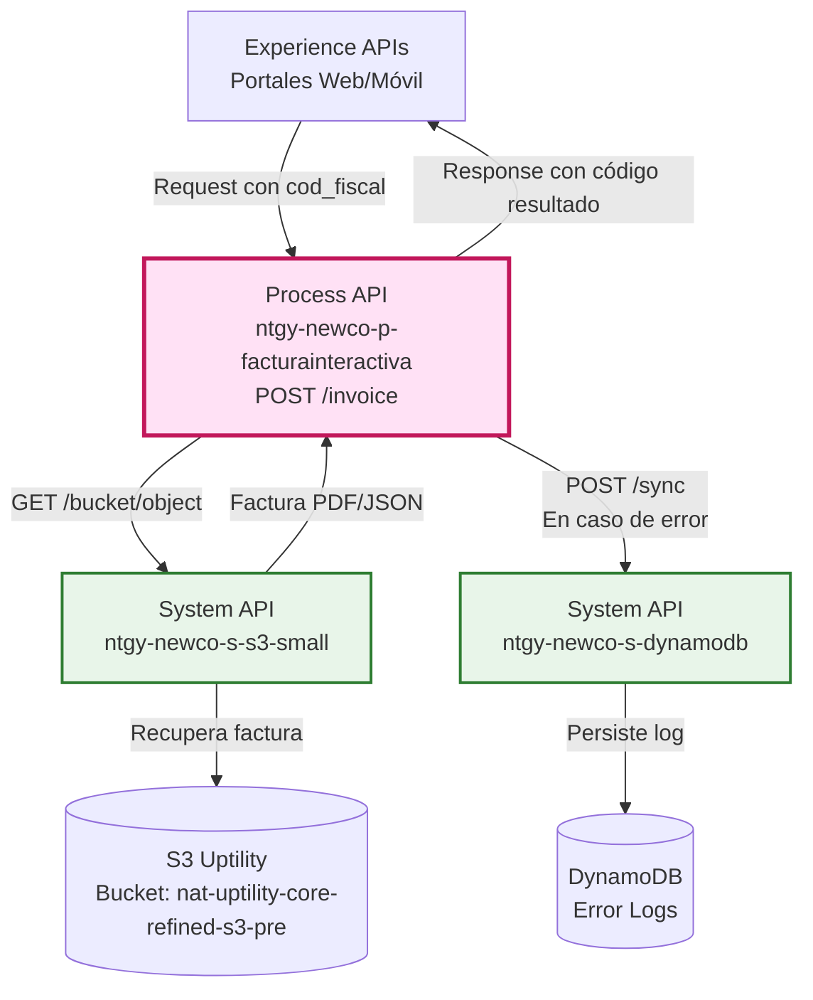
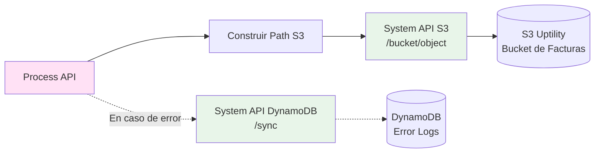
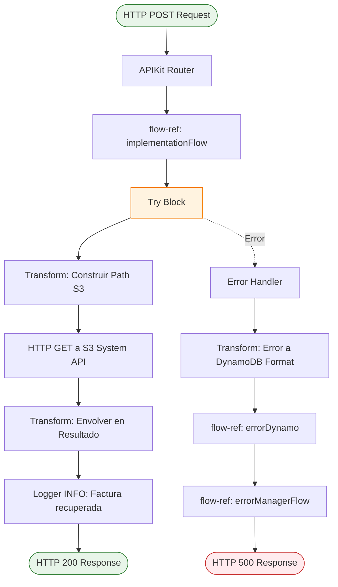
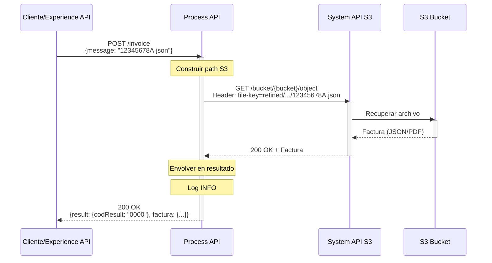
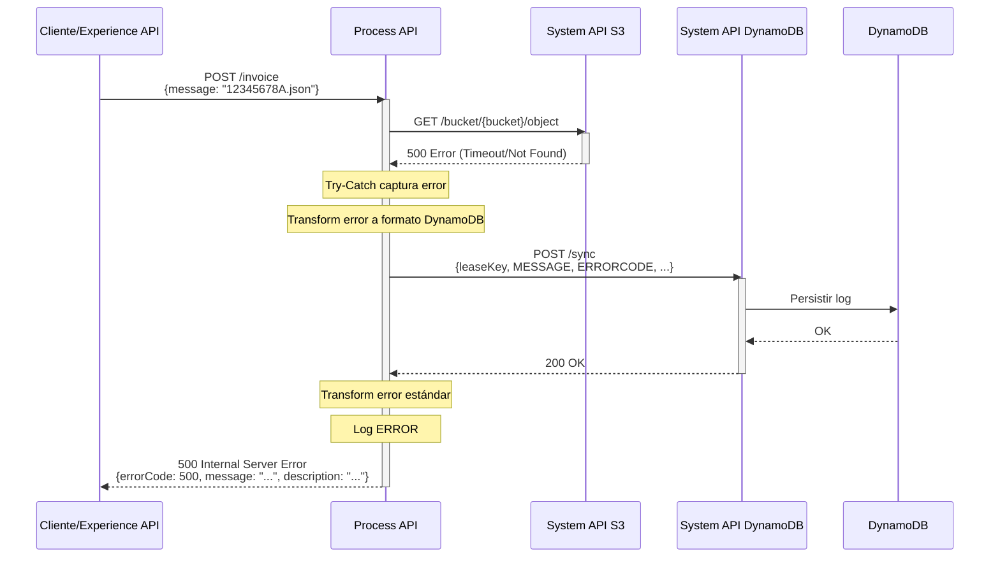
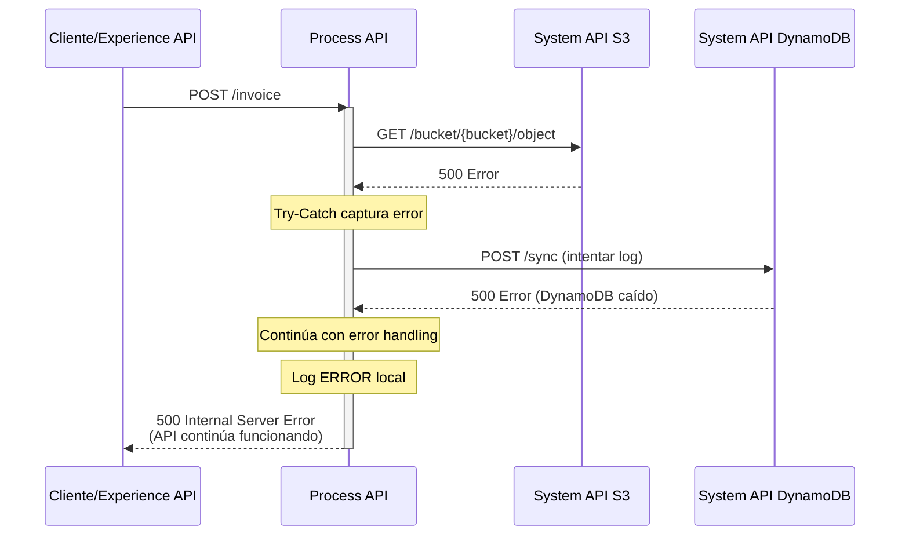

# POST /invoice

## 📌 Descripción General

### Propósito del Endpoint

Este endpoint recupera facturas almacenadas en S3 (Uptility) utilizando el código fiscal del cliente como identificador. Construye dinámicamente la ruta del archivo en S3 y retorna la factura en formato JSON o PDF.

### Tipo de API

**Capa:** Process API (API-Led Connectivity)

**Función:** Orquestación de acceso a facturas con construcción dinámica de rutas S3

### Patrón de Integración

**Tipo:** Request-Reply con Transformación

**Descripción:** Recibe identificador del cliente, construye path S3, recupera factura y transforma respuesta con código de resultado estándar.

### Arquitectura API-Led Connectivity



---

## 💼 Propósito del Negocio

### Casos de Uso Principales

1. **Consulta de Factura por Cliente**
   - Cliente accede a portal web/móvil
   - Solicita factura específica por código fiscal
   - Sistema recupera y muestra factura en tiempo real

2. **Descarga de Factura Histórica**
   - Cliente necesita factura para trámites administrativos
   - Proporciona código fiscal y rango de fechas
   - Sistema localiza y entrega factura en formato PDF/JSON

3. **Integración con Sistemas Externos**
   - Sistemas de terceros autorizados consultan facturas
   - Utilizan código fiscal como identificador único
   - Reciben factura para procesamiento automatizado

### 🔗 Endpoints Dependientes

Este Process API consume los siguientes System APIs:

| System API | Endpoint | Método | Propósito |
|------------|----------|--------|-----------|
| `ntgy-newco-s-s3-small` | `/bucket/{bucketName}/object` | GET | Recuperación de facturas desde S3 Uptility |
| `ntgy-newco-s-dynamodb` | `/sync` | POST | Persistencia de logs de error (solo en caso de fallo) |

### Lógica de Orquestación



**Pasos del Proceso:**

1. **Recepción de Request**: Process API recibe código fiscal del cliente
2. **Construcción de Path**: Genera ruta S3 dinámica: `refined/power/.../interactive_invoice/{cod_fiscal}.json`
3. **Llamada a S3**: HTTP GET a System API S3 con header `file-key`
4. **Transformación**: Envuelve factura en objeto con código de resultado estándar
5. **Logging**: Registra operación exitosa en logs INFO
6. **Error Handling**: Si falla, persiste error en DynamoDB y retorna error estándar

### Transformaciones Aplicadas

| Campo Original (S3) | Campo Transformado (Response) | Transformación |
|---------------------|-------------------------------|----------------|
| `payload` (factura raw) | `factura` | Envuelve en objeto con metadata |
| N/A | `result.codResult` | Genera código "0000" (éxito) |
| N/A | `result.msgResult` | Genera mensaje "No hay error" |

### Contexto Empresarial

- **Dominio:** Facturación Interactiva
- **Sector:** Energía - Utilities
- **División:** Naturgy España - NewCo
- **Proceso de Negocio:** Consulta y descarga de facturas por clientes

### Stakeholders

- **Clientes Finales**: Necesitan acceso rápido a sus facturas para consulta y descarga
- **Equipos de Atención al Cliente**: Requieren acceso a facturas para soporte
- **Sistemas de Terceros**: Integraciones autorizadas que procesan facturas

### Valor de Negocio

- **Acceso 24/7**: Clientes pueden consultar facturas en cualquier momento
- **Reducción de Llamadas**: Menos consultas al call center por facturas
- **Experiencia Digital**: Mejora satisfacción del cliente con acceso inmediato
- **Eficiencia Operativa**: Automatización de consultas reduce costes operativos

### Consumidores Potenciales

Este endpoint puede ser consumido por:
- Portales web de autoservicio de clientes
- Aplicaciones móviles de Naturgy
- Sistemas de agentes de call center
- Plataformas de terceros autorizados (gestorías, asesorías)

---

## 🔧 Especificación Técnica

### URLs por Ambiente

| Ambiente | URL Base | URL Completa |
|----------|----------|--------------|
| **Local** | `http://localhost:8081` | `http://localhost:8081/api/invoice` |
| **Development** | `https://ntgy-newco-p-facturainteractiva-dev.de-c1.cloudhub.io` | `https://ntgy-newco-p-facturainteractiva-dev.de-c1.cloudhub.io/api/invoice` |
| **UAT** | `https://ntgy-newco-p-facturainteractiva-uat00.de-c1.cloudhub.io` | `https://ntgy-newco-p-facturainteractiva-uat00.de-c1.cloudhub.io/api/invoice` |
| **Pre-Production** | `https://ntgy-newco-p-facturainteractiva-pre.de-c1.cloudhub.io` | `https://ntgy-newco-p-facturainteractiva-pre.de-c1.cloudhub.io/api/invoice` |
| **Production** | `https://ntgy-newco-p-facturainteractiva-pro.de-c1.cloudhub.io` | `https://ntgy-newco-p-facturainteractiva-pro.de-c1.cloudhub.io/api/invoice` |

### Método HTTP

```
POST /api/invoice
```

### Parámetros de Entrada

#### Request Body

**Content-Type:** `application/json`

```json
{
  "message": "string"
}
```

| Campo | Tipo | Obligatorio | Descripción | Ejemplo |
|-------|------|-------------|-------------|---------|
| `message` | string | Sí | Nombre del archivo de factura en S3 (incluye extensión .json o .pdf) | `"12345678A.json"` |

**Nota:** El campo `message` debe contener el código fiscal del cliente seguido de la extensión del archivo.

### Respuestas

#### 200 OK - Éxito

**Content-Type:** `application/json`

```json
{
  "result": {
    "codResult": "0000",
    "msgResult": "No hay error"
  },
  "factura": {
    // Contenido de la factura (estructura variable según formato)
  }
}
```

| Campo | Tipo | Descripción |
|-------|------|-------------|
| `result` | object | Objeto con información del resultado de la operación |
| `result.codResult` | string | Código de resultado ("0000" = éxito) |
| `result.msgResult` | string | Mensaje descriptivo del resultado |
| `factura` | object/string | Contenido de la factura recuperada de S3 |

#### 400 Bad Request - Error de Validación

```json
{
  "errorCode": 400,
  "message": "Bad request",
  "description": "Invalid request format"
}
```

#### 500 Internal Server Error - Error del Sistema

```json
{
  "errorCode": 500,
  "message": "Error al recuperar factura",
  "description": "Connection timeout to S3 service"
}
```

### Autenticación

- **Tipo:** Client ID & Client Secret (Anypoint Platform)
- **Headers requeridos:**
  - `client_id`: ID de la aplicación cliente
  - `client_secret`: Secret de la aplicación cliente

### Timeouts

| Tipo | Valor |
|------|-------|
| **Request Timeout** | 30 segundos |
| **Connection Timeout** | 10 segundos |

---

## 🏗️ Implementación Técnica

### Arquitectura del Flow



### Código de Implementación

**Ubicación:** `src/main/mule/implementation.xml` (líneas 12-38)

#### Sub-flow: implementationFlow

```xml
<sub-flow name="implementationFlow">
    <try>
        <!-- Llamada HTTP a S3 System API -->
        <http:request method="GET" 
                      config-ref="HTTP_Request_configuration_s3_small" 
                      path='#["/bucket/" ++ p("ntgy-newco-s-s3-small.bucket") ++ "/object"]'>
            <http:headers><![CDATA[#[output application/java
---
{
    "file-key" : "refined/power/OperationsSupportCapabilities/Operations/Billing/interactive_invoice/" ++ payload.message
}]]]></http:headers>
        </http:request>
        
        <!-- Transformación de respuesta -->
        <ee:transform>
            <ee:message>
                <ee:set-payload><![CDATA[%dw 2.0
output application/json
---
{
    "result": {
        "codResult": "0000",
        "msgResult": "No hay error"
    },
    "factura": payload
}]]></ee:set-payload>
            </ee:message>
        </ee:transform>
    </try>
    
    <!-- Logging de éxito -->
    <logger level="INFO" 
            message="Se ha recuperado el fichero del s3 de Uptility #[payload]" />
</sub-flow>
```

### Transformaciones DataWeave

#### 1. Construcción de Path S3

**Ubicación:** Inline en `<http:headers>` (línea 15-19)

```dataweave
%dw 2.0
output application/java
---
{
    "file-key" : "refined/power/OperationsSupportCapabilities/Operations/Billing/interactive_invoice/" ++ payload.message
}
```

**Propósito:** Construye el path completo del archivo en S3 concatenando el path base con el nombre del archivo.

**Ejemplo:**
- Input: `{ "message": "12345678A.json" }`
- Output: `{ "file-key": "refined/power/.../interactive_invoice/12345678A.json" }`

#### 2. Envolver Respuesta con Código de Resultado

**Ubicación:** Inline en `<ee:transform>` (líneas 21-34)

```dataweave
%dw 2.0
output application/json
---
{
    "result": {
        "codResult": "0000",
        "msgResult": "No hay error"
    },
    "factura": payload
}
```

**Propósito:** Envuelve la factura recuperada en un objeto estándar con código de resultado.

**Ejemplo:**
- Input: `{ "cliente": "Juan", "importe": 150.50 }` (factura de S3)
- Output: 
```json
{
    "result": {
        "codResult": "0000",
        "msgResult": "No hay error"
    },
    "factura": {
        "cliente": "Juan",
        "importe": 150.50
    }
}
```

### Patrones de Diseño

**Patrón:** Request-Reply con Try-Catch

**Justificación:** 
- Comunicación síncrona requerida para respuesta inmediata al cliente
- Try-catch protege contra fallos de S3 (timeouts, errores de red)
- Permite logging de errores en DynamoDB sin bloquear respuesta

### Diagramas de Secuencia

#### 1. Flujo Normal de Éxito



#### 2. Flujo con Error de S3



#### 3. Flujo con Error de DynamoDB (Degradación Graceful)



### Manejo de Errores

#### Estrategia de Error Handling

1. **Try-Catch en Sub-flow**
   - Protege llamada HTTP a S3
   - Captura timeouts, errores de red, errores 4xx/5xx

2. **Error Logging en DynamoDB**
   - Persiste metadata completa del error
   - Incluye: leaseKey, timestamp, interface, errorCode, errorMessage
   - Permite análisis post-mortem y troubleshooting

3. **Error Response Estándar**
   - Sub-flow `errorManagerFlow` transforma error a formato consistente
   - Incluye: errorCode, message, description
   - Logging ERROR en CloudHub

4. **Graceful Degradation**
   - Si DynamoDB falla, API continúa funcionando
   - Error se registra en logs de CloudHub
   - Cliente recibe respuesta de error estándar

#### Códigos de Error

| Código | Descripción | Causa Común |
|--------|-------------|-------------|
| 400 | Bad Request | Formato de request inválido, campo message faltante |
| 404 | Not Found | Factura no existe en S3 |
| 500 | Internal Server Error | Timeout de S3, error de red, error interno |

---

## 💻 Ejemplos de Uso

### Ejemplo 1: Recuperación Exitosa de Factura JSON

#### cURL

```bash
curl -X POST "https://ntgy-newco-p-facturainteractiva-dev.de-c1.cloudhub.io/api/invoice" \
  -H "Content-Type: application/json" \
  -H "client_id: YOUR_CLIENT_ID" \
  -H "client_secret: YOUR_CLIENT_SECRET" \
  -d '{
    "message": "12345678A.json"
  }'
```

#### Respuesta (200 OK)

```json
{
  "result": {
    "codResult": "0000",
    "msgResult": "No hay error"
  },
  "factura": {
    "numeroFactura": "FAC-2024-001234",
    "cliente": {
      "codigoFiscal": "12345678A",
      "nombre": "Juan Pérez García",
      "direccion": "Calle Mayor 123, Madrid"
    },
    "fechaEmision": "2024-01-15",
    "fechaVencimiento": "2024-02-15",
    "conceptos": [
      {
        "descripcion": "Consumo Electricidad",
        "cantidad": 350,
        "unidad": "kWh",
        "precioUnitario": 0.15,
        "importe": 52.50
      },
      {
        "descripcion": "Término Fijo",
        "importe": 25.00
      }
    ],
    "subtotal": 77.50,
    "iva": 16.28,
    "total": 93.78
  }
}
```

### Ejemplo 2: Recuperación de Factura PDF

#### JavaScript (Fetch API)

```javascript
const response = await fetch('https://ntgy-newco-p-facturainteractiva-dev.de-c1.cloudhub.io/api/invoice', {
  method: 'POST',
  headers: {
    'Content-Type': 'application/json',
    'client_id': 'YOUR_CLIENT_ID',
    'client_secret': 'YOUR_CLIENT_SECRET'
  },
  body: JSON.stringify({
    message: '87654321B.pdf'
  })
});

const data = await response.json();
console.log('Factura recuperada:', data.factura);
```

#### Respuesta (200 OK)

```json
{
  "result": {
    "codResult": "0000",
    "msgResult": "No hay error"
  },
  "factura": "JVBERi0xLjQKJeLjz9MKMyAwIG9iago8PC9UeXBlL1BhZ2UvUGFyZW50IDIgMCBSL1Jlc291cmNlczw8L0ZvbnQ8PC9GMSA1IDAgUj4+L1Byb2NTZXRbL1BERi9UZXh0L0ltYWdlQi9JbWFnZUMvSW1hZ2VJXT4+L01lZGlhQm94WzAgMCA1OTUuMzIgODQxLjkyXS9Db250ZW50cyA0IDAgUi9Hcm91cDw8L1R5cGUvR3JvdXAvUy9UcmFuc3BhcmVuY3kvQ1MvRGV2aWNlUkdCPj4vVGFicz..."
}
```

**Nota:** El campo `factura` contiene el PDF en formato Base64 cuando se solicita un archivo .pdf

### Ejemplo 3: Python con Requests

```python
import requests
import json

url = 'https://ntgy-newco-p-facturainteractiva-dev.de-c1.cloudhub.io/api/invoice'
headers = {
    'Content-Type': 'application/json',
    'client_id': 'YOUR_CLIENT_ID',
    'client_secret': 'YOUR_CLIENT_SECRET'
}
payload = {
    'message': '12345678A.json'
}

response = requests.post(url, headers=headers, json=payload)

if response.status_code == 200:
    data = response.json()
    print(f"Código resultado: {data['result']['codResult']}")
    print(f"Factura: {json.dumps(data['factura'], indent=2)}")
else:
    print(f"Error {response.status_code}: {response.text}")
```

### Ejemplo 4: Error - Factura No Encontrada

#### cURL

```bash
curl -X POST "https://ntgy-newco-p-facturainteractiva-dev.de-c1.cloudhub.io/api/invoice" \
  -H "Content-Type: application/json" \
  -H "client_id: YOUR_CLIENT_ID" \
  -H "client_secret: YOUR_CLIENT_SECRET" \
  -d '{
    "message": "99999999Z.json"
  }'
```

#### Respuesta (500 Internal Server Error)

```json
{
  "errorCode": 500,
  "message": "HTTP:NOT_FOUND",
  "description": "HTTP GET on resource 'https://ntgy-newco-s-s3-small-des-6laix2.internal-ccosup.irl-e1.cloudhub.io:443/api/bucket/nat-uptility-core-refined-s3-pre/object' failed: not found (404)."
}
```

### Ejemplo 5: Error - Request Inválido

#### cURL

```bash
curl -X POST "https://ntgy-newco-p-facturainteractiva-dev.de-c1.cloudhub.io/api/invoice" \
  -H "Content-Type: application/json" \
  -H "client_id: YOUR_CLIENT_ID" \
  -H "client_secret: YOUR_CLIENT_SECRET" \
  -d '{
    "invalidField": "value"
  }'
```

#### Respuesta (400 Bad Request)

```json
{
  "errorCode": 400,
  "message": "Bad request",
  "description": "Invalid request format: missing required field 'message'"
}