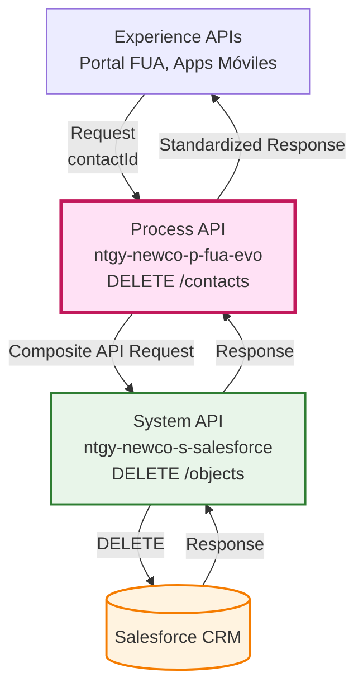
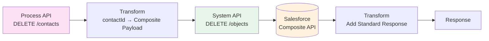
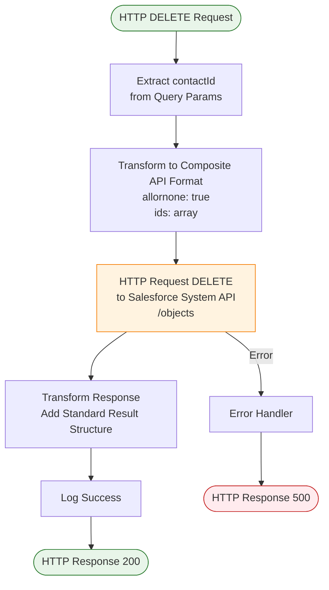
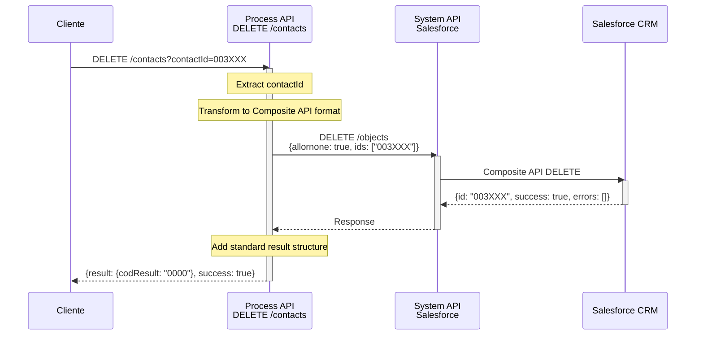
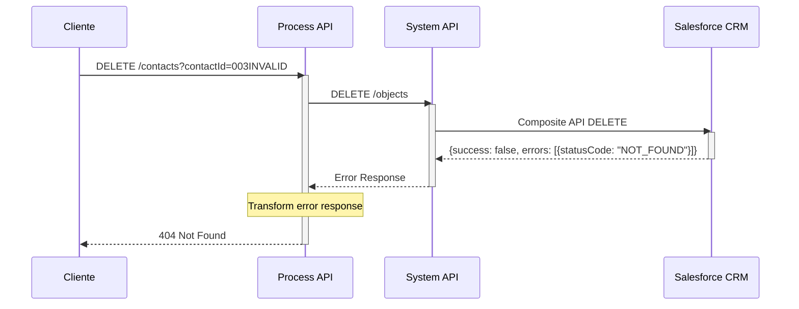
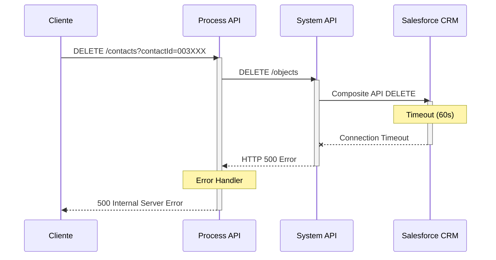

# DELETE /contacts

## 📌 Descripción General

### Propósito del Endpoint

Este endpoint orquesta la eliminación de un contacto en Salesforce utilizando el API Composite de Salesforce. Recibe el ID del contacto como parámetro de consulta, construye el payload requerido por Salesforce y ejecuta la operación de eliminación.

### Tipo de API

**Capa:** Process API (API-Led Connectivity)

**Función:** Orquestación de eliminación de contactos en Salesforce

### Patrón de Integración

**Tipo:** Orquestación con Transformación

**Descripción:** El endpoint transforma el parámetro de entrada en el formato requerido por el Salesforce Composite API, ejecuta la eliminación y estandariza la respuesta.

### Arquitectura API-Led Connectivity



---

## 💼 Propósito del Negocio

### Casos de Uso Principales

1. **Eliminación de Contactos Duplicados**
   - Permite eliminar contactos duplicados o erróneos del CRM
   - Mantiene la integridad de los datos de clientes

2. **Gestión de Datos de Clientes**
   - Facilita la limpieza de datos obsoletos
   - Cumple con requisitos de GDPR (derecho al olvido)

3. **Operaciones de Mantenimiento**
   - Permite a los administradores gestionar contactos
   - Soporta procesos de migración y consolidación de datos

### 🔗 Endpoints Dependientes

Este Process API consume el siguiente System API:

| System API | Endpoint | Método | Propósito |
|------------|----------|--------|-----------|
| `ntgy-newco-s-salesforce` | `/objects` | DELETE | Elimina registros usando Salesforce Composite API |

### Lógica de Orquestación



**Pasos del Proceso:**

1. **Extracción de Parámetros**: Extrae `contactId` del query parameter
2. **Transformación Request**: Construye payload Composite API con `allornone: true` y array de IDs
3. **Llamada a Salesforce**: Ejecuta DELETE en System API Salesforce
4. **Transformación Response**: Agrega estructura estándar de respuesta con código y mensaje
5. **Respuesta Final**: Retorna respuesta estandarizada al consumidor

### Transformaciones Aplicadas

#### Transformación de Request (DataWeave)

**Entrada:**
```dataweave
vars.contactId = "003XXXXXXXXXXXXXXX"
```

**Salida (Payload para Salesforce Composite API):**
```json
{
  "allornone": true,
  "ids": ["003XXXXXXXXXXXXXXX"]
}
```

#### Transformación de Response (DataWeave)

**Entrada (Response de Salesforce):**
```json
[
  {
    "id": "003XXXXXXXXXXXXXXX",
    "success": true,
    "errors": []
  }
]
```

**Salida (Response Estandarizada):**
```json
{
  "result": {
    "codResult": "0000",
    "msgResult": "No hay error"
  },
  "id": "003XXXXXXXXXXXXXXX",
  "success": true,
  "errors": []
}
```

### Contexto Empresarial

- **Dominio:** Gestión de Contactos CRM
- **Sector:** Energía - Utilities
- **División:** Naturgy España - NewCo
- **Proceso de Negocio:** Mantenimiento de datos de clientes en Salesforce

### Stakeholders

- **Administradores de CRM**: Necesitan eliminar contactos duplicados o erróneos
- **Equipo de Calidad de Datos**: Requieren herramientas para limpieza de datos
- **Compliance/Legal**: Necesitan cumplir con GDPR (derecho al olvido)

### Valor de Negocio

- **Integridad de Datos**: Mantiene la calidad de los datos de contactos en Salesforce
- **Cumplimiento Normativo**: Facilita el cumplimiento de GDPR
- **Eficiencia Operativa**: Automatiza la eliminación de contactos mediante API

### Consumidores Potenciales

Este endpoint puede ser consumido por:
- Portales de administración de CRM
- Herramientas de limpieza de datos
- Sistemas de gestión de compliance
- Aplicaciones de migración de datos

---

## 🔧 Especificación Técnica

### URLs por Ambiente

| Ambiente | URL Base | URL Completa |
|----------|----------|--------------|
| **Local** | `http://localhost:8081` | `http://localhost:8081/api/contacts?contactId={id}` |
| **Development** | `https://ntgy-newco-p-fua-evo-dev.us-e2.cloudhub.io` | `https://ntgy-newco-p-fua-evo-dev.us-e2.cloudhub.io/api/contacts?contactId={id}` |
| **UAT** | `https://ntgy-newco-p-fua-evo-uat.us-e2.cloudhub.io` | `https://ntgy-newco-p-fua-evo-uat.us-e2.cloudhub.io/api/contacts?contactId={id}` |
| **Production** | `https://ntgy-newco-p-fua-evo-pro.us-e2.cloudhub.io` | `https://ntgy-newco-p-fua-evo-pro.us-e2.cloudhub.io/api/contacts?contactId={id}` |

### Método HTTP

```
DELETE /api/contacts
```

### Parámetros de Entrada

#### Query Parameters

| Parámetro | Tipo | Requerido | Descripción | Ejemplo |
|-----------|------|-----------|-------------|---------|
| `contactId` | string | ✅ Sí | ID del contacto de Salesforce a eliminar (18 caracteres) | `003XXXXXXXXXXXXXXX` |

**Validaciones:**
- `contactId` debe ser un ID válido de Salesforce (formato: 003 + 15 caracteres)
- El contacto debe existir en Salesforce

### Respuestas

#### 200 OK - Eliminación Exitosa

```json
{
  "result": {
    "codResult": "0000",
    "msgResult": "No hay error"
  },
  "id": "003XXXXXXXXXXXXXXX",
  "success": true,
  "errors": []
}
```

**Campos de Respuesta:**

| Campo | Tipo | Descripción |
|-------|------|-------------|
| `result.codResult` | string | Código de resultado ("0000" = éxito) |
| `result.msgResult` | string | Mensaje descriptivo del resultado |
| `id` | string | ID del contacto eliminado |
| `success` | boolean | Indica si la operación fue exitosa |
| `errors` | array | Array de errores (vacío si success = true) |

#### 400 Bad Request - Parámetro Faltante

```json
{
  "code": "BAD_REQUEST",
  "message": "Missing required parameter: contactId"
}
```

#### 404 Not Found - Contacto No Existe

```json
{
  "result": {
    "codResult": "0001",
    "msgResult": "Contact not found"
  },
  "id": "003XXXXXXXXXXXXXXX",
  "success": false,
  "errors": [
    {
      "statusCode": "NOT_FOUND",
      "message": "The requested resource does not exist"
    }
  ]
}
```

#### 500 Internal Server Error

```json
{
  "code": "INTERNAL_ERROR",
  "message": "Error deleting contact from Salesforce",
  "details": "Connection timeout"
}
```

### Autenticación

- **Tipo:** Client ID & Client Secret (Anypoint Platform)
- **Headers Requeridos:**
  - `client_id`: Client ID de la aplicación
  - `client_secret`: Client Secret de la aplicación

### Timeouts

| Tipo | Valor |
|------|-------|
| **Request Timeout** | 60 segundos |
| **Connection Timeout** | 30 segundos |
| **Salesforce API Timeout** | 60 segundos |

### Rate Limiting

- **Salesforce API Limits:** Sujeto a los límites de API de Salesforce
- **Recomendación:** Implementar retry logic con exponential backoff

---

## 🏗️ Implementación Técnica

### Arquitectura del Flow



### Componentes del Flow

#### 1. Flow Principal (ntgy-newco-p-fua.xml - Líneas 229-237)

```xml
<flow name="delete:\contacts:ntgy-newco-p-fua-config">
    <ee:transform doc:name="Transform Message">
        <ee:message />
        <ee:variables>
            <ee:set-variable variableName="contactId">
                attributes.queryParams.'contactId'
            </ee:set-variable>
        </ee:variables>
    </ee:transform>
    <flow-ref doc:name="deleteRecordsSalesforce" 
              name="deleteRecordsSalesforce" />
</flow>
```

**Función:** Extrae el `contactId` del query parameter y lo almacena en una variable.

#### 2. Sub-flow de Eliminación (clients.xml - Líneas 103-135)

```xml
<sub-flow name="deleteRecordsSalesforce">
    <logger level="INFO" message="Inicio deleteRecordsSalesforce" />
    
    <!-- Transformación Request -->
    <ee:transform doc:name="Transform Message">
        <ee:message>
            <ee:set-payload><![CDATA[%dw 2.0
output application/json
---
{
    allornone: true,
    ids: [vars.contactId]
}]]></ee:set-payload>
        </ee:message>
    </ee:transform>
    
    <!-- Llamada a Salesforce -->
    <http:request method="DELETE"
                  doc:name="Request Salesforce"
                  config-ref="HTTP_Request_configuration_ntgy_newco_s_salesforce"
                  path="/objects" />
    
    <!-- Transformación Response -->
    <ee:transform doc:name="Transform Message">
        <ee:message>
            <ee:set-payload><![CDATA[%dw 2.0
output application/json
---
{
    "result": {
        "codResult": '0000',
        "msgResult": "No hay error"
    }
} ++ payload]]></ee:set-payload>
        </ee:message>
    </ee:transform>
    
    <logger level="INFO" message="Salida deleteRecordsSalesforce" />
</sub-flow>
```

**Función:** Ejecuta la lógica completa de eliminación con transformaciones.

### Transformaciones DataWeave

#### Transformación 1: Request a Salesforce Composite API

```dataweave
%dw 2.0
output application/json
---
{
    allornone: true,
    ids: [vars.contactId]
}
```

**Propósito:** Construye el payload requerido por Salesforce Composite API
- `allornone: true`: Si falla, revierte toda la operación
- `ids`: Array con el ID del contacto a eliminar

#### Transformación 2: Response Estandarizada

```dataweave
%dw 2.0
output application/json
---
{
    "result": {
        "codResult": '0000',
        "msgResult": "No hay error"
    }
} ++ payload
```

**Propósito:** Agrega estructura estándar de respuesta y combina con respuesta de Salesforce

**Operador `++`:** Merge de objetos (combina result con payload de Salesforce)

### Configuración HTTP

**Config-ref:** `HTTP_Request_configuration_ntgy_newco_s_salesforce`

**Configuración:**
- **Host:** System API Salesforce
- **Port:** 443 (HTTPS)
- **Base Path:** `/api/composite/sobjects`
- **Protocol:** HTTPS
- **Authentication:** OAuth 2.0 (gestionado por System API)

### Patrones de Diseño

**Patrón:** API Composition con Transformación

**Justificación:** 
- Abstrae la complejidad del Salesforce Composite API
- Estandariza la respuesta para consumidores
- Centraliza la lógica de eliminación de contactos

### Diagramas de Secuencia

#### 1. Flujo Normal de Éxito



#### 2. Flujo con Error - Contacto No Existe



#### 3. Flujo con Error Técnico - Timeout



### Manejo de Errores

**Estrategia:** Error handling delegado al error handler global del proyecto

**Tipos de Errores:**

1. **Errores de Validación (400)**
   - Parámetro `contactId` faltante
   - Formato de `contactId` inválido

2. **Errores de Negocio (404)**
   - Contacto no existe en Salesforce
   - Contacto ya fue eliminado

3. **Errores Técnicos (500)**
   - Timeout de conexión con Salesforce
   - Error de autenticación OAuth
   - Límites de API de Salesforce excedidos

**Logging:**
- Log de inicio: "Inicio deleteRecordsSalesforce"
- Log de salida: "Salida deleteRecordsSalesforce"
- Nivel: INFO

---

## 💻 Ejemplos de Uso

### Ejemplo 1: Eliminación Exitosa

#### cURL

```bash
curl -X DELETE "https://ntgy-newco-p-fua-evo-dev.us-e2.cloudhub.io/api/contacts?contactId=003XXXXXXXXXXXXXXX" \
  -H "Content-Type: application/json" \
  -H "client_id: YOUR_CLIENT_ID" \
  -H "client_secret: YOUR_CLIENT_SECRET"
```

#### Respuesta (200 OK)

```json
{
  "result": {
    "codResult": "0000",
    "msgResult": "No hay error"
  },
  "id": "003XXXXXXXXXXXXXXX",
  "success": true,
  "errors": []
}
```

### Ejemplo 2: JavaScript (Fetch API)

```javascript
const deleteContact = async (contactId) => {
  try {
    const response = await fetch(
      `https://ntgy-newco-p-fua-evo-dev.us-e2.cloudhub.io/api/contacts?contactId=${contactId}`,
      {
        method: 'DELETE',
        headers: {
          'Content-Type': 'application/json',
          'client_id': 'YOUR_CLIENT_ID',
          'client_secret': 'YOUR_CLIENT_SECRET'
        }
      }
    );

    if (!response.ok) {
      throw new Error(`HTTP error! status: ${response.status}`);
    }

    const data = await response.json();
    console.log('Contact deleted successfully:', data);
    return data;
  } catch (error) {
    console.error('Error deleting contact:', error);
    throw error;
  }
};

// Uso
deleteContact('003XXXXXXXXXXXXXXX')
  .then(result => console.log('Success:', result))
  .catch(error => console.error('Failed:', error));
```

### Ejemplo 3: Python (Requests)

```python
import requests

def delete_contact(contact_id, client_id, client_secret):
    """
    Elimina un contacto de Salesforce
    
    Args:
        contact_id (str): ID del contacto de Salesforce
        client_id (str): Client ID de Anypoint Platform
        client_secret (str): Client Secret de Anypoint Platform
    
    Returns:
        dict: Respuesta de la API
    """
    url = f'https://ntgy-newco-p-fua-evo-dev.us-e2.cloudhub.io/api/contacts'
    
    headers = {
        'Content-Type': 'application/json',
        'client_id': client_id,
        'client_secret': client_secret
    }
    
    params = {
        'contactId': contact_id
    }
    
    try:
        response = requests.delete(url, headers=headers, params=params, timeout=60)
        response.raise_for_status()
        
        result = response.json()
        print(f"Contact deleted successfully: {result}")
        return result
        
    except requests.exceptions.HTTPError as http_err:
        print(f"HTTP error occurred: {http_err}")
        print(f"Response: {response.text}")
        raise
    except requests.exceptions.Timeout:
        print("Request timed out")
        raise
    except Exception as err:
        print(f"An error occurred: {err}")
        raise

# Uso
if __name__ == "__main__":
    contact_id = "003XXXXXXXXXXXXXXX"
    client_id = "YOUR_CLIENT_ID"
    client_secret = "YOUR_CLIENT_SECRET"
    
    result = delete_contact(contact_id, client_id, client_secret)
```

### Ejemplo 4: Error - Contacto No Existe

#### cURL

```bash
curl -X DELETE "https://ntgy-newco-p-fua-evo-dev.us-e2.cloudhub.io/api/contacts?contactId=003INVALIDID000000" \
  -H "Content-Type: application/json" \
  -H "client_id: YOUR_CLIENT_ID" \
  -H "client_secret: YOUR_CLIENT_SECRET"
```

#### Respuesta (404 Not Found)

```json
{
  "result": {
    "codResult": "0001",
    "msgResult": "Contact not found"
  },
  "id": "003INVALIDID000000",
  "success": false,
  "errors": [
    {
      "statusCode": "NOT_FOUND",
      "message": "The requested resource does not exist",
      "fields": []
    }
  ]
}
```

### Ejemplo 5: Postman Collection

```json
{
  "info": {
    "name": "Delete Contact",
    "schema": "https://schema.getpostman.com/json/collection/v2.1.0/collection.json"
  },
  "item": [
    {
      "name": "Delete Contact - Success",
      "request": {
        "method": "DELETE",
        "header": [
          {
            "key": "Content-Type",
            "value": "application/json"
          },
          {
            "key": "client_id",
            "value": "{{client_id}}"
          },
          {
            "key": "client_secret",
            "value": "{{client_secret}}"
          }
        ],
        "url": {
          "raw": "{{base_url}}/api/contacts?contactId={{contact_id}}",
          "host": ["{{base_url}}"],
          "path": ["api", "contacts"],
          "query": [
            {
              "key": "contactId",
              "value": "{{contact_id}}"
            }
          ]
        }
      }
    }
  ]
}
```

### Consideraciones de Uso

1. **Validación Previa:**
   - Verificar que el contacto existe antes de intentar eliminarlo
   - Validar permisos del usuario para eliminar contactos

2. **Manejo de Errores:**
   - Implementar retry logic para errores transitorios (500, 503)
   - No reintentar en errores 400 o 404

3. **Logging y Auditoría:**
   - Registrar todas las eliminaciones para auditoría
   - Incluir información del usuario que ejecuta la eliminación

4. **Límites de API:**
   - Respetar los límites de API de Salesforce
   - Implementar rate limiting en el cliente

5. **Operación Irreversible:**
   - La eliminación es permanente (según configuración de Salesforce)
   - Considerar soft delete si se requiere recuperación