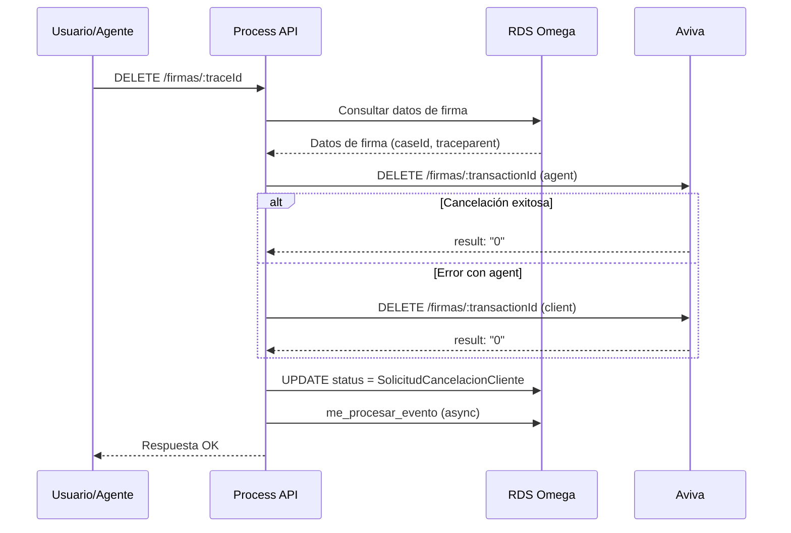
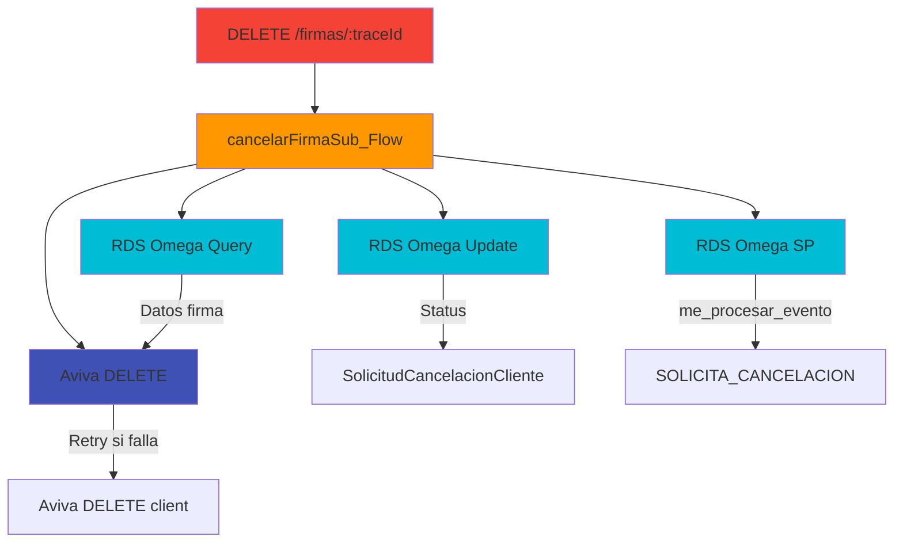
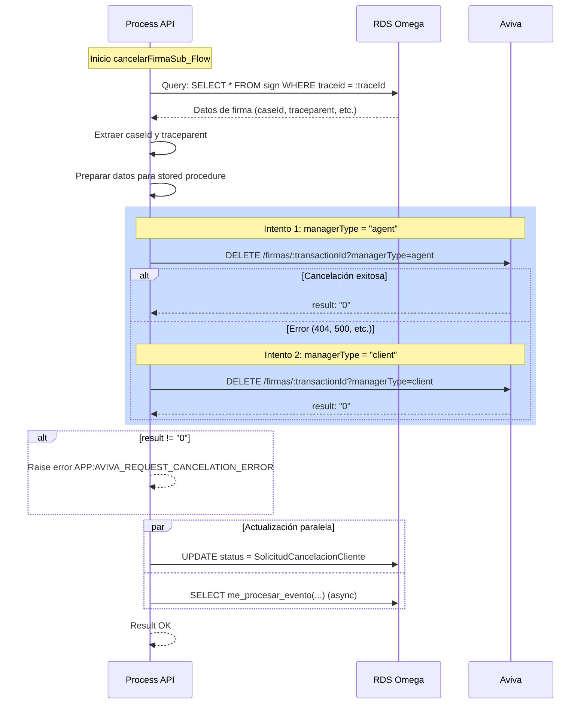

# DELETE /firmas/:traceId

## 📌 Descripción General

Endpoint que permite cancelar un proceso de firma digital en curso. Cancela la transacción en Aviva, actualiza el estado en la base de datos y registra el evento de cancelación mediante stored procedure en PostgreSQL.

### Características Principales

- **Cancelación en Aviva**: Elimina la transacción de firma pendiente
- **Actualización de Estado**: Marca la firma como "SolicitudCancelacionCliente"
- **Registro de Evento**: Ejecuta stored procedure `me_procesar_evento` con evento "SOLICITA_CANCELACION"
- **Retry Automático**: Si falla con managerType "agent", reintenta con "client"

### Casos de Uso

| Escenario | Descripción |
|-----------|-------------|
| **Cliente cancela** | Cliente decide no firmar el documento |
| **Agente cancela** | Agente de call center cancela por solicitud del cliente |
| **Error en proceso** | Se detecta un error y se debe cancelar la firma |
| **Timeout preventivo** | Se cancela antes de que expire automáticamente |

## 💼 Propósito del Negocio

### Problema que Resuelve

Permite a clientes y agentes cancelar procesos de firma que ya no son necesarios o que fueron iniciados por error, evitando confusión y mejorando la experiencia del usuario.

### Flujo de Negocio



### Beneficios del Negocio

- **Control del Cliente**: El cliente puede cancelar firmas que no desea completar
- **Flexibilidad**: Permite corregir errores sin esperar a que expire
- **Trazabilidad**: Registra la cancelación mediante stored procedure en PostgreSQL
- **Integridad de Datos**: Mantiene el estado consistente entre Aviva y la base de datos

## 🔧 Especificación Técnica

### Endpoint

```
DELETE /firmas/:traceId
```

### Path Parameters

| Parámetro | Tipo | Requerido | Descripción |
|-----------|------|-----------|-------------|
| `traceId` | string | Sí | Identificador único del proceso de firma a cancelar |

### Headers Requeridos

| Header | Tipo | Descripción |
|--------|------|-------------|
| `Content-Type` | string | `application/json` |
| `client_id` | string | Client ID de Anypoint Platform |
| `client_secret` | string | Client Secret de Anypoint Platform |

### Request Body

No requiere body.

### Response Body

#### Respuesta Exitosa (200)

```json
{
  "result": {
    "codResult": "0000",
    "msgResult": "No hay error"
  }
}
```

#### Respuesta de Error (400/500)

```json
{
  "code": "ERROR_CODE",
  "message": "Descripción del error",
  "details": "Detalles adicionales del error",
  "timestamp": "2026-09-02T15:37:00Z"
}
```

### Códigos de Estado HTTP

| Código | Descripción |
|--------|-------------|
| 200 | Firma cancelada correctamente |
| 400 | TraceId inválido o firma no encontrada |
| 500 | Error interno del servidor |

### Validaciones

1. **Existencia de Firma**: Verifica que el traceId exista en RDS
2. **Estado de Firma**: Valida que la firma esté en un estado cancelable
3. **Respuesta de Aviva**: Verifica que Aviva confirme la cancelación

## 🏗️ Implementación Técnica

### Arquitectura de Integración



### Flujo de Ejecución Detallado



### Integraciones Backend

#### 1. RDS Omega (ntgy-fua-s-rds-postgres) - Query

**Propósito**: Obtener datos del proceso de firma

**Operación**: Query en tabla `public.sign`

```sql
SELECT * FROM public.sign WHERE traceid = :traceId
```

**Datos Extraídos**:
- `caseid`: ID del caso en Salesforce
- `traceparent`: Trazabilidad del proceso
- `avivarequest`: Request original enviado a Aviva
- `processtype`: Tipo de proceso (CambioCuentaBancaria, etc.)
- `entrypayload`: Payload original del proceso

**Ubicación en código**: Líneas 99-110 de cancelarFirmaSub_Flow

#### 2. Aviva (ntgy-newco-s-aviva-evo) - Cancelación

**Propósito**: Cancelar la transacción de firma en Aviva

**Operación**: DELETE /firmas/:transactionId

**Query Parameters**:
```
managerType: "agent" | "client"
```

**Lógica de Retry**:
1. Primer intento con `managerType=agent`
2. Si falla, segundo intento con `managerType=client`
3. Si ambos fallan, lanza error

**Response Exitoso**:
```json
{
  "result": "0"
}
```

**Ubicación en código**: Líneas 127-149 de cancelarFirmaSub_Flow

#### 3. RDS Omega - Update

**Propósito**: Actualizar estado de la firma

**Operación**: UPDATE en tabla `public.sign`

```sql
UPDATE public.sign 
SET status = 'SolicitudCancelacionCliente', 
    updatedat = (current_timestamp AT TIME ZONE 'Europe/Madrid') 
WHERE traceid = :traceid
```

**Ubicación en código**: Líneas 156-169 de cancelarFirmaSub_Flow (vía actualizaStatusSub_Flow)

#### 4. RDS Omega - Stored Procedure (Motor de Estados)

**Propósito**: Registrar evento de cancelación en el Motor de Estados

**Operación**: Ejecución de stored procedure `public.me_procesar_evento`

**Evento**: SOLICITA_CANCELACION

**Llamada SQL**:
```sql
SELECT public.me_procesar_evento(
  :nif,
  :proceso,
  :billingAccount,
  'SOLICITA_CANCELACION',
  :contrato,
  :casoGestion,
  :eventvars,
  :eventTimeStamp,
  :idIntencion,
  :tipoContrato
)
```

**Ejecución**: Asíncrona mediante subflow `grabarIntencionMe_SubFlow` (no bloquea la respuesta)

**Ubicación en código**: 
- Subflow: `src/main/mule/common.xml` líneas 493-643
- Llamada: Líneas 1270-1286 de `cancelarFirmaSub_Flow`

### Transformaciones DataWeave Clave

#### 1. Extracción de traceId y managerType

**Propósito**: Preparar variables para el proceso

```dataweave
%dw 2.0
output application/json
---
// traceId
attributes.uriParams.'traceId'

// managerType
"agent"
```

**Ubicación**: Flow principal DELETE

### Manejo de Errores

**Errores Específicos**:

| Error Type | Descripción | Acción |
|------------|-------------|--------|
| `APP:AVIVA_REQUEST_CANCELATION_ERROR` | Error al cancelar en Aviva | Retorna 500 con detalles |
| Error en RDS Query | Firma no encontrada | Retorna 400 |
| Error en Stored Procedure | Fallo al ejecutar me_procesar_evento | No bloquea (async) |

**Error Handler**: `firmaSincrono-errorsError_Handler`

### Configuración de Timeouts

| Integración | Timeout |
|-------------|---------|
| RDS Omega (Query/Update) | 30s |
| RDS Omega (Stored Procedure) | 30s (async) |
| Aviva | 60s |

## 💻 Ejemplos de Uso

### Ejemplo 1: Cancelación Exitosa

#### Request

```bash
curl -X DELETE "https://ntgy-newco-p-fua-evo-dev.us-e2.cloudhub.io/api/firmas/abc123-def456-ghi789" \
  -H "Content-Type: application/json" \
  -H "client_id: YOUR_CLIENT_ID" \
  -H "client_secret: YOUR_CLIENT_SECRET"
```

#### Response (200 OK)

```json
{
  "result": {
    "codResult": "0000",
    "msgResult": "No hay error"
  }
}
```

### Ejemplo 2: JavaScript (Fetch API)

```javascript
const cancelarFirma = async (traceId) => {
  try {
    const response = await fetch(
      `https://ntgy-newco-p-fua-evo-dev.us-e2.cloudhub.io/api/firmas/${traceId}`,
      {
        method: 'DELETE',
        headers: {
          'Content-Type': 'application/json',
          'client_id': 'YOUR_CLIENT_ID',
          'client_secret': 'YOUR_CLIENT_SECRET'
        }
      }
    );

    if (!response.ok) {
      throw new Error(`HTTP error! status: ${response.status}`);
    }

    const data = await response.json();
    console.log('Firma cancelada:', data);
    return data;
  } catch (error) {
    console.error('Error al cancelar firma:', error);
    throw error;
  }
};

// Uso
cancelarFirma('abc123-def456-ghi789');
```

### Ejemplo 3: Python (Requests)

```python
import requests

def cancelar_firma(trace_id, client_id, client_secret):
    """
    Cancela un proceso de firma digital
    
    Args:
        trace_id: ID del proceso de firma
        client_id: Client ID de Anypoint
        client_secret: Client Secret de Anypoint
    
    Returns:
        dict: Respuesta del API
    """
    url = f"https://ntgy-newco-p-fua-evo-dev.us-e2.cloudhub.io/api/firmas/{trace_id}"
    
    headers = {
        'Content-Type': 'application/json',
        'client_id': client_id,
        'client_secret': client_secret
    }
    
    try:
        response = requests.delete(url, headers=headers, timeout=60)
        response.raise_for_status()
        return response.json()
    except requests.exceptions.HTTPError as e:
        print(f"Error HTTP: {e}")
        print(f"Respuesta: {e.response.text}")
        raise
    except requests.exceptions.RequestException as e:
        print(f"Error en la petición: {e}")
        raise

# Uso
result = cancelar_firma(
    trace_id='abc123-def456-ghi789',
    client_id='YOUR_CLIENT_ID',
    client_secret='YOUR_CLIENT_SECRET'
)
print(result)
```

### Ejemplo 4: Error - Firma No Encontrada

#### Request

```bash
curl -X DELETE "https://ntgy-newco-p-fua-evo-dev.us-e2.cloudhub.io/api/firmas/invalid-trace-id" \
  -H "Content-Type: application/json" \
  -H "client_id: YOUR_CLIENT_ID" \
  -H "client_secret: YOUR_CLIENT_SECRET"
```

#### Response (400 Bad Request)

```json
{
  "code": "APP:FIRMA_NOT_FOUND",
  "message": "No se encontró el proceso de firma",
  "details": "El traceId proporcionado no existe en la base de datos",
  "timestamp": "2026-09-02T15:37:00Z"
}
```

### Ejemplo 5: Error - Aviva No Responde

#### Request

```bash
curl -X DELETE "https://ntgy-newco-p-fua-evo-dev.us-e2.cloudhub.io/api/firmas/abc123-def456-ghi789" \
  -H "Content-Type": application/json" \
  -H "client_id: YOUR_CLIENT_ID" \
  -H "client_secret: YOUR_CLIENT_SECRET"
```

#### Response (500 Internal Server Error)

```json
{
  "code": "APP:AVIVA_REQUEST_CANCELATION_ERROR",
  "message": "Error al cancelar la firma en Aviva",
  "details": "Timeout al conectar con el servicio de firma digital",
  "timestamp": "2026-09-02T15:37:00Z"
}
```

### Ejemplo 6: Postman Collection

```json
{
  "info": {
    "name": "Cancelar Firma",
    "schema": "https://schema.getpostman.com/json/collection/v2.1.0/collection.json"
  },
  "item": [
    {
      "name": "Cancelar Firma",
      "request": {
        "method": "DELETE",
        "header": [
          {
            "key": "Content-Type",
            "value": "application/json"
          },
          {
            "key": "client_id",
            "value": "{{client_id}}"
          },
          {
            "key": "client_secret",
            "value": "{{client_secret}}"
          }
        ],
        "url": {
          "raw": "{{base_url}}/api/firmas/:traceId",
          "host": ["{{base_url}}"],
          "path": ["api", "firmas", ":traceId"],
          "variable": [
            {
              "key": "traceId",
              "value": "abc123-def456-ghi789"
            }
          ]
        }
      }
    }
  ]
}