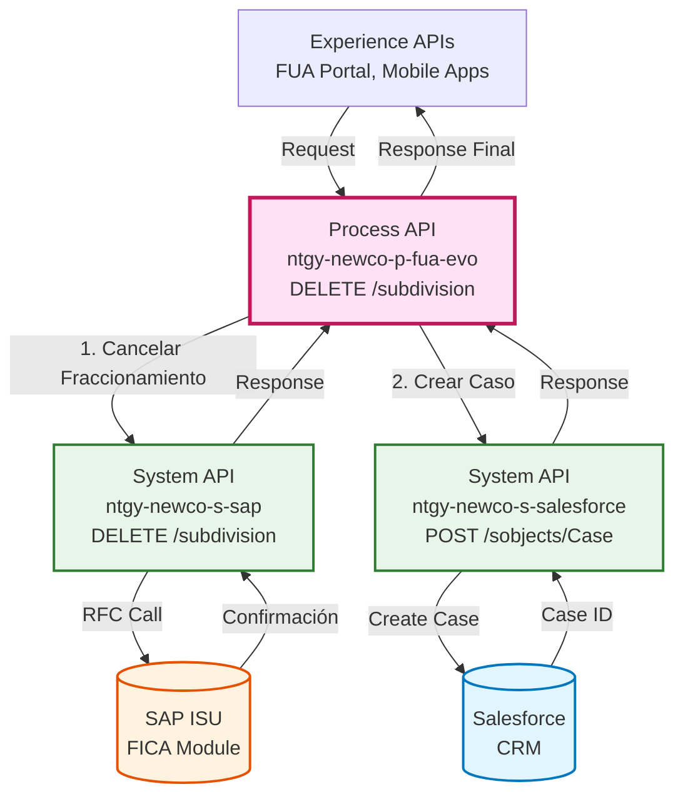
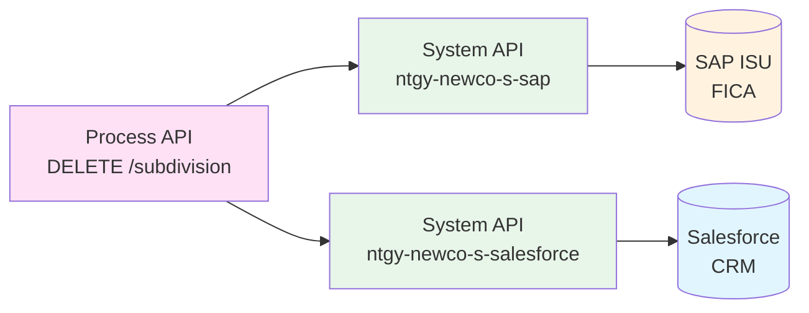
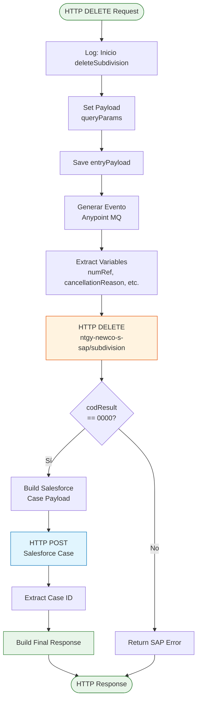
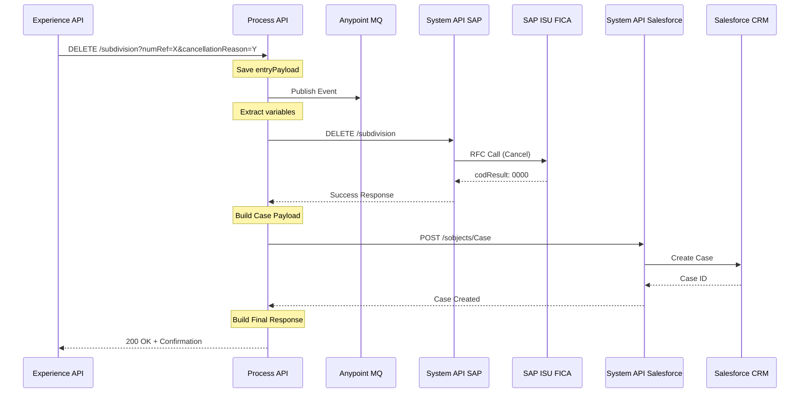
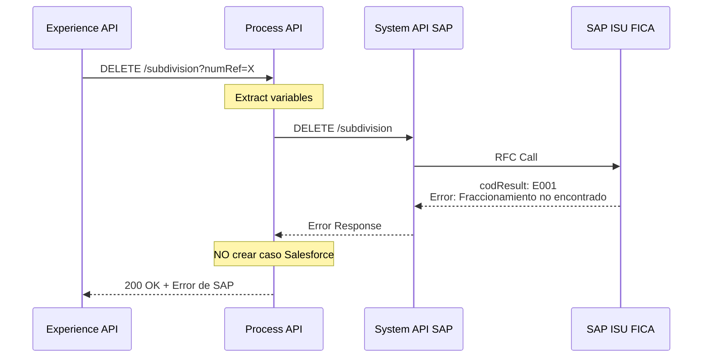
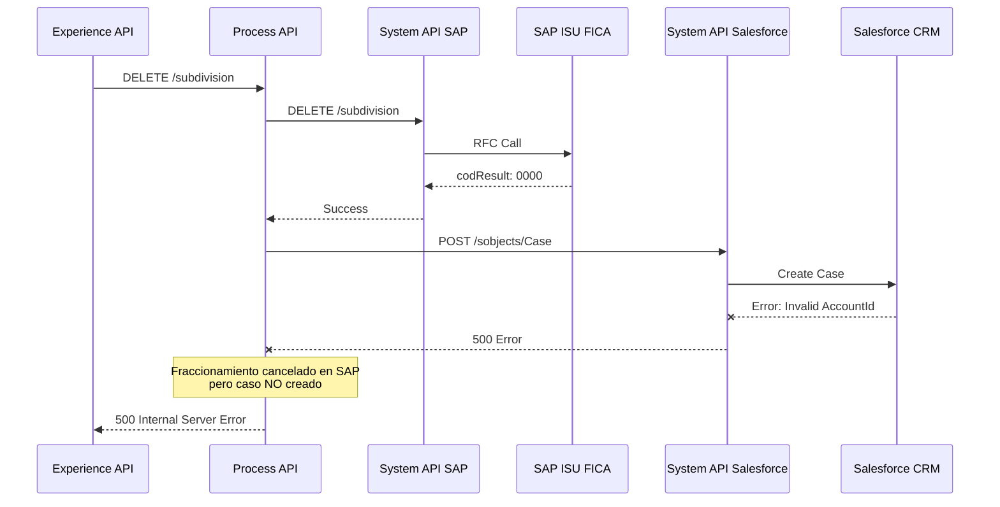

# DELETE /subdivision

## 📌 Descripción General

### Propósito del Endpoint

Este endpoint cancela un fraccionamiento de pago (plan de pago a plazos) existente en SAP ISU. Implementa un **patrón de orquestación secuencial** que primero cancela el fraccionamiento en SAP y, si es exitoso, crea automáticamente un caso de gestión en Salesforce para trazabilidad completa de la operación de cancelación.

### Tipo de API

**Capa:** Process API (API-Led Connectivity)

**Función:** Orquestación de cancelación de fraccionamiento con registro en CRM

### Patrón de Integración

**Tipo:** Orquestación Secuencial (SAP → Salesforce)

**Descripción:** Coordina la cancelación del fraccionamiento en el sistema de billing (SAP ISU) y el registro del caso de gestión en el CRM (Salesforce), garantizando trazabilidad end-to-end del proceso de cancelación.

### Arquitectura API-Led Connectivity



---

## 💼 Propósito del Negocio

### Casos de Uso Principales

1. **Cancelación por Solicitud del Cliente**
   - El cliente solicita cancelar su plan de pago desde el portal FUA
   - Prefiere pagar el saldo pendiente de una vez
   - **Beneficio:** Flexibilidad en la gestión de pagos

2. **Cancelación por Agente de Call Center**
   - El agente cancela un fraccionamiento a petición del cliente
   - Registra el motivo de cancelación para análisis
   - **Beneficio:** Mejor servicio al cliente y trazabilidad

3. **Cancelación por Incumplimiento**
   - El departamento de cobranza cancela fraccionamientos impagados
   - Aplica políticas de recuperación de deuda
   - **Beneficio:** Control de riesgo y gestión de morosidad

### 🔗 Endpoints Dependientes

Este Process API consume los siguientes System APIs:

| System API | Endpoint | Método | Propósito |
|------------|----------|--------|-----------|
| `ntgy-newco-s-sap` | `/subdivision` | DELETE | Cancela fraccionamiento en SAP ISU FICA |
| `ntgy-newco-s-salesforce` | `/sobjects/Case` | POST | Crea caso de gestión en Salesforce |

### Lógica de Orquestación



**Pasos del Proceso:**

1. **Paso 1**: Genera evento de trazabilidad (Anypoint MQ)
2. **Paso 2**: Extrae parámetros (numRef, cancellationReason)
3. **Paso 3**: Invoca SAP para cancelar el fraccionamiento
4. **Paso 4**: Si exitoso → Crea caso de gestión en Salesforce
5. **Paso 5**: Devuelve respuesta con resultado de cancelación

### Transformaciones Aplicadas

#### Transformación 1: Extracción de Query Parameters

| Parámetro Query | Variable | Descripción |
|-----------------|----------|-------------|
| `numRef` | `vars.numRef` | Referencia del fraccionamiento |
| `cancellationReason` | `vars.cancellationReason` | Motivo de cancelación |
| `x-client-id` | `vars.clientId` | ID del cliente |
| `x-contact-id` | `vars.preferredContactId` | ID del contacto |
| `x-user-id` | `vars.xUserId` | ID del usuario/agente |

#### Transformación 2: Creación de Caso Salesforce

**Mapeo de campos para caso de cancelación:**

| Campo Salesforce | Origen | Descripción |
|------------------|--------|-------------|
| `NewCo_Recordtype__c` | Constante: "Gestion" | Tipo de caso |
| `AccountId` | `queryParams.x-client-id` | ID del cliente |
| `ContactId` | `queryParams.x-contact-id` | ID del contacto |
| `Status` | Constante: "06" | Estado cerrado |
| `NewCo_Contract__c` | `queryParams.contractId` | ID del contrato |
| `Origin` | Constante: "FUA" | Canal de origen |
| `Description` | "Cancelación Fraccionamiento " + numRef | Descripción |
| `acn_fld_Tittle__r.NewCo_ExternalId__c` | "CancFraccionamiento" | Título del caso |

### Contexto Empresarial

- **Dominio:** Gestión de Pagos y Cobranza
- **Sector:** Energía - Utilities
- **División:** Naturgy España - NewCo
- **Proceso de Negocio:** Cancelación de Fraccionamientos de Pago (FICA)

### Stakeholders

- **Clientes Residenciales**: Cancelan planes de pago cuando pueden liquidar deuda
- **Agentes de Call Center**: Procesan cancelaciones a solicitud del cliente
- **Departamento de Cobranza**: Cancelan fraccionamientos por incumplimiento
- **Equipo de Auditoría**: Requieren trazabilidad de cancelaciones

### Valor de Negocio

- **Flexibilidad de Pago**: Cliente puede cambiar su estrategia de pago
- **Control de Riesgo**: Cancelación de fraccionamientos impagados
- **Trazabilidad Completa**: Registro en CRM con motivo de cancelación
- **Análisis de Comportamiento**: Datos para mejorar políticas de cobranza

### Consumidores Potenciales

Este endpoint puede ser consumido por:
- Portal web FUA
- Aplicaciones móviles de clientes
- Sistemas de agentes de call center
- Herramientas de gestión de cobranza

---

## 🔧 Especificación Técnica

### URLs por Ambiente

| Ambiente | URL Base | URL Completa |
|----------|----------|--------------|
| **Local** | `http://localhost:8081` | `http://localhost:8081/api/subdivision?numRef=:numRef&cancellationReason=:reason` |
| **Development** | `https://ntgy-newco-p-fua-evo-dev.us-e2.cloudhub.io` | `https://ntgy-newco-p-fua-evo-dev.us-e2.cloudhub.io/api/subdivision?numRef=:numRef&cancellationReason=:reason` |
| **UAT** | `https://ntgy-newco-p-fua-evo-uat.us-e2.cloudhub.io` | `https://ntgy-newco-p-fua-evo-uat.us-e2.cloudhub.io/api/subdivision?numRef=:numRef&cancellationReason=:reason` |
| **Production** | `https://ntgy-newco-p-fua-evo-pro.us-e2.cloudhub.io` | `https://ntgy-newco-p-fua-evo-pro.us-e2.cloudhub.io/api/subdivision?numRef=:numRef&cancellationReason=:reason` |

### Método HTTP

```
DELETE /api/subdivision
```

### Parámetros de Entrada

#### Query Parameters (Obligatorios)

| Parámetro | Tipo | Obligatorio | Descripción | Ejemplo |
|-----------|------|-------------|-------------|---------|
| `numRef` | string | ✅ Sí | Referencia del fraccionamiento a cancelar | `"1234567890"` |
| `cancellationReason` | string | ✅ Sí | Motivo de cancelación | `"CLIENTE_SOLICITA"` |

#### Query Parameters (Trazabilidad)

| Parámetro | Tipo | Obligatorio | Descripción | Ejemplo |
|-----------|------|-------------|-------------|---------|
| `x-client-id` | string | ✅ Sí | ID del cliente (Account) en Salesforce | `"0011w00000AbCdEFG"` |
| `x-contact-id` | string | ⚠️ Opcional | ID del contacto en Salesforce | `"0031w00000XyZaBC"` |
| `x-user-id` | string | ⚠️ Opcional | ID del usuario/agente | `"0051w00000PqRsT"` |
| `contractId` | string | ⚠️ Opcional | ID del contrato en Salesforce | `"8001w00000AbCdEFG"` |
| `x-interaction-id` | string | ⚠️ Opcional | ID del caso de interacción | `"5001w00000UvWxY"` |
| `x-agent-mail` | string | ⚠️ Opcional | Email del agente | `"agente@naturgy.com"` |

#### Motivos de Cancelación Comunes

| Código | Descripción | Uso |
|--------|-------------|-----|
| `CLIENTE_SOLICITA` | Cliente solicita cancelación | Autoservicio |
| `PAGO_TOTAL` | Cliente pagó el saldo completo | Liquidación anticipada |
| `INCUMPLIMIENTO` | Incumplimiento de pagos | Gestión de cobranza |
| `ERROR_DATOS` | Error en datos del fraccionamiento | Corrección administrativa |
| `CAMBIO_PLAN` | Cliente cambia a otro plan | Modificación de condiciones |

### Respuestas

#### 200 OK - Fraccionamiento Cancelado

**Descripción:** Fraccionamiento cancelado exitosamente en SAP y caso registrado en Salesforce

```json
{
  "result": {
    "codResult": "0000",
    "msgResult": "Fraccionamiento cancelado exitosamente"
  },
  "numRef": "1234567890"
}
```

#### 200 OK - Error de SAP

**Descripción:** SAP devolvió error al cancelar el fraccionamiento

```json
{
  "result": {
    "codResult": "E001",
    "msgResult": "Fraccionamiento no encontrado o ya cancelado"
  }
}
```

#### 400 Bad Request

**Descripción:** Parámetros faltantes o inválidos

```json
{
  "code": "BAD_REQUEST",
  "message": "Query parameter 'numRef' is required",
  "timestamp": "2026-08-26T12:00:00Z"
}
```

#### 500 Internal Server Error

**Descripción:** Error interno del servidor

```json
{
  "code": "INTERNAL_ERROR",
  "message": "Error al procesar la solicitud",
  "timestamp": "2026-08-26T12:00:00Z"
}
```

### Autenticación

- **Tipo:** Client ID & Client Secret (Anypoint Platform)
- **Headers requeridos:** `client_id`, `client_secret`

### Timeouts

| Tipo | Valor |
|------|-------|
| **Request Timeout (SAP)** | 30 segundos |
| **Request Timeout (Salesforce)** | 60 segundos |
| **Connection Timeout** | 10 segundos |

---

## 🏗️ Implementación Técnica

### Arquitectura del Flow



### Código del Flow (Simplificado)

**Archivo:** `src/main/mule/services/invoices/subdivision.xml`

**Subflow:** `deleteSubdivision`

```xml
<sub-flow name="deleteSubdivision">
    <logger level="INFO" message="Inicio deleteSubdivision: #[payload]"/>
    
    <!-- Establecer payload como queryParams -->
    <set-payload value="#[attributes.queryParams]"/>
    
    <!-- Guardar payload original -->
    <set-variable variableName="entryPayload" value="#[attributes.queryParams]"/>
    
    <!-- Generar evento de trazabilidad -->
    <flow-ref name="generarEventoFlow"/>
    
    <!-- Extraer variables -->
    <ee:transform>
        <ee:variables>
            <ee:set-variable variableName="DirIp">
                attributes.headers.'x-real-ip' default "0.0.0.0"
            </ee:set-variable>
            <ee:set-variable variableName="clientId">
                attributes.queryParams.'x-client-id'
            </ee:set-variable>
            <ee:set-variable variableName="preferredContactId">
                attributes.queryParams.'contactId' default ""
            </ee:set-variable>
            <ee:set-variable variableName="xUserId">
                attributes.queryParams.'x-user-id'
            </ee:set-variable>
        </ee:variables>
    </ee:transform>
    
    <!-- Llamada a SAP -->
    <http:request method="DELETE" 
                  config-ref="HTTP_Request_ntgy-newco-s-sap" 
                  path="${ntgy-newco-s-sap.functions.subdivision}">
        <http:query-params>
            cancellationReason: attributes.queryParams.'cancellationReason',
            opbel: attributes.queryParams.'numRef'
        </http:query-params>
    </http:request>
    
    <logger level="INFO" message="Respuesta SAP: #[payload]"/>
    
    <!-- Choice: ¿Éxito en SAP? -->
    <choice>
        <when expression='#[payload.result.codResult == "0000"]'>
            <!-- Crear caso en Salesforce -->
            <ee:transform>
                <ee:set-payload>
                    {
                      "allOrNone": true,
                      "compositeRequest": [{
                        "method": "POST",
                        "url": "/services/data/v52.0/sobjects/Case",
                        "referenceId": "refCaseGestion",
                        "body": {
                          "NewCo_Recordtype__c": "Gestion",
                          "AccountId": vars.entryPayload."x-client-id",
                          "ContactId": vars.entryPayload."x-contact-id",
                          "Status": "06",
                          "NewCo_Contract__c": vars.entryPayload.contractId,
                          "Origin": "FUA",
                          "Description": "Cancelación Fraccionamiento " ++ vars.entryPayload.numRef,
                          "NewCo_Creado_por__c": if (vars.entryPayload.'x-user-id' != null) 
                                                    vars.entryPayload.'x-user-id' 
                                                  else 
                                                    vars.entryPayload."x-contact-id",
                          "NewCo_Ip__c": vars.entryPayload.DirIp,
                          "acn_fld_Tittle__r": {
                            "NewCo_ExternalId__c": "CancFraccionamiento"
                          }
                        }
                      }]
                    }
                </ee:set-payload>
            </ee:transform>
            
            <http:request method="POST" 
                          config-ref="HTTP_Request_ntgy_newco_s_salesforce" 
                          path="${ntgy-newco-s-salesforce.pathCasos}">
                <http:headers>
                    username: vars.entryPayload.'x-agent-mail'
                </http:headers>
            </http:request>
            
            <!-- Extraer ID del caso -->
            <set-variable variableName="idCase" 
                          value='#[(payload.compositeResponse filter 
                                    ((item, index) -> item.referenceId == "refCaseGestion"))[0].body.id]'/>
            
            <!-- Respuesta final -->
            <ee:transform>
                <ee:set-payload>
                    {
                      "result": {
                        "codResult": payload.result.codResult,
                        "msgResult": payload.result.msgResult
                      },
                      "numRef": vars.numRef
                    }
                </ee:set-payload>
            </ee:transform>
        </when>
        <otherwise>
            <!-- Devolver error de SAP -->
            <ee:transform>
                <ee:set-payload>
                    payload
                </ee:set-payload>
            </ee:transform>
        </otherwise>
    </choice>
    
    <logger level="INFO" message="Respuesta final: #[payload]"/>
</sub-flow>
```

### Transformaciones DataWeave

#### Transformación 1: Extracción de Variables

**Ubicación:** Inline en flow (líneas 127-143)

```dataweave
%dw 2.0
output application/java
---
{
    DirIp: attributes.headers.'x-real-ip' default "0.0.0.0",
    clientId: attributes.queryParams.'x-client-id',
    preferredContactId: attributes.queryParams.'contactId' default "",
    xUserId: attributes.queryParams.'x-user-id'
}
```

#### Transformación 2: Query Parameters para SAP

**Ubicación:** Inline en flow (líneas 149-153)

```dataweave
%dw 2.0
output application/java
---
{
    cancellationReason: attributes.queryParams.'cancellationReason',
    opbel: attributes.queryParams.'numRef'
}
```

**Nota:** SAP usa `opbel` como nombre del parámetro para la referencia del fraccionamiento.

#### Transformación 3: Creación de Caso Salesforce

**Ubicación:** Inline en flow (líneas 161-197)

```dataweave
%dw 2.0
output application/json
---
{
  "allOrNone": true,
  "collateSubrequests": false,
  "compositeRequest": [
    {
      "method": "POST",
      "url": "/services/data/v52.0/sobjects/Case",
      "referenceId": "refCaseGestion",
      "body": {
        "NewCo_Recordtype__c": "Gestion",
        "AccountId": vars.entryPayload."x-client-id",
        "ContactId": vars.entryPayload."x-contact-id",
        "Status": "06",
        "NewCo_Contract__c": vars.entryPayload.contractId,
        "Origin": "FUA",
        ("OwnerId": vars.entryPayload."x-user-id") if (!isEmpty(vars.entryPayload."x-user-id")),
        "Description": "Cancelación Fraccionamiento " ++ vars.entryPayload.numRef,
        "NewCo_Creado_por__c": if (vars.entryPayload.'x-user-id' != null) 
                                  vars.entryPayload.'x-user-id' 
                                else 
                                  vars.entryPayload."x-contact-id",
        ("ParentId": vars.entryPayload."x-interaction-id") if (vars.entryPayload."x-interaction-id"?),
        "NewCo_Ip__c": vars.entryPayload.DirIp,
        "NewCo_CorrelationId__c": correlationId,
        "acn_fld_Tittle__r": {
          "NewCo_ExternalId__c": "CancFraccionamiento"
        },
        "NewCo_TraceId__c": splitBy(vars.entryPayload.traceparent, "-")[1]
      }
    }
  ]
}
```

**Campos Condicionales:**
- `OwnerId`: Solo si `x-user-id` no está vacío
- `ParentId`: Solo si existe `x-interaction-id`

#### Transformación 4: Respuesta Final

**Ubicación:** Inline en flow (líneas 203-213)

```dataweave
%dw 2.0
output application/json
---
if (payload.result.codResult == "0000") {
  result: {
    codResult: payload.result.codResult,
    msgResult: payload.result.msgResult
  },
  numRef: vars.numRef
}
else payload
```

### Patrones de Diseño

#### Patrón 1: Saga Pattern (Simplificado)

**Justificación:** Coordina transacciones distribuidas entre SAP y Salesforce

**Implementación:**
- Paso 1: Cancelar fraccionamiento en SAP (transacción principal)
- Paso 2: Si exitoso → Crear caso en Salesforce (registro de auditoría)
- No hay rollback automático (compensación manual si es necesario)

#### Patrón 2: Event Sourcing

**Justificación:** Trazabilidad completa del proceso de cancelación

**Implementación:**
- Genera evento al inicio (Anypoint MQ)
- Registra caso en Salesforce con motivo de cancelación
- Permite auditoría y análisis de patrones de cancelación

### Diagramas de Secuencia

#### 1. Flujo Normal de Éxito



#### 2. Flujo con Error de SAP



#### 3. Flujo con Error de Salesforce



**⚠️ Nota Importante:** Si Salesforce falla, el fraccionamiento YA está cancelado en SAP. Se requiere compensación manual o proceso de reconciliación.

### Manejo de Errores

#### Estrategia de Manejo

| Tipo de Error | Acción | Respuesta |
|---------------|--------|-----------|
| **Error de SAP (codResult != 0000)** | No crear caso Salesforce | 200 OK con error de SAP |
| **Error de Salesforce** | Propagar error | 500 Internal Server Error |
| **Parámetros faltantes** | Validación RAML | 400 Bad Request |
| **Timeout SAP** | Retry automático | 3 intentos con backoff |
| **Timeout Salesforce** | Retry automático | 3 intentos con backoff |

#### Códigos de Error SAP Comunes

| Código | Descripción | Acción Recomendada |
|--------|-------------|-------------------|
| `0000` | Éxito | Continuar con Salesforce |
| `E001` | Fraccionamiento no encontrado | Verificar numRef |
| `E002` | Fraccionamiento ya cancelado | Informar al usuario |
| `E003` | No se puede cancelar (cuotas pagadas) | Validar estado |
| `E004` | Error de sistema SAP | Reintentar más tarde |

---

## 💻 Ejemplos de Uso

### Ejemplo 1: Cancelación Exitosa

#### cURL

```bash
curl -X DELETE "https://ntgy-newco-p-fua-evo-dev.us-e2.cloudhub.io/api/subdivision?numRef=1234567890&cancellationReason=CLIENTE_SOLICITA&x-client-id=0011w00000AbCdEFG&x-contact-id=0031w00000XyZaBC&x-user-id=0051w00000PqRsT&contractId=8001w00000AbCdEFG" \
  -H "Content-Type: application/json" \
  -H "client_id: YOUR_CLIENT_ID" \
  -H "client_secret: YOUR_CLIENT_SECRET"
```

#### Respuesta (200 OK)

```json
{
  "result": {
    "codResult": "0000",
    "msgResult": "Fraccionamiento cancelado exitosamente"
  },
  "numRef": "1234567890"
}
```

**Interpretación:**
- `codResult: "0000"` → Cancelación exitosa
- Fraccionamiento cancelado en SAP
- Caso de gestión creado automáticamente en Salesforce

### Ejemplo 2: Error - Fraccionamiento No Encontrado

#### cURL

```bash
curl -X DELETE "https://ntgy-newco-p-fua-evo-dev.us-e2.cloudhub.io/api/subdivision?numRef=9999999999&cancellationReason=CLIENTE_SOLICITA&x-client-id=0011w00000AbCdEFG" \
  -H "Content-Type: application/json" \
  -H "client_id: YOUR_CLIENT_ID" \
  -H "client_secret: YOUR_CLIENT_SECRET"
```

#### Respuesta (200 OK - Error de Negocio)

```json
{
  "result": {
    "codResult": "E001",
    "msgResult": "Fraccionamiento no encontrado o ya cancelado previamente"
  }
}
```

**Interpretación:**
- `codResult: "E001"` → Error de negocio de SAP
- NO se crea caso en Salesforce (solo se crea si SAP tiene éxito)
- Verificar que el numRef sea correcto

### Ejemplo 3: JavaScript con Manejo de Errores

```javascript
async function cancelSubdivision(numRef, cancellationReason, traceabilityData) {
  try {
    const queryParams = new URLSearchParams({
      numRef: numRef,
      cancellationReason: cancellationReason,
      'x-client-id': traceabilityData.clientId,
      'x-contact-id': traceabilityData.contactId || '',
      'x-user-id': traceabilityData.userId || '',
      'contractId': traceabilityData.contractId || '',
      'x-interaction-id': traceabilityData.interactionId || '',
      'x-agent-mail': traceabilityData.agentMail || ''
    });

    const response = await fetch(
      `https://api.naturgy.com/subdivision?${queryParams}`,
      {
        method: 'DELETE',
        headers: {
          'Content-Type': 'application/json',
          'client_id': 'YOUR_CLIENT_ID',
          'client_secret': 'YOUR_CLIENT_SECRET'
        }
      }
    );

    const data = await response.json();

    // Verificar código de resultado
    if (data.result.codResult === '0000') {
      console.log('✅ Fraccionamiento cancelado exitosamente');
      console.log(`Referencia: ${data.numRef}`);
      return {
        success: true,
        numRef: data.numRef,
        message: data.result.msgResult
      };
    } else {
      console.warn('⚠️ Error de negocio:', data.result.msgResult);
      return {
        success: false,
        error: data.result.codResult,
        message: data.result.msgResult
      };
    }

  } catch (error) {
    console.error('❌ Error técnico:', error);
    throw error;
  }
}

// Uso
const result = await cancelSubdivision(
  '1234567890',
  'CLIENTE_SOLICITA',
  {
    clientId: '0011w00000AbCdEFG',
    contactId: '0031w00000XyZaBC',
    userId: '0051w00000PqRsT',
    contractId: '8001w00000AbCdEFG',
    interactionId: '5001w00000UvWxY',
    agentMail: 'agente@naturgy.com'
  }
);

if (result.success) {
  alert(`Fraccionamiento ${result.numRef} cancelado exitosamente`);
} else {
  alert(`No se pudo cancelar: ${result.message}`);
}
```

### Ejemplo 4: Python con Validación

```python
import requests
from typing import Dict, Optional
from enum import Enum

class CancellationReason(Enum):
    """Motivos de cancelación válidos"""
    CLIENTE_SOLICITA = "CLIENTE_SOLICITA"
    PAGO_TOTAL = "PAGO_TOTAL"
    INCUMPLIMIENTO = "INCUMPLIMIENTO"
    ERROR_DATOS = "ERROR_DATOS"
    CAMBIO_PLAN = "CAMBIO_PLAN"

def cancel_subdivision(
    num_ref: str,
    cancellation_reason: CancellationReason,
    client_id: str,
    contact_id: Optional[str] = None,
    user_id: Optional[str] = None,
    contract_id: Optional[str] = None,
    interaction_id: Optional[str] = None,
    agent_mail: Optional[str] = None
) -> Dict:
    """
    Cancela un fraccionamiento de pago en SAP ISU
    
    Args:
        num_ref: Referencia del fraccionamiento
        cancellation_reason: Motivo de cancelación (enum)
        client_id: ID del cliente en Salesforce
        contact_id: ID del contacto (opcional)
        user_id: ID del usuario/agente (opcional)
        contract_id: ID del contrato (opcional)
        interaction_id: ID del caso de interacción (opcional)
        agent_mail: Email del agente (opcional)
    
    Returns:
        Dict con resultado de la operación
    """
    url = "https://api.naturgy.com/subdivision"
    
    # Construir query parameters
    params = {
        'numRef': num_ref,
        'cancellationReason': cancellation_reason.value,
        'x-client-id': client_id
    }
    
    # Añadir parámetros opcionales
    if contact_id:
        params['x-contact-id'] = contact_id
    if user_id:
        params['x-user-id'] = user_id
    if contract_id:
        params['contractId'] = contract_id
    if interaction_id:
        params['x-interaction-id'] = interaction_id
    if agent_mail:
        params['x-agent-mail'] = agent_mail
    
    headers = {
        'Content-Type': 'application/json',
        'client_id': 'YOUR_CLIENT_ID',
        'client_secret': 'YOUR_CLIENT_SECRET'
    }
    
    try:
        response = requests.delete(url, params=params, headers=headers, timeout=60)
        response.raise_for_status()
        
        data = response.json()
        
        # Verificar resultado
        if data['result']['codResult'] == '0000':
            print(f"✅ Fraccionamiento {num_ref} cancelado")
            return {
                'success': True,
                'numRef': data['numRef'],
                'message': data['result']['msgResult']
            }
        else:
            print(f"⚠️ Error de negocio: {data['result']['msgResult']}")
            return {
                'success': False,
                'error': data['result']['codResult'],
                'message': data['result']['msgResult']
            }
            
    except requests.exceptions.RequestException as e:
        print(f"❌ Error técnico: {e}")
        raise

# Uso
result = cancel_subdivision(
    num_ref='1234567890',
    cancellation_reason=CancellationReason.CLIENTE_SOLICITA,
    client_id='0011w00000AbCdEFG',
    contact_id='0031w00000XyZaBC',
    user_id='0051w00000PqRsT',
    contract_id='8001w00000AbCdEFG',
    interaction_id='5001w00000UvWxY',
    agent_mail='agente@naturgy.com'
)

if result['success']:
    print(f"Fraccionamiento cancelado: {result['numRef']}")
else:
    print(f"Error: {result['message']}")
```

### Ejemplo 5: Error - Parámetros Faltantes

#### cURL

```bash
curl -X DELETE "https://ntgy-newco-p-fua-evo-dev.us-e2.cloudhub.io/api/subdivision?numRef=1234567890" \
  -H "Content-Type: application/json" \
  -H "client_id: YOUR_CLIENT_ID" \
  -H "client_secret: YOUR_CLIENT_SECRET"
```

#### Respuesta (400 Bad Request)

```json
{
  "code": "BAD_REQUEST",
  "message": "Required query parameter 'cancellationReason' is missing",
  "timestamp": "2026-08-26T12:00:00Z"
}
```
