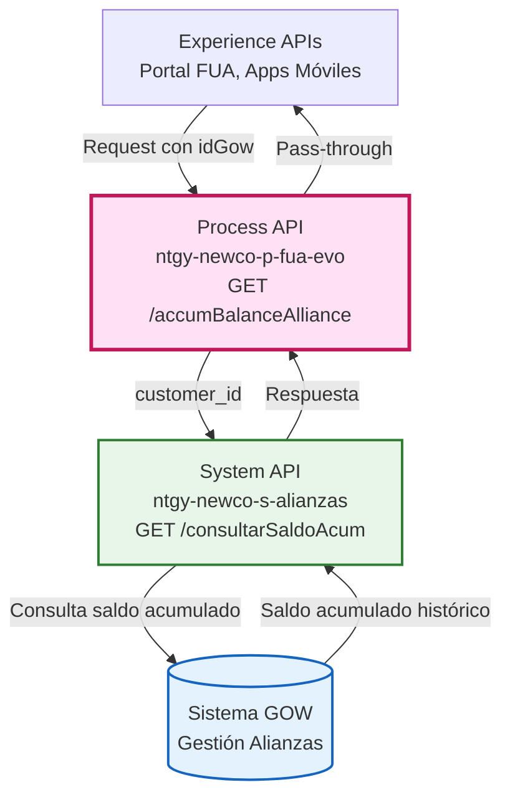
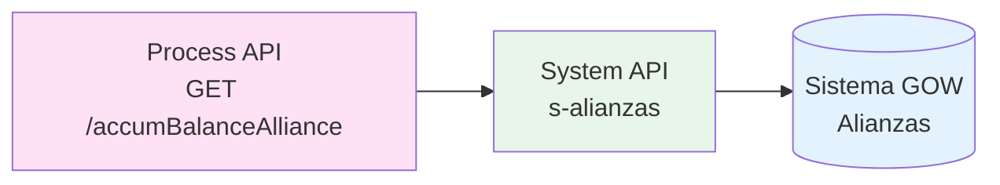
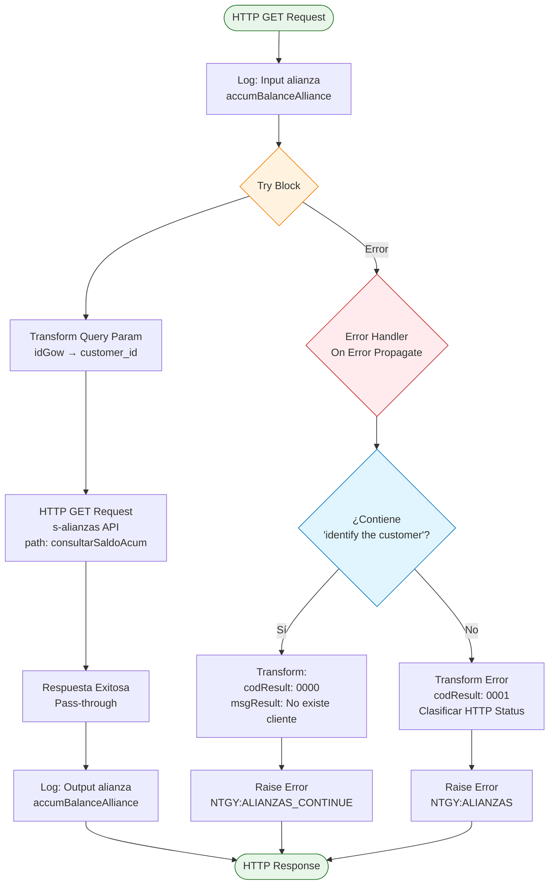
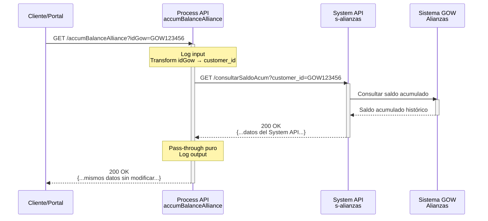
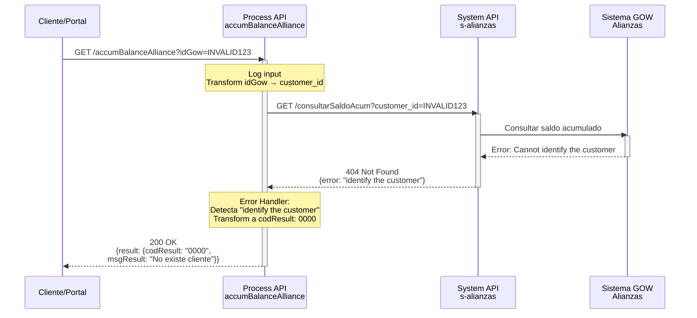
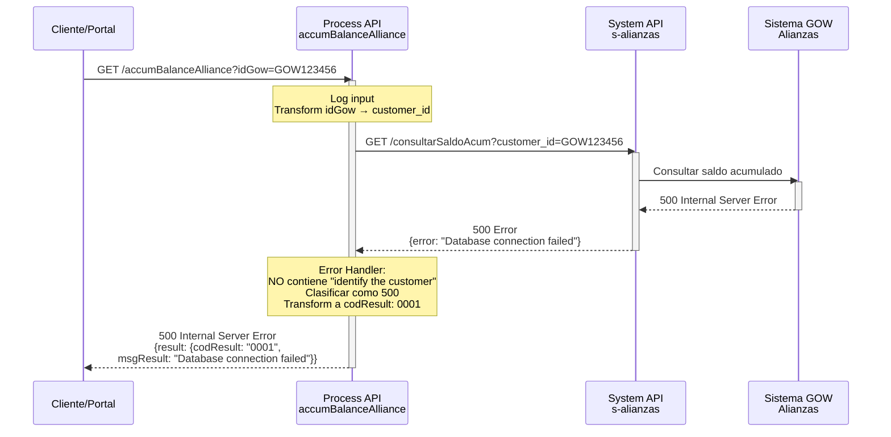

# GET /accumBalanceAlliance

## 📌 Descripción General

### Propósito del Endpoint

Este endpoint consulta el saldo **acumulado histórico** del cliente en el programa de alianzas o fidelización de Naturgy. A diferencia del endpoint `/balanceAlliance` que consulta el saldo actual, este endpoint proporciona información sobre el saldo acumulado a lo largo del tiempo en el sistema de alianzas (GOW - Gestión de Ofertas y Wallet), permitiendo visualizar el historial completo de puntos, créditos o beneficios acumulados.

### Tipo de API

**Capa:** Process API (API-Led Connectivity)

**Función:** Orquestación de consulta de saldo acumulado en sistema de alianzas

### Patrón de Integración

**Tipo:** Pass-Through con Manejo de Errores Especializado

**Descripción:** El endpoint actúa como proxy hacia el System API de alianzas, pero implementa una lógica sofisticada de manejo de errores que distingue entre "cliente no existe" (tratado como caso de negocio exitoso) y errores técnicos reales (propagados con clasificación HTTP). La respuesta del System API se retorna sin modificaciones (pass-through).

### Arquitectura API-Led Connectivity



---

## 💼 Propósito del Negocio

### Casos de Uso Principales

1. **Consulta de Historial de Acumulación**
   - Cliente accede al portal FUA para ver su historial de acumulación de puntos/créditos
   - El sistema muestra el saldo acumulado total a lo largo del tiempo
   - Permite al cliente entender su progreso en el programa de fidelización

2. **Análisis de Participación en Programas**
   - Visualización del total acumulado desde el inicio de participación
   - Seguimiento de la evolución del saldo a lo largo del tiempo
   - Identificación de períodos de mayor acumulación

3. **Validación de Beneficios Históricos**
   - Verificación del total de beneficios acumulados históricamente
   - Comparación entre saldo actual y saldo acumulado total
   - Auditoría de puntos canjeados vs acumulados

### 🔗 Endpoints Dependientes

Este Process API consume el siguiente System API:

| System API | Endpoint | Método | Propósito |
|------------|----------|--------|-----------|
| `ntgy-newco-s-alianzas` | `${s-alianzas.pathConsultarSaldoAcum}` | GET | Consulta saldo acumulado histórico en sistema GOW |

**Nota:** El path exacto se configura mediante property `s-alianzas.pathConsultarSaldoAcum` en archivos de configuración por ambiente.

### Lógica de Orquestación



**Pasos del Proceso:**

1. **Paso 1**: Recibe `idGow` del cliente como query parameter
2. **Paso 2**: Transforma `idGow` a `customer_id` para el System API
3. **Paso 3**: Invoca System API de alianzas (endpoint de saldo acumulado) con timeout configurado
4. **Paso 4**: Maneja respuesta o errores con lógica especializada

### Transformaciones Aplicadas

**Transformación de Request:**

| Campo de Entrada | Campo Transformado | Transformación |
|------------------|-------------------|----------------|
| `idGow` (query param) | `customer_id` (query param) | Renombrado del parámetro para el System API |

**Transformación de Response:**

⚠️ **Este Process API NO transforma la respuesta del System API.**

La respuesta del System API se retorna tal cual (pass-through), excepto en casos de error donde se aplica transformación de códigos de resultado.

Para el schema completo de la respuesta, consultar:
📖 **System API: `ntgy-newco-s-alianzas` endpoint de consulta de saldo acumulado**

### Contexto Empresarial

- **Dominio:** Programas de Fidelización y Alianzas
- **Sector:** Energía - Utilities
- **División:** Naturgy España - NewCo
- **Proceso de Negocio:** Gestión de historial de programas de lealtad y beneficios acumulados

### Stakeholders

- **Clientes Naturgy**: Necesitan consultar su historial de acumulación de puntos/beneficios
- **Equipo de Marketing**: Analiza participación histórica en programas de fidelización
- **Equipo de Desarrollo FUA**: Integra funcionalidad de historial de alianzas en el portal

### Valor de Negocio

- **Transparencia Histórica**: Cliente puede verificar su acumulación total desde el inicio
- **Análisis de Participación**: Permite evaluar el engagement del cliente a lo largo del tiempo
- **Auditoría**: Facilita la verificación de beneficios acumulados vs canjeados
- **Retención**: Muestra el valor total acumulado, incentivando la continuidad en el programa

### Consumidores Potenciales

Este endpoint puede ser consumido por:
- Portal web FUA
- Aplicaciones móviles de clientes
- Sistemas de agentes de call center
- Herramientas de análisis y reporting de marketing

---

## 🔧 Especificación Técnica

### URLs por Ambiente

| Ambiente | URL Base | URL Completa |
|----------|----------|--------------|
| **Local** | `http://localhost:8081` | `http://localhost:8081/api/accumBalanceAlliance?idGow={idGow}` |
| **Development** | `https://ntgy-newco-p-fua-evo-dev.us-e2.cloudhub.io` | `https://ntgy-newco-p-fua-evo-dev.us-e2.cloudhub.io/api/accumBalanceAlliance?idGow={idGow}` |
| **UAT** | `https://ntgy-newco-p-fua-evo-uat.us-e2.cloudhub.io` | `https://ntgy-newco-p-fua-evo-uat.us-e2.cloudhub.io/api/accumBalanceAlliance?idGow={idGow}` |
| **Production** | `https://ntgy-newco-p-fua-evo-pro.us-e2.cloudhub.io` | `https://ntgy-newco-p-fua-evo-pro.us-e2.cloudhub.io/api/accumBalanceAlliance?idGow={idGow}` |

### Método HTTP

```
GET /api/accumBalanceAlliance
```

### Parámetros de Entrada

#### Query Parameters

| Parámetro | Tipo | Requerido | Descripción | Ejemplo |
|-----------|------|-----------|-------------|---------|
| `idGow` | string | ✅ Sí | Identificador del cliente en el sistema GOW de alianzas | "GOW123456" |

**Validaciones:**
- El parámetro `idGow` es obligatorio
- Se transforma a `customer_id` para la llamada al System API

### Respuestas

#### 200 OK - Éxito (Pass-Through del System API)

⚠️ **IMPORTANTE:** Este Process API retorna la respuesta del System API `ntgy-newco-s-alianzas` sin modificaciones (pass-through).

La estructura exacta de la respuesta depende completamente del System API de alianzas. Para conocer el schema detallado, consultar:
📖 **Documentación del System API: `ntgy-newco-s-alianzas` - endpoint de saldo acumulado**

**Ejemplo ilustrativo** (la estructura real puede variar):

```json
{
  // Estructura definida por el System API s-alianzas
  // Consultar documentación del System API para detalles exactos
}
```

#### 200 OK - Cliente No Existe (Caso Especial)

```json
{
  "result": {
    "codResult": "0000",
    "msgResult": "No existe cliente"
  }
}
```

**Descripción:** Cuando el System API retorna error "identify the customer", se transforma en respuesta exitosa con código 0000 y mensaje "No existe cliente". Este es un caso de negocio válido, no un error técnico.

#### 400 Bad Request

```json
{
  "result": {
    "codResult": "0001",
    "msgResult": "Error message from System API or description"
  }
}
```

**Descripción:** Error de validación o parámetros incorrectos.

#### 401 Unauthorized

```json
{
  "result": {
    "codResult": "0001",
    "msgResult": "Authentication error"
  }
}
```

**Descripción:** Error de autenticación con el System API.

#### 404 Not Found

```json
{
  "result": {
    "codResult": "0001",
    "msgResult": "Resource not found"
  }
}
```

**Descripción:** Recurso no encontrado en el System API.

#### 500 Internal Server Error

```json
{
  "result": {
    "codResult": "0001",
    "msgResult": "Internal server error"
  }
}
```

**Descripción:** Error técnico en el System API o en la comunicación.

### Autenticación

- **Tipo:** Client ID & Client Secret (Anypoint Platform)
- **Headers requeridos:**
  - `client_id`: ID del cliente de la aplicación
  - `client_secret`: Secret del cliente de la aplicación

### Timeouts

| Tipo | Valor |
|------|-------|
| **Request Timeout** | Configurado en `${s-alianzas.timeout}` (property por ambiente) |
| **Connection Timeout** | 30 segundos (default) |

---

## 🏗️ Implementación Técnica

### Arquitectura del Flow



### Transformaciones DataWeave

#### 1. Transformación de Query Parameter

**Ubicación:** Inline en `<http:query-params>` del request

```dataweave
%dw 2.0
output application/java
---
{
	"customer_id": attributes.queryParams.'idGow'
}
```

**Descripción:** Transforma el parámetro `idGow` recibido en el request a `customer_id` esperado por el System API.

#### 2. Respuesta Exitosa (Pass-Through Puro)

⚠️ **IMPORTANTE:** NO hay transformación de la respuesta exitosa. El payload del System API se retorna tal cual.

**Código:** El subflow NO incluye un `<ee:transform>` al final, solo logs. El payload pasa directamente del System API al cliente.

#### 3. Transformación de Error - Cliente No Existe

**Ubicación:** Error handler, caso "identify the customer"

```dataweave
%dw 2.0
output application/json
---
{
	"result": {
		"codResult": "0000",
		"msgResult": "No existe cliente"
	}
}
```

**Descripción:** Transforma el error "identify the customer" en una respuesta exitosa con código 0000.

#### 4. Transformación de Error - Otros Errores

**Ubicación:** Error handler, caso otherwise

```dataweave
%dw 2.0
output application/json
---
{
	"result": {
		"codResult": "0001",
		"msgResult": if(error.errorMessage.payload.result.msgResult != null) 
		              error.errorMessage.payload.result.msgResult 
		            else 
		              error.description
	}
}
```

**Clasificación de HTTP Status:**

```dataweave
%dw 2.0
output application/java
---
if((error.errorMessage.payload.result.codResult contains ("400")) or (error.description contains ("400")))
	400
else if((error.errorMessage.payload.result.codResult contains ("401")) or (error.description contains ("401")))
	401
else if((error.errorMessage.payload.result.codResult contains ("403")) or (error.description contains ("403")))
	403
else if((error.errorMessage.payload.result.codResult contains ("404")) or (error.description contains ("404")))
	404
else
	500
```

**Descripción:** Clasifica el error según el código HTTP presente en el mensaje de error o descripción, asignando el status HTTP apropiado.

### Patrones de Diseño

**Patrón:** Pass-Through Puro con Error Handling Especializado

**Justificación:** 
- El endpoint NO transforma la respuesta del System API (pass-through puro)
- Sin embargo, requiere lógica sofisticada de manejo de errores
- Distingue entre casos de negocio (cliente no existe) y errores técnicos
- Clasifica errores HTTP para propagación correcta al consumidor

### Diagramas de Secuencia

#### 1. Flujo Normal de Éxito



#### 2. Flujo con Cliente No Existe (Caso Especial)



#### 3. Flujo con Error Técnico



### Manejo de Errores

**Estrategia:** On-Error-Propagate con Lógica Condicional

**Errores Manejados:**

1. **Cliente No Existe (Caso Especial)**
   - **Detección:** Error message contiene "identify the customer"
   - **Acción:** 
     - Transformar a respuesta exitosa (codResult: "0000")
     - Mensaje: "No existe cliente"
     - Raise error tipo: `NTGY:ALIANZAS_CONTINUE`
   - **Respuesta:** 200 OK con mensaje descriptivo
   - **Rationale:** Es un caso de negocio válido, no un error técnico

2. **Errores HTTP Clasificados**
   - **Detección:** Análisis del código o descripción del error
   - **Clasificación:**
     - 400: Bad Request (parámetros inválidos)
     - 401: Unauthorized (autenticación fallida)
     - 403: Forbidden (sin permisos)
     - 404: Not Found (recurso no encontrado)
     - 500: Internal Server Error (otros errores)
   - **Acción:**
     - Transformar a codResult: "0001"
     - Extraer mensaje de error del System API o usar descripción
     - Asignar httpStatus según clasificación
     - Raise error tipo: `NTGY:ALIANZAS`
   - **Respuesta:** HTTP status apropiado con mensaje de error

3. **Timeout del System API**
   - **Causa:** System API no responde dentro del timeout configurado
   - **Acción:** Clasificar como error 500
   - **Respuesta:** 500 Internal Server Error

**Logging:**
- Log de entrada con query params
- Log de salida con payload de respuesta
- Errores se propagan al error handler global

**Variables de Estado:**
- `httpStatus`: Variable que almacena el código HTTP a retornar

---

## 💻 Ejemplos de Uso

### Ejemplo 1: Consulta Exitosa

#### cURL

```bash
curl -X GET "https://ntgy-newco-p-fua-evo-dev.us-e2.cloudhub.io/api/accumBalanceAlliance?idGow=GOW123456" \
  -H "Content-Type: application/json" \
  -H "client_id: YOUR_CLIENT_ID" \
  -H "client_secret: YOUR_CLIENT_SECRET"
```

#### Respuesta (200 OK)

⚠️ **Nota:** La respuesta es pass-through del System API s-alianzas. La estructura exacta depende de ese System API.

```json
{
  // Respuesta del System API s-alianzas
  // Consultar documentación del System API para estructura exacta
}
```

### Ejemplo 2: Cliente No Existe

#### cURL

```bash
curl -X GET "https://ntgy-newco-p-fua-evo-dev.us-e2.cloudhub.io/api/accumBalanceAlliance?idGow=INVALID999" \
  -H "Content-Type: application/json" \
  -H "client_id: YOUR_CLIENT_ID" \
  -H "client_secret: YOUR_CLIENT_SECRET"
```

#### Respuesta (200 OK)

```json
{
  "result": {
    "codResult": "0000",
    "msgResult": "No existe cliente"
  }
}
```

### Ejemplo 3: JavaScript (Fetch API)

```javascript
const idGow = 'GOW123456';

const response = await fetch(
  `https://ntgy-newco-p-fua-evo-dev.us-e2.cloudhub.io/api/accumBalanceAlliance?idGow=${idGow}`,
  {
    method: 'GET',
    headers: {
      'Content-Type': 'application/json',
      'client_id': 'YOUR_CLIENT_ID',
      'client_secret': 'YOUR_CLIENT_SECRET'
    }
  }
);

const data = await response.json();

// La estructura de data depende del System API s-alianzas
// Verificar documentación del System API para campos disponibles
console.log('Respuesta del System API:', data);

// Ejemplo de manejo si el System API retorna estructura estándar:
if (data.result && data.result.codResult === '0000') {
  console.log('Consulta exitosa');
  // Procesar campos según estructura del System API
} else if (data.result && data.result.codResult === '0002') {
  console.log('Cliente no existe en el sistema de alianzas');
} else {
  console.error('Error en la consulta');
}
```

### Ejemplo 4: Python (Requests)

```python
import requests

id_gow = 'GOW123456'

response = requests.get(
    f'https://ntgy-newco-p-fua-evo-dev.us-e2.cloudhub.io/api/accumBalanceAlliance',
    params={'idGow': id_gow},
    headers={
        'Content-Type': 'application/json',
        'client_id': 'YOUR_CLIENT_ID',
        'client_secret': 'YOUR_CLIENT_SECRET'
    }
)

data = response.json()

# La estructura de data depende del System API s-alianzas
# Verificar documentación del System API para campos disponibles
print("Respuesta del System API:", data)

# Ejemplo de manejo si el System API retorna estructura estándar:
if 'result' in data and data['result']['codResult'] == '0000':
    print("Consulta exitosa")
    # Procesar campos según estructura del System API
elif 'result' in data and data['result']['codResult'] == '0002':
    print("Cliente no existe en el sistema de alianzas")
else:
    print("Error en la consulta")
```

### Ejemplo 5: Integración en Portal FUA

```javascript
// Función para obtener saldo acumulado de alianzas del cliente
async function getCustomerAccumulatedBalance(idGow) {
  try {
    const response = await fetch(
      `${API_BASE_URL}/api/accumBalanceAlliance?idGow=${idGow}`,
      {
        method: 'GET',
        headers: {
          'Content-Type': 'application/json',
          'client_id': CLIENT_ID,
          'client_secret': CLIENT_SECRET
        }
      }
    );

    if (!response.ok) {
      throw new Error(`HTTP error! status: ${response.status}`);
    }

    const data = await response.json();

    // La estructura de data depende del System API s-alianzas
    // Adaptar según la estructura real del System API
    
    // Ejemplo de manejo genérico:
    if (data.result && data.result.codResult === '0000') {
      // Consulta exitosa - procesar según estructura del System API
      return {
        success: true,
        data: data,
        message: 'Saldo acumulado consultado exitosamente'
      };
    } else if (data.result && data.result.codResult === '0002') {
      // Cliente no existe
      return {
        success: true,
        data: null,
        message: 'Cliente no registrado en programa de alianzas'
      };
    } else {
      // Error
      return {
        success: false,
        data: null,
        message: data.result ? data.result.msgResult : 'Error desconocido'
      };
    }
  } catch (error) {
    console.error('Error al consultar saldo acumulado de alianzas:', error);
    return {
      success: false,
      data: null,
      message: 'Error al consultar el saldo acumulado de alianzas'
    };
  }
}

// Uso en la aplicación
const result = await getCustomerAccumulatedBalance('GOW123456');

if (result.success && result.data) {
  // Mostrar datos según estructura del System API
  displayAccumulatedBalanceWidget(result.data);
} else if (result.success && !result.data) {
  // Mostrar mensaje de registro en programa
  showEnrollmentPrompt();
} else {
  // Mostrar mensaje de error
  showErrorMessage(result.message);
}
```

### Ejemplo 6: Comparación Saldo Actual vs Acumulado

```javascript
// Función para comparar saldo actual con saldo acumulado
async function compareBalances(idGow) {
  try {
    // Obtener saldo actual
    const currentBalanceResponse = await fetch(
      `${API_BASE_URL}/api/balanceAlliance?idGow=${idGow}`,
      {
        method: 'GET',
        headers: {
          'Content-Type': 'application/json',
          'client_id': CLIENT_ID,
          'client_secret': CLIENT_SECRET
        }
      }
    );

    // Obtener saldo acumulado
    const accumulatedBalanceResponse = await fetch(
      `${API_BASE_URL}/api/accumBalanceAlliance?idGow=${idGow}`,
      {
        method: 'GET',
        headers: {
          'Content-Type': 'application/json',
          'client_id': CLIENT_ID,
          'client_secret': CLIENT_SECRET
        }
      }
    );

    const currentData = await currentBalanceResponse.json();
    const accumulatedData = await accumulatedBalanceResponse.json();

    // Adaptar según estructura real del System API
    return {
      current: currentData,
      accumulated: accumulatedData,
      // Calcular diferencia si la estructura lo permite
      // redeemed: accumulated - current
    };
  } catch (error) {
    console.error('Error al comparar saldos:', error);
    return null;
  }
}

// Uso
const comparison = await compareBalances('GOW123456');
if (comparison) {
  console.log('Saldo actual:', comparison.current);
  console.log('Saldo acumulado:', comparison.accumulated);
  // Mostrar comparación en la UI
}