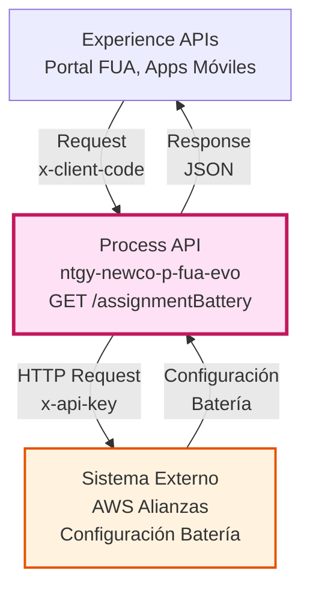
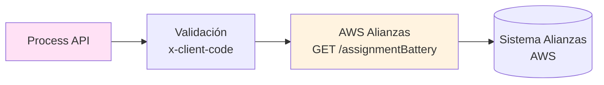
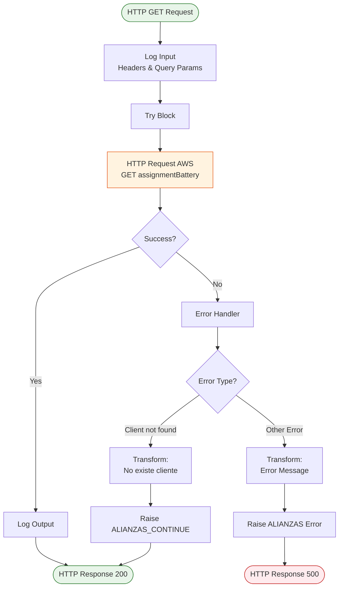
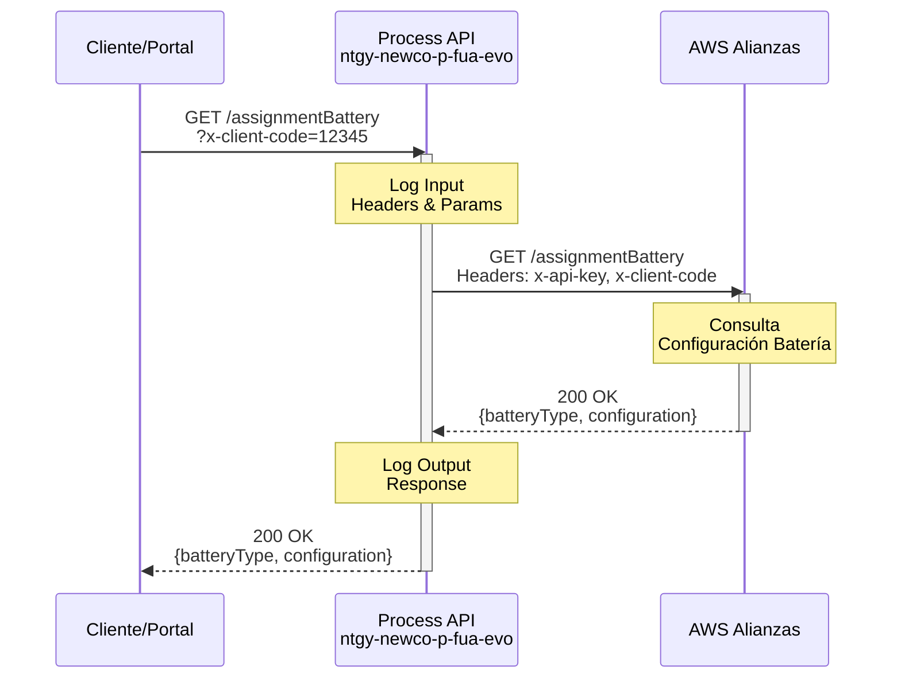
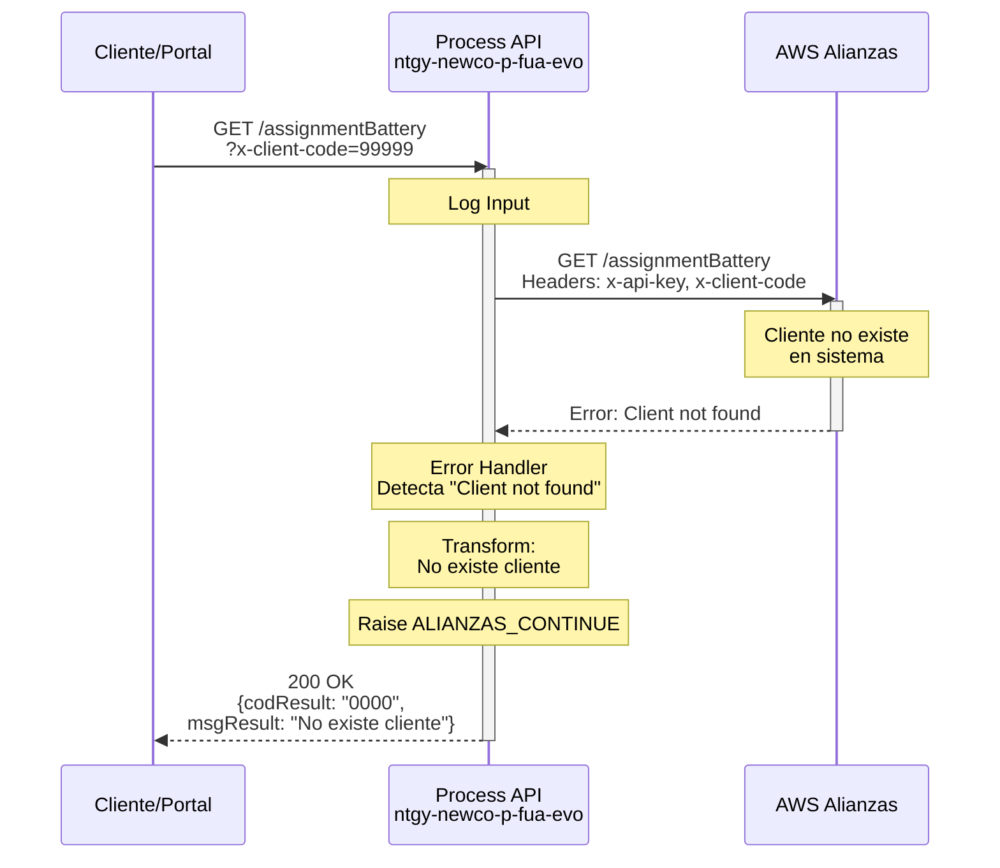
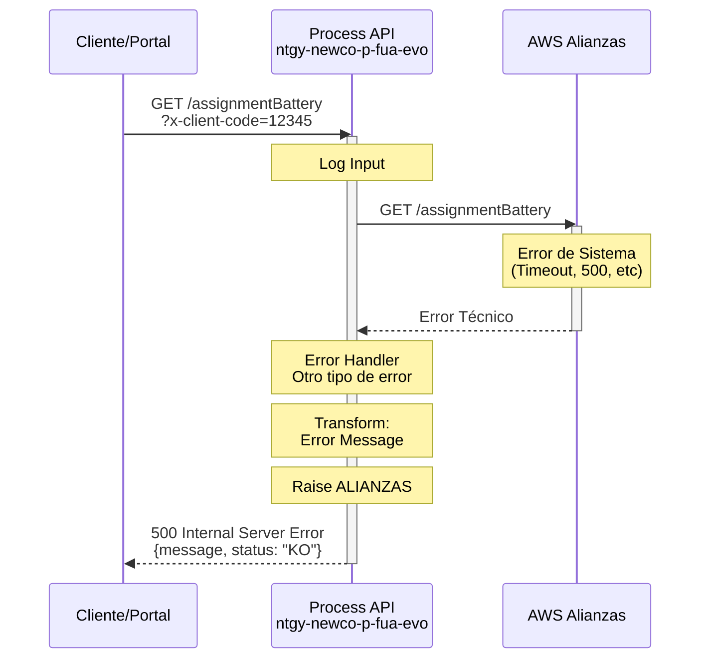

# GET /assignmentBattery

## 📌 Descripción General

### Propósito del Endpoint

Este endpoint consulta el tipo de configuración en batería asignada a un cliente específico desde el sistema de alianzas alojado en AWS. Actúa como un orquestador que valida la solicitud, realiza la llamada al sistema externo y maneja respuestas especiales para clientes no encontrados.

### Tipo de API

**Capa:** Process API (API-Led Connectivity)

**Función:** Orquestación de consulta de configuración de batería desde sistema de alianzas AWS

### Patrón de Integración

**Tipo:** Pass-Through con Manejo de Errores Especializado

**Descripción:** Este endpoint actúa como proxy hacia el sistema de alianzas en AWS, agregando autenticación mediante API Key y proporcionando un manejo especializado de errores, particularmente para el caso de clientes no encontrados que se trata como un flujo controlado en lugar de un error.

### Arquitectura API-Led Connectivity



---

## 💼 Propósito del Negocio

### Casos de Uso Principales

1. **Consulta de Configuración de Batería**
   - Permite conocer el tipo de configuración en batería asignada a un cliente
   - Facilita la gestión de alianzas y servicios complementarios
   - Beneficio: Información centralizada sobre configuraciones de batería

2. **Validación de Cliente en Sistema de Alianzas**
   - Verifica la existencia del cliente en el sistema de alianzas
   - Proporciona respuesta controlada para clientes no registrados
   - Beneficio: Evita errores en flujos posteriores al identificar clientes no existentes

3. **Integración con Portal de Autoservicio**
   - Permite a clientes consultar su configuración de batería
   - Facilita la gestión de servicios de alianzas
   - Beneficio: Transparencia en la información de servicios contratados

### 🔗 Endpoints Dependientes

Este Process API consume el siguiente sistema externo:

| Sistema | Endpoint | Método | Propósito |
|---------|----------|--------|-----------|
| `AWS Alianzas` | `${aws.alianzas.pathConsultaAsignacionBateria}` | GET | Consulta configuración de batería del cliente |

### Lógica de Orquestación



**Pasos del Proceso:**

1. **Validación de Entrada**: Verifica presencia de `x-client-code` en query params
2. **Autenticación AWS**: Agrega `x-api-key` en headers para autenticación
3. **Llamada HTTP**: Realiza request GET al sistema de alianzas en AWS
4. **Manejo Especializado**: Procesa respuesta o error "Client not found" de forma controlada

### Transformaciones Aplicadas

⚠️ **Este Process API NO transforma la respuesta del sistema AWS.**

La respuesta del sistema de alianzas se devuelve tal cual al consumidor, excepto en el caso de error "Client not found" que se transforma en:

```json
{
  "result": {
    "codResult": "0000",
    "msgResult": "No existe cliente"
  }
}
```

### Contexto Empresarial

- **Dominio:** Gestión de Alianzas y Servicios Complementarios
- **Sector:** Energía - Utilities
- **División:** Naturgy España - NewCo
- **Proceso de Negocio:** Consulta de configuración de servicios de batería

### Stakeholders

- **Clientes Naturgy**: Consultan su configuración de batería asignada
- **Agentes de Call Center**: Verifican configuraciones de batería de clientes
- **Sistema de Alianzas**: Proporciona información de configuraciones

### Valor de Negocio

- **Transparencia**: Clientes pueden conocer su configuración de batería
- **Eficiencia Operativa**: Reduce consultas al call center sobre configuraciones
- **Gestión de Alianzas**: Facilita la administración de servicios complementarios
- **Experiencia del Cliente**: Información disponible 24/7 en portal de autoservicio

### Consumidores Potenciales

Este endpoint puede ser consumido por:
- Portal web FUA
- Aplicaciones móviles de clientes
- Sistemas de agentes de call center
- Integraciones de terceros autorizados

---

## 🔧 Especificación Técnica

### URLs por Ambiente

| Ambiente | URL Base | URL Completa |
|----------|----------|--------------|
| **Local** | `http://localhost:8081` | `http://localhost:8081/api/assignmentBattery?x-client-code={clientCode}` |
| **Development** | `https://ntgy-newco-p-fua-evo-dev.us-e2.cloudhub.io` | `https://ntgy-newco-p-fua-evo-dev.us-e2.cloudhub.io/api/assignmentBattery?x-client-code={clientCode}` |
| **UAT** | `https://ntgy-newco-p-fua-evo-uat.us-e2.cloudhub.io` | `https://ntgy-newco-p-fua-evo-uat.us-e2.cloudhub.io/api/assignmentBattery?x-client-code={clientCode}` |
| **Production** | `https://ntgy-newco-p-fua-evo-pro.us-e2.cloudhub.io` | `https://ntgy-newco-p-fua-evo-pro.us-e2.cloudhub.io/api/assignmentBattery?x-client-code={clientCode}` |

### Método HTTP

```
GET /api/assignmentBattery
```

### Parámetros de Entrada

#### Query Parameters

| Parámetro | Tipo | Requerido | Descripción | Ejemplo |
|-----------|------|-----------|-------------|---------|
| `x-client-code` | String | ✅ Sí | Código único del cliente en el sistema | `"12345678"` |
| `year` | String | ❌ No | Año de consulta (registrado en logs, no enviado a backend) | `"2026"` |

**Nota:** El parámetro `year` se registra en los logs de entrada pero no se envía al sistema AWS de alianzas.

#### Headers

| Header | Tipo | Requerido | Descripción |
|--------|------|-----------|-------------|
| `client_id` | String | ✅ Sí | Client ID de Anypoint Platform |
| `client_secret` | String | ✅ Sí | Client Secret de Anypoint Platform |

### Respuestas

#### 200 OK - Configuración Encontrada

```json
{
  "batteryType": "TIPO_A",
  "configuration": {
    "capacity": "10kWh",
    "model": "Tesla Powerwall 2"
  },
  "assignmentDate": "2025-01-15",
  "status": "ACTIVE"
}
```

**Nota:** La estructura exacta depende de la respuesta del sistema AWS de alianzas.

#### 200 OK - Cliente No Encontrado (Respuesta Controlada)

```json
{
  "result": {
    "codResult": "0000",
    "msgResult": "No existe cliente"
  }
}
```

**Importante:** Este caso NO se considera un error HTTP. El endpoint devuelve 200 OK con un mensaje indicando que el cliente no existe en el sistema de alianzas.

#### 500 Internal Server Error - Error de Sistema

```json
{
  "message": "Error al consultar el sistema de alianzas",
  "status": "KO"
}
```

### Autenticación

- **Tipo:** Client ID & Client Secret (Anypoint Platform)
- **Backend AWS:** API Key (`x-api-key`) configurada en properties

### Timeouts

| Tipo | Valor |
|------|-------|
| **Request Timeout** | Configurado en `${aws.timeout}` |
| **Connection Timeout** | 10 segundos (default HTTP connector) |

---

## 🏗️ Implementación Técnica

### Arquitectura del Flow



### Componentes del Flow

#### 1. Subflow Principal: `alianzaAssignmentBattery`

**Ubicación:** `src/main/mule/services/alianzas/` (o archivo principal)

**Componentes:**

1. **Logger de Entrada** (línea 8-18)
   - Registra headers y query parameters
   - Formato: JSON con estructura clara

2. **Try Block** (línea 19-68)
   - Contiene la llamada HTTP y manejo de errores

3. **HTTP Request** (línea 20-28)
   - Config: `HTTP_Request__AWS`
   - Método: `${aws.alianzas.methodConsultaAsignacionBateria}`
   - Path: `${aws.alianzas.pathConsultaAsignacionBateria}`
   - Timeout: `${aws.timeout}`

4. **Error Handler** (línea 29-67)
   - Manejo especializado de errores

5. **Logger de Salida** (línea 69)
   - Registra respuesta del sistema AWS

### Configuración HTTP Request

```xml
<http:request 
    method="${aws.alianzas.methodConsultaAsignacionBateria}" 
    config-ref="HTTP_Request__AWS"
    path="${aws.alianzas.pathConsultaAsignacionBateria}" 
    responseTimeout="${aws.timeout}">
    <http:headers>
        {
            "x-api-key": p('aws.apiKey'),
            "x-client-code": attributes.queryParams.'x-client-code'
        }
    </http:headers>
</http:request>
```

**Headers Enviados:**
- `x-api-key`: API Key para autenticación en AWS (desde properties seguras)
- `x-client-code`: Código del cliente (desde query parameter)

### Transformaciones DataWeave

#### Transformación 1: Error "Cliente No Encontrado"

```dataweave
%dw 2.0
output application/json
---
{
    "result": {
        "codResult": "0000",
        "msgResult": "No existe cliente"
    }
}
```

**Condición:** `error.errorMessage.payload.error == "Client not found"`

**Acción:** Lanza error tipo `NTGY:ALIANZAS_CONTINUE` (error controlado)

#### Transformación 2: Error Genérico

```dataweave
%dw 2.0
import * from dw::core::Strings
output application/json
---
{
    "message": 
        if(error.errorMessage.payload != null)
            error.errorMessage.payload
        else if(substringAfterLast(error.description, "' ") != "") 
            substringAfterLast(error.description, "' ") 
        else if(error.description != null) 
            error.description 
        else 
            "Internal server error",
    "status": "KO"
}
```

**Lógica de Extracción de Mensaje:**
1. Intenta usar `error.errorMessage.payload`
2. Si no existe, extrae texto después de `' ` en `error.description`
3. Si no existe, usa `error.description` completo
4. Fallback: "Internal server error"

**Acción:** Lanza error tipo `NTGY:ALIANZAS`

### Patrones de Diseño

**Patrón:** Error Handler Especializado con Continuación Controlada

**Justificación:** 
- El caso "Cliente no encontrado" es un escenario de negocio válido, no un error técnico
- Se maneja como flujo controlado (`ALIANZAS_CONTINUE`) en lugar de error HTTP
- Permite a consumidores distinguir entre "cliente no existe" y "error de sistema"
- Mejora la experiencia del usuario al proporcionar mensajes claros

### Diagramas de Secuencia

#### 1. Flujo Normal de Éxito



#### 2. Flujo con Cliente No Encontrado



#### 3. Flujo con Error Técnico



### Manejo de Errores

#### Estrategia de Error Handling

**Dos Tipos de Errores:**

1. **Error Controlado: `NTGY:ALIANZAS_CONTINUE`**
   - **Condición:** `error.errorMessage.payload.error == "Client not found"`
   - **Respuesta:** 200 OK con mensaje "No existe cliente"
   - **Uso:** Indica que el cliente no está registrado en sistema de alianzas
   - **Propagación:** NO se propaga como error HTTP

2. **Error de Sistema: `NTGY:ALIANZAS`**
   - **Condición:** Cualquier otro error (timeout, 500, conexión, etc.)
   - **Respuesta:** 500 Internal Server Error
   - **Uso:** Errores técnicos o de sistema
   - **Propagación:** Se propaga como error HTTP 500

#### Códigos de Error

| Código | Tipo | Descripción | HTTP Status |
|--------|------|-------------|-------------|
| `0000` | Negocio | Cliente no existe en sistema de alianzas | 200 OK |
| `NTGY:ALIANZAS` | Técnico | Error al consultar sistema AWS | 500 |

### Logging

**Log de Entrada:**
```json
{
    "Headers historyBattery": {
        "x-client-code": "12345678"
    },
    "queryParams": {
        "year": "2026"
    }
}
```

**Log de Salida:**
```
Ouput alianza assignmentBattery: {payload}
```

---

## 💻 Ejemplos de Uso

### Ejemplo 1: Consulta Exitosa

#### cURL

```bash
curl -X GET "https://ntgy-newco-p-fua-evo-dev.us-e2.cloudhub.io/api/assignmentBattery?x-client-code=12345678" \
  -H "Content-Type: application/json" \
  -H "client_id: YOUR_CLIENT_ID" \
  -H "client_secret: YOUR_CLIENT_SECRET"
```

#### Respuesta (200 OK)

```json
{
  "batteryType": "TIPO_A",
  "configuration": {
    "capacity": "10kWh",
    "model": "Tesla Powerwall 2",
    "installationDate": "2025-01-15"
  },
  "assignmentDate": "2025-01-15",
  "status": "ACTIVE",
  "clientCode": "12345678"
}
```

### Ejemplo 2: Cliente No Encontrado

#### cURL

```bash
curl -X GET "https://ntgy-newco-p-fua-evo-dev.us-e2.cloudhub.io/api/assignmentBattery?x-client-code=99999999" \
  -H "Content-Type: application/json" \
  -H "client_id: YOUR_CLIENT_ID" \
  -H "client_secret: YOUR_CLIENT_SECRET"
```

#### Respuesta (200 OK - Respuesta Controlada)

```json
{
  "result": {
    "codResult": "0000",
    "msgResult": "No existe cliente"
  }
}
```

**Nota:** Este NO es un error HTTP. El endpoint devuelve 200 OK indicando que la consulta fue exitosa, pero el cliente no existe en el sistema de alianzas.

### Ejemplo 3: Error de Sistema

#### cURL

```bash
curl -X GET "https://ntgy-newco-p-fua-evo-dev.us-e2.cloudhub.io/api/assignmentBattery?x-client-code=12345678" \
  -H "Content-Type: application/json" \
  -H "client_id: YOUR_CLIENT_ID" \
  -H "client_secret: YOUR_CLIENT_SECRET"
```

#### Respuesta (500 Internal Server Error)

```json
{
  "message": "Connection timeout to AWS Alianzas system",
  "status": "KO"
}
```

### Ejemplo 4: JavaScript (Fetch API)

```javascript
const clientCode = '12345678';

const response = await fetch(
  `https://ntgy-newco-p-fua-evo-dev.us-e2.cloudhub.io/api/assignmentBattery?x-client-code=${clientCode}`,
  {
    method: 'GET',
    headers: {
      'Content-Type': 'application/json',
      'client_id': 'YOUR_CLIENT_ID',
      'client_secret': 'YOUR_CLIENT_SECRET'
    }
  }
);

const data = await response.json();

// Verificar si es respuesta de "cliente no encontrado"
if (data.result && data.result.codResult === '0000') {
  console.log('Cliente no existe en sistema de alianzas');
} else {
  console.log('Configuración de batería:', data);
}
```

### Ejemplo 5: Python (Requests)

```python
import requests

client_code = '12345678'
url = f'https://ntgy-newco-p-fua-evo-dev.us-e2.cloudhub.io/api/assignmentBattery'

params = {
    'x-client-code': client_code
}

headers = {
    'Content-Type': 'application/json',
    'client_id': 'YOUR_CLIENT_ID',
    'client_secret': 'YOUR_CLIENT_SECRET'
}

response = requests.get(url, params=params, headers=headers)

if response.status_code == 200:
    data = response.json()
    
    # Verificar si es respuesta de "cliente no encontrado"
    if 'result' in data and data['result'].get('codResult') == '0000':
        print('Cliente no existe en sistema de alianzas')
    else:
        print('Configuración de batería:', data)
else:
    print(f'Error: {response.status_code}')
    print(response.json())
```

### Ejemplo 6: Postman Collection

```json
{
  "info": {
    "name": "GET /assignmentBattery",
    "schema": "https://schema.getpostman.com/json/collection/v2.1.0/collection.json"
  },
  "item": [
    {
      "name": "Consulta Configuración Batería",
      "request": {
        "method": "GET",
        "header": [
          {
            "key": "Content-Type",
            "value": "application/json"
          },
          {
            "key": "client_id",
            "value": "{{client_id}}"
          },
          {
            "key": "client_secret",
            "value": "{{client_secret}}"
          }
        ],
        "url": {
          "raw": "{{base_url}}/api/assignmentBattery?x-client-code={{client_code}}",
          "host": ["{{base_url}}"],
          "path": ["api", "assignmentBattery"],
          "query": [
            {
              "key": "x-client-code",
              "value": "{{client_code}}"
            }
          ]
        }
      }
    }
  ]
}