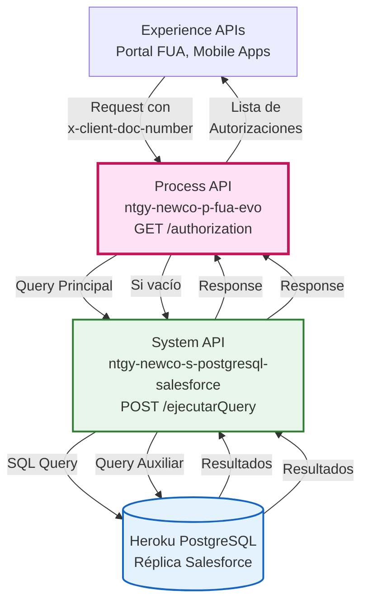
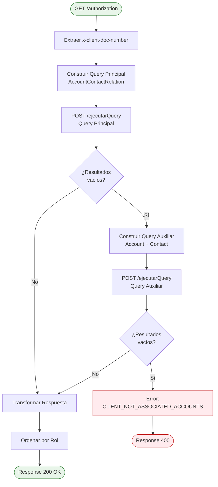
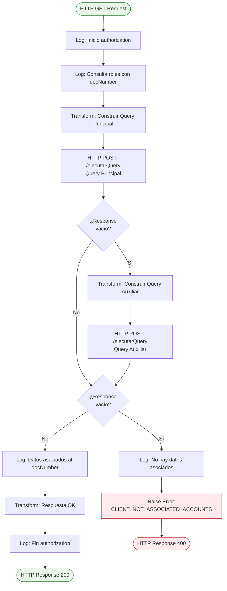
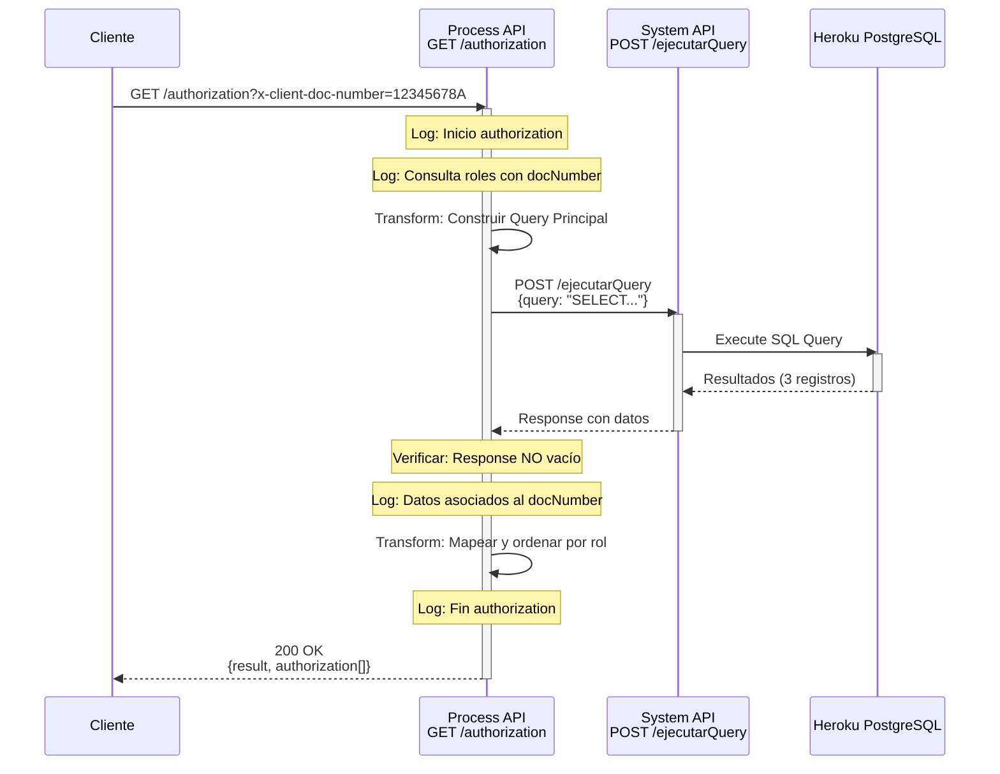
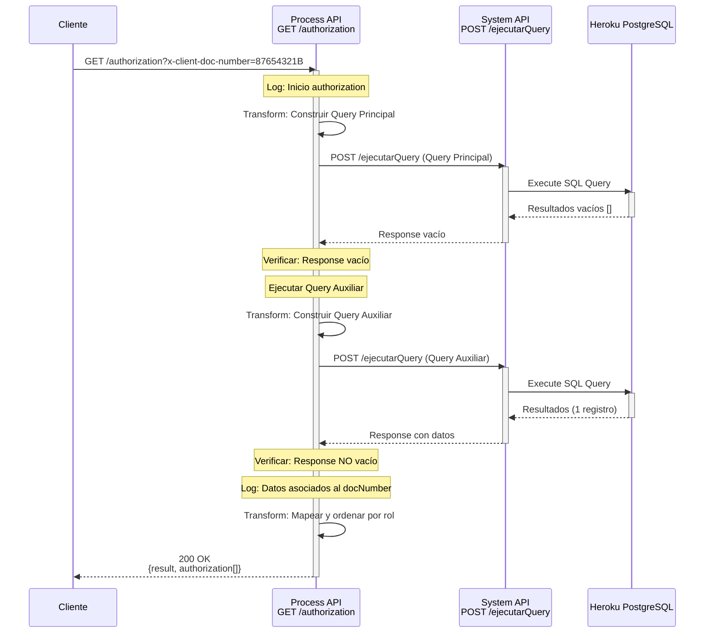
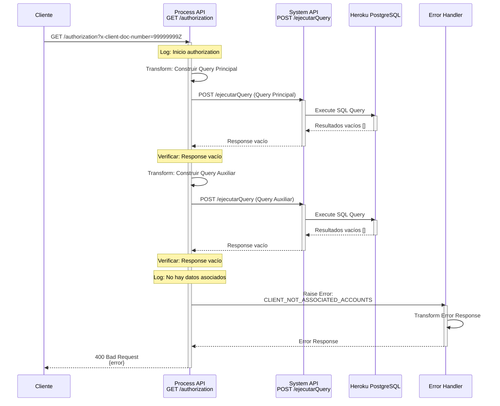
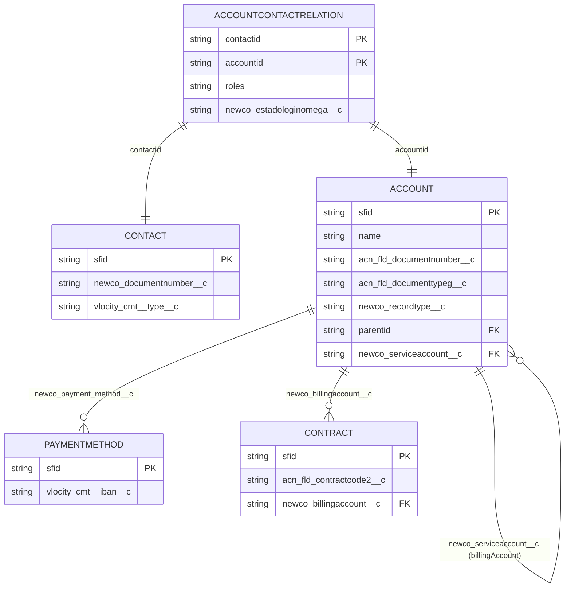

# GET /authorization

## 📌 Descripción General

### Propósito del Endpoint

Este endpoint consulta y valida la autorización de un cliente en el sistema, recuperando todos los roles y cuentas asociadas a su número de documento. Implementa una estrategia de consulta con fallback: primero busca en la tabla de relaciones de contacto-cuenta (AccountContactRelation) y, si no encuentra resultados, ejecuta una consulta alternativa directa en la tabla de cuentas.

### Tipo de API

**Capa:** Process API (API-Led Connectivity)

**Función:** Orquestación de consultas de autorización y roles de clientes

### Patrón de Integración

**Tipo:** Orquestación con Fallback

**Descripción:** Ejecuta consultas SQL secuenciales a Heroku PostgreSQL (réplica de Salesforce) con lógica de fallback. Si la primera consulta no retorna resultados, ejecuta una consulta alternativa para garantizar la recuperación de datos.

### Arquitectura API-Led Connectivity



---

## 💼 Propósito del Negocio

### Casos de Uso Principales

1. **Validación de Autorización de Cliente**
   - Verifica que un cliente tiene cuentas asociadas en el sistema
   - Identifica los roles del cliente en cada cuenta
   - Determina el método de validación apropiado (IBAN o importe)

2. **Gestión de Roles y Permisos**
   - Recupera todos los roles del cliente (01, 03, 04, 05, 06)
   - Identifica si el cliente es titular, autorizado, o tiene otros roles
   - Valida el estado del login en Omega

3. **Determinación de Métodos de Validación**
   - Verifica si la cuenta tiene IBAN registrado
   - Verifica si la cuenta tiene contratos activos
   - Determina el método de validación apropiado para operaciones futuras

### 🔗 Endpoints Dependientes

Este Process API consume el siguiente System API:

| System API | Endpoint | Método | Propósito |
|------------|----------|--------|-----------|
| `ntgy-newco-s-postgresql-salesforce` | `/ejecutarQuery` | POST | Ejecuta queries SQL en Heroku PostgreSQL (réplica de Salesforce) |

### Lógica de Orquestación



**Pasos del Proceso:**

1. **Extracción de Parámetro**: Obtiene el número de documento del query parameter `x-client-doc-number`
2. **Query Principal**: Consulta en `accountcontactrelation` con roles específicos (01, 03, 04, 05, 06)
3. **Validación de Resultados**: Verifica si la query principal retornó datos
4. **Query Auxiliar (Fallback)**: Si no hay resultados, ejecuta consulta alternativa en `account` + `contact`
5. **Validación Final**: Si tampoco hay resultados, lanza error `CLIENT_NOT_ASSOCIATED_ACCOUNTS`
6. **Transformación**: Mapea los campos de la base de datos a la estructura de respuesta
7. **Ordenamiento**: Ordena los resultados por rol antes de retornar

### Transformaciones Aplicadas

| Campo Original (PostgreSQL) | Campo Transformado (Response) | Transformación |
|-----------------------------|-------------------------------|----------------|
| `name` | `nombre` | Directo |
| `rol` | `rol` | Directo |
| `docnumber` | `docnumber` | Directo |
| `doctype` | `docType` | Directo |
| `isindividualclient` | `isIndividualClient` | Directo (boolean) |
| `accountid` | `accountid` | Directo |
| `contactid` | `contactid` | Directo |
| `status` | `status` | Directo o "Pendiente" (query auxiliar) |
| `hascontract` | `hasContracts` | Directo (boolean) |
| `hasiban` | `validateMethod` | Condicional: "iban" si true, "importe" si false |

### Contexto Empresarial

- **Dominio:** Gestión de Autorización y Seguridad
- **Sector:** Energía - Utilities
- **División:** Naturgy España - NewCo
- **Proceso de Negocio:** Validación de autorización de clientes para acceso al portal FUA

### Stakeholders

- **Clientes Finales**: Necesitan validar su autorización para acceder al portal
- **Agentes de Call Center**: Requieren verificar roles y permisos de clientes
- **Equipo de Seguridad**: Gestiona políticas de autorización y acceso
- **Equipo de Desarrollo FUA**: Consume este endpoint para validaciones de login

### Valor de Negocio

- **Seguridad**: Valida que solo usuarios autorizados accedan a información de cuentas
- **Flexibilidad**: Soporta múltiples roles por cliente (titular, autorizado, etc.)
- **Resiliencia**: Implementa fallback para garantizar recuperación de datos
- **Trazabilidad**: Identifica el estado del login y métodos de validación disponibles

### Consumidores Potenciales

Este endpoint puede ser consumido por:
- Portal web FUA
- Aplicaciones móviles de clientes
- Sistemas de agentes de call center
- Servicios de autenticación y autorización

---

## 🔧 Especificación Técnica

### URLs por Ambiente

| Ambiente | URL Base | URL Completa |
|----------|----------|--------------|
| **Local** | `http://localhost:8081` | `http://localhost:8081/api/authorization` |
| **Development** | `https://ntgy-newco-p-fua-evo-dev.us-e2.cloudhub.io` | `https://ntgy-newco-p-fua-evo-dev.us-e2.cloudhub.io/api/authorization` |
| **UAT** | `https://ntgy-newco-p-fua-evo-uat.us-e2.cloudhub.io` | `https://ntgy-newco-p-fua-evo-uat.us-e2.cloudhub.io/api/authorization` |
| **Production** | `https://ntgy-newco-p-fua-evo-pro.us-e2.cloudhub.io` | `https://ntgy-newco-p-fua-evo-pro.us-e2.cloudhub.io/api/authorization` |

### Método HTTP

```
GET /api/authorization
```

### Parámetros de Entrada

#### Query Parameters

| Parámetro | Tipo | Requerido | Descripción | Ejemplo |
|-----------|------|-----------|-------------|---------|
| `x-client-doc-number` | string | ✅ Sí | Número de documento del cliente | `12345678A` |

**Validaciones:**
- El parámetro `x-client-doc-number` es obligatorio
- Debe ser un string válido
- Se utiliza en las queries SQL para filtrar resultados

### Respuestas

#### 200 OK - Autorización Encontrada

**Estructura de Respuesta:**

```json
{
  "result": {
    "codResult": "0000",
    "msgResult": "No hay error"
  },
  "allowedSignRol": "01#03#04#06",
  "allowedSignRolNif": "01#04",
  "allowedSignRolCif": "01#03#04#06",
  "authorization": [
    {
      "nombre": "string",
      "rol": "string",
      "docnumber": "string",
      "docType": "string",
      "isIndividualClient": boolean,
      "accountid": "string",
      "contactid": "string",
      "status": "string",
      "hasContracts": boolean,
      "validateMethod": "string"
    }
  ]
}
```

**Nota:** El array `authorization` se retorna ordenado por el campo `rol` (nulls al final).

**Descripción de Campos:**

| Campo | Tipo | Descripción |
|-------|------|-------------|
| `result.codResult` | string | Código de resultado (siempre "0000" en éxito) |
| `result.msgResult` | string | Mensaje de resultado (siempre "No hay error" en éxito) |
| `allowedSignRol` | string | Roles permitidos para firma (separados por #). Ej: "01#03#04#06" |
| `allowedSignRolNif` | string | Roles permitidos para firma con NIF (separados por #). Ej: "01#04" |
| `allowedSignRolCif` | string | Roles permitidos para firma con CIF (separados por #). Ej: "01#03#04#06" |
| `authorization` | array | Lista de autorizaciones del cliente (ordenada por rol) |
| `authorization[].nombre` | string | Nombre de la cuenta (campo `name` de PostgreSQL) |
| `authorization[].rol` | string | Rol del cliente en la cuenta (01, 03, 04, 05, 06) |
| `authorization[].docnumber` | string | Número de documento de la cuenta (campo `docnumber` de PostgreSQL) |
| `authorization[].docType` | string | Tipo de documento (campo `doctype` de PostgreSQL) |
| `authorization[].isIndividualClient` | boolean | Indica si es cliente individual - Consumer (campo `isindividualclient` de PostgreSQL) |
| `authorization[].accountid` | string | ID de Salesforce de la cuenta |
| `authorization[].contactid` | string | ID de Salesforce del contacto |
| `authorization[].status` | string | Estado del login en Omega (campo `status` de PostgreSQL) |
| `authorization[].hasContracts` | boolean | Indica si la cuenta tiene contratos (calculado con COUNT > 0) |
| `authorization[].validateMethod` | string | Método de validación: "iban" (si hasiban=true) o "importe" (si hasiban=false) |

**Roles Válidos:**
- `01`: Titular
- `03`: Autorizado
- `04`: Representante Legal
- `05`: Apoderado
- `06`: Otro rol específico

#### 400 Bad Request - Cliente Sin Cuentas Asociadas

```json
{
  "error": {
    "code": "APP:CLIENT_NOT_ASSOCIATED_ACCOUNTS",
    "message": "No hay datos asociados al docNumber"
  }
}
```

**Descripción:** Se retorna cuando el cliente no tiene cuentas asociadas en ninguna de las dos queries (principal y auxiliar).

#### 500 Internal Server Error - Error de Sistema

```json
{
  "error": {
    "code": "APP:POSTGRESQL_SALESFORCE",
    "message": "Error al ejecutar query en Heroku PostgreSQL"
  }
}
```

**Descripción:** Error al comunicarse con el System API o al ejecutar las queries SQL.

### Autenticación

- **Tipo:** Client ID & Client Secret (Anypoint Platform)
- **Headers Requeridos:**
  - `client_id`: ID del cliente de Anypoint Platform
  - `client_secret`: Secret del cliente de Anypoint Platform

### Timeouts

| Tipo | Valor |
|------|-------|
| **Request Timeout** | 60 segundos |
| **Connection Timeout** | 30 segundos |

---

## 🏗️ Implementación Técnica

### Arquitectura del Flow



### Queries SQL Ejecutadas

#### Query Principal (AccountContactRelation)

**Ubicación en código:** Línea 11 del flow `authorizationFlow`

```sql
SELECT 
    account.name, 
    account.acn_fld_documenttypeg__c AS docType, 
    (account.newco_recordtype__c = 'Consumer') AS isIndividualClient, 
    accountcontactrelation.roles AS rol, 
    account.acn_fld_documentnumber__c AS docNumber, 
    accountcontactrelation.accountid, 
    accountcontactrelation.contactid, 
    accountcontactrelation.newco_estadologinomega__c AS status, 
    COUNT(paymentmethod.vlocity_cmt__iban__c) > 0 AS hasIban, 
    COUNT(contract.acn_fld_contractcode2__c) > 0 AS hasContract 
FROM newcosalesforce.accountcontactrelation AS accountcontactrelation 
INNER JOIN newcosalesforce.Contact AS contact 
    ON contact.sfid = accountcontactrelation.contactid 
INNER JOIN newcosalesforce.account AS account 
    ON account.sfid = accountcontactrelation.accountid 
LEFT JOIN newcosalesforce.account serviceAccount 
    ON serviceAccount.parentid = account.sfid 
LEFT JOIN newcosalesforce.account billingAccount 
    ON billingAccount.newco_serviceaccount__c = serviceAccount.sfid 
LEFT JOIN newcosalesforce.vlocity_cmt__paymentmethod__c paymentmethod 
    ON billingAccount.newco_payment_method__c = paymentmethod.sfid 
LEFT JOIN newcosalesforce.contract AS contract 
    ON contract.newco_billingaccount__c = billingAccount.sfid 
WHERE contact.newco_documentnumber__c = :docNumber
    AND accountcontactrelation.roles IN ('01','03','04','05','06') 
GROUP BY 
    account.name, 
    docType, 
    isIndividualClient,
    rol, 
    docNumber, 
    accountcontactrelation.accountid, 
    contactid, 
    accountcontactrelation.newco_estadologinomega__c
```

**Propósito:** Busca clientes con roles específicos en la tabla de relaciones contacto-cuenta.

**Tablas Consultadas:**
- `newcosalesforce.accountcontactrelation` (principal)
- `newcosalesforce.Contact`
- `newcosalesforce.account`
- `newcosalesforce.vlocity_cmt__paymentmethod__c`
- `newcosalesforce.contract`

#### Query Auxiliar (Account + Contact)

**Ubicación en código:** Línea 25 del flow `authorizationFlow`

```sql
SELECT 
    account.name, 
    account.acn_fld_documenttypeg__c AS docType, 
    (account.newco_recordtype__c = 'Consumer') AS isIndividualClient, 
    contact.vlocity_cmt__type__c AS rol, 
    account.acn_fld_documentnumber__c AS docNumber, 
    account.sfid AS accountid, 
    contact.sfid AS contactid, 
    'Pendiente' AS status, 
    COUNT(paymentmethod.vlocity_cmt__iban__c) > 0 AS hasIban, 
    COUNT(contract.acn_fld_contractcode2__c) > 0 AS hasContract 
FROM newcosalesforce.account AS account 
INNER JOIN newcosalesforce.Contact AS contact 
    ON contact.accountid = account.sfid 
LEFT JOIN newcosalesforce.account serviceAccount 
    ON serviceAccount.parentid = account.sfid 
LEFT JOIN newcosalesforce.account billingAccount 
    ON billingAccount.newco_serviceaccount__c = serviceAccount.sfid 
LEFT JOIN newcosalesforce.vlocity_cmt__paymentmethod__c paymentmethod 
    ON billingAccount.newco_payment_method__c = paymentmethod.sfid 
LEFT JOIN newcosalesforce.contract AS contract 
    ON contract.newco_billingaccount__c = billingAccount.sfid 
WHERE contact.newco_documentnumber__c = :docNumber
GROUP BY 
    account.name, 
    docType, 
    isIndividualClient, 
    rol, 
    docNumber, 
    account.sfid, 
    contact.sfid
```

**Propósito:** Query de fallback que busca directamente en la tabla de cuentas cuando no hay relaciones explícitas.

**Diferencias con Query Principal:**
- No filtra por roles específicos
- Usa `contact.vlocity_cmt__type__c` en lugar de `accountcontactrelation.roles`
- Establece status como "Pendiente" por defecto
- Busca en `account` + `contact` directamente

### Transformaciones DataWeave

#### Construcción de Query Principal

**Ubicación:** Línea 8-14 del flow

```dataweave
%dw 2.0
output application/json
---
{
    "query": "select account.name, account.acn_fld_documenttypeg__c docType, (account.newco_recordtype__c = 'Consumer') isIndividualClient, accountcontactrelation.roles rol, account.acn_fld_documentnumber__c docNumber, accountcontactrelation.accountid accountid, accountcontactrelation.contactid contactid, accountcontactrelation.newco_estadologinomega__c status, count(paymentmethod.vlocity_cmt__iban__c) > 0 as hasIban, count(contract.acn_fld_contractcode2__c) > 0 as hasContract from newcosalesforce.accountcontactrelation as accountcontactrelation inner join newcosalesforce.Contact as contact on contact.sfid = accountcontactrelation.contactid inner join newcosalesforce.account as account on account.sfid = accountcontactrelation.accountid left join newcosalesforce.account serviceAccount on serviceAccount.parentid = account.sfid left join newcosalesforce.account billingAccount on billingAccount.newco_serviceaccount__c = serviceAccount.sfid left join newcosalesforce.vlocity_cmt__paymentmethod__c paymentmethod on billingAccount.newco_payment_method__c = paymentmethod.sfid left join newcosalesforce.contract as contract on contract.newco_billingaccount__c = billingAccount.sfid where contact.newco_documentnumber__c = '" ++ attributes.queryParams.'x-client-doc-number' ++ "' and accountcontactrelation.roles in ('01','03','04','05','06') group by account.name, docType, isIndividualClient,rol, docNumber, accountcontactrelation.accountid, contactid, accountcontactrelation.newco_estadologinomega__c"
}
```

#### Construcción de Query Auxiliar

**Ubicación:** Línea 22-32 del flow

```dataweave
%dw 2.0
output application/json
---
{
    "query": "select account.name, account.acn_fld_documenttypeg__c docType, (account.newco_recordtype__c = 'Consumer') isIndividualClient, contact.vlocity_cmt__type__c rol, account.acn_fld_documentnumber__c docNumber, account.sfid accountid, contact.sfid contactid, 'Pendiente' status, count(paymentmethod.vlocity_cmt__iban__c) > 0 as hasIban, count(contract.acn_fld_contractcode2__c) > 0 as hasContract from newcosalesforce.account as account inner join newcosalesforce.Contact as contact on contact.accountid = account.sfid left join newcosalesforce.account serviceAccount on serviceAccount.parentid = account.sfid left join newcosalesforce.account billingAccount on billingAccount.newco_serviceaccount__c = serviceAccount.sfid left join newcosalesforce.vlocity_cmt__paymentmethod__c paymentmethod on billingAccount.newco_payment_method__c = paymentmethod.sfid left join newcosalesforce.contract as contract on contract.newco_billingaccount__c = billingAccount.sfid where contact.newco_documentnumber__c = '" ++ attributes.queryParams.'x-client-doc-number' ++ "' group by account.name, docType, isIndividualClient, rol, docNumber, account.sfid, contact.sfid"
}
```

#### Transformación de Respuesta

**Ubicación:** Línea 49-62 del flow

```dataweave
%dw 2.0
output application/json
---
{
    "result": {
        "codResult": "0000",
        "msgResult": "No hay error"
    },
    "allowedSignRol": Mule::p('firma.allowedSignRol'),
    "allowedSignRolNif": Mule::p('firma.allowedSignRolNif'),
    "allowedSignRolCif": Mule::p('firma.allowedSignRolCif'),
    "authorization": vars.queryResponse map ((item, index) -> {
        "nombre": item.name,
        "rol": item.rol,
        "docnumber": item.docnumber,
        "docType": item.doctype,
        "isIndividualClient": item.isindividualclient,
        "accountid": item.accountid,
        "contactid": item.contactid,
        "status": item.status,
        "hasContracts": item.hascontract,
        "validateMethod": if(item.hasiban) "iban" else "importe"
    }) orderBy ($.rol default "null")
}
```

**Lógica de Transformación:**
- Mapea cada item del array de resultados de PostgreSQL
- Normaliza nombres de campos (lowercase → camelCase)
- Añade properties de firma desde configuración (`Mule::p`)
- Calcula `validateMethod` basándose en `hasiban`:
  - Si `hasiban = true` → `"iban"`
  - Si `hasiban = false` → `"importe"`
- Ordena resultados por rol ascendente (nulls al final con `default "null"`)

### Patrones de Diseño

**Patrón:** Query con Fallback (Retry Pattern)

**Justificación:** 
- Garantiza recuperación de datos incluso si la estructura de relaciones no está completa
- Proporciona resiliencia ante inconsistencias en los datos de Salesforce
- Mejora la experiencia del usuario al no fallar inmediatamente

**Implementación:**
1. Intenta query principal (más específica)
2. Si falla o está vacía, intenta query auxiliar (más amplia)
3. Solo falla si ambas queries no retornan resultados

### Diagramas de Secuencia

#### 1. Flujo Normal de Éxito (Query Principal)



#### 2. Flujo con Fallback (Query Auxiliar)



#### 3. Flujo con Error (Sin Cuentas Asociadas)



### Manejo de Errores

#### Error Handler Utilizado

**Referencia:** `login-errorsError_Handler`

**Ubicación en código:** Línea 3 del flow principal

```xml
<error-handler ref="login-errorsError_Handler" />
```

#### Errores Manejados

| Tipo de Error | Código | Descripción | HTTP Status |
|---------------|--------|-------------|-------------|
| `APP:CLIENT_NOT_ASSOCIATED_ACCOUNTS` | Custom | Cliente sin cuentas asociadas | 400 |
| `APP:POSTGRESQL_SALESFORCE` | Custom | Error al ejecutar query en Heroku | 500 |
| `HTTP:TIMEOUT` | Connectivity | Timeout en llamada a System API | 504 |
| `HTTP:CONNECTIVITY` | Connectivity | Error de conectividad con System API | 503 |

#### Estrategia de Recuperación

1. **Query Principal Vacía**: Ejecutar query auxiliar automáticamente
2. **Query Auxiliar Vacía**: Lanzar error de negocio `CLIENT_NOT_ASSOCIATED_ACCOUNTS`
3. **Error de Conectividad**: Propagar error al cliente con código HTTP apropiado
4. **Timeout**: Retornar 504 Gateway Timeout

---

## 💻 Ejemplos de Uso

### Ejemplo 1: Llamada Exitosa con Múltiples Roles

#### cURL

```bash
curl -X GET "https://ntgy-newco-p-fua-evo-dev.us-e2.cloudhub.io/api/authorization?x-client-doc-number=12345678A" \
  -H "Content-Type: application/json" \
  -H "client_id: YOUR_CLIENT_ID" \
  -H "client_secret: YOUR_CLIENT_SECRET"
```

#### Respuesta (200 OK)

```json
{
  "result": {
    "codResult": "0000",
    "msgResult": "No hay error"
  },
  "allowedSignRol": "01#03#04#06",
  "allowedSignRolNif": "01#04",
  "allowedSignRolCif": "01#03#04#06",
  "authorization": [
    {
      "nombre": "JUAN PEREZ GARCIA",
      "rol": "01",
      "docnumber": "12345678A",
      "docType": "NIF",
      "isIndividualClient": true,
      "accountid": "0011t00000AbCdEFG",
      "contactid": "0031t00000XyZwVAB",
      "status": "Activo",
      "hasContracts": true,
      "validateMethod": "iban"
    },
    {
      "nombre": "MARIA LOPEZ SANCHEZ",
      "rol": "03",
      "docnumber": "87654321B",
      "docType": "NIF",
      "isIndividualClient": true,
      "accountid": "0011t00000HiJkLMN",
      "contactid": "0031t00000PqRsTUV",
      "status": "Activo",
      "hasContracts": true,
      "validateMethod": "importe"
    }
  ]
}
```

**Nota:** Los resultados están ordenados por `rol` ascendente (01, 03, 04, 05, 06). Los valores null se colocan al final.

### Ejemplo 2: Cliente Sin Cuentas Asociadas

#### cURL

```bash
curl -X GET "https://ntgy-newco-p-fua-evo-dev.us-e2.cloudhub.io/api/authorization?x-client-doc-number=99999999Z" \
  -H "Content-Type: application/json" \
  -H "client_id: YOUR_CLIENT_ID" \
  -H "client_secret: YOUR_CLIENT_SECRET"
```

#### Respuesta (400 Bad Request)

```json
{
  "error": {
    "code": "APP:CLIENT_NOT_ASSOCIATED_ACCOUNTS",
    "message": "No hay datos asociados al docNumber: 99999999Z"
  }
}
```

### Ejemplo 3: JavaScript (Fetch API)

```javascript
const getAuthorization = async (docNumber) => {
  try {
    const response = await fetch(
      `https://ntgy-newco-p-fua-evo-dev.us-e2.cloudhub.io/api/authorization?x-client-doc-number=${docNumber}`,
      {
        method: 'GET',
        headers: {
          'Content-Type': 'application/json',
          'client_id': 'YOUR_CLIENT_ID',
          'client_secret': 'YOUR_CLIENT_SECRET'
        }
      }
    );

    if (!response.ok) {
      throw new Error(`HTTP error! status: ${response.status}`);
    }

    const data = await response.json();
    console.log('Autorizaciones:', data.authorization);
    
    // Procesar roles
    data.authorization.forEach(auth => {
      console.log(`Cuenta: ${auth.nombre}, Rol: ${auth.rol}, Método: ${auth.validateMethod}`);
    });

    return data;
  } catch (error) {
    console.error('Error al obtener autorización:', error);
    throw error;
  }
};

// Uso
getAuthorization('12345678A');
```

### Ejemplo 4: Python (Requests)

```python
import requests

def get_authorization(doc_number):
    """
    Obtiene la autorización de un cliente por su número de documento
    
    Args:
        doc_number (str): Número de documento del cliente
        
    Returns:
        dict: Respuesta con las autorizaciones del cliente
    """
    url = "https://ntgy-newco-p-fua-evo-dev.us-e2.cloudhub.io/api/authorization"
    
    headers = {
        'Content-Type': 'application/json',
        'client_id': 'YOUR_CLIENT_ID',
        'client_secret': 'YOUR_CLIENT_SECRET'
    }
    
    params = {
        'x-client-doc-number': doc_number
    }
    
    try:
        response = requests.get(url, headers=headers, params=params, timeout=30)
        response.raise_for_status()
        
        data = response.json()
        
        # Procesar autorizaciones
        print(f"Cliente con {len(data['authorization'])} autorizaciones:")
        for auth in data['authorization']:
            print(f"  - {auth['nombre']} (Rol: {auth['rol']}, Método: {auth['validateMethod']})")
        
        return data
        
    except requests.exceptions.HTTPError as e:
        if e.response.status_code == 400:
            print(f"Cliente sin cuentas asociadas: {doc_number}")
        else:
            print(f"Error HTTP: {e}")
        raise
    except requests.exceptions.RequestException as e:
        print(f"Error de conexión: {e}")
        raise

# Uso
if __name__ == "__main__":
    try:
        result = get_authorization('12345678A')
        print(f"Resultado: {result['result']['msgResult']}")
    except Exception as e:
        print(f"Error: {e}")
```

### Ejemplo 5: Postman Collection

```json
{
  "info": {
    "name": "GET /authorization",
    "description": "Consulta de autorización de cliente"
  },
  "item": [
    {
      "name": "Get Authorization - Success",
      "request": {
        "method": "GET",
        "header": [
          {
            "key": "Content-Type",
            "value": "application/json"
          },
          {
            "key": "client_id",
            "value": "{{client_id}}"
          },
          {
            "key": "client_secret",
            "value": "{{client_secret}}"
          }
        ],
        "url": {
          "raw": "{{base_url}}/api/authorization?x-client-doc-number=12345678A",
          "host": ["{{base_url}}"],
          "path": ["api", "authorization"],
          "query": [
            {
              "key": "x-client-doc-number",
              "value": "12345678A"
            }
          ]
        }
      }
    }
  ]
}
```

### Notas de Implementación

#### Mejores Prácticas

1. **Caché de Resultados**: Considerar cachear las autorizaciones por un período corto (5-10 minutos) para reducir carga en la base de datos
2. **Validación de Entrada**: Validar formato del número de documento antes de enviar la petición
3. **Manejo de Errores**: Implementar retry logic para errores transitorios (503, 504)
4. **Logging**: Registrar todas las consultas de autorización para auditoría

#### Consideraciones de Seguridad

- El número de documento es información sensible - usar HTTPS siempre
- No exponer números de documento en logs públicos
- Implementar rate limiting para prevenir ataques de fuerza bruta
- Validar que el usuario autenticado tiene permiso para consultar el documento solicitado

#### Performance

- **Tiempo de Respuesta Esperado**: 1-3 segundos
- **Query Principal**: ~500ms
- **Query Auxiliar (si aplica)**: ~500ms adicionales
- **Transformación**: ~100ms

#### Troubleshooting

**Problema**: Timeout en la consulta
- **Causa**: Base de datos sobrecargada o query muy compleja
- **Solución**: Verificar índices en las tablas de Salesforce, considerar optimización de queries

**Problema**: Resultados inconsistentes
- **Causa**: Datos no sincronizados entre Salesforce y Heroku
- **Solución**: Verificar proceso de replicación, ejecutar sincronización manual si es necesario

**Problema**: Error CLIENT_NOT_ASSOCIATED_ACCOUNTS para cliente válido
- **Causa**: Cliente no tiene relaciones en AccountContactRelation ni en Account
- **Solución**: Verificar datos en Salesforce, crear relaciones faltantes

---

## 📊 Información Adicional

### Properties de Firma

El endpoint incluye tres properties de configuración relacionadas con los roles permitidos para firma de documentos. Estas properties se obtienen del archivo de configuración del proyecto:

**Ubicación:** `src/main/resources/properties/properties-pro.yaml`

```yaml
firma:
  allowedSignRol: "01#03#04#06"
  allowedSignRolNif: "01#04"
  allowedSignRolCif: "01#03#04#06"
```

**Descripción de Properties:**

| Property | Valor | Descripción |
|----------|-------|-------------|
| `allowedSignRol` | `"01#03#04#06"` | Roles generales permitidos para firma de documentos |
| `allowedSignRolNif` | `"01#04"` | Roles permitidos para firma cuando el documento es NIF (persona física) |
| `allowedSignRolCif` | `"01#03#04#06"` | Roles permitidos para firma cuando el documento es CIF (persona jurídica) |

**Formato:** Los roles se separan con el carácter `#` (no con coma).

**Uso:** Estas properties se utilizan en el frontend para determinar si un usuario tiene permisos para firmar documentos según su rol y el tipo de documento de la cuenta.

### Lógica de Método de Validación

El campo `validateMethod` se calcula dinámicamente basándose en la existencia de IBAN en la cuenta:

```dataweave
"validateMethod": if(item.hasiban) "iban" else "importe"
```

**Criterios:**
- **"iban"**: La cuenta tiene un IBAN registrado en Salesforce (campo `vlocity_cmt__iban__c` en `paymentmethod`)
- **"importe"**: La cuenta NO tiene IBAN registrado, se debe validar por importe de factura

**Cálculo de hasIban:**
```sql
COUNT(paymentmethod.vlocity_cmt__iban__c) > 0 AS hasIban
```

### Ordenamiento de Resultados

Los resultados en el array `authorization` se ordenan por el campo `rol` de forma ascendente:

```dataweave
orderBy ($.rol default "null")
```

**Orden de Roles:**
1. `"01"` - Titular
2. `"03"` - Autorizado
3. `"04"` - Representante Legal
4. `"05"` - Apoderado
5. `"06"` - Otro
6. `null` - Sin rol definido (al final)

**Razón:** Facilita la presentación en el frontend, mostrando primero los roles con más permisos.

### Modelo de Datos PostgreSQL

El endpoint consulta las siguientes tablas de la réplica de Salesforce en Heroku PostgreSQL:



**Relaciones Clave:**
- **AccountContactRelation**: Tabla principal que relaciona contactos con cuentas y define roles
- **Account Hierarchy**: Estructura jerárquica de cuentas (Account → ServiceAccount → BillingAccount)
- **PaymentMethod**: Contiene información de IBAN para determinar método de validación
- **Contract**: Indica si la cuenta tiene contratos activos
