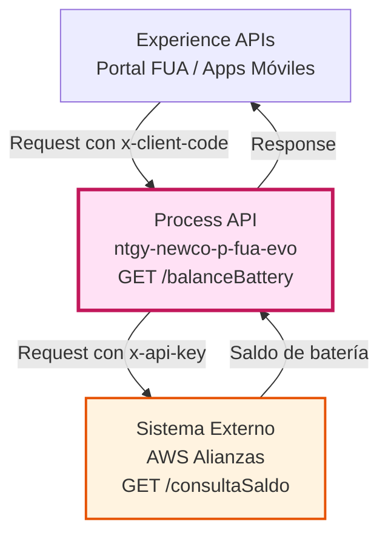
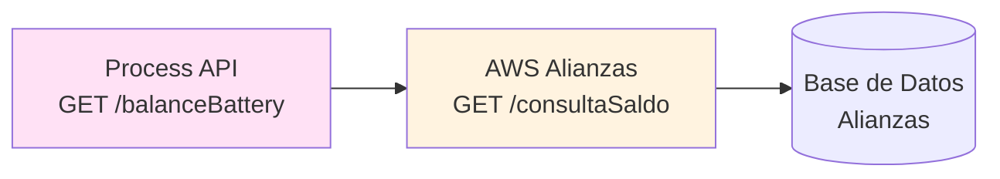
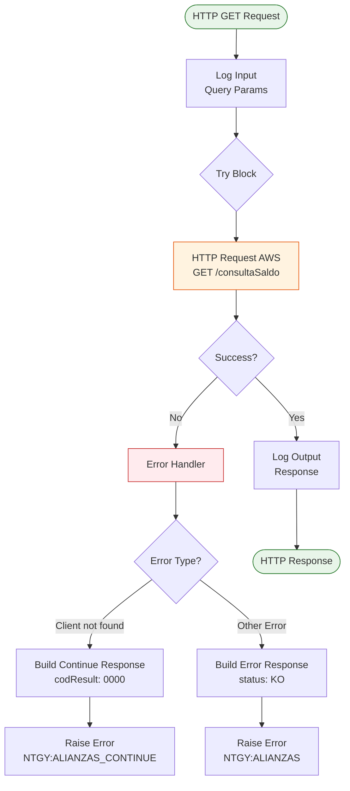
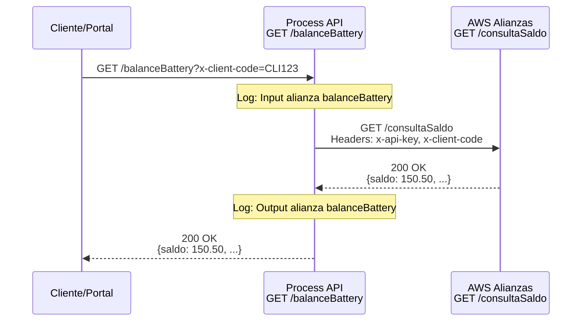
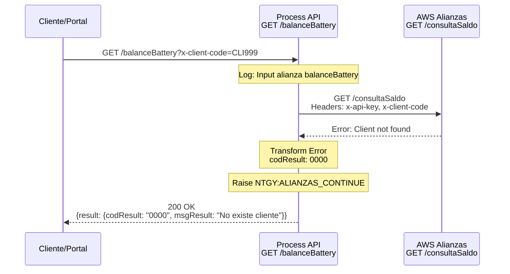
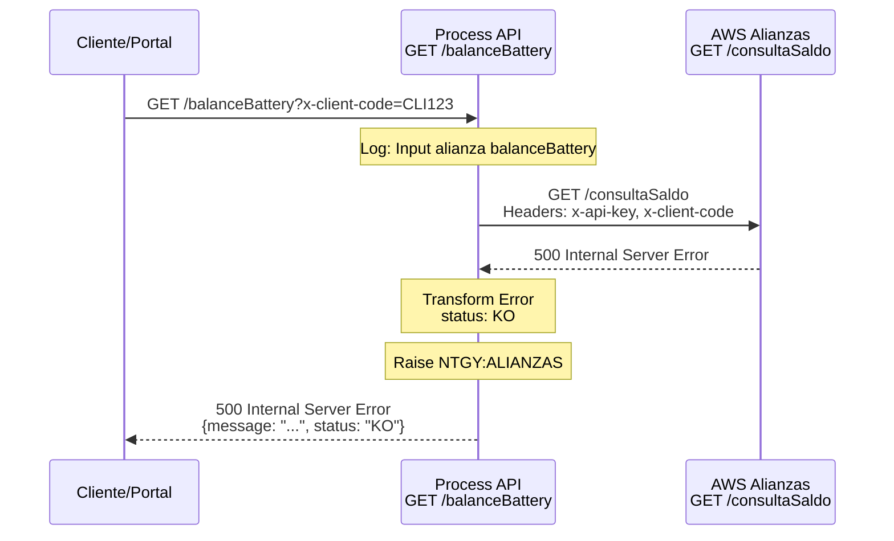

# GET /balanceBattery

## 📌 Descripción General

### Propósito del Endpoint

Este endpoint consulta el saldo de batería de un cliente a través del sistema de alianzas AWS. Actúa como orquestador que recibe la solicitud del cliente, la procesa y la reenvía al servicio externo de AWS para obtener el saldo actual del programa de batería.

### Tipo de API

**Capa:** Process API (API-Led Connectivity)

**Función:** Orquestación de consulta de saldo de batería con sistema externo AWS

### Patrón de Integración

**Tipo:** Pass-Through con Manejo de Errores Especializado

**Descripción:** El endpoint actúa como proxy hacia el sistema de alianzas AWS, agregando autenticación mediante API key y manejando casos especiales como "Cliente no encontrado" con respuestas controladas.

### Arquitectura API-Led Connectivity



---

## 💼 Propósito del Negocio

### Casos de Uso Principales

1. **Consulta de Saldo de Batería**
   - El cliente consulta su saldo actual en el programa de batería
   - Permite conocer el estado de su cuenta en el programa de alianzas

2. **Validación de Cliente en Programa**
   - Verifica si el cliente está registrado en el programa de batería
   - Retorna mensaje específico si el cliente no existe en el sistema

3. **Integración con Portal de Autoservicio**
   - Proporciona información en tiempo real para el portal FUA
   - Permite a los clientes gestionar su participación en el programa

### 🔗 Endpoints Dependientes

Este Process API consume el siguiente sistema externo:

| Sistema | Endpoint | Método | Propósito |
|---------|----------|--------|-----------|
| `AWS Alianzas` | `/consultaSaldo` | GET | Consulta el saldo de batería del cliente |

### Lógica de Orquestación



**Pasos del Proceso:**

1. **Recepción de Request**: Recibe query parameter `x-client-code`
2. **Autenticación**: Agrega header `x-api-key` para autenticación con AWS
3. **Llamada a AWS**: Ejecuta request GET al servicio de alianzas
4. **Manejo de Respuesta**: Procesa respuesta o error específico
5. **Retorno**: Devuelve saldo o mensaje de error controlado

### Transformaciones Aplicadas

⚠️ **Este Process API NO transforma la respuesta del sistema AWS.**

**Transformaciones de Headers:**

| Header Original | Header Transformado | Transformación |
|-----------------|---------------------|----------------|
| `x-client-code` (query param) | `x-client-code` (header) | Se pasa como header en la llamada a AWS |
| N/A | `x-api-key` | Se agrega desde configuración segura |

### Contexto Empresarial

- **Dominio:** Programas de Fidelización y Alianzas
- **Sector:** Energía - Utilities
- **División:** Naturgy España - NewCo
- **Proceso de Negocio:** Gestión de Programa de Batería

### Stakeholders

- **Clientes Naturgy**: Consultan su saldo en el programa de batería
- **Equipo de Alianzas**: Gestiona el programa de batería con AWS
- **Soporte al Cliente**: Ayuda a clientes con consultas sobre el programa

### Valor de Negocio

- **Transparencia**: Clientes pueden consultar su saldo en tiempo real
- **Autoservicio**: Reduce llamadas al call center sobre consultas de saldo
- **Fidelización**: Facilita la participación en programas de alianzas
- **Integración**: Conecta sistemas internos con plataforma externa AWS

### Consumidores Potenciales

Este endpoint puede ser consumido por:
- Portal web FUA
- Aplicaciones móviles de Naturgy
- Sistemas de agentes de call center
- Integraciones de terceros autorizados

---

## 🔧 Especificación Técnica

### URLs por Ambiente

| Ambiente | URL Base | URL Completa |
|----------|----------|--------------|
| **Local** | `http://localhost:8081` | `http://localhost:8081/api/balanceBattery?x-client-code={clientCode}` |
| **Development** | `https://ntgy-newco-p-fua-evo-dev.us-e2.cloudhub.io` | `https://ntgy-newco-p-fua-evo-dev.us-e2.cloudhub.io/api/balanceBattery?x-client-code={clientCode}` |
| **UAT** | `https://ntgy-newco-p-fua-evo-uat.us-e2.cloudhub.io` | `https://ntgy-newco-p-fua-evo-uat.us-e2.cloudhub.io/api/balanceBattery?x-client-code={clientCode}` |
| **Production** | `https://ntgy-newco-p-fua-evo-pro.us-e2.cloudhub.io` | `https://ntgy-newco-p-fua-evo-pro.us-e2.cloudhub.io/api/balanceBattery?x-client-code={clientCode}` |

### Método HTTP

```
GET /api/balanceBattery
```

### Parámetros de Entrada

#### Query Parameters

| Parámetro | Tipo | Requerido | Descripción | Ejemplo |
|-----------|------|-----------|-------------|---------|
| `x-client-code` | String | ✅ Sí | Código identificador del cliente en el sistema | `"CLI123456"` |

### Respuestas

#### 200 OK - Consulta Exitosa

```json
{
  "saldo": 150.50,
  "moneda": "EUR",
  "fechaConsulta": "2026-08-31T10:22:14Z"
}
```

**Nota:** La estructura exacta de la respuesta depende del sistema AWS Alianzas.

#### 200 OK - Cliente No Encontrado

```json
{
  "result": {
    "codResult": "0000",
    "msgResult": "No existe cliente"
  }
}
```

**Descripción:** Respuesta controlada cuando el cliente no está registrado en el programa de batería.

#### 400 Bad Request - Parámetro Faltante

```json
{
  "code": "BAD_REQUEST",
  "message": "Query parameter 'x-client-code' is required",
  "timestamp": "2026-08-31T10:22:14Z"
}
```

#### 500 Internal Server Error - Error del Sistema

```json
{
  "message": "Error en el servicio de alianzas",
  "status": "KO"
}
```

### Autenticación

- **Tipo:** Client ID & Client Secret (Anypoint Platform)
- **Headers Requeridos:**
  - `client_id`: ID del cliente de la aplicación
  - `client_secret`: Secret del cliente de la aplicación

### Timeouts

| Tipo | Valor |
|------|-------|
| **Request Timeout** | Configurable vía `${s-alianzas.timeout}` |
| **Connection Timeout** | 10 segundos (estándar HTTP connector) |

---

## 🏗️ Implementación Técnica

### Arquitectura del Flow



### Configuración del HTTP Request

**Archivo:** `src/main/mule/services/alianzas/alianzaBalanceBattery.xml`

**Configuración:**
- **Método:** `${aws.alianzas.methodConsultaSaldo}` (GET)
- **Path:** `${aws.alianzas.pathConsultaSaldo}` (/consultaSaldo)
- **Config Reference:** `HTTP_Request__AWS`
- **Response Timeout:** `${s-alianzas.timeout}`

**Headers Enviados:**
```dataweave
{
  "x-api-key": p('aws.apiKey'),
  "x-client-code": attributes.queryParams.'x-client-code'
}
```

### Transformaciones DataWeave

#### Transformación de Error - Cliente No Encontrado

```dataweave
%dw 2.0
output application/json
---
{
  "result": {
    "codResult": "0000",
    "msgResult": "No existe cliente"
  }
}
```

#### Transformación de Error - Error Genérico

```dataweave
%dw 2.0
import * from dw::core::Strings
output application/json
---
{
  "message": 
    if(error.errorMessage.payload.error != null)
      error.errorMessage.payload.error
    else if(error.errorMessage.payload.message != null)
      error.errorMessage.payload.message
    else if(substringAfterLast(error.description, "' ") != "") 
      substringAfterLast(error.description, "' ") 
    else if(error.description != null) 
      error.description 
    else 
      "Internal server error",
  "status": "KO"
}
```

### Patrones de Diseño

**Patrón:** Pass-Through con Error Handling Especializado

**Justificación:** 
- Minimiza latencia al no transformar la respuesta exitosa
- Proporciona manejo específico para el caso "Cliente no encontrado"
- Estandariza errores técnicos con formato consistente

### Diagramas de Secuencia

#### 1. Flujo Normal de Éxito



#### 2. Flujo con Cliente No Encontrado



#### 3. Flujo con Error Técnico



### Manejo de Errores

#### Estrategia de Error Handling

**Try-Catch Block con Choice Router:**

1. **Error Específico: "Client not found"**
   - **Condición:** `error.errorMessage.payload.error == "Client not found"`
   - **Acción:** Transformar a respuesta controlada con código "0000"
   - **Error Type:** `NTGY:ALIANZAS_CONTINUE`
   - **HTTP Status:** 200 OK (error de negocio, no técnico)

2. **Otros Errores**
   - **Condición:** Cualquier otro error
   - **Acción:** Transformar a formato estándar de error
   - **Error Type:** `NTGY:ALIANZAS`
   - **HTTP Status:** 500 Internal Server Error

#### Logging

- **Input Log:** Registra query parameters recibidos
- **Output Log:** Registra payload de respuesta
- **Level:** INFO

### Configuración de Propiedades

**Archivo:** `src/main/resources/properties/properties-{env}.yaml`

```yaml
aws:
  apiKey: "${secure::aws.apiKey}"
  alianzas:
    methodConsultaSaldo: "GET"
    pathConsultaSaldo: "/consultaSaldo"

s-alianzas:
  timeout: 30000  # 30 segundos
```

---

## 💻 Ejemplos de Uso

### Ejemplo 1: Consulta Exitosa de Saldo

#### cURL

```bash
curl -X GET "https://ntgy-newco-p-fua-evo-dev.us-e2.cloudhub.io/api/balanceBattery?x-client-code=CLI123456" \
  -H "Content-Type: application/json" \
  -H "client_id: YOUR_CLIENT_ID" \
  -H "client_secret: YOUR_CLIENT_SECRET"
```

#### Respuesta (200 OK)

```json
{
  "saldo": 150.50,
  "moneda": "EUR",
  "fechaConsulta": "2026-08-31T10:22:14Z",
  "clienteId": "CLI123456"
}
```

### Ejemplo 2: Cliente No Encontrado

#### cURL

```bash
curl -X GET "https://ntgy-newco-p-fua-evo-dev.us-e2.cloudhub.io/api/balanceBattery?x-client-code=CLI999999" \
  -H "Content-Type: application/json" \
  -H "client_id: YOUR_CLIENT_ID" \
  -H "client_secret: YOUR_CLIENT_SECRET"
```

#### Respuesta (200 OK)

```json
{
  "result": {
    "codResult": "0000",
    "msgResult": "No existe cliente"
  }
}
```

### Ejemplo 3: JavaScript (Fetch API)

```javascript
const clientCode = 'CLI123456';

const response = await fetch(
  `https://ntgy-newco-p-fua-evo-dev.us-e2.cloudhub.io/api/balanceBattery?x-client-code=${clientCode}`,
  {
    method: 'GET',
    headers: {
      'Content-Type': 'application/json',
      'client_id': 'YOUR_CLIENT_ID',
      'client_secret': 'YOUR_CLIENT_SECRET'
    }
  }
);

const data = await response.json();

if (data.result && data.result.codResult === '0000') {
  console.log('Cliente no encontrado en el programa de batería');
} else {
  console.log('Saldo de batería:', data.saldo, data.moneda);
}
```

### Ejemplo 4: Python (Requests)

```python
import requests

client_code = 'CLI123456'
url = f'https://ntgy-newco-p-fua-evo-dev.us-e2.cloudhub.io/api/balanceBattery'

response = requests.get(
    url,
    params={'x-client-code': client_code},
    headers={
        'Content-Type': 'application/json',
        'client_id': 'YOUR_CLIENT_ID',
        'client_secret': 'YOUR_CLIENT_SECRET'
    }
)

data = response.json()

if 'result' in data and data['result']['codResult'] == '0000':
    print('Cliente no encontrado en el programa de batería')
else:
    print(f"Saldo de batería: {data['saldo']} {data['moneda']}")
```

### Ejemplo 5: Error de Parámetro Faltante

#### cURL

```bash
curl -X GET "https://ntgy-newco-p-fua-evo-dev.us-e2.cloudhub.io/api/balanceBattery" \
  -H "Content-Type: application/json" \
  -H "client_id: YOUR_CLIENT_ID" \
  -H "client_secret: YOUR_CLIENT_SECRET"
```

#### Respuesta (400 Bad Request)

```json
{
  "code": "BAD_REQUEST",
  "message": "Required query parameter 'x-client-code' is missing",
  "timestamp": "2026-08-31T10:22:14Z"
}
```

### Ejemplo 6: Error del Sistema AWS

#### Respuesta (500 Internal Server Error)

```json
{
  "message": "Connection timeout to AWS Alianzas service",
  "status": "KO"
}