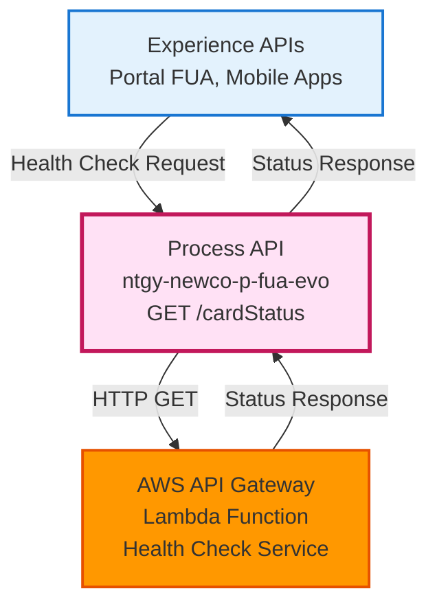
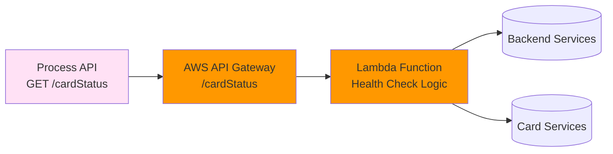
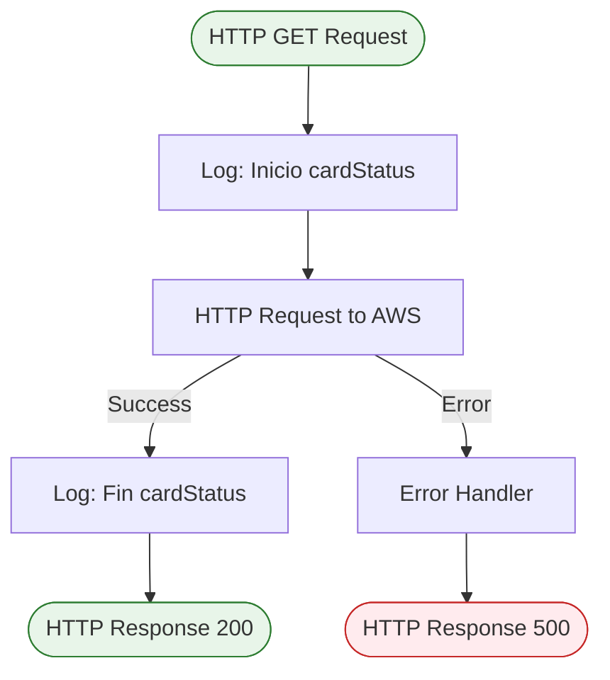
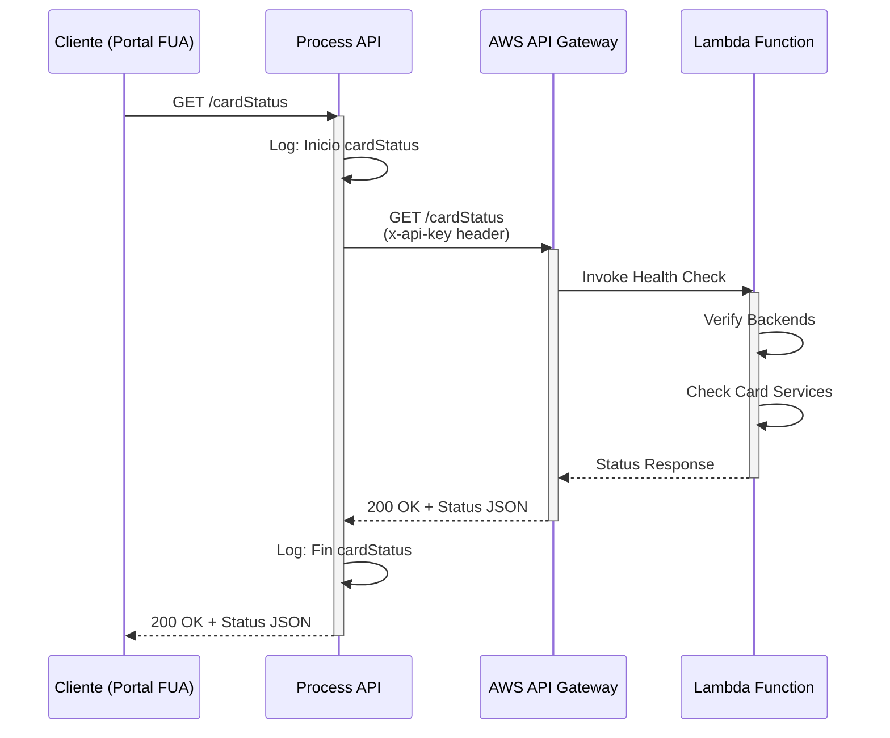
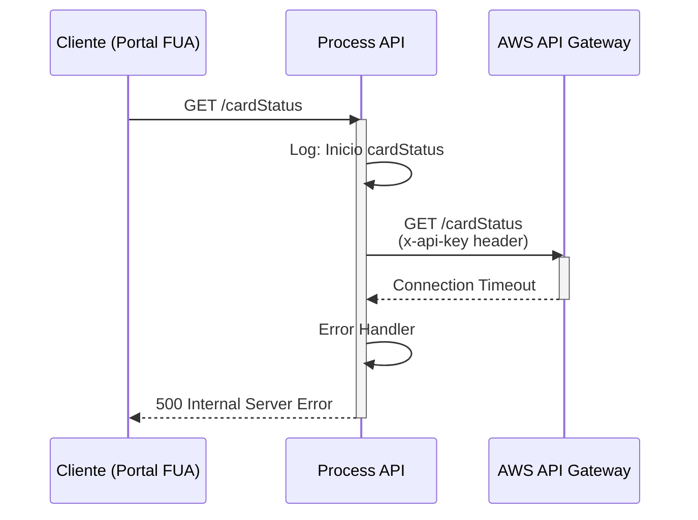
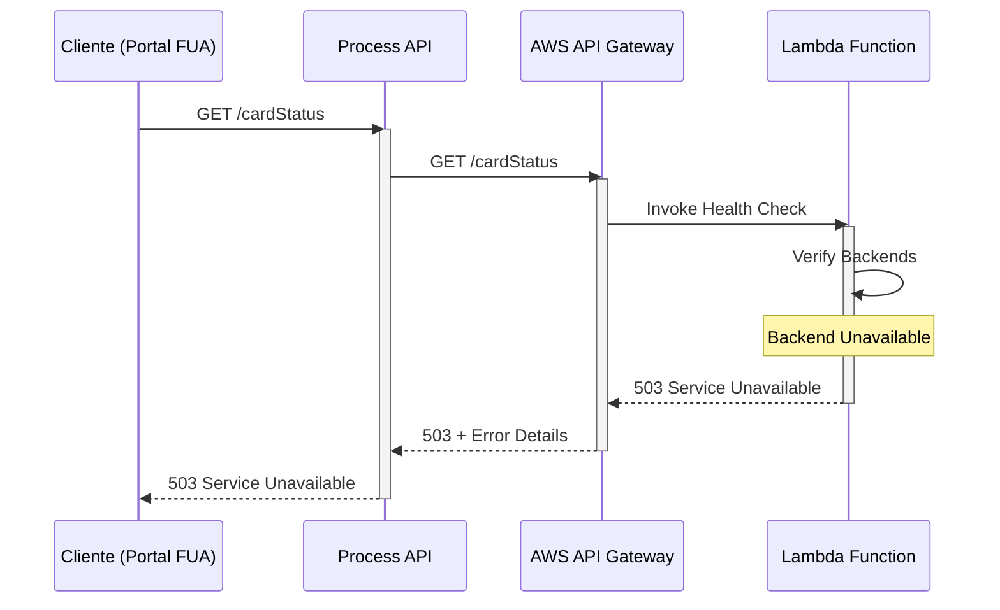

# GET /cardStatus

## 📌 Descripción General

### Propósito del Endpoint

Este endpoint proporciona un mecanismo de **health check** para consultar la disponibilidad de backends y la existencia de cards de cortesía en el frontal del portal FUA. Actúa como un proxy directo hacia la infraestructura AWS, permitiendo verificar el estado operativo de los servicios subyacentes.

### Tipo de API

**Capa:** Process API (API-Led Connectivity)

**Función:** Monitoreo y verificación de disponibilidad de infraestructura

### Patrón de Integración

**Tipo:** Pass-Through / Proxy

**Descripción:** Este endpoint realiza una llamada directa a AWS API Gateway sin transformaciones intermedias. La respuesta del servicio AWS se devuelve tal cual al consumidor, manteniendo la estructura y formato original.

### Arquitectura API-Led Connectivity



---

## 💼 Propósito del Negocio

### Casos de Uso Principales

1. **Verificación de Disponibilidad de Servicios**
   - Permite al portal FUA verificar que los backends están operativos antes de realizar operaciones críticas
   - Beneficio: Mejora la experiencia de usuario al detectar problemas de infraestructura proactivamente

2. **Monitoreo de Cards de Cortesía**
   - Verifica la disponibilidad de cards de cortesía en el frontal
   - Beneficio: Permite mostrar u ocultar funcionalidades según disponibilidad real

3. **Health Check para Dashboards de Monitoreo**
   - Proporciona información de estado para sistemas de monitoreo y alertas
   - Beneficio: Facilita la detección temprana de problemas de infraestructura

### 🔗 Endpoints Dependientes

Este Process API consume el siguiente servicio externo:

| Sistema | Endpoint | Método | Propósito |
|---------|----------|--------|-----------|
| `AWS API Gateway` | `/cardStatus` | GET | Verificación de estado de infraestructura y disponibilidad de servicios |

### Lógica de Orquestación



**Pasos del Proceso:**

1. **Recepción de Request**: El Process API recibe la solicitud de health check
2. **Llamada a AWS**: Se realiza una petición HTTP GET a AWS API Gateway con autenticación por API Key
3. **Verificación en Lambda**: La función Lambda verifica el estado de los backends y servicios
4. **Respuesta Directa**: La respuesta de AWS se devuelve sin transformaciones al consumidor

### Transformaciones Aplicadas

⚠️ **Este Process API NO transforma la respuesta del servicio AWS.**

La respuesta se devuelve en su formato original tal como la proporciona AWS API Gateway.

### Contexto Empresarial

- **Dominio:** Infraestructura y Monitoreo
- **Sector:** Energía - Utilities
- **División:** Naturgy España - NewCo
- **Proceso de Negocio:** Verificación de disponibilidad de servicios del portal FUA

### Stakeholders

- **Equipo de Desarrollo Frontend**: Necesita verificar disponibilidad antes de operaciones críticas
- **Equipo de Operaciones**: Monitorea la salud de la infraestructura AWS
- **Usuarios Finales**: Se benefician de una mejor experiencia al detectar problemas proactivamente

### Valor de Negocio

- **Mejora de Experiencia de Usuario**: Detección proactiva de problemas de infraestructura
- **Reducción de Errores**: Evita intentos de operaciones cuando los servicios no están disponibles
- **Monitoreo Continuo**: Facilita la supervisión del estado de la infraestructura AWS

### Consumidores Potenciales

Este endpoint puede ser consumido por:
- Portal web FUA (Frontal Único de Atención)
- Aplicaciones móviles de Naturgy
- Sistemas de monitoreo y alertas
- Dashboards de operaciones

---

## 🔧 Especificación Técnica

### URLs por Ambiente

| Ambiente | URL Base | URL Completa |
|----------|----------|--------------|
| **Local** | `http://localhost:8081` | `http://localhost:8081/api/cardStatus` |
| **Development** | `https://ntgy-newco-p-fua-evo-dev.us-e2.cloudhub.io` | `https://ntgy-newco-p-fua-evo-dev.us-e2.cloudhub.io/api/cardStatus` |
| **UAT** | `https://ntgy-newco-p-fua-evo-uat.us-e2.cloudhub.io` | `https://ntgy-newco-p-fua-evo-uat.us-e2.cloudhub.io/api/cardStatus` |
| **Production** | `https://ntgy-newco-p-fua-evo-pro.us-e2.cloudhub.io` | `https://ntgy-newco-p-fua-evo-pro.us-e2.cloudhub.io/api/cardStatus` |

### Método HTTP

```
GET /api/cardStatus
```

### Parámetros de Entrada

**Query Parameters:** Ninguno

**Headers:** Ninguno requerido (la autenticación con AWS se maneja internamente)

**Body:** No aplica (método GET)

### Respuestas

#### Respuesta Exitosa (200 OK)

```json
{
  "status": "available",
  "backends": {
    "service1": "operational",
    "service2": "operational"
  },
  "cards": {
    "courtesyCards": "available"
  }
}
```

**Nota:** La estructura exacta de la respuesta depende de la implementación de la función Lambda en AWS.

#### Respuesta de Error (500 Internal Server Error)

```json
{
  "error": "Service unavailable",
  "message": "Unable to connect to AWS backend"
}
```

### Códigos de Estado HTTP

| Código | Descripción |
|--------|-------------|
| **200** | Verificación exitosa - Servicios disponibles |
| **500** | Error interno - Problema de conectividad con AWS |
| **503** | Servicio no disponible - Backends no operativos |

### Autenticación

- **Tipo:** API Key (x-api-key header)
- **Ubicación:** Header HTTP
- **Gestión:** La API Key se configura en las propiedades del proyecto y se envía automáticamente a AWS

### Timeouts

| Tipo | Valor |
|------|-------|
| **Request Timeout** | 30 segundos |
| **Connection Timeout** | 10 segundos |

---

## 🏗️ Implementación Técnica

### Arquitectura del Flow



### Configuración del Conector HTTP

**Archivo:** `src/main/mule/ntgy-newco-p-fua.xml`

**Líneas:** 89-102

```xml
<flow name="get:\cardStatus:ntgy-newco-p-fua-config">
    <flow-ref doc:name="getCardStatus" name="cardStatusSub_Flow" />
</flow>

<sub-flow name="cardStatusSub_Flow">
    <logger level="INFO" doc:name="Inicio" message="Inicio cardStatus"/>
    
    <http:request 
        method="${aws.cardStatus.methodCardStatus}" 
        doc:name="Request AWS cardStatus" 
        config-ref="HTTP_Request__AWS_cardStatus" 
        path="${aws.cardStatus.pathCardStatus}" 
        responseTimeout="${aws.cardStatus.timeout}">
        <http:headers>
            <![CDATA[#[output application/java
            ---
            {
                "x-api-key" : p('aws.cardStatus.apiKey')
            }]]]>
        </http:headers>
    </http:request>
    
    <logger level="INFO" doc:name="Fin" message="Fin cardStatus"/>
</sub-flow>
```

### Configuración de Propiedades

**Archivo:** `src/main/resources/properties/properties-[env].yaml`

```yaml
aws:
  cardStatus:
    methodCardStatus: "GET"
    pathCardStatus: "/cardStatus"
    timeout: "30000"
    apiKey: "![encrypted_value]"
```

### Transformaciones DataWeave

⚠️ **No se aplican transformaciones DataWeave en este endpoint.**

La respuesta de AWS se devuelve directamente al consumidor sin modificaciones.

### Patrones de Diseño

**Patrón:** Pass-Through / Proxy Pattern

**Justificación:** 
- Este endpoint actúa como un proxy simple hacia AWS
- No requiere transformaciones de datos
- Mantiene la latencia al mínimo
- Simplifica el mantenimiento al no introducir lógica adicional

### Diagramas de Secuencia

#### 1. Flujo Normal de Éxito



#### 2. Flujo con Error de Conectividad



#### 3. Flujo con Servicio No Disponible



### Manejo de Errores

**Estrategia:** Error propagation con logging

**Tipos de Errores:**

1. **Connection Timeout (30s)**
   - Se propaga error 500 al cliente
   - Se registra en logs para monitoreo

2. **HTTP Errors de AWS**
   - Se propagan directamente al cliente
   - Mantienen el código de estado original

3. **Authentication Errors**
   - Error 401/403 si la API Key es inválida
   - Se registra para auditoría

**Error Handler Global:** El endpoint utiliza el error handler global del proyecto definido en `errorManagerFlow`.

---

## 💻 Ejemplos de Uso

### Ejemplo 1: Llamada Exitosa con cURL

#### Request

```bash
curl -X GET "https://ntgy-newco-p-fua-evo-dev.us-e2.cloudhub.io/api/cardStatus" \
  -H "Content-Type: application/json" \
  -H "client_id: YOUR_CLIENT_ID" \
  -H "client_secret: YOUR_CLIENT_SECRET"
```

#### Response (200 OK)

```json
{
  "status": "available",
  "timestamp": "2026-03-09T13:30:00Z",
  "backends": {
    "postgresql": "operational",
    "dynamodb": "operational",
    "salesforce": "operational"
  },
  "cards": {
    "courtesyCards": "available",
    "count": 150
  }
}
```

### Ejemplo 2: JavaScript (Fetch API)

```javascript
async function checkCardStatus() {
  try {
    const response = await fetch(
      'https://ntgy-newco-p-fua-evo-dev.us-e2.cloudhub.io/api/cardStatus',
      {
        method: 'GET',
        headers: {
          'Content-Type': 'application/json',
          'client_id': 'YOUR_CLIENT_ID',
          'client_secret': 'YOUR_CLIENT_SECRET'
        }
      }
    );

    if (!response.ok) {
      throw new Error(`HTTP error! status: ${response.status}`);
    }

    const data = await response.json();
    console.log('Card Status:', data);
    
    // Verificar disponibilidad
    if (data.status === 'available') {
      console.log('✅ Servicios disponibles');
    } else {
      console.log('⚠️ Servicios no disponibles');
    }
    
    return data;
  } catch (error) {
    console.error('Error checking card status:', error);
    throw error;
  }
}

// Uso
checkCardStatus();
```

### Ejemplo 3: Python (Requests)

```python
import requests
import json

def check_card_status():
    """
    Verifica el estado de disponibilidad de servicios
    """
    url = 'https://ntgy-newco-p-fua-evo-dev.us-e2.cloudhub.io/api/cardStatus'
    
    headers = {
        'Content-Type': 'application/json',
        'client_id': 'YOUR_CLIENT_ID',
        'client_secret': 'YOUR_CLIENT_SECRET'
    }
    
    try:
        response = requests.get(url, headers=headers, timeout=30)
        response.raise_for_status()
        
        data = response.json()
        print(f"Status: {data.get('status')}")
        print(f"Backends: {json.dumps(data.get('backends'), indent=2)}")
        print(f"Cards: {json.dumps(data.get('cards'), indent=2)}")
        
        return data
        
    except requests.exceptions.Timeout:
        print("⚠️ Timeout: El servicio no respondió en 30 segundos")
        return None
    except requests.exceptions.RequestException as e:
        print(f"❌ Error: {e}")
        return None

# Uso
status = check_card_status()
if status and status.get('status') == 'available':
    print("✅ Todos los servicios están operativos")
else:
    print("⚠️ Algunos servicios no están disponibles")
```

### Ejemplo 4: Integración en React Component

```javascript
import React, { useState, useEffect } from 'react';

function ServiceStatusIndicator() {
  const [status, setStatus] = useState(null);
  const [loading, setLoading] = useState(true);
  const [error, setError] = useState(null);

  useEffect(() => {
    const checkStatus = async () => {
      try {
        const response = await fetch(
          'https://ntgy-newco-p-fua-evo-dev.us-e2.cloudhub.io/api/cardStatus',
          {
            headers: {
              'client_id': process.env.REACT_APP_CLIENT_ID,
              'client_secret': process.env.REACT_APP_CLIENT_SECRET
            }
          }
        );

        if (!response.ok) {
          throw new Error('Service check failed');
        }

        const data = await response.json();
        setStatus(data);
      } catch (err) {
        setError(err.message);
      } finally {
        setLoading(false);
      }
    };

    checkStatus();
    
    // Verificar cada 5 minutos
    const interval = setInterval(checkStatus, 5 * 60 * 1000);
    
    return () => clearInterval(interval);
  }, []);

  if (loading) return <div>Verificando servicios...</div>;
  if (error) return <div className="error">⚠️ Error: {error}</div>;
  if (!status) return null;

  return (
    <div className="service-status">
      <h3>Estado de Servicios</h3>
      <div className={`status-badge ${status.status}`}>
        {status.status === 'available' ? '✅ Disponible' : '⚠️ No Disponible'}
      </div>
      {status.cards && (
        <div className="cards-info">
          Cards de cortesía: {status.cards.courtesyCards}
        </div>
      )}
    </div>
  );
}

export default ServiceStatusIndicator;
```

### Ejemplo 5: Error - Servicio No Disponible

#### Request

```bash
curl -X GET "https://ntgy-newco-p-fua-evo-dev.us-e2.cloudhub.io/api/cardStatus" \
  -H "client_id: YOUR_CLIENT_ID" \
  -H "client_secret: YOUR_CLIENT_SECRET"
```

#### Response (503 Service Unavailable)

```json
{
  "status": "unavailable",
  "timestamp": "2026-03-09T13:30:00Z",
  "backends": {
    "postgresql": "operational",
    "dynamodb": "error",
    "salesforce": "operational"
  },
  "error": {
    "code": "SERVICE_UNAVAILABLE",
    "message": "DynamoDB backend is not responding"
  }
}