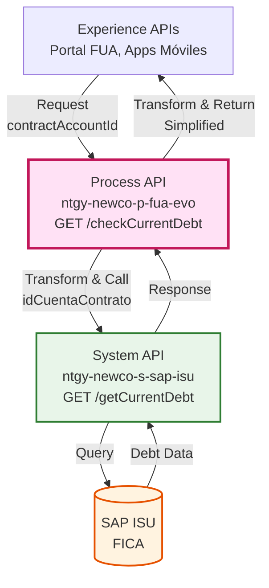
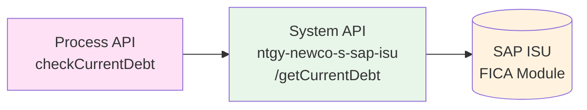
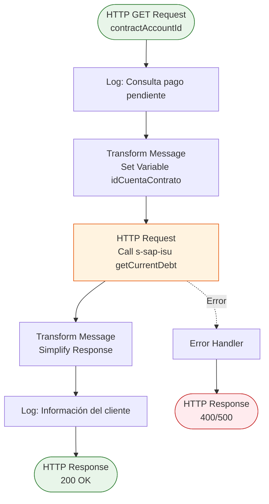
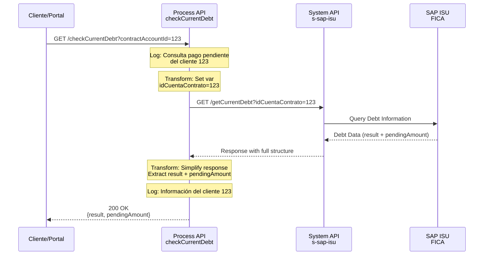
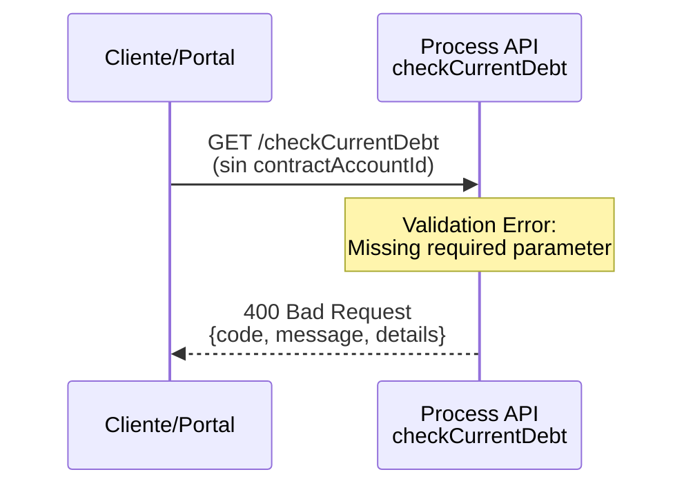
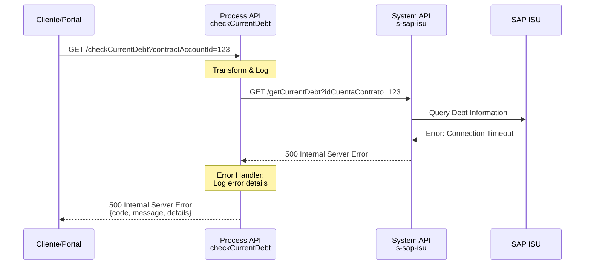

# GET /checkCurrentDebt

## 📌 Descripción General

### Propósito del Endpoint

Este endpoint permite consultar la deuda pendiente actual de un cliente en SAP ISU. Actúa como orquestador entre los consumidores (Experience APIs, portales web, aplicaciones móviles) y el System API de SAP ISU, proporcionando una capa de abstracción que simplifica la consulta de información financiera del cliente.

### Tipo de API

**Capa:** Process API (API-Led Connectivity)

**Función:** Orquestación de consulta de deuda pendiente desde SAP ISU

### Patrón de Integración

**Tipo:** Pass-Through con Transformación

**Descripción:** El endpoint recibe el ID de cuenta contrato, lo transforma en el formato requerido por el System API de SAP ISU, invoca el endpoint `/getCurrentDebt`, y transforma la respuesta para simplificar la estructura de datos devuelta al consumidor.

### Arquitectura API-Led Connectivity



---

## 💼 Propósito del Negocio

### Casos de Uso Principales

1. **Consulta de Deuda Antes de Pago**
   - El cliente necesita conocer su deuda pendiente antes de realizar un pago
   - Permite al cliente tomar decisiones informadas sobre pagos parciales o totales
   - Beneficio: Transparencia financiera y mejor experiencia de usuario

2. **Verificación de Estado de Cuenta**
   - Los agentes de call center consultan la deuda pendiente durante atención al cliente
   - Permite verificar si existen pagos pendientes antes de procesar solicitudes
   - Beneficio: Mejor servicio al cliente y gestión de cobranza

3. **Validación para Solicitud de Fraccionamiento**
   - Antes de solicitar un plan de fraccionamiento (subdivision), se consulta la deuda total
   - Permite determinar si el cliente es elegible para fraccionamiento
   - Beneficio: Proceso de solicitud más eficiente

### 🔗 Endpoints Dependientes

Este Process API consume el siguiente System API:

| System API | Endpoint | Método | Propósito |
|------------|----------|--------|-----------|
| `ntgy-newco-s-sap-isu` | `/getCurrentDebt` | GET | Consulta la deuda pendiente actual del cliente en SAP ISU |

### Lógica de Orquestación



**Pasos del Proceso:**

1. **Recepción**: Recibe `contractAccountId` como query parameter
2. **Transformación de Entrada**: Mapea `contractAccountId` a variable interna `idCuentaContrato`
3. **Invocación**: Llama al System API `/getCurrentDebt` con el parámetro transformado
4. **Transformación de Salida**: Simplifica la respuesta del System API extrayendo solo los campos relevantes
5. **Respuesta**: Devuelve estructura simplificada con resultado y monto pendiente

### Transformaciones Aplicadas

**Transformación de Request:**

| Campo Original (Process API) | Campo Transformado (System API) | Transformación |
|------------------------------|----------------------------------|----------------|
| `contractAccountId` (query param) | `idCuentaContrato` (query param) | Mapeo directo a variable interna |

**Transformación de Response:**

| Campo Original (System API) | Campo Transformado (Process API) | Transformación |
|------------------------------|----------------------------------|----------------|
| `payload.result.codResult` | `result.codResult` | Extracción directa |
| `payload.result.msgResult` | `result.msgResult` | Extracción directa |
| `payload.pendingAmount` | `pendingAmount` | Extracción directa (simplificado) |

**Nota:** La transformación elimina campos innecesarios de la respuesta del System API, proporcionando solo la información esencial al consumidor.

### Contexto Empresarial

- **Dominio:** Gestión Financiera y Cobranza
- **Sector:** Energía - Utilities
- **División:** Naturgy España - NewCo
- **Proceso de Negocio:** Consulta de Deuda Pendiente y Gestión de Cobranza

### Stakeholders

- **Clientes Finales**: Necesitan conocer su deuda pendiente para gestionar pagos
- **Agentes de Call Center**: Requieren información actualizada de deuda durante atención al cliente
- **Equipo de Cobranza**: Utiliza esta información para gestión de cuentas por cobrar
- **Portal FUA**: Sistema que consume este endpoint para mostrar información financiera

### Valor de Negocio

- **Transparencia Financiera**: Los clientes pueden consultar su deuda en tiempo real
- **Reducción de Llamadas**: Autoservicio reduce carga en call center
- **Mejora en Cobranza**: Información actualizada facilita gestión de pagos
- **Experiencia de Usuario**: Acceso inmediato a información financiera crítica

### Consumidores Potenciales

Este endpoint puede ser consumido por:
- Portal web FUA
- Aplicaciones móviles de clientes
- Sistemas de agentes de call center
- Aplicaciones de autoservicio
- Integraciones de terceros autorizados

---

## 🔧 Especificación Técnica

### URLs por Ambiente

| Ambiente | URL Base | URL Completa |
|----------|----------|--------------|
| **Local** | `http://localhost:8081` | `http://localhost:8081/api/checkCurrentDebt?contractAccountId={id}` |
| **Development** | `https://ntgy-newco-p-fua-evo-dev.us-e2.cloudhub.io` | `https://ntgy-newco-p-fua-evo-dev.us-e2.cloudhub.io/api/checkCurrentDebt?contractAccountId={id}` |
| **UAT** | `https://ntgy-newco-p-fua-evo-uat.us-e2.cloudhub.io` | `https://ntgy-newco-p-fua-evo-uat.us-e2.cloudhub.io/api/checkCurrentDebt?contractAccountId={id}` |
| **Production** | `https://ntgy-newco-p-fua-evo-pro.us-e2.cloudhub.io` | `https://ntgy-newco-p-fua-evo-pro.us-e2.cloudhub.io/api/checkCurrentDebt?contractAccountId={id}` |

### Método HTTP

```
GET /api/checkCurrentDebt
```

### Parámetros de Entrada

#### Query Parameters

| Parámetro | Tipo | Requerido | Descripción | Ejemplo |
|-----------|------|-----------|-------------|---------|
| `contractAccountId` | string | ✅ Sí | Identificador único de la cuenta contrato del cliente en SAP ISU | `"1234567890"` |

**Validaciones:**
- El parámetro `contractAccountId` es obligatorio
- Debe ser una cadena de texto válida
- Representa el ID de cuenta contrato en SAP ISU

### Respuestas

#### 200 OK - Consulta Exitosa

**Descripción:** La deuda pendiente se consultó correctamente en SAP ISU.

**Estructura de Respuesta:**

```json
{
  "result": {
    "codResult": "string",
    "msgResult": "string"
  },
  "pendingAmount": "number"
}
```

**Campos de Respuesta:**

| Campo | Tipo | Descripción |
|-------|------|-------------|
| `result` | object | Objeto con información del resultado de la operación |
| `result.codResult` | string | Código de resultado de la operación (ej: "0" para éxito) |
| `result.msgResult` | string | Mensaje descriptivo del resultado |
| `pendingAmount` | number | Monto total de deuda pendiente en euros |

**Ejemplo de Respuesta Exitosa:**

```json
{
  "result": {
    "codResult": "0",
    "msgResult": "Consulta exitosa"
  },
  "pendingAmount": 125.50
}
```

#### 400 Bad Request - Error de Validación

**Descripción:** El parámetro `contractAccountId` no fue proporcionado o es inválido.

**Estructura de Respuesta:**

```json
{
  "code": "BAD_REQUEST",
  "message": "El parámetro contractAccountId es requerido",
  "details": "Query parameter contractAccountId is missing or invalid"
}
```

#### 500 Internal Server Error - Error del Sistema

**Descripción:** Error al consultar SAP ISU o error interno del servidor.

**Estructura de Respuesta:**

```json
{
  "code": "INTERNAL_SERVER_ERROR",
  "message": "Error al consultar la deuda pendiente",
  "details": "Error connecting to SAP ISU system"
}
```

### Autenticación

- **Tipo:** Client ID & Client Secret (Anypoint Platform)
- **Headers Requeridos:**
  - `client_id`: ID del cliente registrado en Anypoint Platform
  - `client_secret`: Secret del cliente registrado en Anypoint Platform

### Timeouts

| Tipo | Valor |
|------|-------|
| **Request Timeout** | 30 segundos |
| **Connection Timeout** | 10 segundos |
| **System API Timeout** | Configurado en el HTTP Request connector |

### Rate Limiting

- **Límite:** Según políticas de Anypoint Platform
- **Recomendación:** Implementar caché en el consumidor para consultas frecuentes

---

## 🏗️ Implementación Técnica

### Arquitectura del Flow



### Ubicación del Código

**Archivo Principal:** `src/main/mule/ntgy-newco-p-fua-evo.xml`
- **Flow:** `get:\checkCurrentDebt:ntgy-newco-p-fua-config` (líneas del flow principal)

**Archivo de Implementación:** `src/main/mule/services/clients/clientInfo.xml`
- **Sub-flow:** `checkCurrentDebt` (líneas del sub-flow)

### Transformaciones DataWeave

#### 1. Transformación de Entrada (Request)

**Ubicación:** Flow principal `get:\checkCurrentDebt:ntgy-newco-p-fua-config`

```dataweave
%dw 2.0
output application/java
---
{
  idCuentaContrato: attributes.queryParams.'contractAccountId' default ""
}
```

**Propósito:** Extrae el `contractAccountId` del query parameter y lo almacena en la variable `idCuentaContrato`.

#### 2. Preparación de Query Parameters para System API

**Ubicación:** Sub-flow `checkCurrentDebt` - HTTP Request

```dataweave
%dw 2.0
output application/java
---
{
  idCuentaContrato: vars.idCuentaContrato
}
```

**Propósito:** Prepara los query parameters para la llamada al System API usando la variable previamente almacenada.

#### 3. Transformación de Salida (Response)

**Ubicación:** Sub-flow `checkCurrentDebt` - Transform Message

```dataweave
%dw 2.0
output application/json

//var pendingAmounts = payload.InvoicesPDS.*pendingAmount default [0]
---
{
  "result": {
    "codResult": payload.result.codResult,
    "msgResult": payload.result.msgResult
  },
  //"pendingAmount": sum(pendingAmounts)
  "pendingAmount": payload.pendingAmount
}
```

**Propósito:** Simplifica la respuesta del System API extrayendo solo los campos esenciales:
- Resultado de la operación (`result.codResult` y `result.msgResult`)
- Monto pendiente total (`pendingAmount`)

**Nota:** El código comentado muestra una implementación alternativa que suma múltiples montos pendientes, pero actualmente se usa el monto total directamente del payload.

### Configuración HTTP Request

**Connector:** `HTTP_Request_ntgy-newco-s-sap`

**Configuración:**
- **Method:** GET
- **Path:** `${ntgy-newco-s-sap.functions.getCurrentDebt}` (configurado en properties)
- **Query Parameters:** `idCuentaContrato` (dinámico)
- **Config Reference:** `HTTP_Request_ntgy-newco-s-sap`

**Propiedades (properties-local.yaml):**
```yaml
ntgy-newco-s-sap:
  functions:
    getCurrentDebt: "/getCurrentDebt"
```

### Patrones de Diseño

**Patrón:** Request-Reply con Transformación

**Justificación:** 
- El endpoint requiere respuesta inmediata (sincrónico)
- Se aplica transformación para simplificar la respuesta del System API
- Proporciona abstracción entre consumidores y SAP ISU

**Patrón:** Variable Storage

**Justificación:**
- Almacena `contractAccountId` en variable `idCuentaContrato` para uso en el sub-flow
- Facilita el paso de parámetros entre flows
- Mejora la legibilidad del código

### Diagramas de Secuencia

#### 1. Flujo Normal de Éxito



#### 2. Flujo con Error de Validación



#### 3. Flujo con Error del System API



### Manejo de Errores

**Estrategia:** Error handling delegado a los error handlers globales del proyecto

**Tipos de Errores Manejados:**

1. **Errores de Validación (400)**
   - Parámetro `contractAccountId` faltante o inválido
   - Formato de parámetro incorrecto

2. **Errores de Conectividad (500)**
   - Timeout al conectar con System API
   - System API no disponible
   - Error de red

3. **Errores de SAP ISU (500)**
   - Error al consultar SAP ISU
   - Cuenta contrato no encontrada
   - Error de autenticación con SAP

**Logging:**
- Log de inicio: Registra el `contractAccountId` consultado
- Log de fin: Registra la respuesta completa (solo en caso de éxito)
- Log de error: Registrado por error handlers globales

---

## 💻 Ejemplos de Uso

### Ejemplo 1: Consulta Exitosa de Deuda Pendiente

#### cURL

```bash
curl -X GET "https://ntgy-newco-p-fua-evo-dev.us-e2.cloudhub.io/api/checkCurrentDebt?contractAccountId=1234567890" \
  -H "Content-Type: application/json" \
  -H "client_id: YOUR_CLIENT_ID" \
  -H "client_secret: YOUR_CLIENT_SECRET"
```

#### Respuesta (200 OK)

```json
{
  "result": {
    "codResult": "0",
    "msgResult": "Consulta exitosa"
  },
  "pendingAmount": 125.50
}
```

**Interpretación:**
- `codResult: "0"` indica operación exitosa
- `msgResult` proporciona mensaje descriptivo
- `pendingAmount: 125.50` indica que el cliente tiene €125.50 de deuda pendiente

### Ejemplo 2: Cliente sin Deuda Pendiente

#### cURL

```bash
curl -X GET "https://ntgy-newco-p-fua-evo-dev.us-e2.cloudhub.io/api/checkCurrentDebt?contractAccountId=9876543210" \
  -H "Content-Type: application/json" \
  -H "client_id: YOUR_CLIENT_ID" \
  -H "client_secret: YOUR_CLIENT_SECRET"
```

#### Respuesta (200 OK)

```json
{
  "result": {
    "codResult": "0",
    "msgResult": "Consulta exitosa"
  },
  "pendingAmount": 0
}
```

**Interpretación:**
- `pendingAmount: 0` indica que el cliente no tiene deuda pendiente

### Ejemplo 3: Error - Parámetro Faltante

#### cURL

```bash
curl -X GET "https://ntgy-newco-p-fua-evo-dev.us-e2.cloudhub.io/api/checkCurrentDebt" \
  -H "Content-Type: application/json" \
  -H "client_id: YOUR_CLIENT_ID" \
  -H "client_secret: YOUR_CLIENT_SECRET"
```

#### Respuesta (400 Bad Request)

```json
{
  "code": "BAD_REQUEST",
  "message": "El parámetro contractAccountId es requerido",
  "details": "Query parameter contractAccountId is missing"
}
```

### Ejemplo 4: JavaScript (Fetch API)

```javascript
const checkCurrentDebt = async (contractAccountId) => {
  try {
    const response = await fetch(
      `https://ntgy-newco-p-fua-evo-dev.us-e2.cloudhub.io/api/checkCurrentDebt?contractAccountId=${contractAccountId}`,
      {
        method: 'GET',
        headers: {
          'Content-Type': 'application/json',
          'client_id': 'YOUR_CLIENT_ID',
          'client_secret': 'YOUR_CLIENT_SECRET'
        }
      }
    );

    if (!response.ok) {
      throw new Error(`HTTP error! status: ${response.status}`);
    }

    const data = await response.json();
    console.log('Deuda pendiente:', data.pendingAmount, '€');
    return data;
  } catch (error) {
    console.error('Error al consultar deuda:', error);
    throw error;
  }
};

// Uso
checkCurrentDebt('1234567890')
  .then(data => {
    if (data.pendingAmount > 0) {
      console.log(`El cliente tiene una deuda de ${data.pendingAmount}€`);
    } else {
      console.log('El cliente no tiene deuda pendiente');
    }
  });
```

### Ejemplo 5: Python (requests)

```python
import requests

def check_current_debt(contract_account_id):
    """
    Consulta la deuda pendiente de un cliente
    
    Args:
        contract_account_id (str): ID de cuenta contrato del cliente
        
    Returns:
        dict: Respuesta con resultado y monto pendiente
    """
    url = "https://ntgy-newco-p-fua-evo-dev.us-e2.cloudhub.io/api/checkCurrentDebt"
    
    headers = {
        'Content-Type': 'application/json',
        'client_id': 'YOUR_CLIENT_ID',
        'client_secret': 'YOUR_CLIENT_SECRET'
    }
    
    params = {
        'contractAccountId': contract_account_id
    }
    
    try:
        response = requests.get(url, headers=headers, params=params, timeout=30)
        response.raise_for_status()
        
        data = response.json()
        print(f"Deuda pendiente: €{data['pendingAmount']}")
        return data
        
    except requests.exceptions.RequestException as e:
        print(f"Error al consultar deuda: {e}")
        raise

# Uso
if __name__ == "__main__":
    result = check_current_debt('1234567890')
    
    if result['pendingAmount'] > 0:
        print(f"El cliente tiene una deuda de €{result['pendingAmount']}")
    else:
        print("El cliente no tiene deuda pendiente")
```

### Ejemplo 6: Integración en Portal Web

```javascript
// Componente React para mostrar deuda pendiente
import React, { useState, useEffect } from 'react';

const DebtDisplay = ({ contractAccountId }) => {
  const [debt, setDebt] = useState(null);
  const [loading, setLoading] = useState(true);
  const [error, setError] = useState(null);

  useEffect(() => {
    const fetchDebt = async () => {
      try {
        const response = await fetch(
          `https://ntgy-newco-p-fua-evo-dev.us-e2.cloudhub.io/api/checkCurrentDebt?contractAccountId=${contractAccountId}`,
          {
            headers: {
              'client_id': process.env.REACT_APP_CLIENT_ID,
              'client_secret': process.env.REACT_APP_CLIENT_SECRET
            }
          }
        );

        if (!response.ok) throw new Error('Error al consultar deuda');

        const data = await response.json();
        setDebt(data.pendingAmount);
      } catch (err) {
        setError(err.message);
      } finally {
        setLoading(false);
      }
    };

    fetchDebt();
  }, [contractAccountId]);

  if (loading) return <div>Consultando deuda pendiente...</div>;
  if (error) return <div>Error: {error}</div>;

  return (
    <div className="debt-display">
      <h3>Deuda Pendiente</h3>
      <p className={debt > 0 ? 'debt-amount' : 'no-debt'}>
        {debt > 0 ? `€${debt.toFixed(2)}` : 'Sin deuda pendiente'}
      </p>
      {debt > 0 && (
        <button onClick={() => window.location.href = '/payment'}>
          Realizar Pago
        </button>
      )}
    </div>
  );
};

export default DebtDisplay;
```

### Ejemplo 7: Error del Sistema (500)

#### cURL

```bash
curl -X GET "https://ntgy-newco-p-fua-evo-dev.us-e2.cloudhub.io/api/checkCurrentDebt?contractAccountId=1234567890" \
  -H "Content-Type: application/json" \
  -H "client_id: YOUR_CLIENT_ID" \
  -H "client_secret: YOUR_CLIENT_SECRET"
```

#### Respuesta (500 Internal Server Error)

```json
{
  "code": "INTERNAL_SERVER_ERROR",
  "message": "Error al consultar la deuda pendiente en SAP ISU",
  "details": "Connection timeout to System API ntgy-newco-s-sap-isu"
}
```

**Interpretación:**
- Error de conectividad con el System API o SAP ISU
- El cliente debe reintentar la operación
- Si el error persiste, contactar soporte técnico