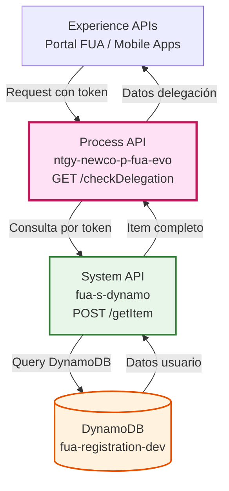
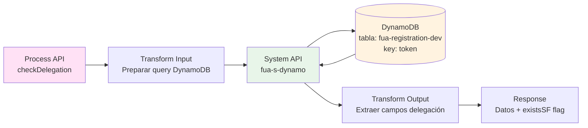
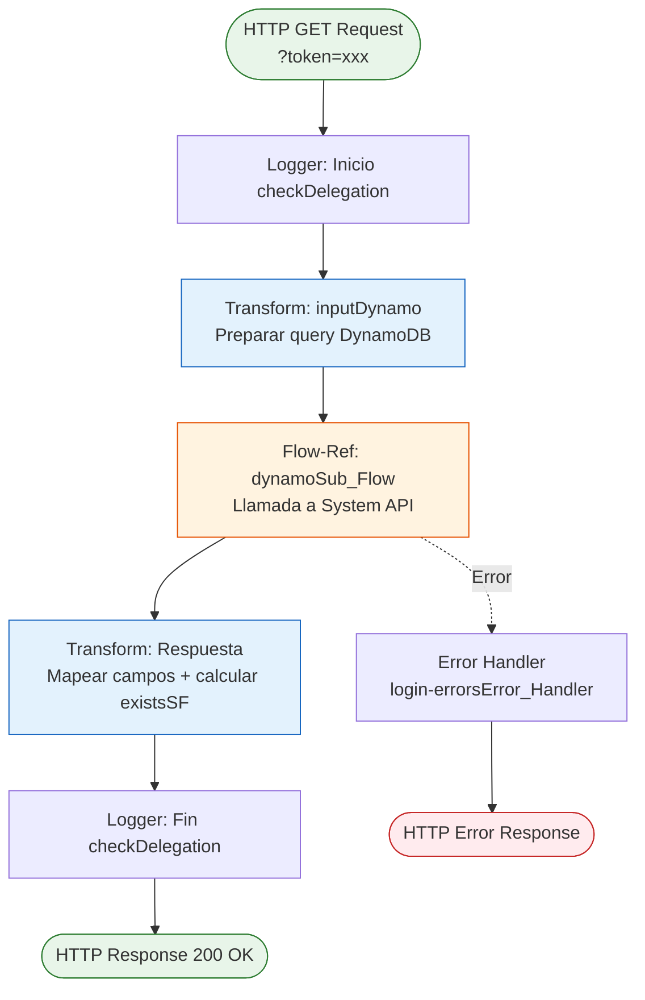
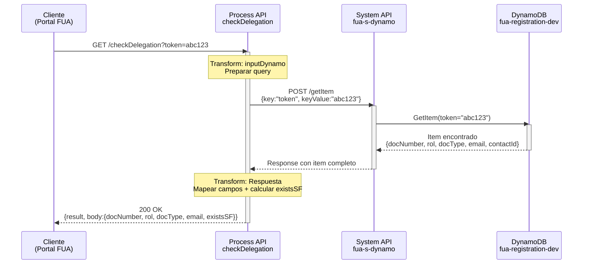
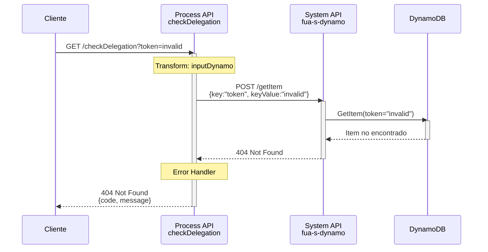
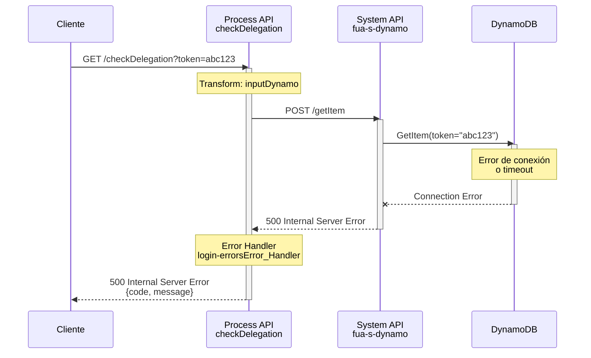

# GET /checkDelegation

## 📌 Descripción General

### Propósito del Endpoint

Este endpoint verifica los campos necesarios para el proceso de delegación de un usuario previamente registrado en el sistema FUA. Consulta la información del usuario almacenada en DynamoDB utilizando un token de sesión y valida que los datos requeridos para la delegación estén completos y disponibles.

### Tipo de API

**Capa:** Process API (API-Led Connectivity)

**Función:** Orquestación de verificación de datos de delegación mediante consulta a System API de DynamoDB

### Patrón de Integración

**Tipo:** Orquestación con Transformación

**Descripción:** El endpoint recibe un token como query parameter, lo transforma en una petición estructurada para DynamoDB, invoca el System API `fua-s-dynamo` para obtener los datos del usuario, y transforma la respuesta para incluir los campos relevantes de delegación y la verificación de existencia en Salesforce.

### Arquitectura API-Led Connectivity



---

## 💼 Propósito del Negocio

### Casos de Uso Principales

1. **Validación de Datos para Delegación**
   - Verifica que el usuario tenga todos los campos necesarios para delegar su cuenta
   - Valida la completitud de información personal (documento, tipo, email, rol)
   - Beneficio: Previene errores en el proceso de delegación

2. **Verificación de Existencia en Salesforce**
   - Comprueba si el usuario ya existe como contacto en Salesforce
   - Determina si se requiere crear o actualizar el registro
   - Beneficio: Evita duplicados y optimiza el flujo de registro

3. **Soporte al Proceso de Registro**
   - Proporciona información de estado del usuario durante el registro
   - Facilita la toma de decisiones en el flujo de onboarding
   - Beneficio: Mejora la experiencia de usuario en el proceso de alta

### 🔗 Endpoints Dependientes

Este Process API consume el siguiente System API:

| System API | Endpoint | Método | Propósito |
|------------|----------|--------|-----------|
| `fua-s-dynamo` | `/getItem` | POST | Consulta un item de DynamoDB por clave primaria (token) |

### Lógica de Orquestación



**Pasos del Proceso:**

1. **Preparación de Query**: Transforma el token recibido en una estructura de consulta DynamoDB con los parámetros: `key="token"`, `keyValue=[token]`, `table="fua-registration-dev"`, `operationDynamo="getItem"`

2. **Consulta a DynamoDB**: Invoca el System API `fua-s-dynamo` que ejecuta la operación `getItem` en la tabla de registro

3. **Transformación de Respuesta**: Extrae los campos relevantes del item de DynamoDB (`docNumber`, `rol`, `docType`, `email`, `contactId`) y calcula el flag `existsSF` basándose en si `contactId` es diferente de "NO"

### Transformaciones Aplicadas

**Transformación de Request (DataWeave):**

| Campo Entrada | Campo DynamoDB Query | Transformación |
|---------------|---------------------|----------------|
| `attributes.queryParams.token` | `keyValue` | Extracción directa del query parameter |
| N/A | `key` | Valor fijo: "token" |
| N/A | `table` | Valor de configuración: `p('fua-s-dynamo.tables.tableRegistration')` |
| N/A | `operationDynamo` | Valor fijo: "getItem" |

**Transformación de Response (DataWeave):**

| Campo DynamoDB | Campo Response | Transformación |
|----------------|----------------|----------------|
| `vars.dynamoItem.item.docNumber` | `body.docNumber` | Extracción directa |
| `vars.dynamoItem.item.rol` | `body.rol` | Extracción directa |
| `vars.dynamoItem.item.docType` | `body.docType` | Extracción directa |
| `vars.dynamoItem.item.email` | `body.email` | Extracción directa |
| `vars.dynamoItem.item.contactId` | `body.existsSF` | Cálculo: `!(contactId == "NO")` |

### Contexto Empresarial

- **Dominio:** Gestión de Usuarios y Registro
- **Sector:** Energía - Utilities
- **División:** Naturgy España - NewCo
- **Proceso de Negocio:** Registro y Delegación de Usuarios en Portal FUA

### Stakeholders

- **Usuarios Finales**: Clientes de Naturgy que se registran en el portal FUA y necesitan delegar su cuenta
- **Equipo de Desarrollo FUA**: Desarrolladores del portal que consumen este endpoint para validar datos
- **Administradores de Salesforce**: Responsables de mantener la integridad de datos de contactos

### Valor de Negocio

- **Prevención de Errores**: Valida datos antes de procesos críticos de delegación
- **Optimización de Flujos**: Evita pasos innecesarios si el usuario ya existe en Salesforce
- **Experiencia de Usuario**: Proporciona feedback inmediato sobre el estado del registro
- **Integridad de Datos**: Asegura que solo usuarios con datos completos puedan delegar

### Consumidores Potenciales

Este endpoint puede ser consumido por:
- Portal web FUA (autoservicio de clientes)
- Aplicaciones móviles de Naturgy
- Sistemas de agentes de call center
- Flujos automatizados de registro y onboarding

---

## 🔧 Especificación Técnica

### URLs por Ambiente

| Ambiente | URL Base | URL Completa |
|----------|----------|--------------|
| **Local** | `http://localhost:8081` | `http://localhost:8081/api/checkDelegation?token={token}` |
| **Development** | `https://ntgy-newco-p-fua-evo-dev.us-e2.cloudhub.io` | `https://ntgy-newco-p-fua-evo-dev.us-e2.cloudhub.io/api/checkDelegation?token={token}` |
| **UAT** | `https://ntgy-newco-p-fua-evo-uat.us-e2.cloudhub.io` | `https://ntgy-newco-p-fua-evo-uat.us-e2.cloudhub.io/api/checkDelegation?token={token}` |
| **Production** | `https://ntgy-newco-p-fua-evo-pro.us-e2.cloudhub.io` | `https://ntgy-newco-p-fua-evo-pro.us-e2.cloudhub.io/api/checkDelegation?token={token}` |

### Método HTTP

```
GET /api/checkDelegation
```

### Parámetros de Entrada

#### Query Parameters

| Parámetro | Tipo | Requerido | Descripción | Ejemplo |
|-----------|------|-----------|-------------|---------|
| `token` | string | ✅ Sí | Token de sesión del usuario registrado que identifica el registro en DynamoDB | `abc123xyz789` |

**Validaciones:**
- El token debe existir en la tabla `fua-registration-dev` de DynamoDB
- Si el token no existe, el System API devolverá un error

### Respuestas

#### 200 OK - Consulta Exitosa

**Estructura de Respuesta:**

```json
{
  "result": {
    "codResult": "0000",
    "msgResult": "No hay error"
  },
  "body": {
    "docNumber": "string",
    "rol": "string",
    "docType": "string",
    "email": "string",
    "existsSF": boolean
  }
}
```

**Campos de Respuesta:**

| Campo | Tipo | Descripción |
|-------|------|-------------|
| `result.codResult` | string | Código de resultado (siempre "0000" en caso de éxito) |
| `result.msgResult` | string | Mensaje descriptivo del resultado |
| `body.docNumber` | string | Número de documento del usuario |
| `body.rol` | string | Rol del usuario en el sistema |
| `body.docType` | string | Tipo de documento (DNI, NIE, Pasaporte, etc.) |
| `body.email` | string | Correo electrónico del usuario |
| `body.existsSF` | boolean | Indica si el usuario existe en Salesforce (`true` si existe, `false` si no) |

#### 400 Bad Request - Token Inválido o Faltante

```json
{
  "code": "BAD_REQUEST",
  "message": "Token parameter is required",
  "timestamp": "2026-02-09T08:44:27Z"
}
```

#### 404 Not Found - Token No Encontrado en DynamoDB

```json
{
  "code": "NOT_FOUND",
  "message": "User not found for provided token",
  "timestamp": "2026-02-09T08:44:27Z"
}
```

#### 500 Internal Server Error - Error del Sistema

```json
{
  "code": "INTERNAL_ERROR",
  "message": "Error connecting to DynamoDB",
  "timestamp": "2026-02-09T08:44:27Z"
}
```

### Autenticación

- **Tipo:** Client ID & Client Secret (Anypoint Platform)
- **Headers Requeridos:**
  - `client_id`: ID del cliente registrado en Anypoint Platform
  - `client_secret`: Secret del cliente

### Timeouts

| Tipo | Valor |
|------|-------|
| **Request Timeout** | 30 segundos |
| **Connection Timeout** | 10 segundos |
| **DynamoDB Query Timeout** | 15 segundos |

---

## 🏗️ Implementación Técnica

### Arquitectura del Flow



### Componentes del Flow

#### 1. Flow Principal: `get:\checkDelegation:ntgy-newco-p-fua-config`

**Ubicación:** `src/main/mule/ntgy-newco-p-fua.xml`

**Componentes:**
- Logger de inicio
- Flow-ref a `checkDelegationFlow`
- Error handler: `login-errorsError_Handler`

#### 2. Sub-Flow: `checkDelegationFlow`

**Ubicación:** `src/main/mule/implementation/checkDelegation.xml`

**Líneas de código:** 8-40

**Componentes:**

1. **Transform: inputDynamo getItem** (líneas 9-17)
   - Prepara la estructura de consulta para DynamoDB
   - Extrae el token del query parameter
   - Configura la tabla y operación

2. **Flow-Ref: dynamoSub_Flow** (línea 19)
   - Invoca el sub-flow que llama al System API `fua-s-dynamo`
   - Ejecuta la operación `getItem` en DynamoDB

3. **Transform: Respuesta** (líneas 20-35)
   - Mapea los campos del item de DynamoDB a la respuesta
   - Calcula el flag `existsSF` basándose en `contactId`

4. **Logger: Fin** (línea 36)
   - Registra el payload final de respuesta

### Transformaciones DataWeave

#### Transformación 1: Preparación de Query DynamoDB

**Ubicación:** Inline en `checkDelegation.xml` (líneas 9-17)

```dataweave
%dw 2.0
output application/json
---
{
	"key": "token",
	"keyValue": attributes.queryParams.token,
	"table": p('fua-s-dynamo.tables.tableRegistration'),
	"operationDynamo": "getItem"
}
```

**Propósito:** Construye el payload para la consulta DynamoDB con:
- `key`: Nombre de la clave primaria ("token")
- `keyValue`: Valor del token extraído del query parameter
- `table`: Nombre de la tabla desde configuración (`fua-registration-dev`)
- `operationDynamo`: Tipo de operación ("getItem")

#### Transformación 2: Mapeo de Respuesta

**Ubicación:** Inline en `checkDelegation.xml` (líneas 20-35)

```dataweave
%dw 2.0
output application/json
---
{
	"result":{
		"codResult": "0000",
		"msgResult": "No hay error"
	},
	"body": {
        "docNumber": vars.dynamoItem.item.docNumber,
        "rol": vars.dynamoItem.item.rol,
        "docType": vars.dynamoItem.item.docType,
        "email": vars.dynamoItem.item.email,
        "existsSF": !(vars.dynamoItem.item.contactId == "NO")
	}
}
```

**Propósito:** Transforma la respuesta de DynamoDB en el formato esperado:
- Extrae campos específicos del item de DynamoDB
- Calcula `existsSF` como negación de `contactId == "NO"`
- Incluye estructura de resultado estándar

### Configuración de DynamoDB

**Archivo:** `src/main/resources/properties/properties-local.yaml`

**Configuración de Tabla:**

```yaml
fua-s-dynamo:
  tables:
    tableRegistration: "fua-registration-dev"
```

**Tabla DynamoDB:**
- **Nombre:** `fua-registration-dev`
- **Clave Primaria:** `token` (string)
- **Campos Relevantes:**
  - `docNumber`: Número de documento
  - `rol`: Rol del usuario
  - `docType`: Tipo de documento
  - `email`: Correo electrónico
  - `contactId`: ID del contacto en Salesforce (o "NO" si no existe)

### Patrones de Diseño

**Patrón:** Request-Reply con Transformación

**Justificación:** 
- Necesidad de consulta síncrona a DynamoDB
- Transformación de datos entre formato de DynamoDB y formato de respuesta API
- Cálculo de campo derivado (`existsSF`) basado en datos obtenidos

**Patrón:** Delegation Pattern

**Justificación:**
- El Process API delega la consulta real a DynamoDB al System API `fua-s-dynamo`
- Mantiene separación de responsabilidades entre capas
- Facilita reutilización del System API por otros consumidores

### Diagramas de Secuencia

#### 1. Flujo Normal de Éxito



#### 2. Flujo con Token No Encontrado



#### 3. Flujo con Error de Conexión a DynamoDB



### Manejo de Errores

**Error Handler:** `login-errorsError_Handler`

**Estrategia:**
- Captura errores de conectividad con DynamoDB
- Captura errores de validación (token faltante)
- Captura errores de negocio (token no encontrado)
- Transforma errores en respuestas HTTP estándar

**Códigos de Error:**

| Código HTTP | Escenario | Acción |
|-------------|-----------|--------|
| 400 | Token no proporcionado | Validación de entrada |
| 404 | Token no encontrado en DynamoDB | Error de negocio |
| 500 | Error de conexión a DynamoDB | Error técnico |
| 503 | System API no disponible | Error de infraestructura |

---

## 💻 Ejemplos de Uso

### Ejemplo 1: Consulta Exitosa - Usuario Existe en Salesforce

#### cURL

```bash
curl -X GET "https://ntgy-newco-p-fua-evo-dev.us-e2.cloudhub.io/api/checkDelegation?token=abc123xyz789" \
  -H "Content-Type: application/json" \
  -H "client_id: YOUR_CLIENT_ID" \
  -H "client_secret: YOUR_CLIENT_SECRET"
```

#### Respuesta (200 OK)

```json
{
  "result": {
    "codResult": "0000",
    "msgResult": "No hay error"
  },
  "body": {
    "docNumber": "12345678A",
    "rol": "titular",
    "docType": "DNI",
    "email": "usuario@example.com",
    "existsSF": true
  }
}
```

**Interpretación:**
- Usuario encontrado en DynamoDB
- Tiene todos los campos necesarios para delegación
- Ya existe como contacto en Salesforce (`existsSF: true`)
- Puede proceder con el proceso de delegación

### Ejemplo 2: Consulta Exitosa - Usuario NO Existe en Salesforce

#### cURL

```bash
curl -X GET "https://ntgy-newco-p-fua-evo-dev.us-e2.cloudhub.io/api/checkDelegation?token=def456uvw012" \
  -H "Content-Type: application/json" \
  -H "client_id: YOUR_CLIENT_ID" \
  -H "client_secret: YOUR_CLIENT_SECRET"
```

#### Respuesta (200 OK)

```json
{
  "result": {
    "codResult": "0000",
    "msgResult": "No hay error"
  },
  "body": {
    "docNumber": "87654321B",
    "rol": "autorizado",
    "docType": "NIE",
    "email": "nuevo.usuario@example.com",
    "existsSF": false
  }
}
```

**Interpretación:**
- Usuario encontrado en DynamoDB
- NO existe aún en Salesforce (`existsSF: false`)
- Será necesario crear el contacto en Salesforce antes de delegar

### Ejemplo 3: Error - Token No Encontrado

#### cURL

```bash
curl -X GET "https://ntgy-newco-p-fua-evo-dev.us-e2.cloudhub.io/api/checkDelegation?token=tokeninvalido" \
  -H "Content-Type: application/json" \
  -H "client_id: YOUR_CLIENT_ID" \
  -H "client_secret: YOUR_CLIENT_SECRET"
```

#### Respuesta (404 Not Found)

```json
{
  "code": "NOT_FOUND",
  "message": "User not found for provided token",
  "timestamp": "2026-02-09T08:44:27Z"
}
```

### Ejemplo 4: Error - Token Faltante

#### cURL

```bash
curl -X GET "https://ntgy-newco-p-fua-evo-dev.us-e2.cloudhub.io/api/checkDelegation" \
  -H "Content-Type: application/json" \
  -H "client_id: YOUR_CLIENT_ID" \
  -H "client_secret: YOUR_CLIENT_SECRET"
```

#### Respuesta (400 Bad Request)

```json
{
  "code": "BAD_REQUEST",
  "message": "Token parameter is required",
  "timestamp": "2026-02-09T08:44:27Z"
}
```

### Ejemplo 5: JavaScript (Fetch API)

```javascript
const checkDelegation = async (token) => {
  try {
    const response = await fetch(
      `https://ntgy-newco-p-fua-evo-dev.us-e2.cloudhub.io/api/checkDelegation?token=${token}`,
      {
        method: 'GET',
        headers: {
          'Content-Type': 'application/json',
          'client_id': 'YOUR_CLIENT_ID',
          'client_secret': 'YOUR_CLIENT_SECRET'
        }
      }
    );

    if (!response.ok) {
      throw new Error(`HTTP error! status: ${response.status}`);
    }

    const data = await response.json();
    
    // Verificar si el usuario existe en Salesforce
    if (data.body.existsSF) {
      console.log('Usuario ya existe en Salesforce');
    } else {
      console.log('Usuario NO existe en Salesforce - crear contacto');
    }
    
    return data;
  } catch (error) {
    console.error('Error al verificar delegación:', error);
    throw error;
  }
};

// Uso
checkDelegation('abc123xyz789')
  .then(data => console.log('Datos de delegación:', data))
  .catch(error => console.error('Error:', error));
```

### Ejemplo 6: Python (Requests)

```python
import requests

def check_delegation(token):
    """
    Verifica los datos de delegación de un usuario
    
    Args:
        token (str): Token de sesión del usuario
        
    Returns:
        dict: Datos de delegación del usuario
    """
    url = f"https://ntgy-newco-p-fua-evo-dev.us-e2.cloudhub.io/api/checkDelegation"
    
    headers = {
        'Content-Type': 'application/json',
        'client_id': 'YOUR_CLIENT_ID',
        'client_secret': 'YOUR_CLIENT_SECRET'
    }
    
    params = {
        'token': token
    }
    
    try:
        response = requests.get(url, headers=headers, params=params, timeout=30)
        response.raise_for_status()
        
        data = response.json()
        
        # Verificar existencia en Salesforce
        if data['body']['existsSF']:
            print(f"Usuario {data['body']['email']} existe en Salesforce")
        else:
            print(f"Usuario {data['body']['email']} NO existe en Salesforce")
        
        return data
        
    except requests.exceptions.HTTPError as http_err:
        print(f"HTTP error occurred: {http_err}")
        raise
    except requests.exceptions.RequestException as req_err:
        print(f"Request error occurred: {req_err}")
        raise

# Uso
if __name__ == "__main__":
    try:
        result = check_delegation('abc123xyz789')
        print(f"Delegación verificada: {result}")
    except Exception as e:
        print(f"Error: {e}")
```

### Ejemplo 7: Java (Spring RestTemplate)

```java
import org.springframework.http.*;
import org.springframework.web.client.RestTemplate;
import org.springframework.web.util.UriComponentsBuilder;

public class DelegationService {
    
    private final RestTemplate restTemplate;
    private final String baseUrl = "https://ntgy-newco-p-fua-evo-dev.us-e2.cloudhub.io/api";
    private final String clientId = "YOUR_CLIENT_ID";
    private final String clientSecret = "YOUR_CLIENT_SECRET";
    
    public DelegationService() {
        this.restTemplate = new RestTemplate();
    }
    
    public DelegationResponse checkDelegation(String token) {
        // Construir URL con query parameter
        String url = UriComponentsBuilder
            .fromHttpUrl(baseUrl + "/checkDelegation")
            .queryParam("token", token)
            .toUriString();
        
        // Configurar headers
        HttpHeaders headers = new HttpHeaders();
        headers.setContentType(MediaType.APPLICATION_JSON);
        headers.set("client_id", clientId);
        headers.set("client_secret", clientSecret);
        
        HttpEntity<String> entity = new HttpEntity<>(headers);
        
        // Realizar petición
        ResponseEntity<DelegationResponse> response = restTemplate.exchange(
            url,
            HttpMethod.GET,
            entity,
            DelegationResponse.class
        );
        
        DelegationResponse data = response.getBody();
        
        // Verificar existencia en Salesforce
        if (data != null && data.getBody().isExistsSF()) {
            System.out.println("Usuario existe en Salesforce");
        } else {
            System.out.println("Usuario NO existe en Salesforce");
        }
        
        return data;
    }
}

// Clases de respuesta
class DelegationResponse {
    private Result result;
    private Body body;
    
    // Getters y setters
    public Result getResult() { return result; }
    public void setResult(Result result) { this.result = result; }
    public Body getBody() { return body; }
    public void setBody(Body body) { this.body = body; }
}

class Result {
    private String codResult;
    private String msgResult;
    
    // Getters y setters
    public String getCodResult() { return codResult; }
    public void setCodResult(String codResult) { this.codResult = codResult; }
    public String getMsgResult() { return msgResult; }
    public void setMsgResult(String msgResult) { this.msgResult = msgResult; }
}

class Body {
    private String docNumber;
    private String rol;
    private String docType;
    private String email;
    private boolean existsSF;
    
    // Getters y setters
    public String getDocNumber() { return docNumber; }
    public void setDocNumber(String docNumber) { this.docNumber = docNumber; }
    public String getRol() { return rol; }
    public void setRol(String rol) { this.rol = rol; }
    public String getDocType() { return docType; }
    public void setDocType(String docType) { this.docType = docType; }
    public String getEmail() { return email; }
    public void setEmail(String email) { this.email = email; }
    public boolean isExistsSF() { return existsSF; }
    public void setExistsSF(boolean existsSF) { this.existsSF = existsSF; }
}
```
