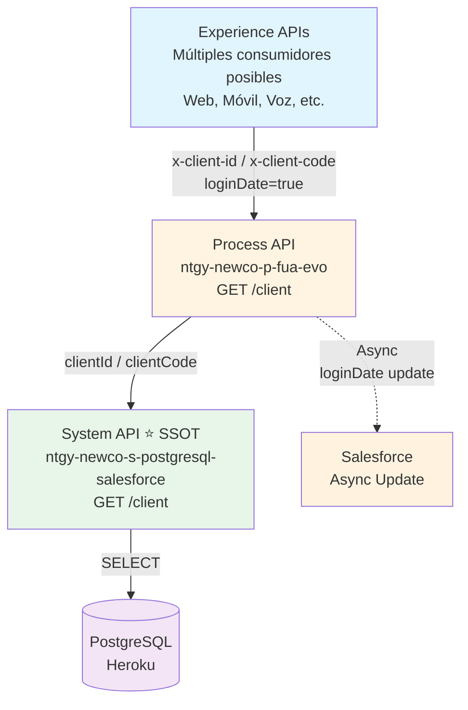
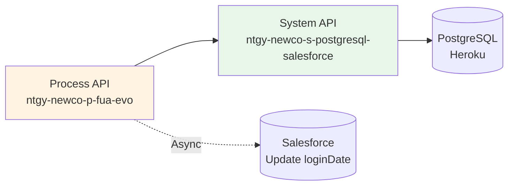
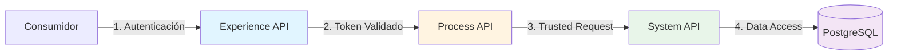
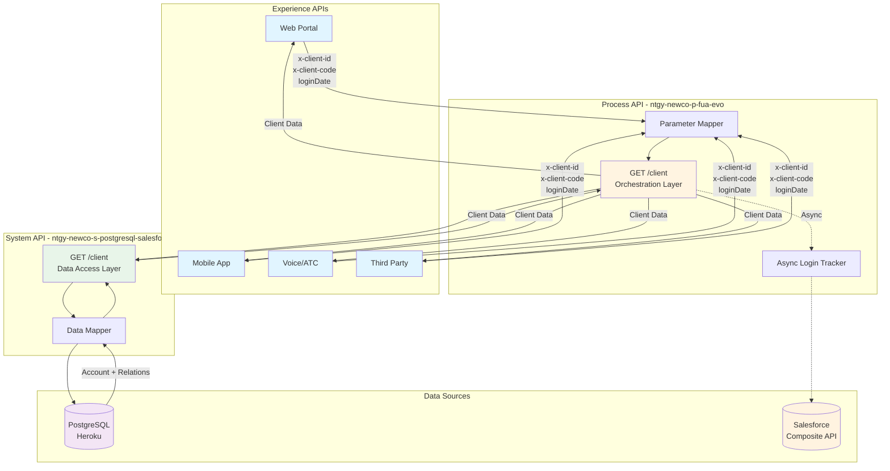
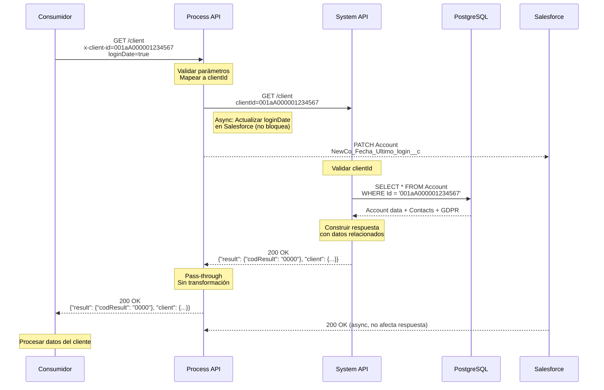
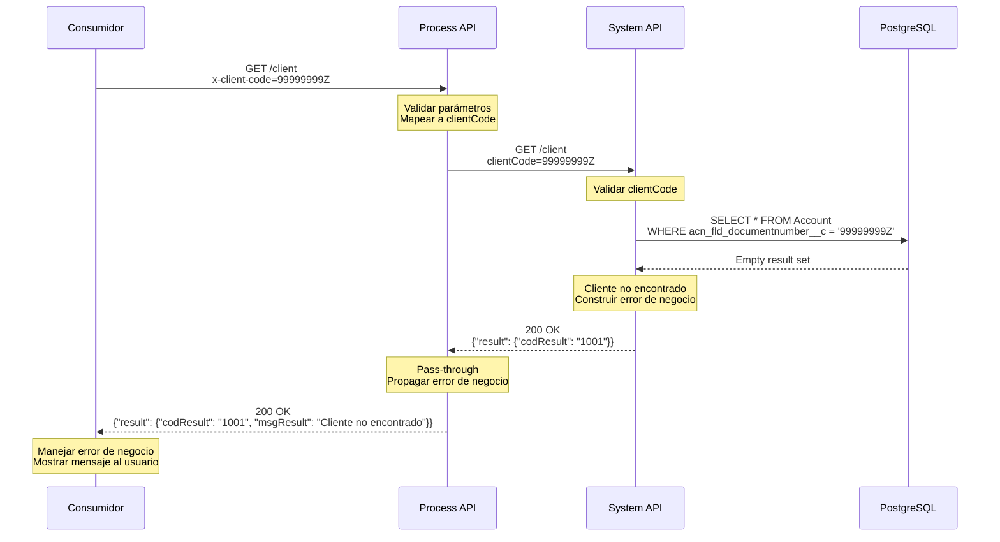
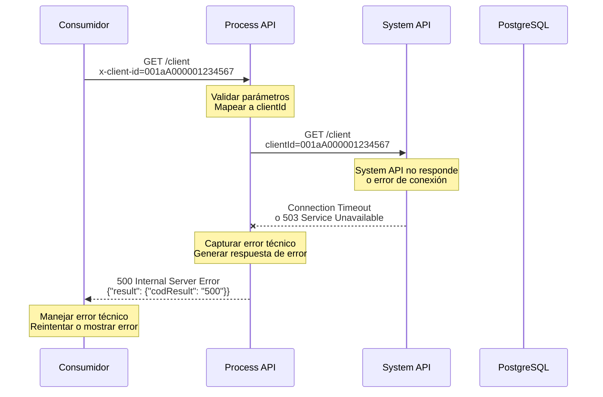

# GET /client

## 📌 Descripción General

### Propósito del Endpoint

Endpoint de orquestación que recupera información completa del cliente desde el System API, con funcionalidad opcional de tracking de última fecha de login.

### Tipo de API

**Capa:** Process API (Orquestación)

### Patrón de Integración

**Tipo:** Pass-Through con Enriquecimiento Asíncrono

**Características:**
- ✅ **Pass-Through**: La respuesta del System API se retorna sin modificaciones
- ✅ **Mapeo de Parámetros**: Convierte headers/query params entre capas
- ✅ **Enriquecimiento Asíncrono**: Actualiza fecha de login en Salesforce sin bloquear respuesta
- ❌ **NO Transforma**: No modifica la estructura de datos del System API

### Arquitectura API-Led Connectivity



---

## 💼 Propósito del Negocio

### Casos de Uso Principales

1. **Consulta de información del cliente**: Permite a cualquier canal obtener datos completos del cliente de forma unificada
2. **Tracking de actividad**: Registra la última fecha de acceso del cliente para análisis de engagement
3. **Validación de identidad**: Verifica la existencia del cliente antes de operaciones críticas
4. **Enriquecimiento de contexto**: Proporciona datos del cliente para personalización de experiencias

### Contexto Empresarial

- **Dominio:** Gestión de Clientes - FUA (Ficha Única de Abonado)
- **Sector:** Energía - Utilities (Naturgy España - NewCo Division)
- **División:** NewCo
- **Criticidad:** Alta - Endpoint fundamental para operaciones de atención al cliente

### Stakeholders

- **Agentes de call center**: Consultan información durante llamadas para atención personalizada
- **Clientes finales**: Acceden a su información vía portal web y aplicaciones móviles
- **Sistemas de terceros**: Integraciones autorizadas para servicios complementarios
- **Sistemas de voz (IVR/ATC)**: Consultas automatizadas durante interacciones telefónicas
- **Equipos de análisis**: Utilizan datos de tracking para métricas de engagement

### Valor de Negocio

- **Unificación de datos**: Proporciona una vista única del cliente consolidando múltiples fuentes
- **Mejora de experiencia**: Permite personalización basada en información completa del cliente
- **Eficiencia operativa**: Reduce tiempo de consulta al centralizar acceso a datos
- **Cumplimiento GDPR**: Facilita gestión de consentimientos y preferencias del cliente
- **Trazabilidad**: Tracking de accesos para auditoría y análisis de comportamiento

### Consumidores Potenciales

Este endpoint puede ser consumido por cualquier Experience API que necesite información del cliente, incluyendo:
- Portales web de autoservicio (FUA Portal)
- Aplicaciones móviles de clientes
- Sistemas de agentes de call center
- Aplicaciones de voz (IVR/ATC)
- Integraciones de terceros autorizados

### 🔗 Endpoints Dependientes

Este Process API consume el siguiente System API:

| System API | Endpoint | Método | Propósito |
|------------|----------|--------|-----------|
| `ntgy-newco-s-postgresql-salesforce` | `/client` | GET | Obtiene información completa del cliente desde PostgreSQL/Salesforce |

#### Flujo de Orquestación



#### Lógica de Orquestación

1. **Paso 1**: Recibe parámetros `x-client-id` o `x-client-code` del consumidor
2. **Paso 2**: Mapea parámetros a `clientId` o `clientCode` para el System API
3. **Paso 3**: Invoca System API de forma síncrona
4. **Paso 4** (Opcional): Si `loginDate=true`, actualiza fecha de login en Salesforce de forma **asíncrona** (no bloquea respuesta)
5. **Paso 5**: Retorna respuesta del System API sin modificaciones (pass-through)

#### Transformaciones Aplicadas

⚠️ **Este Process API NO transforma la respuesta del System API.**

**Mapeo de Parámetros:**

| Parámetro Entrada (Consumidor) | Parámetro Salida (System API) | Transformación |
|---------------------------------|-------------------------------|----------------|
| `x-client-id` (query param) | `clientId` (query param) | Renombrado |
| `x-client-code` (query param) | `clientCode` (query param) | Renombrado |
| `loginDate` (query param) | N/A | Trigger para actualización asíncrona en Salesforce |

**Funcionalidad Adicional:**

| Funcionalidad | Descripción |
|---------------|-------------|
| **Async Login Tracking** | Si `loginDate=true`, actualiza `NewCo_Fecha_Ultimo_login__c` en Salesforce Account usando Composite API |
| **Parameter Validation** | Valida que al menos uno de los identificadores esté presente |
| **Error Propagation** | Propaga errores del System API sin modificación |

Para el schema completo de la respuesta, consultar:
📖 **System API: `ntgy-newco-s-postgresql-salesforce` endpoint `/client`**

---

## 🔧 Especificación Técnica

### URLs por Ambiente

| Ambiente | URL Base | URL Completa |
|----------|----------|--------------|
| **Local** | `http://localhost:8081` | `http://localhost:8081/api/client` |
| **Dev** | `https://ntgy-newco-p-fua-evo-dev.cloudhub.io` | `https://ntgy-newco-p-fua-evo-dev.cloudhub.io/api/client` |
| **Test** | `https://ntgy-newco-p-fua-evo-test.cloudhub.io` | `https://ntgy-newco-p-fua-evo-test.cloudhub.io/api/client` |
| **UAT** | `https://ntgy-newco-p-fua-evo-uat.cloudhub.io` | `https://ntgy-newco-p-fua-evo-uat.cloudhub.io/api/client` |
| **Prod** | `https://ntgy-newco-p-fua-evo.cloudhub.io` | `https://ntgy-newco-p-fua-evo.cloudhub.io/api/client` |

### Método HTTP

```
GET /client
```

### Parámetros de Entrada

#### Query Parameters

| Parámetro | Tipo | Obligatorio | Descripción | Ejemplo | Validación |
|-----------|------|-------------|-------------|---------|------------|
| `x-client-id` | string | Condicional* | Salesforce Account ID (SFID format: 18-character alphanumeric). Primary identifier for direct client lookup. | `001aA000001234567` | Pattern: `^[a-zA-Z0-9]{15,18}$` |
| `x-client-code` | string | Condicional* | Client document number (DNI/NIF/NIE/CIF). Alternative identifier when Salesforce Account ID is not available. | `12345678A` | minLength: 1, maxLength: 50 |
| `loginDate` | string | No | Flag to trigger asynchronous update of last login timestamp in Salesforce. When set to "true": Updates `NewCo_Fecha_Ultimo_login__c` field in Account object. Any other value or omission: No update is performed. Update is ASYNCHRONOUS (doesn't block or affect the response). | `true` | Enum: `["true", "false"]`, Default: `false` |

**\* Condicional:** Al menos uno de `x-client-id` o `x-client-code` debe estar presente.

**Prioridad de Parámetros:**
- Si ambos `x-client-id` y `x-client-code` están presentes, `x-client-id` toma precedencia
- El System API maneja la lógica de búsqueda basada en el parámetro proporcionado

#### Headers HTTP

Este endpoint no requiere headers específicos más allá de los estándar HTTP.

**Headers Recomendados (Opcionales):**

| Header | Descripción | Ejemplo |
|--------|-------------|---------|
| `x-interaction-id` | ID de trazabilidad para correlación de logs | `550e8400-e29b-41d4-a716-446655440000` |
| `x-user-id` | ID del usuario/agente que realiza la petición | `agent123` |
| `x-agent-mail` | Email del agente (para auditoría) | `agente@naturgy.com` |

### Respuestas

#### Respuesta Exitosa (200 OK)

**HTTP Status:** `200 OK`

**Descripción:**

Request processed successfully.

⚠️ **RESPONSE SCHEMA - SINGLE SOURCE OF TRUTH:**

Este endpoint retorna la respuesta UNCHANGED del System API.

**Para el schema COMPLETO y AUTORITATIVO, incluyendo:**
- Todos los campos disponibles y sus tipos de datos
- Descripciones de campos y reglas de negocio
- Restricciones de validación
- Ejemplos completos con todos los campos opcionales
- Estructuras de objetos anidados (contacts, address, gdprPreferences, alianzas, etc.)

**Por favor, consultar:**
📖 **`ntgy-newco-s-postgresql-salesforce /client` endpoint documentation**

---

**Response Codes (Business Logic):**

Este HTTP 200 status se retorna tanto para éxito como para errores de negocio.
Verificar `result.codResult` en el response body:

| codResult | Significado | Descripción |
|-----------|-------------|-------------|
| `0000` | Cliente encontrado exitosamente | Datos del cliente retornados correctamente |
| `1001` | Cliente no encontrado en base de datos | No existe un cliente con el ID o código proporcionado |

**Maintenance Note:**

Cualquier cambio en la estructura de la respuesta se documenta exclusivamente en el System API. Esta documentación del Process API permanece válida ya que es pass-through sin transformaciones.

**Content-Type:** `application/json`

**Ejemplo de Respuesta Exitosa (codResult: 0000):**

```json
{
  "result": {
    "codResult": "0000",
    "msgResult": "Cliente encontrado"
  },
  "client": {
    "clientId": "001aA000001234567",
    "docNumber": "12345678A",
    "name": "Juan",
    "surname": "García",
    "surname2": "López",
    "email": "juan.garcia@example.com",
    "phone": "+34912345678",
    "isIndividualClient": true,
    "preferredLanguage": "es",
    "fiscalAddress": {
      "fullAddress": "Calle Mayor 123, 28013 Madrid",
      "zipCode": "28013",
      "province": "Madrid",
      "city": "Madrid",
      "way": "Calle Mayor",
      "number": "123"
    },
    "gdprPreferences": {
      "marketingConsent": true,
      "dataProcessingConsent": true,
      "consentDate": "2024-01-15"
    },
    "contacts": [
      {
        "contactId": "003aA000002345678",
        "name": "Juan García López",
        "email": "juan.garcia@example.com",
        "phone": "+34912345678",
        "role": "Titular"
      }
    ],
    "alianzas": [
      {
        "alianzaId": "a01aA000003456789",
        "alianzaName": "Alianza Energía Verde",
        "startDate": "2024-01-01",
        "endDate": "2024-12-31"
      }
    ]
  }
}
```

**Ejemplo de Respuesta de Negocio (codResult: 1001):**

```json
{
  "result": {
    "codResult": "1001",
    "msgResult": "Cliente no encontrado"
  }
}
```

#### Respuesta de Error - Bad Request (400)

**HTTP Status:** `400 Bad Request`

**Descripción:**

Bad request - Invalid parameters or malformed request.
Returned by APIKit when query parameters don't match expected format.

**Causas Comunes:**
- Ninguno de los identificadores (`x-client-id`, `x-client-code`) fue proporcionado
- Formato inválido de `x-client-id` (no cumple pattern `^[a-zA-Z0-9]{15,18}$`)
- Parámetros con tipos de datos incorrectos

**Content-Type:** `application/json`

**Ejemplo:**

```json
{
  "result": {
    "codResult": "400",
    "msgResult": "Bad request - At least one identifier (x-client-id or x-client-code) is required"
  }
}
```

#### Respuesta de Error - Internal Server Error (500)

**HTTP Status:** `500 Internal Server Error`

**Descripción:**

Internal server error - Unexpected system error.

**Posibles Causas:**
- System API connection failure
- Database connection failure (downstream in System API)
- Query execution error (downstream in System API)
- Salesforce API error (for async login update - doesn't affect response)
- Unexpected exception in orchestration logic

**Content-Type:** `application/json`

**Ejemplo:**

```json
{
  "result": {
    "codResult": "500",
    "msgResult": "Internal server error - Unable to connect to System API"
  }
}
```

#### Respuesta de Error - Service Unavailable (503)

**HTTP Status:** `503 Service Unavailable`

**Descripción:**

Service temporarily unavailable.

**Posibles Causas:**
- System API is down or unreachable
- Database maintenance window
- CloudHub deployment in progress
- Circuit breaker activated (if implemented)

**Content-Type:** `application/json`

**Ejemplo:**

```json
{
  "result": {
    "codResult": "503",
    "msgResult": "Service unavailable - System API is temporarily unreachable"
  }
}
```

### Autenticación y Autorización

**Tipo:** Delegada al consumidor (Experience API)

Este Process API confía en que las peticiones ya están autenticadas por la capa Experience API. No implementa validación de autenticación propia.

**Modelo de Seguridad:**



**Responsabilidades por Capa:**

| Capa | Responsabilidad | Implementación |
|------|-----------------|----------------|
| **Experience API** | Autenticación del usuario final | OAuth 2.0, JWT, API Key |
| **Process API** | Confianza en Experience API | Sin validación adicional |
| **System API** | Acceso a datos | Credenciales de BD seguras |

**Consideraciones de Seguridad:**
- La autenticación se maneja en la Experience API (OAuth 2.0, JWT, API Key, etc.)
- Este endpoint asume que las peticiones provienen de fuentes confiables
- Para acceso directo (testing), se requiere acceso a la red interna de CloudHub
- Comunicación HTTPS (TLS 1.2+) obligatoria
- Process API solo accesible desde VPC de CloudHub

### Timeouts Configurados

- **Timeout del Endpoint**: 30 segundos
- **Timeout System API**: Configurado en el System API (típicamente 30s)
- **Timeout Salesforce (async)**: 60 segundos (no afecta la respuesta)

### Protocolo

- **Protocolo**: HTTPS (TLS 1.2+)
- **Content-Type**: `application/json`
- **Charset**: UTF-8

---

## 🏗️ Implementación Técnica

### Arquitectura del Flow



### Transformaciones DataWeave

**Mapeo de Parámetros (Entrada):**

```dataweave
%dw 2.0
output application/json
---
{
  // Mapeo de parámetros de entrada
  clientId: attributes.queryParams.'x-client-id',
  clientCode: attributes.queryParams.'x-client-code',
  // loginDate se procesa internamente, no se envía al System API
}
```

**Pass-Through de Respuesta:**

```dataweave
%dw 2.0
output application/json
---
// La respuesta del System API se retorna sin modificaciones
payload
```

### Patrones de Diseño Utilizados

**Patrón Principal:** Pass-Through con Enriquecimiento Asíncrono

**Justificación:**
- **Pass-Through**: Mantiene consistencia de datos con el System API (SOURCE OF TRUTH)
- **Async Enhancement**: Permite tracking de login sin impactar performance
- **Parameter Mapping**: Abstrae diferencias de nomenclatura entre capas
- **Error Propagation**: Simplifica manejo de errores manteniendo semántica original

**Patrones Adicionales:**
- **Delegation Pattern**: Delega autenticación a Experience API
- **Fail Fast**: Validación temprana de parámetros en APIKit
- **Fire and Forget**: Actualización asíncrona de Salesforce

### Diagramas de Secuencia

#### 1. Flujo Normal de Éxito (con Login Tracking)



#### 2. Flujo con Error de Negocio (Cliente No Encontrado)



#### 3. Flujo con Error Técnico (System API No Disponible)



### Connection Pooling y Optimizaciones

**HTTP Connector (Process API → System API):**

```xml
<http:request-config name="HTTP_Request_s_postgresql-salesforce">
    <http:request-connection>
        <http:pooling-profile 
            maxActive="20" 
            maxIdle="10" 
            initialisationPolicy="INITIALISE_ONE"
            exhaustedAction="WHEN_EXHAUSTED_WAIT"
            maxWait="30000"/>
    </http:request-connection>
</http:request-config>
```

**Configuración:**
- **Max Active Connections**: 20
- **Max Idle Connections**: 10
- **Max Wait Time**: 30 segundos
- **Exhausted Action**: Wait for available connection

**Beneficios:**
- Reduce latencia de establecimiento de conexión
- Soporta concurrencia de hasta 20 peticiones simultáneas
- Reutilización eficiente de conexiones TCP

**Optimizaciones Específicas:**

1. **Async Login Update**
   - Operación no bloqueante usando `<async>` scope
   - No afecta el tiempo de respuesta al consumidor
   - Timeout independiente (60s) sin impacto en respuesta

2. **Parameter Validation**
   - Validación temprana en APIKit (fail fast)
   - Evita llamadas innecesarias al System API

3. **Error Propagation**
   - Pass-through de errores sin procesamiento adicional
   - Minimiza overhead en casos de error

4. **Minimal Transformation**
   - Solo renombrado de parámetros (operación O(1))
   - Sin parsing/serialización adicional de JSON

### Performance Esperado

| Escenario | Tiempo Esperado | Percentil 95 | Notas |
|-----------|-----------------|--------------|-------|
| **Búsqueda exitosa** | < 600ms | < 800ms | Incluye query a PostgreSQL + construcción de respuesta |
| **Cliente no encontrado** | < 400ms | < 600ms | Query rápido sin construcción de objeto complejo |
| **Con loginDate=true** | < 650ms | < 850ms | Async update no bloquea, +50ms overhead |
| **Error de conexión** | < 100ms | < 200ms | Fail fast en timeout de conexión |

### Manejo de Errores

**Estrategia:** Error Propagation Pattern

**Implementación:**
- Los errores del System API se propagan sin modificación
- Errores de conexión se capturan y se convierten en HTTP 500
- Validaciones de APIKit generan HTTP 400
- Errores de Salesforce (async) se loggean pero no afectan la respuesta

**Try-Catch Blocks:**
```xml
<try>
    <http:request config-ref="HTTP_Request_s_postgresql-salesforce" 
                  path="/client" 
                  method="GET"/>
    <error-handler>
        <on-error-propagate type="HTTP:CONNECTIVITY">
            <!-- Generar respuesta 500 -->
        </on-error-propagate>
        <on-error-propagate type="HTTP:TIMEOUT">
            <!-- Generar respuesta 503 -->
        </on-error-propagate>
    </error-handler>
</try>
```

### Troubleshooting

**Problemas Comunes:**

| Problema | Causa | Solución |
|----------|-------|----------|
| **400 Bad Request** | Parámetros faltantes o inválidos | Verificar que x-client-id o x-client-code estén presentes |
| **500 Internal Error** | System API no responde | Verificar estado del System API en CloudHub |
| **503 Service Unavailable** | System API caído | Esperar a que el System API se recupere |
| **Respuesta lenta (>2s)** | Database overload | Revisar performance del System API |

**Comandos de Diagnóstico:**

```bash
# Verificar estado del Process API
curl -X GET "https://ntgy-newco-p-fua-evo.cloudhub.io/api/health"

# Test con trazabilidad
curl -X GET "https://ntgy-newco-p-fua-evo.cloudhub.io/api/client?x-client-id=001aA000001234567" \
  -H "x-interaction-id: test-$(date +%s)"

# Verificar logs en CloudHub
# Runtime Manager > Applications > ntgy-newco-p-fua-evo > Logs
```

### Seguridad y Cumplimiento

**Protección de Datos Personales (GDPR):**

| Dato | Clasificación | Protección |
|------|---------------|------------|
| Email | PII | Encriptado en tránsito (HTTPS) |
| Teléfono | PII | Encriptado en tránsito (HTTPS) |
| Número de documento | PII Sensible | Encriptado en tránsito (HTTPS) |
| Dirección fiscal | PII | Encriptado en tránsito (HTTPS) |
| Consentimientos GDPR | Datos de Consentimiento | Almacenado en PostgreSQL |

**Cumplimiento GDPR:**
- ✅ Derecho de Acceso: Este endpoint permite al cliente acceder a sus datos
- ✅ Minimización de Datos: Solo retorna datos necesarios
- ✅ Consentimientos: Incluye información de consentimientos GDPR
- ✅ Encriptación: Datos encriptados en tránsito (HTTPS)

**Audit Logging:**

Todos los accesos a datos de clientes se registran con:
- Timestamp de la petición
- Usuario/agente que realizó la consulta (x-user-id, x-agent-mail)
- Cliente consultado (clientId/clientCode)
- Resultado de la operación (codResult)
- ID de trazabilidad (x-interaction-id)

---

## 💻 Ejemplos de Uso

### Ejemplo 1: Búsqueda Exitosa por Client ID

#### cURL

```bash
curl -X GET "https://ntgy-newco-p-fua-evo.cloudhub.io/api/client?x-client-id=001aA000001234567" \
  -H "Content-Type: application/json" \
  -H "x-interaction-id: 550e8400-e29b-41d4-a716-446655440000" \
  -H "x-user-id: agent123" \
  -H "x-agent-mail: agente@naturgy.com"
```

#### Respuesta (200 OK)

```json
{
  "result": {
    "codResult": "0000",
    "msgResult": "Cliente encontrado"
  },
  "client": {
    "clientId": "001aA000001234567",
    "docNumber": "12345678A",
    "name": "Juan",
    "surname": "García",
    "surname2": "López",
    "email": "juan.garcia@example.com",
    "phone": "+34912345678",
    "isIndividualClient": true,
    "preferredLanguage": "es",
    "fiscalAddress": {
      "fullAddress": "Calle Mayor 123, 28013 Madrid",
      "zipCode": "28013",
      "province": "Madrid",
      "city": "Madrid",
      "way": "Calle Mayor",
      "number": "123"
    },
    "gdprPreferences": {
      "marketingConsent": true,
      "dataProcessingConsent": true,
      "consentDate": "2024-01-15"
    },
    "contacts": [
      {
        "contactId": "003aA000002345678",
        "name": "Juan García López",
        "email": "juan.garcia@example.com",
        "phone": "+34912345678",
        "role": "Titular"
      }
    ],
    "alianzas": [
      {
        "alianzaId": "a01aA000003456789",
        "alianzaName": "Alianza Energía Verde",
        "startDate": "2024-01-01",
        "endDate": "2024-12-31"
      }
    ]
  }
}
```

---

### Ejemplo 2: Búsqueda por Client Code con Login Tracking

#### cURL

```bash
curl -X GET "https://ntgy-newco-p-fua-evo.cloudhub.io/api/client?x-client-code=12345678A&loginDate=true" \
  -H "Content-Type: application/json" \
  -H "x-interaction-id: 550e8400-e29b-41d4-a716-446655440001"
```

#### Respuesta (200 OK)

```json
{
  "result": {
    "codResult": "0000",
    "msgResult": "Cliente encontrado"
  },
  "client": {
    "clientId": "001aA000001234567",
    "docNumber": "12345678A",
    "name": "Juan",
    "surname": "García",
    "surname2": "López",
    "email": "juan.garcia@example.com",
    "phone": "+34912345678"
  }
}
```

**Nota:** La actualización de `loginDate` en Salesforce ocurre de forma asíncrona y no afecta la respuesta.

---

### Ejemplo 3: Cliente No Encontrado

#### cURL

```bash
curl -X GET "https://ntgy-newco-p-fua-evo.cloudhub.io/api/client?x-client-code=99999999Z" \
  -H "Content-Type: application/json"
```

#### Respuesta (200 OK - Error de Negocio)

```json
{
  "result": {
    "codResult": "1001",
    "msgResult": "Cliente no encontrado"
  }
}
```

---

### Ejemplo 4: Error de Parámetros (400 Bad Request)

#### cURL

```bash
# Sin parámetros de identificación
curl -X GET "https://ntgy-newco-p-fua-evo.cloudhub.io/api/client" \
  -H "Content-Type: application/json"
```

#### Respuesta (400 Bad Request)

```json
{
  "result": {
    "codResult": "400",
    "msgResult": "Bad request - At least one identifier (x-client-id or x-client-code) is required"
  }
}
```

---

### Ejemplo 5: JavaScript (Fetch API)

```javascript
// Búsqueda por Client ID con manejo de errores
async function getClientInfo(clientId) {
  const url = `https://ntgy-newco-p-fua-evo.cloudhub.io/api/client?x-client-id=${clientId}`;
  
  try {
    const response = await fetch(url, {
      method: 'GET',
      headers: {
        'Content-Type': 'application/json',
        'x-interaction-id': crypto.randomUUID(),
        'x-user-id': 'web-user-123'
      }
    });
    
    const data = await response.json();
    
    // Verificar código de resultado de negocio
    if (data.result.codResult === '0000') {
      console.log('Cliente encontrado:', data.client);
      return data.client;
    } else if (data.result.codResult === '1001') {
      console.warn('Cliente no encontrado');
      return null;
    } else {
      throw new Error(`Error de negocio: ${data.result.msgResult}`);
    }
    
  } catch (error) {
    console.error('Error al consultar cliente:', error);
    throw error;
  }
}

// Uso
getClientInfo('001aA000001234567')
  .then(client => {
    if (client) {
      console.log(`Bienvenido ${client.name} ${client.surname}`);
    }
  })
  .catch(error => {
    console.error('Error:', error);
  });
```

---

### Ejemplo 6: JavaScript (Axios)

```javascript
const axios = require('axios');

// Configuración base
const apiClient = axios.create({
  baseURL: 'https://ntgy-newco-p-fua-evo.cloudhub.io/api',
  timeout: 30000,
  headers: {
    'Content-Type': 'application/json'
  }
});

// Función para obtener información del cliente
async function getClient(clientId, clientCode, trackLogin = false) {
  try {
    const params = {};
    if (clientId) params['x-client-id'] = clientId;
    if (clientCode) params['x-client-code'] = clientCode;
    if (trackLogin) params.loginDate = 'true';
    
    const response = await apiClient.get('/client', {
      params,
      headers: {
        'x-interaction-id': generateUUID(),
        'x-user-id': 'agent-456',
        'x-agent-mail': 'agente@naturgy.com'
      }
    });
    
    // Verificar resultado de negocio
    if (response.data.result.codResult === '0000') {
      return {
        success: true,
        data: response.data.client
      };
    } else {
      return {
        success: false,
        error: response.data.result.msgResult,
        code: response.data.result.codResult
      };
    }
    
  } catch (error) {
    console.error('Error en petición:', error.message);
    return {
      success: false,
      error: error.message,
      code: error.response?.status || 'NETWORK_ERROR'
    };
  }
}

// Helper para generar UUID
function generateUUID() {
  return 'xxxxxxxx-xxxx-4xxx-yxxx-xxxxxxxxxxxx'.replace(/[xy]/g, function(c) {
    const r = Math.random() * 16 | 0;
    const v = c === 'x' ? r : (r & 0x3 | 0x8);
    return v.toString(16);
  });
}

// Uso
(async () => {
  // Búsqueda por ID con tracking de login
  const result = await getClient('001aA000001234567', null, true);
  
  if (result.success) {
    console.log('Cliente:', result.data.name, result.data.surname);
    console.log('Email:', result.data.email);
  } else {
    console.error('Error:', result.error, '(Código:', result.code, ')');
  }
})();
```

---

### Ejemplo 7: Python (requests)

```python
import requests
import uuid
from typing import Optional, Dict, Any

class ClientAPIClient:
    """Cliente para interactuar con el Process API de clientes"""
    
    def __init__(self, base_url: str = "https://ntgy-newco-p-fua-evo.cloudhub.io/api"):
        self.base_url = base_url
        self.timeout = 30
    
    def get_client(
        self, 
        client_id: Optional[str] = None,
        client_code: Optional[str] = None,
        track_login: bool = False,
        user_id: Optional[str] = None,
        agent_mail: Optional[str] = None
    ) -> Dict[str, Any]:
        """
        Obtiene información del cliente
        
        Args:
            client_id: Salesforce Account ID
            client_code: Número de documento del cliente
            track_login: Si True, actualiza fecha de último login
            user_id: ID del usuario/agente
            agent_mail: Email del agente
            
        Returns:
            Dict con resultado de la operación
        """
        # Validar que al menos un identificador esté presente
        if not client_id and not client_code:
            return {
                "success": False,
                "error": "At least one identifier (client_id or client_code) is required",
                "code": "VALIDATION_ERROR"
            }
        
        # Construir parámetros
        params = {}
        if client_id:
            params['x-client-id'] = client_id
        if client_code:
            params['x-client-code'] = client_code
        if track_login:
            params['loginDate'] = 'true'
        
        # Construir headers
        headers = {
            'Content-Type': 'application/json',
            'x-interaction-id': str(uuid.uuid4())
        }
        if user_id:
            headers['x-user-id'] = user_id
        if agent_mail:
            headers['x-agent-mail'] = agent_mail
        
        try:
            # Realizar petición
            response = requests.get(
                f"{self.base_url}/client",
                params=params,
                headers=headers,
                timeout=self.timeout
            )
            
            # Parsear respuesta
            data = response.json()
            
            # Verificar código de resultado de negocio
            if response.status_code == 200:
                if data['result']['codResult'] == '0000':
                    return {
                        "success": True,
                        "data": data['client'],
                        "interaction_id": headers['x-interaction-id']
                    }
                else:
                    return {
                        "success": False,
                        "error": data['result']['msgResult'],
                        "code": data['result']['codResult'],
                        "interaction_id": headers['x-interaction-id']
                    }
            else:
                return {
                    "success": False,
                    "error": f"HTTP {response.status_code}: {data.get('result', {}).get('msgResult', 'Unknown error')}",
                    "code": str(response.status_code),
                    "interaction_id": headers['x-interaction-id']
                }
                
        except requests.exceptions.Timeout:
            return {
                "success": False,
                "error": "Request timeout after 30 seconds",
                "code": "TIMEOUT"
            }
        except requests.exceptions.ConnectionError:
            return {
                "success": False,
                "error": "Connection error - unable to reach API",
                "code": "CONNECTION_ERROR"
            }
        except Exception as e:
            return {
                "success": False,
                "error": str(e),
                "code": "UNEXPECTED_ERROR"
            }

# Uso
if __name__ == "__main__":
    client = ClientAPIClient()
    
    # Ejemplo 1: Búsqueda por Client ID
    result = client.get_client(
        client_id="001aA000001234567",
        track_login=True,
        user_id="agent-789",
        agent_mail="agente@naturgy.com"
    )
    
    if result["success"]:
        client_data = result["data"]
        print(f"Cliente encontrado: {client_data['name']} {client_data['surname']}")
        print(f"Email: {client_data['email']}")
        print(f"Teléfono: {client_data['phone']}")
        print(f"Interaction ID: {result['interaction_id']}")
    else:
        print(f"Error: {result['error']} (Código: {result['code']})")
    
    # Ejemplo 2: Búsqueda por Client Code
    result2 = client.get_client(client_code="12345678A")
    
    if result2["success"]:
        print(f"\nCliente encontrado por código: {result2['data']['name']}")
    else:
        print(f"\nError: {result2['error']}")
```

---

### Ejemplo 8: Postman Collection

```json
{
  "info": {
    "name": "Process API - Client Endpoints",
    "description": "Collection para testing del endpoint GET /client",
    "schema": "https://schema.getpostman.com/json/collection/v2.1.0/collection.json"
  },
  "item": [
    {
      "name": "GET Client by ID (Success)",
      "request": {
        "method": "GET",
        "header": [
          {
            "key": "Content-Type",
            "value": "application/json"
          },
          {
            "key": "x-interaction-id",
            "value": "{{$guid}}"
          },
          {
            "key": "x-user-id",
            "value": "postman-test"
          }
        ],
        "url": {
          "raw": "{{base_url}}/client?x-client-id={{client_id}}",
          "host": ["{{base_url}}"],
          "path": ["client"],
          "query": [
            {
              "key": "x-client-id",
              "value": "{{client_id}}"
            }
          ]
        }
      },
      "response": []
    },
    {
      "name": "GET Client by Code with Login Tracking",
      "request": {
        "method": "GET",
        "header": [
          {
            "key": "Content-Type",
            "value": "application/json"
          },
          {
            "key": "x-interaction-id",
            "value": "{{$guid}}"
          }
        ],
        "url": {
          "raw": "{{base_url}}/client?x-client-code={{client_code}}&loginDate=true",
          "host": ["{{base_url}}"],
          "path": ["client"],
          "query": [
            {
              "key": "x-client-code",
              "value": "{{client_code}}"
            },
            {
              "key": "loginDate",
              "value": "true"
            }
          ]
        }
      },
      "response": []
    },
    {
      "name": "GET Client - Not Found",
      "request": {
        "method": "GET",
        "header": [
          {
            "key": "Content-Type",
            "value": "application/json"
          }
        ],
        "url": {
          "raw": "{{base_url}}/client?x-client-code=99999999Z",
          "host": ["{{base_url}}"],
          "path": ["client"],
          "query": [
            {
              "key": "x-client-code",
              "value": "99999999Z"
            }
          ]
        }
      },
      "response": []
    },
    {
      "name": "GET Client - Bad Request (No Params)",
      "request": {
        "method": "GET",
        "header": [
          {
            "key": "Content-Type",
            "value": "application/json"
          }
        ],
        "url": {
          "raw": "{{base_url}}/client",
          "host": ["{{base_url}}"],
          "path": ["client"]
        }
      },
      "response": []
    }
  ],
  "variable": [
    {
      "key": "base_url",
      "value": "https://ntgy-newco-p-fua-evo.cloudhub.io/api",
      "type": "string"
    },
    {
      "key": "client_id",
      "value": "001aA000001234567",
      "type": "string"
    },
    {
      "key": "client_code",
      "value": "12345678A",
      "type": "string"
    }
  ]
}
```

---

## 📚 Referencias

### Documentación de APIs

| Recurso | Descripción | Ubicación |
|---------|-------------|-----------|
| **System API Documentation** | Documentación completa del endpoint `/client` (SOURCE OF TRUTH) | `../ntgy-newco-s-postgresql-salesforce/docs/api-endpoints/GET-client.md` |
| **RAML Specification** | Especificación RAML del Process API | `src/main/resources/api/ntgy-newco-p-fua.raml` |
| **Flow Implementation** | Implementación del flow en MuleSoft | `src/main/mule/services/clients/clientInfo.xml` |

### Anypoint Platform

| Recurso | Descripción | URL |
|---------|-------------|-----|
| **Anypoint Exchange** | API Portal y documentación pública | [Anypoint Exchange](https://anypoint.mulesoft.com/exchange/) |
| **Runtime Manager** | Gestión de aplicaciones en CloudHub | [Runtime Manager](https://anypoint.mulesoft.com/cloudhub/) |
| **API Manager** | Políticas y gestión de APIs | [API Manager](https://anypoint.mulesoft.com/apimanager/) |
| **Monitoring** | Dashboards y métricas | [Anypoint Monitoring](https://anypoint.mulesoft.com/monitoring/) |

### Repositorios Git

| Repositorio | Descripción | URL |
|-------------|-------------|-----|
| **Process API** | Este proyecto (ntgy-newco-p-fua-evo) | `http://99007683@scmcorp.intranet.gasnatural.com/scm/clientes-mulesoft/ntgy-newco-p-fua-evo.git` |
| **System API** | ntgy-newco-s-postgresql-salesforce | `http://scmcorp.intranet.gasnatural.com/scm/clientes-mulesoft/ntgy-newco-s-postgresql-salesforce.git` |

### Documentación Relacionada

| Documento | Descripción | Ubicación |
|-----------|-------------|-----------|
| **Memory Bank** | Contexto completo del proyecto | `docs/memory-bank/` |
| **Project Brief** | Identidad y alcance del API | `docs/memory-bank/projectbrief.md` |
| **System Patterns** | Patrones de integración | `docs/memory-bank/systemPatterns.md` |
| **Tech Context** | Stack tecnológico | `docs/memory-bank/techContext.md` |
| **Prompt de Documentación** | Guía para documentar endpoints | `../../MuleSoft/prompts/endpoint-documentation-prompt.md` |

### Recursos Externos

| Recurso | Descripción | URL |
|---------|-------------|-----|
| **MuleSoft Documentation** | Documentación oficial de MuleSoft | [docs.mulesoft.com](https://docs.mulesoft.com) |
| **DataWeave Reference** | Referencia de DataWeave 2.0 | [DataWeave 2.0](https://docs.mulesoft.com/dataweave/2.4/) |
| **PostgreSQL Heroku** | Documentación de PostgreSQL en Heroku | [Heroku Postgres](https://devcenter.heroku.com/categories/postgres) |
| **Salesforce API** | Documentación de Salesforce REST API | [Salesforce REST API](https://developer.salesforce.com/docs/atlas.en-us.api_rest.meta/api_rest/) |

---

## 📝 Notas de Mantenimiento

### Principio SSOT (Single Source of Truth)

**⚠️ IMPORTANTE:** Este documento sigue el principio SSOT de API-Led Connectivity.

**Reglas de Mantenimiento:**

1. **Schema de Respuesta:**
   - ❌ **NO documentar** el schema completo en este documento
   - ✅ **SÍ referenciar** al System API como fuente de verdad
   - El System API `ntgy-newco-s-postgresql-salesforce` es el **único lugar** donde se documenta el schema completo

2. **Cambios en el Schema:**
   - Si el schema de respuesta cambia, **solo actualizar el System API**
   - Este documento del Process API **permanece válido** porque es pass-through
   - No requiere actualización a menos que cambie la lógica de orquestación

3. **Transformaciones:**
   - Si se añaden transformaciones, **documentar aquí** el mapeo de campos
   - Si se mantiene pass-through, **mantener la referencia** al System API

### Cuándo Actualizar Este Documento

**Actualización OBLIGATORIA cuando:**

| Cambio | Acción Requerida |
|--------|------------------|
| ✅ Nuevos parámetros de entrada | Actualizar Sección 3 "Especificación Técnica" |
| ✅ Cambio en lógica de orquestación | Actualizar Sección 2 "Endpoints Dependientes" y Sección 4 diagramas |
| ✅ Nuevas transformaciones | Documentar en Sección 2 "Transformaciones Aplicadas" |
| ✅ Cambio en async login tracking | Actualizar Sección 4 diagramas de secuencia |
| ✅ Nuevos códigos de error | Actualizar Sección 3 "Respuestas" |
| ✅ Cambio en timeouts | Actualizar Sección 3 "Timeouts Configurados" |
| ✅ Nuevas optimizaciones | Actualizar Sección 4 "Connection Pooling y Optimizaciones" |

**NO requiere actualización cuando:**

| Cambio | Razón |
|--------|-------|
| ❌ Cambios en schema del System API | Pass-through - referencia permanece válida |
| ❌ Nuevos campos en respuesta | Documentado en System API (SSOT) |
| ❌ Cambios en base de datos | Manejado por System API |
| ❌ Cambios en ejemplos de respuesta | System API es la fuente de verdad |

### Historial de Cambios

| Versión | Fecha | Autor | Cambios |
|---------|-------|-------|---------|
| **2.0.0** | 2026-06-02 | Cline AI Assistant | Reorganización a estructura de 5 secciones |
| | | | - Consolidación de 14 secciones en 5 principales |
| | | | - Mejora de navegabilidad y claridad |
| | | | - Mantenimiento de todo el contenido técnico |
| **1.0.0** | 2026-06-02 | Cline AI Assistant | Creación inicial del documento |
| | | | - Documentación completa de Process API |
| | | | - 3 diagramas de secuencia |
| | | | - Ejemplos funcionales en múltiples lenguajes |

### Checklist de Validación

Antes de considerar este documento completo, verificar:

#### ✅ Validación de Estructura (5 Secciones Obligatorias)

- [x] **Sección 1: Descripción General** - Completa con propósito, tipo de API, patrón, arquitectura
- [x] **Sección 2: Propósito del Negocio** - Completa con casos de uso, stakeholders, endpoints dependientes
- [x] **Sección 3: Especificación Técnica** - Completa con URLs, parámetros, respuestas, autenticación
- [x] **Sección 4: Implementación Técnica** - Completa con flows, transformaciones, diagramas (3), optimizaciones
- [x] **Sección 5: Ejemplos de Uso** - Completa con curl, JavaScript, Python, Postman

#### ✅ Validaciones de Contenido

- [x] Metadatos Docusaurus presentes en frontmatter YAML
- [x] `endpoint_dependencies` incluye System API consumido
- [x] No hay duplicación de schemas (referencia al System API)
- [x] Las referencias SSOT están claras
- [x] Los ejemplos son funcionales
- [x] Las URLs y rutas son correctas
- [x] Los códigos de error están documentados
- [x] Los diagramas Mermaid renderizan correctamente
- [x] Las tablas están completas
- [x] Los ejemplos de código tienen manejo de errores
- [x] Mínimo 3 diagramas de secuencia incluidos
- [x] Principio de Independencia del Consumidor aplicado

---

## 🎉 Documento Completo

Este documento ha sido reorganizado siguiendo la nueva estructura de 5 secciones para mejorar navegabilidad y claridad.

**Características:**
- ✅ Estructura de 5 secciones principales
- ✅ Documentación completa del endpoint GET /client
- ✅ 3 diagramas de secuencia (éxito + 2 errores)
- ✅ Ejemplos funcionales en múltiples lenguajes (cURL, JavaScript, Python, Postman)
- ✅ Principio de Independencia del Consumidor
- ✅ Referencias claras al System API (SSOT)
- ✅ Guía completa de troubleshooting integrada

**Versión:** 2.0.0  
**Fecha de Creación:** 2026-06-02  
**Última Actualización:** 2026-06-02  
**Estado:** ✅ Completo y Validado

---

**📖 Para consultar el schema completo de la respuesta, ver:**  
**System API: `ntgy-newco-s-postgresql-salesforce` endpoint `/client`**
