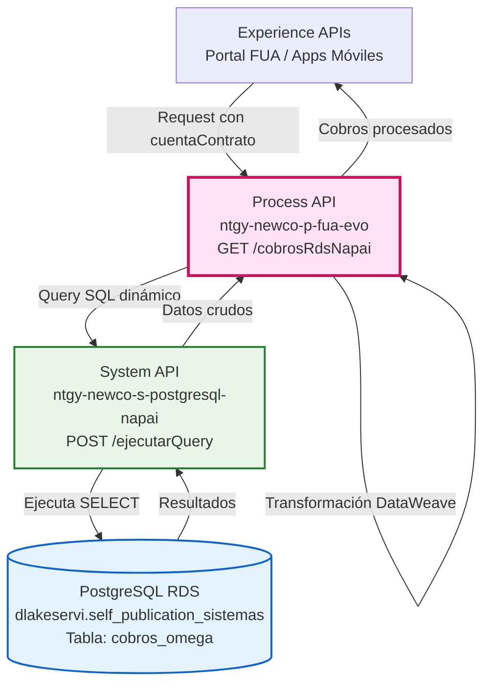
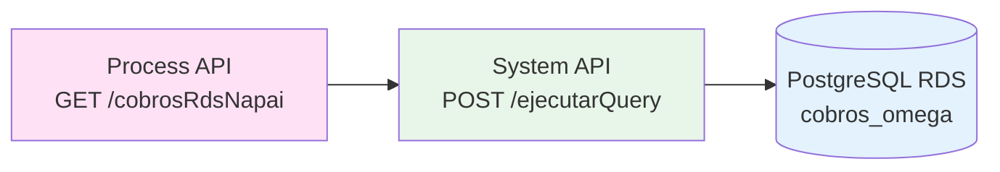
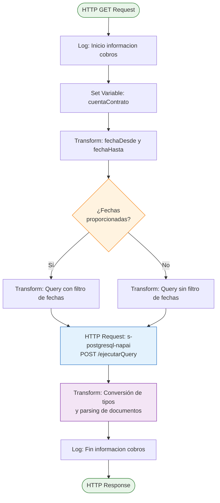
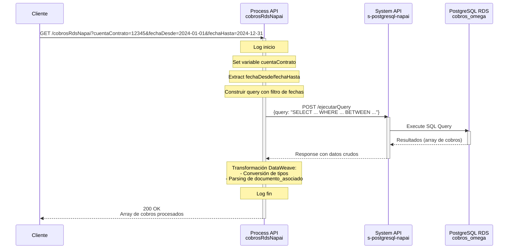
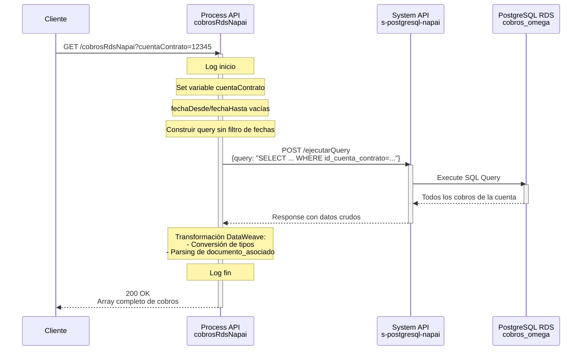
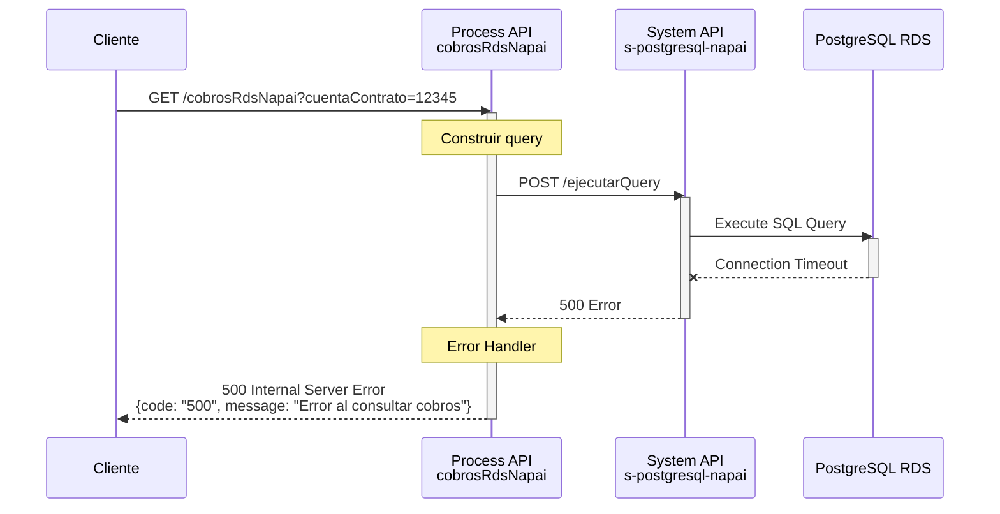

# GET /cobrosRdsNapai

## 📌 Descripción General

### Propósito del Endpoint

Este endpoint recupera el historial completo de cobros de agentes desde una base de datos RDS PostgreSQL (sistema Napai). Permite consultar todos los cobros asociados a una cuenta contrato específica, con la opción de filtrar por rango de fechas. El endpoint procesa y transforma la información de documentos asociados (facturas y cuotas fraccionadas) para presentarla de forma estructurada.

### Tipo de API

**Capa:** Process API (API-Led Connectivity)

**Función:** Orquestación de consulta de cobros con transformación de datos

### Patrón de Integración

**Tipo:** Orquestación con Transformación

**Descripción:** El Process API recibe la solicitud, construye dinámicamente una query SQL según los parámetros recibidos, invoca al System API de PostgreSQL para ejecutar la consulta, y transforma la respuesta aplicando conversiones de tipos y parsing complejo del campo `documento_asociado`.

### Arquitectura API-Led Connectivity



---

## 💼 Propósito del Negocio

### Casos de Uso Principales

1. **Consulta de Historial de Cobros para Agentes**
   - Los agentes de atención al cliente necesitan visualizar el historial completo de cobros de una cuenta
   - Permite identificar pagos realizados, documentos asociados y saldos
   - Facilita la resolución de consultas sobre pagos y facturación

2. **Análisis de Cobros por Período**
   - Filtrado por rango de fechas para análisis de cobros en períodos específicos
   - Útil para conciliaciones y auditorías
   - Permite identificar patrones de pago

3. **Seguimiento de Documentos Asociados**
   - Identifica qué facturas y cuotas fraccionadas están asociadas a cada cobro
   - Proporciona trazabilidad completa de los pagos
   - Facilita la gestión de cobros parciales y fraccionamientos

### 🔗 Endpoints Dependientes

Este Process API consume el siguiente System API:

| System API | Endpoint | Método | Propósito |
|------------|----------|--------|-----------|
| `ntgy-newco-s-postgresql-napai` | `/ejecutarQuery` | POST | Ejecuta queries SQL en la base de datos PostgreSQL RDS |

### Lógica de Orquestación



**Pasos del Proceso:**

1. **Validación de Parámetros**: Extrae `cuentaContrato` (obligatorio) y `fechaDesde`/`fechaHasta` (opcionales)
2. **Construcción de Query Dinámica**: Genera query SQL con o sin filtro de fechas según parámetros
3. **Invocación a System API**: Llama a `s-postgresql-napai` con la query construida
4. **Transformación de Respuesta**: Aplica conversiones de tipos y parsing del campo `documento_asociado`

### Transformaciones Aplicadas

Este Process API aplica transformaciones complejas sobre los datos del System API:

| Campo Original (System API) | Campo Transformado (Process API) | Transformación |
|------------------------------|----------------------------------|----------------|
| `id` (String) | `id` (Number o null) | Conversión a número, null si "NA" |
| `cod_cliente_sap` (String) | `cod_cliente_sap` (Number o null) | Conversión a número con default null |
| `haber` (String) | `haber` (Number o null) | Conversión a número con default null |
| `debe` (String) | `debe` (Number o null) | Conversión a número con default null |
| `saldo` (String) | `saldo` (Number o null) | Conversión a número con default null |
| `documento_asociado` (String) | `documento_asociado` (Array) | Parsing complejo con regex para extraer facturas y cuotas |

**Parsing del Campo `documento_asociado`:**

El campo `documento_asociado` contiene texto con información de facturas y cuotas que se parsea así:

- **Cuotas Fraccionadas**: Extrae números de cuotas del patrón `Cuota Frac. X, Y, Z`
- **Facturas**: Extrae número de factura e importe del patrón `NNNNNN (IMPORTE)`
- **Resultado**: Array de objetos con `numFactura`, `tipo` ("cuota_frac" o "factura"), `importeFact`

### Contexto Empresarial

- **Dominio:** Gestión de Cobros y Pagos
- **Sector:** Energía - Utilities
- **División:** Naturgy España - NewCo
- **Proceso de Negocio:** Consulta de historial de cobros para agentes de atención al cliente

### Stakeholders

- **Agentes de Call Center**: Necesitan consultar historial de cobros para resolver consultas de clientes
- **Departamento de Cobranzas**: Requiere información detallada de cobros para conciliaciones
- **Clientes (indirectamente)**: Beneficiarios de un mejor servicio de atención

### Valor de Negocio

- **Mejora en Atención al Cliente**: Acceso rápido a información completa de cobros
- **Trazabilidad**: Seguimiento detallado de documentos asociados a cada cobro
- **Eficiencia Operativa**: Reducción de tiempo en consultas de historial de pagos
- **Transparencia**: Información clara sobre facturas y cuotas asociadas a cobros

### Consumidores Potenciales

Este endpoint puede ser consumido por:
- Portales web de agentes de atención al cliente
- Aplicaciones de call center
- Sistemas de back office para conciliaciones
- Herramientas de análisis y reporting

---

## 🔧 Especificación Técnica

### URLs por Ambiente

| Ambiente | URL Base | URL Completa |
|----------|----------|--------------|
| **Local** | `http://localhost:8081` | `http://localhost:8081/api/cobrosRdsNapai?cuentaContrato=:cuentaContrato` |
| **Development** | `https://ntgy-newco-p-fua-evo-dev.us-e2.cloudhub.io` | `https://ntgy-newco-p-fua-evo-dev.us-e2.cloudhub.io/api/cobrosRdsNapai?cuentaContrato=:cuentaContrato` |
| **UAT** | `https://ntgy-newco-p-fua-evo-uat.us-e2.cloudhub.io` | `https://ntgy-newco-p-fua-evo-uat.us-e2.cloudhub.io/api/cobrosRdsNapai?cuentaContrato=:cuentaContrato` |
| **Production** | `https://ntgy-newco-p-fua-evo-pro.us-e2.cloudhub.io` | `https://ntgy-newco-p-fua-evo-pro.us-e2.cloudhub.io/api/cobrosRdsNapai?cuentaContrato=:cuentaContrato` |

### Método HTTP

```
GET /api/cobrosRdsNapai
```

### Parámetros de Entrada

#### Query Parameters

| Parámetro | Tipo | Obligatorio | Descripción | Ejemplo |
|-----------|------|-------------|-------------|---------|
| `cuentaContrato` | String | ✅ Sí | Identificador de la cuenta contrato (sin prefijo VTY) | `12345678` |
| `fechaDesde` | String | ❌ No | Fecha inicial del rango (formato: YYYY-MM-DD) | `2024-01-01` |
| `fechaHasta` | String | ❌ No | Fecha final del rango (formato: YYYY-MM-DD) | `2024-12-31` |

**Notas:**
- El parámetro `cuentaContrato` se prefija automáticamente con "VTY" en la query SQL
- Si se proporciona `fechaDesde` y `fechaHasta`, se aplica filtro por rango de fechas
- Si no se proporcionan fechas, se retornan todos los cobros de la cuenta

### Respuestas

#### 200 OK - Éxito

**Estructura de Respuesta:**

```json
[
  {
    "id_cob_documento_cobro": "string",
    "id_cuenta_contrato": "string",
    "plan_pagos_asociado": "string",
    "des_tipo_documento_cobro": "string",
    "fec_cob_emision": "string (YYYY-MM-DD)",
    "info_medio_pago": "string",
    "saldo": number,
    "fecha_carga": "string (timestamp)",
    "id": number | null,
    "cod_cliente_sap": number | null,
    "haber": number | null,
    "debe": number | null,
    "documento_asociado": [
      {
        "numFactura": "string",
        "tipo": "cuota_frac" | "factura",
        "importeFact": "string" | null
      }
    ]
  }
]
```

**Descripción de Campos:**

| Campo | Tipo | Descripción |
|-------|------|-------------|
| `id` | Number/null | ID interno del cobro (null si es "NA") |
| `id_cob_documento_cobro` | String | Identificador del documento de cobro |
| `id_cuenta_contrato` | String | Cuenta contrato (con prefijo VTY) |
| `cod_cliente_sap` | Number/null | Código del cliente en SAP |
| `plan_pagos_asociado` | String | Plan de pagos asociado al cobro |
| `des_tipo_documento_cobro` | String | Descripción del tipo de documento |
| `fec_cob_emision` | String | Fecha de emisión del cobro |
| `info_medio_pago` | String | Información del medio de pago utilizado |
| `debe` | Number/null | Importe en debe |
| `haber` | Number/null | Importe en haber |
| `saldo` | Number/null | Saldo resultante |
| `fecha_carga` | String | Timestamp de carga del registro |
| `documento_asociado` | Array | Lista de documentos asociados (facturas/cuotas) |
| `documento_asociado[].numFactura` | String | Número de factura o cuota |
| `documento_asociado[].tipo` | String | Tipo: "cuota_frac" o "factura" |
| `documento_asociado[].importeFact` | String/null | Importe de la factura (null para cuotas) |

#### 400 Bad Request - Error de Validación

```json
{
  "code": "400",
  "message": "Parámetro cuentaContrato es obligatorio"
}
```

#### 500 Internal Server Error - Error del Sistema

```json
{
  "code": "500",
  "message": "Error al consultar cobros en RDS"
}
```

### Autenticación

- **Tipo:** Client ID & Client Secret (Anypoint Platform)
- **Headers requeridos:**
  - `client_id`: ID del cliente registrado en Anypoint Platform
  - `client_secret`: Secret del cliente

### Timeouts

| Tipo | Valor |
|------|-------|
| **Request Timeout** | 60 segundos |
| **Connection Timeout** | 30 segundos |

---

## 🏗️ Implementación Técnica

### Arquitectura del Flow



### Query SQL Ejecutada

#### Opción 1: Con Filtro de Fechas

```sql
SELECT 
  cobros.id,
  cobros.id_cob_documento_cobro,
  cobros.id_cuenta_contrato,
  cobros.cod_cliente_sap,
  cobros.imp_cob_importe,
  cobros.plan_pagos_asociado,
  cobros.des_tipo_documento_cobro,
  cobros.documento_asociado,
  cobros.fec_cob_emision,
  cobros.info_medio_pago,
  cobros.debe,
  cobros.haber,
  cobros.saldo,
  cobros.fecha_carga
FROM dlakeservi.self_publication_sistemas.cobros_omega cobros
WHERE cobros.id_cuenta_contrato = 'VTY{cuentaContrato}'
  AND cobros.fec_cob_emision BETWEEN '{fechaDesde}' AND '{fechaHasta}'
ORDER BY fec_cob_emision, id_cob_documento_cobro DESC
```

#### Opción 2: Sin Filtro de Fechas

```sql
SELECT 
  cobros.id,
  cobros.id_cob_documento_cobro,
  cobros.id_cuenta_contrato,
  cobros.cod_cliente_sap,
  cobros.imp_cob_importe,
  cobros.plan_pagos_asociado,
  cobros.des_tipo_documento_cobro,
  cobros.documento_asociado,
  cobros.fec_cob_emision,
  cobros.info_medio_pago,
  cobros.debe,
  cobros.haber,
  cobros.saldo,
  cobros.fecha_carga
FROM dlakeservi.self_publication_sistemas.cobros_omega cobros
WHERE cobros.id_cuenta_contrato = 'VTY{cuentaContrato}'
ORDER BY fec_cob_emision, id_cob_documento_cobro DESC
```

### Transformaciones DataWeave

#### 1. Extracción de Variables de Fecha

```dataweave
%dw 2.0
output application/json
---
{
  fechaDesde: attributes.queryParams.fechaDesde,
  fechaHasta: attributes.queryParams.fechaHasta
}
```

#### 2. Construcción de Query SQL (Con Fechas)

```dataweave
%dw 2.0
output application/json
---
{
  "query": "SELECT 
cobros.id,
cobros.id_cob_documento_cobro,
cobros.id_cuenta_contrato,
cobros.cod_cliente_sap,
cobros.imp_cob_importe,
cobros.plan_pagos_asociado,
cobros.des_tipo_documento_cobro,
cobros.documento_asociado,
cobros.fec_cob_emision,
cobros.info_medio_pago,
cobros.debe,
cobros.haber,
cobros.saldo,
cobros.fecha_carga
FROM dlakeservi.self_publication_sistemas.cobros_omega cobros
WHERE cobros.id_cuenta_contrato='VTY" 
++ vars.cuentaContrato ++ "'" 
++ " AND cobros.fec_cob_emision BETWEEN '" ++ vars.fechaDesde ++ "' AND '" ++ vars.fechaHasta ++ "'
order by fec_cob_emision, id_cob_documento_cobro DESC"
}
```

#### 3. Transformación de Respuesta con Parsing de Documentos

```dataweave
%dw 2.0
output application/json
---
vars.resultMain map (item) ->
  (item - "id" - "cod_cliente_sap" - "imp_cob_importe" - "documento_asociado" - "haber" - "debe") ++ {
    id: if (item.id as String != "NA") (item.id as Number) else null,
    cod_cliente_sap: (item.cod_cliente_sap as Number) default null,
    haber: item.haber as Number default null,
    debe: item.debe as Number default null,
    saldo: item.saldo as Number default null,
    documento_asociado: do {
      var text = item.documento_asociado default ""
      var parteCuota = if (text contains "Cuota Frac.") 
                         (text scan /Cuota Frac.\s*((?:\d+\s*,?\s*)+)/)[0][1] 
                       else ""
      var parteFactura = if (text contains "Facturas: ") 
                           (text splitBy "Facturas: ")[1] 
                         else ""
      ---
      flatten([
        // Cuotas fraccionadas
        if (parteCuota != "") 
          (parteCuota scan /\d+/) map ((c) -> {
            numFactura: c[0],
            tipo: "cuota_frac",
            importeFact: null
          }) 
        else [],
        
        // Facturas con identificador
        if (parteFactura != "") 
          (parteFactura splitBy '\n') map ((m) -> {
            numFactura: (m splitBy "(")[0] replace " " with "",
            tipo: "factura",
            importeFact: (m splitBy "(")[1] replace ")" with ""
          }) 
        else [],
        
        // Caso sin indicadores: tratar como facturas
        if (parteCuota == "" and parteFactura == "" and text != "") 
          (text splitBy '\n') map ((m) -> {
            numFactura: (m splitBy "(")[0] replace " " with "",
            tipo: "factura",
            importeFact: (m splitBy "(")[1] replace ")" with ""
          }) 
        else []
      ])
    } default []
  }
```

**Lógica de Parsing:**

1. **Extrae texto del campo `documento_asociado`**
2. **Identifica cuotas fraccionadas**: Busca patrón `Cuota Frac. X, Y, Z` con regex
3. **Identifica facturas**: Busca patrón `Facturas: NNNNNN (IMPORTE)`
4. **Genera array estructurado** con objetos que contienen:
   - `numFactura`: Número de documento
   - `tipo`: "cuota_frac" o "factura"
   - `importeFact`: Importe (solo para facturas)

### Patrones de Diseño

**Patrón:** Request-Reply con Transformación Compleja

**Justificación:** 
- Se requiere consulta síncrona a base de datos
- Los datos crudos necesitan transformación significativa
- El parsing del campo `documento_asociado` requiere lógica compleja con regex
- La conversión de tipos asegura consistencia en la respuesta

### Diagramas de Secuencia

#### 1. Flujo Normal de Éxito (Con Fechas)



#### 2. Flujo Normal de Éxito (Sin Fechas)



#### 3. Flujo con Error de Conexión a Base de Datos



### Manejo de Errores

**Estrategia:**

1. **Validación de Parámetros**: Si falta `cuentaContrato`, retorna 400
2. **Error de Conexión**: Si falla la conexión a PostgreSQL, retorna 500
3. **Error de Query**: Si la query SQL falla, retorna 500
4. **Error de Transformación**: Si falla el parsing DataWeave, retorna 500

**Logging:**
- Log de inicio con `cuentaContrato`
- Log de fin con payload completo
- Logs de error en caso de fallo

---

## 💻 Ejemplos de Uso

### Ejemplo 1: Consulta con Rango de Fechas

#### cURL

```bash
curl -X GET "https://ntgy-newco-p-fua-evo-dev.us-e2.cloudhub.io/api/cobrosRdsNapai?cuentaContrato=12345678&fechaDesde=2024-01-01&fechaHasta=2024-12-31" \
  -H "Content-Type: application/json" \
  -H "client_id: YOUR_CLIENT_ID" \
  -H "client_secret: YOUR_CLIENT_SECRET"
```

#### Respuesta (200 OK)

```json
[
  {
    "id_cob_documento_cobro": "DOC123456",
    "id_cuenta_contrato": "VTY12345678",
    "plan_pagos_asociado": "PLAN001",
    "des_tipo_documento_cobro": "Pago Factura",
    "fec_cob_emision": "2024-06-15",
    "info_medio_pago": "Tarjeta de Crédito",
    "saldo": 150.50,
    "fecha_carga": "2024-06-15T10:30:00Z",
    "id": 789012,
    "cod_cliente_sap": 1001234567,
    "haber": 200.00,
    "debe": 0,
    "documento_asociado": [
      {
        "numFactura": "FAC001234",
        "tipo": "factura",
        "importeFact": "200.00"
      }
    ]
  },
  {
    "id_cob_documento_cobro": "DOC123457",
    "id_cuenta_contrato": "VTY12345678",
    "plan_pagos_asociado": "PLAN002",
    "des_tipo_documento_cobro": "Pago Cuota Fraccionada",
    "fec_cob_emision": "2024-07-01",
    "info_medio_pago": "Domiciliación Bancaria",
    "saldo": 0,
    "fecha_carga": "2024-07-01T08:15:00Z",
    "id": 789013,
    "cod_cliente_sap": 1001234567,
    "haber": 150.50,
    "debe": 0,
    "documento_asociado": [
      {
        "numFactura": "1",
        "tipo": "cuota_frac",
        "importeFact": null
      },
      {
        "numFactura": "2",
        "tipo": "cuota_frac",
        "importeFact": null
      }
    ]
  }
]
```

### Ejemplo 2: Consulta Sin Filtro de Fechas

#### cURL

```bash
curl -X GET "https://ntgy-newco-p-fua-evo-dev.us-e2.cloudhub.io/api/cobrosRdsNapai?cuentaContrato=12345678" \
  -H "Content-Type: application/json" \
  -H "client_id: YOUR_CLIENT_ID" \
  -H "client_secret: YOUR_CLIENT_SECRET"
```

#### Respuesta (200 OK)

```json
[
  {
    "id_cob_documento_cobro": "DOC123456",
    "id_cuenta_contrato": "VTY12345678",
    "plan_pagos_asociado": "PLAN001",
    "des_tipo_documento_cobro": "Pago Factura",
    "fec_cob_emision": "2023-12-15",
    "info_medio_pago": "Transferencia Bancaria",
    "saldo": 0,
    "fecha_carga": "2023-12-15T14:20:00Z",
    "id": 789010,
    "cod_cliente_sap": 1001234567,
    "haber": 300.00,
    "debe": 0,
    "documento_asociado": [
      {
        "numFactura": "FAC001230",
        "tipo": "factura",
        "importeFact": "150.00"
      },
      {
        "numFactura": "FAC001231",
        "tipo": "factura",
        "importeFact": "150.00"
      }
    ]
  }
]
```

### Ejemplo 3: JavaScript (Fetch API)

```javascript
const cuentaContrato = '12345678';
const fechaDesde = '2024-01-01';
const fechaHasta = '2024-12-31';

const url = `https://ntgy-newco-p-fua-evo-dev.us-e2.cloudhub.io/api/cobrosRdsNapai?cuentaContrato=${cuentaContrato}&fechaDesde=${fechaDesde}&fechaHasta=${fechaHasta}`;

const response = await fetch(url, {
  method: 'GET',
  headers: {
    'Content-Type': 'application/json',
    'client_id': 'YOUR_CLIENT_ID',
    'client_secret': 'YOUR_CLIENT_SECRET'
  }
});

const cobros = await response.json();
console.log('Cobros encontrados:', cobros.length);
console.log('Primer cobro:', cobros[0]);
```

### Ejemplo 4: Python (Requests)

```python
import requests

cuenta_contrato = '12345678'
fecha_desde = '2024-01-01'
fecha_hasta = '2024-12-31'

url = f'https://ntgy-newco-p-fua-evo-dev.us-e2.cloudhub.io/api/cobrosRdsNapai'
params = {
    'cuentaContrato': cuenta_contrato,
    'fechaDesde': fecha_desde,
    'fechaHasta': fecha_hasta
}

headers = {
    'Content-Type': 'application/json',
    'client_id': 'YOUR_CLIENT_ID',
    'client_secret': 'YOUR_CLIENT_SECRET'
}

response = requests.get(url, params=params, headers=headers)

if response.status_code == 200:
    cobros = response.json()
    print(f'Cobros encontrados: {len(cobros)}')
    for cobro in cobros:
        print(f"Cobro {cobro['id_cob_documento_cobro']}: {cobro['des_tipo_documento_cobro']}")
else:
    print(f'Error: {response.status_code}')
    print(response.json())
```

### Ejemplo 5: Error - Parámetro Faltante

#### cURL

```bash
curl -X GET "https://ntgy-newco-p-fua-evo-dev.us-e2.cloudhub.io/api/cobrosRdsNapai" \
  -H "Content-Type: application/json" \
  -H "client_id: YOUR_CLIENT_ID" \
  -H "client_secret: YOUR_CLIENT_SECRET"
```

#### Respuesta (400 Bad Request)

```json
{
  "code": "400",
  "message": "Parámetro cuentaContrato es obligatorio"
}
```
