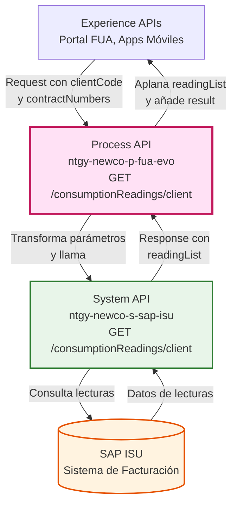
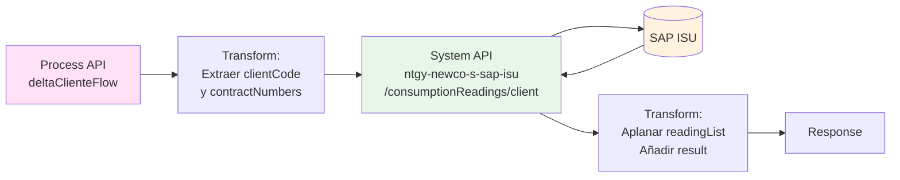
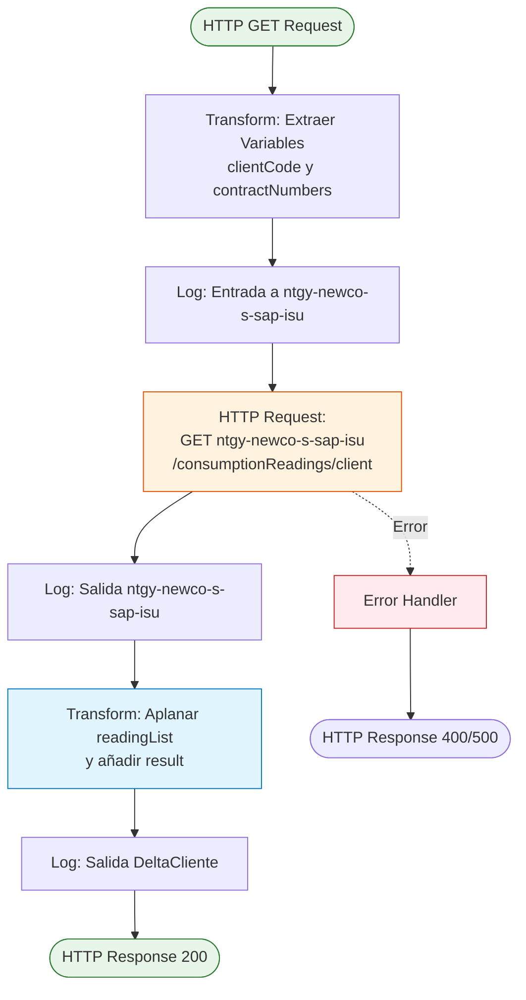
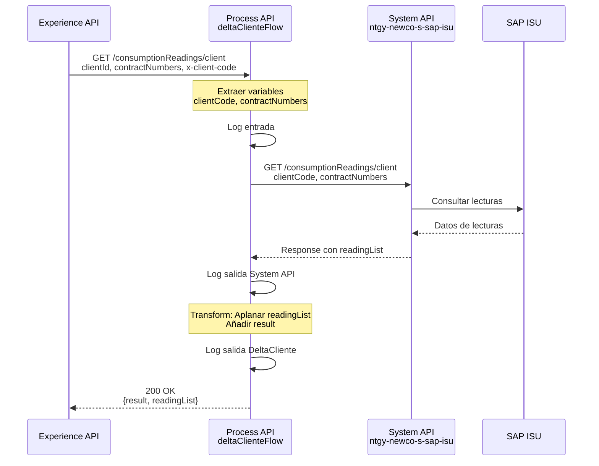
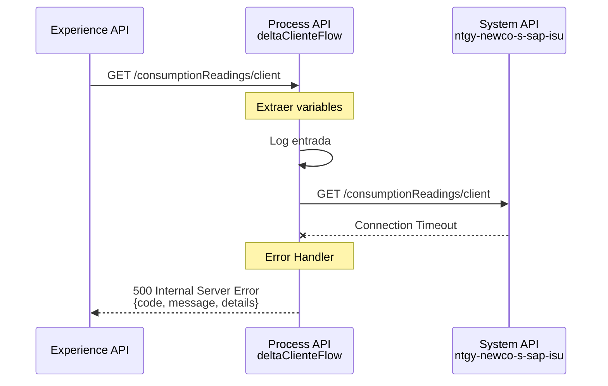
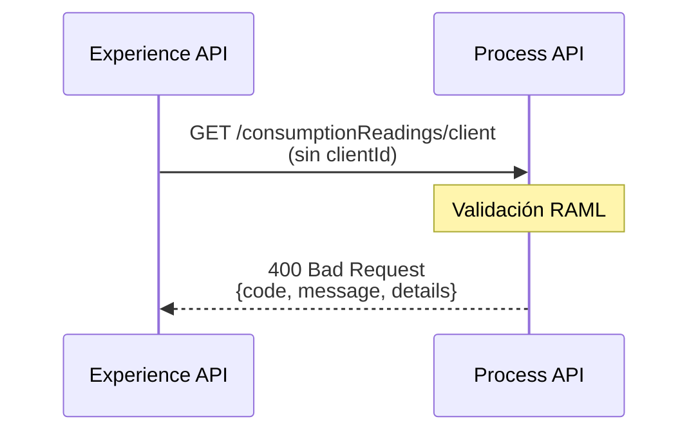

# GET /consumptionReadings/client

## 📌 Descripción General

### Propósito del Endpoint

Este endpoint orquesta la obtención de lecturas de consumo de uno o varios contratos de un cliente específico. Actúa como intermediario entre las capas superiores (Experience APIs) y el System API de SAP ISU, aplicando transformaciones para consolidar y estructurar la respuesta de manera uniforme.

### Tipo de API

**Capa:** Process API (API-Led Connectivity)

**Función:** Orquestación de consulta de lecturas de consumo desde SAP ISU

### Patrón de Integración

**Tipo:** Orquestación con Transformación

**Descripción:** El endpoint recibe parámetros del cliente, los transforma y los envía al System API de SAP ISU. La respuesta del System API es procesada mediante DataWeave para aplanar la estructura de `readingList` y añadir una estructura de respuesta estándar con código y mensaje de resultado.

### Arquitectura API-Led Connectivity



---

## 💼 Propósito del Negocio

### Casos de Uso Principales

1. **Consulta de Lecturas Históricas**
   - Permite a los clientes visualizar el historial de lecturas de sus contratos
   - Facilita el análisis de patrones de consumo a lo largo del tiempo

2. **Validación de Facturación**
   - Los clientes pueden verificar las lecturas utilizadas para calcular sus facturas
   - Proporciona transparencia en el proceso de facturación

3. **Análisis de Consumo Multi-Contrato**
   - Permite consultar lecturas de múltiples contratos simultáneamente
   - Útil para clientes con varios puntos de suministro

### 🔗 Endpoints Dependientes

Este Process API consume el siguiente System API:

| System API | Endpoint | Método | Propósito |
|------------|----------|--------|-----------|
| `ntgy-newco-s-sap-isu` | `/consumptionReadings/client` | GET | Obtener lecturas de consumo desde SAP ISU para uno o varios contratos |

### Lógica de Orquestación



**Pasos del Proceso:**

1. **Extracción de Parámetros**: Se extraen `clientCode` (desde header `x-client-code`) y `contractNumbers` (desde query param) en variables
2. **Llamada al System API**: Se invoca el System API de SAP ISU pasando los parámetros transformados
3. **Transformación de Respuesta**: Se aplana el array `readingList` y se añade una estructura estándar de resultado

### Transformaciones Aplicadas

**Transformación de Request:**

| Parámetro Original | Variable Interna | Origen |
|--------------------|------------------|--------|
| `x-client-code` (header) | `vars.clientCode` | Header HTTP |
| `contractNumbers` (query param) | `vars.contractNumbers` | Query Parameter |

**Transformación de Response:**

La respuesta del System API es transformada para:
- **Aplanar `readingList`**: Utiliza la función `flatten()` para consolidar arrays anidados
- **Añadir estructura de resultado**: Incluye un objeto `result` con código y mensaje estándar

```dataweave
{
  "result": {
    "codResult": "0000",
    "msgResult": "No hay error"
  },
  "readingList": flatten(payload.*readingList)
}
```

### Contexto Empresarial

- **Dominio:** Gestión de Consumo y Lecturas
- **Sector:** Energía - Utilities
- **División:** Naturgy España - NewCo
- **Proceso de Negocio:** Consulta de lecturas de consumo para análisis y validación de facturación

### Stakeholders

- **Clientes Finales**: Necesitan acceso a sus lecturas de consumo para validar facturas y analizar patrones
- **Agentes de Call Center**: Requieren consultar lecturas para resolver consultas de clientes
- **Equipo de Facturación**: Utiliza las lecturas para validar procesos de facturación

### Valor de Negocio

- **Transparencia**: Proporciona visibilidad completa sobre las lecturas utilizadas en facturación
- **Autoservicio**: Reduce la carga del call center al permitir consultas autónomas
- **Análisis de Consumo**: Facilita la identificación de patrones y oportunidades de ahorro energético

### Consumidores Potenciales

Este endpoint puede ser consumido por:
- Portal web FUA
- Aplicaciones móviles de clientes
- Sistemas de agentes de call center
- Herramientas de análisis de consumo

---

## 🔧 Especificación Técnica

### URLs por Ambiente

| Ambiente | URL Base | URL Completa |
|----------|----------|--------------|
| **Local** | `http://localhost:8081` | `http://localhost:8081/api/consumptionReadings/client` |
| **Development** | `https://ntgy-newco-p-fua-evo-dev.us-e2.cloudhub.io` | `https://ntgy-newco-p-fua-evo-dev.us-e2.cloudhub.io/api/consumptionReadings/client` |
| **UAT** | `https://ntgy-newco-p-fua-evo-uat.us-e2.cloudhub.io` | `https://ntgy-newco-p-fua-evo-uat.us-e2.cloudhub.io/api/consumptionReadings/client` |
| **Production** | `https://ntgy-newco-p-fua-evo-pro.us-e2.cloudhub.io` | `https://ntgy-newco-p-fua-evo-pro.us-e2.cloudhub.io/api/consumptionReadings/client` |

### Método HTTP

```
GET /api/consumptionReadings/client
```

### Parámetros de Entrada

#### Headers

| Header | Tipo | Requerido | Descripción |
|--------|------|-----------|-------------|
| `x-client-code` | string | ✅ Sí | Código del cliente para identificación |
| `Content-Type` | string | ✅ Sí | Debe ser `application/json` |
| `client_id` | string | ✅ Sí | Client ID de Anypoint Platform |
| `client_secret` | string | ✅ Sí | Client Secret de Anypoint Platform |

#### Query Parameters

| Parámetro | Tipo | Requerido | Descripción | Ejemplo |
|-----------|------|-----------|-------------|---------|
| `clientId` | string | ✅ Sí | Identificador del cliente | `"12345678"` |
| `contractNumbers` | string | ❌ No | Números de contrato separados por comas (si no se proporciona, devuelve todos los contratos del cliente) | `"1234567890,0987654321"` |

### Respuestas

#### 200 OK - Éxito

**Descripción:** Lecturas obtenidas correctamente

**Estructura de Respuesta:**

```json
{
  "result": {
    "codResult": "0000",
    "msgResult": "No hay error"
  },
  "readingList": [
    {
      "productTypeFamily": "luz",
      "invoiceId": "INV-2024-001",
      "readingDetailList": [
        {
          "magnitude": "Activa",
          "values": [
            {
              "readingDate": "2024-01-15",
              "type": "Real",
              "period": "1",
              "value": "1250.5",
              "counter": "ES0021000001234567FG",
              "consumption": "70.3"
            }
          ]
        }
      ],
      "agentInfo": {
        "cups": "ES0021000001234567FG",
        "coversionFactor": "1.0",
        "distribuitor": "UFD",
        "atrInvoiceId": ["ATR-2024-001"],
        "invoiceType": "Normal",
        "invoiceOriginId": "SAP"
      }
    }
  ]
}
```

**⚠️ IMPORTANTE:** Esta estructura refleja el código real verificado. El Process API aplica `flatten(payload.*readingList)` pero NO transforma la estructura interna.

**Campos de Respuesta:**

| Campo | Tipo | Descripción |
|-------|------|-------------|
| `result.codResult` | string | Código de resultado ("0000" = éxito) |
| `result.msgResult` | string | Mensaje descriptivo del resultado |
| `readingList` | array | Lista aplanada de lecturas (resultado de flatten) |
| `readingList[].productTypeFamily` | string | Familia de producto: "luz" o "gas" |
| `readingList[].invoiceId` | string | ID de factura asociada |
| `readingList[].readingDetailList` | array | Detalles de lecturas por magnitud |
| `readingList[].readingDetailList[].magnitude` | string | Tipo de magnitud (Activa, Reactiva) |
| `readingList[].readingDetailList[].values` | array | Array de valores de lecturas |
| `readingList[].readingDetailList[].values[].readingDate` | string | Fecha de la lectura (YYYY-MM-DD) |
| `readingList[].readingDetailList[].values[].type` | string | Tipo de lectura (Real, Estimada) |
| `readingList[].readingDetailList[].values[].period` | string | Periodo tarifario (1, 2, 3...) |
| `readingList[].readingDetailList[].values[].value` | string | Valor de la lectura en kWh |
| `readingList[].readingDetailList[].values[].counter` | string | Número del contador/CUPS |
| `readingList[].readingDetailList[].values[].consumption` | string | Consumo calculado |
| `readingList[].agentInfo` | object | Información del agente distribuidor |
| `readingList[].agentInfo.cups` | string | CUPS del punto de suministro |
| `readingList[].agentInfo.coversionFactor` | string | Factor de conversión (typo en código) |
| `readingList[].agentInfo.distribuitor` | string | Distribuidora (typo en código) |
| `readingList[].agentInfo.atrInvoiceId` | array | IDs de facturas ATR |
| `readingList[].agentInfo.invoiceType` | string | Tipo de factura |
| `readingList[].agentInfo.invoiceOriginId` | string | ID de origen de factura |

#### 400 Bad Request - Error de Validación

**Descripción:** Parámetros inválidos o faltantes

```json
{
  "code": "BAD_REQUEST",
  "message": "Parámetros de entrada inválidos",
  "details": "El parámetro clientId es requerido"
}
```

#### 500 Internal Server Error - Error del Sistema

**Descripción:** Error en el procesamiento interno o en la comunicación con SAP ISU

```json
{
  "code": "INTERNAL_ERROR",
  "message": "Error al procesar la solicitud",
  "details": "Error de conexión con SAP ISU"
}
```

### Autenticación

- **Tipo:** Client ID & Client Secret (Anypoint Platform)
- **Headers requeridos:** `client_id`, `client_secret`

### Timeouts

| Tipo | Valor |
|------|-------|
| **Request Timeout** | 60 segundos |
| **Connection Timeout** | 30 segundos |

---

## 🏗️ Implementación Técnica

### Arquitectura del Flow



### Componentes del Flow

#### 1. Flow Principal: `get:\consumptionReadings\client:ntgy-newco-p-fua-config`

**Ubicación:** `src/main/mule/ntgy-newco-p-fua.xml`

**Responsabilidades:**
- Recibir la petición HTTP GET
- Extraer parámetros de query y headers
- Invocar el subflow `deltaClienteFlow`

**Código XML:**
```xml
<flow name="get:\consumptionReadings\client:ntgy-newco-p-fua-config">
    <ee:transform doc:name="vars">
        <ee:message />
        <ee:variables>
            <ee:set-variable variableName="contractNumbers">
                <![CDATA[attributes.queryParams.contractNumbers]]>
            </ee:set-variable>
            <ee:set-variable variableName="clientCode">
                <![CDATA[%dw 2.0
                output application/java
                ---
                attributes.queryParams.'x-client-code']]>
            </ee:set-variable>
        </ee:variables>
    </ee:transform>
    <flow-ref doc:name="consumptionReadings Flow" name="deltaClienteFlow" />
</flow>
```

#### 2. Subflow: `deltaClienteFlow`

**Ubicación:** `src/main/mule/implementation/deltaClienteFlow.xml` (inferido)

**Responsabilidades:**
- Logging de entrada
- Llamada HTTP al System API de SAP ISU
- Transformación de respuesta
- Logging de salida

**Código XML:**
```xml
<flow name="deltaClienteFlow">
    <logger level="INFO" doc:name="Log de entrada" 
            message="Log de entrada a ntgy-newco-s-sap-isu: #[vars.contractNumbers]" />
    
    <http:request method="GET" doc:name="Request New" 
                  config-ref="HTTP_Request_ntgy-newco-s-sap" 
                  path="${ntgy-newco-s-sap.functions.deltaCliente}">
        <http:query-params><![CDATA[#[output application/java
        ---
        {
            clientCode : vars.clientCode,
            contractNumbers : vars.contractNumbers
        }]]]></http:query-params>
    </http:request>
    
    <logger level="INFO" doc:name="Log salida" 
            message="Log salida ntgy-newco-s-sap-isu: #[message.payload]"/>
    
    <ee:transform doc:name="Response s-sap-isu">
        <ee:message>
            <ee:set-payload><![CDATA[%dw 2.0
            output application/json
            ---
            {
                "result": {
                    "codResult": "0000",
                    "msgResult": "No hay error"
                },
                "readingList": flatten(payload.*readingList)
            }]]></ee:set-payload>
        </ee:message>
    </ee:transform>
    
    <logger level="INFO" doc:name="Log salida DeltaCliente" 
            message="Log salida DeltaCliente: #[message.payload]"/>
</flow>
```

### Transformaciones DataWeave

#### Transformación 1: Extracción de Variables (Líneas 2-10)

**Propósito:** Extraer parámetros de la petición HTTP y almacenarlos en variables

```dataweave
%dw 2.0
output application/java
---
{
  contractNumbers: attributes.queryParams.contractNumbers,
  clientCode: attributes.queryParams.'x-client-code'
}
```

**Entrada:** Atributos HTTP (query params y headers)

**Salida:** Variables `vars.contractNumbers` y `vars.clientCode`

#### Transformación 2: Construcción de Query Parameters (Líneas 8-13)

**Propósito:** Construir los query parameters para la llamada al System API

```dataweave
%dw 2.0
output application/java
---
{
  clientCode: vars.clientCode,
  contractNumbers: vars.contractNumbers
}
```

#### Transformación 3: Respuesta Final (Líneas 15-26)

**Propósito:** Aplanar la estructura de `readingList` y añadir resultado estándar

```dataweave
%dw 2.0
output application/json
---
{
  "result": {
    "codResult": "0000",
    "msgResult": "No hay error"
  },
  "readingList": flatten(payload.*readingList)
}
```

**Función clave:** `flatten(payload.*readingList)`
- Aplana arrays anidados de lecturas de múltiples contratos
- Consolida todas las lecturas en un único array

### Patrones de Diseño

**Patrón:** Request-Reply con Transformación

**Justificación:** 
- Permite orquestar la llamada al System API de forma síncrona
- Aplica transformaciones necesarias para consolidar datos
- Mantiene la separación de responsabilidades entre capas

**Patrón:** Logging Estratégico

**Justificación:**
- Facilita el debugging y monitoreo
- Registra entrada, salida del System API y respuesta final
- Permite trazabilidad completa del flujo

### Diagramas de Secuencia

#### 1. Flujo Normal de Éxito



#### 2. Flujo con Error de Conexión al System API



#### 3. Flujo con Parámetros Inválidos



### Manejo de Errores

**Estrategia:** Error handling global con respuestas estandarizadas

**Tipos de Errores:**

1. **Errores de Validación (400)**
   - Parámetros faltantes o inválidos
   - Formato incorrecto de datos

2. **Errores de Conectividad (500)**
   - Timeout en llamada al System API
   - System API no disponible

3. **Errores de Negocio (400)**
   - Cliente no encontrado
   - Contratos no válidos

**Configuración de Retry:**
- Reintentos: 3 intentos
- Backoff: Exponencial (1s, 2s, 4s)

---

## 💻 Ejemplos de Uso

### Ejemplo 1: Consulta de Lecturas de Todos los Contratos de un Cliente

#### cURL

```bash
curl -X GET "https://ntgy-newco-p-fua-evo-dev.us-e2.cloudhub.io/api/consumptionReadings/client?clientId=12345678" \
  -H "Content-Type: application/json" \
  -H "x-client-code: NEWCO" \
  -H "client_id: YOUR_CLIENT_ID" \
  -H "client_secret: YOUR_CLIENT_SECRET"
```

#### Respuesta (200 OK)

```json
{
  "result": {
    "codResult": "0000",
    "msgResult": "No hay error"
  },
  "readingList": [
    {
      "productTypeFamily": "luz",
      "invoiceId": "INV-2024-001",
      "readingDetailList": [
        {
          "magnitude": "Activa",
          "values": [
            {
              "readingDate": "2026-08-01",
              "type": "REAL",
              "period": "1",
              "value": "1250.5",
              "counter": "MTR001",
              "consumption": "70.2"
            },
            {
              "readingDate": "2026-07-01",
              "type": "REAL",
              "period": "1",
              "value": "1180.3",
              "counter": "MTR001",
              "consumption": "65.8"
            }
          ]
        }
      ],
      "agentInfo": {
        "cups": "ES0021000001234567FG",
        "coversionFactor": "1.0",
        "distribuitor": "UFD",
        "atrInvoiceId": ["ATR-2024-001"],
        "invoiceType": "Normal",
        "invoiceOriginId": "SAP"
      }
    },
    {
      "productTypeFamily": "luz",
      "invoiceId": "INV-2024-002",
      "readingDetailList": [
        {
          "magnitude": "Activa",
          "values": [
            {
              "readingDate": "2026-08-01",
              "type": "ESTIMADA",
              "period": "1",
              "value": "850.2",
              "counter": "MTR002",
              "consumption": "45.1"
            }
          ]
        }
      ],
      "agentInfo": {
        "cups": "ES0021000009876543FG",
        "coversionFactor": "1.0",
        "distribuitor": "UFD",
        "atrInvoiceId": ["ATR-2024-002"],
        "invoiceType": "Normal",
        "invoiceOriginId": "SAP"
      }
    }
  ]
}
```

### Ejemplo 2: Consulta de Lecturas de Contratos Específicos

#### cURL

```bash
curl -X GET "https://ntgy-newco-p-fua-evo-dev.us-e2.cloudhub.io/api/consumptionReadings/client?clientId=12345678&contractNumbers=1234567890,0987654321" \
  -H "Content-Type: application/json" \
  -H "x-client-code: NEWCO" \
  -H "client_id: YOUR_CLIENT_ID" \
  -H "client_secret: YOUR_CLIENT_SECRET"
```

#### Respuesta (200 OK)

```json
{
  "result": {
    "codResult": "0000",
    "msgResult": "No hay error"
  },
  "readingList": [
    {
      "productTypeFamily": "luz",
      "invoiceId": "INV-2024-001",
      "readingDetailList": [
        {
          "magnitude": "Activa",
          "values": [
            {
              "readingDate": "2026-08-01",
              "type": "REAL",
              "period": "1",
              "value": "1250.5",
              "counter": "MTR001",
              "consumption": "70.2"
            }
          ]
        }
      ],
      "agentInfo": {
        "cups": "ES0021000001234567FG",
        "coversionFactor": "1.0",
        "distribuitor": "UFD",
        "atrInvoiceId": ["ATR-2024-001"],
        "invoiceType": "Normal",
        "invoiceOriginId": "SAP"
      }
    },
    {
      "productTypeFamily": "luz",
      "invoiceId": "INV-2024-002",
      "readingDetailList": [
        {
          "magnitude": "Activa",
          "values": [
            {
              "readingDate": "2026-08-01",
              "type": "ESTIMADA",
              "period": "1",
              "value": "850.2",
              "counter": "MTR002",
              "consumption": "45.1"
            }
          ]
        }
      ],
      "agentInfo": {
        "cups": "ES0021000009876543FG",
        "coversionFactor": "1.0",
        "distribuitor": "UFD",
        "atrInvoiceId": ["ATR-2024-002"],
        "invoiceType": "Normal",
        "invoiceOriginId": "SAP"
      }
    }
  ]
}
```

### Ejemplo 3: JavaScript (Fetch API)

```javascript
const getConsumptionReadings = async (clientId, contractNumbers = null) => {
  const baseUrl = 'https://ntgy-newco-p-fua-evo-dev.us-e2.cloudhub.io/api/consumptionReadings/client';
  const params = new URLSearchParams({ clientId });
  
  if (contractNumbers) {
    params.append('contractNumbers', contractNumbers);
  }
  
  const response = await fetch(`${baseUrl}?${params}`, {
      method: 'GET',
    headers: {
      'Content-Type': 'application/json',
      'x-client-code': 'NEWCO',
      'client_id': 'YOUR_CLIENT_ID',
      'client_secret': 'YOUR_CLIENT_SECRET'
    }
  });
  
  if (!response.ok) {
    throw new Error(`HTTP error! status: ${response.status}`);
  }
  
  const data = await response.json();
  return data;
};

// Uso
try {
  const readings = await getConsumptionReadings('12345678', '1234567890,0987654321');
  console.log('Código resultado:', readings.result.codResult);
  console.log('Total de lecturas:', readings.readingList.length);
  
  // Iterar sobre las lecturas con estructura real
  readings.readingList.forEach(reading => {
    console.log(`Producto: ${reading.productTypeFamily}`);
    console.log(`Factura: ${reading.invoiceId}`);
    console.log(`CUPS: ${reading.agentInfo.cups}`);
    
    reading.readingDetailList.forEach(detail => {
      console.log(`  Magnitud: ${detail.magnitude}`);
      detail.values.forEach(value => {
        console.log(`    ${value.readingDate}: ${value.value} kWh (${value.type})`);
      });
    });
  });
} catch (error) {
  console.error('Error al obtener lecturas:', error);
}
```

### Ejemplo 4: Python (Requests)

```python
import requests

def get_consumption_readings(client_id, contract_numbers=None):
    """
    Obtiene las lecturas de consumo de un cliente
    
    Args:
        client_id (str): ID del cliente
        contract_numbers (str, optional): Números de contrato separados por comas
    
    Returns:
        dict: Respuesta con result y readingList
    """
    base_url = 'https://ntgy-newco-p-fua-evo-dev.us-e2.cloudhub.io/api/consumptionReadings/client'
    
    params = {'clientId': client_id}
    if contract_numbers:
        params['contractNumbers'] = contract_numbers
    
    headers = {
        'Content-Type': 'application/json',
        'x-client-code': 'NEWCO',
        'client_id': 'YOUR_CLIENT_ID',
        'client_secret': 'YOUR_CLIENT_SECRET'
    }
    
    response = requests.get(base_url, params=params, headers=headers)
    response.raise_for_status()
    
    return response.json()

# Uso
try:
    readings = get_consumption_readings('12345678', '1234567890,0987654321')
    print(f"Código resultado: {readings['result']['codResult']}")
    print(f"Total lecturas: {len(readings['readingList'])}")
    
    # Iterar sobre las lecturas con estructura real
    for reading in readings['readingList']:
        print(f"\nProducto: {reading['productTypeFamily']}")
        print(f"Factura: {reading['invoiceId']}")
        print(f"CUPS: {reading['agentInfo']['cups']}")
        
        for detail in reading['readingDetailList']:
            print(f"  Magnitud: {detail['magnitude']}")
            for value in detail['values']:
                print(f"    {value['readingDate']}: {value['value']} kWh ({value['type']})")
except requests.exceptions.RequestException as e:
    print(f"Error al obtener lecturas: {e}")
```

### Ejemplo 5: Error - Parámetro Faltante

#### cURL

```bash
curl -X GET "https://ntgy-newco-p-fua-evo-dev.us-e2.cloudhub.io/api/consumptionReadings/client" \
  -H "Content-Type: application/json" \
  -H "x-client-code: NEWCO" \
  -H "client_id: YOUR_CLIENT_ID" \
  -H "client_secret: YOUR_CLIENT_SECRET"
```

#### Respuesta (400 Bad Request)

```json
{
  "code": "BAD_REQUEST",
  "message": "Parámetros de entrada inválidos",
  "details": "El parámetro clientId es requerido"
}
```

### Ejemplo 6: Error - System API No Disponible

#### Respuesta (500 Internal Server Error)

```json
{
  "code": "INTERNAL_ERROR",
  "message": "Error al procesar la solicitud",
  "details": "Error de conexión con ntgy-newco-s-sap-isu: Connection timeout"
}