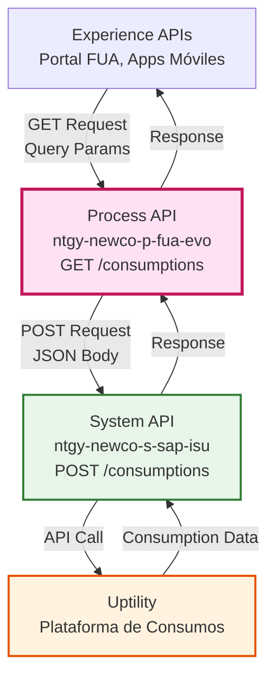
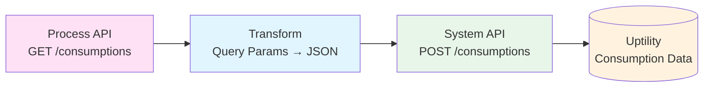
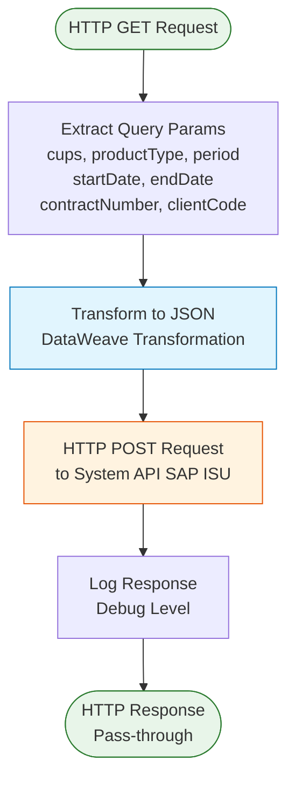
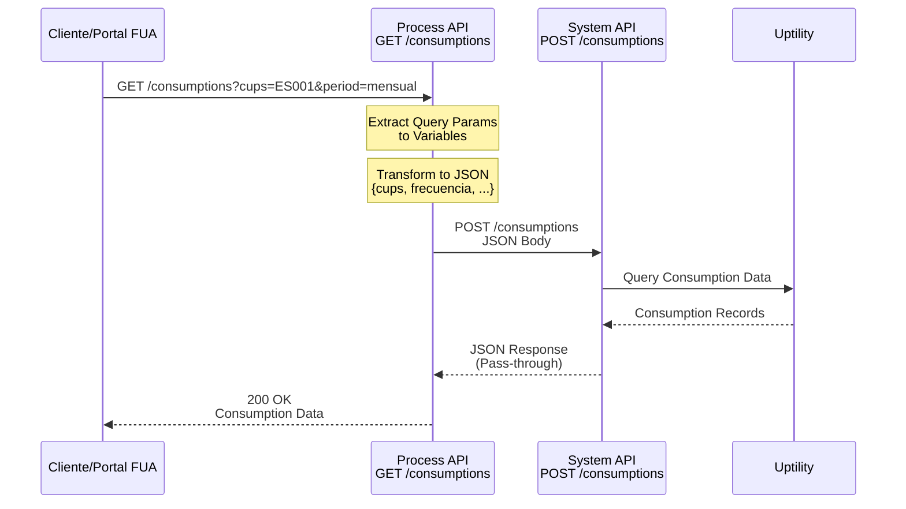
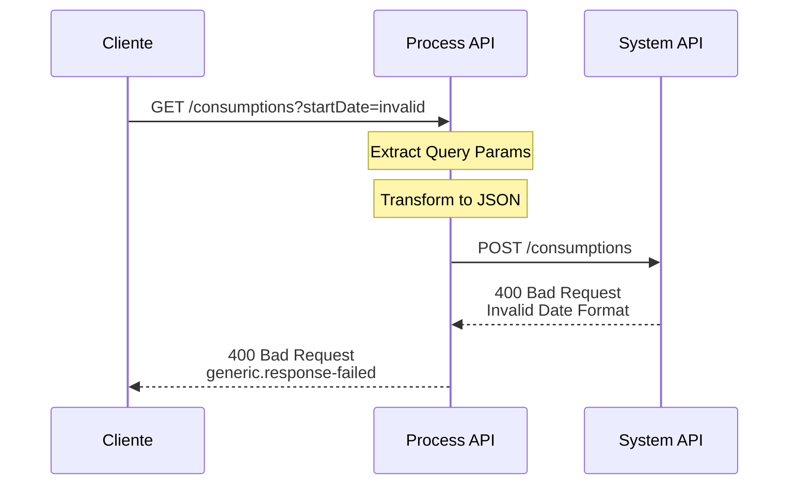
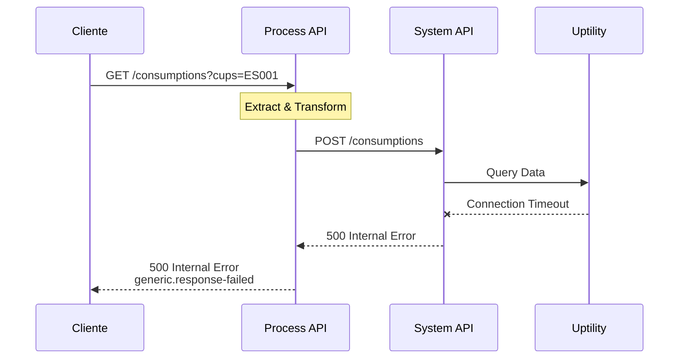

# GET /consumptions

## 📌 Descripción General

### Propósito del Endpoint

Este endpoint orquesta la recuperación de datos de consumos energéticos desde Uptility a través de SAP ISU. Transforma los parámetros de consulta del cliente en el formato requerido por el System API de SAP ISU, que actúa como intermediario para obtener los datos de consumo desde la plataforma Uptility.

### Tipo de API

**Capa:** Process API (API-Led Connectivity)

**Función:** Orquestación de consulta de consumos energéticos con transformación de parámetros

### Patrón de Integración

**Tipo:** Transformación + Orquestación

**Descripción:** El endpoint recibe parámetros de consulta en formato REST, los transforma a JSON con nomenclatura específica de SAP, y realiza una llamada POST al System API de SAP ISU que consume los datos de Uptility.

### Arquitectura API-Led Connectivity



**Nota Importante sobre el Flujo de Datos:**

Este Process API actúa como capa de orquestación que:
1. Transforma parámetros de consulta REST → JSON para SAP ISU
2. Invoca el System API `ntgy-newco-s-sap-isu`
3. El System API consulta SAP ISU, que a su vez obtiene datos de **Uptility**
4. La respuesta se retorna sin transformación (pass-through)

**Uptility** es la plataforma externa que almacena los datos reales de consumo energético. SAP ISU actúa como intermediario técnico para acceder a estos datos.

---

## 💼 Propósito del Negocio

### Casos de Uso Principales

1. **Consulta de Consumos Históricos**
   - Permite a los clientes visualizar su historial de consumo energético
   - Beneficio: Transparencia y control sobre el consumo de energía

2. **Análisis de Patrones de Consumo**
   - Facilita el análisis de consumos por periodo (diario, mensual, anual)
   - Beneficio: Identificación de oportunidades de ahorro energético

3. **Validación de Facturación**
   - Permite comparar consumos reales con facturación
   - Beneficio: Confianza en la exactitud de las facturas

### 🔗 Endpoints Dependientes

Este Process API consume el siguiente System API:

| System API | Endpoint | Método | Propósito |
|------------|----------|--------|-----------|
| `ntgy-newco-s-sap-isu` | `/consumptions` | POST | Consulta de datos de consumo en Uptility a través de SAP ISU |

### Lógica de Orquestación



**Pasos del Proceso:**

1. **Extracción de Parámetros**: Captura 7 query parameters (cups, productType, period, startDate, endDate, contractNumber, clientCode)
2. **Transformación**: Convierte parámetros a formato JSON con nomenclatura SAP/Uptility
3. **Llamada HTTP POST**: Invoca System API de SAP ISU con el payload transformado
4. **Respuesta Directa**: Retorna la respuesta del System API sin transformación adicional

### Transformaciones Aplicadas

**Transformación de Request (Query Params → JSON):**

| Parámetro Query (Process API) | Campo JSON (System API) | Descripción |
|-------------------------------|-------------------------|-------------|
| `cups` | `cups` | Código Universal del Punto de Suministro |
| `productType` | `sector` | Tipo de producto (electricidad/gas) |
| `period` | `frecuencia` | Frecuencia de consulta (diaria/mensual/anual) |
| `startDate` | `fecha_desde` | Fecha inicio del periodo |
| `endDate` | `fecha_hasta` | Fecha fin del periodo |
| `contractNumber` | `contract_number` | Número de contrato |
| `x-client-code` (header) | `clientCode` | Código de cliente (Imperial/NewCo) |

**Transformación de Response:**

⚠️ **Este Process API NO transforma la respuesta del System API.**

La respuesta de Uptility se retorna directamente al consumidor.

Para el schema completo de respuesta, consultar:
📖 **System API: `ntgy-newco-s-sap-isu` endpoint `POST /consumptions`**

### Contexto Empresarial

- **Dominio:** Gestión de Consumos Energéticos
- **Sector:** Energía - Utilities
- **División:** Naturgy España - NewCo
- **Proceso de Negocio:** Consulta y análisis de consumos para clientes del portal FUA

### Stakeholders

- **Clientes Finales**: Necesitan visualizar y analizar su consumo energético
- **Equipo de Atención al Cliente**: Requieren acceso a datos de consumo para resolver consultas
- **Equipo de Facturación**: Utilizan datos de consumo para validar facturación

### Valor de Negocio

- **Transparencia**: Acceso inmediato a datos de consumo real
- **Autoservicio**: Reduce llamadas al call center por consultas de consumo
- **Análisis**: Permite a clientes identificar patrones y optimizar consumo
- **Confianza**: Validación de facturación con datos reales de Uptility

### Consumidores Potenciales

Este endpoint puede ser consumido por:
- Portal web FUA
- Aplicaciones móviles de clientes
- Sistemas de agentes de call center
- Dashboards de análisis de consumo

---

## 🔧 Especificación Técnica

### URLs por Ambiente

| Ambiente | URL Base | URL Completa |
|----------|----------|--------------|
| **Local** | `http://localhost:8081` | `http://localhost:8081/api/consumptions` |
| **Development** | `https://ntgy-newco-p-fua-evo-dev.us-e2.cloudhub.io` | `https://ntgy-newco-p-fua-evo-dev.us-e2.cloudhub.io/api/consumptions` |
| **UAT** | `https://ntgy-newco-p-fua-evo-uat.us-e2.cloudhub.io` | `https://ntgy-newco-p-fua-evo-uat.us-e2.cloudhub.io/api/consumptions` |
| **Production** | `https://ntgy-newco-p-fua-evo-pro.us-e2.cloudhub.io` | `https://ntgy-newco-p-fua-evo-pro.us-e2.cloudhub.io/api/consumptions` |

### Método HTTP

```
GET /api/consumptions
```

### Parámetros de Entrada

#### Query Parameters

| Parámetro | Tipo | Requerido | Descripción | Ejemplo |
|-----------|------|-----------|-------------|---------|
| `cups` | string | Opcional | Código Universal del Punto de Suministro | `ES0021000000000001JN` |
| `productType` | string | Opcional | Tipo de producto energético | `electricidad`, `gas` |
| `period` | string | Opcional | Frecuencia de consulta | `diaria`, `mensual`, `anual` |
| `startDate` | string | Opcional | Fecha inicio (formato: YYYY-MM-DD) | `2024-01-01` |
| `endDate` | string | Opcional | Fecha fin (formato: YYYY-MM-DD) | `2024-12-31` |
| `contractNumber` | string | Opcional | Número de contrato del cliente | `1234567890` |

#### Headers

| Header | Tipo | Requerido | Descripción | Ejemplo |
|--------|------|-----------|-------------|---------|
| `x-client-code` | string | Opcional | Código de cliente (Imperial/NewCo) | `NEWCO`, `IMPERIAL` |
| `client_id` | string | Sí | Client ID de Anypoint Platform | `abc123...` |
| `client_secret` | string | Sí | Client Secret de Anypoint Platform | `xyz789...` |

### Respuestas

#### 200 OK - Éxito

**Descripción:** Datos de consumo recuperados exitosamente desde Uptility vía SAP ISU

**Content-Type:** `application/json`

**Nota:** Este Process API retorna la respuesta del System API sin transformación (pass-through).

**Schema Completo:** Ver documentación de `ntgy-newco-s-sap-isu POST /consumptions`

**Estructura de Respuesta:**

```json
{
  "contractId": "1000123456",
  "productTypeFamily": "luz",
  "productGraphicResume": {
    "anualSelfConsumption": 0,
    "anualEstimatedProduction": 0,
    "anualPowerGridContribution": 0,
    "anualClearedAmount": 0,
    "anualTotalConsumption": 3250.5,
    "anualPointConsumption": 1200.0,
    "anualValleyConsumption": 2050.5,
    "anualComparative": 5.2
  },
  "consumptionValues": [
    {
      "date": "2024-01-15",
      "invoiceRef": "100012345678",
      "valueTotal": 250.5,
      "P1": 100.2,
      "P2": 80.3,
      "P3": 70.0,
      "P4": 0,
      "P5": 0,
      "P6": 0,
      "aported": 0,
      "consumed": 250.5
    }
  ],
  "result": {
    "codResult": "0",
    "msgResult": "Consulta exitosa"
  }
}
```

**Descripción de Campos:**

| Campo | Tipo | Descripción |
|-------|------|-------------|
| `contractId` | String | Número de contrato |
| `productTypeFamily` | String | Tipo de producto: "luz" o "gas" |
| `productGraphicResume` | Object | Resumen anual de consumos |
| `productGraphicResume.anualTotalConsumption` | Number | Consumo total anual en kWh |
| `productGraphicResume.anualPointConsumption` | Number | Consumo en horas punta |
| `productGraphicResume.anualValleyConsumption` | Number | Consumo en horas valle |
| `consumptionValues` | Array | Array de consumos por período |
| `consumptionValues[].date` | String | Fecha del consumo (yyyy-MM-dd) |
| `consumptionValues[].invoiceRef` | String | Referencia de factura |
| `consumptionValues[].valueTotal` | Number | Consumo total del período |
| `consumptionValues[].P1-P6` | Number | Consumo por período tarifario |
| `consumptionValues[].aported` | Number | Energía aportada (autoconsumo) |
| `consumptionValues[].consumed` | Number | Energía consumida |
| `result` | Object | Resultado de la operación |
| `result.codResult` | String | Código de resultado ("0" = éxito) |
| `result.msgResult` | String | Mensaje descriptivo |

#### 400 Bad Request - Error de Validación

**Descripción:** Parámetros de entrada inválidos

**Content-Type:** `application/json`

**Schema:** `generic.response-failed`

```json
{
  "code": "VALIDATION_ERROR",
  "message": "Parámetros de entrada inválidos",
  "details": "El formato de fecha debe ser YYYY-MM-DD",
  "timestamp": "2024-01-15T10:30:00Z"
}
```

#### 500 Internal Server Error - Error del Sistema

**Descripción:** Error en el procesamiento interno o en System API

**Content-Type:** `application/json`

**Schema:** `generic.response-failed`

```json
{
  "code": "INTERNAL_ERROR",
  "message": "Error al procesar la solicitud",
  "details": "Error de conexión con System API SAP ISU",
  "timestamp": "2024-01-15T10:30:00Z"
}
```

### Autenticación

- **Tipo:** Client ID & Client Secret (Anypoint Platform)
- **Headers requeridos:** `client_id`, `client_secret`

### Timeouts

| Tipo | Valor |
|------|-------|
| **Request Timeout** | 60 segundos |
| **Connection Timeout** | 30 segundos |

**Nota:** Timeout extendido debido a que Uptility puede tardar en procesar consultas de periodos largos.

---

## 🏗️ Implementación Técnica

### Arquitectura del Flow



### Componentes del Flow

#### 1. Flow Principal: `get:\consumptions:ntgy-newco-p-fua-config`

**Ubicación:** `src/main/mule/ntgy-newco-p-fua.xml`

**Responsabilidades:**
- Recibir request HTTP GET
- Extraer 7 query parameters a variables
- Invocar subflow de procesamiento

**Código XML:**
```xml
<flow name="get:\consumptions:ntgy-newco-p-fua-config">
    <ee:transform doc:name="period, productType, cups, startDate, endDate y contractNumber">
        <ee:variables>
            <ee:set-variable variableName="period">
                attributes.queryParams.'period'
            </ee:set-variable>
            <ee:set-variable variableName="productType">
                attributes.queryParams.'productType'
            </ee:set-variable>
            <ee:set-variable variableName="cups">
                attributes.queryParams.'cups'
            </ee:set-variable>
            <ee:set-variable variableName="startDate">
                attributes.queryParams.'startDate'
            </ee:set-variable>
            <ee:set-variable variableName="endDate">
                attributes.queryParams.'endDate'
            </ee:set-variable>
            <ee:set-variable variableName="contractNumber">
                attributes.queryParams.'contractNumber'
            </ee:set-variable>
            <ee:set-variable variableName="clientCode">
                attributes.queryParams.'x-client-code'
            </ee:set-variable>
        </ee:variables>
    </ee:transform>
    <flow-ref doc:name="getConsumptions" name="getConsumptions" />
</flow>
```

#### 2. Subflow: `getConsumptions`

**Ubicación:** `src/main/mule/services/[consumptions-module].xml`

**Responsabilidades:**
- Transformar variables a JSON para SAP ISU
- Realizar llamada HTTP POST al System API
- Registrar respuesta en logs

**Transformación DataWeave:**
```dataweave
%dw 2.0
output application/json
---
{
    "contract_number": vars.contractNumber,
    "cups": vars.cups,
    "fecha_desde": vars.startDate,
    "fecha_hasta": vars.endDate,
    "frecuencia": vars.period,
    "sector": vars.productType,
    "clientCode": vars.clientCode
}
```

**Llamada HTTP:**
```xml
<http:request 
    method="POST" 
    doc:name="Call s-sap-isu (consumptions)"
    config-ref="HTTP_Request_ntgy-newco-s-sap"
    path="${ntgy-newco-s-sap.functions.consumptions}">
</http:request>
```

**Logging:**
```xml
<logger 
    level="DEBUG" 
    doc:name="Fin consumos cliente"
    message="Salida al flujo Consumos: #[payload]"/>
```

### Configuración HTTP

**Config Reference:** `HTTP_Request_ntgy-newco-s-sap`

**Propiedades:**
- **Host:** Configurado en properties file por ambiente
- **Port:** 443 (HTTPS)
- **Base Path:** `/api`
- **Path Variable:** `${ntgy-newco-s-sap.functions.consumptions}` → `/consumptions`

### Transformaciones DataWeave

#### Transformación de Input (Query Params → JSON)

**Archivo:** Inline en subflow `getConsumptions`

**Propósito:** Convertir parámetros de consulta REST a formato JSON esperado por SAP ISU

**Mapeo de Campos:**

```dataweave
%dw 2.0
output application/json
---
{
    // Número de contrato
    "contract_number": vars.contractNumber,
    
    // Código Universal del Punto de Suministro
    "cups": vars.cups,
    
    // Fecha inicio (formato: YYYY-MM-DD)
    "fecha_desde": vars.startDate,
    
    // Fecha fin (formato: YYYY-MM-DD)
    "fecha_hasta": vars.endDate,
    
    // Frecuencia: diaria, mensual, anual
    "frecuencia": vars.period,
    
    // Sector: electricidad, gas
    "sector": vars.productType,
    
    // Código de cliente: NEWCO, IMPERIAL
    "clientCode": vars.clientCode
}
```

**Características:**
- ✅ Conversión de nomenclatura inglés → español
- ✅ Todos los campos son opcionales (null-safe)
- ✅ Sin validaciones adicionales (delegadas a System API)

### Patrones de Diseño

**Patrón:** Request-Reply con Transformación

**Justificación:** 
- Necesidad de adaptar interfaz REST (query params) a formato JSON
- Orquestación simple con un solo System API
- Respuesta pass-through sin transformación adicional

**Patrón:** Separation of Concerns

**Justificación:**
- Flow principal maneja routing y extracción de parámetros
- Subflow maneja transformación y llamada HTTP
- Facilita mantenimiento y testing

### Diagramas de Secuencia

#### 1. Flujo Normal de Éxito



#### 2. Flujo con Error de Validación



#### 3. Flujo con Error de Sistema



### Manejo de Errores

**Estrategia:** Propagación de errores del System API

**Tipos de Error:**

1. **Errores de Validación (400)**
   - Formato de fecha inválido
   - Parámetros incompatibles
   - Valores fuera de rango

2. **Errores de Sistema (500)**
   - Timeout de conexión con System API
   - Error en Uptility
   - Error de transformación

3. **Errores de Conectividad**
   - System API no disponible
   - Timeout de request

**Formato de Error:** `generic.response-failed` (biblioteca compartida)

**Logging:**
- Nivel DEBUG: Request/Response exitosos
- Nivel ERROR: Excepciones y errores de sistema

---

## 💻 Ejemplos de Uso

### Ejemplo 1: Consulta de Consumos Mensuales por CUPS

#### cURL

```bash
curl -X GET "https://ntgy-newco-p-fua-evo-dev.us-e2.cloudhub.io/api/consumptions?cups=ES0021000000000001JN&period=mensual&startDate=2024-01-01&endDate=2024-12-31&productType=electricidad" \
  -H "Content-Type: application/json" \
  -H "client_id: YOUR_CLIENT_ID" \
  -H "client_secret: YOUR_CLIENT_SECRET" \
  -H "x-client-code: NEWCO"
```

#### Respuesta (200 OK)

```json
{
  "contractId": "1000123456",
  "productTypeFamily": "electricidad",
  "productGraphicResume": {
    "anualSelfConsumption": 0,
    "anualEstimatedProduction": 0,
    "anualPowerGridContribution": 0,
    "anualClearedAmount": 0,
    "anualTotalConsumption": 1251.5,
    "anualPointConsumption": 500.2,
    "anualValleyConsumption": 751.3,
    "anualComparative": 3.5
  },
  "consumptionValues": [
    {
      "date": "2024-01-15",
      "invoiceRef": "100012345678",
      "valueTotal": 450.5,
      "P1": 180.2,
      "P2": 150.3,
      "P3": 120.0,
      "P4": 0,
      "P5": 0,
      "P6": 0,
      "aported": 0,
      "consumed": 450.5
    },
    {
      "date": "2024-02-15",
      "invoiceRef": "100012345679",
      "valueTotal": 420.3,
      "P1": 168.1,
      "P2": 140.1,
      "P3": 112.1,
      "P4": 0,
      "P5": 0,
      "P6": 0,
      "aported": 0,
      "consumed": 420.3
    },
    {
      "date": "2024-03-15",
      "invoiceRef": "100012345680",
      "valueTotal": 380.7,
      "P1": 152.3,
      "P2": 126.9,
      "P3": 101.5,
      "P4": 0,
      "P5": 0,
      "P6": 0,
      "aported": 0,
      "consumed": 380.7
    }
  ],
  "result": {
    "codResult": "0",
    "msgResult": "Consulta exitosa"
  }
}
```

### Ejemplo 2: Consulta por Número de Contrato

#### cURL

```bash
curl -X GET "https://ntgy-newco-p-fua-evo-dev.us-e2.cloudhub.io/api/consumptions?contractNumber=1234567890&period=diaria&startDate=2024-01-01&endDate=2024-01-31&productType=gas" \
  -H "Content-Type: application/json" \
  -H "client_id: YOUR_CLIENT_ID" \
  -H "client_secret: YOUR_CLIENT_SECRET"
```

#### Respuesta (200 OK)

```json
{
  "contractId": "1234567890",
  "productTypeFamily": "gas",
  "productGraphicResume": {
    "anualSelfConsumption": 0,
    "anualEstimatedProduction": 0,
    "anualPowerGridContribution": 0,
    "anualClearedAmount": 0,
    "anualTotalConsumption": 465.0,
    "anualPointConsumption": 0,
    "anualValleyConsumption": 0,
    "anualComparative": 2.1
  },
  "consumptionValues": [
    {
      "date": "2024-01-01",
      "invoiceRef": "100012345681",
      "valueTotal": 15.2,
      "P1": 15.2,
      "P2": 0,
      "P3": 0,
      "P4": 0,
      "P5": 0,
      "P6": 0,
      "aported": 0,
      "consumed": 15.2
    },
    {
      "date": "2024-01-02",
      "invoiceRef": "100012345682",
      "valueTotal": 14.8,
      "P1": 14.8,
      "P2": 0,
      "P3": 0,
      "P4": 0,
      "P5": 0,
      "P6": 0,
      "aported": 0,
      "consumed": 14.8
    }
  ],
  "result": {
    "codResult": "0",
    "msgResult": "Consulta exitosa"
  }
}
```

### Ejemplo 3: Error de Validación (400)

#### cURL

```bash
curl -X GET "https://ntgy-newco-p-fua-evo-dev.us-e2.cloudhub.io/api/consumptions?cups=ES001&startDate=invalid-date" \
  -H "Content-Type: application/json" \
  -H "client_id: YOUR_CLIENT_ID" \
  -H "client_secret: YOUR_CLIENT_SECRET"
```

#### Respuesta (400 Bad Request)

```json
{
  "code": "VALIDATION_ERROR",
  "message": "Formato de fecha inválido",
  "details": "El parámetro startDate debe tener formato YYYY-MM-DD",
  "timestamp": "2024-01-15T10:30:00Z"
}
```

### Ejemplo 4: Error de Sistema (500)

#### cURL

```bash
curl -X GET "https://ntgy-newco-p-fua-evo-dev.us-e2.cloudhub.io/api/consumptions?cups=ES001&period=mensual" \
  -H "Content-Type: application/json" \
  -H "client_id: YOUR_CLIENT_ID" \
  -H "client_secret: YOUR_CLIENT_SECRET"
```

#### Respuesta (500 Internal Server Error)

```json
{
  "code": "INTERNAL_ERROR",
  "message": "Error al procesar la solicitud de consumos",
  "details": "Timeout al conectar con System API SAP ISU",
  "timestamp": "2024-01-15T10:30:00Z"
}
```

### Ejemplo 5: JavaScript (Fetch API)

```javascript
const getConsumptions = async (cups, period, startDate, endDate) => {
  const params = new URLSearchParams({
    cups: cups,
    period: period,
    startDate: startDate,
    endDate: endDate,
    productType: 'electricidad'
  });

  const response = await fetch(
    `https://ntgy-newco-p-fua-evo-dev.us-e2.cloudhub.io/api/consumptions?${params}`,
    {
      method: 'GET',
      headers: {
        'Content-Type': 'application/json',
        'client_id': 'YOUR_CLIENT_ID',
        'client_secret': 'YOUR_CLIENT_SECRET',
        'x-client-code': 'NEWCO'
      }
    }
  );

  if (!response.ok) {
    throw new Error(`HTTP error! status: ${response.status}`);
  }

  const data = await response.json();
  
  // Verificar si hay error de negocio
  if (data.result && parseInt(data.result.codResult) > 0) {
    console.error(`Error de negocio: ${data.result.msgResult}`);
    return null;
  }
  
  // Procesar consumos exitosos
  if (data.consumptionValues) {
    let totalConsumption = 0;
    data.consumptionValues.forEach(c => {
      console.log(`Fecha: ${c.date}, Consumo: ${c.valueTotal} kWh`);
      totalConsumption += parseFloat(c.valueTotal);
    });
    
    console.log(`Consumo total: ${totalConsumption} kWh`);
    console.log(`Consumo anual: ${data.productGraphicResume.anualTotalConsumption} kWh`);
  }
  
  return data;
};

// Uso
try {
  const consumptions = await getConsumptions(
    'ES0021000000000001JN',
    'mensual',
    '2024-01-01',
    '2024-12-31'
  );
  
  if (consumptions) {
    console.log('✅ Consulta exitosa');
    console.log(`Tipo de producto: ${consumptions.productTypeFamily}`);
  }
} catch (error) {
  console.error('Error al obtener consumos:', error);
}
```

### Ejemplo 6: Python (Requests)

```python
import requests
from datetime import datetime, timedelta

def get_consumptions(cups, period, start_date, end_date, product_type='electricidad'):
    """
    Obtiene datos de consumo desde el Process API
    
    Args:
        cups (str): Código Universal del Punto de Suministro
        period (str): Frecuencia (diaria, mensual, anual)
        start_date (str): Fecha inicio (YYYY-MM-DD)
        end_date (str): Fecha fin (YYYY-MM-DD)
        product_type (str): Tipo de producto (electricidad, gas)
    
    Returns:
        dict: Datos de consumo o None si hay error
    """
    url = 'https://ntgy-newco-p-fua-evo-dev.us-e2.cloudhub.io/api/consumptions'
    
    params = {
        'cups': cups,
        'period': period,
        'startDate': start_date,
        'endDate': end_date,
        'productType': product_type
    }
    
    headers = {
        'Content-Type': 'application/json',
        'client_id': 'YOUR_CLIENT_ID',
        'client_secret': 'YOUR_CLIENT_SECRET',
        'x-client-code': 'NEWCO'
    }
    
    try:
        response = requests.get(url, params=params, headers=headers, timeout=60)
        response.raise_for_status()
        
        data = response.json()
        
        # Verificar si hay error de negocio
        if 'result' in data and int(data['result'].get('codResult', 0)) > 0:
            print(f"Error de negocio: {data['result']['msgResult']}")
            return None
        
        # Procesar consumos
        if 'consumptionValues' in data:
            total_consumption = sum(
                float(c.get('valueTotal', 0)) 
                for c in data['consumptionValues']
            )
            print(f"Consumo total: {total_consumption} kWh")
            print(f"Número de períodos: {len(data['consumptionValues'])}")
            
            # Mostrar resumen anual
            if 'productGraphicResume' in data:
                resume = data['productGraphicResume']
                print(f"Consumo anual total: {resume.get('anualTotalConsumption', 0)} kWh")
                print(f"Consumo punta: {resume.get('anualPointConsumption', 0)} kWh")
                print(f"Consumo valle: {resume.get('anualValleyConsumption', 0)} kWh")
            
            # Mostrar detalle de consumos por período tarifario
            for consumption in data['consumptionValues']:
                print(f"\nFecha: {consumption.get('date')}")
                print(f"  Total: {consumption.get('valueTotal')} kWh")
                print(f"  P1: {consumption.get('P1')} kWh")
                print(f"  P2: {consumption.get('P2')} kWh")
                print(f"  P3: {consumption.get('P3')} kWh")
        
        return data
        
    except requests.exceptions.Timeout:
        print("Error: Timeout al conectar con Process API")
        return None
    except requests.exceptions.HTTPError as e:
        print(f"Error HTTP: {e.response.status_code} - {e.response.text}")
        return None
    except Exception as e:
        print(f"Error inesperado: {str(e)}")
        return None

# Uso
if __name__ == "__main__":
    # Consulta de consumos mensuales del último año
    end_date = datetime.now().strftime('%Y-%m-%d')
    start_date = (datetime.now() - timedelta(days=365)).strftime('%Y-%m-%d')
    
    consumptions = get_consumptions(
        cups='ES0021000000000001JN',
        period='mensual',
        start_date=start_date,
        end_date=end_date,
        product_type='electricidad'
    )
    
    if consumptions:
        print("✅ Consulta exitosa")
        print(f"Tipo de producto: {consumptions.get('productTypeFamily', 'N/A')}")
        print(f"Contrato: {consumptions.get('contractId', 'N/A')}")
    else:
        print("❌ Error en la consulta")
```

### Ejemplo 7: Postman Collection

```json
{
  "info": {
    "name": "Process API - Consumptions",
    "schema": "https://schema.getpostman.com/json/collection/v2.1.0/collection.json"
  },
  "item": [
    {
      "name": "Get Consumptions - Monthly",
      "request": {
        "method": "GET",
        "header": [
          {
            "key": "Content-Type",
            "value": "application/json"
          },
          {
            "key": "client_id",
            "value": "{{client_id}}"
          },
          {
            "key": "client_secret",
            "value": "{{client_secret}}"
          },
          {
            "key": "x-client-code",
            "value": "NEWCO"
          }
        ],
        "url": {
          "raw": "{{base_url}}/api/consumptions?cups=ES0021000000000001JN&period=mensual&startDate=2024-01-01&endDate=2024-12-31&productType=electricidad",
          "host": ["{{base_url}}"],
          "path": ["api", "consumptions"],
          "query": [
            {
              "key": "cups",
              "value": "ES0021000000000001JN"
            },
            {
              "key": "period",
              "value": "mensual"
            },
            {
              "key": "startDate",
              "value": "2024-01-01"
            },
            {
              "key": "endDate",
              "value": "2024-12-31"
            },
            {
              "key": "productType",
              "value": "electricidad"
            }
          ]
        }
      }
    }
  ]
}