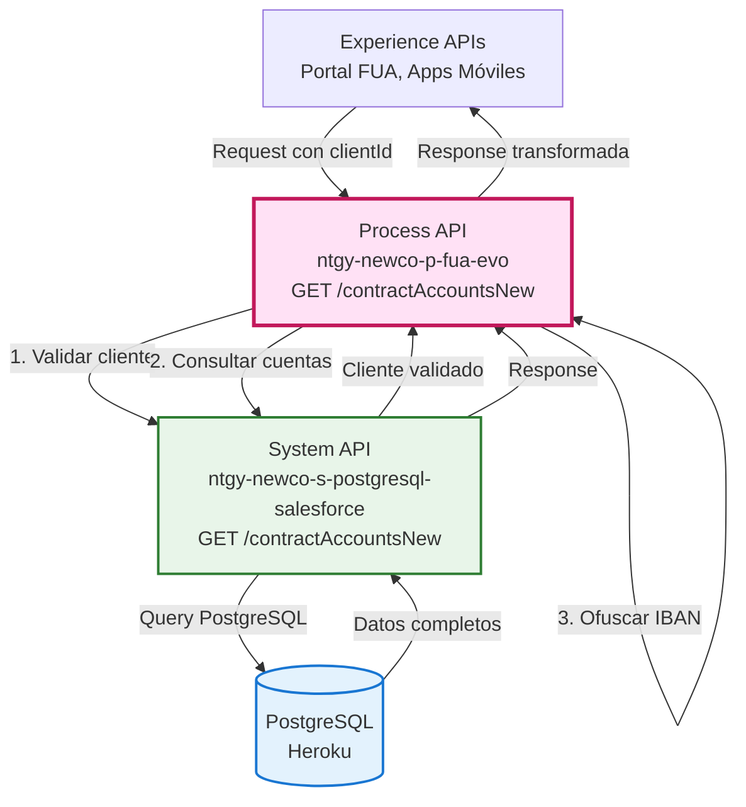
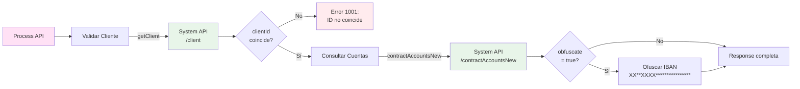
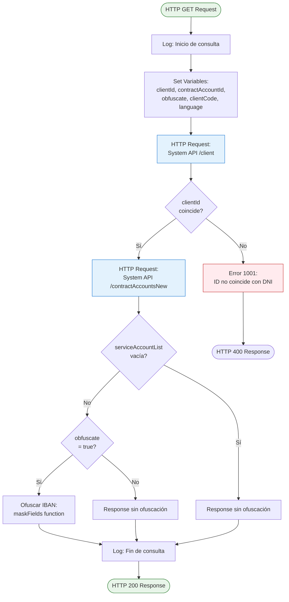
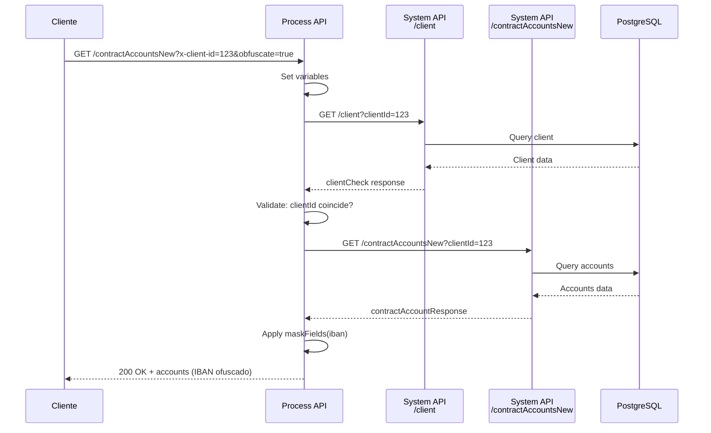
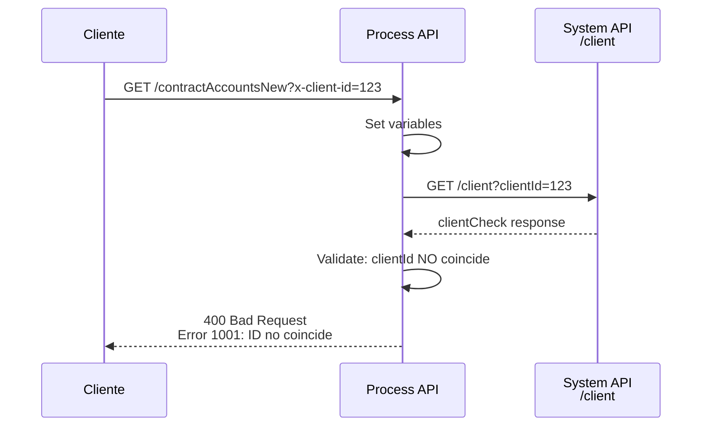
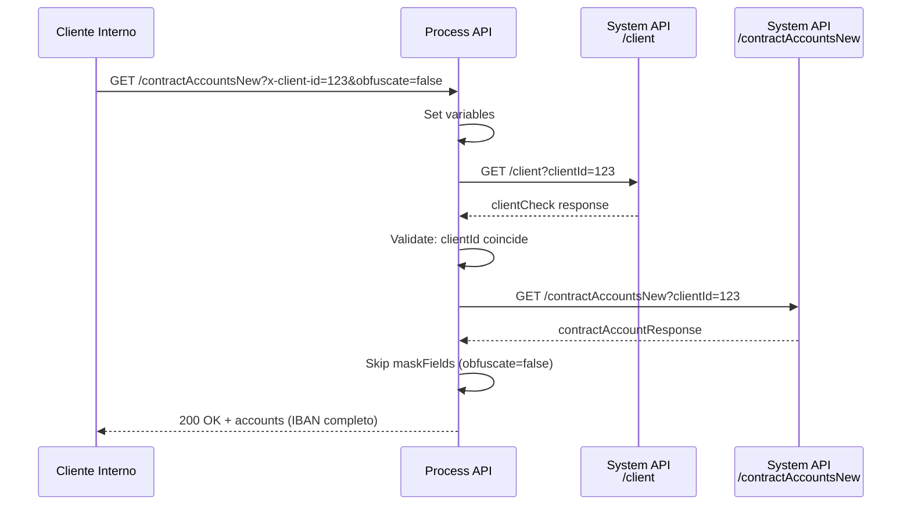

# GET /contractAccountsNew

## 📌 Descripción General

### Propósito del Endpoint

Este endpoint recupera información completa de cuentas contrato desde PostgreSQL (Heroku), incluyendo datos de servicio, facturación, direcciones, productos asociados y cuentas bancarias. Soporta ofuscación de datos sensibles (IBAN) y respuestas multiidioma.

### Tipo de API

**Capa:** Process API (API-Led Connectivity)

**Función:** Orquestación de consulta de cuentas contrato con validación de cliente, transformación de datos y ofuscación de información sensible

### Patrón de Integración

**Tipo:** Orquestación con Validación y Transformación

**Descripción:** El endpoint valida la identidad del cliente, consulta el System API de PostgreSQL/Salesforce, aplica ofuscación de IBAN si se requiere, y retorna una estructura completa de cuentas contrato con todos sus datos asociados.

### Arquitectura API-Led Connectivity



---

## 💼 Propósito del Negocio

### Casos de Uso Principales

1. **Consulta Completa de Cuentas por Cliente**
   - Recuperar todas las cuentas contrato con información detallada
   - Beneficio: Vista 360° del cliente con todos sus servicios

2. **Gestión de Datos Sensibles**
   - Ofuscación automática de IBAN para protección de datos
   - Beneficio: Cumplimiento GDPR y seguridad de información bancaria

3. **Información Multiidioma**
   - Respuestas adaptadas al idioma preferido del cliente
   - Beneficio: Experiencia personalizada según preferencias

4. **Validación de Identidad**
   - Verificación de que el clientId corresponde al cliente autenticado
   - Beneficio: Seguridad y prevención de acceso no autorizado

### 🔗 Endpoints Dependientes

Este Process API consume los siguientes System APIs:

| System API | Endpoint | Método | Propósito |
|------------|----------|--------|-----------|
| `ntgy-newco-s-postgresql-salesforce` | `/client` | GET | Validación de identidad del cliente |
| `ntgy-newco-s-postgresql-salesforce` | `/contractAccountsNew` | GET | Consulta de cuentas contrato desde PostgreSQL |

### Lógica de Orquestación



**Pasos del Proceso:**

1. **Validación de Cliente**: Llama a `/client` para verificar identidad
2. **Verificación de Coincidencia**: Compara clientId del request con el del cliente
3. **Consulta de Cuentas**: Si coincide, consulta `/contractAccountsNew`
4. **Ofuscación Condicional**: Si `obfuscate=true`, enmascara IBAN
5. **Respuesta**: Retorna estructura completa de cuentas contrato

### Transformaciones Aplicadas

**Transformación de Ofuscación de IBAN (DataWeave inline):**

| Campo Original | Campo Transformado | Transformación |
|----------------|-------------------|----------------|
| `iban` (completo) | `iban` (ofuscado) | `XX**XXXX****************` (muestra solo primeros 2 y caracteres 5-8) |

**Función de Ofuscación:**
```dataweave
fun maskFields(in, fields, mask1="**", mask2="****************") =
  applyWhenKey(in,
    ((value) -> (value as String)[0 to 1] ++ mask1 ++ (value as String)[4 to 7] ++ mask2),
    ((key) -> fields contains (key as String)))
```

### Contexto Empresarial

- **Dominio:** Gestión de Clientes y Cuentas Contrato
- **Sector:** Energía - Utilities
- **División:** Naturgy España - NewCo
- **Proceso de Negocio:** Consulta de información completa de cuentas contrato para portal de autoservicio FUA

### Stakeholders

- **Clientes Naturgy**: Consultan sus cuentas contrato con información detallada
- **Agentes de Call Center**: Acceden a información completa para soporte
- **Sistemas de Facturación**: Requieren datos actualizados de cuentas
- **Compliance/Legal**: Requieren ofuscación de datos sensibles

### Valor de Negocio

- **Información Completa**: Vista 360° de cuentas con servicios, facturación y productos
- **Seguridad**: Ofuscación automática de IBAN para protección de datos
- **Validación**: Prevención de acceso no autorizado mediante validación de identidad
- **Multiidioma**: Soporte para idioma preferido del cliente

### Consumidores Potenciales

Este endpoint puede ser consumido por:
- Portal web FUA
- Aplicaciones móviles de clientes
- Sistemas de agentes de call center
- Aplicaciones de gestión interna

---

## 🔧 Especificación Técnica

### URLs por Ambiente

| Ambiente | URL Base | URL Completa |
|----------|----------|--------------|
| **Local** | `http://localhost:8081` | `http://localhost:8081/api/contractAccountsNew` |
| **Development** | `https://ntgy-newco-p-fua-evo-dev.us-e2.cloudhub.io` | `https://ntgy-newco-p-fua-evo-dev.us-e2.cloudhub.io/api/contractAccountsNew` |
| **UAT** | `https://ntgy-newco-p-fua-evo-uat.us-e2.cloudhub.io` | `https://ntgy-newco-p-fua-evo-uat.us-e2.cloudhub.io/api/contractAccountsNew` |
| **Production** | `https://ntgy-newco-p-fua-evo-pro.us-e2.cloudhub.io` | `https://ntgy-newco-p-fua-evo-pro.us-e2.cloudhub.io/api/contractAccountsNew` |

### Método HTTP

```
GET /api/contractAccountsNew
```

### Parámetros de Entrada

#### Query Parameters

| Parámetro | Tipo | Requerido | Descripción | Ejemplo |
|-----------|------|-----------|-------------|---------|
| `x-client-id` | string | ✅ Sí | Identificador único del cliente | `12345678` |
| `x-client-code` | string | ✅ Sí | Código de cliente (DNI/NIF) | `12345678A` |
| `contractAccountID` | string | ❌ No | ID específico de cuenta contrato | `ACC-001` |
| `obfuscate` | boolean | ❌ No | Ofuscar IBAN en respuesta (default: true) | `true` |
| `x-language` | string | ❌ No | Idioma de respuesta (default: es) | `es` |

**Validaciones:**
- `x-client-id`: Requerido, no puede estar vacío
- `x-client-code`: Requerido, debe coincidir con el cliente autenticado
- `contractAccountID`: Opcional, formato alfanumérico
- `obfuscate`: Opcional, valores: `true` o `false` (default: `true`)
- `x-language`: Opcional, valores soportados: `es`, `en`, `ca`, `gl`, `eu`

### Respuestas

#### 200 OK - Consulta Exitosa

**Descripción:** Cuentas contrato recuperadas exitosamente

**Estructura de Respuesta:**

```json
{
  "serviceAccountList": [
    {
      "clientId": "string",
      "serviceAccountId": "string",
      "lastInvoice": {
        "invoiceId": "string",
        "invoiceNum": "string",
        "issuedDate": "string",
        "billingDate": "string",
        "status": "string",
        "amount": 0,
        "interactiveInvoice": "string",
        "pdfDocumentId": "string",
        "productFamilyIdList": [],
        "refNumber": "string"
      },
      "supplyAddress": {
        "fullAddress": "string",
        "addressId": "string",
        "zipCode": "string",
        "province": "string",
        "city": "string",
        "town": "string",
        "wayId": "string",
        "way": "string",
        "wayType": "string",
        "number": "string",
        "floor": "string",
        "door": "string",
        "portal": "string",
        "stairs": "string"
      },
      "billingAccountList": [
        {
          "refNum": "string",
          "billingAccountId": "string",
          "isDirectPayment": false,
          "billDeliveryMethod": "string",
          "mailingAddress": {},
          "bankAccount": {
            "bankAccountId": "string",
            "contactId": "string",
            "holderName": "string",
            "holderType": "string",
            "iban": "ES**************1234"
          },
          "products": []
        }
      ]
    }
  ]
}
```

**Campos de Respuesta Principales:**

| Campo | Tipo | Descripción |
|-------|------|-------------|
| `serviceAccountList` | array | Lista de cuentas de servicio del cliente |
| `serviceAccountList[].clientId` | string | ID del cliente propietario |
| `serviceAccountList[].serviceAccountId` | string | ID de la cuenta de servicio |
| `serviceAccountList[].lastInvoice` | object | Última factura emitida |
| `serviceAccountList[].supplyAddress` | object | Dirección de suministro |
| `serviceAccountList[].billingAccountList` | array | Lista de cuentas de facturación |
| `billingAccountList[].refNum` | string | Número de referencia de la cuenta |
| `billingAccountList[].bankAccount.iban` | string | IBAN (ofuscado si obfuscate=true) |
| `billingAccountList[].products` | array | Productos asociados a la cuenta |

#### 400 Bad Request - Error de Validación

**Descripción:** Parámetros de entrada inválidos o cliente no coincide

```json
{
  "result": {
    "codResult": "1001",
    "msgResult": "el id no coincide con el DNI del cliente: 12345678A y clientId: 87654321"
  }
}
```

#### 500 Internal Server Error - Error del Sistema

**Descripción:** Error interno del servidor o System API

```json
{
  "code": "INTERNAL_ERROR",
  "message": "Error al consultar System API",
  "details": "Connection timeout to PostgreSQL service",
  "timestamp": "2026-08-19T12:26:30Z"
}
```

### Autenticación

- **Tipo:** Client ID & Client Secret (Anypoint Platform)
- **Headers Requeridos:**
  - `client_id`: ID de cliente de Anypoint Platform
  - `client_secret`: Secret de cliente de Anypoint Platform

### Timeouts

| Tipo | Valor |
|------|-------|
| **Request Timeout** | 30 segundos |
| **Connection Timeout** | 10 segundos |
| **System API Timeout** | 20 segundos |

---

## 🏗️ Implementación Técnica

### Arquitectura del Flow



### Implementación del Flow (XML)

**Ubicación:** `src/main/mule/services/clients/clientInfo.xml` (líneas 899-980)

**Flow Principal:**

```xml
<sub-flow name="getContractAccountsNew">
    <logger level="INFO" message="Consulta de informacion contract accounts asociadas al cliente #[vars.clientId]" />
    
    <!-- 1. Validar cliente -->
    <flow-ref name="getClient" target="clientCheck"/>
    
    <choice>
        <when expression="#[vars.clientCheck.client.clientId == vars.clientId]">
            <!-- 2. Consultar cuentas contrato -->
            <http:request method="GET" 
                          config-ref="HTTP_Request_s_postgresql-salesforce" 
                          path="/contractAccountsNew" 
                          target="contractAccountResponse">
                <http:query-params>
                    clientId: vars.clientId,
                    obfuscate: (vars.obfuscate default true),
                    contractAccountId: vars.contractAccountId,
                    language: vars.clientCheck.client.preferredLanguage
                </http:query-params>
            </http:request>
            
            <!-- 3. Ofuscar IBAN si es necesario -->
            <choice>
                <when expression="#[!isEmpty(vars.contractAccountResponse.serviceAccountList)]">
                    <ee:transform doc:name="obfuscate iban">
                        <ee:set-variable variableName="contractAccount">
                            <!-- Función de ofuscación -->
                            if ((isEmpty(vars.obfuscate)) or (vars.obfuscate == "true")) 
                                maskFields(vars.contractAccountResponse, ['iban']) 
                            else 
                                vars.contractAccountResponse
                        </ee:set-variable>
                    </ee:transform>
                    <ee:set-payload>vars.contractAccount</ee:set-payload>
                </when>
                <otherwise>
                    <ee:set-payload>vars.contractAccountResponse</ee:set-payload>
                </otherwise>
            </choice>
        </when>
        <otherwise>
            <!-- Error: ID no coincide -->
            <ee:set-payload>{
                "result": {
                    "codResult": "1001",
                    "msgResult": "el id no coincide con el DNI del cliente"
                }
            }</ee:set-payload>
        </otherwise>
    </choice>
</sub-flow>
```

### Transformaciones DataWeave

#### Función de Ofuscación de IBAN

**Ubicación:** Inline en `clientInfo.xml` (línea 920-941)

**Propósito:** Enmascarar IBAN mostrando solo primeros 2 caracteres y caracteres 5-8

```dataweave
%dw 2.0
output application/json

fun applyWhenKey(e, fn, predicate) =
  e match {
    case is Array  -> $ map applyWhenKey($, fn, predicate)
    case is Object -> $ mapObject ((v, k) -> 
      if (predicate(k)) { 
        (k): fn(v)
      } else {
        (k): applyWhenKey(v, fn, predicate)
      })
    else -> $
  }

fun maskFields(in, fields, mask1="**", mask2="****************") =
  applyWhenKey(in,
    ((value) -> (value as String)[0 to 1] ++ mask1 ++ (value as String)[4 to 7] ++ mask2),
    ((key) -> fields contains (key as String)))
---
if ((isEmpty(vars.obfuscate)) or (vars.obfuscate == "true")) 
  maskFields(vars.contractAccountResponse, ['iban']) 
else 
  vars.contractAccountResponse
```

**Lógica Clave:**
- `applyWhenKey`: Función recursiva que recorre toda la estructura (arrays y objetos)
- `maskFields`: Aplica máscara a campos específicos (en este caso, 'iban')
- **Formato de máscara:** `ES**1234****************` (muestra ES + ** + 4 dígitos + ****************)
- **Default:** Si `obfuscate` no se especifica o es `"true"`, se aplica la máscara

### Configuración de System API

**System API:** `ntgy-newco-s-postgresql-salesforce`

**Endpoints Consumidos:**
1. **GET /client** - Validación de identidad
2. **GET /contractAccountsNew** - Consulta de cuentas contrato

**Backend:** PostgreSQL (Heroku)

**Tablas Principales:**
- Cuentas de servicio (service accounts)
- Cuentas de facturación (billing accounts)
- Productos asociados
- Direcciones (suministro y correspondencia)
- Cuentas bancarias

### Patrones de Diseño

**Patrón 1: Validación Previa (Pre-Validation)**

**Justificación:** 
- Verifica identidad antes de consultar datos sensibles
- Previene acceso no autorizado
- Reduce carga en System API si la validación falla

**Patrón 2: Transformación Condicional**

**Justificación:**
- Ofuscación solo cuando se requiere
- Flexibilidad para casos internos que necesitan IBAN completo
- Cumplimiento de GDPR y protección de datos

**Patrón 3: Target Variables**

**Justificación:**
- Preserva respuestas intermedias para validación
- Permite lógica condicional basada en respuestas
- Facilita debugging y logging

### Diagramas de Secuencia

#### 1. Flujo Normal de Éxito con Ofuscación



#### 2. Flujo con Error de Validación



#### 3. Flujo sin Ofuscación



### Manejo de Errores

**Estrategia:** Validación previa con error handling específico

**Tipos de Errores:**

1. **Error 1001 - ID No Coincide (400)**
   - **Causa:** `clientId` del request no coincide con el cliente autenticado
   - **Mensaje:** "el id no coincide con el DNI del cliente: [clientCode] y clientId: [clientId]"
   - **Acción:** Verificar autenticación y parámetros

2. **Errores de System API (500)**
   - **Causa:** Timeout, conexión fallida, error en PostgreSQL
   - **Respuesta:** Error genérico sin exponer detalles internos
   - **Acción:** Revisar logs del System API

3. **Errores de Transformación (500)**
   - **Causa:** Error en función maskFields o estructura inesperada
   - **Respuesta:** Error interno del servidor
   - **Acción:** Verificar estructura de datos del System API

**Logging:**
- Inicio de request con clientId
- Resultado de validación de cliente
- Llamada a System API con parámetros
- Aplicación de ofuscación (si aplica)
- Fin de request con tiempo de respuesta

---

## 💻 Ejemplos de Uso

### Ejemplo 1: Consulta con Ofuscación (Default)

#### cURL

```bash
curl -X GET "https://ntgy-newco-p-fua-evo-dev.us-e2.cloudhub.io/api/contractAccountsNew?x-client-id=12345678&x-client-code=12345678A" \
  -H "Content-Type: application/json" \
  -H "client_id: YOUR_CLIENT_ID" \
  -H "client_secret: YOUR_CLIENT_SECRET"
```

#### Respuesta (200 OK)

```json
{
  "serviceAccountList": [
    {
      "clientId": "12345678",
      "serviceAccountId": "SA-001",
      "lastInvoice": {
        "invoiceId": "INV-2024-001",
        "invoiceNum": "F-2024-001",
        "issuedDate": "2024-01-15",
        "billingDate": "2024-01-31",
        "status": "Pagada",
        "amount": 125.50,
        "interactiveInvoice": "https://...",
        "pdfDocumentId": "PDF-001",
        "productFamilyIdList": ["Electricidad"],
        "refNumber": "REF-001"
      },
      "supplyAddress": {
        "fullAddress": "Calle Mayor 123, 28001 Madrid",
        "addressId": "ADDR-001",
        "zipCode": "28001",
        "province": "Madrid",
        "city": "Madrid",
        "town": "Madrid",
        "wayId": "WAY-001",
        "way": "Mayor",
        "wayType": "Calle",
        "number": "123",
        "floor": "3",
        "door": "A",
        "portal": "1",
        "stairs": "Izquierda"
      },
      "billingAccountList": [
        {
          "refNum": "BA-001",
          "billingAccountId": "BILL-001",
          "isDirectPayment": true,
          "billDeliveryMethod": "Email",
          "mailingAddress": {
            "fullAddress": "Calle Mayor 123, 28001 Madrid"
          },
          "bankAccount": {
            "bankAccountId": "BANK-001",
            "contactId": "CONT-001",
            "holderName": "Juan Pérez García",
            "holderType": "Titular",
            "iban": "ES**1234****************"
          },
          "products": [
            {
              "productId": "PROD-001",
              "productType": "Electricidad",
              "contractId": "CONT-001",
              "status": "Activo"
            }
          ]
        }
      ]
    }
  ]
}
```

### Ejemplo 2: Consulta sin Ofuscación (Uso Interno)

#### cURL

```bash
curl -X GET "https://ntgy-newco-p-fua-evo-dev.us-e2.cloudhub.io/api/contractAccountsNew?x-client-id=12345678&x-client-code=12345678A&obfuscate=false" \
  -H "Content-Type: application/json" \
  -H "client_id: YOUR_CLIENT_ID" \
  -H "client_secret: YOUR_CLIENT_SECRET"
```

#### Respuesta (200 OK)

```json
{
  "serviceAccountList": [
    {
      "clientId": "12345678",
      "serviceAccountId": "SA-001",
      "billingAccountList": [
        {
          "refNum": "BA-001",
          "