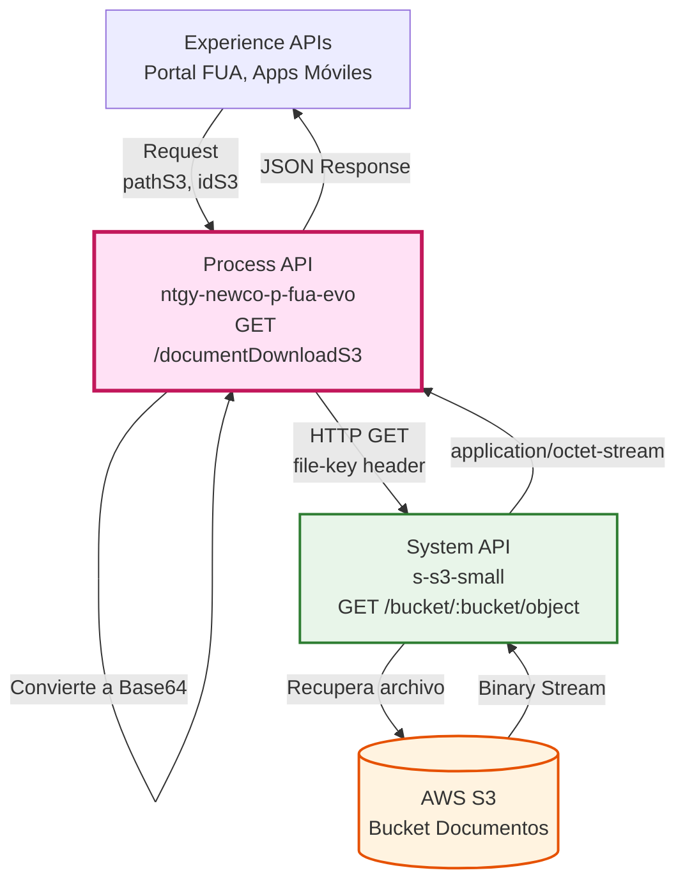
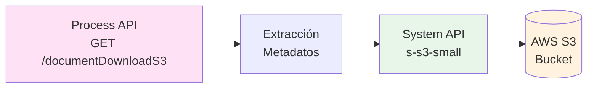
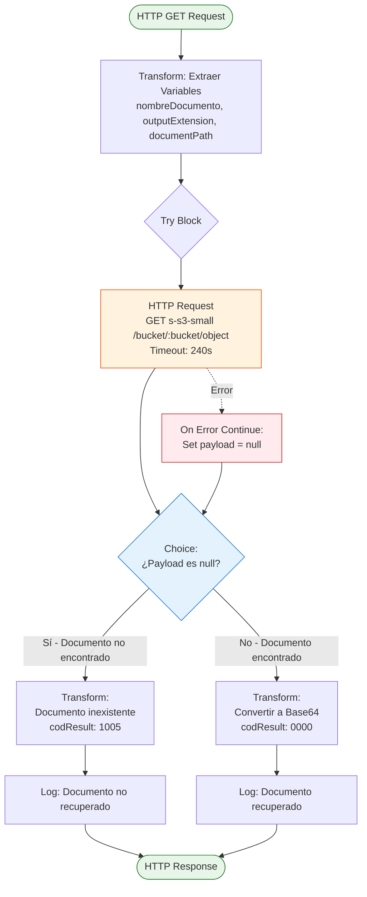
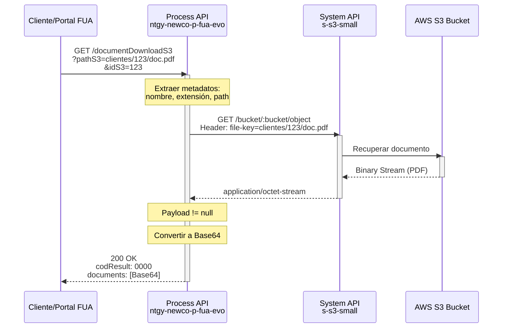
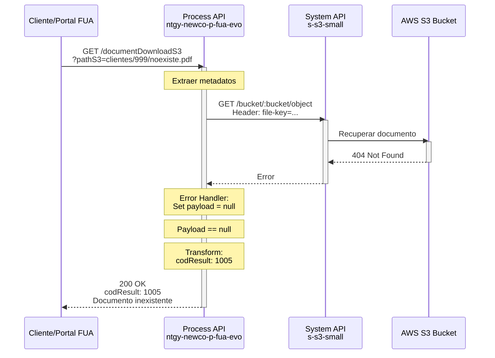
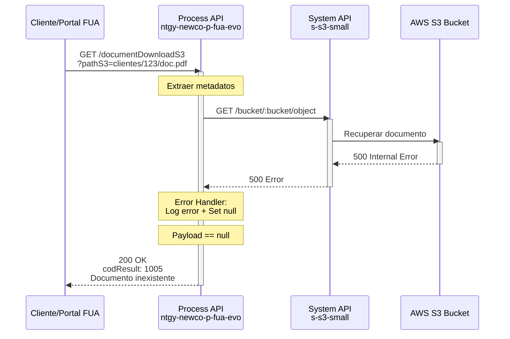
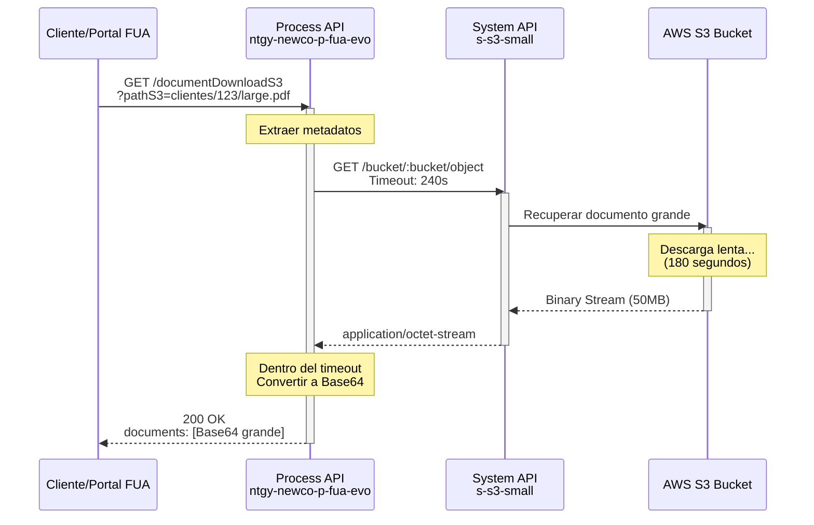

# GET /documentDownloadS3

## 📌 Descripción General

### Propósito del Endpoint

Este endpoint orquesta la descarga de documentos almacenados en AWS S3, convirtiendo los archivos binarios a formato Base64 para su transporte seguro en respuestas JSON. Forma parte del módulo de gestión documental del proceso FUA (Firma Única Avanzada).

### Tipo de API

**Capa:** Process API (API-Led Connectivity)

**Función:** Orquestación de descarga de documentos con transformación de formato

### Patrón de Integración

**Tipo:** Transformación con Manejo Robusto de Errores

**Descripción:** El endpoint extrae metadatos del documento desde el path S3, recupera el archivo binario del System API S3, maneja errores de documentos no encontrados o corruptos, y convierte el contenido a Base64 para respuesta JSON.

### Arquitectura API-Led Connectivity



---

## 💼 Propósito del Negocio

### Casos de Uso Principales

1. **Descarga de Documentos de Clientes**
   - Acceso a facturas, contratos y documentos legales almacenados en S3
   - Visualización de documentos en el portal FUA
   - Descarga de documentos para archivo personal

2. **Gestión Documental del Proceso FUA**
   - Recuperación de documentos firmados digitalmente
   - Acceso a documentación de casos y solicitudes
   - Consulta de documentos históricos

3. **Integración con Sistemas de Almacenamiento**
   - Abstracción del almacenamiento S3 para consumidores
   - Conversión de formatos binarios a JSON transportable
   - Manejo centralizado de errores de documentos

### 🔗 Endpoints Dependientes

Este Process API consume el siguiente System API:

| System API | Endpoint | Método | Propósito |
|------------|----------|--------|-----------|
| `s-s3-small` | `/bucket/:bucket/object` | GET | Recupera documentos desde AWS S3 bucket |

### Lógica de Orquestación



**Pasos del Proceso:**

1. **Extracción de Metadatos**: Analiza pathS3 para extraer nombre del documento, extensión y ruta completa
2. **Recuperación del Documento**: Invoca System API S3 con file-key header y bucket URI parameter
3. **Manejo de Errores**: Try-catch para documentos no encontrados o corruptos
4. **Transformación**: Convierte stream binario a Base64 y construye respuesta JSON estructurada

### Transformaciones Aplicadas

**Transformaciones de Metadatos:**

| Entrada | Transformación | Salida |
|---------|----------------|--------|
| `pathS3` (query param) | `splitBy "/"` → último elemento → `splitBy "."` → primer elemento | `nombreDocumento` (variable) |
| `pathS3` (query param) | `substringAfterLast "."` → default "pdf" | `outputExtension` (variable) |
| `pathS3` (query param) | Pass-through | `documentPath` (variable) |

**Transformación de Respuesta:**

| Condición | Transformación | Resultado |
|-----------|----------------|-----------|
| `payload == null` | Código 1005 + mensaje error | JSON con error "Documento inexistente" |
| `payload != null` | `dw::core::Binaries::toBase64(payload)` | JSON con documento en Base64 |

### Contexto Empresarial

- **Dominio:** Gestión Documental
- **Sector:** Energía - Utilities
- **División:** Naturgy España - NewCo
- **Proceso de Negocio:** Firma Única Avanzada (FUA) - Módulo de Documentos

### Stakeholders

- **Clientes Naturgy**: Necesitan acceder a sus documentos (facturas, contratos)
- **Equipo FUA Portal**: Requiere funcionalidad de descarga de documentos
- **Equipo de Infraestructura AWS**: Propietarios del bucket S3
- **Equipo de Atención al Cliente**: Acceso a documentos para soporte

### Valor de Negocio

- **Accesibilidad**: Clientes pueden descargar documentos 24/7
- **Eficiencia**: Reduce solicitudes de documentos al call center
- **Seguridad**: Transporte seguro de documentos mediante Base64 en HTTPS
- **Escalabilidad**: Almacenamiento en S3 permite crecimiento ilimitado

### Consumidores Potenciales

Este endpoint puede ser consumido por:
- Portal web FUA (Frontal Único de Atención)
- Aplicaciones móviles de clientes
- Sistemas de agentes de call center
- Procesos automatizados de gestión documental

---

## 🔧 Especificación Técnica

### URLs por Ambiente

| Ambiente | URL Base | URL Completa |
|----------|----------|--------------|
| **Local** | `http://localhost:8081` | `http://localhost:8081/api/documentDownloadS3?pathS3={path}&idS3={id}` |
| **Development** | `https://ntgy-newco-p-fua-evo-dev.us-e2.cloudhub.io` | `https://ntgy-newco-p-fua-evo-dev.us-e2.cloudhub.io/api/documentDownloadS3?pathS3={path}&idS3={id}` |
| **UAT** | `https://ntgy-newco-p-fua-evo-uat.us-e2.cloudhub.io` | `https://ntgy-newco-p-fua-evo-uat.us-e2.cloudhub.io/api/documentDownloadS3?pathS3={path}&idS3={id}` |
| **Production** | `https://ntgy-newco-p-fua-evo-pro.us-e2.cloudhub.io` | `https://ntgy-newco-p-fua-evo-pro.us-e2.cloudhub.io/api/documentDownloadS3?pathS3={path}&idS3={id}` |

### Método HTTP

```
GET /api/documentDownloadS3
```

### Parámetros de Entrada

#### Query Parameters

| Parámetro | Tipo | Requerido | Descripción | Ejemplo |
|-----------|------|-----------|-------------|---------|
| `pathS3` | string | ✅ Sí | Ruta completa del documento en S3 (incluye carpetas y nombre de archivo) | `"clientes/12345/factura-2024-01.pdf"` |
| `idS3` | string | ⚠️ Opcional | ID del cliente (usado solo para logging, no afecta la operación) | `"12345678"` |

**Nota sobre pathS3:**
- Debe incluir la ruta completa desde la raíz del bucket
- Puede incluir subcarpetas separadas por `/`
- Debe incluir el nombre del archivo con extensión
- Si no tiene extensión, se asume `.pdf` por defecto

#### Headers

| Header | Tipo | Requerido | Descripción | Ejemplo |
|--------|------|-----------|-------------|---------|
| `Content-Type` | string | ✅ Sí | Tipo de contenido | `"application/json"` |
| `client_id` | string | ✅ Sí | Client ID de Anypoint Platform | `"your-client-id"` |
| `client_secret` | string | ✅ Sí | Client Secret de Anypoint Platform | `"your-client-secret"` |

### Respuestas

#### 200 OK - Documento Recuperado Exitosamente

**Descripción:** Documento encontrado y convertido a Base64

**Content-Type:** `application/json`

**Schema:**
```json
{
  "result": {
    "codResult": "0000",
    "msgResult": "No hay error"
  },
  "documents": "string (Base64)"
}
```

**Ejemplo:**
```json
{
  "result": {
    "codResult": "0000",
    "msgResult": "No hay error"
  },
  "documents": "JVBERi0xLjQKJeLjz9MKMyAwIG9iago8PC9UeXBlL1BhZ2UvUGFyZW50IDIgMCBSL1Jlc291cmNlczw8L0ZvbnQ8PC9GMSA1IDAgUj4+L1Byb2NTZXRbL1BERi9UZXh0L0ltYWdlQi9JbWFnZUMvSW1hZ2VJXT4+L01lZGlhQm94WzAgMCA1OTUuMzIgODQxLjkyXS9Db250ZW50cyA0IDAgUi9Hcm91cDw8L1R5cGUvR3JvdXAvUy9UcmFuc3BhcmVuY3kvQ1MvRGV2aWNlUkdCPj4vVGFicz..."
}
```

#### 200 OK - Documento No Encontrado

**Descripción:** Documento no existe en S3 o está corrupto

**Content-Type:** `application/json`

**Schema:**
```json
{
  "result": {
    "codResult": "1005",
    "msgResult": "Documento inexistente"
  }
}
```

**Ejemplo:**
```json
{
  "result": {
    "codResult": "1005",
    "msgResult": "Documento inexistente"
  }
}
```

#### 400 Bad Request - Error de Validación

**Descripción:** Parámetros de entrada inválidos o faltantes

```json
{
  "error": {
    "code": "BAD_REQUEST",
    "message": "Query parameter 'pathS3' es requerido",
    "timestamp": "2024-01-15T10:30:00Z"
  }
}
```

#### 401 Unauthorized - Error de Autenticación

**Descripción:** Credenciales inválidas o faltantes

```json
{
  "error": {
    "code": "UNAUTHORIZED",
    "message": "Client ID o Client Secret inválidos",
    "timestamp": "2024-01-15T10:30:00Z"
  }
}
```

#### 500 Internal Server Error - Error del Sistema

**Descripción:** Error en la comunicación con S3 o error interno

```json
{
  "error": {
    "code": "INTERNAL_ERROR",
    "message": "Error al recuperar documento desde S3",
    "timestamp": "2024-01-15T10:30:00Z"
  }
}
```

#### 503 Service Unavailable - Servicio No Disponible

**Descripción:** System API S3 no disponible

```json
{
  "error": {
    "code": "SERVICE_UNAVAILABLE",
    "message": "System API S3 temporalmente no disponible",
    "timestamp": "2024-01-15T10:30:00Z"
  }
}
```

### Autenticación

- **Tipo:** Client ID & Client Secret (Anypoint Platform)
- **Headers Requeridos:** `client_id`, `client_secret`

### Timeouts

| Tipo | Valor | Justificación |
|------|-------|---------------|
| **Request Timeout** | 240 segundos (4 minutos) | Documentos grandes pueden tardar en descargarse |
| **Connection Timeout** | 10 segundos | Tiempo estándar de conexión |

**Nota:** El timeout extendido de 240 segundos es necesario para soportar la descarga de documentos grandes (PDFs de múltiples páginas, imágenes de alta resolución, etc.).

---

## 🏗️ Implementación Técnica

### Arquitectura del Flow



### Código de Implementación

**Archivo:** `src/main/mule/services/docs/getDocumentODS3.xml`

**Sub-flow Principal:**
```xml
<sub-flow name="getDocumentODS3" doc:id="5429e71d-7622-43c0-b46a-69ec2cac5431">
    <!-- Paso 1: Extraer metadatos del documento -->
    <ee:transform doc:name="vars documentPath, nombreDocumento, outputExtension">
        <ee:variables>
            <ee:set-variable variableName="nombreDocumento">
                <![CDATA[%dw 2.0
                output application/java
                ---
                ((attributes.queryParams.pathS3 splitBy "/")[-1] splitBy ".")[0] default ""]]>
            </ee:set-variable>
            <ee:set-variable variableName="outputExtension">
                <![CDATA[%dw 2.0
                output application/json
                import * from dw::core::Strings
                ---
                if((attributes.queryParams.pathS3 substringAfterLast ".") != "")
                    attributes.queryParams.pathS3 substringAfterLast "." 
                else "pdf"]]>
            </ee:set-variable>
            <ee:set-variable variableName="documentPath">
                <![CDATA[%dw 2.0
                output application/java
                ---
                attributes.queryParams.pathS3 default ""]]>
            </ee:set-variable>
        </ee:variables>
    </ee:transform>
    
    <!-- Paso 2: Try-catch para recuperación del documento -->
    <try doc:name="Try">
        <http:request method="GET" 
                      doc:name="Recuperar documento S3" 
                      config-ref="HTTP_Request_s_s3_small" 
                      path="/bucket/{bucket}/object" 
                      outputMimeType="application/octet-stream" 
                      responseTimeout="240000">
            <http:headers>
                <![CDATA[#[output application/java
                ---
                {
                    "file-key": vars.documentPath
                }]]]>
            </http:headers>
            <http:uri-params>
                <![CDATA[#[output application/java
                ---
                {
                    "bucket": p('s-s3-small.operacionesDomi.bucket')
                }]]]>
            </http:uri-params>
        </http:request>
        
        <error-handler>
            <on-error-continue enableNotifications="true" logException="true">
                <logger level="ERROR" 
                        doc:name="Documento no encontrado" 
                        message="Documento #[vars.nombreDocumento] no se encuentra o esta corrupto"/>
                <set-payload value="#[null]" 
                             doc:name="DocumentId No encontrado"/>
            </on-error-continue>
        </error-handler>
    </try>
    
    <!-- Paso 3: Choice para respuesta condicional -->
    <choice doc:name="Choice">
        <when expression="#[isEmpty(payload)]">
            <ee:transform doc:name="Documento inexistente">
                <ee:message>
                    <ee:set-payload>
                        <![CDATA[%dw 2.0
                        output application/json
                        ---
                        {
                            "result": {
                                "codResult": '1005',
                                "msgResult": "Documento inexistente"
                            }
                        }]]>
                    </ee:set-payload>
                </ee:message>
            </ee:transform>
            <logger level="INFO" 
                    doc:name="No se ha podido recuperar el documento" 
                    message="No se ha podido recuperar el documento #[vars.nombreDocumento] para el cliente #[attributes.queryParams.idS3]"/>
        </when>
        <otherwise>
            <logger level="INFO" 
                    doc:name="extension" 
                    message='Content-type: #[attributes.headers."content-type"] Extension archivo: #[vars.outputExtension]'/>
            <ee:transform doc:name="Documento existente">
                <ee:message>
                    <ee:set-payload>
                        <![CDATA[%dw 2.0
                        output application/json
                        ---
                        {
                            "result": {
                                "codResult": '0000',
                                "msgResult": "No hay error"
                            },
                        } ++ "documents": dw::core::Binaries::toBase64(payload)]]>
                    </ee:set-payload>
                </ee:message>
            </ee:transform>
            <logger level="INFO" 
                    doc:name="Se ha recuperado el documento" 
                    message="Se ha recuperado el documento #[vars.nombreDocumento] para el cliente #[attributes.queryParams.idS3]"/>
        </otherwise>
    </choice>
</sub-flow>
```

### Transformaciones DataWeave

**1. Extracción de Metadatos del Documento:**

```dataweave
%dw 2.0
output application/java
---
{
    nombreDocumento: ((attributes.queryParams.pathS3 splitBy "/")[-1] splitBy ".")[0] default "",
    outputExtension: if((attributes.queryParams.pathS3 substringAfterLast ".") != "")
                        attributes.queryParams.pathS3 substringAfterLast "." 
                     else "pdf",
    documentPath: attributes.queryParams.pathS3 default ""
}
```

**Descripción:**
- `nombreDocumento`: Extrae el nombre del archivo sin extensión del último segmento del path
- `outputExtension`: Extrae la extensión del archivo, usa "pdf" como default
- `documentPath`: Guarda el path completo para el header file-key

**2. Respuesta de Documento Inexistente:**

```dataweave
%dw 2.0
output application/json
---
{
    "result": {
        "codResult": "1005",
        "msgResult": "Documento inexistente"
    }
}
```

**3. Respuesta de Documento Existente (Conversión a Base64):**

```dataweave
%dw 2.0
output application/json
---
{
    "result": {
        "codResult": "0000",
        "msgResult": "No hay error"
    }
} ++ {
    "documents": dw::core::Binaries::toBase64(payload)
}
```

**Descripción:**
- Usa la función `dw::core::Binaries::toBase64()` para convertir el stream binario
- Combina el objeto result con el campo documents usando el operador `++`

### Configuración HTTP

**Connector:** `HTTP_Request_s_s3_small`

**Configuración Especial:**
- **Path:** `/bucket/{bucket}/object` (URI parameter dinámico)
- **Output MIME Type:** `application/octet-stream` (para recibir binarios)
- **Response Timeout:** 240000 ms (4 minutos) - Extendido para documentos grandes
- **Header:** `file-key` con el path completo del documento
- **URI Parameter:** `bucket` desde configuración de propiedades

### Patrones de Diseño

**Patrón 1: Try-Catch con Graceful Degradation**

**Justificación:** 
- Maneja errores de documentos no encontrados o corruptos sin fallar el endpoint
- Establece payload a null en caso de error para procesamiento posterior
- Permite respuesta estructurada incluso cuando el documento no existe

**Patrón 2: Choice Router para Respuestas Condicionales**

**Justificación:**
- Diferencia entre documento encontrado y no encontrado
- Proporciona códigos de resultado específicos (0000 vs 1005)
- Permite logging diferenciado según el resultado

**Patrón 3: Conversión de Formato (Binary → Base64)**

**Justificación:**
- Base64 permite transporte de binarios en JSON
- Compatible con APIs REST estándar
- Facilita el manejo en clientes web y móviles

### Diagramas de Secuencia

#### 1. Flujo Normal de Éxito (Documento Encontrado)



#### 2. Flujo con Documento No Encontrado



#### 3. Flujo con Error de Sistema S3



#### 4. Flujo con Timeout (Documento Grande)



### Manejo de Errores

**Estrategia:** Try-Catch con On-Error-Continue + Choice Router

**Tipos de Errores Manejados:**

1. **Documento No Encontrado (404)**
   - **Handler:** On-error-continue
   - **Acción:** Set payload = null
   - **Respuesta:** 200 OK con codResult 1005
   - **Logging:** ERROR level con nombre del documento

2. **Documento Corrupto**
   - **Handler:** On-error-continue
   - **Acción:** Set payload = null
   - **Respuesta:** 200 OK con codResult 1005
   - **Logging:** ERROR level

3. **Timeout de Descarga**
   - **Timeout:** 240 segundos (configurable)
   - **Handler:** On-error-continue
   - **Respuesta:** 200 OK con codResult 1005

4. **Error de Conectividad con S3**
   - **Handler:** On-error-continue
   - **Acción:** Set payload = null
   - **Respuesta:** 200 OK con codResult 1005

**Características del Manejo de Errores:**

- **Graceful Degradation:** Nunca falla con 500, siempre retorna 200 con código de resultado
- **Logging Detallado:** Logs de INFO y ERROR según el resultado
- **Información Contextual:** Incluye nombre del documento y ID del cliente en logs
- **Notificaciones Habilitadas:** `enableNotifications="true"` para alertas
- **Log de Excepciones:** `logException="true"` para debugging

---

## 💻 Ejemplos de Uso

### Ejemplo 1: Descarga Exitosa de Documento PDF

#### cURL

```bash
curl -X GET "https://ntgy-newco-p-fua-evo-dev.us-e2.cloudhub.io/api/documentDownloadS3?pathS3=clientes/12345678/facturas/factura-2024-01.pdf&idS3=12345678" \
  -H "Content-Type: application/json" \
  -H "client_id: your-client-id" \
  -H "client_secret: your-client-secret"
```

#### Respuesta (200 OK)

```json
{
  "result": {
    "codResult": "0000",
    "msgResult": "No hay error"
  },
  "documents": "JVBERi0xLjQKJeLjz9MKMyAwIG9iago8PC9UeXBlL1BhZ2UvUGFyZW50IDIgMCBSL1Jlc291cmNlczw8L0ZvbnQ8PC9GMSA1IDAgUj4+L1Byb2NTZXRbL1BERi9UZXh0L0ltYWdlQi9JbWFnZUMvSW1hZ2VJXT4+L01lZGlhQm94WzAgMCA1OTUuMzIgODQxLjkyXS9Db250ZW50cyA0IDAgUi9Hcm91cDw8L1R5cGUvR3JvdXAvUy9UcmFuc3BhcmVuY3kvQ1MvRGV2aWNlUkdCPj4vVGFicz..."
}
```

**Nota:** El campo `documents` contiene el documento completo en Base64. Para decodificarlo en el cliente:

```javascript
// JavaScript
const base64Data = response.documents;
const binaryData = atob(base64Data);
const blob = new Blob([binaryData], { type: 'application/pdf' });
const url = URL.createObjectURL(blob);
window.open(url);
```

### Ejemplo 2: Documento No Encontrado

#### cURL

```bash
curl -X GET "https://ntgy-newco-p-fua-evo-dev.us-e2.cloudhub.io/api/documentDownloadS3?pathS3=clientes/99999/documento-inexistente.pdf&idS3=99999" \
  -H "Content-Type: application/json" \
  -H "client_id: your-client-id" \
  -H "client_secret: your-client-secret"
```

#### Respuesta (200 OK)

```json
{
  "result": {
    "codResult": "1005",
    "msgResult": "Documento inexistente"
  }
}
```

### Ejemplo 3: JavaScript (Fetch API) con Decodificación

```javascript
const downloadDocument = async (pathS3, idS3) => {
  try {
    const response = await fetch(
      `https://ntgy-newco-p-fua-evo-dev.us-e2.cloudhub.io/api/documentDownloadS3?pathS3=${encodeURIComponent(pathS3)}&idS3=${idS3}`,
      {
        method: 'GET',
        headers: {
          'Content-Type': 'application/json',
          'client_id': 'your-client-id',
          'client_secret': 'your-client-secret'
        }
      }
    );

    if (!response.ok) {
      throw new Error(`HTTP error! status: ${response.status}`);
    }

    const data = await response.json();
    
    // Verificar código de resultado
    if (data.result.codResult === '0000') {
      // Documento encontrado - decodificar Base64
      const base64Data = data.documents;
      const binaryString = atob(base64Data);
      const bytes = new Uint8Array(binaryString.length);
      
      for (let i = 0; i < binaryString.length; i++) {
        bytes[i] = binaryString.charCodeAt(i);
      }
      
      // Crear blob y descargar
      const blob = new Blob([bytes], { type: 'application/pdf' });
      const url = URL.createObjectURL(blob);
      
      // Abrir en nueva ventana o descargar
      const link = document.createElement('a');
      link.href = url;
      link.download = pathS3.split('/').pop(); // Nombre del archivo
      link.click();
      
      URL.revokeObjectURL(url);
      
      console.log('Documento descargado exitosamente');
      return { success: true, data };
    } else {
      // Documento no encontrado
      console.error('Documento no encontrado:', data.result.msgResult);
      return { success: false, error: data.result };
    }
  } catch (error) {
    console.error('Error al descargar documento:', error);
    throw error;
  }
};

// Uso
downloadDocument('clientes/12345678/facturas/factura-2024-01.pdf', '12345678');
```

### Ejemplo 4: Python (Requests) con Decodificación

```python
import requests
import base64
from typing import Dict, Any, Optional

def download_document(path_s3: str, id_s3: str, output_file: Optional[str] = None) -> Dict[str, Any]:
    """
    Descarga un documento desde S3 a través del Process API
    
    Args:
        path_s3: Ruta completa del documento en S3
        id_s3: ID del cliente
        output_file: Ruta donde guardar el archivo (opcional)
        
    Returns:
        Dict con el resultado de la operación
    """
    url = 'https://ntgy-newco-p-fua-evo-dev.us-e2.cloudhub.io/api/documentDownloadS3'
    
    headers = {
        'Content-Type': 'application/json',
        'client_id': 'your-client-id',
        'client_secret': 'your-client-secret'
    }
    
    params = {
        'pathS3': path_s3,
        'idS3': id_s3
    }
    
    try:
        response = requests.get(url, headers=headers, params=params, timeout=300)
        response.raise_for_status()
        data = response.json()
        
        # Verificar código de resultado
        if data['result']['codResult'] == '0000':
            # Documento encontrado - decodificar Base64
            base64_data = data['documents']
            binary_data = base64.b64decode(base64_data)
            
            # Guardar archivo si se especificó ruta
            if output_file:
                with open(output_file, 'wb') as f:
                    f.write(binary_data)
                print(f'Documento guardado en: {output_file}')
            
            return {
                'success': True,
                'data': binary_data,
                'size': len(binary_data),
                'message': 'Documento descargado exitosamente'
            }
        else:
            # Documento no encontrado
            return {
                'success': False,
                'error': data['result']['msgResult'],
                'code': data['result']['codResult']
            }
            
    except requests.exceptions.RequestException as e:
        print(f'Error al descargar documento: {e}')
        raise

# Uso
result = download_document(
    path_s3='clientes/12345678/facturas/factura-2024-01.pdf',
    id_s3='12345678',
    output_file='factura-2024-01.pdf'
)

if result['success']:
    print(f"Documento descargado: {result['size']} bytes")
else:
    print(f"Error: {result['error']}")
```

### Ejemplo 5: Error - Parámetro Faltante

#### cURL

```bash
curl -X GET "https://ntgy-newco-p-fua-evo-dev.us-e2.cloudhub.io/api/documentDownloadS3?idS3=12345678" \
  -H "Content-Type: application/json" \
  -H "client_id: your-client-id" \
  -H "client_secret: your-client-secret"
```

#### Respuesta (400 Bad Request)

```json
{
  "error": {
    "code": "BAD_REQUEST",
    "message": "Query parameter 'pathS3' es requerido",
    "timestamp": "2024-01-15T10:30:00Z",
    "path": "/api/documentDownloadS3"
  }
}
```

### Ejemplo 6: Descarga de Documento Grande (con Timeout Extendido)

#### cURL

```bash
# Documento grande (50MB) - el timeout de 240s permite la descarga
curl -X GET "https://ntgy-newco-p-fua-evo-dev.us-e2.cloudhub.io/api/documentDownloadS3?pathS3=clientes/12345678/contratos/contrato-completo-50mb.pdf&idS3=12345678" \
  -H "Content-Type: application/json" \
  -H "client_id: your-client-id" \
  -H "client_secret: your-client-secret" \
  --max-time 300
```

#### Respuesta (200 OK)

```json
{
  "result": {
    "codResult": "0000",
    "msgResult": "No hay error"
  },
  "documents": "[Base64 muy largo - aproximadamente 68MB en Base64]..."
}
```

**Nota:** Los documentos grandes en Base64 aumentan su tamaño aproximadamente un 33%. Un PDF de 50MB se convierte en ~68MB de Base64.
