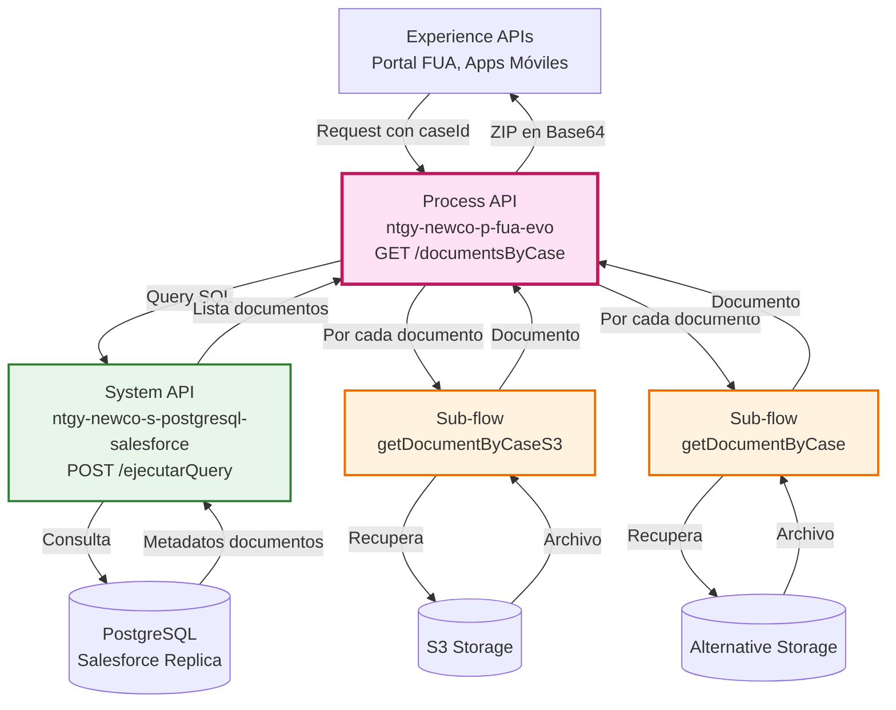
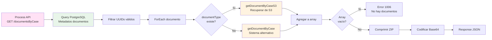
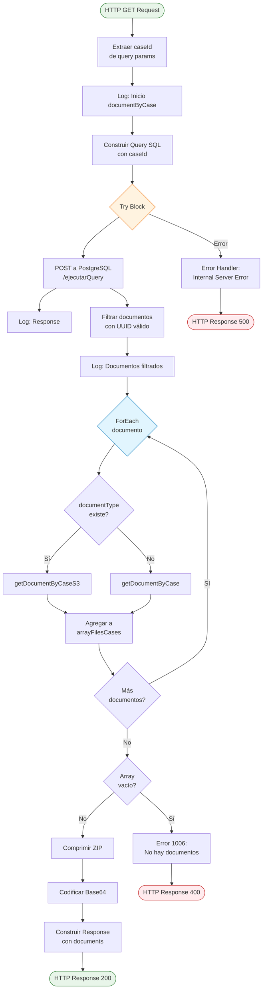
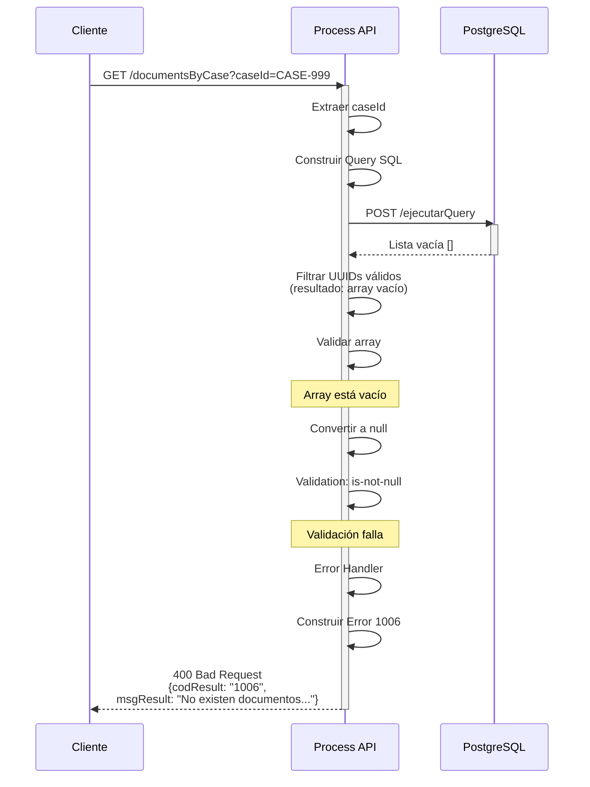
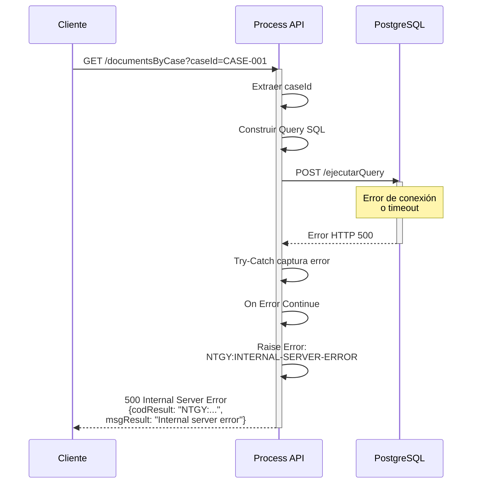

# GET /documentsByCase

## 📌 Descripción General

### Propósito del Endpoint

Este endpoint recupera todos los documentos adjuntos asociados a un caso específico de gestión. Consulta la base de datos PostgreSQL (réplica de Salesforce) para obtener la lista de documentos del caso, recupera cada documento desde su ubicación de almacenamiento (S3 o sistema alternativo), los comprime en un archivo ZIP y retorna el resultado codificado en Base64.

### Tipo de API

**Capa:** Process API (API-Led Connectivity)

**Función:** Orquestación de recuperación y compresión de documentos de casos

### Patrón de Integración

**Tipo:** Orquestación con Agregación

**Descripción:** Este endpoint orquesta múltiples llamadas para:
1. Consultar metadatos de documentos en PostgreSQL (Salesforce replica)
2. Recuperar cada documento desde su ubicación de almacenamiento
3. Agregar y comprimir todos los documentos en un ZIP
4. Codificar el resultado en Base64 para transmisión

### Arquitectura API-Led Connectivity



---

## 💼 Propósito del Negocio

### Casos de Uso Principales

1. **Consulta de Documentación de Gestiones**
   - Los clientes necesitan acceder a todos los documentos relacionados con sus casos de gestión
   - Permite descargar en un solo archivo todos los adjuntos de un caso
   - Facilita la revisión completa de la documentación del caso

2. **Auditoría y Seguimiento**
   - Los agentes de atención al cliente pueden revisar toda la documentación de un caso
   - Permite verificar qué documentos se han adjuntado a cada gestión
   - Facilita el seguimiento de casos complejos con múltiple documentación

3. **Gestión Documental**
   - Centraliza el acceso a documentos almacenados en diferentes sistemas
   - Proporciona un método unificado de recuperación de documentos
   - Simplifica la descarga de múltiples archivos en una sola operación

### 🔗 Endpoints Dependientes

Este Process API consume los siguientes System APIs y sub-flows:

| System API / Sub-flow | Endpoint / Nombre | Método | Propósito |
|------------|----------|--------|-----------|
| `ntgy-newco-s-postgresql-salesforce` | `/ejecutarQuery` | POST | Ejecuta query SQL para obtener metadatos de documentos |
| Sub-flow interno | `getDocumentByCaseS3` | - | Recupera documentos desde S3 |
| Sub-flow interno | `getDocumentByCase` | - | Recupera documentos desde sistema alternativo |

### Lógica de Orquestación



**Pasos del Proceso:**

1. **Consulta de Metadatos**: Query SQL a PostgreSQL para obtener información de documentos del caso
2. **Filtrado de Documentos**: Valida que los documentos tengan UUIDs válidos
3. **Recuperación Iterativa**: Por cada documento, determina su ubicación y lo recupera
4. **Agregación**: Acumula todos los documentos en un array
5. **Validación**: Verifica que existan documentos para comprimir
6. **Compresión**: Crea archivo ZIP con todos los documentos
7. **Codificación**: Convierte el ZIP a Base64 para transmisión
8. **Respuesta**: Retorna JSON con el ZIP codificado

### Transformaciones Aplicadas

| Transformación | Descripción | Ubicación |
|----------------|-------------|-----------|
| **Query SQL Dinámica** | Construye query con caseId del parámetro | Línea 32-36 (docs.xml) |
| **Filtrado UUID** | Valida formato UUID en documentKey | Línea 58-60 (docs.xml) |
| **Agregación de Documentos** | Acumula documentos en arrayFilesCases | ForEach (línea 64-82) |
| **Compresión ZIP** | Crea archivo ZIP con nombres y extensiones | Línea 99-105 (docs.xml) |
| **Codificación Base64** | Convierte ZIP binario a Base64 | Línea 107-117 (docs.xml) |

### Contexto Empresarial

- **Dominio:** Gestión de Casos y Documentación
- **Sector:** Energía - Utilities
- **División:** Naturgy España - NewCo
- **Proceso de Negocio:** Autoservicio de clientes - Consulta de documentación de gestiones

### Stakeholders

- **Clientes Finales**: Necesitan acceder a documentación de sus casos de gestión
- **Agentes de Atención al Cliente**: Requieren revisar documentación completa de casos
- **Equipo de Auditoría**: Necesitan verificar documentación adjunta a gestiones
- **Administradores de Salesforce**: Gestionan los casos y sus adjuntos

### Valor de Negocio

- **Autoservicio**: Permite a clientes descargar su documentación sin intervención de agentes
- **Eficiencia Operativa**: Reduce tiempo de búsqueda y recuperación de documentos
- **Trazabilidad**: Mantiene registro completo de documentación por caso
- **Experiencia de Usuario**: Simplifica descarga de múltiples documentos en una operación

### Consumidores Potenciales

Este endpoint puede ser consumido por:
- Portal web FUA
- Aplicaciones móviles de clientes
- Sistemas de agentes de call center
- Portales de autoservicio de clientes

---

## 🔧 Especificación Técnica

### URLs por Ambiente

| Ambiente | URL Base | URL Completa |
|----------|----------|--------------|
| **Local** | `http://localhost:8081` | `http://localhost:8081/api/documentsByCase?caseId={caseId}` |
| **Development** | `https://ntgy-newco-p-fua-evo-dev.us-e2.cloudhub.io` | `https://ntgy-newco-p-fua-evo-dev.us-e2.cloudhub.io/api/documentsByCase?caseId={caseId}` |
| **UAT** | `https://ntgy-newco-p-fua-evo-uat.us-e2.cloudhub.io` | `https://ntgy-newco-p-fua-evo-uat.us-e2.cloudhub.io/api/documentsByCase?caseId={caseId}` |
| **Production** | `https://ntgy-newco-p-fua-evo-pro.us-e2.cloudhub.io` | `https://ntgy-newco-p-fua-evo-pro.us-e2.cloudhub.io/api/documentsByCase?caseId={caseId}` |

### Método HTTP

```
GET /api/documentsByCase
```

### Parámetros de Entrada

#### Query Parameters

| Parámetro | Tipo | Requerido | Descripción | Ejemplo |
|-----------|------|-----------|-------------|---------|
| `caseId` | string | ✅ Sí | Código único del caso (newco_calccasecode__c) | `"CASE-2024-001234"` |

**Validaciones:**
- `caseId` es obligatorio
- Debe corresponder a un caso existente en Salesforce

### Estructura de Respuesta

#### Respuesta Exitosa (200 OK)

```json
{
  "result": {
    "codResult": "0000",
    "msgResult": "No hay error"
  },
  "documents": "UEsDBBQAAAAIAO... [Base64 del ZIP]"
}
```

**Campos de Respuesta:**

| Campo | Tipo | Descripción |
|-------|------|-------------|
| `result.codResult` | string | Código de resultado (`"0000"` = éxito) |
| `result.msgResult` | string | Mensaje descriptivo del resultado |
| `documents` | string | Archivo ZIP codificado en Base64 conteniendo todos los documentos |

**Contenido del ZIP:**
- Cada documento con su nombre original y extensión
- Formato: `{fileName}.{extension}`
- Ejemplo: `contrato_suministro.pdf`, `factura_enero.pdf`

#### Respuesta de Error - Sin Documentos (400 Bad Request)

```json
{
  "result": {
    "codResult": "1006",
    "msgResult": "No existen documentos adjuntos para la Gestión"
  }
}
```

#### Respuesta de Error - Error Interno (500 Internal Server Error)

```json
{
  "result": {
    "codResult": "NTGY:INTERNAL-SERVER-ERROR",
    "msgResult": "Internal server error"
  }
}
```

### Códigos de Estado HTTP

| Código | Descripción | Escenario |
|--------|-------------|-----------|
| `200` | OK | Documentos recuperados y comprimidos exitosamente |
| `400` | Bad Request | No existen documentos para el caso o parámetros inválidos |
| `500` | Internal Server Error | Error en consulta a PostgreSQL o recuperación de documentos |

### Autenticación

- **Tipo:** Client ID & Client Secret (Anypoint Platform)
- **Headers requeridos:**
  - `client_id`: ID de la aplicación cliente
  - `client_secret`: Secret de la aplicación cliente

### Timeouts

| Tipo | Valor | Justificación |
|------|-------|---------------|
| **Request Timeout** | 60 segundos | Permite tiempo para recuperar múltiples documentos |
| **Connection Timeout** | 10 segundos | Timeout estándar de conexión |
| **Query Timeout** | 30 segundos | Tiempo para ejecutar query en PostgreSQL |

---

## 🏗️ Implementación Técnica

### Arquitectura del Flow



### Query SQL Ejecutada

**Ubicación:** `docs.xml` líneas 32-36

```sql
SELECT 
    aocc.acn_fld_documentkey__c,
    aocc.acn_fld_nombre_documento__c,
    aocc.acn_fld_type__c,
    aocc.acn_fld_documenttype__c
FROM newcosalesforce.case c
INNER JOIN newcosalesforce.acn_obj_caseattachments__c aocc 
    ON c.sfid = aocc.acn_fld_case__c
WHERE c.newco_calccasecode__c = '{caseId}'
```

**Descripción:**
- Consulta la tabla `case` y su relación con `acn_obj_caseattachments__c`
- Filtra por el código de caso (`newco_calccasecode__c`)
- Retorna metadatos de documentos: key, nombre, tipo y documentType

**Tablas Consultadas:**
- `newcosalesforce.case`: Casos de Salesforce
- `newcosalesforce.acn_obj_caseattachments__c`: Adjuntos de casos (objeto custom)

### Transformaciones DataWeave

#### 1. Construcción de Query SQL (Línea 32-36)

```dataweave
%dw 2.0
output application/json
---
{
    "query": "select aocc.acn_fld_documentkey__c, aocc.acn_fld_nombre_documento__c, aocc.acn_fld_type__c, aocc.acn_fld_documenttype__c from newcosalesforce.case c inner join newcosalesforce.acn_obj_caseattachments__c aocc on c.sfid = aocc.acn_fld_case__c where newco_calccasecode__c = '" ++ vars.caseId ++ "'"
}
```

**Propósito:** Construye el payload JSON con la query SQL dinámica incluyendo el caseId

#### 2. Filtrado de Documentos con UUID Válido (Línea 58-60)

```dataweave
%dw 2.0
output application/java
---
payload filter !isEmpty($.acn_fld_documentkey__c) filter ($.acn_fld_documentkey__c matches /.*[0-9a-f]{8}\b-[0-9a-f]{4}-[0-9a-f]{4}-[0-9a-f]{4}-\b[0-9a-f]{12}\b/)
```

**Propósito:** 
- Filtra documentos que tengan documentKey no vacío
- Valida que el documentKey tenga formato UUID válido
- Elimina registros con claves inválidas o corruptas

#### 3. Validación de Array Vacío (Línea 86-92)

```dataweave
%dw 2.0
output application/java
---
if(isEmpty(vars.arrayFilesCases)) (null) else vars.arrayFilesCases
```

**Propósito:** Convierte array vacío a null para activar validación de error

#### 4. Compresión ZIP (Línea 99-105)

```xml
<compression:archive>
    <compression:entries><![CDATA[#[{
        (vars.arrayFilesCases map ($.fileName ++ "." ++ $.extension): $.data)
    }]]]></compression:entries>
    <compression:archiver>
        <compression:zip-archiver />
    </compression:archiver>
</compression:archive>
```

**Propósito:** 
- Crea archivo ZIP con todos los documentos
- Usa fileName + extension como nombre de archivo en el ZIP
- Incluye el contenido binario (data) de cada documento

#### 5. Respuesta Final con Base64 (Línea 107-117)

```dataweave
%dw 2.0
output application/json
---
{
    "result": {
        "codResult": '0000',
        "msgResult": "No hay error"
    }
} ++ "documents": dw::core::Binaries::toBase64(payload)
```

**Propósito:** 
- Construye respuesta JSON estándar
- Codifica el ZIP binario a Base64
- Agrega el campo "documents" con el ZIP codificado

### Patrones de Diseño

**Patrón 1: Orquestación con Agregación**

**Justificación:** 
- Necesidad de consultar metadatos y luego recuperar múltiples documentos
- Agregación de documentos de diferentes fuentes (S3 vs alternativo)
- Compresión final de todos los documentos en un solo archivo

**Patrón 2: Content-Based Routing**

**Justificación:**
- Decisión de routing basada en `documentType`
- Documentos con tipo definido → S3
- Documentos sin tipo → Sistema alternativo

**Patrón 3: Scatter-Gather (Implícito en ForEach)**

**Justificación:**
- Recuperación paralela conceptual de múltiples documentos
- Agregación de resultados en array común
- Procesamiento independiente de cada documento

### Diagramas de Secuencia

#### 1. Flujo Normal de Éxito

```mermaid
sequenceDiagram
    participant C as Cliente
    participant P as Process API
    participant PG as PostgreSQL<br/>(Salesforce Replica)
    participant S3 as S3 Storage
    participant ALT as Alternative Storage
    
    C->>P: GET /documentsByCase?caseId=CASE-001
    activate P
    
    P->>P: Extraer caseId
    P->>P: Construir Query SQL
    
    P->>PG: POST /ejecutarQuery<br/>(Query con caseId)
    activate PG
    PG-->>P: Lista de metadatos<br/>de documentos
    deactivate PG
    
    P->>P: Filtrar UUIDs válidos
    P->>P: Log documentos filtrados
    
    loop Por cada documento
        alt documentType existe
            P->>S3: getDocumentByCaseS3
            activate S3
            S3-->>P: Documento binario
            deactivate S3
        else documentType vacío
            P->>ALT: getDocumentByCase
            activate ALT
            ALT-->>P: Documento binario
            deactivate ALT
        end
        P->>P: Agregar a arrayFilesCases
    end
    
    P->>P: Validar array no vacío
    P->>P: Comprimir ZIP
    P->>P: Codificar Base64
    P->>P: Construir response JSON
    
    P-->>C: 200 OK<br/>{result, documents: Base64}
    deactivate P
```

#### 2. Flujo con Error - Sin Documentos



#### 3. Flujo con Error Técnico - PostgreSQL



### Manejo de Errores

#### Estrategia de Error Handling

**1. Try-Catch en Query PostgreSQL (Línea 40-50)**

```xml
<try>
    <http:request method="POST" path="/ejecutarQuery" />
    <error-handler>
        <on-error-continue>
            <raise-error type="NTGY:INTERNAL-SERVER-ERROR" 
                        description="Internal server error" />
        </on-error-continue>
    </error-handler>
</try>
```

**Errores Capturados:**
- Errores de conexión a PostgreSQL
- Timeouts en la consulta
- Errores HTTP del System API

**Acción:** Propaga error como INTERNAL-SERVER-ERROR

**2. Validación de Documentos Vacíos (Línea 84-98)**

```xml
<try>
    <validation:is-not-null value="#[vars.arrayFilesCasesEmpty]" 
                           message="No existen documentos adjuntos para la Gestión"/>
    <error-handler>
        <on-error-propagate>
            <ee:transform>
                <!-- Error 1006 -->
            </ee:transform>
            <set-variable value="400" variableName="httpStatus"/>
        </on-error-propagate>
    </error-handler>
</try>
```

**Errores Capturados:**
- Array de documentos vacío o null

**Acción:** Retorna error 1006 con HTTP 400

**3. Try-Catch en Recuperación de Documentos (Sub-flows)**

Cada sub-flow (`getDocumentByCase` y `getDocumentByCaseS3`) tiene su propio error handler:

```xml
<error-handler>
    <on-error-continue>
        <logger level="ERROR" message="DocumentId no encontrado"/>
        <set-payload value="#[null]"/>
    </on-error-continue>
</error-handler>
```

**Errores Capturados:**
- Documento no encontrado en storage
- Documento corrupto
- Errores de conexión a S3 o Sharepoint

**Acción:** Registra error y continúa con siguiente documento (no detiene el proceso)

#### Códigos de Error

| Código | Descripción | HTTP Status |
|--------|-------------|-------------|
| `0000` | Operación exitosa | 200 |
| `1006` | No existen documentos adjuntos para la Gestión | 400 |
| `NTGY:INTERNAL-SERVER-ERROR` | Error interno del servidor | 500 |

---

## 💻 Ejemplos de Uso

### Ejemplo 1: Llamada Exitosa con cURL

#### Request

```bash
curl -X GET "https://ntgy-newco-p-fua-evo-dev.us-e2.cloudhub.io/api/documentsByCase?caseId=CASE-2024-001234" \
  -H "Content-Type: application/json" \
  -H "client_id: YOUR_CLIENT_ID" \
  -H "client_secret: YOUR_CLIENT_SECRET"
```

#### Response (200 OK)

```json
{
  "result": {
    "codResult": "0000",
    "msgResult": "No hay error"
  },
  "documents": "UEsDBBQAAAAIAO+Ks1gAAAAAAAAAAAAAAAAJABwAY29udHJhdG8ucGRmVVQJAANxYmRjcWJkY3V4CwABBOgDAAAE6AMAAEzLQQ6AIAwAwF/0BxQQH+BN..."
}
```

**Nota:** El campo `documents` contiene el archivo ZIP completo codificado en Base64. Para usarlo:

1. Decodificar el Base64
2. Guardar como archivo .zip
3. Extraer los documentos individuales

### Ejemplo 2: Decodificación del ZIP en JavaScript

```javascript
// Realizar la petición
const response = await fetch(
  'https://ntgy-newco-p-fua-evo-dev.us-e2.cloudhub.io/api/documentsByCase?caseId=CASE-2024-001234',
  {
    method: 'GET',
    headers: {
      'Content-Type': 'application/json',
      'client_id': 'YOUR_CLIENT_ID',
      'client_secret': 'YOUR_CLIENT_SECRET'
    }
  }
);

const data = await response.json();

// Decodificar Base64 y crear blob
const base64Data = data.documents;
const binaryString = atob(base64Data);
const bytes = new Uint8Array(binaryString.length);

for (let i = 0; i < binaryString.length; i++) {
  bytes[i] = binaryString.charCodeAt(i);
}

const blob = new Blob([bytes], { type: 'application/zip' });

// Descargar el archivo
const url = window.URL.createObjectURL(blob);
const a = document.createElement('a');
a.href = url;
a.download = `documentos_caso_${caseId}.zip`;
document.body.appendChild(a);
a.click();
window.URL.revokeObjectURL(url);
document.body.removeChild(a);
```

### Ejemplo 3: Decodificación en Python

```python
import requests
import base64

# Realizar la petición
response = requests.get(
    'https://ntgy-newco-p-fua-evo-dev.us-e2.cloudhub.io/api/documentsByCase',
    params={'caseId': 'CASE-2024-001234'},
    headers={
        'Content-Type': 'application/json',
        'client_id': 'YOUR_CLIENT_ID',
        'client_secret': 'YOUR_CLIENT_SECRET'
    }
)

data = response.json()

# Decodificar Base64 y guardar ZIP
if data['result']['codResult'] == '0000':
    zip_data = base64.b64decode(data['documents'])
    
    with open('documentos_caso.zip', 'wb') as f:
        f.write(zip_data)
    
    print("ZIP descargado exitosamente")
else:
    print(f"Error: {data['result']['msgResult']}")
```

### Ejemplo 4: Error - Sin Documentos

#### Request

```bash
curl -X GET "https://ntgy-newco-p-fua-evo-dev.us-e2.cloudhub.io/api/documentsByCase?caseId=CASE-2024-999999" \
  -H "Content-Type: application/json" \
  -H "client_id: YOUR_CLIENT_ID" \
  -H "client_secret: YOUR_CLIENT_SECRET"
```

#### Response (400 Bad Request)

```json
{
  "result": {
    "codResult": "1006",
    "msgResult": "No existen documentos adjuntos para la Gestión"
  }
}
```

### Ejemplo 5: Error - Caso No Existe

#### Request

```bash
curl -X GET "https://ntgy-newco-p-fua-evo-dev.us-e2.cloudhub.io/api/documentsByCase?caseId=INVALID-CASE" \
  -H "Content-Type": application/json" \
  -H "client_id: YOUR_CLIENT_ID" \
  -H "client_secret: YOUR_CLIENT_SECRET"
```

#### Response (400 Bad Request)

```json
{
  "result": {
    "codResult": "1006",
    "msgResult": "No existen documentos adjuntos para la Gestión"
  }
}
```

### Ejemplo 6: Uso en Postman

**Configuración:**

1. **Método:** GET
2. **URL:** `https://ntgy-newco-p-fua-evo-dev.us-e2.cloudhub.io/api/documentsByCase`
3. **Query Params:**
   - Key: `caseId`
   - Value: `CASE-2024-001234`
4. **Headers:**
   - `Content-Type`: `application/json`
   - `client_id`: `YOUR_CLIENT_ID`
   - `client_secret`: `YOUR_CLIENT_SECRET`

**Test Script para guardar ZIP:**

```javascript
// En la pestaña "Tests" de Postman
if (pm.response.code === 200) {
    const jsonData = pm.response.json();
    
    if (jsonData.documents) {
        // Guardar el Base64 en una variable de entorno
        pm.environment.set("zipBase64", jsonData.documents);
        console.log("ZIP guardado en variable de entorno");
    }
}
```

### Notas de Implementación

**Consideraciones de Tamaño:**
- El ZIP puede ser grande si el caso tiene muchos documentos
- Considerar límites de tamaño de respuesta HTTP
- Para casos con muchos documentos, puede ser necesario implementar paginación o descarga por lotes

**Tipos de Documentos Soportados:**
- PDF (más común)
- Imágenes (JPG, PNG)
- Documentos de Office (DOC, DOCX, XLS, XLSX)
- Cualquier tipo de archivo adjuntado al caso en Salesforce

**Nombres de Archivos en el ZIP:**
- Formato: `{fileName}.{extension}`
- Si no hay nombre disponible: `ntgy_{caseId}_{documentId}.{extension}`
- Extensión por defecto si no se detecta: `.pdf`
