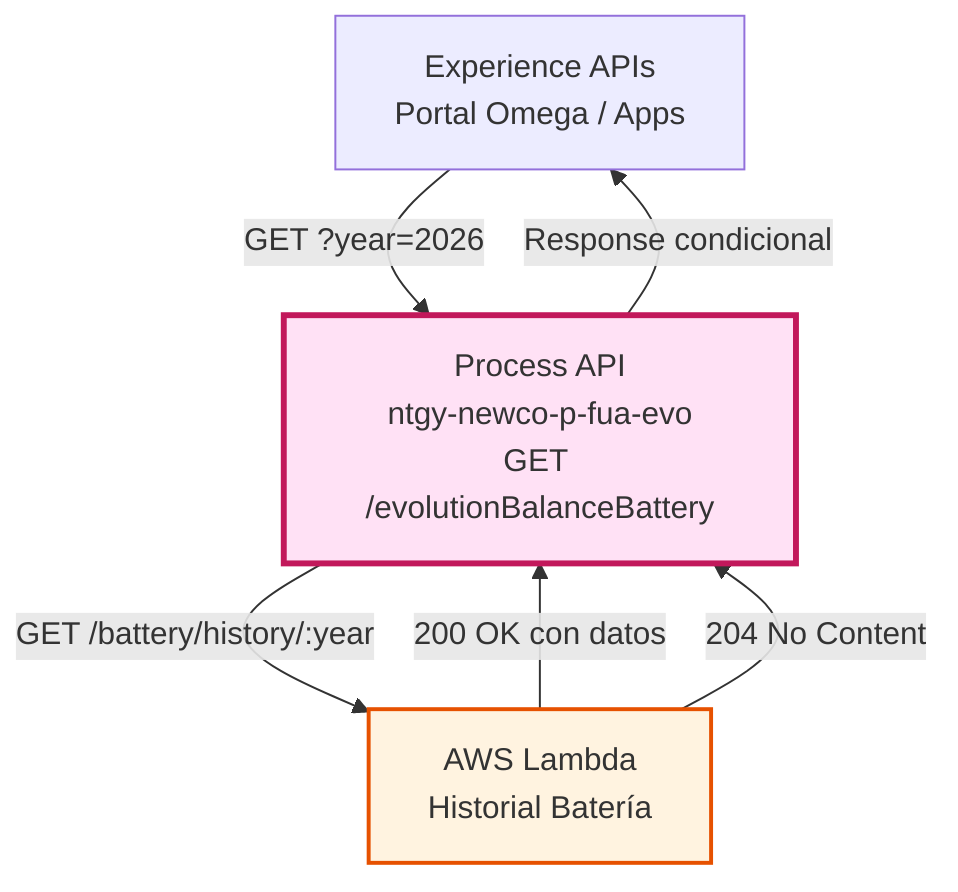
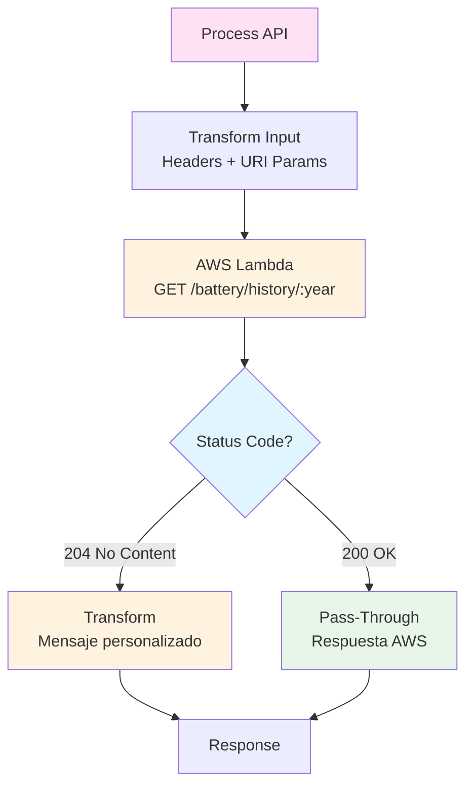
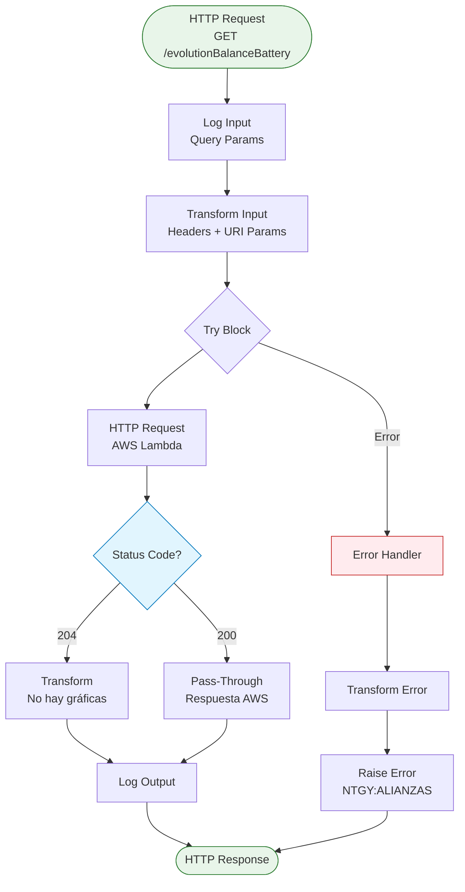
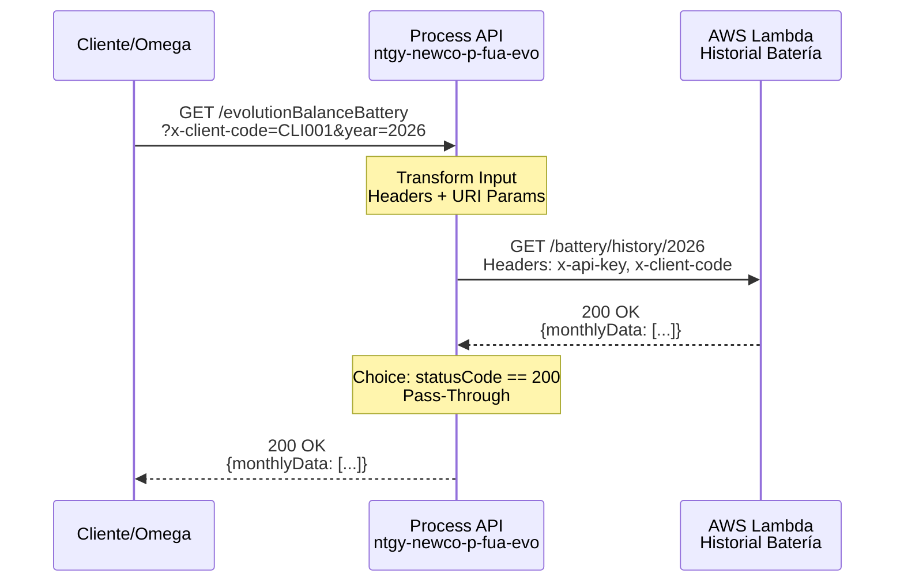
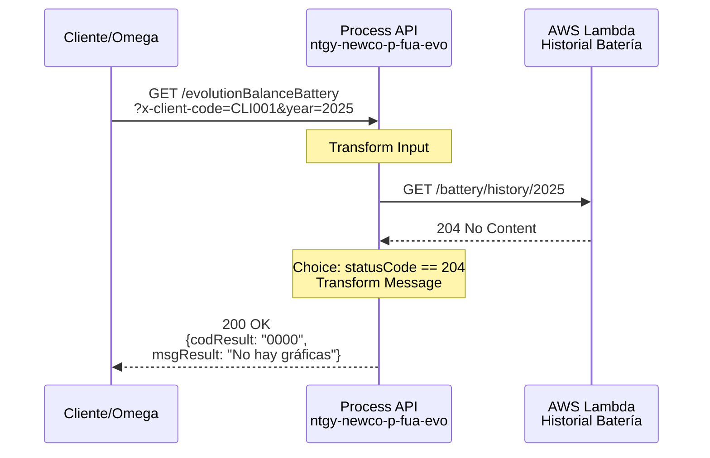
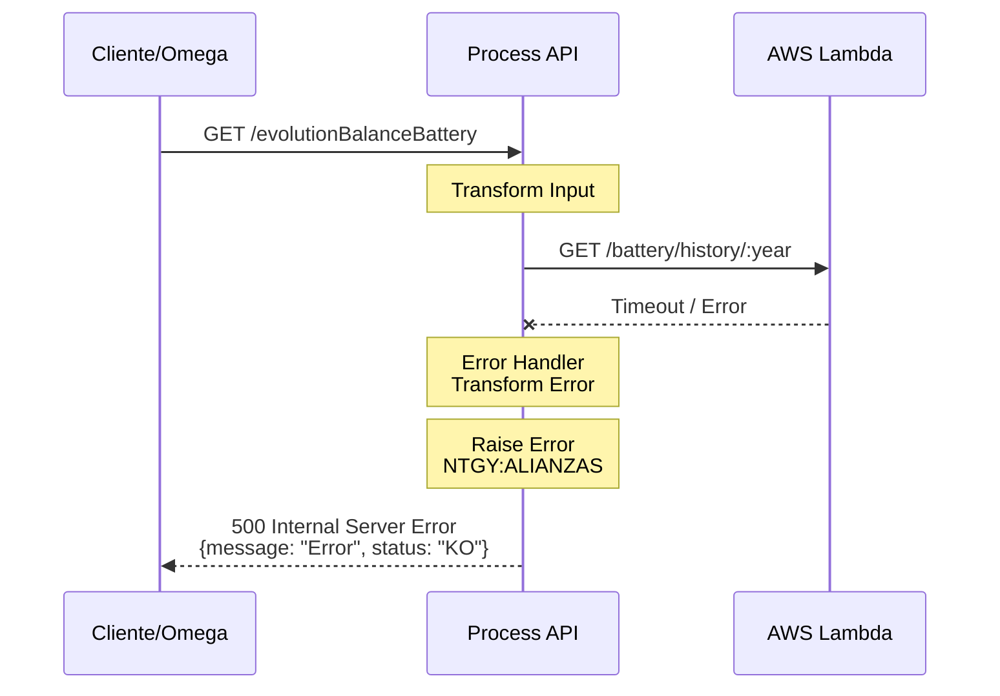

# GET /evolutionBalanceBattery

## 📌 Descripción General

### Propósito del Endpoint

Este endpoint permite consultar la evolución del saldo generado en batería durante un año específico. Los datos se utilizan para generar gráficas mensuales en el portal Omega, mostrando la evolución del balance energético de la batería del cliente.

### Tipo de API

**Capa:** Process API (API-Led Connectivity)

**Función:** Consulta de datos históricos de batería desde AWS Lambda

### Patrón de Integración

**Tipo:** Pass-Through con Transformación Condicional

**Descripción:** El endpoint reenvía la consulta a AWS Lambda y aplica lógica condicional: si no hay datos (204), devuelve un mensaje personalizado; si hay datos (200), devuelve la respuesta de AWS tal cual.

### Arquitectura API-Led Connectivity



---

## 💼 Propósito del Negocio

### Casos de Uso Principales

1. **Visualización de Evolución Anual**
   - El cliente consulta cómo ha evolucionado su saldo de batería durante el año
   - Se muestran datos mensuales en gráficas interactivas
   - Beneficio: Transparencia en el uso de la batería

2. **Análisis de Rendimiento**
   - Permite identificar patrones de generación y consumo
   - Ayuda a optimizar el uso de la batería
   - Beneficio: Mejor gestión energética

3. **Generación de Gráficas en Omega**
   - Portal Omega consume estos datos para crear visualizaciones
   - Gráficas mensuales de evolución del saldo
   - Beneficio: Experiencia de usuario mejorada

### 🔗 Endpoints Dependientes

Este Process API consume el siguiente servicio externo:

| Sistema | Endpoint | Método | Host | Propósito |
|---------|----------|--------|------|-----------|
| AWS Lambda - Historial Batería | /battery/history/:year | GET | 80xkw026n1.execute-api.eu-west-1.amazonaws.com | Obtiene datos mensuales de evolución del saldo de batería para un año específico |

### Lógica de Orquestación



**Pasos del Proceso:**

1. **Paso 1**: Recepción de query parameters (x-client-code, year)
2. **Paso 2**: Construcción de headers y URI parameters para AWS
3. **Paso 3**: Llamada a AWS Lambda con el año en el path
4. **Paso 4**: Evaluación del status code de respuesta
5. **Paso 5a**: Si 204 → Transformar a mensaje "No hay gráficas"
6. **Paso 5b**: Si 200 → Pass-through de la respuesta de AWS

### Transformaciones Aplicadas

**Transformación de Entrada:**

| Origen | Destino | Tipo | Descripción |
|--------|---------|------|-------------|
| attributes.queryParams.'x-client-code' | Header x-client-code | Header | Código del cliente |
| p('aws.apiKey') | Header x-api-key | Header | API Key de AWS |
| attributes.queryParams.'year' | URI param :year | Path | Año para consultar (ej: 2026) |

**Transformación de Salida (Condicional):**

**Caso 1 - Sin datos (204):**
```json
{
  "result": {
    "codResult": "0000",
    "msgResult": "No hay gráficas para mostrar"
  }
}
```

**Caso 2 - Con datos (200):**
```json
// Pass-through de AWS Lambda
// Estructura determinada por AWS
```

### Contexto Empresarial

- **Dominio:** Gestión de Energía - Baterías
- **Sector:** Energía - Utilities
- **División:** Naturgy España - NewCo
- **Proceso de Negocio:** Monitoreo y análisis de rendimiento de baterías

### Stakeholders

- **Clientes con Batería**: Usuarios finales que consultan su evolución
- **Portal Omega**: Sistema que consume estos datos para gráficas
- **Equipo de Alianzas**: Analiza patrones de uso de baterías
- **Equipo de Soporte**: Ayuda a clientes a interpretar los datos

### Valor de Negocio

- **Transparencia**: Cliente ve claramente la evolución de su saldo
- **Análisis**: Datos históricos para optimizar uso de batería
- **Visualización**: Gráficas mensuales fáciles de entender
- **Toma de Decisiones**: Información para ajustar configuración

### Consumidores Potenciales

Este endpoint puede ser consumido por:
- Portal Omega (principal consumidor)
- Aplicaciones móviles de gestión energética
- Dashboards de análisis de baterías
- Herramientas de reporting

---

## 🔧 Especificación Técnica

### URLs por Ambiente

| Ambiente | URL Base | URL Completa |
|----------|----------|--------------|
| **Local** | http://localhost:8081 | http://localhost:8081/api/evolutionBalanceBattery?x-client-code=CLI001&year=2026 |
| **Development** | https://ntgy-newco-p-fua-evo-dev.us-e2.cloudhub.io | https://ntgy-newco-p-fua-evo-dev.us-e2.cloudhub.io/api/evolutionBalanceBattery?x-client-code=CLI001&year=2026 |
| **UAT** | https://ntgy-newco-p-fua-evo-uat.us-e2.cloudhub.io | https://ntgy-newco-p-fua-evo-uat.us-e2.cloudhub.io/api/evolutionBalanceBattery?x-client-code=CLI001&year=2026 |
| **Production** | https://ntgy-newco-p-fua-evo-pro.us-e2.cloudhub.io | https://ntgy-newco-p-fua-evo-pro.us-e2.cloudhub.io/api/evolutionBalanceBattery?x-client-code=CLI001&year=2026 |

### Método HTTP

```
GET /api/evolutionBalanceBattery
```

### Parámetros de Entrada

#### Query Parameters

| Parámetro | Tipo | Requerido | Descripción |
|-----------|------|-----------|-------------|
| x-client-code | string | Sí | Código del cliente para identificar la batería |
| year | integer | Sí | Año para consultar la evolución (ej: 2026) |

**Ejemplo de URL:**
```
GET /api/evolutionBalanceBattery?x-client-code=CLI001&year=2026
```

### Respuestas

#### 200 OK - Con Datos Disponibles

**Pass-Through Response de AWS Lambda:**

La respuesta proviene directamente de AWS Lambda cuando hay datos disponibles.

**Nota:** La estructura exacta depende de la implementación del servicio AWS Lambda `/battery/history/:year`.

**Ejemplo esperado (estructura típica):**
```json
{
  "year": 2026,
  "clientCode": "CLI001",
  "monthlyData": [
    {
      "month": 1,
      "balance": 150.50,
      "generation": 200.00,
      "consumption": 49.50
    },
    {
      "month": 2,
      "balance": 180.25,
      "generation": 220.00,
      "consumption": 39.75
    }
  ]
}
```

#### 200 OK - Sin Datos (204 transformado)

Cuando AWS Lambda devuelve 204 No Content, el Process API lo transforma a:

```json
{
  "result": {
    "codResult": "0000",
    "msgResult": "No hay gráficas para mostrar"
  }
}
```

**Nota:** Este es el único caso donde el Process API transforma la respuesta.

#### 500 Internal Server Error - Error del Sistema

Cuando ocurre un error (timeout, conexión, error de AWS):

```json
{
  "message": "Descripción del error",
  "status": "KO"
}
```

**Ejemplos de mensajes de error:**
- "Timeout al conectar con AWS"
- "Error historial batería"
- "Internal server error"

### Autenticación

- **Tipo:** Client ID & Client Secret (Anypoint Platform)
- **AWS Authentication:** API Key (x-api-key) en headers

### Timeouts

| Tipo | Valor |
|------|-------|
| **Request Timeout** | 60000ms |
| **Connection Timeout** | 10 segundos |

---

## 🏗️ Implementación Técnica

### Arquitectura del Flow



### Configuración del HTTP Request

**Archivo:** `src/main/mule/services/alianzas/alianzaEvolutionBalanceBattery.xml`

**Configuración:**
- **Method:** GET
- **Path:** /battery/history/:year
- **Host:** 80xkw026n1.execute-api.eu-west-1.amazonaws.com
- **Port:** 80
- **Config-ref:** HTTP_Request__AWS
- **Response Timeout:** 60000ms

**Headers enviados:**
```dataweave
{
  "x-api-key": p('aws.apiKey'),
  "x-client-code": attributes.queryParams.'x-client-code'
}
```

**URI Parameters:**
```dataweave
{
  "year": attributes.queryParams.'year'
}
```

### Transformación DataWeave de Entrada

**Archivo:** Inline en el XML (líneas 11-22)

```dataweave
%dw 2.0
output application/json skipNullOn="everywhere"
---
{
  body: {},
  headers: {
    "x-api-key": p('aws.apiKey'),
    "x-client-code": attributes.queryParams.'x-client-code'
  }
}
```

**Características:**
- **skipNullOn="everywhere"**: Omite campos nulos
- **body vacío**: GET no requiere body
- **headers**: Construye headers para AWS

### Lógica Condicional (Choice)

**Archivo:** Inline en el XML (líneas 44-66)

```dataweave
// Condición: attributes.statusCode == 204
// Si es 204 (No Content):
{
  "result": {
    "codResult": "0000",
    "msgResult": "No hay gráficas para mostrar"
  }
}

// Si NO es 204 (típicamente 200):
payload  // Pass-through
```

**Rationale:**
- AWS Lambda devuelve 204 cuando no hay datos para ese año
- El Process API transforma 204 a un mensaje amigable
- Para 200, devuelve los datos tal cual (pass-through)

### Transformación de Errores (DataWeave)

**Archivo:** Inline en el error handler (líneas 35-51)

```dataweave
%dw 2.0
import * from dw::core::Strings
output application/json
---
{
  "message": 
    if(error.errorMessage.payload != null)
      error.errorMessage.payload
    else if(substringAfterLast(error.description, "' ") != "") 
      substringAfterLast(error.description, "' ") 
    else if(error.description != null) 
      error.description 
    else 
      "Internal server error",
  "status": "KO"
}
```

### Patrones de Diseño

**Patrón:** Conditional Pass-Through Pattern

**Justificación:** 
- Permite manejar el caso especial de "sin datos" (204)
- Mantiene pass-through para respuestas con datos
- Proporciona mensajes amigables al usuario
- Evita errores en el cliente cuando no hay datos

### Diagramas de Secuencia

#### 1. Flujo Normal con Datos (200 OK)



#### 2. Flujo Sin Datos (204 No Content)



#### 3. Flujo con Error



### Manejo de Errores

**Estrategia:** Try-Catch con Error Handler Especializado

**Tipos de Errores Manejados:**

1. **Errores de Conectividad**
   - Timeout al conectar con AWS
   - Connection refused
   - Network errors

2. **Errores de AWS Lambda**
   - Cliente no encontrado
   - Año inválido
   - Errores internos de AWS

3. **Errores de Validación**
   - Query parameters faltantes
   - Formato de año incorrecto

**Respuesta de Error Estándar:**
```json
{
  "message": "Descripción del error",
  "status": "KO"
}
```

**Error Type:** `NTGY:ALIANZAS`

**Error Description:** "Error historial batería"

### Logging

**Log de Entrada:**
```
Level: INFO
Message: "Input alianza evolutionBalanceBattery: #[attributes.queryParams]"
```

**Log de Salida:**
```
Level: INFO
Message: "Ouput evolutionBalanceBattery: #[payload]"
```

---

## 💻 Ejemplos de Uso

### Ejemplo 1: Consulta con Datos Disponibles

#### cURL

```bash
curl -X GET "https://ntgy-newco-p-fua-evo-dev.us-e2.cloudhub.io/api/evolutionBalanceBattery?x-client-code=CLI001&year=2026" \
  -H "client_id: YOUR_CLIENT_ID" \
  -H "client_secret: YOUR_CLIENT_SECRET"
```

#### Respuesta (200 OK)

**Nota:** Respuesta pass-through de AWS Lambda.

```json
{
  "year": 2026,
  "clientCode": "CLI001",
  "monthlyData": [
    {
      "month": 1,
      "monthName": "Enero",
      "balance": 150.50,
      "generation": 200.00,
      "consumption": 49.50,
      "savings": 25.30
    },
    {
      "month": 2,
      "monthName": "Febrero",
      "balance": 180.25,
      "generation": 220.00,
      "consumption": 39.75,
      "savings": 30.15
    }
  ],
  "totalBalance": 330.75,
  "totalGeneration": 420.00,
  "totalConsumption": 89.25
}
```

### Ejemplo 2: Consulta Sin Datos (Año Futuro)

#### JavaScript

```javascript
const response = await fetch(
  'https://ntgy-newco-p-fua-evo-dev.us-e2.cloudhub.io/api/evolutionBalanceBattery?x-client-code=CLI001&year=2027',
  {
    method: 'GET',
    headers: {
      'client_id': 'YOUR_CLIENT_ID',
      'client_secret': 'YOUR_CLIENT_SECRET'
    }
  }
);

const data = await response.json();
console.log(data);
```

#### Respuesta (200 OK)

```json
{
  "result": {
    "codResult": "0000",
    "msgResult": "No hay gráficas para mostrar"
  }
}
```

### Ejemplo 3: Consulta para Gráficas en Omega

#### Python

```python
import requests

response = requests.get(
    'https://ntgy-newco-p-fua-evo-dev.us-e2.cloudhub.io/api/evolutionBalanceBattery',
    headers={
        'client_id': 'YOUR_CLIENT_ID',
        'client_secret': 'YOUR_CLIENT_SECRET'
    },
    params={
        'x-client-code': 'CLI001',
        'year': '2026'
    }
)

data = response.json()

# Procesar datos para gráficas
if 'monthlyData' in data:
    months = [item['monthName'] for item in data['monthlyData']]
    balances = [item['balance'] for item in data['monthlyData']]
    print(f"Meses: {months}")
    print(f"Saldos: {balances}")
else:
    print(data['result']['msgResult'])
```

#### Respuesta (200 OK)

```json
{
  "year": 2026,
  "clientCode": "CLI001",
  "monthlyData": [
    {"month": 1, "monthName": "Enero", "balance": 150.50},
    {"month": 2, "monthName": "Febrero", "balance": 180.25}
  ]
}
```

### Ejemplo 4: Error - Cliente No Encontrado

#### cURL

```bash
curl -X GET "https://ntgy-newco-p-fua-evo-dev.us-e2.cloudhub.io/api/evolutionBalanceBattery?x-client-code=INVALID&year=2026" \
  -H "client_id: YOUR_CLIENT_ID" \
  -H "client_secret: YOUR_CLIENT_SECRET"
```

#### Respuesta (500 Internal Server Error)

```json
{
  "message": "Cliente no encontrado en el sistema de alianzas",
  "status": "KO"
}