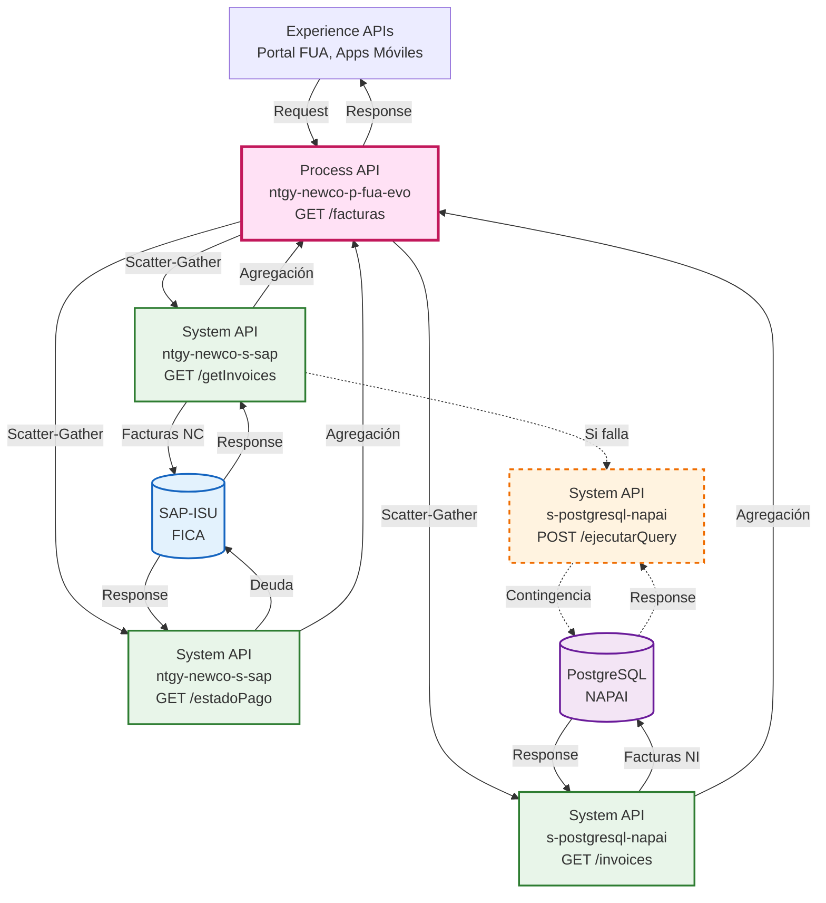
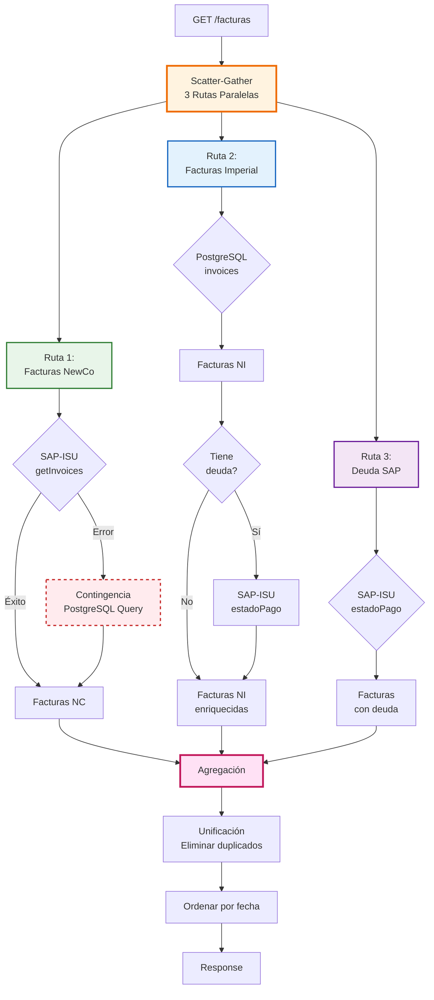
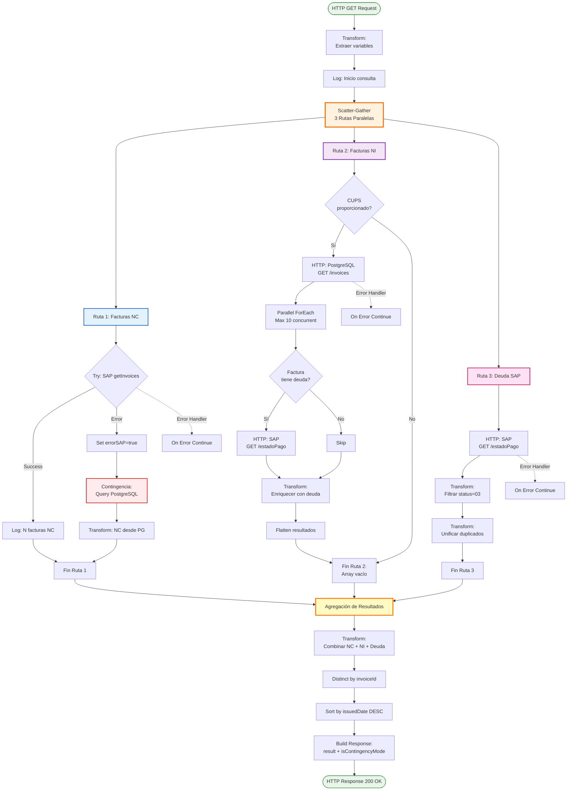
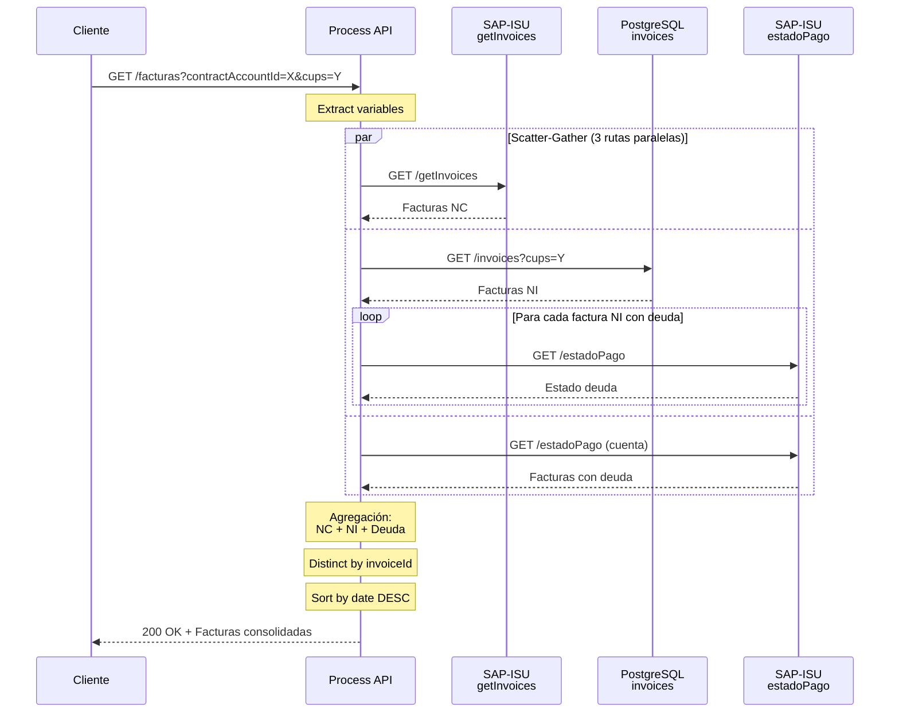
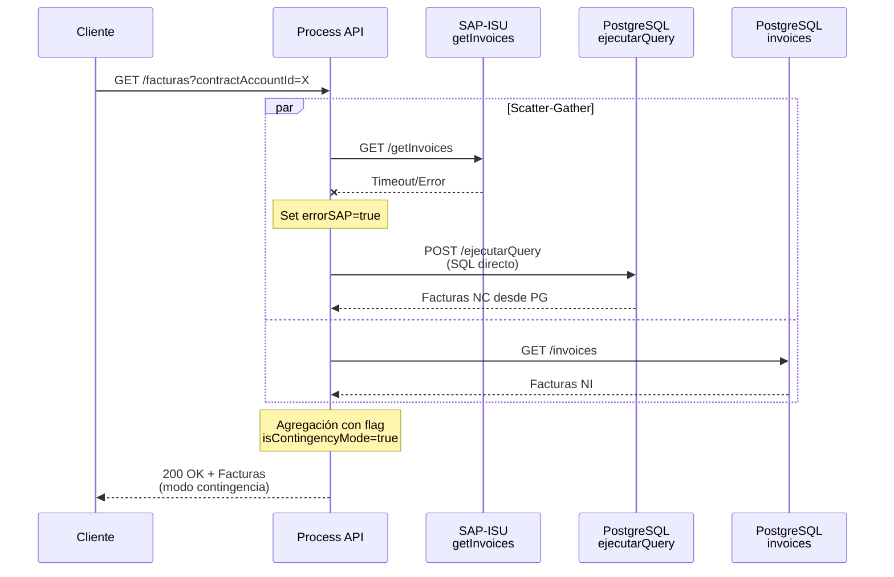
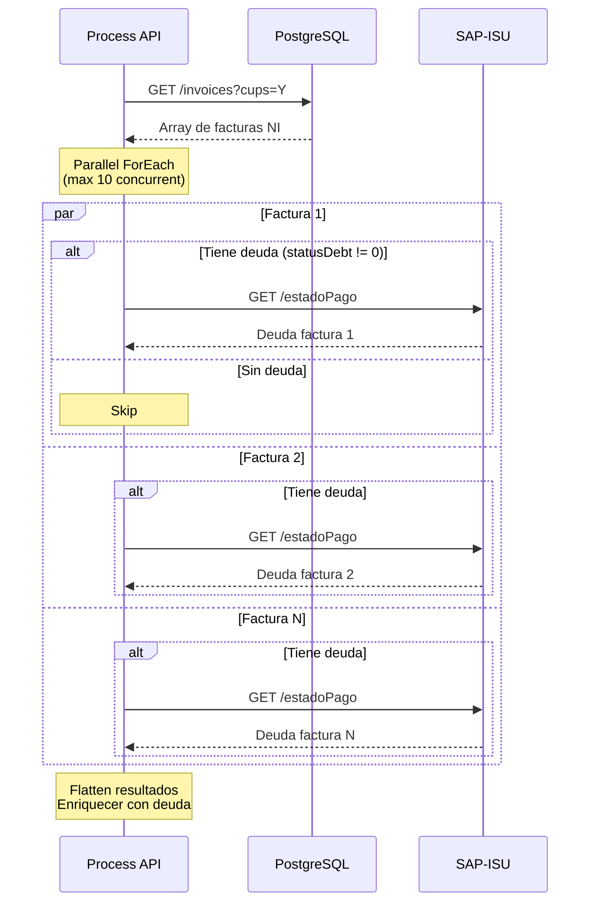

# GET /facturas

## 📌 Descripción General

### Propósito del Endpoint

Este endpoint recupera y consolida facturas de clientes desde múltiples fuentes (SAP-ISU y PostgreSQL NAPAI), proporcionando una vista unificada de facturas NewCo e Imperial con información actualizada de deuda y estado de pago. Implementa un patrón de orquestación compleja con Scatter-Gather para consultas paralelas y mecanismos de resiliencia con contingencia automática.

### Tipo de API

**Capa:** Process API (API-Led Connectivity)

**Función:** Orquestación compleja de consulta de facturas con agregación de datos de múltiples fuentes

### Patrón de Integración

**Tipo:** Orquestación Compleja con Scatter-Gather (3 rutas paralelas)

**Descripción:** 
- Ejecuta 3 consultas en paralelo para obtener facturas de diferentes fuentes
- Agrega y unifica resultados eliminando duplicados
- Implementa mecanismos de contingencia si SAP-ISU falla
- Enriquece facturas con información de deuda en tiempo real

### Arquitectura API-Led Connectivity



---

## 💼 Propósito del Negocio

### Casos de Uso Principales

1. **Consulta de Historial de Facturas**
   - Clientes consultan todas sus facturas (NewCo e Imperial) en un solo lugar
   - Vista unificada independiente del sistema origen
   - **Beneficio:** Experiencia de usuario consistente y completa

2. **Verificación de Deuda Pendiente**
   - Información actualizada de estado de pago de cada factura
   - Detalle de importes pendientes por factura
   - **Beneficio:** Transparencia en el estado de cuenta del cliente

3. **Gestión de Pagos**
   - Identificación de facturas pendientes de pago
   - Información necesaria para procesar pagos
   - **Beneficio:** Facilita la gestión de pagos por parte del cliente

4. **Soporte a Agentes de Call Center**
   - Acceso rápido a historial completo de facturación
   - Información de deuda para gestión de cobros
   - **Beneficio:** Mejor atención al cliente y resolución de consultas

### 🔗 Endpoints Dependientes

Este Process API consume los siguientes System APIs:

| System API | Endpoint | Método | Propósito |
|------------|----------|--------|-----------|
| `ntgy-newco-s-sap` | `/getInvoices` | GET | Recuperar facturas NewCo (código 39) desde SAP-ISU |
| `ntgy-newco-s-sap` | `/estadoPago` | GET | Consultar estado de pago y deuda de facturas en SAP-ISU |
| `s-postgresql-napai` | `/invoices` | GET | Recuperar facturas Imperial (código 32) desde PostgreSQL |
| `s-postgresql-napai` | `/ejecutarQuery` | POST | Contingencia - Query SQL directo si SAP-ISU falla |

### Lógica de Orquestación



**Pasos del Proceso:**

1. **Scatter-Gather Paralelo:** Ejecuta 3 rutas simultáneamente
2. **Ruta 1 - Facturas NewCo:** Consulta SAP-ISU, con fallback a PostgreSQL
3. **Ruta 2 - Facturas Imperial:** Consulta PostgreSQL y enriquece con deuda de SAP
4. **Ruta 3 - Deuda Pendiente:** Consulta estado de pago en SAP-ISU
5. **Agregación:** Combina resultados de las 3 rutas
6. **Unificación:** Elimina duplicados por `invoiceId`
7. **Ordenamiento:** Ordena por fecha de emisión descendente

### Transformaciones Aplicadas

**Transformaciones Complejas DataWeave:**

| Transformación | Descripción | Propósito |
|----------------|-------------|-----------|
| **Agregación de Fuentes** | Combina facturas NC + NI + Deuda | Unificar datos de múltiples orígenes |
| **Eliminación de Duplicados** | `distinctBy invoiceId` | Evitar facturas repetidas |
| **Enriquecimiento de Tipo** | Agrega campo `type`: "NC" o "NI" | Identificar origen de la factura |
| **Cálculo de Deuda** | Suma `pendingAmount` por factura | Consolidar deuda total |
| **Formateo de Fechas** | Convierte formatos de fecha | Estandarizar formato de respuesta |
| **Unificación de Duplicados** | Agrupa por `invoiceId` y suma importes | Consolidar facturas fragmentadas |
| **Ordenamiento** | Por `issuedDate` descendente | Mostrar facturas más recientes primero |

### Contexto Empresarial

- **Dominio:** Gestión de Facturación y Cobros
- **Sector:** Energía - Utilities
- **División:** Naturgy España - NewCo + Imperial
- **Proceso de Negocio:** Consulta de Facturas en Portal FUA

### Stakeholders

- **Clientes Finales**: Necesitan consultar su historial de facturas y estado de deuda
- **Agentes de Call Center**: Requieren información completa para atención al cliente
- **Departamento de Cobros**: Necesitan identificar facturas pendientes de pago
- **Sistemas de Pago**: Consumen este endpoint para procesar pagos

### Valor de Negocio

- **Unificación de Datos**: Vista consolidada de facturas NewCo e Imperial
- **Resiliencia**: Mecanismos de contingencia garantizan disponibilidad
- **Información Actualizada**: Estado de deuda en tiempo real desde SAP-ISU
- **Experiencia de Usuario**: Respuesta única con toda la información necesaria
- **Reducción de Llamadas**: Clientes pueden autogestionar consultas de facturación

### Consumidores Potenciales

Este endpoint puede ser consumido por:
- Portales web de autoservicio (FUA Portal)
- Aplicaciones móviles de clientes
- Sistemas de agentes de call center
- Módulos de gestión de pagos
- Sistemas de análisis y reporting

---

## 🔧 Especificación Técnica

### URLs por Ambiente

| Ambiente | URL Base | URL Completa |
|----------|----------|--------------|
| **Local** | `http://localhost:8081` | `http://localhost:8081/api/facturas` |
| **Development** | `https://ntgy-newco-p-fua-evo-dev.us-e2.cloudhub.io` | `https://ntgy-newco-p-fua-evo-dev.us-e2.cloudhub.io/api/facturas` |
| **UAT** | `https://ntgy-newco-p-fua-evo-uat.us-e2.cloudhub.io` | `https://ntgy-newco-p-fua-evo-uat.us-e2.cloudhub.io/api/facturas` |
| **Production** | `https://ntgy-newco-p-fua-evo-pro.us-e2.cloudhub.io` | `https://ntgy-newco-p-fua-evo-pro.us-e2.cloudhub.io/api/facturas` |

### Método HTTP

```
GET /api/facturas
```

### Parámetros de Entrada

#### Query Parameters

| Parámetro | Tipo | Requerido | Descripción |
|-----------|------|-----------|-------------|
| `contractAccountId` | string | ✅ Sí | ID de la cuenta contrato del cliente |
| `x-client-code` | string | ⚠️ Condicional | Código del cliente (requerido para consultas de deuda) |
| `cups` | string | ❌ No | CUPS (Código Universal del Punto de Suministro) para filtrar facturas Imperial |

**Notas sobre Parámetros:**
- `contractAccountId`: Se formatea con padding de ceros a la izquierda (12 dígitos) para SAP-ISU
- `x-client-code`: Usado para consultas de estado de pago en SAP-ISU
- `cups`: Si se proporciona, filtra facturas Imperial por punto de suministro específico

### Headers Requeridos

| Header | Tipo | Requerido | Descripción |
|--------|------|-----------|-------------|
| `client_id` | string | ✅ Sí | Client ID de Anypoint Platform |
| `client_secret` | string | ✅ Sí | Client Secret de Anypoint Platform |

### Respuestas

#### ✅ 200 OK - Éxito

**Descripción:** Facturas recuperadas y consolidadas exitosamente

**Content-Type:** `application/json`

**Estructura de Respuesta:**

```json
{
  "result": {
    "codResult": "string",
    "msgResult": "string"
  },
  "isContingencyMode": boolean,
  "InvoicesPDS": [
    {
      "cuentaContrato": "string",
      "invoiceId": "string",
      "invoiceNum": "string",
      "pdfDownload": boolean,
      "issuedDate": "string",
      "billingDate": "string",
      "periodFrom": "string",
      "periodEnd": "string",
      "amount": number,
      "status": "string",
      "pendingAmount": number,
      "pendingInvoiceStatus": [
        {
          "opbel": "string",
          "opupw": "string",
          "opupk": "string",
          "opupz": "string",
          "status": "string"
        }
      ],
      "pdfDocumentId": "string",
      "productInvoiceRelationList": [
        {
          "productFamilyId": "string"
        }
      ],
      "type": "string"
    }
  ]
}
```

**Campos de Respuesta:**

| Campo | Tipo | Descripción |
|-------|------|-------------|
| `result.codResult` | string | Código de resultado ("0000" = éxito) |
| `result.msgResult` | string | Mensaje descriptivo del resultado |
| `isContingencyMode` | boolean | Indica si alguna llamada falló y se usó contingencia |
| `InvoicesPDS` | array | Array de facturas consolidadas |
| `InvoicesPDS[].cuentaContrato` | string | ID de la cuenta contrato |
| `InvoicesPDS[].invoiceId` | string | ID único de la factura |
| `InvoicesPDS[].invoiceNum` | string | Número de factura |
| `InvoicesPDS[].pdfDownload` | boolean | Indica si el PDF está disponible |
| `InvoicesPDS[].issuedDate` | string | Fecha de emisión (formato: yyyy-MM-dd) |
| `InvoicesPDS[].billingDate` | string | Fecha de cargo (formato: yyyy-MM-dd) |
| `InvoicesPDS[].periodFrom` | string | Inicio del período de consumo |
| `InvoicesPDS[].periodEnd` | string | Fin del período de consumo |
| `InvoicesPDS[].amount` | number | Importe total de la factura |
| `InvoicesPDS[].status` | string | Estado de la factura ("03" = pendiente) |
| `InvoicesPDS[].pendingAmount` | number | Importe pendiente de pago |
| `InvoicesPDS[].pendingInvoiceStatus` | array | Detalle de partidas pendientes |
| `InvoicesPDS[].pdfDocumentId` | string | ID del documento PDF |
| `InvoicesPDS[].productInvoiceRelationList` | array | Productos asociados (luz, gas, servicios) |
| `InvoicesPDS[].type` | string | Tipo de factura: "NC" (NewCo) o "NI" (Imperial) |

#### ❌ 400 Bad Request - Error de Cliente

**Descripción:** Parámetros inválidos o faltantes

**Content-Type:** `application/json`

**Estructura:**

```json
{
  "code": "BAD_REQUEST",
  "message": "Parámetro contractAccountId es requerido",
  "timestamp": "2026-08-20T12:30:00Z"
}
```

#### ❌ 500 Internal Server Error - Error del Servidor

**Descripción:** Error interno del servidor o fallo en todos los System APIs

**Content-Type:** `application/json`

**Estructura:**

```json
{
  "code": "INTERNAL_ERROR",
  "message": "Error al recuperar facturas",
  "timestamp": "2026-08-20T12:30:00Z"
}
```

### Autenticación

- **Tipo:** Client ID & Client Secret (Anypoint Platform)
- **Ubicación:** Headers HTTP
- **Validación:** Gestionada por API Manager de Anypoint Platform

### Timeouts

| Tipo | Valor | Configuración |
|------|-------|---------------|
| **Request Timeout SAP-ISU** | Configurable | `${ntgy-newco-s-sap.response.timeoutResilienciaFact}` |
| **Request Timeout PostgreSQL** | 30 segundos | Por defecto |
| **Connection Timeout** | 10 segundos | Por defecto |

**Nota:** El timeout de SAP-ISU es configurable por ambiente para ajustar la resiliencia según la carga del sistema.

### Rate Limiting

- **Límite:** Configurado en API Manager
- **Ventana:** Por minuto
- **Comportamiento:** HTTP 429 Too Many Requests si se excede

---

## 🏗️ Implementación Técnica

### Arquitectura del Flow



### Código de Implementación

**Archivo:** `src/main/mule/services/invoices/facturas.xml` (ubicación inferida)

**Flow Principal:**

```xml
<flow name="get:\facturas:ntgy-newco-p-fua-config">
    <ee:transform doc:name="Transform Message">
        <ee:variables>
            <ee:set-variable variableName="clientCode">
                <![CDATA[attributes.queryParams.'x-client-code']]>
            </ee:set-variable>
        </ee:variables>
    </ee:transform>
    <flow-ref doc:name="getFacturas" name="getFacturas" />
</flow>
```

**Sub-flow Principal:**

```xml
<sub-flow name="getFacturas">
    <!-- Extracción de variables -->
    <ee:transform doc:name="vars">
        <ee:variables>
            <ee:set-variable variableName="idCuentaContrato">
                <![CDATA[attributes.queryParams.'contractAccountId' default ""]]>
            </ee:set-variable>
            <ee:set-variable variableName="clientId">
                <![CDATA[attributes.queryParams.'x-client-code' default ""]]>
            </ee:set-variable>
            <ee:set-variable variableName="cups">
                <![CDATA[attributes.queryParams.'cups' default ""]]>
            </ee:set-variable>
        </ee:variables>
    </ee:transform>
    
    <logger level="INFO" doc:name="Consulta de factura del cliente"
            message="invoices - Consulta de factura del cliente #[vars.clientId], cuenta contrato: #[vars.idCuentaContrato] y cups: #[vars.cups]"/>
    
    <!-- Scatter-Gather con 3 rutas paralelas -->
    <scatter-gather doc:name="Scatter-Gather">
        <!-- RUTA 1: Facturas NewCo -->
        <route>
            <!-- Ver código completo en el XML proporcionado -->
        </route>
        
        <!-- RUTA 2: Facturas Imperial -->
        <route>
            <!-- Ver código completo en el XML proporcionado -->
        </route>
        
        <!-- RUTA 3: Deuda SAP -->
        <route>
            <!-- Ver código completo en el XML proporcionado -->
        </route>
    </scatter-gather>
    
    <!-- Agregación final -->
    <ee:transform doc:name="Resultado">
        <!-- Ver transformación completa en el XML proporcionado -->
    </ee:transform>
</sub-flow>
```

### Transformaciones DataWeave Clave

#### 1. Contingencia - Query SQL para Facturas NC

```dataweave
%dw 2.0
output application/json
---
{
  "query": "with ele as (
    select \"Numero_factura\", \"Importe_total_euro\", \"Fecha_emision\", 
           \"Fecha_cargo\", \"Periodo_consumo\", 'Electricidad' as \"Tipo\", 
           \"Referencia\", \"CUPS\" 
    from self_publication_sistemas.agrupador_facturas_elec 
    where \"Referencia\" = '" ++ vars.idCuentaContrato ++ "' 
      and substring(\"Numero_factura\", 5, 2) = '39'
  ), gas as (
    select \"Numero_factura\", \"importe_total_euro\", \"Fecha_emision\", 
           \"Fecha_cargo\", \"Periodo_consumo\", 'Gas' as \"Tipo\", 
           \"Referencia\", \"CUPS\" 
    from self_publication_sistemas.agrupador_facturas_gas 
    where \"Referencia\" = '" ++ vars.idCuentaContrato ++ "' 
      and substring(\"Numero_factura\", 5, 2) = '39'
  ) 
  select * from ele union all select * from gas"
}
```

#### 2. Agregación Final de Resultados

```dataweave
%dw 2.0
output application/json

var invoiceNewco = vars.invoicesNC.InvoicesPDS map ((item, index) -> 
    item ++ {"type":"NC"}
) 
var invoiceImperial = vars.facturasNI map ((item, index) -> 
    item ++ {"type":"NI"}
)

var newco = if(vars.invoicesNC.InvoicesPDS != null) invoiceNewco else []
var imperial = if(vars.facturasNI != null) invoiceImperial else []

var sumFact = (imperial ++ newco)
 
var factDeuda = vars.invoicesDueSAP map ((item, index) -> 
    item ++ {
        "type": if ((item.invoiceId[4 to 5]) == "39") "NC" 
                else if ((item.invoiceId[4 to 5]) == "32") "NI" 
                else "NC"
    }
)

var imperialDeuda = if (vars.invoicesDueSAP != null) factDeuda else []

var sumTotal = (sumFact ++ imperialDeuda)

var listFinal = sumTotal distinctBy ((item, index) -> item.invoiceId)

---
{
    "result": {
        "codResult": "0000",
        "msgResult": "No hay error" 
    },
   "isContingencyMode": (vars.errorSAP default false) or 
                        (vars.errorSAPNI default false) or 
                        (vars.errorSAPdeuda default false),
   "InvoicesPDS": ((listFinal orderBy ((item, index) -> 
                    item.issuedDate ++ " " ++ (item.periodFrom default "1900-01-01 00:00:00")
                   )) [-1 to 0]) default []
}
```

### Patrones de Diseño

**Patrón 1: Scatter-Gather**
- **Propósito:** Ejecutar múltiples consultas en paralelo
- **Beneficio:** Reduce tiempo de respuesta total
- **Implementación:** 3 rutas paralelas independientes

**Patrón 2: Circuit Breaker / Contingencia**
- **Propósito:** Resiliencia ante fallos de SAP-ISU
- **Beneficio:** Disponibilidad del servicio incluso si SAP falla
- **Implementación:** Fallback a PostgreSQL con query SQL directo

**Patrón 3: Parallel ForEach**
- **Propósito:** Enriquecer facturas NI con deuda en paralelo
- **Beneficio:** Procesa múltiples facturas simultáneamente
- **Implementación:** Max 10 ejecuciones concurrentes

**Patrón 4: Error Handler con Continue**
- **Propósito:** Continuar ejecución aunque una ruta falle
- **Beneficio:** Resiliencia - devuelve datos parciales si es posible
- **Implementación:** `on-error-continue` en cada ruta del Scatter-Gather

### Diagramas de Secuencia

#### 1. Flujo Normal de Éxito (Todas las Rutas Exitosas)



#### 2. Flujo con Contingencia (SAP-ISU Falla)



#### 3. Flujo de Enriquecimiento Paralelo (Ruta 2)



### Manejo de Errores

**Estrategia por Ruta:**

| Ruta | Error Posible | Manejo | Resultado |
|------|---------------|--------|-----------|
| **Ruta 1 (NC)** | SAP-ISU timeout/error | Contingencia a PostgreSQL | Facturas NC desde PG |
| **Ruta 2 (NI)** | PostgreSQL error | On-error-continue | Array vacío |
| **Ruta 2 (NI)** | SAP-ISU error (deuda) | On-error-continue | Facturas sin enriquecer |
| **Ruta 3 (Deuda)** | SAP-ISU error | On-error-continue | Array vacío |

**Flags de Contingencia:**
- `errorSAP`: SAP-ISU falló en Ruta 1
- `errorSAPNI`: SAP-ISU falló en Ruta 2 (enriquecimiento)
- `errorSAPdeuda`: SAP-ISU falló en Ruta 3
- `isContingencyMode`: Cualquiera de los anteriores es true

**Comportamiento:**
- El endpoint SIEMPRE devuelve 200 OK con los datos disponibles
- El campo `isContingencyMode` indica si hubo fallos
- Los datos parciales son mejor que ningún dato

### Consideraciones de Performance

**Optimizaciones Implementadas:**

1. **Scatter-Gather Paralelo:**
   - 3 rutas ejecutándose simultáneamente
   - Reduce tiempo total de respuesta

2. **Parallel ForEach:**
   - Hasta 10 facturas procesadas concurrentemente
   - Enriquecimiento de deuda en paralelo

3. **Timeouts Configurables:**
   - Timeout de SAP-ISU ajustable por ambiente
   - Permite balance entre resiliencia y performance

4. **Contingencia Rápida:**
   - Fallback inmediato a PostgreSQL si SAP falla
   - Evita esperas innecesarias

**Tiempos Estimados:**

| Escenario | Tiempo Estimado |
|-----------|-----------------|
| **Todas las rutas exitosas** | 2-4 segundos |
| **Con contingencia (1 ruta)** | 3-5 segundos |
| **Con contingencia (múltiples)** | 4-6 segundos |
| **Timeout SAP-ISU** | Según configuración |

---

## 💻 Ejemplos de Uso

### Ejemplo 1: Consulta Básica de Facturas

#### Request

```bash
curl -X GET "https://ntgy-newco-p-fua-evo-dev.us-e2.cloudhub.io/api/facturas?contractAccountId=000012345678&x-client-code=12345678A" \
  -H "Content-Type: application/json" \
  -H "client_id: your_client_id" \
  -H "client_secret: your_client_secret"
```

#### Response (200 OK)

```json
{
  "result": {
    "codResult": "0000",
    "msgResult": "No hay error"
  },
  "isContingencyMode": false,
  "InvoicesPDS": [
    {
      "cuentaContrato": "000012345678",
      "invoiceId": "1234567890",
      "invoiceNum": "1234567890",
      "pdfDownload": true,
      "issuedDate": "2026-07-15",
      "billingDate": "2026-07-20",
      "periodFrom": "2026-06-01",
      "periodEnd": "2026-06-30",
      "amount": 125.50,
      "status": "03",
      "pendingAmount": 125.50,
      "pendingInvoiceStatus": [
        {
          "opbel": "1234567890",
          "opupw": "001",
          "opupk": "01",
          "opupz": "001",
          "status": "03"
        }
      ],
      "pdfDocumentId": "1234567890",
      "productInvoiceRelationList": [
        {
          "productFamilyId": "luz"
        }
      ],
      "type": "NC"
    },
    {
      "cuentaContrato": "000012345678",
      "invoiceId": "9876543210",
      "invoiceNum": "9876543210",
      "pdfDownload": true,
      "issuedDate": "2026-06-15",
      "billingDate": "2026-06-20",
      "periodFrom": "2026-05-01",
      "periodEnd": "2026-05-31",
      "amount": 98.75,
      "status": "01",
      "pendingAmount": 0,
      "pendingInvoiceStatus": [],
      "pdfDocumentId": "9876543210",
      "productInvoiceRelationList": [
        {
          "productFamilyId": "gas"
        }
      ],
      "type": "NI"
    }
  ]
}
```

### Ejemplo 2: Consulta con CUPS Específico

#### Request

```bash
curl -X GET "https://ntgy-newco-p-fua-evo-pro.us-e2.cloudhub.io/api/facturas?contractAccountId=000012345678&x-client-code=12345678A&cups=ES0021000000000001AA" \
  -H "Content-Type: application/json" \
  -H "client_id: your_client_id" \
  -H "client_secret: your_client_secret"
```

### Ejemplo 3: Respuesta en Modo Contingencia

#### Response (200 OK - Contingencia Activa)

```json
{
  "result": {
    "codResult": "0000",
    "msgResult": "No hay error"
  },
  "isContingencyMode": true,
  "InvoicesPDS": [
    {
      "cuentaContrato": "000012345678",
      "invoiceId": "1234567890",
      "invoiceNum": "1234567890",
      "pdfDownload": false,
      "issuedDate": "2026-07-15",
      "billingDate": "2026-07-20",
      "periodFrom": "2026-06-01",
      "periodEnd": "2026-06-30",
      "amount": 125.50,
      "status": "",
      "pendingAmount": 0,
      "pendingInvoiceStatus": [],
      "pdfDocumentId": "",
      "productInvoiceRelationList": [
        {
          "productFamilyId": "luz"
        }
      ],
      "type": "NC"
    }
  ]
}
```

**Nota:** Cuando `isContingencyMode: true`, algunos campos pueden estar vacíos o con valores por defecto debido a que se obtuvieron de la fuente de contingencia (PostgreSQL) en lugar de SAP-ISU.

### Ejemplo 4: Integración en JavaScript

```javascript
async function getFacturas(contractAccountId, clientCode, cups = null) {
  const baseUrl = 'https://ntgy-newco-p-fua-evo-pro.us-e2.cloudhub.io';
  
  // Construir query params
  const params = new URLSearchParams({
    contractAccountId: contractAccountId,
    'x-client-code': clientCode
  });
  
  if (cups) {
    params.append('cups', cups);
  }
  
  try {
    const response = await fetch(`${baseUrl}/api/facturas?${params}`, {
      method: 'GET',
      headers: {
        'Content-Type': 'application/json',
        'client_id': process.env.CLIENT_ID,
        'client_secret': process.env.CLIENT_SECRET
      }
    });
    
    if (!response.ok) {
      throw new Error(`HTTP error! status: ${response.status}`);
    }
    
    const data = await response.json();
    
    // Verificar modo contingencia
    if (data.isContingencyMode) {
      console.warn('⚠️ Respuesta en modo contingencia - algunos datos pueden estar incompletos');
    }
    
    return {
      facturas: data.InvoicesPDS,
      contingencia: data.isContingencyMode,
      total: data.InvoicesPDS.length
    };
    
  } catch (error) {
    console.error('Error al obtener facturas:', error);
    throw error;
  }
}

// Uso
const result = await getFacturas('000012345678', '12345678A');
console.log(`Total facturas: ${result.total}`);
console.log(`Modo contingencia: ${result.contingencia ? 'Sí' : 'No'}`);

// Filtrar facturas pendientes
const pendientes = result.facturas.filter(f => f.pendingAmount > 0);
console.log(`Facturas pendientes: ${pendientes.length}`);
```

### Ejemplo 5: Integración en Python

```python
import requests
from typing import List, Dict, Optional
from dataclasses import dataclass

@dataclass
class Factura:
    invoice_id: str
    invoice_num: str
    issued_date: str
    amount: float
    pending_amount: float
    status: str
    type: str  # "NC" o "NI"

class FacturasClient:
    def __init__(self, base_url: str, client_id: str, client_secret: str):
        self.base_url = base_url
        self.headers = {
            'Content-Type': 'application/json',
            'client_id': client_id,
            'client_secret': client_secret
        }
    
    def get_facturas(
        self, 
        contract_account_id: str, 
        client_code: str,
        cups: Optional[str] = None
    ) -> Dict:
        """
        Recupera facturas consolidadas de un cliente
        
        Returns:
            Dict con keys: facturas, contingencia, total
        """
        params = {
            'contractAccountId': contract_account_id,
            'x-client-code': client_code
        }
        
        if cups:
            params['cups'] = cups
        
        try:
            response = requests.get(
                f'{self.base_url}/api/facturas',
                headers=self.headers,
                params=params,
                timeout=30
            )
            response.raise_for_status()
            
            data = response.json()
            
            # Advertir si está en modo contingencia
            if data.get('isContingencyMode'):
                print('⚠️ Respuesta en modo contingencia')
            
            # Parsear facturas
            facturas = [
                Factura(
                    invoice_id=f['invoiceId'],
                    invoice_num=f['invoiceNum'],
                    issued_date=f['issuedDate'],
                    amount=f['amount'],
                    pending_amount=f['pendingAmount'],
                    status=f['status'],
                    type=f['type']
                )
                for f in data.get('InvoicesPDS', [])
            ]
            
            return {
                'facturas': facturas,
                'contingencia': data.get('isContingencyMode', False),
                'total': len(facturas)
            }
            
        except requests.exceptions.RequestException as e:
            print(f'Error al obtener facturas: {e}')
            raise
    
    def get_facturas_pendientes(
        self, 
        contract_account_id: str, 
        client_code: str
    ) -> List[Factura]:
        """Obtiene solo facturas con deuda pendiente"""
        result = self.get_facturas(contract_account_id, client_code)
        return [f for f in result['facturas'] if f.pending_amount > 0]
    
    def calcular_deuda_total(
        self, 
        contract_account_id: str, 
        client_code: str
    ) -> float:
        """Calcula la deuda total del cliente"""
        facturas_pendientes = self.get_facturas_pendientes(
            contract_account_id, 
            client_code
        )
        return sum(f.pending_amount for f in facturas_pendientes)

# Uso
client = FacturasClient(
    base_url='https://ntgy-newco-p-fua-evo-pro.us-e2.cloudhub.io',
    client_id='your_client_id',
    client_secret='your_client_secret'
)

# Obtener todas las facturas
result = client.get_facturas('000012345678', '12345678A')
print(f"Total facturas: {result['total']}")
print(f"Modo contingencia: {result['contingencia']}")

# Obtener solo pendientes
pendientes = client.get_facturas_pendientes('000012345678', '12345678A')
print(f"Facturas pendientes: {len(pendientes)}")

# Calcular deuda total
deuda_total = client.calcular_deuda_total('000012345678', '12345678A')
print(f"Deuda total: €{deuda_total:.2f}")

# Separar por tipo
newco = [f for f in result['facturas'] if f.type == 'NC']
imperial = [f for f in result['facturas'] if f.type == 'NI']
print(f"Facturas NewCo: {len(newco)}, Imperial: {len(imperial)}")
```

### Ejemplo 6: Manejo de Errores

```bash
# Error 400 - Parámetro faltante
curl -X GET "https://ntgy-newco-p-fua-evo-dev.us-e2.cloudhub.io/api/facturas" \
  -H "Content-Type: application/json" \
  -H "client_id: your_client_id" \
  -H "client_secret: your_client_secret"

# Response (400 Bad Request)
{
  "code": "BAD_REQUEST",
  "message": "Parámetro contractAccountId es requerido",
  "timestamp": "2026-08-20T12:30:00Z"
}
```

```bash
# Error 500 - Fallo en todos los sistemas
curl -X GET "https://ntgy-newco-p-fua-evo-dev.us-e2.cloudhub.io/api/facturas?contractAccountId=000012345678&x-client-code=12345678A" \
  -H "Content-Type: application/json" \
  -H "client_id: your_client_id" \
  -H "client_secret: your_client_secret"

# Response (500 Internal Server Error)
{
  "code": "INTERNAL_ERROR",
  "message": "Error al recuperar facturas - todos los sistemas fallaron",
  "timestamp": "2026-08-20T12:30:00Z"
}
```
