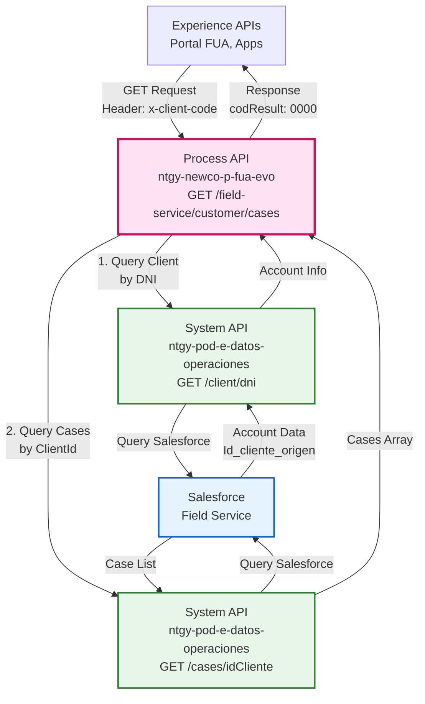
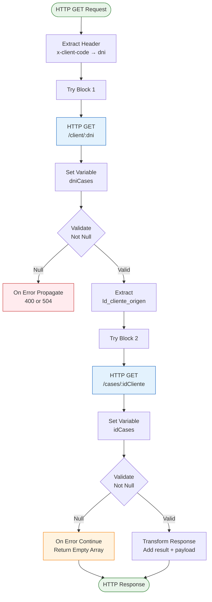
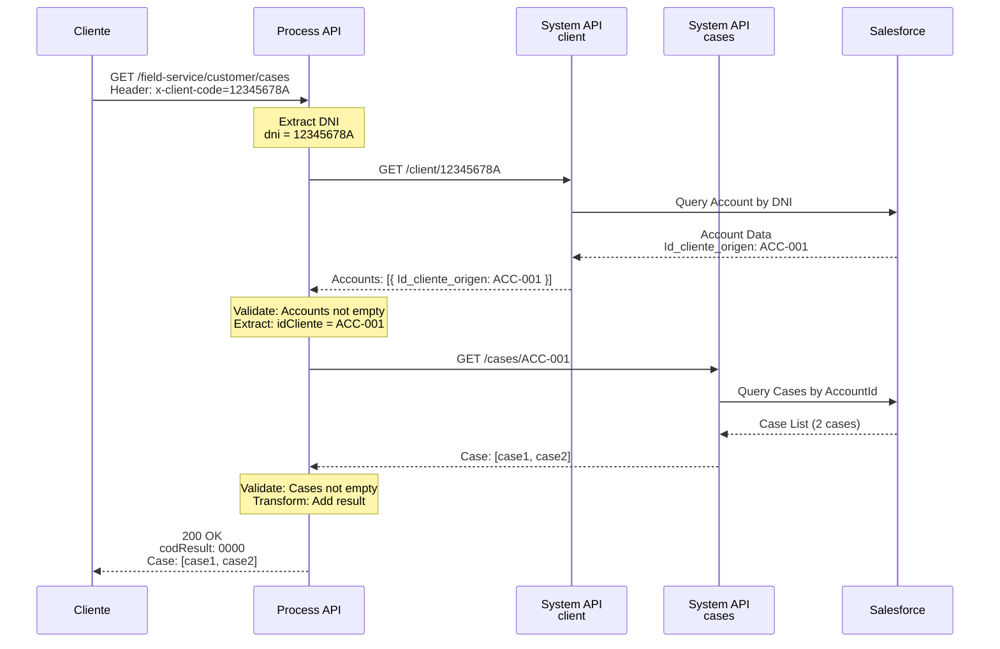
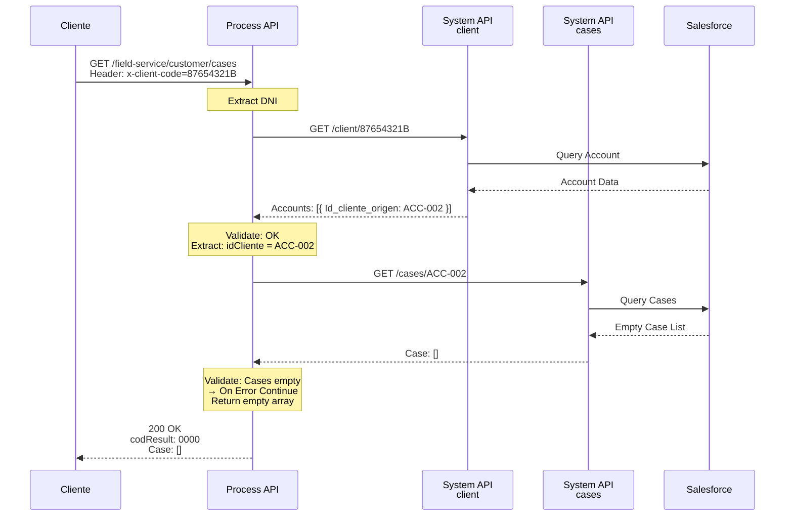
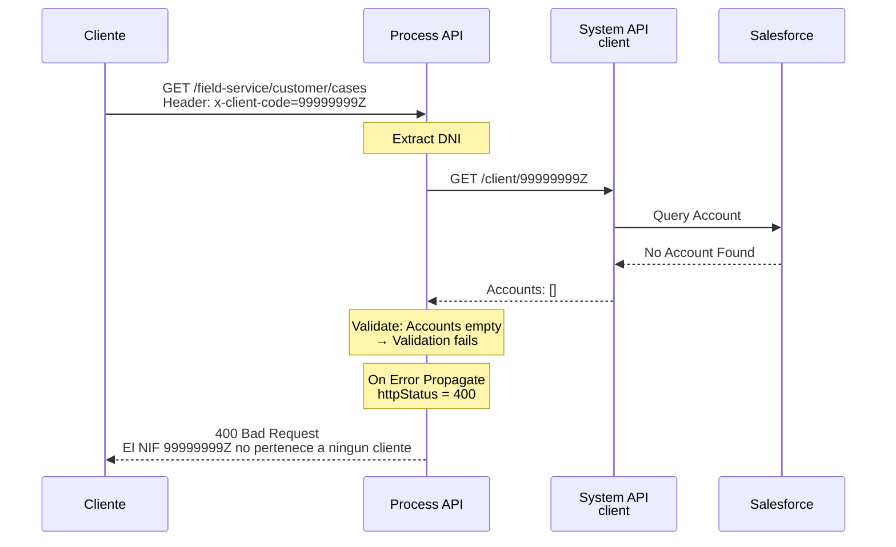
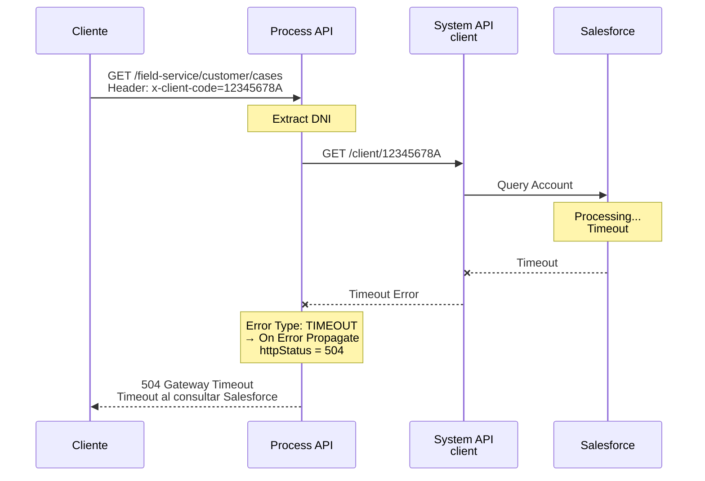

# GET /field-service/customer/cases

## 📌 Descripción General

### Propósito del Endpoint

Este endpoint orquesta la recuperación de casos de Field Service asociados a un cliente desde Salesforce. Implementa una estrategia de doble consulta secuencial: primero obtiene los datos del cliente mediante su DNI para extraer el ID de cliente de Salesforce, y luego recupera todos los casos asociados a ese ID. Maneja elegantemente el escenario de "sin casos" retornando un array vacío en lugar de un error.

### Tipo de API

**Capa:** Process API (API-Led Connectivity)

**Función:** Orquestación de consultas secuenciales con validación y manejo de errores

### Patrón de Integración

**Tipo:** Orquestación Secuencial con Validación

**Descripción:** El endpoint implementa un flujo de dos pasos:
1. Consulta datos del cliente por DNI para obtener el ID de cliente de Salesforce
2. Consulta casos del cliente usando el ID obtenido
3. Valida existencia de datos en cada paso
4. Retorna array vacío si no hay casos (en lugar de error)

### Arquitectura API-Led Connectivity



---

## 💼 Propósito del Negocio

### Casos de Uso Principales

1. **Consulta de Historial de Reclamaciones**
   - Permite a clientes visualizar todas sus reclamaciones y casos abiertos
   - Beneficio: Transparencia y seguimiento de incidencias

2. **Gestión de Casos por Agentes**
   - Agentes de call center consultan casos del cliente para dar soporte
   - Beneficio: Contexto completo para resolución eficiente

3. **Seguimiento de Servicios Técnicos**
   - Visualización de visitas técnicas y trabajos de campo programados
   - Beneficio: Planificación y seguimiento de servicios

### 🔗 Endpoints Dependientes

Este Process API consume los siguientes endpoints del System API:

| System API | Endpoint | Método | Propósito |
|------------|----------|--------|-----------|
| `ntgy-pod-e-datos-operaciones` | `/client/&#123;dni&#125;` | GET | Obtiene datos del cliente por DNI, incluyendo `Id_cliente_origen` (AccountId de Salesforce) |
| `ntgy-pod-e-datos-operaciones` | `/cases/&#123;idCliente&#125;` | GET | Obtiene lista de casos asociados al cliente en Salesforce Field Service |

### Lógica de Orquestación

```mermaid
graph TD
    Start[GET /field-service/customer/cases] --> Extract[Extraer Header<br/>x-client-code → dni]
    Extract --> Call1[HTTP GET<br/>/client/dni]
    Call1 --> Check1{Cliente<br/>Existe?}
    Check1 -->|No| Error1[Error 400:<br/>DNI no pertenece a ningún cliente]
    Check1 -->|Sí| ExtractId[Extraer<br/>Id_cliente_origen]
    ExtractId --> Call2[HTTP GET<br/>/cases/idCliente]
    Call2 --> Check2{Casos<br/>Existen?}
    Check2 -->|No| Empty[Retornar Array Vacío<br/>Case: []]
    Check2 -->|Sí| Success[Retornar Casos<br/>codResult: 0000]
    
    style Start fill:#e8f5e9,stroke:#2e7d32
    style Success fill:#e8f5e9,stroke:#2e7d32
    style Empty fill:#fff3e0,stroke:#f57c00
    style Error1 fill:#ffebee,stroke:#c62828
    style Call1 fill:#e3f2fd,stroke:#1565c0
    style Call2 fill:#e3f2fd,stroke:#1565c0
```

**Pasos del Proceso:**

1. **Extracción de DNI**: Captura header `x-client-code` (DNI del cliente)
2. **Consulta de Cliente**: GET a `/client/&#123;dni&#125;` para obtener datos del cliente
3. **Validación de Cliente**: Verifica que el cliente existe (array Accounts no vacío)
4. **Extracción de ID**: Obtiene `Id_cliente_origen` del primer elemento de Accounts
5. **Consulta de Casos**: GET a `/cases/&#123;idCliente&#125;` para obtener casos
6. **Validación de Casos**: Verifica que existen casos (array Case no vacío)
7. **Respuesta**: Retorna casos con código 0000 o array vacío si no hay casos

### Transformaciones Aplicadas

**Transformación 1: Extracción de DNI**

| Header Input | Variable | Descripción |
|--------------|----------|-------------|
| `x-client-code` | `dni` | DNI del cliente para consulta |

**Transformación 2: Validación de Cliente**

```dataweave
// Si no hay cuentas, retorna null para validación
if(sizeOf(payload.Accounts) == 0) (null) else payload.Accounts
```

**Transformación 3: Extracción de ID de Cliente**

```dataweave
// Extrae Id_cliente_origen del primer Account
payload.Accounts[0].Id_cliente_origen
```

**Transformación 4: Validación de Casos**

```dataweave
// Si no hay casos, retorna null para validación
if(sizeOf(payload.Case) == 0) (null) else payload.Case
```

**Transformación 5: Respuesta Final**

```dataweave
{
    "result": {
        "codResult": "0000",
        "msgResult": "No hay error"
    }
} ++ payload  // Agrega el payload original (con array Case)
```

### Contexto Empresarial

- **Dominio:** Gestión de Casos y Field Service
- **Sector:** Energía - Utilities
- **División:** Naturgy España - NewCo
- **Proceso de Negocio:** Consulta de reclamaciones y casos de servicio técnico

### Stakeholders

- **Clientes Finales**: Necesitan consultar el estado de sus reclamaciones
- **Agentes de Call Center**: Requieren visibilidad de casos para dar soporte
- **Equipo de Field Service**: Gestionan visitas técnicas y trabajos de campo
- **Equipo de Calidad**: Analizan casos para mejora continua

### Valor de Negocio

- **Transparencia**: Visibilidad completa del historial de casos del cliente
- **Eficiencia**: Acceso rápido a información de casos para agentes
- **Satisfacción**: Clientes pueden hacer seguimiento de sus reclamaciones
- **Trazabilidad**: Registro completo de interacciones de servicio

### Consumidores Potenciales

Este endpoint puede ser consumido por:
- Portal web FUA
- Aplicaciones móviles de clientes
- Sistemas de agentes de call center
- Dashboards de Field Service
- Sistemas de gestión de calidad

---

## 🔧 Especificación Técnica

### URLs por Ambiente

| Ambiente | URL Base | URL Completa |
|----------|----------|--------------|
| **Local** | `http://localhost:8081` | `http://localhost:8081/api/field-service/customer/cases` |
| **Development** | `https://ntgy-newco-p-fua-evo-dev.us-e2.cloudhub.io` | `https://ntgy-newco-p-fua-evo-dev.us-e2.cloudhub.io/api/field-service/customer/cases` |
| **UAT** | `https://ntgy-newco-p-fua-evo-uat.us-e2.cloudhub.io` | `https://ntgy-newco-p-fua-evo-uat.us-e2.cloudhub.io/api/field-service/customer/cases` |
| **Production** | `https://ntgy-newco-p-fua-evo-pro.us-e2.cloudhub.io` | `https://ntgy-newco-p-fua-evo-pro.us-e2.cloudhub.io/api/field-service/customer/cases` |

### Método HTTP

```
GET /api/field-service/customer/cases
```

### Parámetros de Entrada

#### Headers

| Header | Tipo | Requerido | Descripción | Ejemplo |
|--------|------|-----------|-------------|---------|
| `x-client-code` | string | Sí | DNI del cliente | `12345678A` |
| `client_id` | string | Sí | Client ID de Anypoint Platform | `abc123...` |
| `client_secret` | string | Sí | Client Secret de Anypoint Platform | `xyz789...` |

### Respuestas

#### 200 OK - Casos Encontrados

**Descripción:** Cliente existe y tiene casos asociados

**Content-Type:** `application/json`

**Schema:**
```json
{
  "result": {
    "codResult": "0000",
    "msgResult": "No hay error"
  },
  "Case": [
    {
      "Id": "500xx000000abcABC",
      "CaseNumber": "00001234",
      "Subject": "Problema con facturación",
      "Status": "New",
      "Priority": "Medium",
      "Origin": "Web",
      "CreatedDate": "2024-01-15T10:30:00.000Z",
      "Description": "El cliente reporta discrepancia en la factura"
    },
    {
      "Id": "500xx000000defDEF",
      "CaseNumber": "00001235",
      "Subject": "Solicitud de revisión de contador",
      "Status": "In Progress",
      "Priority": "High",
      "Origin": "Phone",
      "CreatedDate": "2024-01-10T14:20:00.000Z",
      "Description": "Cliente solicita revisión técnica del contador"
    }
  ]
}
```

#### 200 OK - Sin Casos

**Descripción:** Cliente existe pero no tiene casos asociados

**Content-Type:** `application/json`

**Schema:**
```json
{
  "result": {
    "codResult": "0000",
    "msgResult": "No hay error"
  },
  "Case": []
}
```

#### 400 Bad Request - Cliente No Existe

**Descripción:** El DNI proporcionado no corresponde a ningún cliente

**Content-Type:** `application/json`

**Schema:** `generic.response-failed`

```json
{
  "code": "VALIDATION_ERROR",
  "message": "El NIF 12345678A no pertenece a ningun cliente",
  "details": "Cliente no encontrado en Salesforce",
  "timestamp": "2024-01-15T10:30:00Z"
}
```

#### 504 Gateway Timeout - Timeout

**Descripción:** Timeout en la consulta a Salesforce

**Content-Type:** `application/json`

**Schema:** `generic.response-failed`

```json
{
  "code": "TIMEOUT_ERROR",
  "message": "Timeout al consultar Salesforce",
  "details": "La consulta excedió el tiempo máximo de espera",
  "timestamp": "2024-01-15T10:30:00Z"
}
```

#### 500 Internal Server Error - Error del Sistema

**Descripción:** Error en el procesamiento interno

**Content-Type:** `application/json`

**Schema:** `generic.response-failed`

```json
{
  "code": "INTERNAL_ERROR",
  "message": "Error al procesar la solicitud",
  "details": "Error de conexión con System API",
  "timestamp": "2024-01-15T10:30:00Z"
}
```

### Autenticación

- **Tipo:** Client ID & Client Secret (Anypoint Platform)
- **Headers requeridos:** `client_id`, `client_secret`

### Timeouts

| Tipo | Valor |
|------|-------|
| **Request Timeout** | 60 segundos |
| **Connection Timeout** | 30 segundos |

---

## 🏗️ Implementación Técnica

### Arquitectura del Flow



### Componentes del Flow

#### 1. Flow Principal: `get:\field-service\customer\cases:ntgy-newco-p-fua-config`

**Ubicación:** `src/main/mule/ntgy-newco-p-fua.xml`

**Responsabilidades:**
- Recibir request HTTP GET
- Extraer header `x-client-code` a variable `dni`
- Invocar subflow de procesamiento

**Código XML:**
```xml
<flow name="get:\field-service\customer\cases:ntgy-newco-p-fua-config">
    <logger level="INFO" 
            message="get:\field-service\customer\cases:ntgy-newco-p-fua-config" />
    <ee:transform doc:name="Transform Message">
        <ee:variables>
            <ee:set-variable variableName="dni">
                attributes.headers.'x-client-code'
            </ee:set-variable>
        </ee:variables>
    </ee:transform>
    <flow-ref doc:name="Flow Reference" name="customer_casesFlow" />
</flow>
```

#### 2. Subflow: `customer_casesFlow`

**Ubicación:** `src/main/mule/services/fieldservice/customer_casesFlow.xml` (ubicación estimada)

**Responsabilidades:**
- Consultar cliente por DNI
- Validar existencia del cliente
- Consultar casos del cliente
- Validar existencia de casos
- Transformar respuesta

**Try Block 1: Consulta de Cliente**
```xml
<try doc:name="Try">
    <http:request method="GET" 
                  config-ref="HTTP_Request_customer-cases-workorders" 
                  path="${ntgy-pod-e-datos-operaciones.functions.client}&#123;dni&#125;">
        <http:uri-params>
            &#123; "dni": vars.dni &#125;
        </http:uri-params>
    </http:request>
    
    <set-variable 
        value="#[if(sizeOf(payload.Accounts) == 0) (null) else payload.Accounts]" 
        variableName="dniCases"/>
    
    <validation:is-not-null 
        value="#[vars.dniCases]" 
        message='#["El NIF " ++ vars.dni ++ " no pertenece a ningun cliente"]'/>
    
    <error-handler>
        <on-error-propagate when="#[isEmpty(vars.getCases)]">
            <ee:transform>
                <ee:variables>
                    <ee:set-variable variableName="httpStatus">
                        if(error.errorType.identifier == "TIMEOUT") "504" else "400"
                    </ee:set-variable>
                </ee:variables>
            </ee:transform>
        </on-error-propagate>
        <on-error-continue>
            <ee:transform>
                <ee:set-payload>
                    { "Case": [] }
                </ee:set-payload>
            </ee:transform>
        </on-error-continue>
    </error-handler>
</try>
```

**Try Block 2: Consulta de Casos**
```xml
<try doc:name="Try">
    <set-variable 
        value="#[payload.Accounts[0].Id_cliente_origen]" 
        variableName="idCliente" />
    
    <http:request method="GET" 
                  config-ref="HTTP_Request_customer-cases-workorders" 
                  path="${ntgy-pod-e-datos-operaciones.functions.cases}&#123;idCliente&#125;">
        <http:uri-params>
            &#123; "idCliente": vars.idCliente &#125;
        </http:uri-params>
    </http:request>
    
    <set-variable 
        value="#[if(sizeOf(payload.Case) == 0) (null) else payload.Case]" 
        variableName="idCases"/>
    
    <validation:is-not-null 
        value="#[vars.idCases]" 
        message='#["No hay ningun caso asociado al idCliente " ++ vars.idCliente]'/>
    
    <error-handler>
        <on-error-propagate when="#[isEmpty(vars.getCases)]">
            <ee:transform>
                <ee:variables>
                    <ee:set-variable variableName="httpStatus">
                        if(error.errorType.identifier == "TIMEOUT") "504" else "400"
                    </ee:set-variable>
                </ee:variables>
            </ee:transform>
        </on-error-propagate>
        <on-error-continue>
            <ee:transform>
                <ee:set-payload>
                    { "Case": [] }
                </ee:set-payload>
            </ee:transform>
        </on-error-continue>
    </error-handler>
</try>
```

**Transformación Final:**
```dataweave
%dw 2.0
output application/json
---
{
    "result": {
        "codResult": '0000',
        "msgResult": "No hay error"
    }
} ++ payload
```

### Configuración HTTP

**Config Reference:** `HTTP_Request_customer-cases-workorders`

**Propiedades:**
- **Host:** Configurado en properties file por ambiente
- **Port:** 443 (HTTPS)
- **Base Path:** Configurado en properties
- **Path Variables:** 
  - `${ntgy-pod-e-datos-operaciones.functions.client}` → `/client/`
  - `${ntgy-pod-e-datos-operaciones.functions.cases}` → `/cases/`

### Patrones de Diseño

**Patrón 1: Sequential Orchestration**

**Justificación:** 
- Necesidad de obtener ID de cliente antes de consultar casos
- Dependencia secuencial: resultado de primera llamada alimenta segunda llamada
- No se pueden paralelizar las consultas

**Patrón 2: Graceful Degradation**

**Justificación:**
- Retornar array vacío en lugar de error cuando no hay casos
- Mejor experiencia de usuario (no es un error no tener casos)
- Permite al frontend manejar el escenario de "sin datos" elegantemente

**Patrón 3: Fail Fast with Validation**

**Justificación:**
- Validación temprana de existencia de cliente
- Evita llamadas innecesarias si el cliente no existe
- Mensajes de error claros y específicos

### Diagramas de Secuencia

#### 1. Flujo Normal - Cliente con Casos



#### 2. Flujo Normal - Cliente sin Casos



#### 3. Flujo con Error - Cliente No Existe



#### 4. Flujo con Error - Timeout



### Manejo de Errores

**Estrategia:** Validación con `validation:is-not-null` y error handlers diferenciados

**Tipos de Error:**

1. **Cliente No Existe (400)**
   - Validación falla: `Accounts` array vacío
   - Mensaje: "El NIF &#123;dni&#125; no pertenece a ningun cliente"
   - Error handler: `on-error-propagate`

2. **Sin Casos (200 con array vacío)**
   - Validación falla: `Case` array vacío
   - Respuesta: Array vacío en lugar de error
   - Error handler: `on-error-continue`

3. **Timeout (504)**
   - Error type: TIMEOUT
   - Código HTTP: 504 Gateway Timeout
   - Error handler: `on-error-propagate` con detección de tipo

4. **Errores de Sistema (500)**
   - Errores de conexión, transformación, etc.
   - Código HTTP: 500 Internal Server Error
   - Error handler: Global error handler

**Formato de Error:** `generic.response-failed` (biblioteca compartida)

**Logging:**
- Nivel INFO: Request/Response exitosos, cada paso del flujo
- Nivel ERROR: Excepciones y errores de sistema

---

## 💻 Ejemplos de Uso

### Ejemplo 1: Cliente con Casos

#### cURL

```bash
curl -X GET "https://ntgy-newco-p-fua-evo-dev.us-e2.cloudhub.io/api/field-service/customer/cases" \
  -H "Content-Type: application/json" \
  -H "x-client-code: 12345678A" \
  -H "client_id: YOUR_CLIENT_ID" \
  -H "client_secret: YOUR_CLIENT_SECRET"
```

#### Respuesta (200 OK)

```json
{
  "result": {
    "codResult": "0000",
    "msgResult": "No hay error"
  },
  "Case": [
    {
      "Id": "500xx000000abcABC",
      "CaseNumber": "00001234",
      "Subject": "Problema con facturación",
      "Status": "New",
      "Priority": "Medium",
      "Origin": "Web",
      "CreatedDate": "2024-01-15T10:30:00.000Z",
      "Description": "El cliente reporta discrepancia en la factura del mes de diciembre",
      "ContactId": "003xx000000defDEF",
      "AccountId": "001xx000000ghiGHI"
    },
    {
      "Id": "500xx000000jklJKL",
      "CaseNumber": "00001235",
      "Subject": "Solicitud de revisión de contador",
      "Status": "In Progress",
      "Priority": "High",
      "Origin": "Phone",
      "CreatedDate": "2024-01-10T14:20:00.000Z",
      "Description": "Cliente solicita revisión técnica del contador eléctrico",
      "ContactId": "003xx000000defDEF",
      "AccountId": "001xx000000ghiGHI"
    }
  ]
}
```

### Ejemplo 2: Cliente sin Casos

#### cURL

```bash
curl -X GET "https://ntgy-newco-p-fua-evo-dev.us-e2.cloudhub.io/api/field-service/customer/cases" \
  -H "Content-Type: application/json" \
  -H "x-client-code: 87654321B" \
  -H "client_id: YOUR_CLIENT_ID" \
  -H "client_secret: YOUR_CLIENT_SECRET"
```

#### Respuesta (200 OK - Array Vacío)

```json
{
  "result": {
    "codResult": "0000",
    "msgResult": "No hay error"
  },
  "Case": []
}
```

### Ejemplo 3: Error - Cliente No Existe

#### cURL

```bash
curl -X GET "https://ntgy-newco-p-fua-evo-dev.us-e2.cloudhub.io/api/field-service/customer/cases" \
  -H "Content-Type: application/json" \
  -H "x-client-code: 99999999Z" \
  -H "client_id: YOUR_CLIENT_ID" \
  -H "client_secret: YOUR_CLIENT_SECRET"
```

#### Respuesta (400 Bad Request)

```json
{
  "code": "VALIDATION_ERROR",
  "message": "El NIF 99999999Z no pertenece a ningun cliente",
  "details": "Cliente no encontrado en Salesforce",
  "timestamp": "2024-01-15T10:30:00Z"
}
```

### Ejemplo 4: JavaScript (Fetch API)

```javascript
const getCustomerCases = async (clientDNI) => {
  try {
    const response = await fetch(
      'https://ntgy-newco-p-fua-evo-dev.us-e2.cloudhub.io/api/field-service/customer/cases',
      {
        method: 'GET',
        headers: {
          'Content-Type': 'application/json',
          'x-client-code': clientDNI,
          'client_id': 'YOUR_CLIENT_ID',
          'client_secret': 'YOUR_CLIENT_SECRET'
        }
      }
    );

    if (!response.ok) {
      throw new Error(`HTTP error! status: ${response.status}`);
    }

    const data = await response.json();
    
    if (data.result.codResult !== '0000') {
      console.error(`Error: ${data.result.msgResult}`);
      return null;
    }

    return data.Case;
  } catch (error) {
    console.error('Error al obtener casos:', error);
    return null;
  }
};

// Uso
const cases = await getCustomerCases('12345678A');
if (cases && cases.length > 0) {
  console.log(`Cliente tiene ${cases.length} casos`);
  cases.forEach(c => console.log(`- ${c.CaseNumber}: ${c.Subject}`));
} else {
  console.log('Cliente no tiene casos abiertos');
}
```

### Ejemplo 5: Python (Requests)

```python
import requests

def get_customer_cases(client_dni):
    """
    Obtiene casos de Field Service del cliente
    
    Args:
        client_dni (str): DNI del cliente
    
    Returns:
        list: Lista de casos o lista vacía
    """
    url = 'https://ntgy-newco-p-fua-evo-dev.us-e2.cloudhub.io/api/field-service/customer/cases'
    
    headers = {
        'Content-Type': 'application/json',
        'x-client-code': client_dni,
        'client_id': 'YOUR_CLIENT_ID',
        'client_secret': 'YOUR_CLIENT_SECRET'
    }
    
    try:
        response = requests.get(url, headers=headers, timeout=60)
        response.raise_for_status()
        
        data = response.json()
        
        if data['result']['codResult'] != '0000':
            print(f"Error: {data['result']['msgResult']}")
            return []
        
        return data.get('Case', [])
        
    except requests.exceptions.RequestException as e:
        print(f"Error al obtener casos: {e}")
        return []

# Uso
if __name__ == "__main__":
    dni = '12345678A'
    cases = get_customer_cases(dni)
    
    if cases:
        print(f"Cliente {dni} tiene {len(cases)} casos:")
        for case in cases:
            print(f"  - {case['CaseNumber']}: {case['Subject']} ({case['Status']})")
    else:
        print(f"Cliente {dni} no tiene casos abiertos")
```
