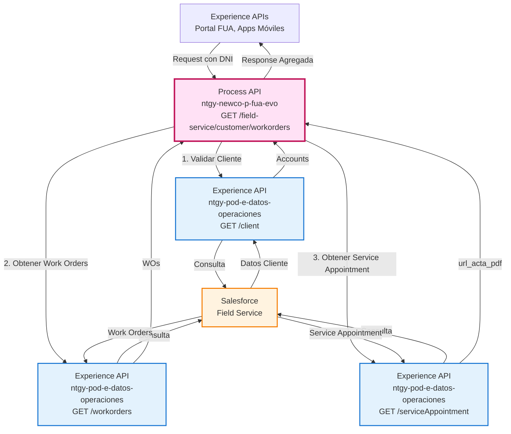
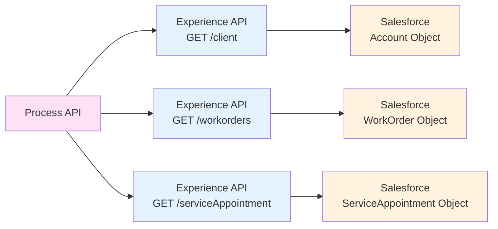
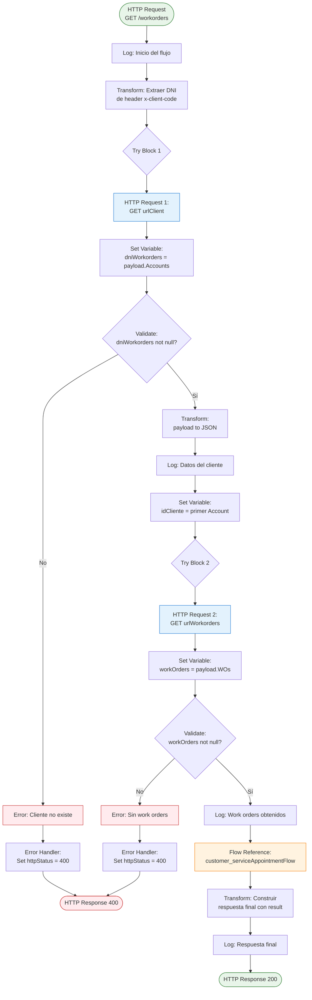
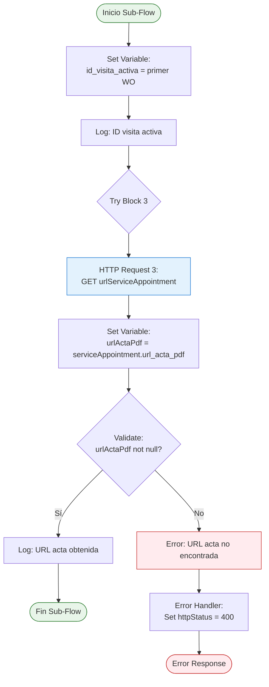
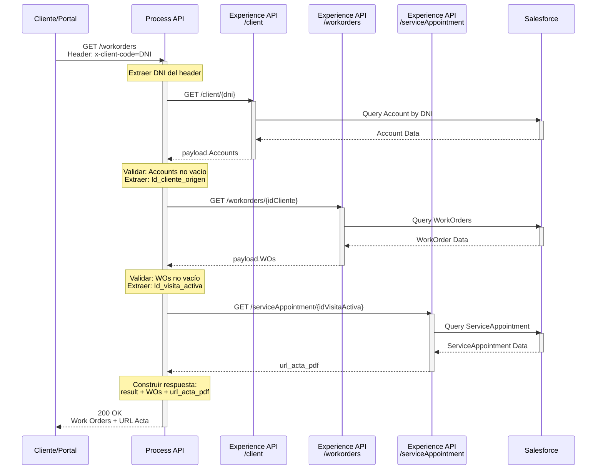
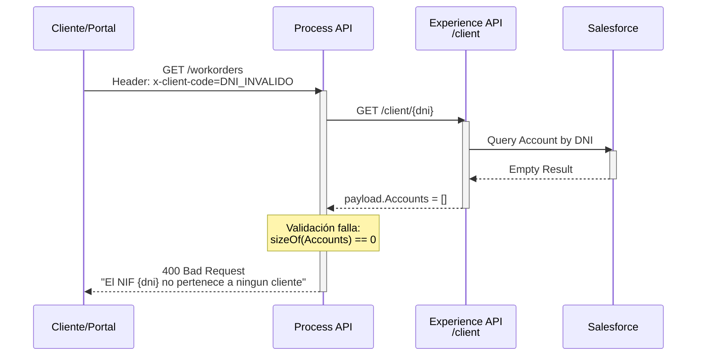
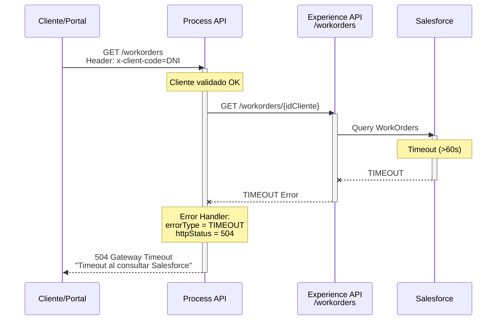

# GET /field-service/customer/workorders

## 📌 Descripción General

### Propósito del Endpoint

Este endpoint recupera las órdenes de trabajo (work orders) de Field Service asociadas a un cliente específico, identificado por su DNI. Orquesta múltiples llamadas a APIs de Salesforce Field Service para obtener información completa sobre visitas técnicas programadas, incluyendo el estado de las órdenes de trabajo y la documentación asociada (actas PDF).

### Tipo de API

**Capa:** Process API (API-Led Connectivity)

**Función:** Orquestación de consultas a Salesforce Field Service para agregación de datos de órdenes de trabajo

### Patrón de Integración

**Tipo:** Orquestación Secuencial con Validaciones

**Descripción:** Realiza tres llamadas REST secuenciales:
1. Valida la existencia del cliente por DNI
2. Recupera las órdenes de trabajo del cliente
3. Obtiene detalles de la cita de servicio activa (Service Appointment)

### Arquitectura API-Led Connectivity



---

## 💼 Propósito del Negocio

### Casos de Uso Principales

1. **Consulta de Visitas Técnicas Programadas**
   - Los clientes pueden consultar el estado de sus visitas técnicas pendientes
   - Beneficio: Transparencia y visibilidad del servicio técnico

2. **Seguimiento de Órdenes de Trabajo**
   - Agentes de call center pueden verificar el estado de las órdenes de trabajo
   - Beneficio: Mejor atención al cliente con información actualizada

3. **Acceso a Documentación de Visitas**
   - Recuperación de actas PDF de visitas completadas
   - Beneficio: Acceso inmediato a documentación técnica

### 🔗 Endpoints Dependientes

Este Process API consume los siguientes endpoints de Experience API:

| Experience API | Endpoint | Método | Propósito |
|----------------|----------|--------|-----------|
| `ntgy-pod-e-datos-operaciones` | `/client` | GET | Validar cliente y obtener Id_cliente_origen |
| `ntgy-pod-e-datos-operaciones` | `/workorders` | GET | Recuperar órdenes de trabajo del cliente |
| `ntgy-pod-e-datos-operaciones` | `/serviceAppointment` | GET | Obtener detalles de la cita de servicio y URL del acta PDF |

### Lógica de Orquestación



**Pasos del Proceso:**

1. **Validación de Cliente**: Consulta Salesforce por DNI para obtener información del cliente
2. **Recuperación de Work Orders**: Obtiene todas las órdenes de trabajo asociadas al cliente
3. **Obtención de Service Appointment**: Recupera detalles de la visita activa, incluyendo URL del acta PDF
4. **Agregación de Respuesta**: Combina todos los datos en una respuesta unificada

### Transformaciones Aplicadas

**Transformación de Respuesta Final:**

| Campo Original | Campo Transformado | Transformación |
|----------------|-------------------|----------------|
| `payload.WOs` | `payload` (raíz) | Datos de work orders en raíz de respuesta |
| `vars.urlActaPdf` | `url_acta_pdf` | URL del acta PDF agregada a la respuesta |
| N/A | `result.codResult` | Código de resultado "0000" (éxito) |
| N/A | `result.msgResult` | Mensaje "No hay error" |

### Contexto Empresarial

- **Dominio:** Gestión de Servicios de Campo (Field Service Management)
- **Sector:** Energía - Utilities
- **División:** Naturgy España - NewCo
- **Proceso de Negocio:** Seguimiento y gestión de visitas técnicas a clientes

### Stakeholders

- **Clientes Residenciales**: Necesitan visibilidad de visitas técnicas programadas
- **Agentes de Call Center**: Requieren información actualizada para atención al cliente
- **Técnicos de Campo**: Consultan órdenes de trabajo asignadas
- **Supervisores de Field Service**: Monitorean estado de órdenes de trabajo

### Valor de Negocio

- **Transparencia**: Clientes informados sobre el estado de sus visitas técnicas
- **Eficiencia Operativa**: Reducción de llamadas al call center por consultas de estado
- **Satisfacción del Cliente**: Acceso inmediato a información de servicio técnico
- **Trazabilidad**: Documentación completa de visitas realizadas

### Consumidores Potenciales

Este endpoint puede ser consumido por:
- Portal web de autoservicio FUA
- Aplicaciones móviles de clientes
- Sistemas de agentes de call center
- Portales de técnicos de campo
- Integraciones de terceros autorizados

---

## 🔧 Especificación Técnica

### URLs por Ambiente

| Ambiente | URL Base | URL Completa |
|----------|----------|--------------|
| **Local** | `http://localhost:8081` | `http://localhost:8081/api/field-service/customer/workorders` |
| **Development** | `https://ntgy-newco-p-fua-evo-dev.us-e2.cloudhub.io` | `https://ntgy-newco-p-fua-evo-dev.us-e2.cloudhub.io/api/field-service/customer/workorders` |
| **UAT** | `https://ntgy-newco-p-fua-evo-uat.us-e2.cloudhub.io` | `https://ntgy-newco-p-fua-evo-uat.us-e2.cloudhub.io/api/field-service/customer/workorders` |
| **Production** | `https://ntgy-newco-p-fua-evo-pro.us-e2.cloudhub.io` | `https://ntgy-newco-p-fua-evo-pro.us-e2.cloudhub.io/api/field-service/customer/workorders` |

### Método HTTP

```
GET /api/field-service/customer/workorders
```

### Parámetros de Entrada

#### Headers (Requeridos)

| Header | Tipo | Descripción | Ejemplo |
|--------|------|-------------|---------|
| `x-client-code` | string | DNI/NIF del cliente | `"12345678A"` |
| `Content-Type` | string | Tipo de contenido | `"application/json"` |
| `client_id` | string | Client ID de Anypoint Platform | `"your_client_id"` |
| `client_secret` | string | Client Secret de Anypoint Platform | `"your_client_secret"` |

#### Query Parameters

No requiere query parameters.

#### Body

No requiere body (método GET).

### Respuestas

#### 200 OK - Éxito

**Descripción:** Órdenes de trabajo recuperadas exitosamente.

**Estructura de Respuesta:**

```json
{
  "result": {
    "codResult": "0000",
    "msgResult": "No hay error"
  },
  "WOs": [
    {
      "Id_visita_activa": ["string"],
      "WorkOrderNumber": "string",
      "Status": "string",
      "Subject": "string",
      "Description": "string",
      "CreatedDate": "string",
      "LastModifiedDate": "string"
    }
  ],
  "url_acta_pdf": "string"
}
```

**Campos de Respuesta:**

| Campo | Tipo | Descripción |
|-------|------|-------------|
| `result.codResult` | string | Código de resultado ("0000" = éxito) |
| `result.msgResult` | string | Mensaje descriptivo del resultado |
| `WOs` | array | Array de órdenes de trabajo del cliente |
| `WOs[].Id_visita_activa` | array | IDs de visitas activas asociadas |
| `url_acta_pdf` | string | URL del documento PDF del acta de visita |

#### 400 Bad Request - Error de Negocio

**Descripción:** Error en la validación de datos o cliente no encontrado.

**Casos de Error:**

1. **Cliente no existe:**
```json
{
  "error": {
    "code": "400",
    "message": "El NIF 12345678A no pertenece a ningun cliente"
  }
}
```

2. **Sin work orders:**
```json
{
  "error": {
    "code": "400",
    "message": "No hay ningun workorder asociado al idCliente ABC123"
  }
}
```

3. **Sin URL de acta:**
```json
{
  "error": {
    "code": "400",
    "message": "No se encuentra el campo o no viene relleno"
  }
}
```

#### 504 Gateway Timeout - Timeout

**Descripción:** Timeout en la comunicación con Salesforce.

```json
{
  "error": {
    "code": "504",
    "message": "Timeout al consultar Salesforce Field Service"
  }
}
```

### Autenticación

- **Tipo:** Client ID & Client Secret (Anypoint Platform)
- **Headers Requeridos:** `client_id`, `client_secret`

### Timeouts

| Tipo | Valor |
|------|-------|
| **Request Timeout** | 60 segundos (por llamada a Salesforce) |
| **Connection Timeout** | 30 segundos |
| **Timeout Total Estimado** | ~180 segundos (3 llamadas secuenciales) |

### Validaciones

1. **Header x-client-code requerido:** El DNI del cliente es obligatorio
2. **Cliente debe existir:** Validación en Salesforce Account
3. **Work orders deben existir:** Al menos una orden de trabajo asociada
4. **URL acta debe existir:** Campo url_acta_pdf debe estar presente

---

## 🏗️ Implementación Técnica

### Arquitectura del Flow



### Sub-Flow: customer_serviceAppointmentFlow



### Transformaciones DataWeave

#### 1. Extracción de DNI del Header

```dataweave
%dw 2.0
output application/java
---
{
    dni: attributes.headers.'x-client-code'
}
```

#### 2. Validación de Cliente (Set Variable)

```dataweave
%dw 2.0
output application/java
---
if(sizeOf(payload.Accounts) == 0) 
    null 
else 
    payload.Accounts
```

#### 3. Validación de Work Orders (Set Variable)

```dataweave
%dw 2.0
output application/java
---
if(sizeOf(payload.WOs) == 0) 
    null 
else 
    payload.WOs
```

#### 4. Construcción de Respuesta Final

```dataweave
%dw 2.0
output application/json
---
{
    "result": {
        "codResult": '0000',
        "msgResult": "No hay error"
    }
} ++ (payload ++ {url_acta_pdf: vars.urlActaPdf})
```

#### 5. Manejo de Error (Timeout vs Otros)

```dataweave
%dw 2.0
output application/java
---
if(error.errorType.identifier == "TIMEOUT") 
    "504" 
else 
    "400"
```

### Configuración HTTP

**HTTP Request Configuration:** `HTTP_Request_customer-cases-workorders`

**Endpoints Consumidos:**

1. **GET Client:**
   - URL: `${ntgy-pod-e-datos-operaciones.functions.urlClient}{dni}`
   - URI Parameters: `{dni: vars.dni}`

2. **GET Work Orders:**
   - URL: `${ntgy-pod-e-datos-operaciones.functions.urlWorkorders}{idCliente}`
   - URI Parameters: `{idCliente: vars.idCliente}`

3. **GET Service Appointment:**
   - URL: `${ntgy-pod-e-datos-operaciones.functions.urlServiceAppointment}{idVisitaActiva}`
   - URI Parameters: `{idVisitaActiva: vars.id_visita_activa}`

### Variables de Flow

| Variable | Tipo | Descripción | Origen |
|----------|------|-------------|--------|
| `dni` | string | DNI del cliente | Header x-client-code |
| `dniWorkorders` | array | Cuentas del cliente | Response de urlClient |
| `idCliente` | string | ID del cliente en Salesforce | Primer elemento de Accounts.Id_cliente_origen |
| `workOrders` | array | Órdenes de trabajo | Response de urlWorkorders |
| `id_visita_activa` | string | ID de visita activa | Primer elemento de WOs.Id_visita_activa |
| `urlActaPdf` | string | URL del acta PDF | serviceAppointment.url_acta_pdf |
| `httpStatus` | string | Código HTTP de error | "400" o "504" |

### Patrones de Diseño

**Patrón:** Orquestación Secuencial con Validaciones en Cascada

**Justificación:** 
- Cada llamada depende del resultado de la anterior
- Las validaciones aseguran integridad de datos en cada paso
- Permite fail-fast con mensajes de error específicos

**Patrón:** Try-Catch con Error Propagation

**Justificación:**
- Manejo granular de errores por cada llamada HTTP
- Diferenciación entre timeouts (504) y errores de negocio (400)
- Propagación controlada de errores con contexto

### Diagramas de Secuencia

#### 1. Flujo Normal de Éxito



#### 2. Flujo con Error: Cliente No Existe



#### 3. Flujo con Error: Timeout en Salesforce



### Manejo de Errores

#### Estrategia de Error Handling

**Try-Catch Blocks:** 3 bloques independientes (uno por cada llamada HTTP)

**Error Propagation:** Todos los errores se propagan con `on-error-propagate`

**Clasificación de Errores:**

| Tipo de Error | HTTP Status | Acción |
|---------------|-------------|--------|
| Cliente no existe | 400 | Validación falla, mensaje específico |
| Sin work orders | 400 | Validación falla, mensaje específico |
| Sin URL acta | 400 | Validación falla, mensaje específico |
| Timeout | 504 | Error de conectividad, reintentar |
| Otros errores | 400 | Error genérico |

#### Mensajes de Error Específicos

1. **Cliente no existe:**
   ```
   "El NIF {dni} no pertenece a ningun cliente"
   ```

2. **Sin work orders:**
   ```
   "No hay ningun workorder asociado al idCliente {idCliente}"
   ```

3. **Sin URL acta:**
   ```
   "No se encuentra el campo o no viene relleno"
   ```

### Logging

**Puntos de Logging:**

1. Inicio del flow principal
2. Después de obtener datos del cliente
3. Después de obtener work orders
4. ID de visita activa extraído
5. URL acta PDF obtenida
6. Respuesta final construida

**Nivel de Log:** INFO

---

## 💻 Ejemplos de Uso

### Ejemplo 1: Llamada Exitosa con cURL

#### Request

```bash
curl -X GET "https://ntgy-newco-p-fua-evo-dev.us-e2.cloudhub.io/api/field-service/customer/workorders" \
  -H "Content-Type: application/json" \
  -H "x-client-code: 12345678A" \
  -H "client_id: YOUR_CLIENT_ID" \
  -H "client_secret: YOUR_CLIENT_SECRET"
```

#### Response (200 OK)

```json
{
  "result": {
    "codResult": "0000",
    "msgResult": "No hay error"
  },
  "WOs": [
    {
      "Id_visita_activa": ["0WO5e000000123ABC"],
      "WorkOrderNumber": "WO-00001234",
      "Status": "In Progress",
      "Subject": "Instalación de contador inteligente",
      "Description": "Instalación programada de contador inteligente en domicilio del cliente",
      "CreatedDate": "2026-08-20T10:30:00Z",
      "LastModifiedDate": "2026-08-23T14:45:00Z",
      "Priority": "Medium",
      "ServiceTerritory": "Madrid Centro"
    }
  ],
  "url_acta_pdf": "https://sharepoint.naturgy.com/sites/fieldservice/documents/actas/acta_WO-00001234.pdf"
}
```

### Ejemplo 2: Error - Cliente No Existe

#### Request

```bash
curl -X GET "https://ntgy-newco-p-fua-evo-dev.us-e2.cloudhub.io/api/field-service/customer/workorders" \
  -H "Content-Type: application/json" \
  -H "x-client-code: 99999999Z" \
  -H "client_id: YOUR_CLIENT_ID" \
  -H "client_secret: YOUR_CLIENT_SECRET"
```

#### Response (400 Bad Request)

```json
{
  "error": {
    "code": "400",
    "message": "El NIF 99999999Z no pertenece a ningun cliente"
  }
}
```

### Ejemplo 3: Error - Sin Work Orders

#### Request

```bash
curl -X GET "https://ntgy-newco-p-fua-evo-dev.us-e2.cloudhub.io/api/field-service/customer/workorders" \
  -H "Content-Type: application/json" \
  -H "x-client-code: 11111111B" \
  -H "client_id: YOUR_CLIENT_ID" \
  -H "client_secret: YOUR_CLIENT_SECRET"
```

#### Response (400 Bad Request)

```json
{
  "error": {
    "code": "400",
    "message": "No hay ningun workorder asociado al idCliente 0015e00000ABC123"
  }
}
```

### Ejemplo 4: Error - Timeout

#### Request

```bash
curl -X GET "https://ntgy-newco-p-fua-evo-dev.us-e2.cloudhub.io/api/field-service/customer/workorders" \
  -H "Content-Type: application/json" \
  -H "x-client-code: 12345678A" \
  -H "client_id: YOUR_CLIENT_ID" \
  -H "client_secret: YOUR_CLIENT_SECRET"
```

#### Response (504 Gateway Timeout)

```json
{
  "error": {
    "code": "504",
    "message": "Timeout al consultar Salesforce Field Service"
  }
}
```

### Ejemplo 5: JavaScript (Fetch API)

```javascript
const getWorkOrders = async (dni) => {
  try {
    const response = await fetch(
      'https://ntgy-newco-p-fua-evo-dev.us-e2.cloudhub.io/api/field-service/customer/workorders',
      {
        method: 'GET',
        headers: {
          'Content-Type': 'application/json',
          'x-client-code': dni,
          'client_id': 'YOUR_CLIENT_ID',
          'client_secret': 'YOUR_CLIENT_SECRET'
        }
      }
    );

    if (!response.ok) {
      const error = await response.json();
      throw new Error(error.error.message);
    }

    const data = await response.json();
    
    console.log('Work Orders:', data.WOs);
    console.log('URL Acta PDF:', data.url_acta_pdf);
    
    return data;
  } catch (error) {
    console.error('Error al obtener work orders:', error.message);
    throw error;
  }
};

// Uso
getWorkOrders('12345678A')
  .then(data => {
    console.log('Órdenes de trabajo obtenidas:', data.WOs.length);
  })
  .catch(error => {
    console.error('Error:', error);
  });
```

### Ejemplo 6: Python (Requests)

```python
import requests

def get_work_orders(dni):
    """
    Obtiene las órdenes de trabajo de un cliente por DNI
    
    Args:
        dni (str): DNI del cliente
        
    Returns:
        dict: Datos de work orders y URL del acta
    """
    url = 'https://ntgy-newco-p-fua-evo-dev.us-e2.cloudhub.io/api/field-service/customer/workorders'
    
    headers = {
        'Content-Type': 'application/json',
        'x-client-code': dni,
        'client_id': 'YOUR_CLIENT_ID',
        'client_secret': 'YOUR_CLIENT_SECRET'
    }
    
    try:
        response = requests.get(url, headers=headers, timeout=180)
        response.raise_for_status()
        
        data = response.json()
        
        print(f"Work Orders encontrados: {len(data['WOs'])}")
        print(f"URL Acta PDF: {data['url_acta_pdf']}")
        
        return data
        
    except requests.exceptions.Timeout:
        print("Error: Timeout al consultar el servicio")
        raise
    except requests.exceptions.HTTPError as e:
        error_data = e.response.json()
        print(f"Error HTTP {e.response.status_code}: {error_data['error']['message']}")
        raise
    except Exception as e:
        print(f"Error inesperado: {str(e)}")
        raise

# Uso
if __name__ == "__main__":
    try:
        result = get_work_orders('12345678A')
        
        for wo in result['WOs']:
            print(f"\nWork Order: {wo['WorkOrderNumber']}")
            print(f"Estado: {wo['Status']}")
            print(f"Asunto: {wo['Subject']}")
            
    except Exception as e:
        print(f"No se pudieron obtener las órdenes de trabajo: {e}")
```

### Ejemplo 7: Postman Collection

```json
{
  "info": {
    "name": "Field Service - Work Orders",
    "schema": "https://schema.getpostman.com/json/collection/v2.1.0/collection.json"
  },
  "item": [
    {
      "name": "Get Work Orders",
      "request": {
        "method": "GET",
        "header": [
          {
            "key": "Content-Type",
            "value": "application/json"
          },
          {
            "key": "x-client-code",
            "value": "{{client_dni}}"
          },
          {
            "key": "client_id",
            "value": "{{client_id}}"
          },
          {
            "key": "client_secret",
            "value": "{{client_secret}}"
          }
        ],
        "url": {
          "raw": "{{base_url}}/api/field-service/customer/workorders",
          "host": ["{{base_url}}"],
          "path": ["api", "field-service", "customer", "workorders"]
        }
      }
    }
  ]
}
```

### Ejemplo 8: Java (Spring RestTemplate)

```java
import org.springframework.http.*;
import org.springframework.web.client.RestTemplate;
import org.springframework.web.client.HttpClientErrorException;
import org.springframework.web.client.ResourceAccessException;

public class WorkOrdersClient {
    
    private final RestTemplate restTemplate;
    private final String baseUrl;
    private final String clientId;
    private final String clientSecret;
    
    public WorkOrdersClient(String baseUrl, String clientId, String clientSecret) {
        this.restTemplate = new RestTemplate();
        this.baseUrl = baseUrl;
        this.clientId = clientId;
        this.clientSecret = clientSecret;
    }
    
    public WorkOrdersResponse getWorkOrders(String dni) {
        String url = baseUrl + "/api/field-service/customer/workorders";
        
        HttpHeaders headers = new HttpHeaders();
        headers.setContentType(MediaType.APPLICATION_JSON);
        headers.set("x-client-code", dni);
        headers.set("client_id", clientId);
        headers.set("client_secret", clientSecret);
        
        HttpEntity<String> entity = new HttpEntity<>(headers);
        
        try {
            ResponseEntity<WorkOrdersResponse> response = restTemplate.exchange(
                url,
                HttpMethod.GET,
                entity,
                WorkOrdersResponse.class
            );
            
            return response.getBody();
            
        } catch (HttpClientErrorException.BadRequest e) {
            System.err.println("Error 400: " + e.getResponseBodyAsString());
            throw new RuntimeException("Cliente no encontrado o sin work orders");
            
        } catch (HttpClientErrorException.GatewayTimeout e) {
            System.err.println("Error 504: Timeout");
            throw new RuntimeException("Timeout al consultar Salesforce");
            
        } catch (ResourceAccessException e) {
            System.err.println("Error de conexión: " + e.getMessage());
            throw new RuntimeException("Error de conectividad");
        }
    }
    
    // Uso
    public static void main(String[] args) {
        WorkOrdersClient client = new WorkOrdersClient(
            "https://ntgy-newco-p-fua-evo-dev.us-e2.cloudhub.io",
            "YOUR_CLIENT_ID",
            "YOUR_CLIENT_SECRET"
        );
        
        try {
            WorkOrdersResponse response = client.getWorkOrders("12345678A");
            
            System.out.println("Código resultado: " + response.getResult().getCodResult());
            System.out.println("Work Orders: " + response.getWOs().size());
            System.out.println("URL Acta: " + response.getUrlActaPdf());
            
        } catch (Exception e) {
            System.err.println("Error: " + e.getMessage());
        }
    }
}
```
