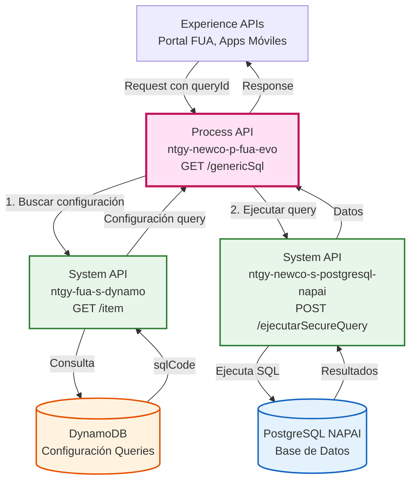
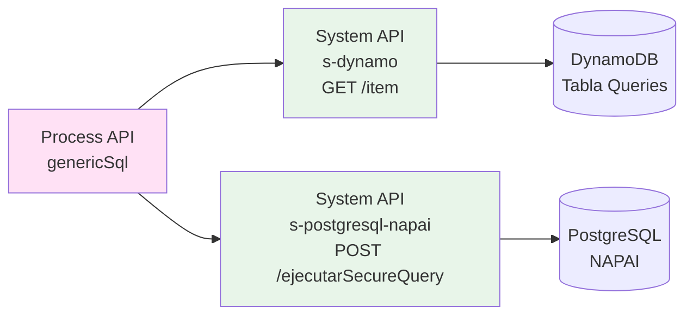
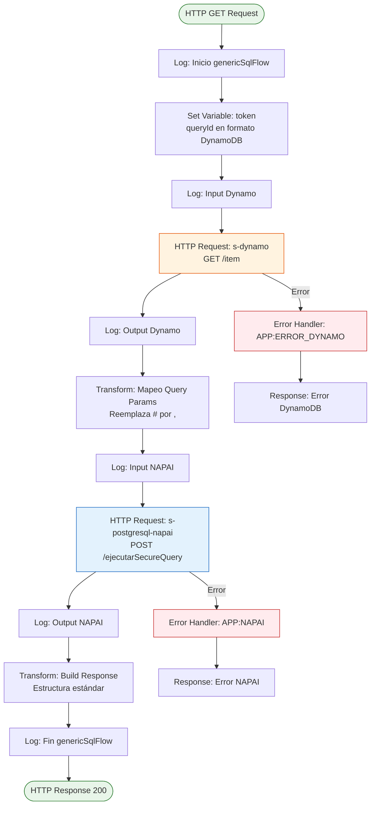
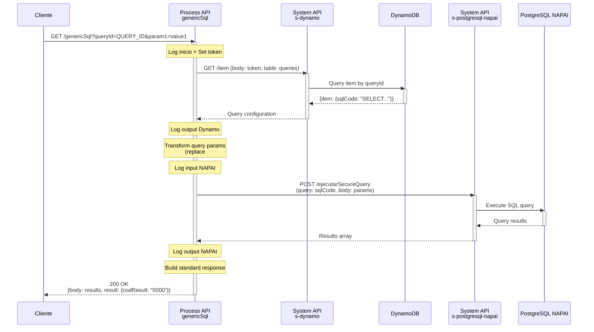
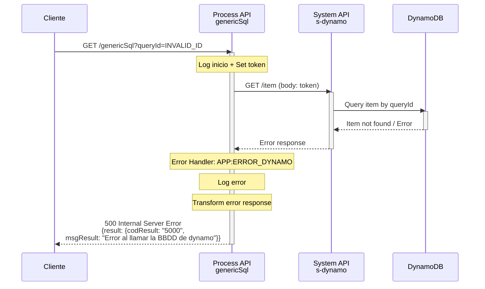
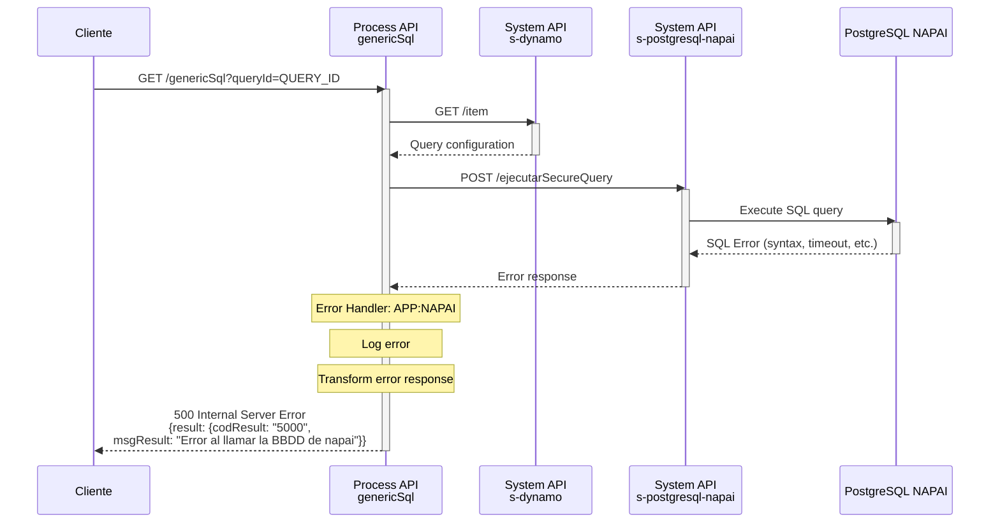

# GET /genericSql

## 📌 Descripción General

### Propósito del Endpoint

Este endpoint permite ejecutar consultas SQL genéricas y seguras en la base de datos NAPAI (PostgreSQL) mediante un sistema de configuración centralizada. Las consultas están pre-configuradas en DynamoDB, lo que garantiza la seguridad y previene ataques de SQL injection.

### Tipo de API

**Capa:** Process API (API-Led Connectivity)

**Función:** Orquestación de consultas SQL seguras con configuración centralizada

### Patrón de Integración

**Tipo:** Orquestación con Transformación

**Descripción:** 
1. Busca la configuración de la query en DynamoDB usando el `queryId`
2. Ejecuta la query SQL parametrizada en PostgreSQL NAPAI
3. Retorna los resultados transformados

### Arquitectura API-Led Connectivity



---

## 💼 Propósito del Negocio

### Casos de Uso Principales

1. **Consultas Dinámicas Seguras**
   - Permite ejecutar consultas SQL sin exponer la estructura de la base de datos
   - Previene SQL injection mediante queries pre-configuradas
   - Facilita el mantenimiento centralizado de consultas

2. **Acceso Flexible a Datos NAPAI**
   - Proporciona acceso a datos de NAPAI sin necesidad de crear endpoints específicos
   - Permite agregar nuevas consultas sin modificar código
   - Soporta consultas parametrizadas dinámicas

3. **Gestión Centralizada de Queries**
   - Todas las queries están almacenadas en DynamoDB
   - Facilita auditoría y control de acceso a datos
   - Permite actualizar queries sin redesplegar la aplicación

### 🔗 Endpoints Dependientes

Este Process API consume los siguientes System APIs:

| System API | Endpoint | Método | Propósito |
|------------|----------|--------|-----------|
| `ntgy-fua-s-dynamo` | `/item` | GET | Obtiene la configuración de la query SQL desde DynamoDB |
| `ntgy-newco-s-postgresql-napai` | `/ejecutarSecureQuery` | POST | Ejecuta la query SQL parametrizada en PostgreSQL NAPAI |

### Lógica de Orquestación



**Pasos del Proceso:**

1. **Paso 1 - Validación de Entrada**: Extrae el `queryId` de los query parameters
2. **Paso 2 - Búsqueda en DynamoDB**: Consulta DynamoDB para obtener el `sqlCode` asociado al `queryId`
3. **Paso 3 - Preparación de Parámetros**: Transforma los query parameters en parámetros SQL (reemplaza `#` por `,`)
4. **Paso 4 - Ejecución en NAPAI**: Ejecuta la query SQL parametrizada en PostgreSQL NAPAI
5. **Paso 5 - Transformación de Respuesta**: Formatea la respuesta con estructura estándar

### Transformaciones Aplicadas

| Campo Original | Campo Transformado | Transformación |
|----------------|-------------------|----------------|
| `attributes.queryParams.queryId` | `vars.token.queryId.S` | Formato DynamoDB (String type) |
| `attributes.queryParams.*` (excepto queryId) | `vars.query` | Reemplaza `#` por `,` para separadores |
| `vars.dynamoItem.item.sqlCode` | Query parameter `query` | Extrae SQL code de DynamoDB |
| `vars.postgresResult` | `payload.body` | Envuelve resultado en estructura estándar |

### Contexto Empresarial

- **Dominio:** Gestión de Datos y Consultas Genéricas
- **Sector:** Energía - Utilities
- **División:** Naturgy España - NewCo
- **Proceso de Negocio:** Acceso seguro y flexible a datos operacionales en NAPAI

### Stakeholders

- **Desarrolladores de Portal FUA**: Necesitan acceso flexible a datos sin crear endpoints específicos
- **Administradores de Base de Datos**: Controlan y auditan las queries ejecutadas
- **Equipos de Seguridad**: Garantizan que no haya SQL injection mediante configuración centralizada

### Valor de Negocio

- **Seguridad**: Previene SQL injection mediante queries pre-configuradas
- **Flexibilidad**: Permite agregar nuevas consultas sin modificar código
- **Mantenibilidad**: Centraliza la gestión de queries en DynamoDB
- **Auditoría**: Facilita el seguimiento de queries ejecutadas

### Consumidores Potenciales

Este endpoint puede ser consumido por:
- Portal web FUA
- Aplicaciones móviles de clientes
- Sistemas de agentes de call center
- Herramientas de reporting y análisis

---

## 🔧 Especificación Técnica

### URLs por Ambiente

| Ambiente | URL Base | URL Completa |
|----------|----------|--------------|
| **Local** | `http://localhost:8081` | `http://localhost:8081/api/genericSql?queryId=QUERY_ID` |
| **Development** | `https://ntgy-newco-p-fua-evo-dev.us-e2.cloudhub.io` | `https://ntgy-newco-p-fua-evo-dev.us-e2.cloudhub.io/api/genericSql?queryId=QUERY_ID` |
| **UAT** | `https://ntgy-newco-p-fua-evo-uat.us-e2.cloudhub.io` | `https://ntgy-newco-p-fua-evo-uat.us-e2.cloudhub.io/api/genericSql?queryId=QUERY_ID` |
| **Production** | `https://ntgy-newco-p-fua-evo-pro.us-e2.cloudhub.io` | `https://ntgy-newco-p-fua-evo-pro.us-e2.cloudhub.io/api/genericSql?queryId=QUERY_ID` |

### Método HTTP

```
GET /api/genericSql
```

### Parámetros de Entrada

#### Query Parameters

| Parámetro | Tipo | Requerido | Descripción | Ejemplo |
|-----------|------|-----------|-------------|---------|
| `queryId` | string | ✅ Sí | Identificador único de la query configurada en DynamoDB | `"QUERY_CUSTOMERS_BY_REGION"` |
| `[param1]` | string | ❌ No | Parámetros dinámicos para la query SQL (nombres definidos en la configuración) | `"Madrid"` |
| `[param2]` | string | ❌ No | Parámetros adicionales según la query | `"2024"` |

**Nota sobre parámetros dinámicos:**
- Los parámetros adicionales dependen de la query configurada en DynamoDB
- Se pueden pasar múltiples parámetros separados por `#` que serán convertidos a `,`
- Ejemplo: `param=value1#value2#value3` → se convierte en `param=value1,value2,value3`

### Estructura de Request

**Ejemplo de URL con parámetros:**
```
GET /api/genericSql?queryId=QUERY_CUSTOMERS&region=Madrid&year=2024
```

### Respuestas

#### ✅ Respuesta Exitosa (200 OK)

```json
{
  "body": [
    {
      "column1": "value1",
      "column2": "value2",
      "column3": "value3"
    },
    {
      "column1": "value4",
      "column2": "value5",
      "column3": "value6"
    }
  ],
  "result": {
    "codResult": "0000",
    "msgResult": "Resultado correcto!"
  }
}
```

**Campos de la respuesta:**

| Campo | Tipo | Descripción |
|-------|------|-------------|
| `body` | array | Array de objetos con los resultados de la query SQL |
| `result.codResult` | string | Código de resultado (`"0000"` = éxito) |
| `result.msgResult` | string | Mensaje descriptivo del resultado |

⚠️ **Nota sobre el contenido de `body`:**

El array `body` contiene los resultados de la query SQL ejecutada en PostgreSQL NAPAI. La estructura y campos específicos dependen de la query configurada en DynamoDB para cada `queryId`. 

**Evidencia del código (genericSqlFlow.xml):**
```dataweave
{
    "body": vars.postgresResult  // Resultados directos de PostgreSQL
} ++
{
    "result": {
        "codResult": "0000",
        "msgResult": "Resultado correcto!"
    }
}
```

Los ejemplos mostrados (`customerId`, `customerName`, `invoiceId`, etc.) son representativos y varían según la query específica ejecutada.

#### ❌ Error - Query No Encontrada en DynamoDB (500)

```json
{
  "result": {
    "codResult": "5000",
    "msgResult": "Error al llamar la BBDD de dynamo"
  }
}
```

#### ❌ Error - Fallo en Ejecución de Query NAPAI (500)

```json
{
  "result": {
    "codResult": "5000",
    "msgResult": "Error al llamar la BBDD de napai"
  }
}
```

### Códigos de Estado HTTP

| Código | Descripción | Escenario |
|--------|-------------|-----------|
| `200` | OK | Query ejecutada exitosamente |
| `400` | Bad Request | Falta el parámetro `queryId` o formato inválido |
| `500` | Internal Server Error | Error en DynamoDB o PostgreSQL NAPAI |

### Autenticación

- **Tipo:** Client ID & Client Secret (Anypoint Platform)
- **Headers requeridos:**
  - `client_id`: Client ID de la aplicación
  - `client_secret`: Client Secret de la aplicación

### Timeouts

| Tipo | Valor |
|------|-------|
| **Request Timeout** | 60 segundos |
| **Connection Timeout** | 30 segundos |
| **DynamoDB Timeout** | 30 segundos |
| **PostgreSQL NAPAI Timeout** | 60 segundos |

---

## 🏗️ Implementación Técnica

### Arquitectura del Flow



### Transformaciones DataWeave

#### 1. Preparación del Token para DynamoDB

```dataweave
%dw 2.0
output application/json
---
{
  "queryId": {"S": attributes.queryParams.queryId}
}
```

**Propósito:** Convierte el `queryId` al formato requerido por DynamoDB (tipo String con estructura `{"S": "valor"}`).

#### 2. Mapeo de Query Parameters

```dataweave
%dw 2.0
output application/json
---
attributes.queryParams mapObject ((value, key) -> {
    (key): (value replace "#" with ",")
} - "queryId")
```

**Propósito:** 
- Transforma todos los query parameters excepto `queryId`
- Reemplaza el separador `#` por `,` para permitir múltiples valores
- Ejemplo: `param=val1#val2#val3` → `param=val1,val2,val3`

#### 3. Construcción de Respuesta Final

```dataweave
%dw 2.0
output application/json
---
{
    "body": vars.postgresResult 	
} ++
{
    "result": {
        "codResult": "0000",
        "msgResult": "Resultado correcto!"
    }
}
```

**Propósito:** Envuelve los resultados de PostgreSQL en una estructura estándar con código de resultado.

### Configuración de HTTP Requests

#### Request a DynamoDB (s-dynamo)

```xml
<http:request 
    method="GET" 
    doc:name="Buscamos token en api de dynamo DB" 
    config-ref="HTTP_Request_s_dynamo" 
    path="/item" 
    sendBodyMode="ALWAYS" 
    target="dynamoItem">
    <error-mapping targetType="APP:ERROR_DYNAMO" />
    <http:body><![CDATA[#[vars.token]]]></http:body>
    <http:query-params>
        <![CDATA[#[output application/java
---
{
    "table" : p('fua-s-dynamo.dynamo.table')
}]]]>
    </http:query-params>
</http:request>
```

**Configuración:**
- **Método:** GET
- **Path:** `/item`
- **Body:** Token con queryId en formato DynamoDB
- **Query Param:** `table` (nombre de la tabla DynamoDB desde properties)
- **Target Variable:** `dynamoItem`

#### Request a PostgreSQL NAPAI (s-postgresql-napai)

```xml
<http:request 
    method="POST" 
    doc:name="Request s-postgresql-napai" 
    config-ref="HTTP_Request_s_postgresql-napai" 
    path="/ejecutarSecureQuery" 
    target="postgresResult">
    <error-mapping targetType="APP:NAPAI" />
    <http:body><![CDATA[#[vars.query]]]></http:body>
    <http:query-params>
        <![CDATA[#[output application/java
---
{
    "query" : vars.dynamoItem.item.sqlCode
}]]]>
    </http:query-params>
</http:request>
```

**Configuración:**
- **Método:** POST
- **Path:** `/ejecutarSecureQuery`
- **Body:** Parámetros de la query transformados
- **Query Param:** `query` (SQL code extraído de DynamoDB)
- **Target Variable:** `postgresResult`

### Patrones de Diseño

**Patrón:** Configuration-Driven Query Execution

**Justificación:** 
- Separa la configuración de queries del código de la aplicación
- Permite agregar/modificar queries sin redesplegar
- Mejora la seguridad al prevenir SQL injection
- Facilita auditoría y control de acceso

### Diagramas de Secuencia

#### 1. Flujo Normal de Éxito



#### 2. Flujo con Error en DynamoDB



#### 3. Flujo con Error en PostgreSQL NAPAI



### Manejo de Errores

#### Error Handlers Configurados

**1. APP:ERROR_DYNAMO**
- **Trigger:** Error al llamar al System API s-dynamo
- **Acción:** 
  - Log del error con el queryId
  - Retorna código `"5000"` con mensaje "Error al llamar la BBDD de dynamo"
- **Tipo:** `on-error-continue` (no propaga el error)

**2. APP:NAPAI**
- **Trigger:** Error al llamar al System API s-postgresql-napai
- **Acción:**
  - Log del error con el queryId
  - Retorna código `"5000"` con mensaje "Error al llamar la BBDD de napai"
- **Tipo:** `on-error-continue` (no propaga el error)

#### Estrategia de Logging

El flow incluye logging extensivo en cada paso:
1. **Inicio:** Log de query parameters de entrada
2. **Pre-DynamoDB:** Log del token a enviar
3. **Post-DynamoDB:** Log de la configuración obtenida
4. **Pre-NAPAI:** Log de los parámetros transformados
5. **Post-NAPAI:** Log de los resultados obtenidos
6. **Fin:** Log de finalización del flow

---

## 💻 Ejemplos de Uso

### Ejemplo 1: Consulta Simple con Un Parámetro

#### cURL

```bash
curl -X GET "https://ntgy-newco-p-fua-evo-dev.us-e2.cloudhub.io/api/genericSql?queryId=QUERY_CUSTOMERS_BY_REGION&region=Madrid" \
  -H "Content-Type: application/json" \
  -H "client_id: YOUR_CLIENT_ID" \
  -H "client_secret: YOUR_CLIENT_SECRET"
```

#### Respuesta (200 OK)

```json
{
  "body": [
    {
      "customerId": "12345",
      "customerName": "Juan Pérez",
      "region": "Madrid",
      "contractCount": 3
    },
    {
      "customerId": "67890",
      "customerName": "María García",
      "region": "Madrid",
      "contractCount": 2
    }
  ],
  "result": {
    "codResult": "0000",
    "msgResult": "Resultado correcto!"
  }
}
```

### Ejemplo 2: Consulta con Múltiples Parámetros

#### cURL

```bash
curl -X GET "https://ntgy-newco-p-fua-evo-dev.us-e2.cloudhub.io/api/genericSql?queryId=QUERY_INVOICES_BY_DATE&startDate=2024-01-01&endDate=2024-12-31&status=PAID" \
  -H "Content-Type: application/json" \
  -H "client_id: YOUR_CLIENT_ID" \
  -H "client_secret: YOUR_CLIENT_SECRET"
```

#### Respuesta (200 OK)

```json
{
  "body": [
    {
      "invoiceId": "INV-001",
      "invoiceDate": "2024-03-15",
      "amount": 125.50,
      "status": "PAID"
    },
    {
      "invoiceId": "INV-002",
      "invoiceDate": "2024-06-20",
      "amount": 89.75,
      "status": "PAID"
    }
  ],
  "result": {
    "codResult": "0000",
    "msgResult": "Resultado correcto!"
  }
}
```

### Ejemplo 3: Consulta con Parámetros Múltiples (usando #)

#### cURL

```bash
curl -X GET "https://ntgy-newco-p-fua-evo-dev.us-e2.cloudhub.io/api/genericSql?queryId=QUERY_CONTRACTS_BY_IDS&contractIds=C001#C002#C003" \
  -H "Content-Type: application/json" \
  -H "client_id: YOUR_CLIENT_ID" \
  -H "client_secret: YOUR_CLIENT_SECRET"
```

**Nota:** El parámetro `contractIds=C001#C002#C003` se transforma internamente a `contractIds=C001,C002,C003` para la query SQL.

#### Respuesta (200 OK)

```json
{
  "body": [
    {
      "contractId": "C001",
      "contractType": "Electricity",
      "status": "Active"
    },
    {
      "contractId": "C002",
      "contractType": "Gas",
      "status": "Active"
    },
    {
      "contractId": "C003",
      "contractType": "Electricity",
      "status": "Suspended"
    }
  ],
  "result": {
    "codResult": "0000",
    "msgResult": "Resultado correcto!"
  }
}
```

### Ejemplo 4: Error - Query No Encontrada

#### cURL

```bash
curl -X GET "https://ntgy-newco-p-fua-evo-dev.us-e2.cloudhub.io/api/genericSql?queryId=INVALID_QUERY_ID" \
  -H "Content-Type: application/json" \
  -H "client_id: YOUR_CLIENT_ID" \
  -H "client_secret: YOUR_CLIENT_SECRET"
```

#### Respuesta (500 Internal Server Error)

```json
{
  "result": {
    "codResult": "5000",
    "msgResult": "Error al llamar la BBDD de dynamo"
  }
}
```

### Ejemplo 5: JavaScript (Fetch API)

```javascript
const queryId = 'QUERY_CUSTOMERS_BY_REGION';
const region = 'Madrid';

const response = await fetch(
  `https://ntgy-newco-p-fua-evo-dev.us-e2.cloudhub.io/api/genericSql?queryId=${queryId}&region=${region}`,
  {
    method: 'GET',
    headers: {
      'Content-Type': 'application/json',
      'client_id': 'YOUR_CLIENT_ID',
      'client_secret': 'YOUR_CLIENT_SECRET'
    }
  }
);

const data = await response.json();

if (data.result.codResult === '0000') {
  console.log('Query ejecutada exitosamente');
  console.log('Resultados:', data.body);
} else {
  console.error('Error en la query:', data.result.msgResult);
}
```

### Ejemplo 6: Python (Requests)

```python
import requests

query_id = 'QUERY_CUSTOMERS_BY_REGION'
region = 'Madrid'

url = f'https://ntgy-newco-p-fua-evo-dev.us-e2.cloudhub.io/api/genericSql'
params = {
    'queryId': query_id,
    'region': region
}
headers = {
    'Content-Type': 'application/json',
    'client_id': 'YOUR_CLIENT_ID',
    'client_secret': 'YOUR_CLIENT_SECRET'
}

response = requests.get(url, params=params, headers=headers)
data = response.json()

if data['result']['codResult'] == '0000':
    print('Query ejecutada exitosamente')
    print('Resultados:', data['body'])
else:
    print('Error:', data['result']['msgResult'])
```
