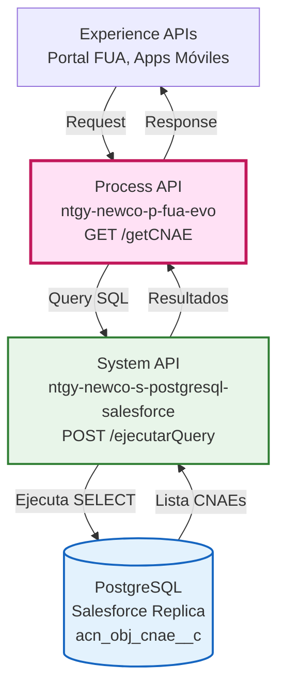
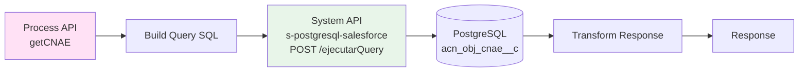
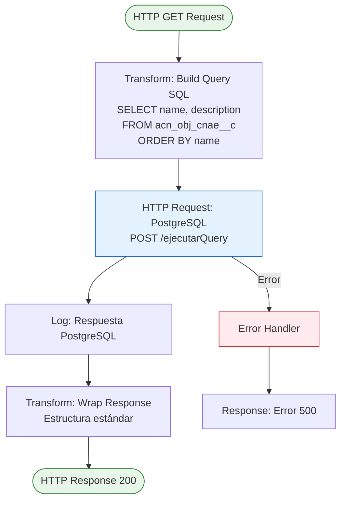
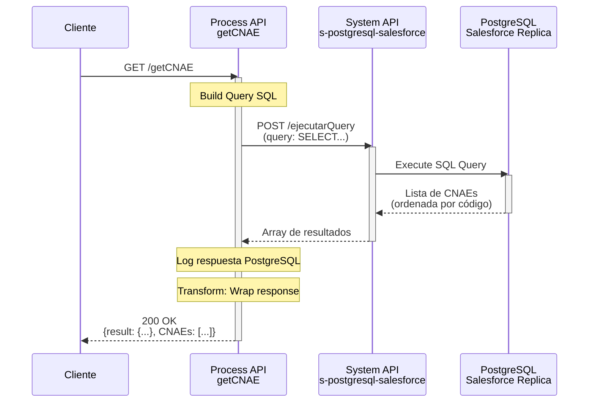
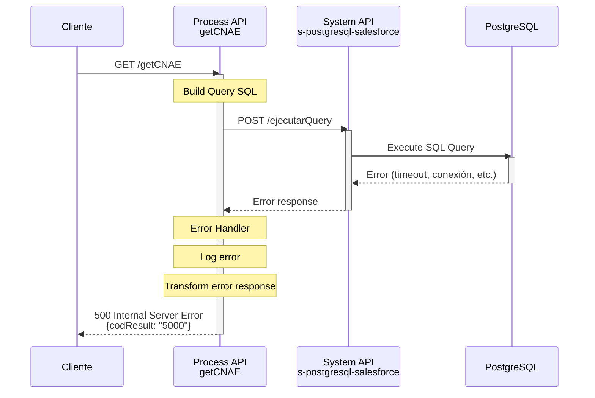

# GET /getCNAE

## 📌 Descripción General

### Propósito del Endpoint

Este endpoint consulta el catálogo completo de códigos CNAE (Clasificación Nacional de Actividades Económicas) almacenados en Salesforce. Retorna una lista ordenada alfabéticamente de todos los códigos CNAE disponibles con sus descripciones, utilizada principalmente para poblar listas desplegables y formularios en aplicaciones cliente.

### Tipo de API

**Capa:** Process API (API-Led Connectivity)

**Función:** Consulta de datos de referencia (catálogo)

### Patrón de Integración

**Tipo:** Pass-Through con Transformación Simple

**Descripción:** 
1. Construye query SQL para consultar tabla de CNAEs
2. Ejecuta query en PostgreSQL (replica de Salesforce)
3. Transforma respuesta a formato estándar
4. Retorna lista completa ordenada

### Arquitectura API-Led Connectivity



---

## 💼 Propósito del Negocio

### Casos de Uso Principales

1. **Población de Formularios**
   - Proporciona lista de CNAEs para listas desplegables
   - Permite selección de actividad económica en formularios
   - Facilita la entrada de datos estandarizada

2. **Validación de Datos**
   - Permite validar códigos CNAE ingresados manualmente
   - Verifica que el CNAE seleccionado existe en el catálogo
   - Asegura consistencia de datos

3. **Consulta de Referencia**
   - Permite buscar descripciones de códigos CNAE
   - Facilita la comprensión de clasificaciones económicas
   - Soporta funcionalidades de búsqueda y filtrado

### 🔗 Endpoints Dependientes

Este Process API consume el siguiente System API:

| System API | Endpoint | Método | Propósito |
|------------|----------|--------|-----------|
| `ntgy-newco-s-postgresql-salesforce` | `/ejecutarQuery` | POST | Ejecuta query SQL en PostgreSQL (replica de Salesforce) |

### Lógica de Orquestación



**Pasos del Proceso:**

1. **Paso 1 - Construcción de Query**: Prepara query SQL para obtener todos los CNAEs
2. **Paso 2 - Ejecución en PostgreSQL**: Ejecuta query en replica de Salesforce
3. **Paso 3 - Transformación**: Envuelve resultado en estructura estándar
4. **Paso 4 - Respuesta**: Retorna lista completa de CNAEs ordenada

### Transformaciones Aplicadas

| Campo Original (PostgreSQL) | Campo Transformado (Response) | Transformación |
|-----------------------------|-------------------------------|----------------|
| `aocc.name` | `cnae` | Alias del código CNAE |
| `aocc.acn_fld_description__c` | `description` | Alias de la descripción |
| Resultado query | `CNAEs[]` | Envuelve en array con estructura estándar |

### Contexto Empresarial

- **Dominio:** Datos de Referencia y Catálogos
- **Sector:** Energía - Utilities
- **División:** Naturgy España - NewCo
- **Proceso de Negocio:** Gestión de datos maestros y clasificaciones

### Stakeholders

- **Desarrolladores Frontend**: Necesitan lista de CNAEs para formularios
- **Agentes de Call Center**: Consultan CNAEs al registrar clientes PYMEs
- **Clientes PYME**: Seleccionan su actividad económica en formularios
- **Equipo de Datos Maestros**: Mantienen el catálogo actualizado

### Valor de Negocio

- **Estandarización**: Garantiza uso de códigos CNAE oficiales
- **Usabilidad**: Facilita selección mediante descripciones claras
- **Consistencia**: Centraliza catálogo en una única fuente
- **Mantenibilidad**: Cambios en Salesforce se reflejan automáticamente

### Consumidores Potenciales

Este endpoint puede ser consumido por:
- Portal web FUA
- Aplicaciones móviles de clientes
- Portales de agentes de call center
- Formularios de registro y modificación de datos

---

## 🔧 Especificación Técnica

### URLs por Ambiente

| Ambiente | URL Base | URL Completa |
|----------|----------|--------------|
| **Local** | `http://localhost:8081` | `http://localhost:8081/api/getCNAE` |
| **Development** | `https://ntgy-newco-p-fua-evo-dev.us-e2.cloudhub.io` | `https://ntgy-newco-p-fua-evo-dev.us-e2.cloudhub.io/api/getCNAE` |
| **UAT** | `https://ntgy-newco-p-fua-evo-uat.us-e2.cloudhub.io` | `https://ntgy-newco-p-fua-evo-uat.us-e2.cloudhub.io/api/getCNAE` |
| **Production** | `https://ntgy-newco-p-fua-evo-pro.us-e2.cloudhub.io` | `https://ntgy-newco-p-fua-evo-pro.us-e2.cloudhub.io/api/getCNAE` |

### Método HTTP

```
GET /api/getCNAE
```

### Parámetros de Entrada

**Este endpoint NO requiere parámetros de entrada.**

Retorna el catálogo completo de códigos CNAE sin filtros.

### Respuestas

#### ✅ Respuesta Exitosa (200 OK)

```json
{
  "result": {
    "codResult": "0000",
    "msgResult": "No hay error"
  },
  "CNAEs": [
    {
      "cnae": "0111",
      "description": "Cultivo de cereales (excepto arroz), leguminosas y semillas oleaginosas"
    },
    {
      "cnae": "0112",
      "description": "Cultivo de arroz"
    },
    {
      "cnae": "4711",
      "description": "Comercio al por menor en establecimientos no especializados, con predominio en productos alimenticios, bebidas y tabaco"
    },
    {
      "cnae": "5610",
      "description": "Restaurantes y puestos de comidas"
    }
  ]
}
```

**Campos de la respuesta:**

| Campo | Tipo | Descripción |
|-------|------|-------------|
| `result.codResult` | string | Código de resultado (`"0000"` = éxito) |
| `result.msgResult` | string | Mensaje descriptivo del resultado |
| `CNAEs` | array | Array de objetos con códigos CNAE |
| `CNAEs[].cnae` | string | Código CNAE (4 dígitos) |
| `CNAEs[].description` | string | Descripción de la actividad económica |

**Características de la respuesta:**
- Lista ordenada alfabéticamente por código CNAE
- Incluye todos los CNAEs disponibles en Salesforce
- Sin paginación (retorna lista completa)

#### ❌ Error - Fallo en PostgreSQL (500)

```json
{
  "result": {
    "codResult": "5000",
    "msgResult": "Error al consultar base de datos"
  }
}
```

### Códigos de Estado HTTP

| Código | Descripción | Escenario |
|--------|-------------|-----------|
| `200` | OK | Catálogo de CNAEs obtenido exitosamente |
| `500` | Internal Server Error | Error en PostgreSQL o System API |

### Autenticación

- **Tipo:** Client ID & Client Secret (Anypoint Platform)
- **Headers requeridos:**
  - `client_id`: Client ID de la aplicación
  - `client_secret`: Client Secret de la aplicación

### Timeouts

| Tipo | Valor |
|------|-------|
| **Request Timeout** | 60 segundos |
| **PostgreSQL Timeout** | Configurado en properties |

---

## 🏗️ Implementación Técnica

### Arquitectura del Flow



### Query SQL Ejecutada

```sql
SELECT 
    aocc.name AS cnae, 
    aocc.acn_fld_description__c AS description 
FROM newcosalesforce.acn_obj_cnae__c aocc 
ORDER BY cnae
```

**Detalles de la Query:**
- **Tabla:** `acn_obj_cnae__c` (objeto custom de Salesforce)
- **Schema:** `newcosalesforce` (replica de Salesforce en PostgreSQL)
- **Campos:**
  - `name`: Código CNAE (4 dígitos)
  - `acn_fld_description__c`: Descripción de la actividad
- **Ordenamiento:** Alfabético por código CNAE
- **Filtros:** Ninguno (retorna todos los registros)

### Transformaciones DataWeave

#### 1. Construcción de Query SQL

```dataweave
%dw 2.0
output application/json
---
{
    "query": "select aocc.name as cnae, aocc.acn_fld_description__c as description from newcosalesforce.acn_obj_cnae__c aocc order by cnae"
}
```

**Propósito:** Prepara la query SQL en formato JSON para enviar al System API de PostgreSQL.

#### 2. Transformación de Respuesta

```dataweave
%dw 2.0
output application/json
---
{
    "result": {
        "codResult": '0000',
        "msgResult": "No hay error"
    },
    "CNAEs": vars.postgresResultCNAE
}
```

**Propósito:** 
- Envuelve el resultado de PostgreSQL en estructura estándar
- Añade código de resultado y mensaje
- Mantiene el array de CNAEs en el campo `CNAEs`

### Configuración de HTTP Request

#### Request a PostgreSQL Salesforce

```xml
<http:request 
    method="POST" 
    doc:name="Request s-postgresql-salesforce" 
    config-ref="HTTP_Request_s_postgresql-salesforce" 
    path="/ejecutarQuery" 
    target="postgresResultCNAE">
    <http:body><![CDATA[#[vars.query]]]></http:body>
</http:request>
```

**Configuración:**
- **Método:** POST
- **Path:** `/ejecutarQuery`
- **Body:** Query SQL en formato JSON
- **Target Variable:** `postgresResultCNAE`

### Patrones de Diseño

**Patrón: Reference Data Pattern**

**Justificación:** 
- Endpoint de solo lectura para datos de referencia
- Sin parámetros de entrada (catálogo completo)
- Respuesta cacheable (datos cambian poco frecuentemente)
- Ideal para poblar listas desplegables

### Diagramas de Secuencia

#### 1. Flujo Normal de Éxito



#### 2. Flujo con Error en PostgreSQL



### Manejo de Errores

#### Error Handlers Configurados

**1. Error en PostgreSQL**
- **Trigger:** Fallo al ejecutar query o conectar con PostgreSQL
- **Acción:** 
  - Log del error con detalles
  - Retorna código `"5000"` con mensaje descriptivo
- **Tipo:** `on-error-propagate`

#### Estrategia de Logging

El flow incluye logging en puntos clave:
1. **Post-PostgreSQL:** Log de la respuesta de Heroku (primer elemento)
2. **Errores:** Log de cualquier error en la ejecución

---

## 💻 Ejemplos de Uso

### Ejemplo 1: Consulta Simple

#### cURL

```bash
curl -X GET "https://ntgy-newco-p-fua-evo-dev.us-e2.cloudhub.io/api/getCNAE" \
  -H "client_id: YOUR_CLIENT_ID" \
  -H "client_secret: YOUR_CLIENT_SECRET"
```

#### Respuesta (200 OK)

```json
{
  "result": {
    "codResult": "0000",
    "msgResult": "No hay error"
  },
  "CNAEs": [
    {
      "cnae": "0111",
      "description": "Cultivo de cereales (excepto arroz), leguminosas y semillas oleaginosas"
    },
    {
      "cnae": "0112",
      "description": "Cultivo de arroz"
    },
    {
      "cnae": "0113",
      "description": "Cultivo de hortalizas, raíces y tubérculos"
    },
    {
      "cnae": "4711",
      "description": "Comercio al por menor en establecimientos no especializados, con predominio en productos alimenticios, bebidas y tabaco"
    },
    {
      "cnae": "5610",
      "description": "Restaurantes y puestos de comidas"
    },
    {
      "cnae": "6201",
      "description": "Actividades de programación informática"
    }
  ]
}
```

### Ejemplo 2: JavaScript (Fetch API)

```javascript
const getCNAEs = async () => {
  const response = await fetch(
    'https://ntgy-newco-p-fua-evo-dev.us-e2.cloudhub.io/api/getCNAE',
    {
      method: 'GET',
      headers: {
        'client_id': 'YOUR_CLIENT_ID',
        'client_secret': 'YOUR_CLIENT_SECRET'
      }
    }
  );

  const data = await response.json();

  if (data.result.codResult === '0000') {
    console.log('CNAEs obtenidos exitosamente');
    console.log(`Total de CNAEs: ${data.CNAEs.length}`);
    
    // Poblar lista desplegable
    const selectElement = document.getElementById('cnae-select');
    data.CNAEs.forEach(cnae => {
      const option = document.createElement('option');
      option.value = cnae.cnae;
      option.textContent = `${cnae.cnae} - ${cnae.description}`;
      selectElement.appendChild(option);
    });
  } else {
    console.error('Error:', data.result.msgResult);
  }
};

getCNAEs();
```

### Ejemplo 3: JavaScript con Filtrado

```javascript
const getCNAEsFiltered = async (searchTerm) => {
  const response = await fetch(
    'https://ntgy-newco-p-fua-evo-dev.us-e2.cloudhub.io/api/getCNAE',
    {
      method: 'GET',
      headers: {
        'client_id': 'YOUR_CLIENT_ID',
        'client_secret': 'YOUR_CLIENT_SECRET'
      }
    }
  );

  const data = await response.json();

  if (data.result.codResult === '0000') {
    // Filtrar CNAEs por término de búsqueda
    const filtered = data.CNAEs.filter(cnae => 
      cnae.cnae.includes(searchTerm) || 
      cnae.description.toLowerCase().includes(searchTerm.toLowerCase())
    );
    
    console.log(`CNAEs encontrados: ${filtered.length}`);
    return filtered;
  }
  
  return [];
};

// Buscar CNAEs relacionados con "comercio"
getCNAEsFiltered('comercio').then(results => {
  console.log(results);
});
```

### Ejemplo 4: Python (Requests)

```python
import requests

url = 'https://ntgy-newco-p-fua-evo-dev.us-e2.cloudhub.io/api/getCNAE'
headers = {
    'client_id': 'YOUR_CLIENT_ID',
    'client_secret': 'YOUR_CLIENT_SECRET'
}

response = requests.get(url, headers=headers)
data = response.json()

if data['result']['codResult'] == '0000':
    print(f"CNAEs obtenidos exitosamente")
    print(f"Total de CNAEs: {len(data['CNAEs'])}")
    
    # Mostrar primeros 5 CNAEs
    for cnae in data['CNAEs'][:5]:
        print(f"{cnae['cnae']}: {cnae['description']}")
else:
    print(f"Error: {data['result']['msgResult']}")
```

### Ejemplo 5: Python con Búsqueda

```python
import requests

def get_cnaes():
    url = 'https://ntgy-newco-p-fua-evo-dev.us-e2.cloudhub.io/api/getCNAE'
    headers = {
        'client_id': 'YOUR_CLIENT_ID',
        'client_secret': 'YOUR_CLIENT_SECRET'
    }
    
    response = requests.get(url, headers=headers)
    data = response.json()
    
    if data['result']['codResult'] == '0000':
        return data['CNAEs']
    return []

def search_cnae(code):
    """Buscar CNAE por código exacto"""
    cnaes = get_cnaes()
    for cnae in cnaes:
        if cnae['cnae'] == code:
            return cnae
    return None

def search_cnaes_by_description(keyword):
    """Buscar CNAEs por palabra clave en descripción"""
    cnaes = get_cnaes()
    return [
        cnae for cnae in cnaes 
        if keyword.lower() in cnae['description'].lower()
    ]

# Buscar CNAE específico
cnae_info = search_cnae('4711')
if cnae_info:
    print(f"CNAE {cnae_info['cnae']}: {cnae_info['description']}")

# Buscar CNAEs relacionados con "restaurante"
restaurantes = search_cnaes_by_description('restaurante')
print(f"\nCNAEs relacionados con 'restaurante': {len(restaurantes)}")
for cnae in restaurantes:
    print(f"  {cnae['cnae']}: {cnae['description']}")
```

### Ejemplo 6: Error - Fallo en PostgreSQL

#### Respuesta (500 Internal Server Error)

```json
{
  "result": {
    "codResult": "5000",
    "msgResult": "Error al consultar base de datos"
  }
}