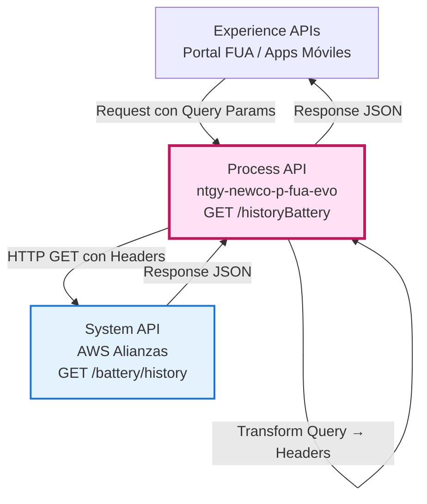
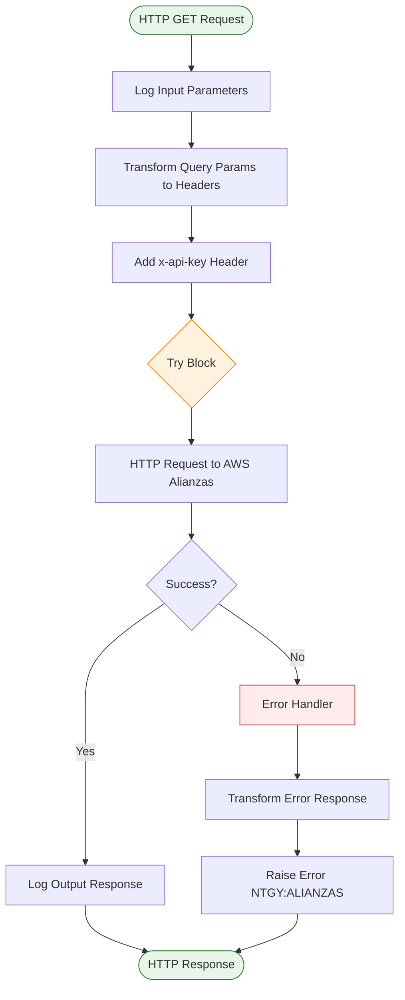
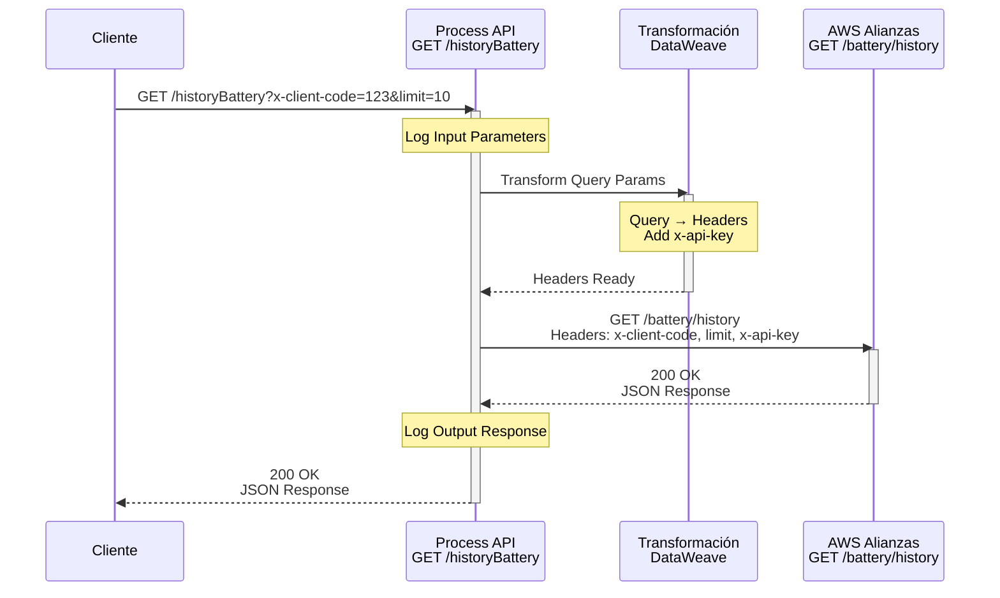
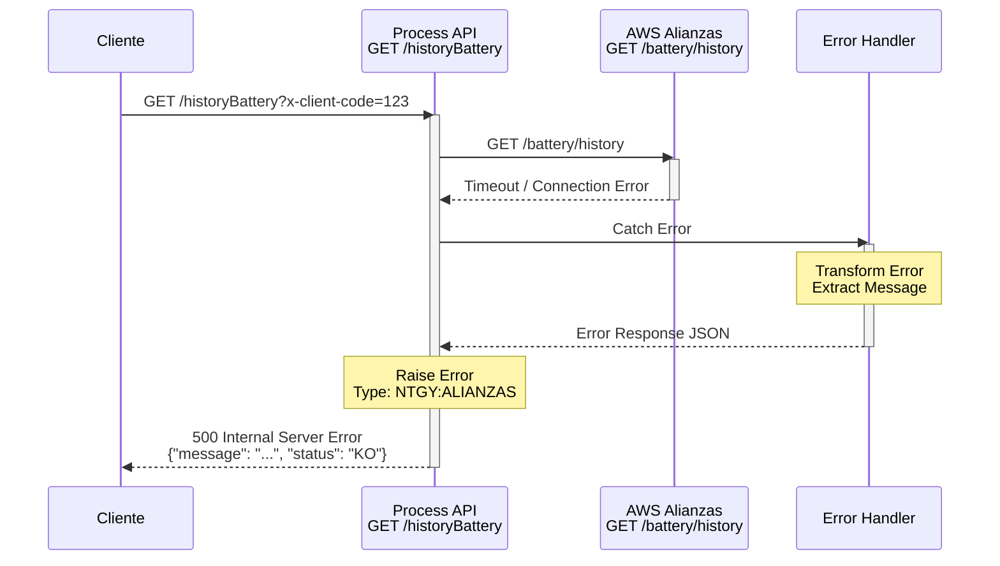
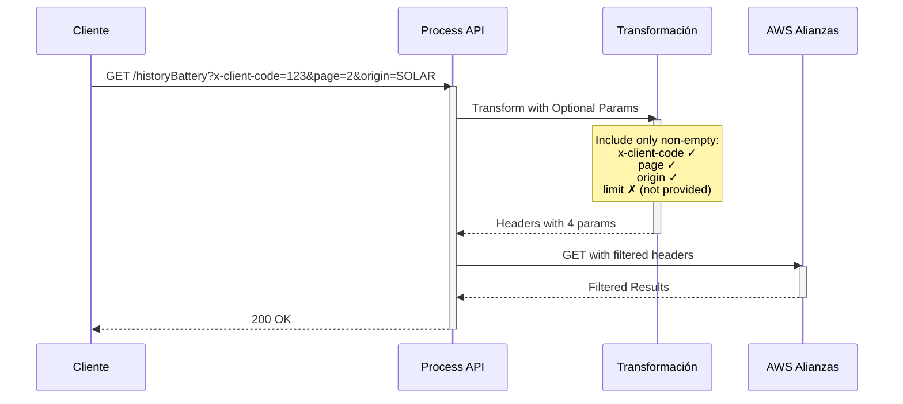

# GET /historyBattery

## 📌 Descripción General

### Propósito del Endpoint

Este endpoint consulta el historial de movimientos de batería a través del servicio de Alianzas alojado en AWS. Actúa como un proxy orquestador que transforma los parámetros de query recibidos en headers HTTP para la llamada al servicio externo, proporcionando una capa de abstracción entre los consumidores y el sistema de Alianzas.

### Tipo de API

**Capa:** Process API (API-Led Connectivity)

**Función:** Orquestación y transformación de parámetros para consulta de historial de batería

### Patrón de Integración

**Tipo:** Proxy con Transformación

**Descripción:** El endpoint recibe parámetros como query params, los transforma a headers HTTP, añade credenciales de autenticación y realiza una llamada GET al servicio de Alianzas en AWS. La respuesta del servicio externo se devuelve directamente al consumidor.

### Arquitectura API-Led Connectivity



---

## 💼 Propósito del Negocio

### Casos de Uso Principales

1. **Consulta de Historial de Movimientos**
   - Permite a los clientes consultar el historial completo de movimientos de batería
   - Proporciona trazabilidad de todas las operaciones realizadas con baterías
   - Facilita la auditoría y seguimiento de transacciones

2. **Filtrado por Origen**
   - Permite filtrar movimientos por origen específico de batería
   - Facilita la búsqueda de movimientos relacionados con un origen particular
   - Mejora la experiencia de usuario al reducir resultados irrelevantes

3. **Paginación de Resultados**
   - Soporta paginación para manejar grandes volúmenes de datos
   - Permite al usuario navegar por el historial de forma eficiente
   - Optimiza el rendimiento al limitar la cantidad de datos transferidos

### 🔗 Endpoints Dependientes

Este Process API consume el siguiente servicio externo:

| Sistema | Endpoint | Método | Propósito |
|---------|----------|--------|-----------|
| `AWS Alianzas API` | `/battery/history` | GET | Obtiene el historial de movimientos de batería desde el sistema de Alianzas |

### Lógica de Orquestación


**Pasos del Proceso:**

1. **Recepción de Request**: El endpoint recibe la petición con query parameters
2. **Logging de Entrada**: Registra los parámetros recibidos para trazabilidad
3. **Transformación de Parámetros**: Convierte query params a headers HTTP
4. **Añadir Autenticación**: Inyecta el `x-api-key` desde configuración segura
5. **Llamada a AWS**: Realiza HTTP GET al servicio de Alianzas
6. **Manejo de Errores**: Captura y transforma errores en formato estándar
7. **Logging de Salida**: Registra la respuesta para auditoría
8. **Respuesta al Cliente**: Devuelve el resultado al consumidor

### Transformaciones Aplicadas

**Transformación de Query Params a Headers:**

| Query Parameter | Header HTTP | Transformación |
|-----------------|-------------|----------------|
| `x-client-code` | `x-client-code` | Obligatorio - Se pasa directamente |
| `limit` | `limit` | Opcional - Se incluye solo si no está vacío |
| `page` | `page` | Opcional - Se incluye solo si no está vacío |
| `origin` | `origin` | Opcional - Se incluye solo si no está vacío |
| N/A | `x-api-key` | Se añade desde configuración segura |

**Nota sobre Inconsistencia RAML:**
- El RAML define el parámetro como `battery-origin`
- El código implementa el parámetro como `origin`
- **La implementación (código) es la fuente de verdad**

### Contexto Empresarial

- **Dominio:** Gestión de Alianzas y Baterías
- **Sector:** Energía - Utilities
- **División:** Naturgy España - NewCo
- **Proceso de Negocio:** Consulta de historial de movimientos de batería para clientes

### Stakeholders

- **Clientes Finales**: Necesitan consultar el historial de sus baterías
- **Equipo de Soporte**: Requieren acceso al historial para resolver incidencias
- **Equipo de Alianzas**: Gestionan las operaciones de batería con partners

### Valor de Negocio

- **Transparencia**: Proporciona visibilidad completa del historial de movimientos
- **Trazabilidad**: Permite auditar todas las operaciones de batería
- **Autoservicio**: Reduce la carga del call center al permitir consultas autónomas
- **Eficiencia**: Paginación y filtrado optimizan la experiencia de usuario

### Consumidores Potenciales

Este endpoint puede ser consumido por:
- Portal web FUA
- Aplicaciones móviles de clientes
- Sistemas de agentes de call center
- Herramientas de auditoría y reporting

---

## 🔧 Especificación Técnica

### URLs por Ambiente

| Ambiente | URL Base | URL Completa |
|----------|----------|--------------|
| **Local** | `http://localhost:8081` | `http://localhost:8081/api/historyBattery` |
| **Development** | `https://ntgy-newco-p-fua-evo-dev.us-e2.cloudhub.io` | `https://ntgy-newco-p-fua-evo-dev.us-e2.cloudhub.io/api/historyBattery` |
| **UAT** | `https://ntgy-newco-p-fua-evo-uat.us-e2.cloudhub.io` | `https://ntgy-newco-p-fua-evo-uat.us-e2.cloudhub.io/api/historyBattery` |
| **Production** | `https://ntgy-newco-p-fua-evo-pro.us-e2.cloudhub.io` | `https://ntgy-newco-p-fua-evo-pro.us-e2.cloudhub.io/api/historyBattery` |

### Método HTTP

```
GET /api/historyBattery
```

### Parámetros de Entrada

#### Query Parameters

| Parámetro | Tipo | Requerido | Descripción | Ejemplo |
|-----------|------|-----------|-------------|---------|
| `x-client-code` | string | ✅ Sí | Código del cliente | `12345678` |
| `limit` | integer | ❌ No | Número máximo de resultados por página | `10` |
| `page` | integer | ❌ No | Número de página para paginación | `1` |
| `origin` | string | ❌ No | Origen de la batería para filtrar resultados | `SOLAR` |

**Validaciones:**
- `x-client-code`: Obligatorio, no puede estar vacío
- `limit`: Opcional, debe ser un número entero positivo
- `page`: Opcional, debe ser un número entero positivo
- `origin`: Opcional, string que identifica el origen de la batería

### Respuestas

#### 200 OK - Éxito

**Descripción:** Historial de movimientos de batería obtenido exitosamente

**Content-Type:** `application/json`

**Schema:** La respuesta proviene directamente del servicio de AWS Alianzas

```json
{
  "movements": [
    {
      "id": "string",
      "date": "string",
      "type": "string",
      "origin": "string",
      "amount": "number",
      "description": "string"
    }
  ],
  "pagination": {
    "currentPage": "integer",
    "totalPages": "integer",
    "totalItems": "integer",
    "itemsPerPage": "integer"
  }
}
```

#### 400 Bad Request - Error de Validación

**Descripción:** Parámetros de entrada inválidos

**Content-Type:** `application/json`

```json
{
  "message": "x-client-code es obligatorio",
  "status": "KO"
}
```

#### 500 Internal Server Error - Error del Sistema

**Descripción:** Error en la comunicación con el servicio de Alianzas o error interno

**Content-Type:** `application/json`

```json
{
  "message": "Error al consultar historial de batería",
  "status": "KO"
}
```

### Autenticación

- **Tipo:** Client ID & Client Secret (Anypoint Platform)
- **Headers Requeridos:**
  - `client_id`: ID del cliente de Anypoint Platform
  - `client_secret`: Secret del cliente de Anypoint Platform

### Timeouts

| Tipo | Valor |
|------|-------|
| **Request Timeout** | 60 segundos |
| **Connection Timeout** | 30 segundos |

---

## 🏗️ Implementación Técnica

### Arquitectura del Flow



### Componentes del Flow

#### 1. Logger de Entrada (Línea 8-9)

**Propósito:** Registrar los parámetros de entrada para trazabilidad

**Implementación:**
```xml
<logger level="INFO" doc:name="Input alianza historyBattery" 
        message="#[output application/json
---
{
    &quot;Headers historyBattery&quot;: {
        &quot;x-client-code&quot;:  attributes.queryParams.'x-client-code',
        (&quot;limit&quot;: attributes.queryParams['limit']) if (attributes.queryParams['limit'] != &quot;null&quot; and !isEmpty(attributes.queryParams['limit'])),
        (&quot;page&quot;: attributes.queryParams['page']) if (attributes.queryParams['page'] != &quot;null&quot; and !isEmpty(attributes.queryParams['page'])),
        (&quot;battery-origin&quot;: attributes.queryParams['battery-origin']) if (attributes.queryParams['battery-origin'] != &quot;null&quot; and !isEmpty(attributes.queryParams['battery-origin']))
    }
}]"/>
```

#### 2. Transformación de Parámetros (Línea 10-24)

**Propósito:** Convertir query params a headers HTTP y añadir autenticación

**Implementación DataWeave:**
```dataweave
%dw 2.0
output application/json skipNullOn="everywhere"
---
{
    body: {},
    headers: {
        "x-api-key": p('aws.apiKey'),
        "x-client-code": attributes.queryParams.'x-client-code',
        ("limit":  attributes.queryParams.'limit') if(attributes.queryParams.'limit' != ""),
        ("page": attributes.queryParams.'page') if( attributes.queryParams.'page' != ""),
        ("origin": attributes.queryParams.'origin') if( attributes.queryParams.'origin' != "")
    }
}
```

**Características:**
- `skipNullOn="everywhere"`: Omite campos nulos en la salida
- Validación condicional: Solo incluye parámetros opcionales si no están vacíos
- Inyección de `x-api-key` desde propiedades seguras

#### 3. HTTP Request a AWS (Línea 26-30)

**Propósito:** Realizar la llamada al servicio de Alianzas en AWS

**Configuración:**
- **Método:** GET (configurado en `${aws.alianzas.methodHistorialBateria}`)
- **Path:** `/battery/history` (configurado en `${aws.alianzas.pathHistorialBateria}`)
- **Config:** `HTTP_Request__AWS`
- **Timeout:** 60 segundos (configurado en `${aws.timeout}`)

**Implementación:**
```xml
<http:request method="${aws.alianzas.methodHistorialBateria}" 
              doc:name="Request AWS bateria" 
              config-ref="HTTP_Request__AWS" 
              path="${aws.alianzas.pathHistorialBateria}" 
              responseTimeout="${aws.timeout}">
    <http:body><![CDATA[#[payload.body]]]></http:body>
    <http:headers><![CDATA[#[payload.headers]]]></http:headers>
</http:request>
```

#### 4. Manejo de Errores (Línea 32-46)

**Propósito:** Capturar y transformar errores en formato estándar

**Estrategia:**
- Captura cualquier error durante la ejecución
- Transforma el error a formato JSON estándar
- Propaga el error con tipo `NTGY:ALIANZAS`

**Transformación de Error:**
```dataweave
%dw 2.0
import * from dw::core::Strings
output application/json
---
{
    "message": 
        if(error.errorMessage.payload != null)
            error.errorMessage.payload
        else if(substringAfterLast(error.description, "' ") != "") 
            substringAfterLast(error.description, "' ") 
        else if(error.description != null) 
            error.description 
        else 
            "Internal server error",
    "status": "KO"
}
```

**Lógica de Extracción de Mensaje:**
1. Intenta obtener el payload del error
2. Si no existe, extrae la última parte de la descripción
3. Si no existe, usa la descripción completa
4. Como último recurso, usa mensaje genérico

#### 5. Logger de Salida (Línea 48)

**Propósito:** Registrar la respuesta para auditoría

**Implementación:**
```xml
<logger level="INFO" doc:name="Ouput historyBattery" 
        message="Ouput historyBattery: #[payload]"/>
```

### Configuración del Proyecto

**Archivo:** `src/main/resources/properties/properties-{env}.yaml`

```yaml
aws:
  alianzas:
    methodHistorialBateria: "GET"
    pathHistorialBateria: "/battery/history"
  apiKey: "${secure::aws.apiKey}"
  timeout: "60000"
```

### Patrones de Diseño

**Patrón:** Proxy con Transformación de Parámetros

**Justificación:** 
- Desacopla la interfaz del consumidor de la implementación del servicio externo
- Permite cambiar la ubicación o formato del servicio sin afectar a los consumidores
- Centraliza la autenticación y configuración de seguridad
- Facilita el logging y monitoreo centralizado

### Diagramas de Secuencia

#### 1. Flujo Normal de Éxito



#### 2. Flujo con Error de Comunicación



#### 3. Flujo con Parámetros Opcionales



### Manejo de Errores

**Estrategia:** Try-Catch con Error Propagation

**Tipos de Errores Manejados:**

1. **Errores de Conectividad**
   - Timeout de conexión
   - Servicio no disponible
   - Error de red

2. **Errores de Autenticación**
   - API Key inválida
   - Credenciales expiradas

3. **Errores de Validación**
   - Parámetros inválidos
   - Formato incorrecto

4. **Errores del Sistema**
   - Error interno del servicio
   - Error de transformación

**Formato de Error Estándar:**
```json
{
  "message": "Descripción del error",
  "status": "KO"
}
```

**Error Type:** `NTGY:ALIANZAS` - Permite identificar errores específicos del servicio de Alianzas

---

## 💻 Ejemplos de Uso

### Ejemplo 1: Consulta Básica (Solo Cliente)

#### cURL

```bash
curl -X GET "https://ntgy-newco-p-fua-evo-dev.us-e2.cloudhub.io/api/historyBattery?x-client-code=12345678" \
  -H "Content-Type: application/json" \
  -H "client_id: YOUR_CLIENT_ID" \
  -H "client_secret: YOUR_CLIENT_SECRET"
```

#### Respuesta (200 OK)

```json
{
  "movements": [
    {
      "id": "MOV-001",
      "date": "2026-08-30T10:30:00Z",
      "type": "CHARGE",
      "origin": "SOLAR",
      "amount": 150.5,
      "description": "Carga desde panel solar"
    },
    {
      "id": "MOV-002",
      "date": "2026-08-29T15:45:00Z",
      "type": "DISCHARGE",
      "origin": "GRID",
      "amount": 75.2,
      "description": "Descarga a red eléctrica"
    }
  ],
  "pagination": {
    "currentPage": 1,
    "totalPages": 5,
    "totalItems": 48,
    "itemsPerPage": 10
  }
}
```

### Ejemplo 2: Consulta con Paginación

#### cURL

```bash
curl -X GET "https://ntgy-newco-p-fua-evo-dev.us-e2.cloudhub.io/api/historyBattery?x-client-code=12345678&limit=5&page=2" \
  -H "Content-Type: application/json" \
  -H "client_id: YOUR_CLIENT_ID" \
  -H "client_secret: YOUR_CLIENT_SECRET"
```

#### Respuesta (200 OK)

```json
{
  "movements": [
    {
      "id": "MOV-006",
      "date": "2026-08-25T09:15:00Z",
      "type": "CHARGE",
      "origin": "WIND",
      "amount": 200.0,
      "description": "Carga desde energía eólica"
    }
  ],
  "pagination": {
    "currentPage": 2,
    "totalPages": 10,
    "totalItems": 48,
    "itemsPerPage": 5
  }
}
```

### Ejemplo 3: Consulta con Filtro por Origen

#### cURL

```bash
curl -X GET "https://ntgy-newco-p-fua-evo-dev.us-e2.cloudhub.io/api/historyBattery?x-client-code=12345678&origin=SOLAR&limit=10" \
  -H "Content-Type: application/json" \
  -H "client_id: YOUR_CLIENT_ID" \
  -H "client_secret: YOUR_CLIENT_SECRET"
```

#### Respuesta (200 OK)

```json
{
  "movements": [
    {
      "id": "MOV-001",
      "date": "2026-08-30T10:30:00Z",
      "type": "CHARGE",
      "origin": "SOLAR",
      "amount": 150.5,
      "description": "Carga desde panel solar"
    },
    {
      "id": "MOV-015",
      "date": "2026-08-28T12:00:00Z",
      "type": "CHARGE",
      "origin": "SOLAR",
      "amount": 180.3,
      "description": "Carga desde panel solar"
    }
  ],
  "pagination": {
    "currentPage": 1,
    "totalPages": 2,
    "totalItems": 15,
    "itemsPerPage": 10
  }
}
```

### Ejemplo 4: Error - Cliente No Proporcionado

#### cURL

```bash
curl -X GET "https://ntgy-newco-p-fua-evo-dev.us-e2.cloudhub.io/api/historyBattery" \
  -H "Content-Type: application/json" \
  -H "client_id: YOUR_CLIENT_ID" \
  -H "client_secret: YOUR_CLIENT_SECRET"
```

#### Respuesta (400 Bad Request)

```json
{
  "message": "x-client-code es obligatorio",
  "status": "KO"
}
```

### Ejemplo 5: JavaScript (Fetch API)

```javascript
const getHistoryBattery = async (clientCode, options = {}) => {
  const { limit, page, origin } = options;
  
  // Construir query params
  const params = new URLSearchParams({
    'x-client-code': clientCode
  });
  
  if (limit) params.append('limit', limit);
  if (page) params.append('page', page);
  if (origin) params.append('origin', origin);
  
  try {
    const response = await fetch(
      `https://ntgy-newco-p-fua-evo-dev.us-e2.cloudhub.io/api/historyBattery?${params}`,
      {
        method: 'GET',
        headers: {
          'Content-Type': 'application/json',
          'client_id': 'YOUR_CLIENT_ID',
          'client_secret': 'YOUR_CLIENT_SECRET'
        }
      }
    );
    
    if (!response.ok) {
      throw new Error(`HTTP error! status: ${response.status}`);
    }
    
    const data = await response.json();
    console.log('Historial de batería:', data);
    return data;
  } catch (error) {
    console.error('Error al consultar historial:', error);
    throw error;
  }
};

// Uso
getHistoryBattery('12345678', { limit: 10, page: 1, origin: 'SOLAR' });
```

### Ejemplo 6: Python (Requests)

```python
import requests
from typing import Optional, Dict, Any

def get_history_battery(
    client_code: str,
    limit: Optional[int] = None,
    page: Optional[int] = None,
    origin: Optional[str] = None
) -> Dict[str, Any]:
    """
    Consulta el historial de movimientos de batería
    
    Args:
        client_code: Código del cliente (obligatorio)
        limit: Número máximo de resultados por página
        page: Número de página
        origin: Origen de la batería para filtrar
        
    Returns:
        Dict con el historial de movimientos
    """
    url = "https://ntgy-newco-p-fua-evo-dev.us-e2.cloudhub.io/api/historyBattery"
    
    # Construir parámetros
    params = {'x-client-code': client_code}
    if limit:
        params['limit'] = limit
    if page:
        params['page'] = page
    if origin:
        params['origin'] = origin
    
    # Headers de autenticación
    headers = {
        'Content-Type': 'application/json',
        'client_id': 'YOUR_CLIENT_ID',
        'client_secret': 'YOUR_CLIENT_SECRET'
    }
    
    try:
        response = requests.get(url, params=params, headers=headers)
        response.raise_for_status()
        return response.json()
    except requests.exceptions.RequestException as e:
        print(f"Error al consultar historial: {e}")
        raise

# Uso
if __name__ == "__main__":
    # Consulta básica
    result = get_history_battery('12345678')
    print(f"Total de movimientos: {result['pagination']['totalItems']}")
    
    # Consulta con filtros
    result_filtered = get_history_battery(
        client_code='12345678',
        limit=5,
        page=2,
        origin='SOLAR'
    )
    print(f"Movimientos filtrados: {len(result_filtered['movements'])}")
```

### Ejemplo 7: Error de Timeout

#### Respuesta (500 Internal Server Error)

```json
{
  "message": "Timeout al conectar con el servicio de Alianzas",
  "status": "KO"
}
```

### Ejemplo 8: Postman Collection

```json
{
  "info": {
    "name": "History Battery API",
    "schema": "https://schema.getpostman.com/json/collection/v2.1.0/collection.json"
  },
  "item": [
    {
      "name": "Get History Battery - Basic",
      "request": {
        "method": "GET",
        "header": [
          {
            "key": "Content-Type",
            "value": "application/json"
          },
          {
            "key": "client_id",
            "value": "{{client_id}}"
          },
          {
            "key": "client_secret",
            "value": "{{client_secret}}"
          }
        ],
        "url": {
          "raw": "{{base_url}}/api/historyBattery?x-client-code={{client_code}}",
          "host": ["{{base_url