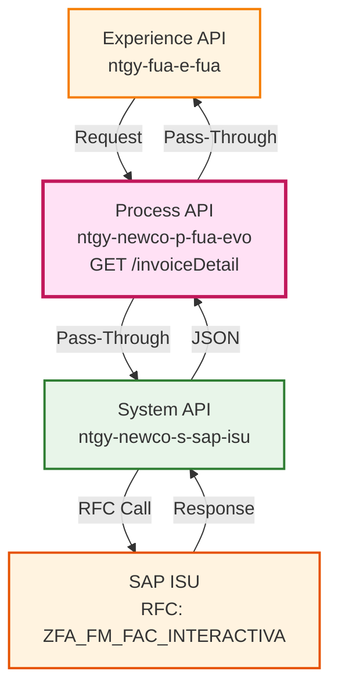
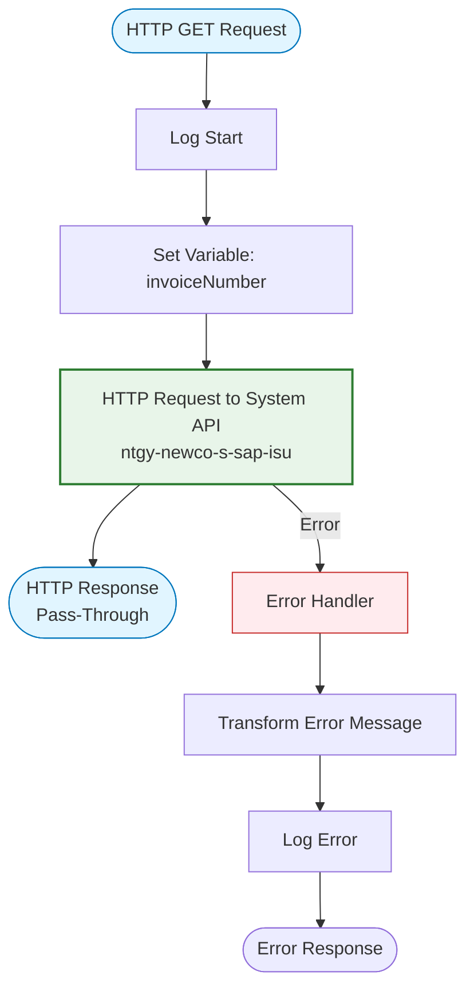
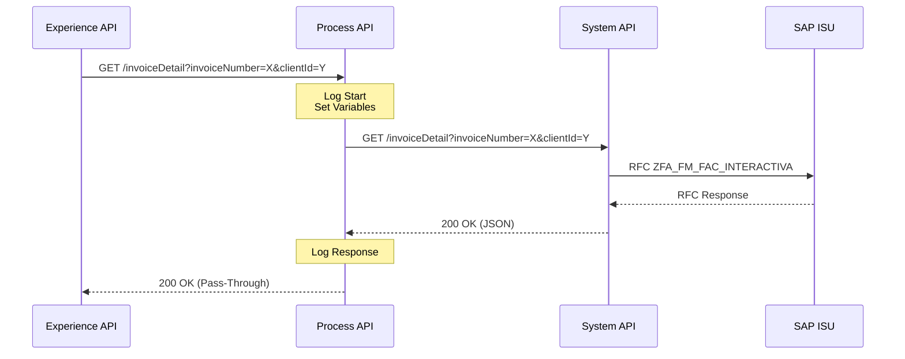
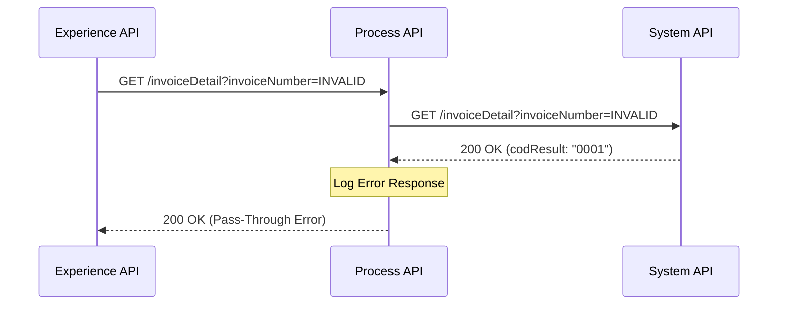
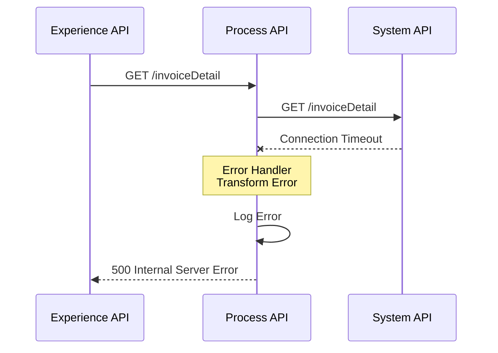

# GET /invoiceDetail

## 📌 Descripción General

### Propósito del Endpoint

Obtiene el detalle completo de una factura específica orquestando la llamada al System API de SAP ISU. Este Process API actúa como capa de orquestación entre las Experience APIs y el System API.

### Tipo de API

**Capa:** Process API (API-Led Connectivity)

**Función:** Orquestación de consulta de detalle de factura

### Patrón de Integración

**Tipo:** Pass-Through (sin transformación)

**Descripción:** Este Process API actúa como pass-through puro, delegando la consulta directamente al System API sin aplicar transformaciones adicionales.

### Arquitectura API-Led Connectivity



---

## 💼 Propósito del Negocio

### Casos de Uso Principales

1. **Orquestación de Consulta de Factura**
   - Coordinar la consulta de detalle de factura entre Experience y System APIs
   - Proporcionar capa de abstracción para cambios futuros
   - Facilitar la integración de múltiples canales (web, móvil, voz)

2. **Gestión de Facturación**
   - Centralizar la lógica de consulta de facturas
   - Permitir extensiones futuras sin impactar consumidores
   - Facilitar auditoría y monitoreo centralizado

3. **Integración Multi-Canal**
   - Servir a múltiples Experience APIs (web, móvil, agentes)
   - Mantener consistencia en la respuesta entre canales
   - Simplificar la integración de nuevos canales

### 🔗 Endpoints Dependientes

Este Process API consume el siguiente System API:

| System API | Endpoint | Método | Propósito |
|------------|----------|--------|-----------|
| `ntgy-newco-s-sap-isu` | `/invoiceDetail` | GET | Consulta del detalle completo de factura en SAP ISU mediante RFC ZFA_FM_FAC_INTERACTIVA |

**Consumidores Potenciales:**

Este endpoint puede ser consumido por cualquier Experience API que necesite información de detalle de factura, incluyendo:
- Portales web de autoservicio de clientes
- Aplicaciones móviles
- Sistemas de agentes de call center
- Integraciones de terceros autorizados

### Contexto Empresarial

- **Dominio:** Facturación y Billing
- **Sector:** Energía - Utilities
- **División:** Naturgy España - NewCo
- **Capa:** Process (Orquestación)

### Stakeholders

- **Experience APIs**: Consumidores del servicio de facturación
- **Equipos de Desarrollo**: Mantenedores de las capas de integración
- **Arquitectura**: Responsables del diseño API-Led
- **Operaciones**: Monitoreo y soporte de integraciones

### Valor de Negocio

- **Desacoplamiento**: Separa consumidores de la implementación del System API
- **Flexibilidad**: Permite cambios en System API sin impactar consumidores
- **Escalabilidad**: Facilita la adición de nuevos canales
- **Monitoreo**: Punto centralizado para auditoría y métricas

---

## 🔧 Especificación Técnica

### URLs por Ambiente

| Ambiente | URL Base | URL Completa |
|----------|----------|--------------|
| **Local** | `http://localhost:8091` | `http://localhost:8091/api/invoiceDetail` |
| **Development** | `https://ntgy-newco-p-fua-evo-dev.us-e2.cloudhub.io` | `https://ntgy-newco-p-fua-evo-dev.us-e2.cloudhub.io/api/invoiceDetail` |
| **UAT** | `https://ntgy-newco-p-fua-evo-uat.us-e2.cloudhub.io` | `https://ntgy-newco-p-fua-evo-uat.us-e2.cloudhub.io/api/invoiceDetail` |
| **Production** | `https://ntgy-newco-p-fua-evo-pro.us-e2.cloudhub.io` | `https://ntgy-newco-p-fua-evo-pro.us-e2.cloudhub.io/api/invoiceDetail` |

### Método HTTP

```
GET /api/invoiceDetail
```

### Parámetros de Entrada

#### Query Parameters

| Parámetro | Tipo | Requerido | Descripción | Ejemplo |
|-----------|------|-----------|-------------|---------|
| `invoiceNumber` | String | ✅ Sí | Número de factura a consultar | `"1234567890"` |
| `clientId` | String | ✅ Sí | Identificador del cliente (NIF/NIE) | `"12345678A"` |

**Ejemplo de URL:**
```
GET /api/invoiceDetail?invoiceNumber=1234567890&clientId=12345678A
```

### Respuesta Exitosa (200 OK)

⚠️ **IMPORTANTE - Pass-Through API**

Este Process API actúa como **pass-through puro** hacia el System API `ntgy-newco-s-sap-isu` sin aplicar transformaciones.

**Schema completo documentado aquí como referencia para desarrolladores.**

📖 **Fuente Original:** System API `ntgy-newco-s-sap-isu` endpoint `/invoiceDetail`

#### Estructura de Respuesta

```json
{
  "result": {
    "codResult": "0000",
    "msgResult": "Operación exitosa"
  },
  "detalleFactura": {
    "cuentaContrato": "200012345678",
    "fecEmision": "15.01.2024",
    "fecCargo": "20.01.2024",
    "contactos": {
      "contacAtc": "912345678",
      "contacEle": "info@example.com",
      "contacGas": "912345679",
      "contacSer": "servicio@example.com"
    },
    "financiaciones": {
      "desgloseFin": [
        {
          "codProd": "ELEC",
          "impFin": "50,00"
        }
      ],
      "impTotFin": "50,00"
    },
    "impTotFactura": "150,50",
    "impTotImpuestos": "31,61",
    "invoice_amount": "150,50",
    "invoice_discharge": "0,00",
    "invoice_discharge02": "0,00",
    "current_total": "150,50",
    "notificaciones": {
      "desgloseNot": [
        {
          "codMensaje": "INFO001",
          "info": "Factura emitida correctamente"
        }
      ]
    },
    "numFactura": "1234567890",
    "producto": {
      "codProd": "ELEC",
      "consAcumulado": "1500",
      "consLimite": "2000",
      "consPeriodo": "500",
      "fechaFin": "31.01.2024",
      "fechaFinTP": "31.01.2024",
      "fechaInicio": "01.01.2024",
      "fechaInicioTP": "01.01.2024",
      "impBrutoEne": "100,00",
      "impBrutoEneSin": "95,00",
      "impImpuestoEsp": "5,00",
      "impImpuestoInd": "21,00",
      "impReguladoAlq": "10,00",
      "impReguladoPea": "5,00",
      "impTotEne": "100,00",
      "impTotImp": "26,00",
      "impTotProd": "126,00",
      "impTotReg": "15,00",
      "tipoSubSec": "DOM",
      "indECO": "X",
      "indTP": "X",
      "numDias": "31",
      "sector": "ELEC"
    },
    "promociones": {
      "desgloseProm": [
        {
          "impProm": "10,00",
          "sector": "ELEC"
        }
      ],
      "impTotProm": "10,00"
    },
    "servicios": {
      "desgloseSer": [
        {
          "codProd": "MANT",
          "impBruto": "20,00",
          "impDescuento": "2,00"
        }
      ],
      "impImpuestoInd": "3,78",
      "impTotBrutoSer": "20,00",
      "impTotBrutoSerSin": "18,00",
      "impTotSer": "21,78"
    },
    "tipoImpuesto": "IVA",
    "ALIANZ_EXISTE": true
  }
}
```

#### Campos de la Respuesta

📖 **Para descripción detallada de cada campo, consultar:**
- **System API:** `ntgy-newco-s-sap-isu` endpoint `/invoiceDetail`

**Resumen de Estructura:**

| Sección | Descripción | Opcional |
|---------|-------------|----------|
| `result` | Resultado de la operación (código y mensaje) | No |
| `detalleFactura` | Objeto con el detalle completo de la factura | Condicional* |
| `detalleFactura.cuentaContrato` | Número de cuenta contrato | No |
| `detalleFactura.fecEmision` | Fecha de emisión (dd.MM.yyyy) | No |
| `detalleFactura.fecCargo` | Fecha de cargo (dd.MM.yyyy) | No |
| `detalleFactura.contactos` | Información de contactos | Sí |
| `detalleFactura.financiaciones` | Desglose de financiaciones | Sí |
| `detalleFactura.notificaciones` | Notificaciones de la factura | Sí |
| `detalleFactura.producto` | Información del producto energético | Sí |
| `detalleFactura.promociones` | Promociones aplicadas | Sí |
| `detalleFactura.servicios` | Servicios contratados | Sí |
| `detalleFactura.impTotFactura` | Importe total de la factura | No |
| `detalleFactura.numFactura` | Número de factura | No |

\* `detalleFactura` solo se incluye si `result.codResult == "0000"`

### Respuestas de Error

#### Error 400 - Bad Request

```json
{
  "result": {
    "codResult": "0001",
    "msgResult": "Parámetros inválidos: invoiceNumber es requerido"
  }
}
```

#### Error 500 - Internal Server Error

```json
{
  "result": {
    "codResult": "0001",
    "msgResult": "Error al consultar System API: Connection timeout"
  }
}
```

### Autenticación

- **Tipo:** API Key / Client Credentials
- **Header:** `client_id` y `client_secret`

### Timeouts

| Tipo | Valor | Justificación |
|------|-------|---------------|
| **Request Timeout** | 60 segundos | Tiempo suficiente para consulta compleja en SAP ISU |
| **Connection Timeout** | 30 segundos | Tiempo de establecimiento de conexión con System API |

---

## 🏗️ Implementación Técnica

### Arquitectura del Flow



### Transformación de Datos

⚠️ **Este Process API NO transforma la respuesta del System API.**

**Patrón:** Pass-Through Puro

**Flujo de Datos:**
1. Recibe request del Experience API
2. Extrae `invoiceNumber` del query parameter
3. Llama al System API con los mismos parámetros
4. Retorna la respuesta del System API sin modificaciones

**Código del Flow:**

```xml
<sub-flow name="invoiceDetail">
    <logger level="INFO" message="Detalle factura #[vars.invoiceNumber]"/>
    <http:request method="GET" 
                  config-ref="HTTP_Request_ntgy-newco-s-sap" 
                  path="${ntgy-newco-s-sap.functions.invoiceDetail}">
        <http:query-params>
            {
                invoiceNumber: attributes.queryParams.invoiceNumber,
                clientId: attributes.queryParams.clientId
            }
        </http:query-params>
    </http:request>
    <logger level="DEBUG" message="Salida detalle de factura #[vars.invoiceNumber]: #[payload]"/>
</sub-flow>
```

### Configuración de Integración

**HTTP Request Configuration:**

| Propiedad | Valor | Descripción |
|-----------|-------|-------------|
| **Config Ref** | `HTTP_Request_ntgy-newco-s-sap` | Configuración de conexión al System API |
| **Method** | `GET` | Método HTTP |
| **Path** | `${ntgy-newco-s-sap.functions.invoiceDetail}` | Path del endpoint (desde properties) |
| **Timeout** | 60000 ms | Timeout de request |

**Mapeo de Parámetros:**

| Parámetro Process API | Parámetro System API | Transformación |
|-----------------------|----------------------|----------------|
| `invoiceNumber` | `invoiceNumber` | Ninguna (pass-through) |
| `clientId` | `clientId` | Ninguna (pass-through) |

### Patrones de Diseño

**Patrón:** Pass-Through con Logging

**Justificación:**
- Simplicidad: No requiere transformación de datos
- Flexibilidad: Permite cambios en System API sin impactar este Process API
- Monitoreo: Logging centralizado para auditoría
- Desacoplamiento: Abstrae la ubicación del System API

### Diagramas de Secuencia

#### 1. Flujo Normal de Éxito



#### 2. Flujo con Error del System API



#### 3. Flujo con Error de Conexión



### Manejo de Errores

**Error Handler:**

```xml
<error-handler>
    <on-error-propagate enableNotifications="true" logException="true">
        <ee:transform doc:name="Set Error Message">
            <ee:set-payload>
                {
                    "result": {
                        "codResult": "0001",
                        "msgResult": error.description
                    }
                }
            </ee:set-payload>
        </ee:transform>
        <logger level="ERROR" message="Error in invoiceDetail flow"/>
    </on-error-propagate>
</error-handler>
```

**Tipos de Errores Manejados:**

1. **Errores de Conexión:** Timeout o fallo de conexión con System API
2. **Errores del System API:** Propagados sin modificación
3. **Errores de Validación:** Parámetros faltantes o inválidos

---

## 💻 Ejemplos de Uso

### Ejemplo 1: Consulta Exitosa

#### cURL

```bash
curl -X GET "https://ntgy-newco-p-fua-evo-pro.us-e2.cloudhub.io/api/invoiceDetail?invoiceNumber=1234567890&clientId=12345678A" \
  -H "client_id: YOUR_CLIENT_ID" \
  -H "client_secret: YOUR_CLIENT_SECRET"
```

#### Respuesta (200 OK)

```json
{
  "result": {
    "codResult": "0000",
    "msgResult": "Consulta exitosa"
  },
  "detalleFactura": {
    "cuentaContrato": "200012345678",
    "fecEmision": "15.01.2024",
    "fecCargo": "20.01.2024",
    "impTotFactura": "150,50",
    "impTotImpuestos": "31,61",
    "numFactura": "1234567890",
    "producto": {
      "codProd": "ELEC",
      "consAcumulado": "1500",
      "consPeriodo": "500",
      "impTotProd": "126,00",
      "sector": "ELEC"
    },
    "tipoImpuesto": "IVA",
    "ALIANZ_EXISTE": true
  }
}
```

### Ejemplo 2: Factura No Encontrada

#### cURL

```bash
curl -X GET "https://ntgy-newco-p-fua-evo-pro.us-e2.cloudhub.io/api/invoiceDetail?invoiceNumber=9999999999&clientId=12345678A" \
  -H "client_id: YOUR_CLIENT_ID" \
  -H "client_secret: YOUR_CLIENT_SECRET"
```

#### Respuesta (200 OK - Error de Negocio)

```json
{
  "result": {
    "codResult": "0001",
    "msgResult": "Factura no encontrada en SAP ISU"
  }
}
```

### Ejemplo 3: Error de Conexión

#### cURL

```bash
curl -X GET "https://ntgy-newco-p-fua-evo-pro.us-e2.cloudhub.io/api/invoiceDetail?invoiceNumber=1234567890&clientId=12345678A" \
  -H "client_id: YOUR_CLIENT_ID" \
  -H "client_secret: YOUR_CLIENT_SECRET"
```

#### Respuesta (500 Internal Server Error)

```json
{
  "result": {
    "codResult": "0001",
    "msgResult": "HTTP:TIMEOUT - Connection timeout to System API"
  }
}
```

### Ejemplo 4: JavaScript/TypeScript

```javascript
const getInvoiceDetail = async (invoiceNumber, clientId) => {
  const response = await fetch(
    `https://ntgy-newco-p-fua-evo-pro.us-e2.cloudhub.io/api/invoiceDetail?invoiceNumber=${invoiceNumber}&clientId=${clientId}`,
    {
      method: 'GET',
      headers: {
        'client_id': 'YOUR_CLIENT_ID',
        'client_secret': 'YOUR_CLIENT_SECRET'
      }
    }
  );
  
  const data = await response.json();
  
  if (data.result.codResult === '0000') {
    console.log('Detalle de factura:', data.detalleFactura);
    return data.detalleFactura;
  } else {
    console.error('Error:', data.result.msgResult);
    throw new Error(data.result.msgResult);
  }
};

// Uso
getInvoiceDetail('1234567890', '12345678A')
  .then(invoice => {
    console.log('Número de factura:', invoice.numFactura);
    console.log('Importe total:', invoice.impTotFactura);
  })
  .catch(error => console.error('Error:', error));
```

### Ejemplo 5: Python

```python
import requests

def get_invoice_detail(invoice_number, client_id):
    """
    Obtiene el detalle de una factura desde el Process API
    """
    url = "https://ntgy-newco-p-fua-evo-pro.us-e2.cloudhub.io/api/invoiceDetail"
    
    params = {
        "invoiceNumber": invoice_number,
        "clientId": client_id
    }
    
    headers = {
        "client_id": "YOUR_CLIENT_ID",
        "client_secret": "YOUR_CLIENT_SECRET"
    }
    
    try:
        response = requests.get(url, params=params, headers=headers, timeout=60)
        response.raise_for_status()
        
        data = response.json()
        
        if data['result']['codResult'] == '0000':
            print(f"Factura obtenida: {data['detalleFactura']['numFactura']}")
            return data['detalleFactura']
        else:
            print(f"Error de negocio: {data['result']['msgResult']}")
            return None
            
    except requests.exceptions.Timeout:
        print("Error: Timeout al consultar el Process API")
        return None
    except requests.exceptions.RequestException as e:
        print(f"Error de conexión: {str(e)}")
        return None

# Uso
invoice = get_invoice_detail('1234567890', '12345678A')
if invoice:
    print(f"Importe total: {invoice['impTotFactura']}")
    print(f"Fecha de emisión: {invoice['fecEmision']}")