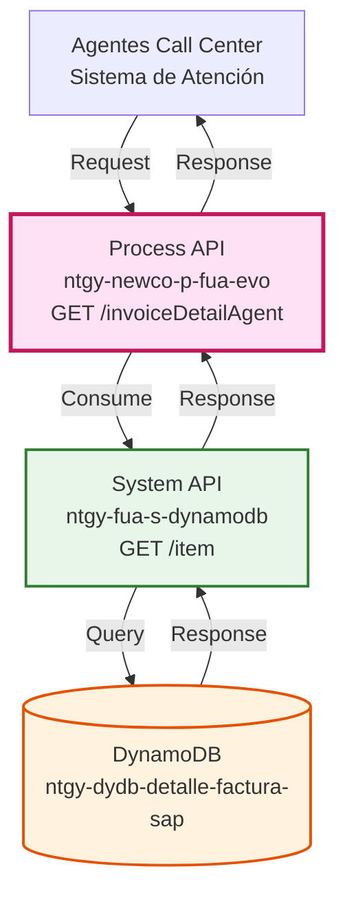
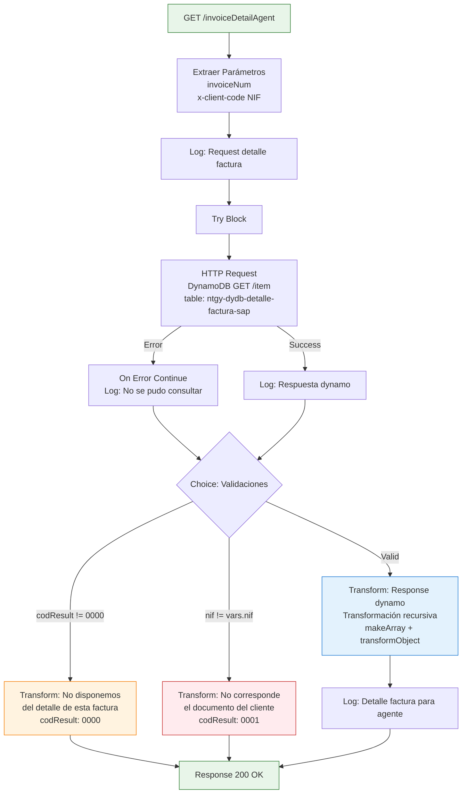
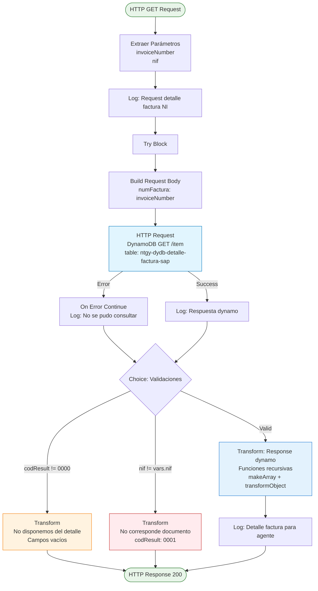
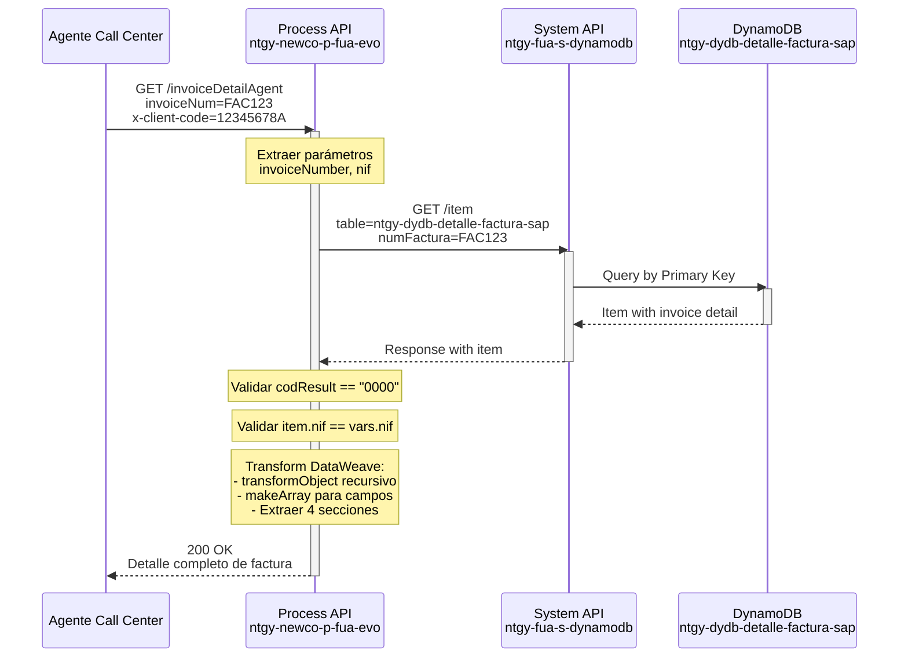
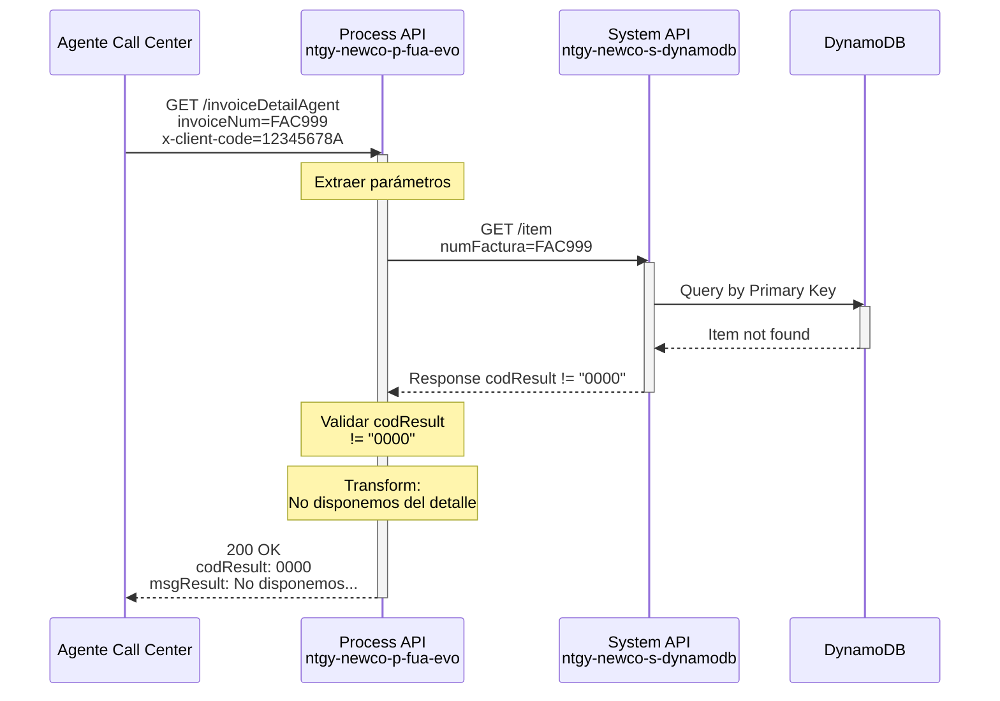
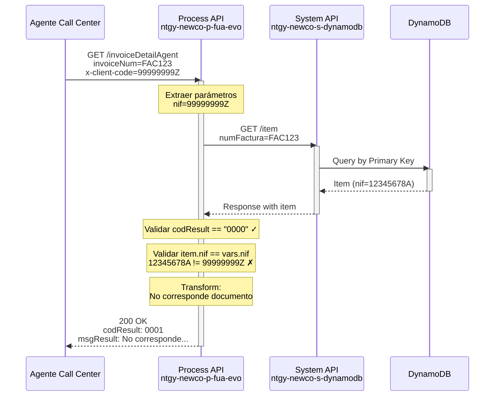

# GET /invoiceDetailAgent

## 📌 Descripción General

### Propósito del Endpoint

Este endpoint recupera el detalle completo de una factura SAP almacenada en DynamoDB, diseñado específicamente para uso por agentes de call center. Implementa validación de seguridad mediante verificación de NIF para asegurar que el agente está consultando la factura del cliente correcto.

### Tipo de API

**Capa:** Process API (API-Led Connectivity)

**Función:** Consulta de detalle de factura con validación de seguridad para agentes

### Patrón de Integración

**Tipo:** Pass-Through con Validación y Transformación

**Descripción:** Consulta directa a DynamoDB con validación de NIF del cliente y transformación compleja de estructura de datos SAP.

### Arquitectura API-Led Connectivity



---

## 💼 Propósito del Negocio

### Casos de Uso Principales

1. **Consulta de Detalle de Factura por Agentes**
   - Permite a agentes de call center acceder al detalle completo de facturas SAP
   - Proporciona información detallada para resolver consultas de clientes
   - Incluye conceptos, lecturas y cálculos de facturación

2. **Validación de Seguridad**
   - Verifica que el NIF del cliente coincida con la factura solicitada
   - Previene acceso no autorizado a información de otros clientes
   - Mantiene integridad y privacidad de datos

3. **Soporte a Reclamaciones**
   - Proporciona desglose detallado de conceptos facturados
   - Facilita explicación de importes y cálculos
   - Ayuda en resolución de disputas de facturación

4. **Análisis de Consumo**
   - Muestra lecturas de contadores (gas y electricidad)
   - Permite verificar consumos facturados
   - Facilita comparativas y análisis histórico

### 🔗 Endpoints Dependientes

Este Process API consume el siguiente System API:

| System API | Endpoint | Método | Propósito |
|------------|----------|--------|-----------|
| `ntgy-fua-s-dynamodb` | `/item` | GET | Consulta item por clave primaria en tabla DynamoDB |

**Tabla DynamoDB:** `ntgy-dydb-detalle-factura-sap`

### Lógica de Orquestación



**Pasos del Proceso:**

1. **Extracción de Parámetros**: Obtiene `invoiceNum` y `x-client-code` (NIF)
2. **Consulta a DynamoDB**: Busca factura por número en tabla de detalle
3. **Manejo de Errores**: `on-error-continue` permite respuesta controlada
4. **Validación 1 - Factura Existe**: Verifica `codResult == "0000"`
5. **Validación 2 - NIF Coincide**: Verifica `payload.item.nif == vars.nif`
6. **Transformación Compleja**: Aplica funciones recursivas para normalizar estructura
7. **Respuesta**: Devuelve detalle completo o mensaje de error apropiado

### Transformaciones Aplicadas

**Transformación Principal (DataWeave con Funciones Recursivas):**

| Campo DynamoDB | Campo API | Transformación |
|----------------|-----------|----------------|
| `informacionFactura.DATOS_GENERAL.ECO` | `detalleGeneralECO` | Pass-through, default "" |
| `informacionFactura.DATOS_CONCEPTOS` | `detalleCalculo` | Transformación recursiva con `transformObject` |
| `informacionFactura.DATOS_LECTURAS_GAS` | `detalleLecturaGas` | Pass-through, default "" |
| `informacionFactura.DATOS_LECTURAS_ELE` | `detalleLecturaLuz` | Pass-through, default "" |

**Funciones DataWeave Especiales:**

1. **`makeArray(value)`**: Convierte objetos individuales en arrays
   - Si es Object → `[value]`
   - Si es Array → `value`
   - Otros → `[]`

2. **`transformObject(obj)`**: Transformación recursiva de estructura
   - Procesa objetos anidados recursivamente
   - Procesa arrays de objetos
   - Convierte campos específicos a arrays: `DETALLE_PROD`, `POSICION`, `DETALLE_OTR`

**Lógica de Normalización:**
```dataweave
fun makeArray(value) = 
    if (value is Object) [value] 
    else if (value is Array) value 
    else []

fun transformObject(obj) =
    obj mapObject ((value, key) ->
        if (value is Object) 
         (key): transformObject(value)
        else if (value is Array) 
         (key): (value map ((v) -> if (v is Object) transformObject(v) else v))
        else (key): value
    ) mapObject ((value, key) ->
        if (fieldsToArray contains (key as String)) 
         (key): makeArray(value) 
        else (key): value
    )
```

### Contexto Empresarial

- **Dominio:** Atención al Cliente y Facturación
- **Sector:** Energía - Utilities
- **División:** Naturgy España - NewCo
- **Proceso de Negocio:** Soporte de Agentes para Consultas de Facturación

### Stakeholders

- **Agentes de Call Center**: Necesitan acceso rápido a detalle de facturas para atender clientes
- **Supervisores de Atención**: Requieren información completa para resolver escalaciones
- **Departamento de Facturación**: Usa información para análisis de reclamaciones
- **Clientes Finales**: Beneficiarios indirectos de mejor atención

### Valor de Negocio

- **Mejora en Atención al Cliente**: Agentes tienen información completa en tiempo real
- **Reducción de Tiempos de Resolución**: Acceso inmediato a detalle de factura
- **Seguridad de Datos**: Validación de NIF previene accesos no autorizados
- **Transparencia**: Desglose completo de conceptos y cálculos

### Consumidores Potenciales

Este endpoint puede ser consumido por:
- Sistemas de atención al cliente (call center)
- Aplicaciones de agentes de soporte
- Herramientas de análisis de facturación
- Sistemas de gestión de reclamaciones

---

## 🔧 Especificación Técnica

### URLs por Ambiente

| Ambiente | URL Base | URL Completa |
|----------|----------|--------------|
| **Local** | `http://localhost:8081` | `http://localhost:8081/api/invoiceDetailAgent?invoiceNum=:invoiceNum&x-client-code=:nif` |
| **Development** | `https://ntgy-newco-p-fua-evo-dev.us-e2.cloudhub.io` | `https://ntgy-newco-p-fua-evo-dev.us-e2.cloudhub.io/api/invoiceDetailAgent?invoiceNum=:invoiceNum&x-client-code=:nif` |
| **UAT** | `https://ntgy-newco-p-fua-evo-uat.us-e2.cloudhub.io` | `https://ntgy-newco-p-fua-evo-uat.us-e2.cloudhub.io/api/invoiceDetailAgent?invoiceNum=:invoiceNum&x-client-code=:nif` |
| **Production** | `https://ntgy-newco-p-fua-evo-pro.us-e2.cloudhub.io` | `https://ntgy-newco-p-fua-evo-pro.us-e2.cloudhub.io/api/invoiceDetailAgent?invoiceNum=:invoiceNum&x-client-code=:nif` |

### Método HTTP

```
GET /api/invoiceDetailAgent
```

### Parámetros de Entrada

#### Query Parameters

| Parámetro | Tipo | Requerido | Descripción | Ejemplo |
|-----------|------|-----------|-------------|---------|
| `invoiceNum` | String | ✅ Sí | Número de factura SAP a consultar | `"FAC123456789"` |
| `x-client-code` | String | ✅ Sí | NIF del cliente para validación de seguridad | `"12345678A"` |

#### Headers

| Header | Tipo | Requerido | Descripción | Ejemplo |
|--------|------|-----------|-------------|---------|
| `Content-Type` | String | ✅ Sí | Tipo de contenido | `"application/json"` |

### Respuestas

#### 200 OK - Éxito (Factura Encontrada y NIF Válido)

```json
{
  "detalleGeneralECO": {
    "numeroFactura": "FAC2024001234",
    "fechaEmision": "2024-01-15",
    "importeTotal": 125.75,
    "estado": "Pagada"
  },
  "detalleCalculo": {
    "DETALLE_PROD": [
      {
        "concepto": "Término de energía",
        "importe": 45.00,
        "unidad": "EUR"
      },
      {
        "concepto": "Término de potencia",
        "importe": 25.30,
        "unidad": "EUR"
      }
    ],
    "POSICION": [
      {
        "posicion": "001",
        "descripcion": "Término de energía"
      }
    ],
    "DETALLE_OTR": [
      {
        "concepto": "Impuesto eléctrico",
        "importe": 5.00
      }
    ]
  },
  "detalleLecturaGas": {
    "lectura_anterior": "12345",
    "lectura_actual": "12567",
    "consumo": "222"
  },
  "detalleLecturaLuz": {
    "lectura_anterior_p1": "45678",
    "lectura_actual_p1": "45890",
    "consumo_p1": "212"
  }
}
```

**Campos de Respuesta:**

| Campo | Tipo | Descripción |
|-------|------|-------------|
| `detalleGeneralECO` | Object/String | Información general económica de la factura |
| `detalleCalculo` | Object/String | Conceptos y cálculos de facturación (transformado) |
| `detalleCalculo.DETALLE_PROD` | Array | Detalle de productos/conceptos (normalizado a array) |
| `detalleCalculo.POSICION` | Array | Posiciones de factura (normalizado a array) |
| `detalleCalculo.DETALLE_OTR` | Array | Otros detalles (normalizado a array) |
| `detalleLecturaGas` | Object/String | Lecturas de contadores de gas |
| `detalleLecturaLuz` | Object/String | Lecturas de contadores de electricidad |

#### 200 OK - Factura No Encontrada

```json
{
  "result": {
    "codResult": "0000",
    "msgResult": "No disponemos del detalle de esta factura"
  },
  "detalleGeneralECO": "",
  "detalleCalculo": "",
  "detalleLecturaGas": "",
  "detalleLecturaLuz": ""
}
```

**Cuándo se devuelve:**
- La factura no existe en DynamoDB
- Error en consulta a DynamoDB
- `payload.result.codResult != "0000"`

#### 200 OK - NIF No Coincide

```json
{
  "result": {
    "codResult": "0001",
    "msgResult": "No corresponde el documento del cliente con la factura solicitada"
  }
}
```

**Cuándo se devuelve:**
- El NIF proporcionado no coincide con el NIF asociado a la factura
- Validación de seguridad fallida: `payload.item.nif != vars.nif`

#### 400 Bad Request

```json
{
  "code": "BAD_REQUEST",
  "message": "Parámetros invoiceNum y x-client-code son requeridos",
  "timestamp": "2024-01-15T10:30:00Z"
}
```

#### 500 Internal Server Error

```json
{
  "code": "INTERNAL_SERVER_ERROR",
  "message": "Error interno del servidor",
  "timestamp": "2024-01-15T10:30:00Z"
}
```

### Autenticación

- **Tipo:** Client ID & Client Secret (Anypoint Platform)
- **Headers requeridos:**
  - `client_id`: ID de la aplicación cliente
  - `client_secret`: Secret de la aplicación cliente

### Timeouts

| Tipo | Valor |
|------|-------|
| **Request Timeout** | 30 segundos |
| **Connection Timeout** | 10 segundos |

---

## 🏗️ Implementación Técnica

### Arquitectura del Flow



### Transformaciones DataWeave

#### Transformación de Request a DynamoDB

**Ubicación:** Inline en `invoiceDetailAgent.xml` (líneas 11-17)

```dataweave
%dw 2.0
output application/json
---
{
    "numFactura": {"S": vars.invoiceNumber}
}
```

**Query Parameters:**
```dataweave
%dw 2.0
output application/java
---
{
    table: "ntgy-dydb-detalle-factura-sap"
}
```

#### Transformación de Respuesta - Factura No Encontrada

**Ubicación:** Inline en `invoiceDetailAgent.xml` (líneas 30-42)

```dataweave
%dw 2.0
output application/json
---
{
  "result": {
    "codResult": "0000",
    "msgResult": "No disponemos del detalle de esta factura"
  },
  "detalleGeneralECO": "",
  "detalleCalculo": "",
  "detalleLecturaGas": "",
  "detalleLecturaLuz": ""
}
```

#### Transformación de Respuesta - NIF Inválido

**Ubicación:** Inline en `invoiceDetailAgent.xml` (líneas 46-55)

```dataweave
%dw 2.0
output application/json
---
{
  "result": {
    "codResult": "0001",
    "msgResult": "No corresponde el documento del cliente con la factura solicitada"
  }
}
```

#### Transformación de Respuesta - Éxito (Compleja)

**Ubicación:** Inline en `invoiceDetailAgent.xml` (líneas 58-77)

```dataweave
%dw 2.0
output application/json

var fieldsToArray = ["DETALLE_PROD", "POSICION", "DETALLE_OTR"]

fun makeArray(value) = 
    if (value is Object) [value] 
    else if (value is Array) value 
    else []

fun transformObject(obj) =
    obj mapObject ((value, key) ->
        if (value is Object) 
         (key): transformObject(value)
        else if (value is Array) 
         (key): (value map ((v) -> if (v is Object) transformObject(v) else v))
        else (key): value
    ) mapObject ((value, key) ->
        if (fieldsToArray contains (key as String)) 
         (key): makeArray(value) 
        else (key): value
    )

---
{
    "detalleGeneralECO": payload.item.informacionFactura.DATOS_GENERAL.ECO default "",
    "detalleCalculo": transformObject(payload.item.informacionFactura.DATOS_CONCEPTOS) default "",
    "detalleLecturaGas": payload.item.informacionFactura.DATOS_LECTURAS_GAS default "",
    "detalleLecturaLuz": payload.item.informacionFactura.DATOS_LECTURAS_ELE default ""
}
```

**Lógica Clave:**

1. **Variable `fieldsToArray`**: Define campos que deben ser arrays
2. **Función `makeArray`**: Normaliza valores a arrays
   - Object individual → Array con un elemento
   - Array → Mantiene como array
   - Otros tipos → Array vacío
3. **Función `transformObject`**: Transformación recursiva
   - Procesa objetos anidados recursivamente
   - Procesa arrays de objetos elemento por elemento
   - Aplica `makeArray` a campos específicos
4. **Extracción de Datos**: Obtiene 4 secciones principales de la factura

### Patrones de Diseño

**Patrón 1: Security Validation Pattern**

**Justificación:** Protege información sensible de facturas asegurando que solo agentes autorizados con el NIF correcto puedan acceder al detalle.

**Implementación:**
```xml
<when expression="#[payload.item.nif != vars.nif]">
    <logger message="No coincide el numero de la factura: #[vars.invoiceNumber] con el nif del cliente: #[vars.nif]"/>
    <ee:transform>
        <!-- Respuesta de error de validación -->
    </ee:transform>
</when>
```

**Patrón 2: Graceful Degradation**

**Justificación:** Mantiene disponibilidad del servicio incluso cuando DynamoDB falla, devolviendo respuesta controlada en lugar de error 500.

**Implementación:**
```xml
<error-handler>
    <on-error-continue type="ANY">
        <logger message="No se ha podido consultar el detalle de la factura"/>
    </on-error-continue>
</error-handler>
```

**Patrón 3: Recursive Data Transformation**

**Justificación:** Normaliza estructura compleja y anidada de datos SAP, convirtiendo objetos individuales en arrays para consistencia.

**Implementación:**
- Función recursiva `transformObject` procesa toda la estructura
- Función `makeArray` normaliza campos específicos
- Permite manejar variabilidad en estructura de datos SAP

### Diagramas de Secuencia

#### 1. Flujo Normal de Éxito



#### 2. Flujo con Factura No Encontrada



#### 3. Flujo con NIF Inválido (Validación de Seguridad)



### Manejo de Errores

#### Estrategia de Error Handling

```xml
<try>
    <http:request method="GET" path="/item" config-ref="HTTP_Request_s_dynamo">
        <!-- Request body y query params -->
    </http:request>
    <logger level="DEBUG" message="Respuesta dynamo: #[payload]"/>
    
    <error-handler>
        <on-error-continue type="ANY">
            <logger level="INFO" message="No se ha podido consultar el detalle de la factura - #[vars.invoiceNumber]"/>
        </on-error-continue>
    </error-handler>
</try>
```

**Tipos de Error Manejados:**

| Error | Acción | Respuesta |
|-------|--------|-----------|
| **DynamoDB No Disponible** | On Error Continue | 200 - Factura no encontrada |
| **Factura No Existe** | Validación codResult | 200 - No disponemos del detalle |
| **NIF No Coincide** | Validación de seguridad | 200 - No corresponde documento (codResult: 0001) |
| **Parámetros Faltantes** | Validación APIKit | 400 - Bad Request |
| **Error Interno** | Error estándar | 500 - Internal Server Error |

#### Logging

```xml
<!-- Log de inicio -->
<logger level="INFO" message="invoiceDetailAgent - Consulta del detalle de facturas para el agente: #[vars.invoiceNumber]"/>

<!-- Log de respuesta DynamoDB -->
<logger level="DEBUG" message="invoiceDetailAgent - Factura #[vars.invoiceNumber] - Respuesta dynamo: #[payload]"/>

<!-- Log de error -->
<logger level="INFO" message="invoiceDetailAgent - No se ha podido consultar el detalle de la factura - #[vars.invoiceNumber]"/>

<!-- Log de factura no encontrada -->
<logger level="INFO" message="invoiceDetailAgent - No disponemos del detalle de esta factura: #[vars.invoiceNumber] con el nif del cliente: #[vars.nif]"/>

<!-- Log de NIF inválido -->
<logger level="INFO" message="invoiceDetailAgent - No coincide el numero de la factura: #[vars.invoiceNumber] con el nif del cliente: #[vars.nif]"/>

<!-- Log de éxito -->
<logger level="DEBUG" message="invoiceDetailAgent - Detalle factura #[vars.invoiceNumber] para el agente: #[payload]"/>
```

---

## 💻 Ejemplos de Uso

### Ejemplo 1: Consulta Exitosa con Detalle Completo

#### cURL

```bash
curl -X GET "https://ntgy-newco-p-fua-evo-dev.us-e2.cloudhub.io/api/invoiceDetailAgent?invoiceNum=FAC2024001234&x-client-code=12345678A" \
  -H "Content-Type: application/json" \
  -H "client_id: YOUR_CLIENT_ID" \
  -H "client_secret: YOUR_CLIENT_SECRET"
```

#### Respuesta (200 OK)

```json
{
  "detalleGeneralECO": {
    "numeroFactura": "FAC2024001234",
    "fechaEmision": "2024-01-15",
    "importeTotal": 125.75,
    "estado": "Pagada"
  },
  "detalleCalculo": {
    "DETALLE_PROD": [
      {
        "concepto": "Término de energía",
        "cantidad": 350,
        "precioUnitario": 0.12,
        "importe": 42.00
      },
      {
        "concepto": "Término de potencia",
        "cantidad": 4.6,
        "precioUnitario": 3.45,
        "importe": 15.87
      },
      {
        "concepto": "Alquiler de equipo",
        "cantidad": 1,
        "precioUnitario": 0.81,
        "importe": 0.81
      }
    ],
    "POSICION": [
      {
        "posicion": "001",
        "descripcion": "Suministro de energía eléctrica"
      }
    ],
    "DETALLE_OTR": [
      {
        "concepto": "IVA 21%",
        "base": 58.68,
        "importe": 12.32
      },
      {
        "concepto": "Impuesto eléctrico 5.11%",
        "base": 42.00,
        "importe": 2.15
      }
    ],
    "subtotal": 58.68,
    "impuestos": 14.47,
    "total": 73.15
  },
  "detalleLecturaGas": "",
  "detalleLecturaLuz": {
    "cups": "ES0021000000000001AA",
    "lecturaAnterior": {
      "fecha": "2023-12-15",
      "lectura_p1": "45678",
      "lectura_p2": "23456",
      "tipo": "Real"
    },
    "lecturaActual": {
      "fecha": "2024-01-15",
      "lectura_p1": "45890",
      "lectura_p2": "23567",
      "tipo": "Real"
    },
    "consumo": {
      "periodo_p1": 212,
      "periodo_p2": 111,
      "total": 323
    }
  }
}
```

**Nota:** Los campos `DETALLE_PROD`, `POSICION` y `DETALLE_OTR` han sido normalizados a arrays mediante las funciones `makeArray` y `transformObject`.

### Ejemplo 2: Factura No Encontrada

#### cURL

```bash
curl -X GET "https://ntgy-newco-p-fua-evo-dev.us-e2.cloudhub.io/api/invoiceDetailAgent?invoiceNum=FAC9999999999&x-client-code=12345678A" \
  -H "Content-Type: application/json" \
  -H "client_id: YOUR_CLIENT_ID" \
  -H "client_secret: YOUR_CLIENT_SECRET"
```

#### Respuesta (200 OK)

```json
{
  "result": {
    "codResult": "0000",
    "msgResult": "No disponemos del detalle de esta factura"
  },
  "detalleGeneralECO": "",
  "detalleCalculo": "",
  "detalleLecturaGas": "",
  "detalleLecturaLuz": ""
}
```

**Nota:** Esta respuesta se devuelve cuando la factura no existe en DynamoDB o cuando hay un error en la consulta.

### Ejemplo 3: NIF No Coincide (Validación de Seguridad)

#### cURL

```bash
curl -X GET "https://ntgy-newco-p-fua-evo-dev.us-e2.cloudhub.io/api/invoiceDetailAgent?invoiceNum=FAC2024001234&x-client-code=99999999Z" \
  -H "Content-Type: application/json" \
  -H "client_id: YOUR_CLIENT_ID" \
  -H "client_secret: YOUR_CLIENT_SECRET"
```

#### Respuesta (200 OK)

```json
{
  "result": {
    "codResult": "0001",
    "msgResult": "No corresponde el documento del cliente con la factura solicitada"
  }
}
```

**Nota:** Esta respuesta se devuelve cuando el NIF proporcionado no coincide con el NIF asociado a la factura en DynamoDB, previniendo acceso no autorizado.

### Ejemplo 4: JavaScript (Fetch API)

```javascript
const getInvoiceDetailAgent = async (invoiceNum, clientNif) => {
  try {
    const response = await fetch(
      `https://ntgy-newco-p-fua-evo-dev.us-e2.cloudhub.io/api/invoiceDetailAgent?invoiceNum=${invoiceNum}&x-client-code=${clientNif}`,
      {
        method: 'GET',
        headers: {
          'Content-Type': 'application/json',
          'client_id': 'YOUR_CLIENT_ID',
          'client_secret': 'YOUR_CLIENT_SECRET'
        }
      }
    );

    const data = await response.json();
    
    // Verificar si hay resultado de error
    if (data.result) {
      if (data.result.codResult === '0000') {
        console.warn('Factura no encontrada en el sistema');
        return { success: false, error: 'NOT_FOUND', message: data.result.msgResult };
      } else if (data.result.codResult === '0001') {
        console.error('NIF no coincide con la factura');
        return { success: false, error: 'INVALID_NIF', message: data.result.msgResult };
      }
    }
    
    // Factura encontrada y válida
    console.log('Detalle de factura recuperado exitosamente');
    return { 
      success: true, 
      data: {
        general: data.detalleGeneralECO,
        calculo: data.detalleCalculo,
        lecturaGas: data.detalleLecturaGas,
        lecturaLuz: data.detalleLecturaLuz
      }
    };
    
  } catch (error) {
    console.error('Error al consultar detalle de factura:', error);
    throw error;
  }
};

// Uso
getInvoiceDetailAgent('FAC2024001234', '12345678A')
  .then(result => {
    if (result.success) {
      console.log('Información general:', result.data.general);
      console.log('Conceptos facturados:', result.data.calculo.DETALLE_PROD);
      console.log('Lecturas:', result.data.lecturaLuz);
    } else {
      console.error(`Error: ${result.error} - ${result.message}`);
    }
  });
```

### Ejemplo 5: Python (Requests)

```python
import requests
from typing import Dict, Optional

def get_invoice_detail_agent(invoice_num: str, client_nif: str) -> Dict:
    """
    Consulta el detalle de una factura para agentes con validación de NIF.
    
    Args:
        invoice_num: Número de factura SAP
        client_nif: NIF del cliente para validación
    
    Returns:
        Dict con información de la factura o error
    """
    url = "https://ntgy-newco-p-fua-evo-dev.us-e2.cloudhub.io/api/invoiceDetailAgent"
    
    headers = {
        'Content-Type': 'application/json',
        'client_id': 'YOUR_CLIENT_ID',
        'client_secret': 'YOUR_CLIENT_SECRET'
    }
    
    params = {
        'invoiceNum': invoice_num,
        'x-client-code': client_nif
    }
    
    try:
        response = requests.get(url, headers=headers, params=params, timeout=30)
        response.raise_for_status()
        
        data = response.json()
        
        # Verificar si hay resultado de error
        if 'result' in data:
            cod_result = data['result'].get('codResult')
            msg_result = data['result'].get('msgResult')
            
            if cod_result == '0000':
                print(f"⚠️ Factura no encontrada: {msg_result}")
                return {
                    'success': False,
                    'error': 'NOT_FOUND',
                    'message': msg_result
                }
            elif cod_result == '0001':
                print(f"❌ Validación de NIF fallida: {msg_result}")
                return {
                    'success': False,
                    'error': 'INVALID_NIF',
                    'message': msg_result
                }
        
        # Factura encontrada y válida
        print(f"✅ Detalle de factura {invoice_num} recuperado")
        
        # Procesar detalle de cálculo
        detalle_calculo = data.get('detalleCalculo', {})
        productos = detalle_calculo.get('DETALLE_PROD', [])
        
        # Calcular total de productos
        total_productos = sum(
            float(prod.get('importe', 0)) 
            for prod in productos
        )
        
        return {
            'success': True,
            'invoice_num': invoice_num,
            'general': data.get('detalleGeneralECO', {}),
            'productos': productos,
            'total_productos': total_productos,
            'posiciones': detalle_calculo.get('POSICION', []),
            'otros_conceptos': detalle_calculo.get('DETALLE_OTR', []),
            'lectura_gas': data.get('detalleLecturaGas', {}),
            'lectura_luz': data.get('detalleLecturaLuz', {})
        }
        
    except requests.exceptions.Timeout:
        print("❌ Timeout al consultar detalle de factura")
        raise
    except requests.exceptions.RequestException as e:
        print(f"❌ Error en la petición: {e}")
        raise

# Uso
if __name__ == "__main__":
    result = get_invoice_detail_agent('FAC2024001234', '12345678A')
    
    if result['success']:
        print(f"\n📄 Factura: {result['invoice_num']}")
        print(f"💰 Total productos: {result['total_productos']}€")
        print(f"📊 Número de conceptos: {len(result['productos'])}")
        
        print("\n🔍 Detalle de productos:")
        for prod in result['productos']:
            concepto = prod.get('concepto', 'N/A')
            importe = prod.get('importe', 0)
            print(f"  - {concepto}: {importe}€")
        
        if result['lectura_luz']:
            print("\n⚡ Lecturas de electricidad disponibles")
        if result['lectura_gas']:
            print("🔥 Lecturas de gas disponibles")
    else:
        print(f"\n❌ Error: {result['error']}")
        print(f"   Mensaje: {result['message']}")
```

### Ejemplo 6: Manejo de Tres Escenarios

```javascript
// Función completa con manejo de los 3 escenarios posibles
async function consultarFacturaAgente(numeroFactura, nifCliente) {
  const url = `https://ntgy-newco-p-fua-evo-dev.us-e2.cloudhub.io/api/invoiceDetailAgent`;
  
  try {
    const response = await fetch(
      `${url}?invoiceNum=${numeroFactura}&x-client-code=${nifCliente}`,
      {
        method: 'GET',
        headers: {
          'Content-Type': 'application/json',
          'client_id': 'YOUR_CLIENT_ID',
          'client_secret': 'YOUR_CLIENT_SECRET'
        }
      }
    );
    
    if (!response.ok) {
      throw new Error(`HTTP ${response.status}: ${response.statusText}`);
    }
    
    const data = await response.json();
    
    // ESCENARIO 1: Factura encontrada y NIF válido
    if (!data.result && data.detalleCalculo) {
      return {
        escenario: 'EXITO',
        mensaje: 'Factura encontrada y validada',
        datos: {
          general: data.detalleGeneralECO,
          productos: data.detalleCalculo.DETALLE_PROD || [],
          posiciones: data.detalleCalculo.POSICION || [],
          otrosConceptos: data.detalleCalculo.DETALLE_OTR || [],
          lecturaGas: data.detalleLecturaGas,
          lecturaLuz: data.detalleLecturaLuz
        }
      };
    }
    
    // ESCENARIO 2: Factura no encontrada
    if (data.result && data.result.codResult === '0000') {
      return {
        escenario: 'NO_ENCONTRADA',
        mensaje: data.result.msgResult,
        codigo: '0000'
      };
    }
    
    // ESCENARIO 3: NIF no coincide
    if (data.result && data.result.codResult === '0001') {
      return {
        escenario: 'NIF_INVALIDO',
        mensaje: data.result.msgResult,
        codigo: '0001'
      };
    }
    
    // Caso inesperado
    return {
      escenario: 'DESCONOCIDO',
      mensaje: 'Respuesta inesperada del servidor',
      datos: data
    };
    
  } catch (error) {
    console.error('Error en consulta de factura:', error);
    return {
      escenario: 'ERROR',
      mensaje: error.message
    };
  }
}

// Ejemplo de uso con los tres escenarios
async function ejemploCompleto() {
  // Caso 1: Éxito
  const resultado1 = await consultarFacturaAgente('FAC2024001234', '12345678A');
  if (resultado1.escenario === 'EXITO') {
    console.log('✅ Factura válida');
    console.log('Productos:', resultado1.datos.productos.length);
  }
  
  // Caso 2: Factura no encontrada
  const resultado2 = await consultarFacturaAgente('FAC9999999999', '12345678A');
  if (resultado2.escenario === 'NO_ENCONTRADA') {
    console.log('⚠️ Factura no existe en el sistema');
  }
  
  // Caso 3: NIF inválido
  const resultado3 = await consultarFacturaAgente('FAC2024001234', '99999999Z');
  if (resultado3.escenario === 'NIF_INVALIDO') {
    console.log('❌ NIF no autorizado para esta factura');
  }
}
```

### Ejemplo 7: Integración con Sistema de Call Center

```python
class InvoiceDetailService:
    """Servicio para consulta de detalle de facturas por agentes."""
    
    def __init__(self, base_url: str, client_id: str, client_secret: str):
        self.base_url = base_url
        self.headers = {
            'Content-Type': 'application/json',
            'client_id': client_id,
            'client_secret': client_secret
        }
    
    def get_invoice_detail(self, invoice_num: str, client_nif: str) -> Dict:
        """
        Obtiene el detalle de una factura con validación de NIF.
        
        Returns:
            Dict con estructura normalizada para el sistema de call center
        """
        url = f"{self.base_url}/api/invoiceDetailAgent"
        params = {
            'invoiceNum': invoice_num,
            'x-client-code': client_nif
        }
        
        try:
            response = requests.get(
                url, 
                headers=self.headers, 
                params=params, 
                timeout=30
            )
            response.raise_for_status()
            data = response.json()
            
            # Normalizar respuesta para el sistema
            return self._normalize_response(data, invoice_num, client_nif)
            
        except Exception as e:
            return {
                'status': 'ERROR',
                'error_type': type(e).__name__,
                'message': str(e)
            }
    
    def _normalize_response(self, data: Dict, invoice_num: str, nif: str) -> Dict:
        """Normaliza la respuesta para el sistema de call center."""
        
        # Verificar errores
        if 'result' in data:
            cod = data['result'].get('codResult')
            msg = data['result'].get('msgResult')
            
            if cod == '0000':
                return {
                    'status': 'NOT_FOUND',
                    'invoice_num': invoice_num,
                    'message': msg,
                    'action': 'Verificar número de factura con el cliente'
                }
            elif cod == '0001':
                return {
                    'status': 'UNAUTHORIZED',
                    'invoice_num': invoice_num,
                    'nif': nif,
                    'message': msg,
                    'action': 'Verificar NIF del cliente'
                }
        
        # Factura válida - extraer información
        return {
            'status': 'SUCCESS',
            'invoice_num': invoice_num,
            'nif': nif,
            'general_info': data.get('detalleGeneralECO', {}),
            'billing_details': self._extract_billing_details(data.get('detalleCalculo', {})),
            'readings': {
                'gas': data.get('detalleLecturaGas', {}),
                'electricity': data.get('detalleLecturaLuz', {})
            },
            'action': 'Información disponible para el agente'
        }
    
    def _extract_billing_details(self, detalle_calculo: Dict) -> Dict:
        """Extrae y estructura los detalles de facturación."""
        productos = detalle_calculo.get('DETALLE_PROD', [])
        otros = detalle_calculo.get('DETALLE_OTR', [])
        
        return {
            'products': productos,
            'product_count': len(productos),
            'total_products': sum(p.get('importe', 0) for p in productos),
            'other_charges': otros,
            'positions': detalle_calculo.get('POSICION', [])
        }

# Uso en sistema de call center
service = InvoiceDetailService(
    base_url='https://ntgy-newco-p-fua-evo-dev.us-e2.cloudhub.io',
    client_id='YOUR_CLIENT_ID',
    client_secret='YOUR_CLIENT_SECRET'
)

# Agente consulta factura
result = service.get_invoice_detail('FAC2024001234', '12345678A')

if result['status'] == 'SUCCESS':
    print(f"✅ Factura {result['invoice_num']} - Cliente {result['nif']}")
    print(f"📊 {result['billing_details']['product_count']} conceptos")
    print(f"💰 Total: {result['billing_details']['total_products']}€")
elif result['status'] == 'NOT_FOUND':
    print(f"⚠️ {result['message']}")
    print(f"👉 {result['action']}")
elif result['status'] == 'UNAUTHORIZED':
    print(f"❌ {result['message']}")
    print(f"👉 {result['action']}")
```
