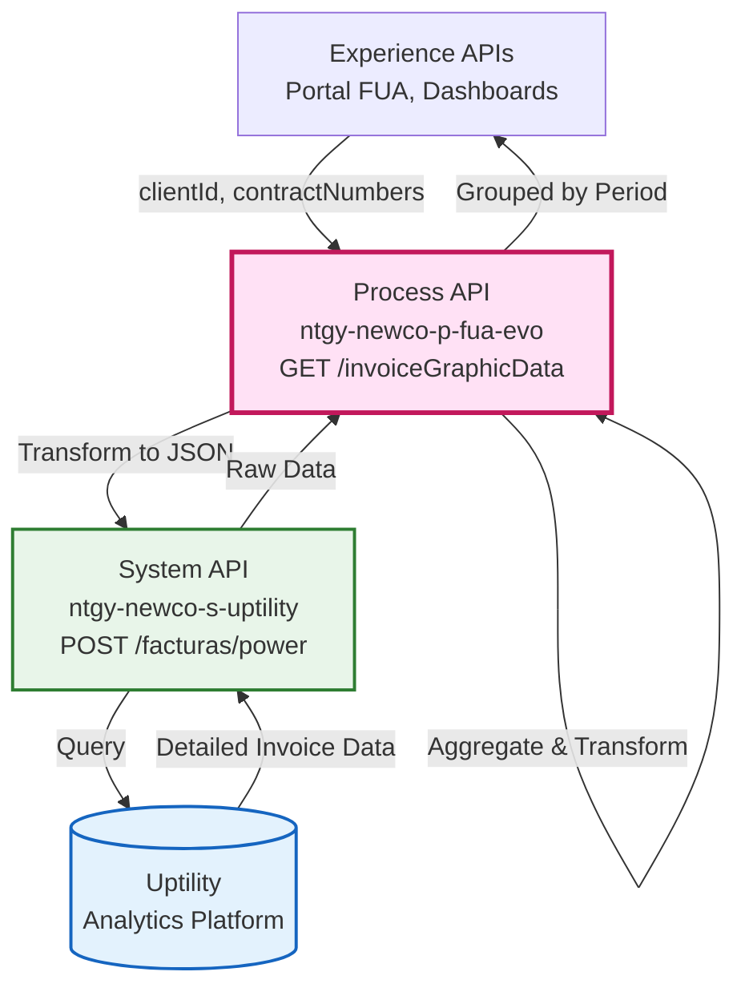
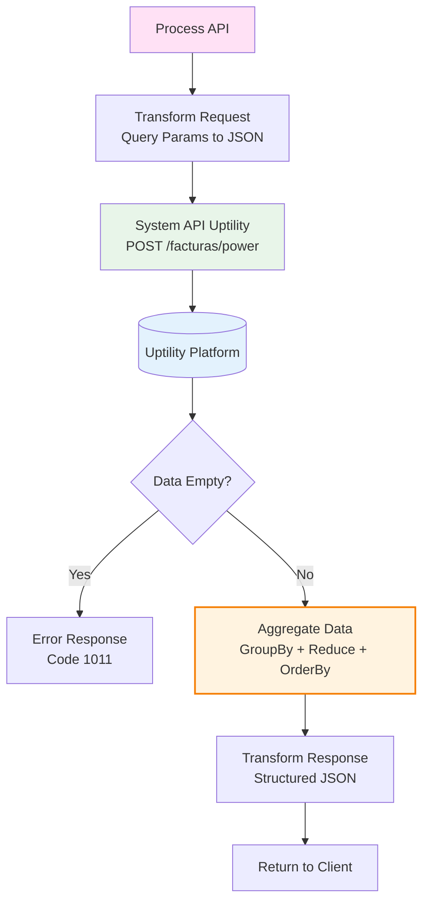
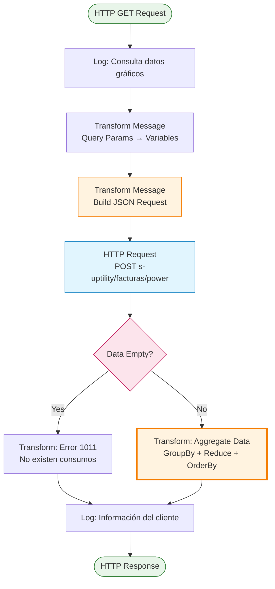
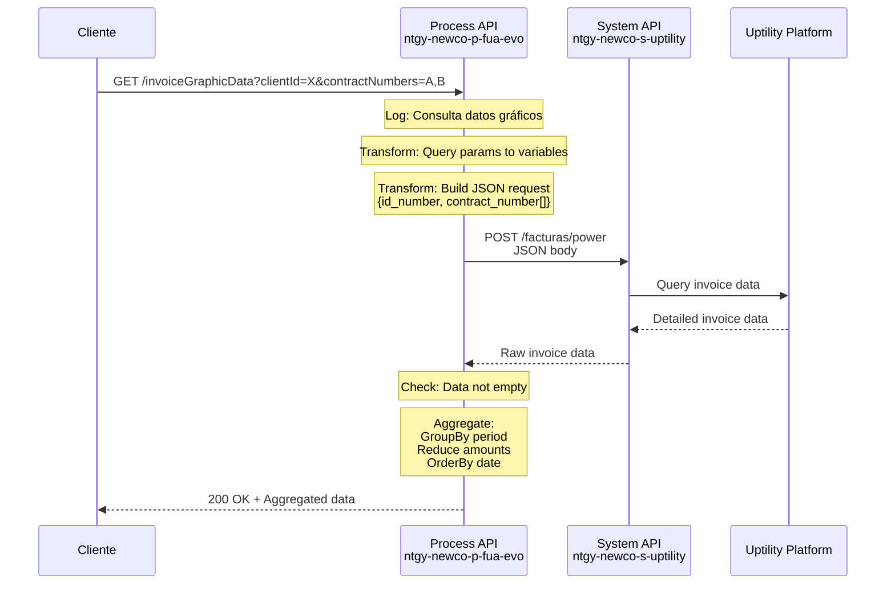
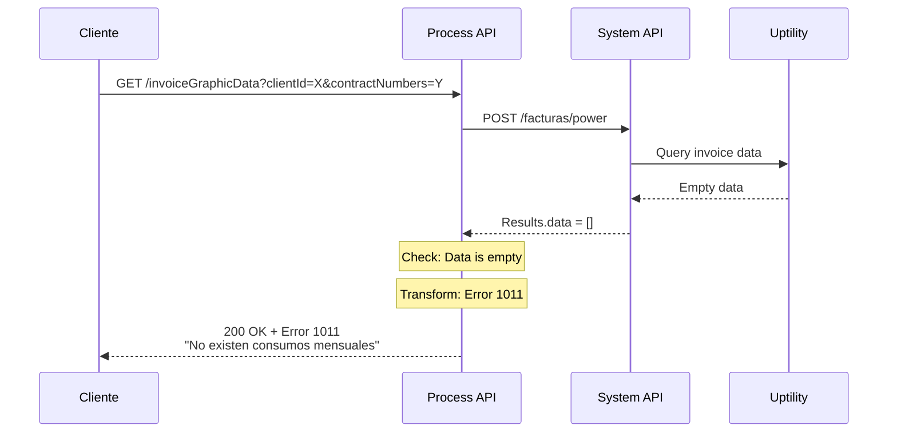
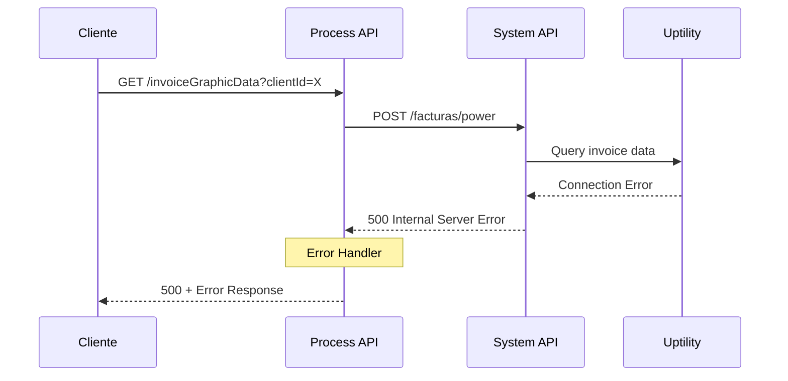

# GET /invoiceGraphicData

## 📌 Descripción General

### Propósito del Endpoint

Este endpoint recupera datos históricos de facturas desde Uptility y los agrega por periodo para su visualización en gráficas del portal FUA. Realiza una transformación compleja que agrupa facturas por mes y suma los importes, proporcionando datos optimizados para dashboards y análisis de consumo.

### Tipo de API

**Capa:** Process API (API-Led Connectivity)

**Función:** Orquestación con agregación y transformación de datos de facturación

### Patrón de Integración

**Tipo:** Transformación y Agregación de Datos

**Descripción:** Este endpoint transforma los query parameters en formato JSON para Uptility, recibe datos detallados de facturas, y aplica lógica de agregación (groupBy, reduce, orderBy) para generar datos consolidados por periodo, optimizados para visualización en gráficas.

### Arquitectura API-Led Connectivity



---

## 💼 Propósito del Negocio

### Casos de Uso Principales

1. **Visualización de Histórico de Facturación**
   - Permite a los clientes ver la evolución de sus facturas en gráficas mensuales
   - Facilita la identificación de patrones de consumo y costes

2. **Análisis de Tendencias de Consumo**
   - Agrega múltiples contratos del mismo cliente para vista consolidada
   - Soporta análisis comparativo entre periodos

3. **Dashboard de Gestión Energética**
   - Proporciona datos optimizados para widgets de gráficas
   - Reduce carga de procesamiento en el frontend

### 🔗 Endpoints Dependientes

Este Process API consume el siguiente System API:

| System API | Endpoint | Método | Propósito |
|------------|----------|--------|-----------|
| `ntgy-newco-s-uptility` | `/facturas/power` | POST | Recupera datos detallados de facturas desde Uptility |

### Lógica de Orquestación



**Pasos del Proceso:**

1. **Recepción de Request**: Recibe `clientId` y `contractNumbers` (separados por comas)
2. **Transformación de Request**: Convierte query params a JSON con array de contratos
3. **Llamada a Uptility**: POST al System API con datos transformados
4. **Validación de Datos**: Verifica si `payload.Results.data` tiene contenido
5. **Agregación Compleja**: 
   - Agrupa facturas por periodo (`groupBy item.period`)
   - Suma importes del mismo periodo (`reduce`)
   - Ordena cronológicamente (`orderBy item.date`)
6. **Respuesta Estructurada**: Retorna datos optimizados para gráficas

### Transformaciones Aplicadas

**✅ Este Process API SÍ transforma la respuesta del System API.**

#### Transformación de Request (Query Params → JSON)

| Campo Entrada | Campo Salida | Transformación |
|---------------|--------------|----------------|
| `clientId` (string) | `id_number` (string) | Mapeo directo |
| `contractNumbers` (string CSV) | `contract_number` (array) | Split por coma: `splitBy(",")` |

#### Transformación de Response (Uptility → Agregado)

| Campo Original (Uptility) | Campo Transformado | Transformación |
|---------------------------|-------------------|----------------|
| `Results.data[].period` | `date` (YYYY-MM-DD) | Extrae primeros 10 caracteres: `[0 to 9]` |
| `Results.data[].invoice_amount` | `amount` (number) | Suma por periodo: `reduce + accumulator` |
| N/A | `result.codResult` | Generado: `"0000"` (éxito) o `"1011"` (sin datos) |
| N/A | `result.msgResult` | Generado: Mensaje descriptivo |

**Lógica de Agregación (DataWeave):**
```dataweave
// Agrupa por periodo, suma importes, ordena por fecha
entriesOf(payload.Results.data groupBy item.period) map {
    "date": $.key[0 to 9],
    "amount": ($.value.invoice_amount reduce ((item, accumulator) -> 
        (item as Number) + (accumulator as Number))) as Number
} orderBy item.date
```

### Contexto Empresarial

- **Dominio:** Facturación y Analytics de Consumo
- **Sector:** Energía - Utilities
- **División:** Naturgy España - NewCo
- **Proceso de Negocio:** Visualización de histórico de facturación para autoservicio del cliente

### Stakeholders

- **Clientes Residenciales**: Visualizan evolución de sus facturas en gráficas
- **Clientes Empresariales**: Analizan tendencias de consumo multi-contrato
- **Equipo de UX/Frontend**: Consumen datos pre-agregados para dashboards
- **Equipo de Analytics**: Utilizan datos para análisis de patrones

### Valor de Negocio

- **Optimización de Performance**: Agregación en backend reduce carga del frontend
- **Experiencia de Usuario**: Gráficas rápidas y responsivas en el portal
- **Insights de Consumo**: Facilita identificación de patrones y anomalías
- **Reducción de Costes**: Menos llamadas al backend, datos pre-procesados

### Consumidores Potenciales

Este endpoint puede ser consumido por:
- Portal web FUA - Sección de gráficas
- Aplicaciones móviles - Dashboard de consumo
- Widgets de analytics en aplicaciones cliente
- Herramientas de reporting y business intelligence

---

## 🔧 Especificación Técnica

### URLs por Ambiente

| Ambiente | URL Base | URL Completa |
|----------|----------|--------------|
| **Local** | `http://localhost:8081` | `http://localhost:8081/api/invoiceGraphicData` |
| **Development** | `https://ntgy-newco-p-fua-evo-dev.us-e2.cloudhub.io` | `https://ntgy-newco-p-fua-evo-dev.us-e2.cloudhub.io/api/invoiceGraphicData` |
| **UAT** | `https://ntgy-newco-p-fua-evo-uat.us-e2.cloudhub.io` | `https://ntgy-newco-p-fua-evo-uat.us-e2.cloudhub.io/api/invoiceGraphicData` |
| **Production** | `https://ntgy-newco-p-fua-evo-pro.us-e2.cloudhub.io` | `https://ntgy-newco-p-fua-evo-pro.us-e2.cloudhub.io/api/invoiceGraphicData` |

### Método HTTP

```
GET /api/invoiceGraphicData
```

### Parámetros de Entrada

#### Query Parameters

| Parámetro | Tipo | Requerido | Descripción | Ejemplo |
|-----------|------|-----------|-------------|---------|
| `clientId` | string | Sí | Identificador único del cliente | `"12345678A"` |
| `contractNumbers` | string | Sí | Números de contrato separados por comas | `"ES0021000001,ES0021000002"` |
| `contractAccountId` | string | No | ⚠️ Parámetro legacy sin efecto en la respuesta actual | `"1234567890"` |

**Notas:**
- `contractNumbers` acepta múltiples contratos separados por comas
- El endpoint agregará datos de todos los contratos proporcionados
- Si un contrato no tiene datos, no afecta a los demás
- ⚠️ **`contractAccountId`**: Este parámetro se captura por compatibilidad pero **no se utiliza** en la lógica de agregación actual. No afecta la respuesta ni el filtrado de datos.

### Respuestas

#### 200 OK - Éxito con Datos

**Content-Type:** `application/json`

**Estructura Verificada del Código:**

```json
{
  "result": {
    "codResult": "0000",
    "msgResult": "No hay error"
  },
  "invoiceGraphicDataList": [
    {
      "date": "2026-01-01",
      "amount": 125.50
    },
    {
      "date": "2026-02-01",
      "amount": 98.75
    },
    {
      "date": "2026-03-01",
      "amount": 110.25
    }
  ]
}
```

**Campos de Respuesta:**

| Campo | Tipo | Descripción |
|-------|------|-------------|
| `result` | object | Objeto con información del resultado |
| `result.codResult` | string | Código de resultado: `"0000"` (éxito) |
| `result.msgResult` | string | Mensaje descriptivo del resultado |
| `invoiceGraphicDataList` | array | Lista de datos agregados por periodo |
| `invoiceGraphicDataList[].date` | string | Fecha del periodo (YYYY-MM-DD) |
| `invoiceGraphicDataList[].amount` | number | Importe total del periodo (suma de facturas) |

**Características de los Datos:**
- Datos agrupados por periodo mensual
- Importes sumados cuando hay múltiples facturas en el mismo periodo
- Ordenados cronológicamente (más antiguo primero)
- Formato de fecha: primeros 10 caracteres del periodo (YYYY-MM-DD)

#### 200 OK - Sin Datos Disponibles

**Content-Type:** `application/json`

```json
{
  "result": {
    "codResult": "1011",
    "msgResult": "No existen consumos mensuales asociados al cliente"
  }
}
```

**Descripción:** Se retorna cuando `payload.Results.data` de Uptility está vacío.

#### 400 Bad Request - Error de Validación

**Content-Type:** `application/json`

```json
{
  "code": "VALIDATION_ERROR",
  "message": "Parámetros de entrada inválidos",
  "details": "El parámetro 'clientId' es obligatorio",
  "timestamp": "2026-08-21T08:54:00Z"
}
```

#### 500 Internal Server Error - Error del Sistema

**Content-Type:** `application/json`

```json
{
  "code": "INTERNAL_ERROR",
  "message": "Error al procesar la solicitud",
  "details": "Error de conexión con Uptility",
  "timestamp": "2026-08-21T08:54:00Z"
}
```

### Autenticación

- **Tipo:** Client ID & Client Secret (Anypoint Platform)
- **Headers Requeridos:**
  - `client_id`: ID del cliente registrado en Anypoint Platform
  - `client_secret`: Secret del cliente

### Timeouts

| Tipo | Valor |
|------|-------|
| **Request Timeout** | Configurado en `${ntgy-newco-s-uptility.timeout.facturas}` |
| **Connection Timeout** | 10 segundos |

### Rate Limiting

- **Límite:** Según políticas de Anypoint Platform
- **Recomendación:** Implementar caché en el cliente (datos históricos cambian poco)

---

## 🏗️ Implementación Técnica

### Arquitectura del Flow



### Código de Implementación

#### Flow Principal: `get:\invoiceGraphicData:ntgy-newco-p-fua-config`

**Ubicación:** `src/main/mule/ntgy-newco-p-fua.xml`

```xml
<flow name="get:\invoiceGraphicData:ntgy-newco-p-fua-config">
    <ee:transform doc:name="Transform Message">
        <ee:message />
        <ee:variables>
            <ee:set-variable variableName="clientId">
                <![CDATA[attributes.queryParams.'clientId']]>
            </ee:set-variable>
            <ee:set-variable variableName="contractNumbers">
                <![CDATA[attributes.queryParams.'contractNumbers']]>
            </ee:set-variable>
            <ee:set-variable variableName="contractAccountId">
                <![CDATA[attributes.queryParams.'contractAccountId']]>
            </ee:set-variable>
        </ee:variables>
    </ee:transform>
    <flow-ref doc:name="Flow Reference" name="getInvoiceGraphicData" />
</flow>
```

#### Sub-Flow: `getInvoiceGraphicData`

**Ubicación:** `src/main/mule/ntgy-newco-p-fua.xml`

```xml
<sub-flow name="getInvoiceGraphicData">
    <logger level="INFO" doc:name="Logger"
            message="Consulta de datos gráficos de factura del cliente #[vars.clientId]" />
    
    <!-- Transformación 1: Request para Uptility -->
    <ee:transform doc:name="Transform Message">
        <ee:message>
            <ee:set-payload><![CDATA[%dw 2.0
output application/json
---
{
    "id_number": vars.clientId,
    "contract_number": vars.contractNumbers splitBy(",")
}]]></ee:set-payload>
        </ee:message>
    </ee:transform>
    
    <!-- Llamada a Uptility -->
    <http:request method="POST" 
                  doc:name="Request s-uptility" 
                  config-ref="HTTP_Request_ntgy-newco-s-uptility" 
                  path="#[p('ntgy-newco-s-uptility.functions.facturas.power')]" 
                  responseTimeout="${ntgy-newco-s-uptility.timeout.facturas}" />
    
    <!-- Lógica Condicional -->
    <choice doc:name="Choice">
        <!-- Caso 1: Sin datos -->
        <when expression="#[isEmpty(payload.Results.data)]">
            <ee:transform doc:name="Transform Message">
                <ee:message>
                    <ee:set-payload><![CDATA[%dw 2.0
output application/json
---
{
    "result": {
        "codResult": "1011",
        "msgResult": "No existen consumos mensuales asociados al cliente"
    }
}]]></ee:set-payload>
                </ee:message>
            </ee:transform>
        </when>
        
        <!-- Caso 2: Con datos - Agregación -->
        <otherwise>
            <ee:transform doc:name="Transform Message">
                <ee:message>
                    <ee:set-payload><![CDATA[%dw 2.0
output application/json
---
{
    "result": {
        "codResult": "0000",
        "msgResult": "No hay error"
    },
    "invoiceGraphicDataList": (entriesOf(payload.Results.data groupBy ((item, index) -> item.period)) map {
            "date": $.key[0 to 9],
            "amount": ($.value.invoice_amount reduce ((item, accumulator) -> (item as Number) + (accumulator as Number))) as Number
    }) orderBy ((item, index) -> item.date)
}]]></ee:set-payload>
                </ee:message>
            </ee:transform>
        </otherwise>
    </choice>
    
    <logger level="INFO" doc:name="Logger"
            message="Información del cliente #[vars.clientId]: #[payload]" />
</sub-flow>
```

### Transformaciones DataWeave

#### Transformación 1: Request para Uptility

**Propósito:** Convertir query parameters en JSON con array de contratos

```dataweave
%dw 2.0
output application/json
---
{
    "id_number": vars.clientId,
    "contract_number": vars.contractNumbers splitBy(",")
}
```

**Ejemplo de Transformación:**
- Input: `clientId="12345678A"`, `contractNumbers="ES001,ES002,ES003"`
- Output:
```json
{
  "id_number": "12345678A",
  "contract_number": ["ES001", "ES002", "ES003"]
}
```

**⚠️ Nota sobre `contractAccountId`:**
Aunque este parámetro se captura como variable en el flow principal, **no se utiliza** en la transformación hacia Uptility ni en ninguna otra parte de la lógica. Se mantiene por compatibilidad con versiones anteriores del API.

#### Transformación 2: Agregación de Datos

**Propósito:** Agrupar facturas por periodo, sumar importes y ordenar cronológicamente

```dataweave
%dw 2.0
output application/json
---
{
    "result": {
        "codResult": "0000",
        "msgResult": "No hay error"
    },
    "invoiceGraphicDataList": (
        entriesOf(
            payload.Results.data groupBy ((item, index) -> item.period)
        ) map {
            "date": $.key[0 to 9],
            "amount": (
                $.value.invoice_amount reduce (
                    (item, accumulator) -> (item as Number) + (accumulator as Number)
                )
            ) as Number
        }
    ) orderBy ((item, index) -> item.date)
}
```

**Explicación de la Lógica:**

1. **`groupBy item.period`**: Agrupa todas las facturas por su periodo
2. **`entriesOf(...)`**: Convierte el objeto agrupado en array de entries (key-value)
3. **`map`**: Transforma cada entry en un objeto con date y amount
4. **`$.key[0 to 9]`**: Extrae los primeros 10 caracteres del periodo (YYYY-MM-DD)
5. **`reduce`**: Suma todos los importes del mismo periodo
6. **`orderBy item.date`**: Ordena cronológicamente

**Ejemplo de Transformación:**

Input de Uptility:
```json
{
  "Results": {
    "data": [
      {"period": "2026-01-01T00:00:00", "invoice_amount": "50.00"},
      {"period": "2026-01-01T00:00:00", "invoice_amount": "75.50"},
      {"period": "2026-02-01T00:00:00", "invoice_amount": "98.75"}
    ]
  }
}
```

Output Agregado:
```json
{
  "result": {"codResult": "0000", "msgResult": "No hay error"},
  "invoiceGraphicDataList": [
    {"date": "2026-01-01", "amount": 125.50},
    {"date": "2026-02-01", "amount": 98.75}
  ]
}
```

### Configuración HTTP

**Config-Ref:** `HTTP_Request_ntgy-newco-s-uptility`

**Ubicación:** `src/main/mule/global.xml`

**Propiedades:**
- **Host:** `${ntgy-newco-s-uptility.host}`
- **Port:** `${ntgy-newco-s-uptility.port}`
- **Base Path:** Configurado en properties
- **Path Dinámico:** `${ntgy-newco-s-uptility.functions.facturas.power}`
- **Response Timeout:** `${ntgy-newco-s-uptility.timeout.facturas}`
- **Protocol:** HTTPS
- **Connection Pooling:** Habilitado

### Patrones de Diseño

**Patrón:** Aggregator Pattern con Transformación

**Justificación:** 
- Reduce múltiples registros de facturas a datos consolidados por periodo
- Optimiza el payload para visualización en gráficas
- Separa lógica de agregación del frontend
- Mejora performance al pre-procesar datos en el backend

**Patrón Secundario:** Content Enricher

**Justificación:**
- Añade metadatos de resultado (`codResult`, `msgResult`)
- Estructura la respuesta de forma consistente
- Facilita manejo de errores en el cliente

### Diagramas de Secuencia

#### 1. Flujo Normal de Éxito con Agregación



#### 2. Flujo Sin Datos Disponibles



#### 3. Flujo con Error de Backend



### Manejo de Errores

**Estrategia:** Validación de datos + Manejo de errores de backend

**Errores Manejados:**

1. **Sin Datos (Código 1011)**
   - Condición: `isEmpty(payload.Results.data)`
   - Respuesta: 200 OK con `codResult: "1011"`
   - Mensaje: "No existen consumos mensuales asociados al cliente"
   - **Acción:** Respuesta estructurada, no es error técnico

2. **Errores de Conectividad (500)**
   - Error de conexión con Uptility
   - Timeout en la llamada al System API
   - **Acción:** Log del error y respuesta 500 al cliente

3. **Errores de Validación (400)**
   - Parámetros faltantes o inválidos
   - Formato incorrecto de `contractNumbers`
   - **Acción:** Respuesta 400 con detalles del error

4. **Errores de Transformación (500)**
   - Error en DataWeave (datos inesperados)
   - Campos faltantes en respuesta de Uptility
   - **Acción:** Log detallado y respuesta genérica al cliente

**Logging:**
- Log de inicio con `clientId`
- Log de salida con payload completo
- Logs de error con stack trace (nivel ERROR)

---

## 💻 Ejemplos de Uso

### Ejemplo 1: Consulta con Múltiples Contratos

#### cURL

```bash
curl -X GET "https://ntgy-newco-p-fua-evo-dev.us-e2.cloudhub.io/api/invoiceGraphicData?clientId=12345678A&contractNumbers=ES0021000001,ES0021000002,ES0021000003" \
  -H "Content-Type: application/json" \
  -H "client_id: YOUR_CLIENT_ID" \
  -H "client_secret: YOUR_CLIENT_SECRET"
```

#### Respuesta (200 OK)

```json
{
  "result": {
    "codResult": "0000",
    "msgResult": "No hay error"
  },
  "invoiceGraphicDataList": [
    {
      "date": "2025-10-01",
      "amount": 145.75
    },
    {
      "date": "2025-11-01",
      "amount": 132.50
    },
    {
      "date": "2025-12-01",
      "amount": 168.90
    },
    {
      "date": "2026-01-01",
      "amount": 155.25
    },
    {
      "date": "2026-02-01",
      "amount": 142.80
    },
    {
      "date": "2026-03-01",
      "amount": 138.45
    }
  ]
}
```

### Ejemplo 2: Consulta con Un Solo Contrato

#### cURL

```bash
curl -X GET "https://ntgy-newco-p-fua-evo-dev.us-e2.cloudhub.io/api/invoiceGraphicData?clientId=87654321B&contractNumbers=ES0021000005" \
  -H "Content-Type: application/json" \
  -H "client_id: YOUR_CLIENT_ID" \
  -H "client_secret: YOUR_CLIENT_SECRET"
```

#### Respuesta (200 OK)

```json
{
  "result": {
    "codResult": "0000",
    "msgResult": "No hay error"
  },
  "invoiceGraphicDataList": [
    {
      "date": "2026-01-01",
      "amount": 89.50
    },
    {
      "date": "2026-02-01",
      "amount": 95.75
    },
    {
      "date": "2026-03-01",
      "amount": 87.20
    }
  ]
}
```

### Ejemplo 3: Sin Datos Disponibles

#### cURL

```bash
curl -X GET "https://ntgy-newco-p-fua-evo-dev.us-e2.cloudhub.io/api/invoiceGraphicData?clientId=99999999Z&contractNumbers=ES0000000000" \
  -H "Content-Type: application/json" \
  -H "client_id: YOUR_CLIENT_ID" \
  -H "client_secret: YOUR_CLIENT_SECRET"
```

#### Respuesta (200 OK - Sin Datos)

```json
{
  "result": {
    "codResult": "1011",
    "msgResult": "No existen consumos mensuales asociados al cliente"
  }
}
```

### Ejemplo 4: JavaScript (Fetch API) con Visualización

```javascript
const getInvoiceGraphicData = async (clientId, contractNumbers) => {
  const baseUrl = 'https://ntgy-newco-p-fua-evo-dev.us-e2.cloudhub.io/api/invoiceGraphicData';
  const params = new URLSearchParams({
    clientId: clientId,
    contractNumbers: contractNumbers.join(',')
  });
  
  try {
    const response = await fetch(`${baseUrl}?${params}`, {
      method: 'GET',
      headers: {
        'Content-Type': 'application/json',
        'client_id': 'YOUR_CLIENT_ID',
        'client_secret': 'YOUR_CLIENT_SECRET'
      }
    });
    
    if (!response.ok) {
      throw new Error(`HTTP error! status: ${response.status}`);
    }
    
    const data = await response.json();
    
    // Verificar si hay datos
    if (data.result.codResult === '1011') {
      console.log('No hay datos disponibles para este cliente');
      return null;
    }
    
    // Preparar datos para gráfica
    const chartData = {
      labels: data.invoiceGraphicDataList.map(item => item.date),
      datasets: [{
        label: 'Importe de Facturas (€)',
        data: data.invoiceGraphicDataList.map(item => item.amount),
        borderColor: 'rgb(75, 192, 192)',
        backgroundColor: 'rgba(75, 192, 192, 0.2)',
        tension: 0.1
      }]
    };
    
    console.log('Datos para gráfica:', chartData);
    return chartData;
    
  } catch (error) {
    console.error('Error fetching invoice graphic data:', error);
    throw error;
  }
};

// Uso con Chart.js
getInvoiceGraphicData('12345678A', ['ES0021000001', 'ES0021000002'])
  .then(chartData => {
    if (chartData) {
      // Renderizar gráfica con Chart.js, D3.js, etc.
      console.log('Renderizando gráfica con', chartData.labels.length, 'puntos');
    }
  })
  .catch(error => console.error(error));
```

### Ejemplo 5: Python (Requests) con Pandas

```python
import requests
import pandas as pd
from typing import List, Dict, Any, Optional
from datetime import datetime

def get_invoice_graphic_data(
    client_id: str,
    contract_numbers: List[str]
) -> Optional[pd.DataFrame]:
    """
    Consulta datos de facturas para gráficas y los convierte a DataFrame.
    
    Args:
        client_id: Identificador del cliente
        contract_numbers: Lista de números de contrato
    
    Returns:
        DataFrame con columnas 'date' y 'amount', o None si no hay datos
    """
    base_url = 'https://ntgy-newco-p-fua-evo-dev.us-e2.cloudhub.io/api/invoiceGraphicData'
    
    params = {
        'clientId': client_id,
        'contractNumbers': ','.join(contract_numbers)
    }
    
    headers = {
        'Content-Type': 'application/json',
        'client_id': 'YOUR_CLIENT_ID',
        'client_secret': 'YOUR_CLIENT_SECRET'
    }
    
    try:
        response = requests.get(base_url, params=params, headers=headers)
        response.raise_for_status()
        
        data = response.json()
        
        # Verificar si hay datos
        if data['result']['codResult'] == '1011':
            print(f"No hay datos para el cliente {client_id}")
            return None
        
        # Convertir a DataFrame
        df = pd.DataFrame(data['invoiceGraphicDataList'])
        df['date'] = pd.to_datetime(df['date'])
        df = df.sort_values('date')
        
        print(f"Datos recuperados: {len(df)} periodos")
        print(f"Rango: {df['date'].min()} a {df['date'].max()}")
        print(f"Total facturado: {df['amount'].sum():.2f}€")
        
        return df
        
    except requests.exceptions.RequestException as e:
        print(f"Error fetching invoice graphic data: {e}")
        raise

# Uso con análisis
if __name__ == "__main__":
    df = get_invoice_graphic_data(
        client_id='12345678A',
        contract_numbers=['ES0021000001', 'ES0021000002']
    )
    
    if df is not None:
        # Análisis estadístico
        print("\nEstadísticas:")
        print(f"Media mensual: {df['amount'].mean():.2f}€")
        print(f"Máximo: {df['amount'].max():.2f}€")
        print(f"Mínimo: {df['amount'].min():.2f}€")
        
        # Visualización con matplotlib
        import matplotlib.pyplot as plt
        
        plt.figure(figsize=(12, 6))
        plt.plot(df['date'], df['amount'], marker='o')
        plt.title('Evolución de Facturas')
        plt.xlabel('Fecha')
        plt.ylabel('Importe (€)')
        plt.grid(True)
        plt.xticks(rotation=45)
        plt.tight_layout()
        plt.show()
```

### Ejemplo 6: Error - Parámetros Faltantes

#### cURL

```bash
curl -X GET "https://ntgy-newco-p-fua-evo-dev.us-e2.cloudhub.io/api/invoiceGraphicData?clientId=12345678A" \
  -H "Content-Type: application/json" \
  -H "client_id: YOUR_CLIENT_ID" \
  -H "client_secret: YOUR_CLIENT_SECRET"
```

#### Respuesta (400 Bad Request)

```json
{
  "code": "VALIDATION_ERROR",
  "message": "Parámetros de entrada inválidos",
  "details": "El parámetro 'contractNumbers' es obligatorio",
  "timestamp": "2026-08-21T08:55:00Z"
}
```
