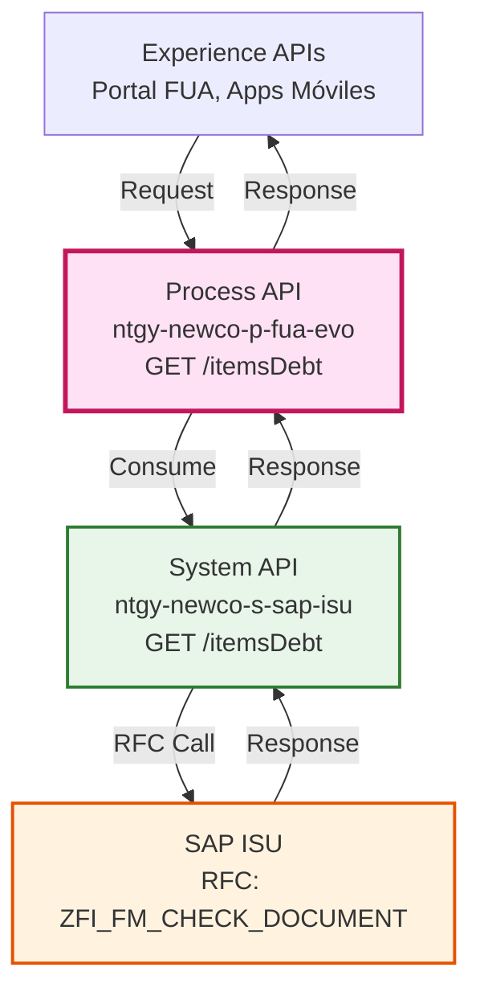
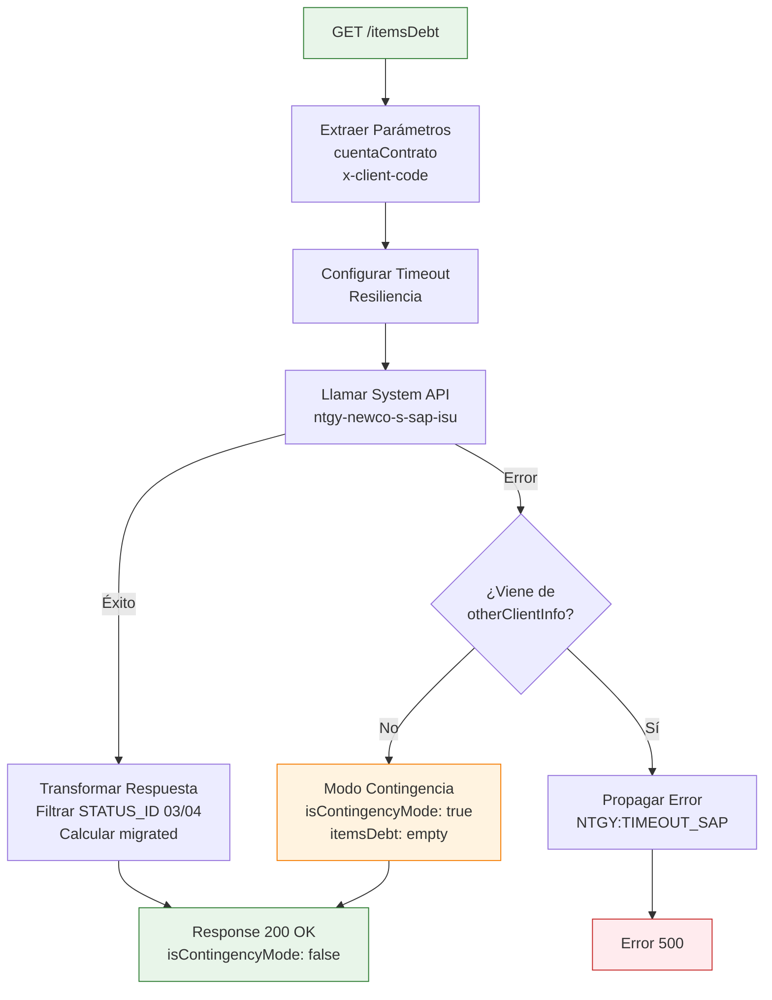
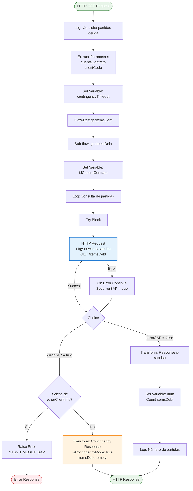
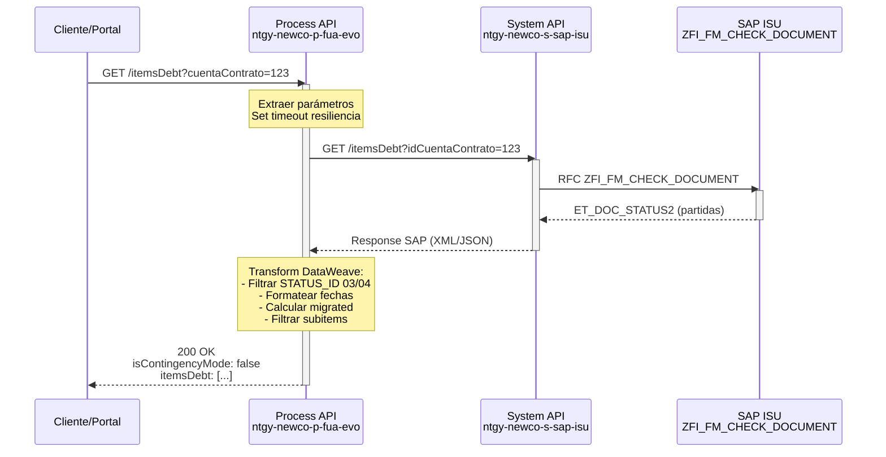
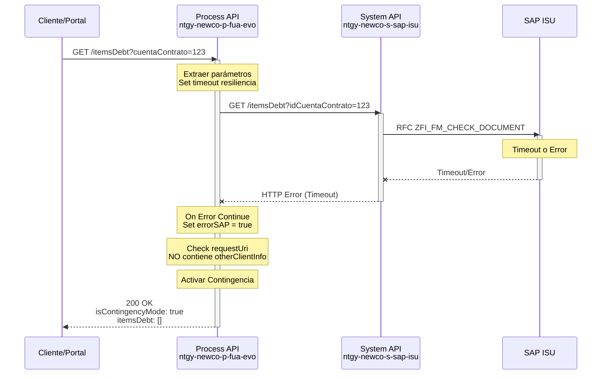
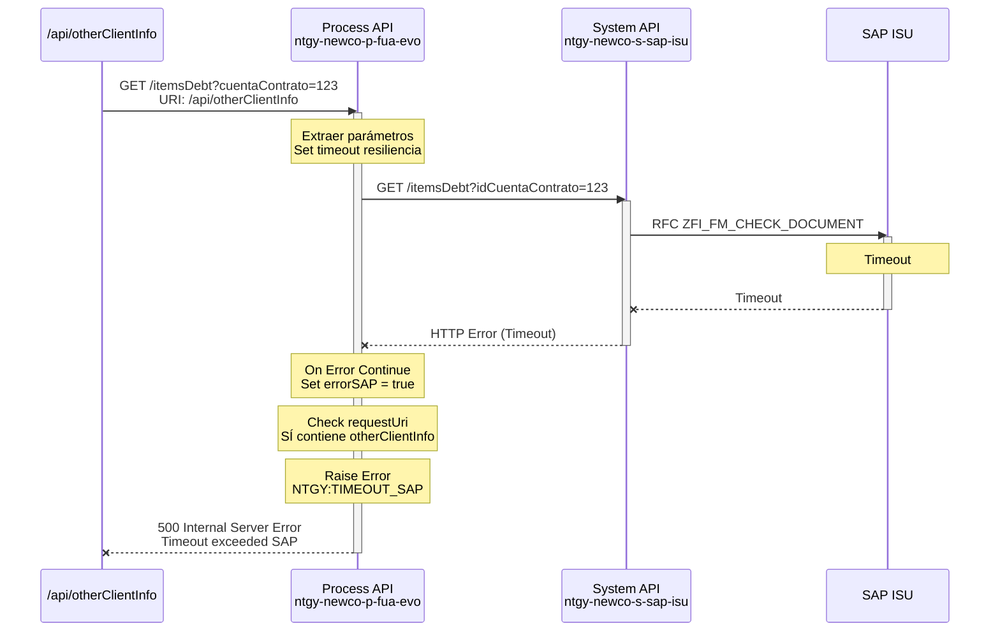

# GET /itemsDebt

## 📌 Descripción General

### Propósito del Endpoint

Este endpoint recupera las partidas de deuda (items de deuda) asociadas a una cuenta contrato específica desde SAP ISU. Implementa un mecanismo de contingencia que devuelve una respuesta vacía en caso de timeout o error de SAP, excepto cuando es llamado desde el endpoint `/api/otherClientInfo`, donde propaga el error.

### Tipo de API

**Capa:** Process API (API-Led Connectivity)

**Función:** Orquestación de consulta de partidas de deuda con resiliencia y contingencia

### Patrón de Integración

**Tipo:** Pass-Through con Contingencia

**Descripción:** Consulta directa a System API SAP ISU con transformación de respuesta y manejo especial de errores según contexto de invocación.

### Arquitectura API-Led Connectivity



---

## 💼 Propósito del Negocio

### Casos de Uso Principales

1. **Consulta de Deuda Pendiente**
   - Permite a los clientes visualizar todas las partidas de deuda asociadas a su cuenta contrato
   - Facilita la gestión de pagos y planificación financiera

2. **Gestión de Pagos Fraccionados**
   - Proporciona información detallada de partidas para configurar planes de pago
   - Identifica partidas elegibles para fraccionamiento

3. **Información Completa del Cliente (otherClientInfo)**
   - Forma parte del conjunto de datos agregados del cliente
   - En este contexto, los errores se propagan para mantener integridad de datos

4. **Identificación de Deuda Migrada**
   - Detecta partidas migradas de sistemas legacy basándose en tipo de documento y fecha de vencimiento
   - Permite tratamiento diferenciado de deuda histórica

### 🔗 Endpoints Dependientes

Este Process API consume el siguiente System API:

| System API | Endpoint | Método | Propósito |
|------------|----------|--------|-----------|
| `ntgy-newco-s-sap-isu` | `/estadoPago` | GET | Consulta partidas de deuda en SAP ISU mediante RFC ZFI_FM_CHECK_DOCUMENT |

### Lógica de Orquestación



**Pasos del Proceso:**

1. **Extracción de Parámetros**: Obtiene `cuentaContrato` y `x-client-code` de la request
2. **Configuración de Timeout**: Establece timeout de resiliencia desde propiedades
3. **Llamada a SAP ISU**: Invoca System API con parámetros
4. **Manejo de Errores Contextual**:
   - Si viene de `/api/otherClientInfo` → Propaga error de timeout
   - Si viene de otro endpoint → Activa modo contingencia
5. **Transformación de Respuesta**: Filtra, formatea y enriquece datos de SAP
6. **Cálculo de Migración**: Identifica partidas migradas según reglas de negocio

### Transformaciones Aplicadas

**Transformación Principal (DataWeave):**

| Campo SAP (ZFI_FM_CHECK_DOCUMENT) | Campo API | Transformación |
|-----------------------------------|-----------|----------------|
| `VKONT` | `cuentaContrato` | Elimina ceros iniciales (^00) |
| `BETRW_PENDIENTE` | `pendingAmount` | Conversión a Number, default 0 |
| `BUDAT` | `issuedDate` | Formato: "E MMM dd HH:mm:ss z yyyy" → "yyyy-MM-dd HH:mm:ss" |
| `BUDAT_OP` | `dueDate` | Formato: "E MMM dd HH:mm:ss z yyyy" → "yyyy-MM-dd HH:mm:ss" |
| `OPBEL` | `opbel` | Pass-through |
| `STEP` | `step` | Pass-through |
| `BLART + FAEDN` | `migrated` | Calculado: true si BLART=="MC" y FAEDN < now() |
| `ITEMS.*row` | `items` | Array de subitems filtrados y deduplicados por OPUPK |

**Filtros Aplicados:**
- Solo partidas con `STATUS_ID == '03' o '04'`
- Subitems con `STATUS_ID == '03' o '04'`
- Deduplicación de subitems por `OPUPK`

**Lógica de Migración:**
```dataweave
migrated: if(item.BLART == "MC" and 
             (item.FAEDN < (now() as DateTime {format: "E MMM dd HH:mm:ss z yyyy"}))) 
          true 
          else false
```

### Contexto Empresarial

- **Dominio:** Gestión de Deuda y Facturación
- **Sector:** Energía - Utilities
- **División:** Naturgy España - NewCo
- **Proceso de Negocio:** Consulta de Partidas de Deuda para Gestión de Cobros

### Stakeholders

- **Clientes Finales**: Necesitan visibilidad de su deuda pendiente para planificar pagos
- **Departamento de Cobros**: Requiere información precisa para gestión de recaudación
- **Agentes de Call Center**: Necesitan acceso rápido a información de deuda del cliente
- **Sistema de Pagos**: Consume esta información para procesar pagos y fraccionamientos

### Valor de Negocio

- **Transparencia Financiera**: Clientes pueden ver detalle completo de su deuda
- **Reducción de Llamadas**: Autoservicio reduce carga en call center
- **Resiliencia Operativa**: Modo contingencia mantiene disponibilidad del portal
- **Gestión Proactiva**: Identificación de deuda migrada permite tratamiento diferenciado

### Consumidores Potenciales

Este endpoint puede ser consumido por:
- Portal web FUA
- Aplicaciones móviles de clientes
- Sistemas de agentes de call center
- Endpoint agregador `/api/otherClientInfo`
- Sistemas de gestión de cobros

---

## 🔧 Especificación Técnica

### URLs por Ambiente

| Ambiente | URL Base | URL Completa |
|----------|----------|--------------|
| **Local** | `http://localhost:8081` | `http://localhost:8081/api/itemsDebt?cuentaContrato=:cuentaContrato` |
| **Development** | `https://ntgy-newco-p-fua-evo-dev.us-e2.cloudhub.io` | `https://ntgy-newco-p-fua-evo-dev.us-e2.cloudhub.io/api/itemsDebt?cuentaContrato=:cuentaContrato` |
| **UAT** | `https://ntgy-newco-p-fua-evo-uat.us-e2.cloudhub.io` | `https://ntgy-newco-p-fua-evo-uat.us-e2.cloudhub.io/api/itemsDebt?cuentaContrato=:cuentaContrato` |
| **Production** | `https://ntgy-newco-p-fua-evo-pro.us-e2.cloudhub.io` | `https://ntgy-newco-p-fua-evo-pro.us-e2.cloudhub.io/api/itemsDebt?cuentaContrato=:cuentaContrato` |

### Método HTTP

```
GET /api/itemsDebt
```

### Parámetros de Entrada

#### Query Parameters

| Parámetro | Tipo | Requerido | Descripción | Ejemplo |
|-----------|------|-----------|-------------|---------|
| `cuentaContrato` | String | ✅ Sí | Identificador de la cuenta contrato en SAP ISU | `"1234567890"` |

#### Headers

| Header | Tipo | Requerido | Descripción | Ejemplo |
|--------|------|-----------|-------------|---------|
| `x-client-code` | String | ✅ Sí | Código del cliente para enrutamiento | `"NEWCO"` |
| `Content-Type` | String | ✅ Sí | Tipo de contenido | `"application/json"` |

### Respuestas

#### 200 OK - Éxito (Modo Normal)

```json
{
  "isContingencyMode": false,
  "itemsDebt": [
    {
      "cuentaContrato": "1234567890",
      "pendingAmount": 150.75,
      "issuedDate": "2024-01-15 00:00:00",
      "dueDate": "2024-02-15 00:00:00",
      "opbel": "OP123456",
      "step": "1",
      "migrated": false,
      "items": [
        {
          "opupk": "ITEM001"
        },
        {
          "opupk": "ITEM002"
        }
      ]
    }
  ]
}
```

**Campos de Respuesta:**

| Campo | Tipo | Descripción |
|-------|------|-------------|
| `isContingencyMode` | Boolean | Indica si la respuesta es de contingencia (false = datos reales) |
| `itemsDebt` | Array | Lista de partidas de deuda |
| `itemsDebt[].cuentaContrato` | String | Cuenta contrato sin ceros iniciales |
| `itemsDebt[].pendingAmount` | Number | Importe pendiente de pago |
| `itemsDebt[].issuedDate` | String | Fecha de emisión (formato: yyyy-MM-dd HH:mm:ss) |
| `itemsDebt[].dueDate` | String | Fecha de vencimiento (formato: yyyy-MM-dd HH:mm:ss) |
| `itemsDebt[].opbel` | String | Número de documento de partida individual |
| `itemsDebt[].step` | String | Paso o estado de la partida |
| `itemsDebt[].migrated` | Boolean | Indica si es deuda migrada (BLART="MC" y vencida) |
| `itemsDebt[].items` | Array | Subitems de la partida |
| `itemsDebt[].items[].opupk` | String | Identificador único del subitem |

#### 200 OK - Modo Contingencia

```json
{
  "isContingencyMode": true,
  "itemsDebt": []
}
```

**Cuándo se activa:**
- Timeout en llamada a SAP ISU
- Error de conectividad con SAP
- Error en procesamiento de SAP
- **Excepción:** NO se activa si la request viene de `/api/otherClientInfo`

#### 400 Bad Request

```json
{
  "code": "BAD_REQUEST",
  "message": "Parámetro cuentaContrato es requerido",
  "timestamp": "2024-01-15T10:30:00Z"
}
```

#### 500 Internal Server Error

```json
{
  "code": "NTGY:TIMEOUT_SAP",
  "message": "Timeout exceeded SAP",
  "timestamp": "2024-01-15T10:30:00Z"
}
```

**Cuándo se devuelve:**
- Solo cuando la request viene de `/api/otherClientInfo` y hay timeout de SAP

### Autenticación

- **Tipo:** Client ID & Client Secret (Anypoint Platform)
- **Headers requeridos:**
  - `client_id`: ID de la aplicación cliente
  - `client_secret`: Secret de la aplicación cliente

### Timeouts

| Tipo | Valor | Configuración |
|------|-------|---------------|
| **Timeout Resiliencia** | Configurable | `${ntgy-newco-s-sap.response.timeoutResilienciaDebt}` |
| **Timeout Default** | Configurable | `${ntgy-newco-s-sap.response.timeoutDebtDefault}` |
| **Comportamiento** | Fallback | Si no hay timeout de resiliencia, usa timeout default |

---

## 🏗️ Implementación Técnica

### Arquitectura del Flow



### Transformaciones DataWeave

#### Transformación de Respuesta Normal

**Ubicación:** Inline en `getItemsDebt.xml` (líneas 42-71)

```dataweave
%dw 2.0
output application/json

fun formatDate(fecha : String|Null) = 
    fecha as DateTime {format: "E MMM dd HH:mm:ss z yyyy"} 
         as DateTime as String {format: 'yyyy-MM-dd HH:mm:ss'} 
         default ""

var content = payload.ZFI_FM_CHECK_DOCUMENT.export.ET_DOC_STATUS2.*row

---
{
    "isContingencyMode": false,
    "itemsDebt": content filter ((item1, index) -> 
        item1.STATUS_ID == '03' or item1.STATUS_ID == '04'
    ) map ((item, index) -> {
        "cuentaContrato": item.VKONT replace /^00/ with "",
        "pendingAmount": item.BETRW_PENDIENTE as Number default 0,
        "issuedDate": formatDate(item.BUDAT),
        "dueDate": formatDate(item.BUDAT_OP),
        "opbel": item.OPBEL,
        "step": item.STEP,
        "migrated": if(item.BLART == "MC" and 
                      (item.FAEDN < (now() as DateTime {format: "E MMM dd HH:mm:ss z yyyy"}))) 
                    true 
                    else false,
        "items": (item.ITEMS.*row filter ((subitem, index) -> 
            subitem.STATUS_ID == "03" or subitem.STATUS_ID == "04"
        ) distinctBy ((item3, index) -> item3.OPUPK)) map ((subitem, index) -> {
            "opupk": subitem.OPUPK
        })
    }) default []
}
```

**Lógica Clave:**
1. **Función formatDate**: Convierte fechas de formato SAP a ISO
2. **Filtro Principal**: Solo STATUS_ID '03' o '04'
3. **Limpieza de Cuenta**: Elimina ceros iniciales con regex
4. **Cálculo de Migración**: Compara BLART y fecha de vencimiento
5. **Filtro de Subitems**: Aplica mismo filtro de STATUS_ID
6. **Deduplicación**: `distinctBy` elimina subitems duplicados por OPUPK

#### Transformación de Contingencia

**Ubicación:** Inline en `getItemsDebt.xml` (líneas 32-40)

```dataweave
%dw 2.0
output application/json
---
{
    "isContingencyMode": true,
    "itemsDebt": []
}
```

### Configuración de Timeout

**Variables utilizadas:**

```xml
<!-- Timeout de resiliencia (configurable por endpoint) -->
<set-variable 
    value="${ntgy-newco-s-sap.response.timeoutResilienciaDebt}" 
    variableName="contingencyTimeout"/>

<!-- En HTTP Request -->
<http:request 
    responseTimeout="#[vars.contingencyTimeout default p('ntgy-newco-s-sap.response.timeoutDebtDefault')]">
```

**Estrategia:**
1. Intenta usar timeout específico de resiliencia para deuda
2. Si no existe, usa timeout default de deuda
3. Permite configuración granular por tipo de operación

### Patrones de Diseño

**Patrón 1: Contingency Pattern**

**Justificación:** Mantiene disponibilidad del portal FUA incluso cuando SAP ISU no responde, evitando que un timeout de backend afecte la experiencia del usuario.

**Implementación:**
- Try-catch en llamada a SAP
- Variable `errorSAP` para tracking de errores
- Respuesta vacía con flag `isContingencyMode: true`

**Patrón 2: Context-Aware Error Handling**

**Justificación:** Diferentes consumidores tienen diferentes requisitos de integridad de datos. El endpoint `/api/otherClientInfo` necesita datos completos o error, mientras que otros endpoints pueden tolerar datos parciales.

**Implementación:**
```xml
<choice>
    <when expression="#[attributes.requestUri contains '/api/otherClientInfo']">
        <raise-error type="NTGY:TIMEOUT_SAP" description="Timeout exceeded SAP"/>
    </when>
    <otherwise>
        <!-- Modo contingencia -->
    </otherwise>
</choice>
```

**Patrón 3: Configurable Timeout**

**Justificación:** Permite ajustar timeouts sin redesplegar la aplicación, facilitando optimización de resiliencia en producción.

### Diagramas de Secuencia

#### 1. Flujo Normal de Éxito



#### 2. Flujo con Modo Contingencia (Timeout SAP)



#### 3. Flujo con Error Propagado (desde otherClientInfo)



### Manejo de Errores

#### Estrategia de Error Handling

```xml
<try>
    <http:request method="GET" path="${ntgy-newco-s-sap.functions.getItemsDebt}">
        <!-- Llamada a SAP -->
    </http:request>
    
    <error-handler>
        <on-error-continue type="ANY">
            <set-variable value="#[true]" variableName="errorSAP"/>
            <logger level="INFO" message="La llamada a SAP para recuperar las partidas de deuda de la cuenta contrato #[vars.idCuentaContrato] ha fallado"/>
        </on-error-continue>
    </error-handler>
</try>
```

**Tipos de Error Manejados:**

| Error | Acción | Respuesta |
|-------|--------|-----------|
| **Timeout SAP** (desde otherClientInfo) | Propagar error | 500 - NTGY:TIMEOUT_SAP |
| **Timeout SAP** (otros endpoints) | Modo contingencia | 200 - isContingencyMode: true |
| **Error de Conectividad** | Modo contingencia | 200 - isContingencyMode: true |
| **Error de Validación** | Error estándar | 400 - Bad Request |
| **Error Interno** | Error estándar | 500 - Internal Server Error |

#### Logging

```xml
<!-- Log de inicio -->
<logger level="INFO" message="Consulta de partidas de deuda del cliente #[vars.idCuentaContrato]"/>

<!-- Log de error -->
<logger level="INFO" message="La llamada a SAP para recuperar las partidas de deuda de la cuenta contrato #[vars.idCuentaContrato] ha fallado"/>

<!-- Log de contingencia -->
<logger level="INFO" message="Respuesta de contingencia para timeout SAP - itemsDebt"/>

<!-- Log de éxito -->
<logger level="INFO" message="Se han devuelto #[vars.num] partidas de deuda para la cuenta contrato: #[vars.idCuentaContrato]"/>
```

---

## 💻 Ejemplos de Uso

### Ejemplo 1: Consulta Exitosa con Partidas de Deuda

#### cURL

```bash
curl -X GET "https://ntgy-newco-p-fua-evo-dev.us-e2.cloudhub.io/api/itemsDebt?cuentaContrato=1234567890" \
  -H "Content-Type: application/json" \
  -H "x-client-code: NEWCO" \
  -H "client_id: YOUR_CLIENT_ID" \
  -H "client_secret: YOUR_CLIENT_SECRET"
```

#### Respuesta (200 OK)

```json
{
  "isContingencyMode": false,
  "itemsDebt": [
    {
      "cuentaContrato": "1234567890",
      "pendingAmount": 150.75,
      "issuedDate": "2024-01-15 00:00:00",
      "dueDate": "2024-02-15 00:00:00",
      "opbel": "OP123456",
      "step": "1",
      "migrated": false,
      "items": [
        {
          "opupk": "ITEM001"
        },
        {
          "opupk": "ITEM002"
        }
      ]
    },
    {
      "cuentaContrato": "1234567890",
      "pendingAmount": 89.50,
      "issuedDate": "2024-02-01 00:00:00",
      "dueDate": "2024-03-01 00:00:00",
      "opbel": "OP123457",
      "step": "2",
      "migrated": false,
      "items": [
        {
          "opupk": "ITEM003"
        }
      ]
    }
  ]
}
```

### Ejemplo 2: Consulta con Deuda Migrada

#### cURL

```bash
curl -X GET "https://ntgy-newco-p-fua-evo-dev.us-e2.cloudhub.io/api/itemsDebt?cuentaContrato=9876543210" \
  -H "Content-Type: application/json" \
  -H "x-client-code: NEWCO" \
  -H "client_id: YOUR_CLIENT_ID" \
  -H "client_secret: YOUR_CLIENT_SECRET"
```

#### Respuesta (200 OK)

```json
{
  "isContingencyMode": false,
  "itemsDebt": [
    {
      "cuentaContrato": "9876543210",
      "pendingAmount": 250.00,
      "issuedDate": "2020-06-15 00:00:00",
      "dueDate": "2020-07-15 00:00:00",
      "opbel": "OP999888",
      "step": "1",
      "migrated": true,
      "items": [
        {
          "opupk": "LEGACY001"
        }
      ]
    }
  ]
}
```

**Nota:** El campo `migrated: true` indica que esta partida fue migrada de un sistema legacy (BLART="MC") y ya está vencida.

### Ejemplo 3: Modo Contingencia (Timeout SAP)

#### cURL

```bash
curl -X GET "https://ntgy-newco-p-fua-evo-dev.us-e2.cloudhub.io/api/itemsDebt?cuentaContrato=1234567890" \
  -H "Content-Type: application/json" \
  -H "x-client-code: NEWCO" \
  -H "client_id: YOUR_CLIENT_ID" \
  -H "client_secret: YOUR_CLIENT_SECRET"
```

#### Respuesta (200 OK - Contingencia)

```json
{
  "isContingencyMode": true,
  "itemsDebt": []
}
```

**Nota:** Esta respuesta se devuelve cuando SAP ISU no responde a tiempo, permitiendo que el portal FUA continúe funcionando sin mostrar error al usuario.

### Ejemplo 4: Sin Partidas de Deuda

#### cURL

```bash
curl -X GET "https://ntgy-newco-p-fua-evo-dev.us-e2.cloudhub.io/api/itemsDebt?cuentaContrato=5555555555" \
  -H "Content-Type: application/json" \
  -H "x-client-code: NEWCO" \
  -H "client_id: YOUR_CLIENT_ID" \
  -H "client_secret: YOUR_CLIENT_SECRET"
```

#### Respuesta (200 OK)

```json
{
  "isContingencyMode": false,
  "itemsDebt": []
}
```

**Nota:** Array vacío con `isContingencyMode: false` indica que la consulta fue exitosa pero no hay partidas de deuda pendientes.

### Ejemplo 5: JavaScript (Fetch API)

```javascript
const getItemsDebt = async (cuentaContrato, clientCode) => {
  try {
    const response = await fetch(
      `https://ntgy-newco-p-fua-evo-dev.us-e2.cloudhub.io/api/itemsDebt?cuentaContrato=${cuentaContrato}`,
      {
        method: 'GET',
        headers: {
          'Content-Type': 'application/json',
          'x-client-code': clientCode,
          'client_id': 'YOUR_CLIENT_ID',
          'client_secret': 'YOUR_CLIENT_SECRET'
        }
      }
    );

    const data = await response.json();
    
    if (data.isContingencyMode) {
      console.warn('SAP ISU no disponible - Modo contingencia activado');
      return { success: true, contingency: true, items: [] };
    }
    
    console.log(`Partidas de deuda encontradas: ${data.itemsDebt.length}`);
    return { success: true, contingency: false, items: data.itemsDebt };
    
  } catch (error) {
    console.error('Error al consultar partidas de deuda:', error);
    throw error;
  }
};

// Uso
getItemsDebt('1234567890', 'NEWCO')
  .then(result => {
    if (result.contingency) {
      // Mostrar mensaje al usuario sobre disponibilidad limitada
      console.log('Información de deuda temporalmente no disponible');
    } else {
      // Procesar partidas de deuda
      result.items.forEach(item => {
        console.log(`Partida: ${item.opbel}, Importe: ${item.pendingAmount}€`);
      });
    }
  });
```

### Ejemplo 6: Python (Requests)

```python
import requests
from typing import Dict, List, Optional

def get_items_debt(cuenta_contrato: str, client_code: str) -> Dict:
    """
    Consulta las partidas de deuda de una cuenta contrato.
    
    Args:
        cuenta_contrato: Identificador de la cuenta contrato
        client_code: Código del cliente (NEWCO, IMPERIAL, etc.)
    
    Returns:
        Dict con información de partidas de deuda y modo contingencia
    """
    url = "https://ntgy-newco-p-fua-evo-dev.us-e2.cloudhub.io/api/itemsDebt"
    
    headers = {
        'Content-Type': 'application/json',
        'x-client-code': client_code,
        'client_id': 'YOUR_CLIENT_ID',
        'client_secret': 'YOUR_CLIENT_SECRET'
    }
    
    params = {
        'cuentaContrato': cuenta_contrato
    }
    
    try:
        response = requests.get(url, headers=headers, params=params, timeout=30)
        response.raise_for_status()
        
        data = response.json()
        
        if data.get('isContingencyMode', False):
            print(f"⚠️ Modo contingencia activado - SAP ISU no disponible")
            return {
                'success': True,
                'contingency': True,
                'items': [],
                'message': 'Información temporalmente no disponible'
            }
        
        items = data.get('itemsDebt', [])
        print(f"✅ {len(items)} partidas de deuda encontradas")
        
        # Calcular total de deuda
        total_debt = sum(item.get('pendingAmount', 0) for item in items)
        
        # Identificar partidas migradas
        migrated_items = [item for item in items if item.get('migrated', False)]
        
        return {
            'success': True,
            'contingency': False,
            'items': items,
            'total_debt': total_debt,
            'migrated_count': len(migrated_items)
        }
        
    except requests.exceptions.Timeout:
        print("❌ Timeout al consultar partidas de deuda")
        raise
    except requests.exceptions.RequestException as e:
        print(f"❌ Error en la petición: {e}")
        raise

# Uso
if __name__ == "__main__":
    result = get_items_debt('1234567890', 'NEWCO')
    
    if result['contingency']:
        print("Sistema en modo contingencia")
    else:
        print(f"Total deuda: {result['total_debt']}€")
        print(f"Partidas migradas: {result['migrated_count']}")
        
        for item in result['items']:
            status = "MIGRADA" if item.get('migrated') else "ACTIVA"
            print(f"  - {item['opbel']}: {item['pendingAmount']}€ [{status}]")
```

### Ejemplo 7: Error desde otherClientInfo

#### cURL

```bash
# Simulación de llamada desde /api/otherClientInfo
curl -X GET "https://ntgy-newco-p-fua-evo-dev.us-e2.cloudhub.io/api/itemsDebt?cuentaContrato=1234567890" \
  -H "Content-Type: application/json" \
  -H "x-client-code: NEWCO" \
  -H "Referer: https://ntgy-newco-p-fua-evo-dev.us-e2.cloudhub.io/api/otherClientInfo" \
  -H "client_id: YOUR_CLIENT_ID" \
  -H "client_secret: YOUR_CLIENT_SECRET"
```

#### Respuesta (500 Internal Server Error)

```json
{
  "code": "NTGY:TIMEOUT_SAP",
  "message": "Timeout exceeded SAP",
  "timestamp": "2024-01-15T10:30:00Z"
}
```

**Nota:** Cuando la llamada proviene de `/api/otherClientInfo`, los errores de SAP se propagan en lugar de activar el modo contingencia, para mantener la integridad de los datos agregados.
