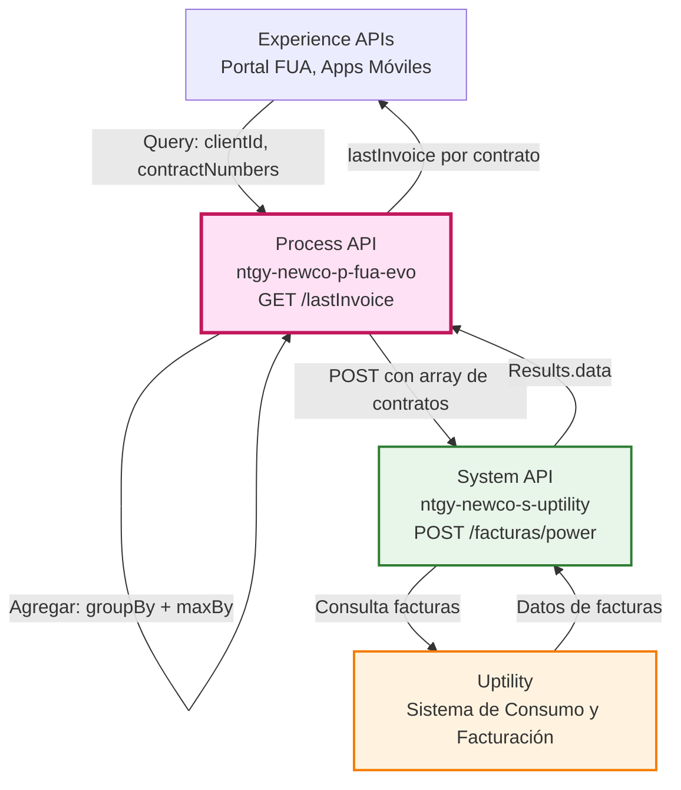
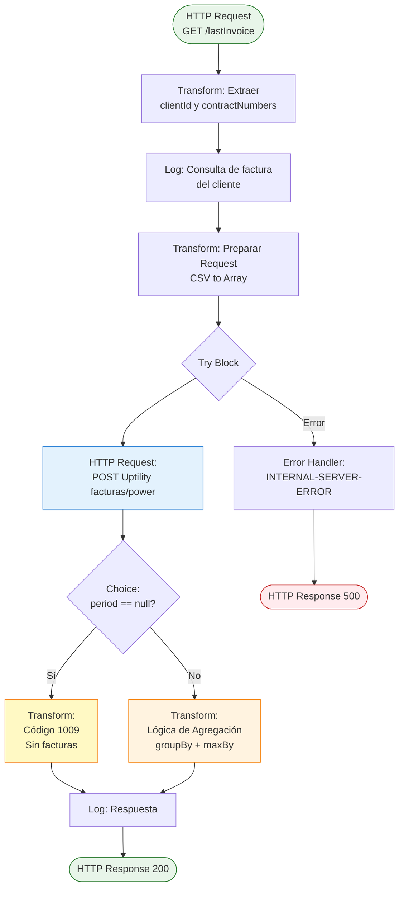
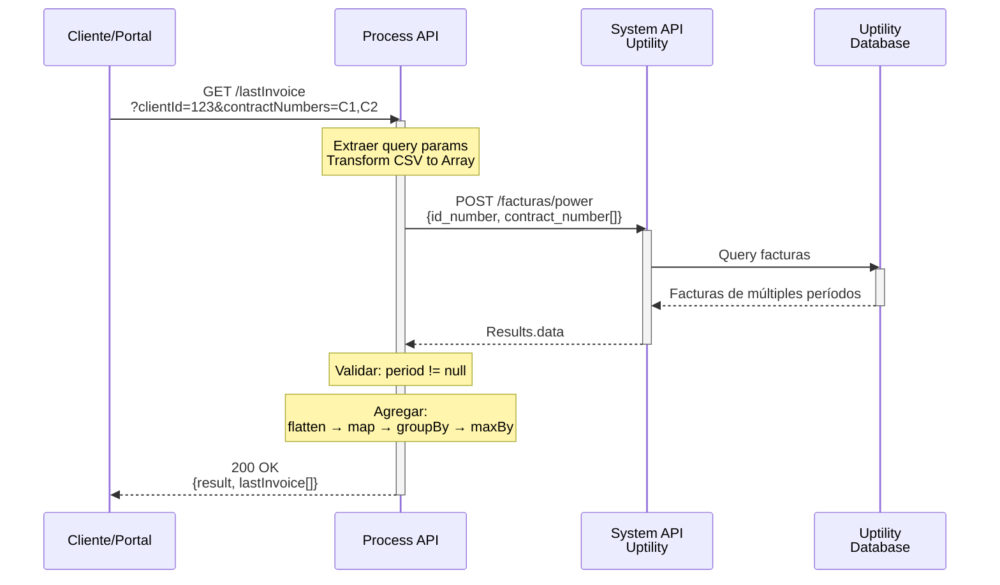
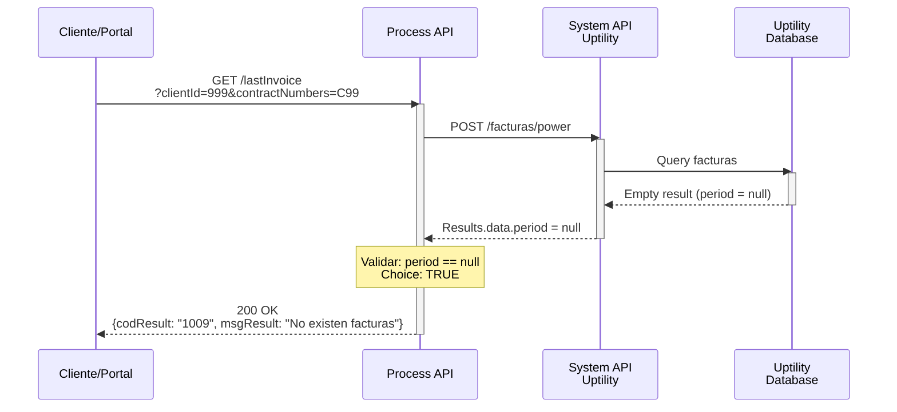
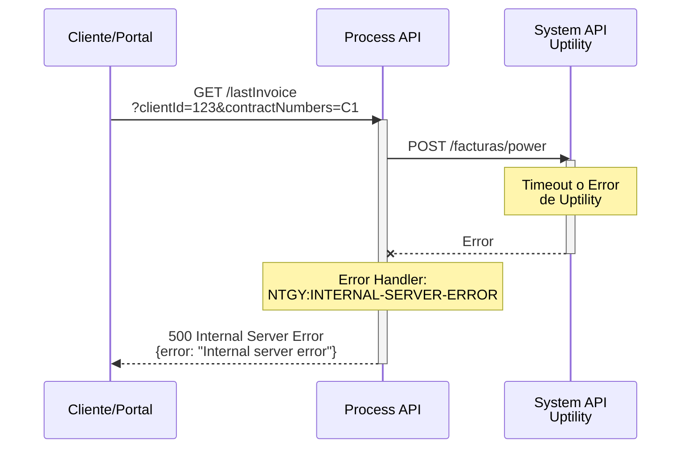

# GET /lastInvoice

## 📌 Descripción General

### Propósito del Endpoint

Este endpoint recupera la fecha de última emisión de facturas desde Uptility para uno o múltiples contratos de un cliente. Realiza una agregación inteligente que agrupa las facturas por contrato y selecciona el período más reciente para cada uno, proporcionando una vista consolidada de la última facturación por contrato.

### Tipo de API

**Capa:** Process API (API-Led Connectivity)

**Función:** Transformación y agregación de datos de facturación desde Uptility

### Patrón de Integración

**Tipo:** Transformación con Agregación Compleja

**Descripción:** 
1. Transforma query parameters (CSV → Array)
2. Consulta Uptility para obtener facturas de múltiples contratos
3. Aplica lógica de agregación compleja (groupBy + maxBy)
4. Retorna última factura por contrato

### Arquitectura API-Led Connectivity



---

## 💼 Propósito del Negocio

### Casos de Uso Principales

1. **Consulta de Última Factura Emitida**
   - Los clientes pueden verificar cuándo fue su última facturación
   - Beneficio: Transparencia en el ciclo de facturación

2. **Gestión Multi-Contrato**
   - Consulta simultánea de múltiples contratos de un cliente
   - Beneficio: Vista consolidada de todas las facturas del cliente

3. **Validación de Facturación Activa**
   - Detecta si un cliente tiene facturas emitidas
   - Beneficio: Identificación de contratos sin actividad de facturación

### 🔗 Endpoints Dependientes

Este Process API consume el siguiente System API:

| System API | Endpoint | Método | Propósito |
|------------|----------|--------|-----------|
| `ntgy-newco-s-uptility` | `/facturas/power` | POST | Obtener datos de facturas de Uptility por cliente y contratos |

### Lógica de Agregación

```mermaid
graph LR
    P[Process API] --> T1[Transform:<br/>CSV to Array]
    T1 --> S[System API<br/>Uptility]
    S --> U[Uptility<br/>Database]
    U --> R[Results.data<br/>Múltiples facturas]
    R --> A1[Flatten<br/>Aplanar estructura]
    A1 --> A2[Map<br/>Extraer contract_id + period]
    A2 --> A3[GroupBy<br/>Agrupar por contract_id]
    A3 --> A4[MaxBy<br/>Período más reciente]
    A4 --> F[lastInvoice<br/>Array por contrato]
    
    style P fill:#ffe1f5
    style S fill:#e8f5e9
    style U fill:#fff3e0
    style A1 fill:#e3f2fd
    style A2 fill:#e3f2fd
    style A3 fill:#e3f2fd
    style A4 fill:#e3f2fd
```



**Pasos del Proceso de Agregación:**

1. **Flatten**: Aplana la estructura de datos anidada
2. **Map**: Extrae `contract_id` y `period` de cada factura
3. **GroupBy**: Agrupa facturas por `contract_id`
4. **MaxBy**: Selecciona el período más reciente para cada contrato
5. **Result**: Array con última factura por contrato

### Transformaciones Aplicadas

**Transformación de Query Parameters:**

| Parámetro Original | Transformación | Resultado |
|-------------------|----------------|-----------|
| `contractNumbers` (CSV) | `splitBy(",")` | Array de strings |
| `clientId` (string) | Sin cambio | String |

**Transformación de Respuesta Uptility:**

| Campo Original | Campo Transformado | Transformación |
|----------------|-------------------|----------------|
| `Results.data[].contract_id` | `lastInvoice[].contract_id` | Agrupación por contrato |
| `Results.data[].period` | `lastInvoice[].period` | MaxBy (período más reciente) |

### Contexto Empresarial

- **Dominio:** Facturación y Billing
- **Sector:** Energía - Utilities
- **División:** Naturgy España - NewCo
- **Proceso de Negocio:** Consulta de información de facturación para clientes

### Stakeholders

- **Clientes Residenciales**: Necesitan conocer su última fecha de facturación
- **Agentes de Call Center**: Requieren información de facturación para atención al cliente
- **Departamento de Facturación**: Monitorean ciclos de facturación
- **Sistemas de Cobranza**: Verifican actividad de facturación

### Valor de Negocio

- **Transparencia**: Clientes informados sobre su ciclo de facturación
- **Eficiencia**: Consulta multi-contrato en una sola llamada
- **Detección Temprana**: Identifica contratos sin facturación activa
- **Soporte al Cliente**: Información precisa para resolución de consultas

### Consumidores Potenciales

Este endpoint puede ser consumido por:
- Portal web de autoservicio FUA
- Aplicaciones móviles de clientes
- Sistemas de agentes de call center
- Dashboards de facturación
- Sistemas de alertas y notificaciones

---

## 🔧 Especificación Técnica

### URLs por Ambiente

| Ambiente | URL Base | URL Completa |
|----------|----------|--------------|
| **Local** | `http://localhost:8081` | `http://localhost:8081/api/lastInvoice?clientId=123&contractNumbers=C1,C2` |
| **Development** | `https://ntgy-newco-p-fua-evo-dev.us-e2.cloudhub.io` | `https://ntgy-newco-p-fua-evo-dev.us-e2.cloudhub.io/api/lastInvoice?clientId=123&contractNumbers=C1,C2` |
| **UAT** | `https://ntgy-newco-p-fua-evo-uat.us-e2.cloudhub.io` | `https://ntgy-newco-p-fua-evo-uat.us-e2.cloudhub.io/api/lastInvoice?clientId=123&contractNumbers=C1,C2` |
| **Production** | `https://ntgy-newco-p-fua-evo-pro.us-e2.cloudhub.io` | `https://ntgy-newco-p-fua-evo-pro.us-e2.cloudhub.io/api/lastInvoice?clientId=123&contractNumbers=C1,C2` |

### Método HTTP

```
GET /api/lastInvoice
```

### Parámetros de Entrada

#### Query Parameters (Requeridos)

| Parámetro | Tipo | Descripción | Ejemplo | Formato |
|-----------|------|-------------|---------|---------|
| `clientId` | string | ID del cliente en Uptility | `"12345"` | Numérico |
| `contractNumbers` | string | Números de contrato separados por comas | `"C001,C002,C003"` | CSV (Comma-Separated Values) |

**Nota sobre contractNumbers:**
- Formato CSV: valores separados por comas sin espacios
- Se transformará internamente a array
- Puede contener uno o múltiples contratos

#### Headers

| Header | Tipo | Descripción | Requerido |
|--------|------|-------------|-----------|
| `Content-Type` | string | Tipo de contenido | Sí |
| `client_id` | string | Client ID de Anypoint Platform | Sí |
| `client_secret` | string | Client Secret de Anypoint Platform | Sí |

#### Body

No requiere body (método GET).

### Respuestas

#### 200 OK - Éxito con Facturas

**Descripción:** Última factura por contrato recuperada exitosamente.

**Estructura de Respuesta:**

```json
{
  "result": {
    "codResult": "0000",
    "msgResult": "No hay error"
  },
  "lastInvoice": [
    {
      "contract_id": "string",
      "period": "string"
    }
  ]
}
```

**Campos de Respuesta:**

| Campo | Tipo | Descripción |
|-------|------|-------------|
| `result.codResult` | string | Código de resultado ("0000" = éxito) |
| `result.msgResult` | string | Mensaje descriptivo del resultado |
| `lastInvoice` | array | Array con última factura por contrato |
| `lastInvoice[].contract_id` | string | ID del contrato |
| `lastInvoice[].period` | string | Período de la última factura (formato: año) |

#### 200 OK - Sin Facturas

**Descripción:** Cliente válido pero sin facturas asociadas.

```json
{
  "result": {
    "codResult": "1009",
    "msgResult": "No existen facturas asociadas al cliente"
  }
}
```

**Código Específico:**
- `1009`: Indica que el cliente existe pero no tiene facturas en Uptility

#### 400 Bad Request - Error de Validación

**Descripción:** Parámetros inválidos o faltantes.

```json
{
  "error": {
    "code": "400",
    "message": "Parámetros requeridos faltantes: clientId o contractNumbers"
  }
}
```

#### 500 Internal Server Error - Error de Sistema

**Descripción:** Error al comunicarse con Uptility.

```json
{
  "error": {
    "code": "NTGY:INTERNAL-SERVER-ERROR",
    "message": "Internal server error"
  }
}
```

### Autenticación

- **Tipo:** Client ID & Client Secret (Anypoint Platform)
- **Headers Requeridos:** `client_id`, `client_secret`

### Timeouts

| Tipo | Valor |
|------|-------|
| **Request Timeout** | Configurado en `${ntgy-newco-s-uptility.timeout.facturas}` |
| **Connection Timeout** | 30 segundos (estándar) |

### Validaciones

1. **Query parameters requeridos:** clientId y contractNumbers son obligatorios
2. **Formato contractNumbers:** Debe ser CSV válido
3. **Existencia de facturas:** Valida si `period == null` en respuesta de Uptility

---

## 🏗️ Implementación Técnica

### Arquitectura del Flow



### Transformaciones DataWeave

#### 1. Extracción de Query Parameters

```dataweave
%dw 2.0
output application/java
---
{
    clientId: attributes.queryParams.'clientId',
    contractNumbers: attributes.queryParams.'contractNumbers'
}
```

#### 2. Preparación de Request a Uptility

```dataweave
%dw 2.0
output application/json
---
{
    "id_number": vars.clientId,
    "contract_number": vars.contractNumbers splitBy(",")
}
```

**Transformación Clave:**
- `splitBy(",")`: Convierte string CSV en array
- Ejemplo: `"C001,C002,C003"` → `["C001", "C002", "C003"]`

#### 3. Respuesta Sin Facturas

```dataweave
%dw 2.0
output application/json
---
{
    "result": {
        "codResult": "1009",
        "msgResult": "No existen facturas asociadas al cliente"
    }
}
```

#### 4. Agregación de Última Factura (Lógica Compleja)

```dataweave
%dw 2.0
output application/json
---
{
    "result": {
        "codResult": "0000",
        "msgResult": "No hay error"
    },
    "lastInvoice":
        entriesOf(
            flatten(
                payload.Results.data map ((item, index) -> 
                    (item.contract_id map {
                        contract_id: $,
                        period: (item.period splitBy(" "))[2]
                    })
                )
            ) groupBy ((item, index) -> item.contract_id)
        ) map ((item, index) -> 
            item.value maxBy ((item) -> item.period)
        )
}
```

**Explicación Paso a Paso de la Agregación:**

1. **`payload.Results.data map`**: Itera sobre cada elemento de datos
2. **`item.contract_id map`**: Para cada contrato en el item
3. **`period splitBy(" ")[2]`**: Extrae el año del período (ej: "Enero 2024" → "2024")
4. **`flatten`**: Aplana la estructura anidada en un array simple
5. **`groupBy contract_id`**: Agrupa facturas por ID de contrato
6. **`entriesOf`**: Convierte el objeto agrupado en array de entries
7. **`maxBy period`**: Selecciona la factura con el período más reciente
8. **Resultado**: Array con última factura por contrato

### Configuración HTTP

**HTTP Request Configuration:** `HTTP_Request_ntgy-newco-s-uptility`

**Endpoint Consumido:**
- **URL:** `${ntgy-newco-s-uptility.functions.facturas.power}`
- **Método:** POST
- **Timeout:** `${ntgy-newco-s-uptility.timeout.facturas}`

**Request Body:**
```json
{
  "id_number": "clientId",
  "contract_number": ["C001", "C002", "C003"]
}
```

### Variables de Flow

| Variable | Tipo | Descripción | Origen |
|----------|------|-------------|--------|
| `clientId` | string | ID del cliente | Query parameter |
| `contractNumbers` | string | Contratos en formato CSV | Query parameter |

### Patrones de Diseño

**Patrón:** Transformación con Agregación Compleja

**Justificación:** 
- Uptility retorna datos de múltiples facturas por contrato
- Se requiere lógica de agregación para obtener la más reciente
- DataWeave proporciona operadores funcionales (map, groupBy, maxBy)

**Patrón:** Choice para Validación de Negocio

**Justificación:**
- Diferencia entre "sin facturas" (1009) y "con facturas" (0000)
- Permite respuestas específicas según el caso de negocio

### Diagramas de Secuencia

#### 1. Flujo Normal de Éxito con Facturas



#### 2. Flujo Sin Facturas (Código 1009)



#### 3. Flujo con Error de Sistema



### Manejo de Errores

#### Estrategia de Error Handling

**Try-Catch Block:** Captura errores de comunicación con Uptility

**Error Type:** `NTGY:INTERNAL-SERVER-ERROR`

**On-Error-Continue:** Permite continuar el flujo con error controlado

**Clasificación de Errores:**

| Tipo de Error | HTTP Status | Código | Acción |
|---------------|-------------|--------|--------|
| Sin facturas | 200 | 1009 | Respuesta de negocio válida |
| Error Uptility | 500 | INTERNAL-SERVER-ERROR | Error de sistema |
| Parámetros faltantes | 400 | - | Validación de entrada |

#### Validación de Negocio

**Choice Condition:** `payload.Results.data.period == null`

**Casos:**
1. **period == null**: Cliente sin facturas → Código 1009
2. **period != null**: Cliente con facturas → Agregación y código 0000

### Logging

**Puntos de Logging:**

1. **Inicio:** Log con clientId consultado
2. **Fin:** Log con payload de respuesta

**Nivel de Log:** INFO

**Formato de Log:**
```
"Consulta de factura del cliente #[vars.clientId]"
```

---

## 💻 Ejemplos de Uso

### Ejemplo 1: Consulta Exitosa con Múltiples Contratos

#### Request

```bash
curl -X GET "https://ntgy-newco-p-fua-evo-dev.us-e2.cloudhub.io/api/lastInvoice?clientId=12345&contractNumbers=C001,C002,C003" \
  -H "Content-Type: application/json" \
  -H "client_id: YOUR_CLIENT_ID" \
  -H "client_secret: YOUR_CLIENT_SECRET"
```

#### Response (200 OK)

```json
{
  "result": {
    "codResult": "0000",
    "msgResult": "No hay error"
  },
  "lastInvoice": [
    {
      "contract_id": "C001",
      "period": "2026"
    },
    {
      "contract_id": "C002",
      "period": "2026"
    },
    {
      "contract_id": "C003",
      "period": "2025"
    }
  ]
}
```

### Ejemplo 2: Cliente Sin Facturas (Código 1009)

#### Request

```bash
curl -X GET "https://ntgy-newco-p-fua-evo-dev.us-e2.cloudhub.io/api/lastInvoice?clientId=99999&contractNumbers=C999" \
  -H "Content-Type: application/json" \
  -H "client_id: YOUR_CLIENT_ID" \
  -H "client_secret: YOUR_CLIENT_SECRET"
```

#### Response (200 OK)

```json
{
  "result": {
    "codResult": "1009",
    "msgResult": "No existen facturas asociadas al cliente"
  }
}
```

### Ejemplo 3: Consulta con Un Solo Contrato

#### Request

```bash
curl -X GET "https://ntgy-newco-p-fua-evo-dev.us-e2.cloudhub.io/api/lastInvoice?clientId=12345&contractNumbers=C001" \
  -H "Content-Type: application/json" \
  -H "client_id: YOUR_CLIENT_ID" \
  -H "client_secret: YOUR_CLIENT_SECRET"
```

#### Response (200 OK)

```json
{
  "result": {
    "codResult": "0000",
    "msgResult": "No hay error"
  },
  "lastInvoice": [
    {
      "contract_id": "C001",
      "period": "2026"
    }
  ]
}
```

### Ejemplo 4: Error de Sistema

#### Request

```bash
curl -X GET "https://ntgy-newco-p-fua-evo-dev.us-e2.cloudhub.io/api/lastInvoice?clientId=12345&contractNumbers=C001" \
  -H "Content-Type: application/json" \
  -H "client_id: YOUR_CLIENT_ID" \
  -H "client_secret: YOUR_CLIENT_SECRET"
```

#### Response (500 Internal Server Error)

```json
{
  "error": {
    "code": "NTGY:INTERNAL-SERVER-ERROR",
    "message": "Internal server error"
  }
}
```

### Ejemplo 5: JavaScript (Fetch API)

```javascript
const getLastInvoice = async (clientId, contractNumbers) => {
  // contractNumbers puede ser array o string CSV
  const contracts = Array.isArray(contractNumbers) 
    ? contractNumbers.join(',') 
    : contractNumbers;
  
  const url = new URL('https://ntgy-newco-p-fua-evo-dev.us-e2.cloudhub.io/api/lastInvoice');
  url.searchParams.append('clientId', clientId);
  url.searchParams.append('contractNumbers', contracts);
  
  try {
    const response = await fetch(url, {
      method: 'GET',
      headers: {
        'Content-Type': 'application/json',
        'client_id': 'YOUR_CLIENT_ID',
        'client_secret': 'YOUR_CLIENT_SECRET'
      }
    });

    if (!response.ok) {
      throw new Error(`HTTP error! status: ${response.status}`);
    }

    const data = await response.json();
    
    // Verificar código de resultado
    if (data.result.codResult === '1009') {
      console.log('Cliente sin facturas asociadas');
      return { hasInvoices: false, message: data.result.msgResult };
    }
    
    console.log('Última factura por contrato:', data.lastInvoice);
    return { hasInvoices: true, invoices: data.lastInvoice };
    
  } catch (error) {
    console.error('Error al obtener última factura:', error.message);
    throw error;
  }
};

// Uso con múltiples contratos
getLastInvoice('12345', ['C001', 'C002', 'C003'])
  .then(result => {
    if (result.hasInvoices) {
      result.invoices.forEach(invoice => {
        console.log(`Contrato ${invoice.contract_id}: Período ${invoice.period}`);
      });
    }
  })
  .catch(error => console.error('Error:', error));

// Uso con un solo contrato
getLastInvoice('12345', 'C001')
  .then(result => {
    console.log('Resultado:', result);
  });
```

### Ejemplo 6: Python (Requests)

```python
import requests
from typing import List, Union, Dict

def get_last_invoice(client_id: str, contract_numbers: Union[str, List[str]]) -> Dict:
    """
    Obtiene la última factura emitida para uno o múltiples contratos
    
    Args:
        client_id (str): ID del cliente
        contract_numbers (Union[str, List[str]]): Contrato(s) - string CSV o lista
        
    Returns:
        dict: Datos de última factura por contrato
    """
    # Convertir lista a CSV si es necesario
    if isinstance(contract_numbers, list):
        contracts = ','.join(contract_numbers)
    else:
        contracts = contract_numbers
    
    url = 'https://ntgy-newco-p-fua-evo-dev.us-e2.cloudhub.io/api/lastInvoice'
    
    params = {
        'clientId': client_id,
        'contractNumbers': contracts
    }
    
    headers = {
        'Content-Type': 'application/json',
        'client_id': 'YOUR_CLIENT_ID',
        'client_secret': 'YOUR_CLIENT_SECRET'
    }
    
    try:
        response = requests.get(url, params=params, headers=headers, timeout=30)
        response.raise_for_status()
        
        data = response.json()
        
        # Verificar código de resultado
        if data['result']['codResult'] == '1009':
            print(f"Cliente sin facturas: {data['result']['msgResult']}")
            return {'has_invoices': False, 'message': data['result']['msgResult']}
        
        print(f"Última factura encontrada para {len(data['lastInvoice'])} contrato(s)")
        
        # Mostrar resultados
        for invoice in data['lastInvoice']:
            print(f"  Contrato {invoice['contract_id']}: Período {invoice['period']}")
        
        return {'has_invoices': True, 'invoices': data['lastInvoice']}
        
    except requests.exceptions.Timeout:
        print("Error: Timeout al consultar el servicio")
        raise
    except requests.exceptions.HTTPError as e:
        print(f"Error HTTP {e.response.status_code}: {e.response.text}")
        raise
    except Exception as e:
        print(f"Error inesperado: {str(e)}")
        raise

# Uso con múltiples contratos
if __name__ == "__main__":
    try:
        # Ejemplo 1: Lista de contratos
        result = get_last_invoice('12345', ['C001', 'C002', 'C003'])
        
        if result['has_invoices']:
            for invoice in result['invoices']:
                print(f"\nContrato: {invoice['contract_id']}")
                print(f"Último período: {invoice['period']}")
        
        # Ejemplo 2: String CSV
        result2 = get_last_invoice('12345', 'C001,C002')
        
        # Ejemplo 3: Un solo contrato
        result3 = get_last_invoice('12345', 'C001')
        
    except Exception as e:
        print(f"No se pudo obtener la última factura: {e}")
```

### Ejemplo 7: Java (Spring RestTemplate)

```java
import org.springframework.http.*;
import org.springframework.web.client.RestTemplate;
import org.springframework.web.util.UriComponentsBuilder;
import java.util.List;
import java.util.stream.Collectors;

public class LastInvoiceClient {
    
    private final RestTemplate restTemplate;
    private final String baseUrl;
    private final String clientId;
    private final String clientSecret;
    
    public LastInvoiceClient(String baseUrl, String clientId, String clientSecret) {
        this.restTemplate = new RestTemplate();
        this.baseUrl = baseUrl;
        this.clientId = clientId;
        this.clientSecret = clientSecret;
    }
    
    public LastInvoiceResponse getLastInvoice(String clientId, List<String> contractNumbers) {
        // Convertir lista a CSV
        String contracts = String.join(",", contractNumbers);
        
        // Construir URL con query parameters
        String url = UriComponentsBuilder.fromHttpUrl(baseUrl + "/api/lastInvoice")
            .queryParam("clientId", clientId)
            .queryParam("contractNumbers", contracts)
            .toUriString();
        
        // Configurar headers
        HttpHeaders headers = new HttpHeaders();
        headers.setContentType(MediaType.APPLICATION_JSON);
        headers.set("client_id", this.clientId);
        headers.set("client_secret", this.clientSecret);
        
        HttpEntity<String> entity = new HttpEntity<>(headers);
        
        try {
            ResponseEntity<LastInvoiceResponse> response = restTemplate.exchange(
                url,
                HttpMethod.GET,
                entity,
                LastInvoiceResponse.class
            );
            
            LastInvoiceResponse data = response.getBody();
            
            // Verificar código de resultado
            if ("1009".equals(data.getResult().getCodResult())) {
                System.out.println("Cliente sin facturas: " + data.getResult().getMsgResult());
            } else {
                System.out.println("Última factura encontrada para " + 
                    data.getLastInvoice().size() + " contrato(s)");
            }
            
            return data;
            
        } catch (Exception e) {
            System.err.println("Error al obtener última factura: " + e.getMessage());
            throw new RuntimeException("Error al consultar última factura", e);
        }
    }
    
    // Sobrecarga para un solo contrato
    public LastInvoiceResponse getLastInvoice(String clientId, String contractNumber) {
        return getLastInvoice(clientId, List.of(contractNumber));
    }
    
    // Uso
    public static void main(String[] args) {
        LastInvoiceClient client = new LastInvoiceClient(
            "https://ntgy-newco-p-fua-evo-dev.us-e2.cloudhub.io",
            "YOUR_CLIENT_ID",
            "YOUR_CLIENT_SECRET"
        );
        
        try {
            // Ejemplo 1: Múltiples contratos
            LastInvoiceResponse response = client.getLastInvoice(
                "12345", 
                List.of("C001", "C002", "C003")
            );
            
            if ("0000".equals(response.getResult().getCodResult())) {
                response.getLastInvoice().forEach(invoice -> {
                    System.out.println("Contrato: " + invoice.getContractId());
                    System.out.println("Período: " + invoice.getPeriod());
                });
            }
            
            // Ejemplo 2: Un solo contrato
            LastInvoiceResponse response2 = client.getLastInvoice("12345", "C001");
            
        } catch (Exception e) {
            System.err.println("Error: " + e.getMessage());
        }
    }
}

// Clases de respuesta
class LastInvoiceResponse {
    private Result result;
    private List<Invoice> lastInvoice;
    
    // Getters y Setters
    public Result getResult() { return result; }
    public void setResult(Result result) { this.result = result; }
    public List<Invoice> getLastInvoice() { return lastInvoice; }
    public void setLastInvoice(List<Invoice> lastInvoice) { this.lastInvoice = lastInvoice; }
}

class Result {
    private String codResult;
    private String msgResult;
    
    // Getters y Setters
    public String getCodResult() { return codResult; }
    public void setCodResult(String codResult) { this.codResult = codResult; }
    public String getMsgResult() { return msgResult; }
    public void setMsgResult(String msgResult) { this.msgResult = msgResult; }
}

class Invoice {
    private String contract_id;
    private String period;
    
    // Getters y Setters
    public String getContractId() { return contract_id; }
    public void setContractId(String contract_id) { this.contract_id = contract_id; }
    public String getPeriod() { return period; }
    public void setPeriod(String period) { this.period = period; }
}
```
