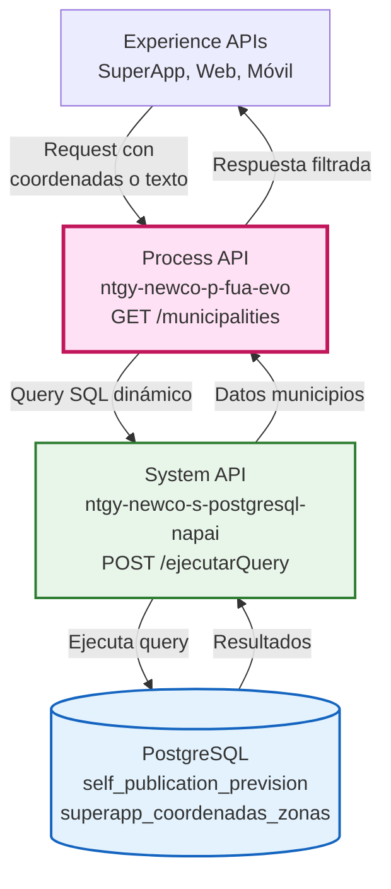
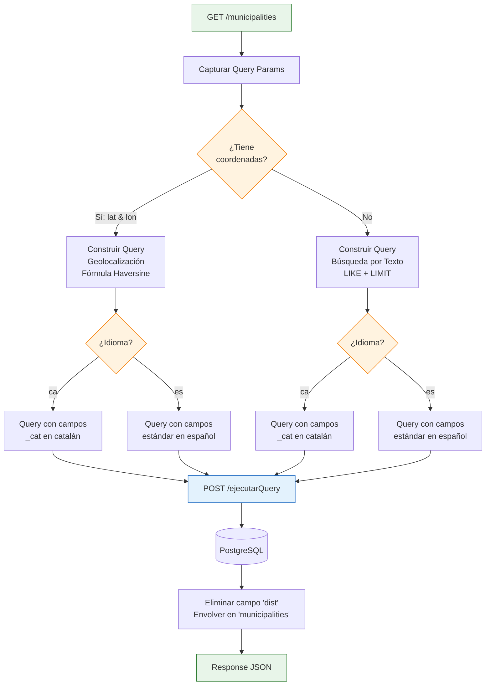
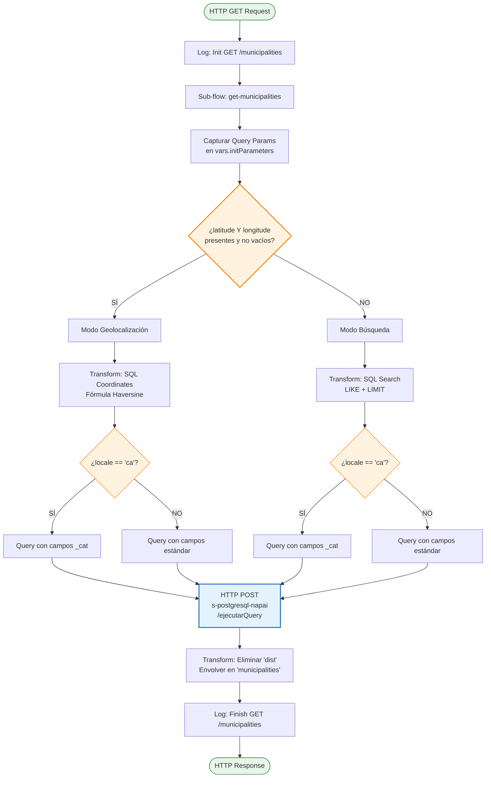
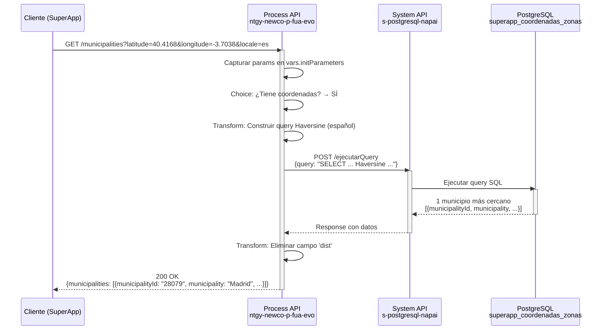
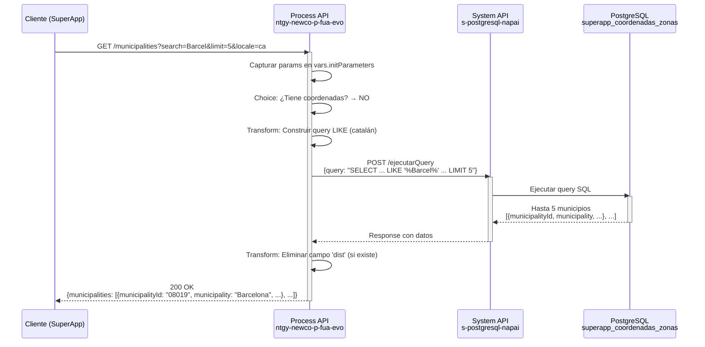
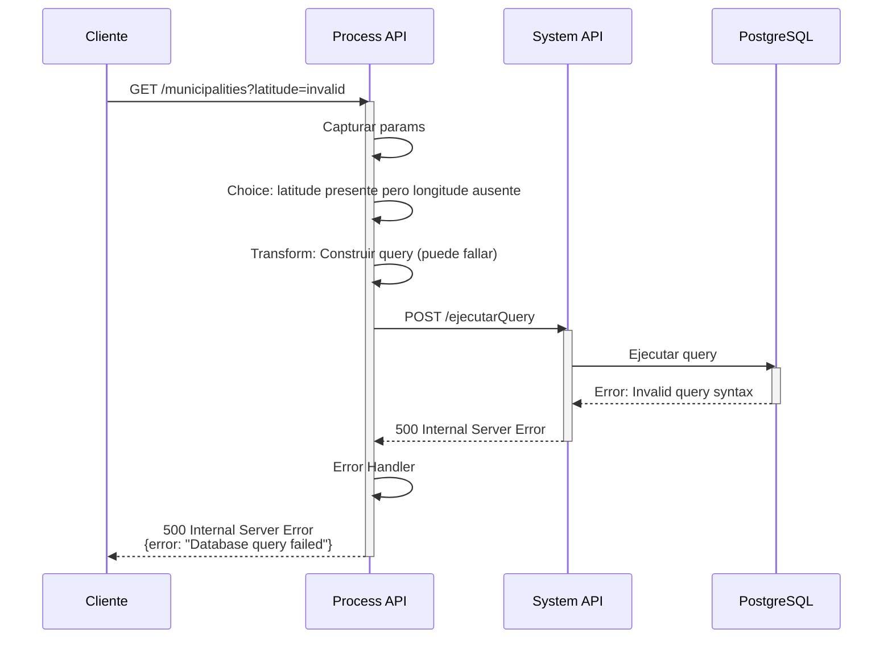

# GET /municipalities

## 📌 Descripción General

### Propósito del Endpoint

Este endpoint proporciona funcionalidad de búsqueda de municipios españoles con **dos modos de operación**:

1. **Búsqueda por Coordenadas Geográficas**: Encuentra el municipio más cercano a una ubicación específica usando la fórmula de Haversine
2. **Búsqueda por Texto**: Busca municipios por nombre con filtrado LIKE

Ambos modos soportan **internacionalización** (español/catalán) y están optimizados para la SuperApp de Naturgy.

### Tipo de API

**Capa:** Process API (API-Led Connectivity)

**Función:** Orquestación de búsqueda de municipios con lógica condicional y construcción dinámica de queries SQL

### Patrón de Integración

**Tipo:** Orquestación con Transformación Dinámica

**Descripción:** El endpoint construye dinámicamente queries SQL según el modo de búsqueda (coordenadas vs texto) y el idioma solicitado (es/ca), delegando la ejecución al System API de PostgreSQL.

### Arquitectura API-Led Connectivity



---

## 💼 Propósito del Negocio

### Casos de Uso Principales

1. **Geolocalización Automática (Modo Coordenadas)**
   - Usuario permite acceso a ubicación GPS en la app
   - Sistema encuentra automáticamente el municipio más cercano
   - Beneficio: Experiencia de usuario sin fricción, sin necesidad de escribir

2. **Búsqueda Manual (Modo Texto)**
   - Usuario escribe nombre del municipio (ej: "Barcel", "Madrid")
   - Sistema muestra lista de municipios coincidentes
   - Beneficio: Flexibilidad para usuarios que prefieren búsqueda manual

3. **Soporte Multiidioma**
   - Usuarios en Cataluña ven nombres en catalán
   - Resto de España ve nombres en español
   - Beneficio: Experiencia localizada y accesible

### 🔗 Endpoints Dependientes

Este Process API consume el siguiente System API:

| System API | Endpoint | Método | Propósito |
|------------|----------|--------|-----------|
| `ntgy-newco-s-postgresql-napai` | `/ejecutarQuery` | POST | Ejecuta queries SQL dinámicas en PostgreSQL para búsqueda de municipios |

### Lógica de Orquestación



**Pasos del Proceso:**

1. **Captura de Parámetros**: Extrae queryParams (latitude, longitude, search, limit, locale)
2. **Decisión de Modo**: Choice evalúa si existen coordenadas válidas
3. **Construcción de Query**: Genera SQL dinámico según modo e idioma
4. **Ejecución**: Delega al System API de PostgreSQL
5. **Transformación**: Elimina campo técnico `dist` y estructura respuesta

### Transformaciones Aplicadas

#### Transformación de Request (DataWeave)

**Modo Coordenadas (español):**
```dataweave
%dw 2.0
output application/json
---
{
  "query": "SELECT municipalityId, municipality, provinceId, province, region, min(dist_km) as dist 
            FROM (
              SELECT id_municipio as municipalityId, 
                     des_municipio as municipality, 
                     id_provincia as provinceId, 
                     des_provincia as province, 
                     des_ccaa as region, 
                     (6370 * acos(cos(radians(" ++ params.latitude ++ ")) * cos(radians(latitude)) * 
                      cos(radians(longitude) - radians(" ++ params.longitude ++ ")) + 
                      sin(radians(" ++ params.latitude ++ ")) * sin(radians(latitude)))) as dist_km
              FROM self_publication_prevision.superapp_coordenadas_zonas
              WHERE id_municipio != '**' 
                AND latitude BETWEEN (" ++ params.latitude ++ " - 0.5) AND (" ++ params.latitude ++ " + 0.5)
                AND longitude BETWEEN (" ++ params.longitude ++ " - 0.7) AND (" ++ params.longitude ++ " + 0.7)
              ORDER BY dist_km ASC
            ) tabla 
            GROUP BY 1,2,3,4,5 
            ORDER BY dist ASC 
            LIMIT 1"
}
```

**Modo Búsqueda (español):**
```dataweave
%dw 2.0
output application/json
---
{
  "query": "SELECT municipalityId, municipality, provinceId, province, region 
            FROM (
              SELECT DISTINCT ON (id_municipio) 
                     id_municipio AS municipalityId, 
                     des_municipio AS municipality, 
                     id_provincia AS provinceId, 
                     des_provincia AS province, 
                     des_ccaa AS region
              FROM self_publication_prevision.superapp_coordenadas_zonas
              WHERE id_municipio != '**' 
                AND LOWER(des_municipio) LIKE LOWER('%' || '" ++ params.search ++ "' || '%')
              ORDER BY id_municipio
            ) t 
            ORDER BY municipality ASC 
            LIMIT " ++ (params.limit default 10)
}
```

#### Transformación de Response (DataWeave)

```dataweave
%dw 2.0
output application/json
---
{
  municipalities: payload map ($ - "dist")
}
```

**Propósito:** Elimina el campo técnico `dist` (distancia calculada) que no debe exponerse al cliente.

### Contexto Empresarial

- **Dominio:** Geolocalización y Datos Meteorológicos
- **Sector:** Energía - Utilities
- **División:** Naturgy España - NewCo
- **Proceso de Negocio:** Búsqueda de municipios para servicios de la SuperApp (previsión meteorológica, servicios localizados)

### Stakeholders

- **Usuarios de SuperApp**: Necesitan encontrar su municipio para acceder a servicios localizados
- **Equipo de Producto**: Requiere experiencia de usuario fluida con geolocalización
- **Equipo de Datos**: Mantiene la tabla de coordenadas de municipios españoles

### Valor de Negocio

- **Experiencia de Usuario Mejorada**: Geolocalización automática reduce fricción
- **Accesibilidad**: Soporte multiidioma (es/ca) para todas las regiones
- **Precisión**: Fórmula de Haversine garantiza municipio más cercano
- **Flexibilidad**: Dos modos de búsqueda para diferentes preferencias de usuario

### Consumidores Potenciales

Este endpoint puede ser consumido por:
- SuperApp de Naturgy (iOS/Android)
- Portal web de autoservicio
- Aplicaciones móviles de terceros autorizados
- Sistemas de agentes de call center

---

## 🔧 Especificación Técnica

### URLs por Ambiente

| Ambiente | URL Base | URL Completa |
|----------|----------|--------------|
| **Local** | `http://localhost:8081` | `http://localhost:8081/api/municipalities` |
| **Development** | `https://ntgy-newco-p-fua-evo-dev.us-e2.cloudhub.io` | `https://ntgy-newco-p-fua-evo-dev.us-e2.cloudhub.io/api/municipalities` |
| **UAT** | `https://ntgy-newco-p-fua-evo-uat.us-e2.cloudhub.io` | `https://ntgy-newco-p-fua-evo-uat.us-e2.cloudhub.io/api/municipalities` |
| **Production** | `https://ntgy-newco-p-fua-evo-pro.us-e2.cloudhub.io` | `https://ntgy-newco-p-fua-evo-pro.us-e2.cloudhub.io/api/municipalities` |

### Método HTTP

```
GET /api/municipalities
```

### Parámetros de Entrada

#### Query Parameters

| Parámetro | Tipo | Requerido | Default | Descripción |
|-----------|------|-----------|---------|-------------|
| `latitude` | number | No | - | Latitud de la ubicación (ej: 40.4168). Requerido junto con `longitude` para modo geolocalización |
| `longitude` | number | No | - | Longitud de la ubicación (ej: -3.7038). Requerido junto con `latitude` para modo geolocalización |
| `search` | string | No | - | Texto de búsqueda para filtrar municipios por nombre (ej: "Barcel", "Madrid") |
| `limit` | integer | No | 10 | Número máximo de resultados a devolver (solo aplica en modo búsqueda) |
| `locale` | string | No | "es" | Idioma para nombres de municipios. Valores: `es` (español), `ca` (catalán) |

#### Modos de Operación

**Modo 1: Geolocalización (Coordenadas)**
- Requiere: `latitude` Y `longitude` (ambos presentes y no vacíos)
- Opcional: `locale`
- Ignora: `search`, `limit`
- Retorna: 1 municipio (el más cercano)

**Modo 2: Búsqueda por Texto**
- Requiere: Ninguno (puede ser búsqueda vacía)
- Opcional: `search`, `limit`, `locale`
- Ignora: `latitude`, `longitude`
- Retorna: Hasta `limit` municipios (default: 10)

### Respuestas

#### 200 OK - Éxito

**Estructura de Respuesta:**

```json
{
  "municipalities": [
    {
      "municipalityId": "string",
      "municipality": "string",
      "provinceId": "string",
      "province": "string",
      "region": "string"
    }
  ]
}
```

**Campos de Respuesta:**

| Campo | Tipo | Descripción |
|-------|------|-------------|
| `municipalities` | array | Lista de municipios encontrados |
| `municipalities[].municipalityId` | string | Identificador único del municipio |
| `municipalities[].municipality` | string | Nombre del municipio (en idioma solicitado) |
| `municipalities[].provinceId` | string | Identificador de la provincia |
| `municipalities[].province` | string | Nombre de la provincia (en idioma solicitado) |
| `municipalities[].region` | string | Nombre de la comunidad autónoma (en idioma solicitado) |

#### 400 Bad Request - Error de Validación

```json
{
  "error": "Invalid parameters",
  "message": "Latitude and longitude must be provided together"
}
```

#### 500 Internal Server Error - Error del Sistema

```json
{
  "error": "Internal server error",
  "message": "Error executing database query"
}
```

### Autenticación

- **Tipo:** Client ID & Client Secret (Anypoint Platform)
- **Headers Requeridos:**
  - `client_id`: Client ID de la aplicación
  - `client_secret`: Client Secret de la aplicación

### Timeouts

| Tipo | Valor |
|------|-------|
| **Request Timeout** | 30 segundos |
| **Connection Timeout** | 10 segundos |

### Consideraciones de Performance

- **Modo Coordenadas**: Más rápido (1 resultado, índices en lat/lon)
- **Modo Búsqueda**: Variable según `limit` (default: 10 resultados)
- **Optimización**: Query usa `DISTINCT ON` y filtros de rango para eficiencia

---

## 🏗️ Implementación Técnica

### Arquitectura del Flow



### Detalles de Implementación

#### 1. Flow Principal

**Archivo:** `ntgy-newco-p-fua.xml`

```xml
<flow name="get:\municipalities:ntgy-newco-p-fua-config">
    <logger level="INFO" message="Init: GET /api/municipalities"/>
    <flow-ref name="get-municipalities" />
    <logger level="INFO" message="Finish: GET /api/municipalities" />
</flow>
```

#### 2. Sub-flow de Lógica

**Archivo:** `ntgy-newco-p-fua.xml`

**Componentes clave:**

1. **Captura de Parámetros:**
```xml
<set-variable 
    value="#[%dw 2.0 output application/json --- attributes.queryParams]" 
    variableName="initParameters"/>
```

2. **Choice Condicional:**
```xml
<choice>
    <when expression='#[(vars.initParameters.latitude != "" and vars.initParameters.latitude != null) 
                        and (vars.initParameters.longitude != "" and vars.initParameters.longitude != null)]'>
        <!-- Modo Geolocalización -->
    </when>
    <otherwise>
        <!-- Modo Búsqueda -->
    </otherwise>
</choice>
```

3. **HTTP Request al System API:**
```xml
<http:request 
    method="POST" 
    config-ref="HTTP_Request_s_postgresql-napai" 
    path="/ejecutarQuery">
</http:request>
```

### Transformaciones DataWeave Detalladas

#### Transformación 1: SQL Coordinates (Geolocalización)

**Propósito:** Construir query SQL con fórmula de Haversine para calcular distancia

**Lógica:**
- Radio terrestre: 6370 km
- Rango de búsqueda: ±0.5° latitud, ±0.7° longitud
- Ordenamiento: Por distancia ascendente
- Resultado: 1 municipio más cercano

**Función DataWeave:**
```dataweave
fun formatQuery(params) = 
    if (lower(params.locale) == "ca")
        // Query con campos en catalán (_cat)
    else
        // Query con campos en español (estándar)
```

#### Transformación 2: SQL Search (Búsqueda por Texto)

**Propósito:** Construir query SQL con filtro LIKE para búsqueda textual

**Lógica:**
- `DISTINCT ON (id_municipio)`: Evita duplicados
- `LIKE LOWER('%' || search || '%')`: Búsqueda case-insensitive
- Ordenamiento: Alfabético por nombre de municipio
- Resultado: Hasta `limit` municipios (default: 10)

**Funciones DataWeave:**
```dataweave
fun baseQuery(locale) = 
    // SELECT con campos según idioma

fun whereQuery(params) =
    if (params.search != "" and params.search != null)
        // Filtro LIKE con search
    else
        // Sin filtro, solo LIMIT 10
```

#### Transformación 3: Response Final

**Propósito:** Limpiar respuesta eliminando campo técnico `dist`

```dataweave
%dw 2.0
output application/json
---
{
    municipalities: payload map ($ - "dist")
}
```

**Rationale:** El campo `dist` (distancia en km) es útil internamente para ordenamiento, pero no debe exponerse al cliente.

### Tabla PostgreSQL

**Base de Datos:** `self_publication_prevision`

**Tabla:** `superapp_coordenadas_zonas`

**Campos Relevantes:**

| Campo | Tipo | Descripción |
|-------|------|-------------|
| `id_municipio` | string | ID único del municipio |
| `des_municipio` | string | Nombre en español |
| `des_municipio_cat` | string | Nombre en catalán |
| `id_provincia` | string | ID de la provincia |
| `des_provincia` | string | Provincia en español |
| `des_provincia_cat` | string | Provincia en catalán |
| `des_ccaa` | string | Comunidad autónoma en español |
| `des_ccaa_cat` | string | Comunidad autónoma en catalán |
| `latitude` | decimal | Latitud del municipio |
| `longitude` | decimal | Longitud del municipio |
| `cod_postal` | string | Código postal |

**Índices:** Optimizados para búsquedas por coordenadas (latitude, longitude) y nombre (des_municipio, des_municipio_cat)

### Patrones de Diseño

**Patrón 1: Strategy Pattern (Construcción de Query)**

**Justificación:** Permite seleccionar dinámicamente la estrategia de búsqueda (coordenadas vs texto) sin duplicar código.

**Patrón 2: Template Method (Internacionalización)**

**Justificación:** Define estructura común de query SQL, permitiendo variaciones en nombres de campos según idioma.

**Patrón 3: Adapter Pattern (System API)**

**Justificación:** Adapta la interfaz genérica de `/ejecutarQuery` para búsquedas específicas de municipios.

### Diagramas de Secuencia

#### 1. Flujo Normal - Modo Geolocalización



#### 2. Flujo Normal - Modo Búsqueda por Texto



#### 3. Flujo con Error - Query Inválido



### Manejo de Errores

**Estrategia:** Error handling delegado a handlers globales del proyecto

**Errores Comunes:**

1. **Parámetros Inválidos:**
   - Coordenadas fuera de rango
   - Locale no soportado
   - Limit negativo o excesivo

2. **Errores de Base de Datos:**
   - Timeout de query
   - Conexión perdida
   - Tabla no disponible

3. **Errores del System API:**
   - System API no disponible
   - Respuesta malformada

**Respuesta de Error Estándar:**
```json
{
  "error": "Error type",
  "message": "Detailed error message",
  "timestamp": "2026-09-07T10:58:52Z"
}
```

---

## 💻 Ejemplos de Uso

### Ejemplo 1: Búsqueda por Coordenadas (Madrid)

#### cURL

```bash
curl -X GET "https://ntgy-newco-p-fua-evo-dev.us-e2.cloudhub.io/api/municipalities?latitude=40.4168&longitude=-3.7038&locale=es" \
  -H "Content-Type: application/json" \
  -H "client_id: YOUR_CLIENT_ID" \
  -H "client_secret: YOUR_CLIENT_SECRET"
```

#### Respuesta (200 OK)

```json
{
  "municipalities": [
    {
      "municipalityId": "28079",
      "municipality": "Madrid",
      "provinceId": "28",
      "province": "Madrid",
      "region": "Comunidad de Madrid"
    }
  ]
}
```

### Ejemplo 2: Búsqueda por Texto (Barcelona en Catalán)

#### cURL

```bash
curl -X GET "https://ntgy-newco-p-fua-evo-dev.us-e2.cloudhub.io/api/municipalities?search=Barcel&limit=3&locale=ca" \
  -H "Content-Type: application/json" \
  -H "client_id: YOUR_CLIENT_ID" \
  -H "client_secret: YOUR_CLIENT_SECRET"
```

#### Respuesta (200 OK)

```json
{
  "municipalities": [
    {
      "municipalityId": "08019",
      "municipality": "Barcelona",
      "provinceId": "08",
      "province": "Barcelona",
      "region": "Catalunya"
    },
    {
      "municipalityId": "43020",
      "municipality": "Barceloneta",
      "provinceId": "43",
      "province": "Tarragona",
      "region": "Catalunya"
    }
  ]
}
```

### Ejemplo 3: Búsqueda Sin Filtros (Top 10)

#### cURL

```bash
curl -X GET "https://ntgy-newco-p-fua-evo-dev.us-e2.cloudhub.io/api/municipalities?locale=es" \
  -H "Content-Type: application/json" \
  -H "client_id: YOUR_CLIENT_ID" \
  -H "client_secret: YOUR_CLIENT_SECRET"
```

#### Respuesta (200 OK)

```json
{
  "municipalities": [
    {
      "municipalityId": "01001",
      "municipality": "Alegría-Dulantzi",
      "provinceId": "01",
      "province": "Álava",
      "region": "País Vasco"
    },
    {
      "municipalityId": "01002",
      "municipality": "Amurrio",
      "provinceId": "01",
      "province": "Álava",
      "region": "País Vasco"
    }
    // ... hasta 10 municipios
  ]
}
```

### Ejemplo 4: JavaScript (Fetch API)

```javascript
// Modo Geolocalización
const getMunicipalityByCoordinates = async (lat, lon) => {
  const response = await fetch(
    `https://ntgy-newco-p-fua-evo-dev.us-e2.cloudhub.io/api/municipalities?latitude=${lat}&longitude=${lon}&locale=es`,
    {
      method: 'GET',
      headers: {
        'Content-Type': 'application/json',
        'client_id': 'YOUR_CLIENT_ID',
        'client_secret': 'YOUR_CLIENT_SECRET'
      }
    }
  );
  
  const data = await response.json();
  return data.municipalities[0]; // Retorna el municipio más cercano
};

// Modo Búsqueda por Texto
const searchMunicipalities = async (searchText, limit = 10) => {
  const response = await fetch(
    `https://ntgy-newco-p-fua-evo-dev.us-e2.cloudhub.io/api/municipalities?search=${encodeURIComponent(searchText)}&limit=${limit}&locale=es`,
    {
      method: 'GET',
      headers: {
        'Content-Type': 'application/json',
        'client_id': 'YOUR_CLIENT_ID',
        'client_secret': 'YOUR_CLIENT_SECRET'
      }
    }
  );
  
  const data = await response.json();
  return data.municipalities;
};

// Uso con Geolocalización del Navegador
if (navigator.geolocation) {
  navigator.geolocation.getCurrentPosition(async (position) => {
    const municipality = await getMunicipalityByCoordinates(
      position.coords.latitude,
      position.coords.longitude
    );
    console.log('Tu municipio:', municipality.municipality);
  });
}
```

### Ejemplo 5: Python (Requests)

```python
import requests

# Modo Geolocalización
def get_municipality_by_coordinates(lat, lon, locale='es'):
    url = 'https://ntgy-newco-p-fua-evo-dev.us-e2.cloudhub.io/api/municipalities'
    params = {
        'latitude': lat,
        'longitude': lon,
        'locale': locale
    }
    headers = {
        'Content-Type': 'application/json',
        'client_id': 'YOUR_CLIENT_ID',
        'client_secret': 'YOUR_CLIENT_SECRET'
    }
    
    response = requests.get(url, params=params, headers=headers)
    data = response.json()
    return data['municipalities'][0] if data['municipalities'] else None

# Modo Búsqueda por Texto
def search_municipalities(search_text, limit=10, locale='es'):
    url = 'https://ntgy-newco-p-fua-evo-dev.us-e2.cloudhub.io/api/municipalities'
    params = {
        'search': search_text,
        'limit': limit,
        'locale': locale
    }
    headers = {
        'Content-Type': 'application/json',
        'client_id': 'YOUR_CLIENT_ID',
        'client_secret': 'YOUR_CLIENT_SECRET'
    }
    
    response = requests.get(url, params=params, headers=headers)
    data = response.json()
    return data['municipalities']

# Ejemplo de uso
if __name__ == '__main__':
    # Búsqueda por coordenadas (Madrid)
    madrid = get_municipality_by_coordinates(40.4168, -3.7038)
    print(f"Municipio más cercano: {madrid['municipality']}")
    
    # Búsqueda por texto
    results = search_municipalities('Barcel', limit=5, locale='ca')
    for municipality in results:
        print(f"- {municipality['municipality']} ({municipality['province']})")
```

### Ejemplo 6: Caso de Uso Real - SuperApp

```javascript
// Componente React para búsqueda de municipios
import React, { useState, useEffect } from 'react';

const MunicipalitySearch = () => {
  const [municipalities, setMunicipalities] = useState([]);
  const [searchText, setSearchText] = useState('');
  const [useGeolocation, setUseGeolocation] = useState(false);
  const [loading, setLoading] = useState(false);

  // Búsqueda por geolocalización
  useEffect(() => {
    if (useGeolocation && navigator.geolocation) {
      setLoading(true);
      navigator.geolocation.getCurrentPosition(async (position) => {
        try {
          const response = await fetch(
            `https://ntgy-newco-p-fua-evo-dev.us-e2.cloudhub.io/api/municipalities?latitude=${position.coords.latitude}&longitude=${position.coords.longitude}&locale=es`,
            {
              headers: {
                'client_id': process.env.REACT_APP_CLIENT_ID,
                'client_secret': process.env.REACT_APP_CLIENT_SECRET
              }
            }
          );
          const data = await response.json();
          setMunicipalities(data.municipalities);
        } catch (error) {
          console.error('Error obteniendo municipio:', error);
        } finally {
          setLoading(false);
        }
      });
    }
  }, [useGeolocation]);

  // Búsqueda por texto
  const handleSearch = async () => {
    if (!searchText) return;
    
    setLoading(true);
    try {
      const response = await fetch(
        `https://ntgy-newco-p-fua-evo-dev.us-e2.cloudhub.io/api/municipalities?search=${encodeURIComponent(searchText)}&limit=10&locale=es`,
        {
          headers: {
            'client_id': process.env.REACT_APP_CLIENT_ID,
            'client_secret': process.env.REACT_APP_CLIENT_SECRET
          }
        }
      );
      const data = await response.json();
      setMunicipalities(data.municipalities);
    } catch (error) {
      console.error('Error buscando municipios:', error);
    } finally {
      setLoading(false);
    }
  };

  return (
    <div>
      <button onClick={() => setUseGeolocation(true)}>
        📍 Usar mi ubicación
      </button>
      
      <input
        type="text"
        value={searchText}
        onChange={(e) => setSearchText(e.target.value)}
        placeholder="Buscar municipio..."
      />
      <button onClick={handleSearch}>🔍 Buscar</button>
      
      {loading && <p>Cargando...</p>}
      
      <ul>
        {municipalities.map((m) => (
          <li key={m.municipalityId}>
            {m.municipality} - {m.province} ({m.region})
          </li>
        ))}
      </ul>
    </div>
  );
};

export default MunicipalitySearch;
```
