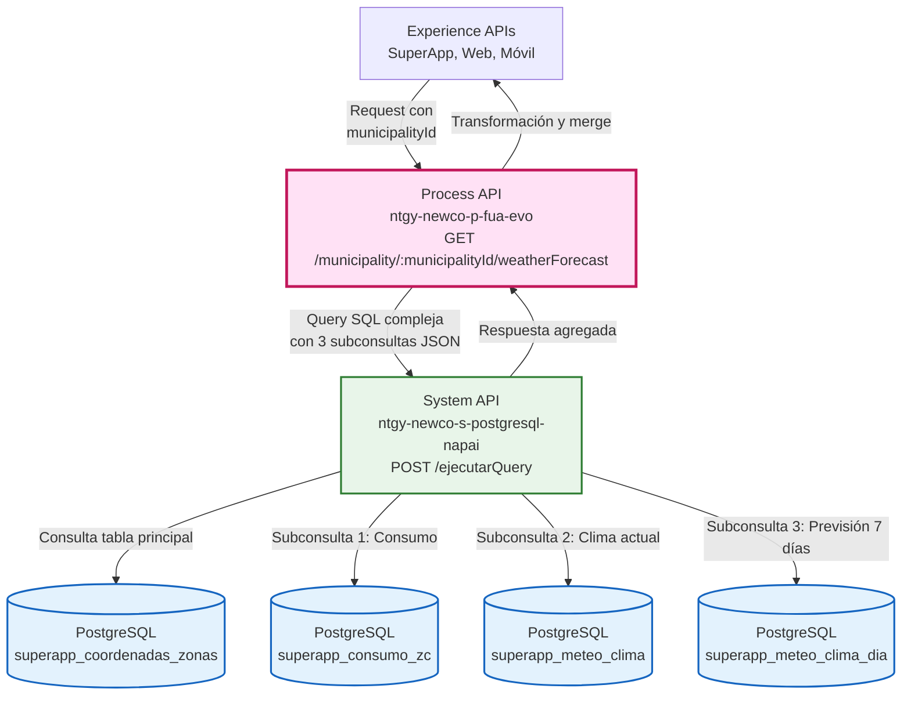
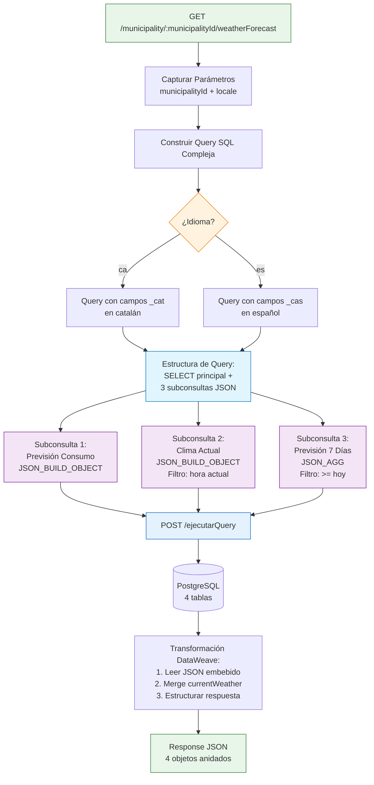
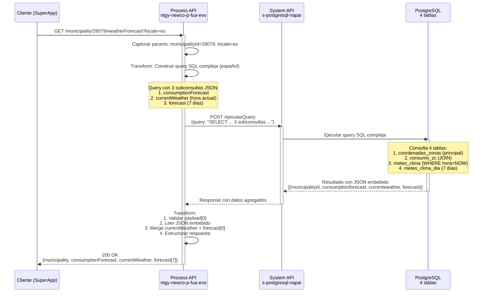
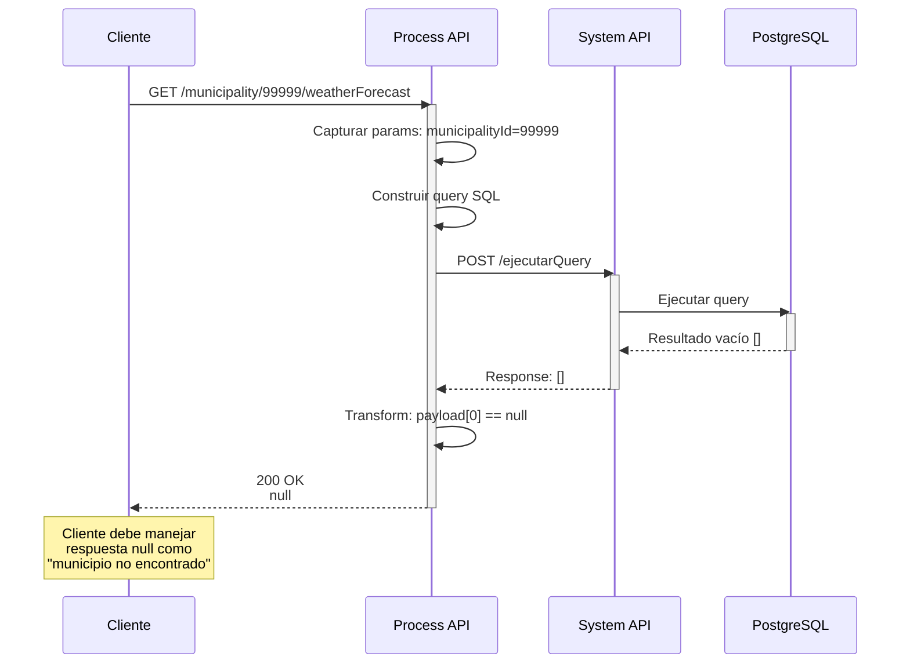
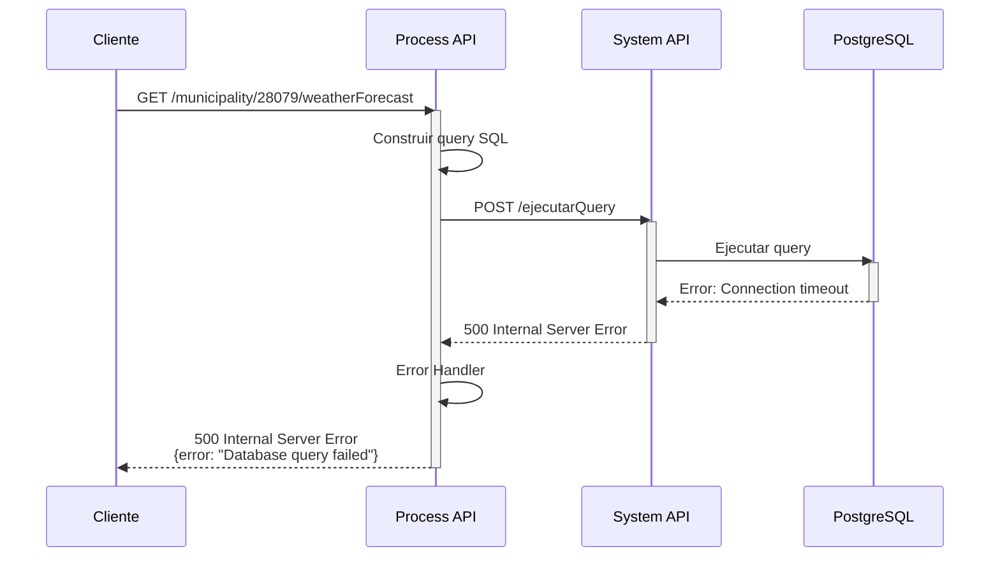

# GET /municipality/:municipalityId/weatherForecast

## 📌 Descripción General

### Propósito del Endpoint

Este endpoint proporciona una **consulta meteorológica completa** para un municipio específico, integrando:

1. **Datos del Municipio**: Información geográfica (nombre, provincia, región)
2. **Previsión de Consumo**: Impacto esperado en consumo de gas y electricidad
3. **Clima Actual**: Temperatura, sensación térmica y condiciones meteorológicas actuales
4. **Previsión 7 Días**: Pronóstico detallado con temperaturas, condiciones y alertas meteorológicas

Todo con soporte de **internacionalización** (español/catalán) para la SuperApp de Naturgy.

### Tipo de API

**Capa:** Process API (API-Led Connectivity)

**Función:** Orquestación de datos meteorológicos y de consumo mediante query SQL compleja con subconsultas JSON anidadas

### Patrón de Integración

**Tipo:** Orquestación con Query SQL Compleja

**Descripción:** El endpoint construye una query SQL avanzada que utiliza subconsultas correlacionadas con `JSON_BUILD_OBJECT` y `JSON_AGG` para agregar datos de 4 tablas diferentes en una sola respuesta estructurada.

### Arquitectura API-Led Connectivity



---

## 💼 Propósito del Negocio

### Casos de Uso Principales

1. **Dashboard Meteorológico en SuperApp**
   - Usuario consulta clima actual de su municipio
   - Ve previsión de 7 días con alertas meteorológicas
   - Beneficio: Información meteorológica completa en una sola llamada

2. **Recomendaciones de Consumo Energético**
   - Sistema muestra impacto esperado en consumo de gas y electricidad
   - Basado en condiciones meteorológicas previstas
   - Beneficio: Usuario puede anticipar variaciones en su factura

3. **Alertas Meteorológicas Localizadas**
   - Avisos de olas de calor, frío extremo, tormentas
   - Integrados en la previsión diaria
   - Beneficio: Usuario informado de condiciones adversas

4. **Planificación de Consumo**
   - Usuario ve correlación entre clima y consumo energético
   - Puede tomar decisiones sobre uso de calefacción/aire acondicionado
   - Beneficio: Optimización del consumo energético

### 🔗 Endpoints Dependientes

Este Process API consume el siguiente System API:

| System API | Endpoint | Método | Propósito |
|------------|----------|--------|-----------|
| `ntgy-newco-s-postgresql-napai` | `/ejecutarQuery` | POST | Ejecuta query SQL compleja con 3 subconsultas JSON para agregar datos meteorológicos y de consumo |

### Lógica de Orquestación



**Pasos del Proceso:**

1. **Captura de Parámetros**: Extrae `municipalityId` (path) y `locale` (query)
2. **Construcción de Query SQL**: Genera query compleja según idioma
3. **Subconsulta 1 - Consumo**: JOIN con tabla de consumo por zona meteorológica
4. **Subconsulta 2 - Clima Actual**: Filtro temporal por hora actual (`DATE_TRUNC('hour', NOW())`)
5. **Subconsulta 3 - Previsión 7 Días**: Agregación JSON de 7 días (`JSON_AGG` + `LIMIT 7`)
6. **Ejecución**: Delega al System API de PostgreSQL
7. **Transformación**: Lee JSON embebido, merge de datos, estructura final

### Transformaciones Aplicadas

#### Transformación de Request (DataWeave - Construcción de Query)

**Query SQL Compleja (Español):**

```dataweave
%dw 2.0
output application/json

fun baseQuery(locale, municipalityId) = 
  if(lower(locale) == "ca")
    // Query en catalán (campos _cat)
  else
    "SELECT " ++
    // Datos del municipio
    "cz.id_municipio AS municipalityId, " ++
    "cz.des_municipio AS municipality, " ++
    "cz.id_provincia AS provinceId, " ++
    "cz.des_provincia AS province, " ++
    "cz.des_ccaa AS region, " ++
    
    // Subconsulta 1: Previsión de consumo
    "(SELECT JSON_BUILD_OBJECT(" ++
      "'gasForecastVariation', sc.prevision_gas, " ++
      "'elecForecastVariation', sc.prevision_ele, " ++
      "'forecastMessage', sc.mensaje_cas" ++
    ") FROM self_publication_prevision.superapp_consumo_zc sc " ++
    "WHERE cz.des_zona_meteorologica_aemet = sc.des_zona_meteorologica_aemet " ++
    "LIMIT 1) AS consumptionForecast, " ++
    
    // Subconsulta 2: Clima actual (hora actual)
    "(SELECT JSON_BUILD_OBJECT(" ++
      "'currentTemperature', mcd.temperatura, " ++
      "'feelsLike', mcd.sensacion_termica, " ++
      "'weatherId', mcd.icono_id, " ++
      "'weatherType', mcd.tiempo_tipo_cas" ++
    ") FROM self_publication_prevision.superapp_meteo_clima mcd " ++
    "WHERE mcd.latitude = cz.latitude " ++
    "AND mcd.longitude = cz.longitude " ++
    "AND TO_TIMESTAMP(" ++
      "year || '-' || LPAD(month, 2, '0') || '-' || " ++
      "LPAD(day, 2, '0') || ' ' || LPAD(hour, 2, '0') || ':00:00', " ++
      "'YYYY-MM-DD HH24:MI:SS'" ++
    ") = DATE_TRUNC('hour', NOW()) " ++
    "LIMIT 1) AS currentWeather, " ++
    
    // Subconsulta 3: Previsión 7 días
    "(SELECT JSON_AGG(" ++
      "JSON_BUILD_OBJECT(" ++
        "'date', CONCAT(year, '-', LPAD(month, 2, '0'), '-', LPAD(day, 2, '0')), " ++
        "'minTemperature', temperatura_min, " ++
        "'maxTemperature', temperatura_max, " ++
        "'feelsLike', sensacion_termica, " ++
        "'weatherType', tiempo_tipo_cas, " ++
        "'weatherId', icono_id, " ++
        "'weatherDescription', mensaje_cas, " ++
        "'alert', aviso_zona_cas" ++
      ") ORDER BY year, month, day" ++
    ") FROM (" ++
      "SELECT * FROM self_publication_prevision.superapp_meteo_clima_dia mcd " ++
      "WHERE mcd.latitude = cz.latitude " ++
      "AND mcd.longitude = cz.longitude " ++
      "AND TO_DATE(year || '-' || LPAD(month, 2, '0') || '-' || LPAD(day, 2, '0'), 'YYYY-MM-DD') >= CURRENT_DATE " ++
      "ORDER BY year, month, day " ++
      "LIMIT 7" ++
    ") AS forecast_data) AS forecast " ++
    
    // FROM principal
    "FROM self_publication_prevision.superapp_coordenadas_zonas cz " ++
    "WHERE cz.id_municipio = '" ++ municipalityId ++ "' " ++
    "LIMIT 1"
---
{
  "query": baseQuery(vars.initParameters.locale, vars.initParameters.municipalityId)
}
```

**Técnicas SQL Avanzadas Utilizadas:**

1. **JSON_BUILD_OBJECT**: Construye objetos JSON directamente en PostgreSQL
2. **JSON_AGG**: Agrega múltiples filas en un array JSON
3. **Subconsultas Correlacionadas**: 3 subconsultas que referencian la tabla principal
4. **Filtros Temporales Dinámicos**:
   - `DATE_TRUNC('hour', NOW())`: Clima de la hora actual exacta
   - `>= CURRENT_DATE`: Previsión desde hoy
5. **Construcción de Fechas**: `TO_TIMESTAMP` y `TO_DATE` para conversión
6. **LPAD**: Relleno de ceros para formato de fecha consistente

#### Transformación de Response (DataWeave - Merge y Estructura)

```dataweave
%dw 2.0
output application/json
---
if(payload[0] != null)
{
    municipality: {
        municipalityId: payload[0].municipalityid,
        municipality: payload[0].municipality,
        provinceId: payload[0].provinceid,
        province: payload[0].province,
        region: payload[0].region
    },
    consumptionForecast: read(payload[0].consumptionforecast.value, "application/json"),
    currentWeather: read(payload[0].currentweather.value, "application/json") ++ {
        weatherDescription: read(payload[0].forecast.value, "application/json")[0].weatherDescription,
        alert: read(payload[0].forecast.value, "application/json")[0].alert
    },
    forecast: read(payload[0].forecast.value, "application/json")
}
else null
```

**Lógica de Transformación:**

1. **Validación**: Verifica que exista resultado (`payload[0] != null`)
2. **Lectura de JSON Embebido**: `read(..., "application/json")` para parsear JSON de PostgreSQL
3. **Merge de Datos**: Combina `currentWeather` con `weatherDescription` y `alert` del primer día de previsión
4. **Estructura Final**: 4 objetos principales (municipality, consumptionForecast, currentWeather, forecast)

### Contexto Empresarial

- **Dominio:** Meteorología y Consumo Energético
- **Sector:** Energía - Utilities
- **División:** Naturgy España - NewCo
- **Proceso de Negocio:** Información meteorológica y recomendaciones de consumo para SuperApp

### Stakeholders

- **Usuarios de SuperApp**: Necesitan información meteorológica y su impacto en consumo energético
- **Equipo de Producto**: Requiere dashboard meteorológico completo en una sola llamada
- **Equipo de Datos**: Mantiene tablas de datos meteorológicos y previsiones de consumo
- **Equipo de Negocio**: Usa correlación clima-consumo para estrategias comerciales

### Valor de Negocio

- **Experiencia de Usuario Mejorada**: Información completa en una sola consulta
- **Transparencia**: Usuario ve impacto del clima en su consumo energético
- **Prevención**: Alertas meteorológicas permiten anticipar situaciones adversas
- **Optimización**: Usuario puede planificar consumo según previsión meteorológica

### Consumidores Potenciales

Este endpoint puede ser consumido por:
- SuperApp de Naturgy (iOS/Android)
- Portal web de autoservicio
- Aplicaciones móviles de terceros autorizados
- Sistemas de análisis de consumo

---

## 🔧 Especificación Técnica

### URLs por Ambiente

| Ambiente | URL Base | URL Completa |
|----------|----------|--------------|
| **Local** | `http://localhost:8081` | `http://localhost:8081/api/municipality/:municipalityId/weatherForecast` |
| **Development** | `https://ntgy-newco-p-fua-evo-dev.us-e2.cloudhub.io` | `https://ntgy-newco-p-fua-evo-dev.us-e2.cloudhub.io/api/municipality/:municipalityId/weatherForecast` |
| **UAT** | `https://ntgy-newco-p-fua-evo-uat.us-e2.cloudhub.io` | `https://ntgy-newco-p-fua-evo-uat.us-e2.cloudhub.io/api/municipality/:municipalityId/weatherForecast` |
| **Production** | `https://ntgy-newco-p-fua-evo-pro.us-e2.cloudhub.io` | `https://ntgy-newco-p-fua-evo-pro.us-e2.cloudhub.io/api/municipality/:municipalityId/weatherForecast` |

### Método HTTP

```
GET /api/municipality/:municipalityId/weatherForecast
```

### Parámetros de Entrada

#### Path Parameters

| Parámetro | Tipo | Requerido | Descripción |
|-----------|------|-----------|-------------|
| `municipalityId` | string | Sí | Identificador único del municipio (ej: "28079" para Madrid, "08019" para Barcelona) |

#### Query Parameters

| Parámetro | Tipo | Requerido | Default | Descripción |
|-----------|------|-----------|---------|-------------|
| `locale` | string | No | "es" | Idioma para nombres y mensajes. Valores: `es` (español), `ca` (catalán) |

### Respuestas

#### 200 OK - Éxito

**Estructura de Respuesta:**

```json
{
  "municipality": {
    "municipalityId": "string",
    "municipality": "string",
    "provinceId": "string",
    "province": "string",
    "region": "string"
  },
  "consumptionForecast": {
    "gasForecastVariation": "string",
    "elecForecastVariation": "string",
    "forecastMessage": "string"
  },
  "currentWeather": {
    "currentTemperature": number,
    "feelsLike": number,
    "weatherId": number,
    "weatherType": "string",
    "weatherDescription": "string",
    "alert": "string"
  },
  "forecast": [
    {
      "date": "string",
      "minTemperature": number,
      "maxTemperature": number,
      "feelsLike": number,
      "weatherType": "string",
      "weatherId": number,
      "weatherDescription": "string",
      "alert": "string"
    }
  ]
}
```

**Campos de Respuesta:**

| Campo | Tipo | Descripción |
|-------|------|-------------|
| `municipality` | object | Información del municipio |
| `municipality.municipalityId` | string | ID único del municipio |
| `municipality.municipality` | string | Nombre del municipio (en idioma solicitado) |
| `municipality.provinceId` | string | ID de la provincia |
| `municipality.province` | string | Nombre de la provincia (en idioma solicitado) |
| `municipality.region` | string | Comunidad autónoma (en idioma solicitado) |
| `consumptionForecast` | object | Previsión de impacto en consumo energético |
| `consumptionForecast.gasForecastVariation` | string | Variación esperada en consumo de gas (ej: "ALTO", "MEDIO", "BAJO") |
| `consumptionForecast.elecForecastVariation` | string | Variación esperada en consumo de electricidad |
| `consumptionForecast.forecastMessage` | string | Mensaje descriptivo de la previsión de consumo |
| `currentWeather` | object | Condiciones meteorológicas actuales |
| `currentWeather.currentTemperature` | number | Temperatura actual en °C |
| `currentWeather.feelsLike` | number | Sensación térmica en °C |
| `currentWeather.weatherId` | number | ID del icono meteorológico |
| `currentWeather.weatherType` | string | Tipo de tiempo (ej: "Soleado", "Nublado", "Lluvia") |
| `currentWeather.weatherDescription` | string | Descripción detallada del tiempo (del primer día de previsión) |
| `currentWeather.alert` | string | Alerta meteorológica activa (del primer día de previsión) |
| `forecast` | array | Previsión meteorológica de 7 días |
| `forecast[].date` | string | Fecha en formato YYYY-MM-DD |
| `forecast[].minTemperature` | number | Temperatura mínima del día en °C |
| `forecast[].maxTemperature` | number | Temperatura máxima del día en °C |
| `forecast[].feelsLike` | number | Sensación térmica promedio en °C |
| `forecast[].weatherType` | string | Tipo de tiempo esperado |
| `forecast[].weatherId` | number | ID del icono meteorológico |
| `forecast[].weatherDescription` | string | Descripción detallada del tiempo |
| `forecast[].alert` | string | Alerta meteorológica (ej: "Ola de calor", "Frío extremo", null si no hay) |

#### 404 Not Found - Municipio No Encontrado

```json
{
  "error": "Municipality not found",
  "message": "No data available for municipalityId: 99999"
}
```

#### 500 Internal Server Error - Error del Sistema

```json
{
  "error": "Internal server error",
  "message": "Error executing database query"
}
```

### Autenticación

- **Tipo:** Client ID & Client Secret (Anypoint Platform)
- **Headers Requeridos:**
  - `client_id`: Client ID de la aplicación
  - `client_secret`: Client Secret de la aplicación

### Timeouts

| Tipo | Valor |
|------|-------|
| **Request Timeout** | 30 segundos |
| **Connection Timeout** | 10 segundos |

### Consideraciones de Performance

- **Query Compleja**: 3 subconsultas JSON pueden tardar 1-2 segundos
- **Optimización**: Índices en coordenadas (latitude, longitude) y municipalityId
- **Caché Recomendado**: Datos meteorológicos pueden cachearse por 1 hora
- **Volumen de Datos**: Respuesta típica ~5-10 KB (7 días de previsión)

---

## 🏗️ Implementación Técnica

### Arquitectura del Flow

```mermaid
flowchart TD
    Start([HTTP GET Request]) --> LogStart[Log: Init GET /municipality/:municipalityId/weatherForecast]
    LogStart --> SubFlow[Sub-flow: get-intent-municipalityId-weatherForecast]
    
    SubFlow --> CaptureParams[Capturar Parámetros<br/>municipalityId + locale<br/>en vars.initParameters]
    
    CaptureParams --> BuildQuery[Transform: SQL Format<br/>Construir Query Compleja]
    
    BuildQuery --> LocaleCheck{¿locale == 'ca'?}
    
    LocaleCheck -->|SÍ| QueryCA[Query con campos _cat<br/>Catalán]
    LocaleCheck -->|NO| QueryES[Query con campos _cas<br/>Español]
    
    QueryCA --> QueryStructure[Estructura de Query:<br/>SELECT principal +<br/>3 subconsultas JSON]
    QueryES --> QueryStructure
    
    QueryStructure --> Sub1[Subconsulta 1:<br/>consumptionForecast<br/>JSON_BUILD_OBJECT]
    QueryStructure --> Sub2[Subconsulta 2:<br/>currentWeather<br/>JSON_BUILD_OBJECT<br/>WHERE hora = NOW]
    QueryStructure --> Sub3[Subconsulta 3:<br/>forecast<br/>JSON_AGG<br/>WHERE fecha >= HOY<br/>LIMIT 7]
    
    Sub1 --> HTTPCall[HTTP POST<br/>s-postgresql-napai<br/>/ejecutarQuery]
    Sub2 --> HTTPCall
    Sub3 --> HTTPCall
    
    HTTPCall --> FinalTransform[Transform: Response<br/>1. Validar payload[0]<br/>2. Leer JSON embebido<br/>3. Merge currentWeather<br/>4. Estructurar respuesta]
    
    FinalTransform --> LogEnd[Log: Finish GET]
    LogEnd --> End([HTTP Response])
    
    style Start fill:#e8f5e9,stroke:#2e7d32
    style LocaleCheck fill:#fff3e0,stroke:#f57c00,stroke-width:2px
    style QueryStructure fill:#e1f5fe,stroke:#0277bd,stroke-width:2px
    style Sub1 fill:#f3e5f5,stroke:#7b1fa2
    style Sub2 fill:#f3e5f5,stroke:#7b1fa2
    style Sub3 fill:#f3e5f5,stroke:#7b1fa2
    style HTTPCall fill:#e3f2fd,stroke:#1565c0,stroke-width:2px
    style FinalTransform fill:#fff9c4,stroke:#f57f17,stroke-width:2px
    style End fill:#e8f5e9,stroke:#2e7d32
```

### Detalles de Implementación

#### 1. Flow Principal

**Archivo:** `ntgy-newco-p-fua.xml`

```xml
<flow name="get:\municipality\(municipalityId)\weatherForecast:ntgy-newco-p-fua-config">
    <logger level="INFO" message="Init: GET /api/municipality/(municipalityId)/weatherForecast" />
    <flow-ref name="get-intent-municipalityId-weatherForecast" />
    <logger level="INFO" message="Finish: GET /api/municipality/(municipalityId)/weatherForecast" />
</flow>
```

#### 2. Sub-flow de Lógica

**Archivo:** `ntgy-newco-p-fua.xml`

**Componentes clave:**

1. **Captura de Parámetros:**
```xml
<set-variable 
    value="#[%dw 2.0 output application/json --- attributes.queryParams default null ++ attributes.uriParams default null]" 
    variableName="initParameters"/>
```

2. **Transformación SQL Format:**
```xml
<ee:transform doc:name="SQL Format">
    <ee:message>
        <ee:set-payload>
            <!-- DataWeave con función baseQuery -->
        </ee:set-payload>
    </ee:message>
</ee:transform>
```

3. **HTTP Request al System API:**
```xml
<http:request 
    method="POST" 
    config-ref="HTTP_Request_s_postgresql-napai" 
    path="/ejecutarQuery">
</http:request>
```

4. **Transformación Final:**
```xml
<ee:transform doc:name="Transform Message">
    <ee:message>
        <ee:set-payload>
            <!-- DataWeave con merge de datos -->
        </ee:set-payload>
    </ee:message>
</ee:transform>
```

### Tablas PostgreSQL Consultadas por el System API

**⚠️ Nota Importante:** Estas tablas son consultadas por el **System API `ntgy-newco-s-postgresql-napai`**, no directamente por este Process API. El Process API construye la query SQL y la delega al System API para su ejecución.

#### Tabla 1: superapp_coordenadas_zonas (Principal)

**Propósito:** Datos maestros de municipios con coordenadas

| Campo | Tipo | Descripción |
|-------|------|-------------|
| `id_municipio` | string | ID único del municipio |
| `des_municipio` | string | Nombre en español |
| `des_municipio_cat` | string | Nombre en catalán |
| `id_provincia` | string | ID de la provincia |
| `des_provincia` | string | Provincia en español |
| `des_provincia_cat` | string | Provincia en catalán |
| `des_ccaa` | string | Comunidad autónoma en español |
| `des_ccaa_cat` | string | Comunidad autónoma en catalán |
| `latitude` | decimal | Latitud del municipio |
| `longitude` | decimal | Longitud del municipio |
| `des_zona_meteorologica_aemet` | string | Zona meteorológica AEMET |

#### Tabla 2: superapp_consumo_zc (Previsión de Consumo)

**Propósito:** Previsión de impacto en consumo energético por zona meteorológica

| Campo | Tipo | Descripción |
|-------|------|-------------|
| `des_zona_meteorologica_aemet` | string | Zona meteorológica (JOIN con tabla principal) |
| `prevision_gas` | string | Variación esperada en consumo de gas |
| `prevision_ele` | string | Variación esperada en consumo de electricidad |
| `mensaje_cas` | string | Mensaje descriptivo en español |
| `mensaje_cat` | string | Mensaje descriptivo en catalán |

#### Tabla 3: superapp_meteo_clima (Clima Actual)

**Propósito:** Datos meteorológicos por hora y coordenadas

| Campo | Tipo | Descripción |
|-------|------|-------------|
| `latitude` | decimal | Latitud (JOIN con tabla principal) |
| `longitude` | decimal | Longitud (JOIN con tabla principal) |
| `year` | integer | Año |
| `month` | integer | Mes |
| `day` | integer | Día |
| `hour` | integer | Hora |
| `temperatura` | decimal | Temperatura en °C |
| `sensacion_termica` | decimal | Sensación térmica en °C |
| `icono_id` | integer | ID del icono meteorológico |
| `tiempo_tipo_cas` | string | Tipo de tiempo en español |
| `tiempo_tipo_cat` | string | Tipo de tiempo en catalán |

#### Tabla 4: superapp_meteo_clima_dia (Previsión 7 Días)

**Propósito:** Previsión meteorológica diaria con temperaturas y alertas

| Campo | Tipo | Descripción |
|-------|------|-------------|
| `latitude` | decimal | Latitud (JOIN con tabla principal) |
| `longitude` | decimal | Longitud (JOIN con tabla principal) |
| `year` | integer | Año |
| `month` | integer | Mes |
| `day` | integer | Día |
| `temperatura_min` | decimal | Temperatura mínima del día en °C |
| `temperatura_max` | decimal | Temperatura máxima del día en °C |
| `sensacion_termica` | decimal | Sensación térmica promedio en °C |
| `icono_id` | integer | ID del icono meteorológico |
| `tiempo_tipo_cas` | string | Tipo de tiempo en español |
| `tiempo_tipo_cat` | string | Tipo de tiempo en catalán |
| `mensaje_cas` | string | Descripción detallada en español |
| `mensaje_cat` | string | Descripción detallada en catalán |
| `aviso_zona_cas` | string | Alerta meteorológica en español |
| `aviso_zona_cat` | string | Alerta meteorológica en catalán |

### Patrones de Diseño

**Patrón 1: Query Builder Pattern**

**Justificación:** Construcción dinámica de queries SQL complejas según parámetros (idioma, municipio), permitiendo reutilización y mantenibilidad.

**Patrón 2: Subquery Aggregation Pattern**

**Justificación:** Uso de subconsultas correlacionadas con `JSON_BUILD_OBJECT` y `JSON_AGG` para agregar datos de múltiples tablas en una sola query, reduciendo round-trips a la base de datos.

**Patrón 3: Data Enrichment Pattern**

**Justificación:** Merge de datos de `currentWeather` con campos de `forecast[0]` para enriquecer la respuesta sin duplicar información.

### Diagramas de Secuencia

#### 1. Flujo Normal - Consulta Exitosa



#### 2. Flujo con Municipio No Encontrado



#### 3. Flujo con Error de Base de Datos



### Manejo de Errores

**Estrategia:** Error handling delegado a handlers globales del proyecto

**Errores Comunes:**

1. **Municipio No Encontrado:**
   - Respuesta: `null` (HTTP 200)
   - Cliente debe interpretar como "no encontrado"

2. **Errores de Base de Datos:**
   - Timeout de query (>30s)
   - Conexión perdida
   - Tabla no disponible
   - Respuesta: HTTP 500

3. **Errores del System API:**
   - System API no disponible
   - Query SQL malformado
   - Respuesta: HTTP 500

**Respuesta de Error Estándar:**
```json
{
  "error": "Error type",
  "message": "Detailed error message",
  "timestamp": "2026-09-07T11:20:36Z"
}
```

---

## 💻 Ejemplos de Uso

### Ejemplo 1: Consulta Completa (Madrid)

#### cURL

```bash
curl -X GET "https://ntgy-newco-p-fua-evo-dev.us-e2.cloudhub.io/api/municipality/28079/weatherForecast?locale=es" \
  -H "Content-Type: application/json" \
  -H "client_id: YOUR_CLIENT_ID" \
  -H "client_secret: YOUR_CLIENT_SECRET"
```

#### Respuesta (200 OK)

```json
{
  "municipality": {
    "municipalityId": "28079",
    "municipality": "Madrid",
    "provinceId": "28",
    "province": "Madrid",
    "region": "Comunidad de Madrid"
  },
  "consumptionForecast": {
    "gasForecastVariation": "ALTO",
    "elecForecastVariation": "MEDIO",
    "forecastMessage": "Se espera un aumento en el consumo de gas debido a las bajas temperaturas previstas"
  },
  "currentWeather": {
    "currentTemperature": 15.5,
    "feelsLike": 13.2,
    "weatherId": 801,
    "weatherType": "Parcialmente nublado",
    "weatherDescription": "Cielo con nubes dispersas. Temperaturas suaves.",
    "alert": null
  },
  "forecast": [
    {
      "date": "2026-09-07",
      "minTemperature": 12.0,
      "maxTemperature": 22.0,
      "feelsLike": 17.0,
      "weatherType": "Parcialmente nublado",
      "weatherId": 801,
      "weatherDescription": "Cielo con nubes dispersas. Temperaturas suaves.",
      "alert": null
    },
    {
      "date": "2026-09-08",
      "minTemperature": 14.0,
      "maxTemperature": 24.0,
      "feelsLike": 19.0,
      "weatherType": "Soleado",
      "weatherId": 800,
      "weatherDescription": "Cielo despejado. Día soleado.",
      "alert": null
    },
    {
      "date": "2026-09-09",
      "minTemperature": 16.0,
      "maxTemperature": 28.0,
      "feelsLike": 22.0,
      "weatherType": "Soleado",
      "weatherId": 800,
      "weatherDescription": "Cielo despejado. Temperaturas en aumento.",
      "alert": "Ola de calor"
    }
    // ... hasta 7 días
  ]
}
```

### Ejemplo 2: Consulta en Catalán (Barcelona)

#### cURL

```bash
curl -X GET "https://ntgy-newco-p-fua-evo-dev.us-e2.cloudhub.io/api/municipality/08019/weatherForecast?locale=ca" \
  -H "Content-Type: application/json" \
  -H "client_id: YOUR_CLIENT_ID" \
  -H "client_secret: YOUR_CLIENT_SECRET"
```

#### Respuesta (200 OK)

```json
{
  "municipality": {
    "municipalityId": "08019",
    "municipality": "Barcelona",
    "provinceId": "08",
    "province": "Barcelona",
    "region": "Catalunya"
  },
  "consumptionForecast": {
    "gasForecastVariation": "BAIX",
    "elecForecastVariation": "ALT",
    "forecastMessage": "S'espera un augment en el consum d'electricitat degut a les altes temperatures"
  },
  "currentWeather": {
    "currentTemperature": 25.0,
    "feelsLike": 27.5,
    "weatherId": 800,
    "weatherType": "Assolellat",
    "weatherDescription": "Cel serè. Temperatures càlides.",
    "alert": null
  },
  "forecast": [
    {
      "date": "2026-09-07",
      "minTemperature": 20.0,
      "maxTemperature": 28.0,
      "feelsLike": 24.0,
      "weatherType": "Assolellat",
      "weatherId": 800,
      "weatherDescription": "Cel serè. Temperatures càlides.",
      "alert": null
    }
    // ... hasta 7 días
  ]
}
```

### Ejemplo 3: JavaScript (React Component)

```javascript
import React, { useState, useEffect } from 'react';

const WeatherDashboard = ({ municipalityId }) => {
  const [weatherData, setWeatherData] = useState(null);
  const [loading, setLoading] = useState(true);
  const [error, setError] = useState(null);

  useEffect(() => {
    const fetchWeather = async () => {
      try {
        setLoading(true);
        const response = await fetch(
          `https://ntgy-newco-p-fua-evo-dev.us-e2.cloudhub.io/api/municipality/${municipalityId}/weatherForecast?locale=es`,
          {
            headers: {
              'Content-Type': 'application/json',
              'client_id': process.env.REACT_APP_CLIENT_ID,
              'client_secret': process.env.REACT_APP_CLIENT_SECRET
            }
          }
        );

        if (!response.ok) {
          throw new Error('Error fetching weather data');
        }

        const data = await response.json();
        
        if (data === null) {
          throw new Error('Municipality not found');
        }

        setWeatherData(data);
      } catch (err) {
        setError(err.message);
      } finally {
        setLoading(false);
      }
    };

    if (municipalityId) {
      fetchWeather();
    }
  }, [municipalityId]);

  if (loading) return <div>Cargando datos meteorológicos...</div>;
  if (error) return <div>Error: {error}</div>;
  if (!weatherData) return <div>No hay datos disponibles</div>;

  return (
    <div className="weather-dashboard">
      <h2>{weatherData.municipality.municipality}</h2>
      <p>{weatherData.municipality.province}, {weatherData.municipality.region}</p>

      {/* Clima Actual */}
      <div className="current-weather">
        <h3>Clima Actual</h3>
        <p>Temperatura: {weatherData.currentWeather.currentTemperature}°C</p>
        <p>Sensación térmica: {weatherData.currentWeather.feelsLike}°C</p>
        <p>{weatherData.currentWeather.weatherType}</p>
        {weatherData.currentWeather.alert && (
          <div className="alert">{weatherData.currentWeather.alert}</div>
        )}
      </div>

      {/* Previsión de Consumo */}
      <div className="consumption-forecast">
        <h3>Previsión de Consumo</h3>
        <p>Gas: {weatherData.consumptionForecast.gasForecastVariation}</p>
        <p>Electricidad: {weatherData.consumptionForecast.elecForecastVariation}</p>
        <p>{weatherData.consumptionForecast.forecastMessage}</p>
      </div>

      {/* Previsión 7 Días */}
      <div className="forecast">
        <h3>Previsión 7 Días</h3>
        {weatherData.forecast.map((day) => (
          <div key={day.date} className="forecast-day">
            <p>{day.date}</p>
            <p>{day.minTemperature}°C - {day.maxTemperature}°C</p>
            <p>{day.weatherType}</p>
            {day.alert && <span className="alert">{day.alert}</span>}
          </div>
        ))}
      </div>
    </div>
  );
};

export default WeatherDashboard;
```

### Ejemplo 4: Python (Análisis de Datos)

```python
import requests
import pandas as pd
from datetime import datetime

def get_weather_forecast(municipality_id, locale='es'):
    """
    Obtiene previsión meteorológica completa para un municipio
    """
    url = f'https://ntgy-newco-p-fua-evo-dev.us-e2.cloudhub.io/api/municipality/{municipality_id}/weatherForecast'
    params = {'locale': locale}
    headers = {
        'Content-Type': 'application/json',
        'client_id': 'YOUR_CLIENT_ID',
        'client_secret': 'YOUR_CLIENT_SECRET'
    }
    
    response = requests.get(url, params=params, headers=headers)
    
    if response.status_code == 200:
        data = response.json()
        if data is None:
            raise ValueError(f"Municipality {municipality_id} not found")
        return data
    else:
        raise Exception(f"Error: {response.status_code} - {response.text}")

def analyze_weather_impact(municipality_id):
    """
    Analiza el impacto del clima en el consumo energético
    """
    data = get_weather_forecast(municipality_id)
    
    # Crear DataFrame con previsión de 7 días
    forecast_df = pd.DataFrame(data['forecast'])
    forecast_df['date'] = pd.to_datetime(forecast_df['date'])
    
    # Análisis de temperaturas
    avg_temp = forecast_df[['minTemperature', 'maxTemperature']].mean().mean()
    max_temp = forecast_df['maxTemperature'].max()
    min_temp = forecast_df['minTemperature'].min()
    
    # Contar alertas
    alerts = forecast_df['alert'].notna().sum()
    
    print(f"Municipio: {data['municipality']['municipality']}")
    print(f"Temperatura promedio: {avg_temp:.1f}°C")
    print(f"Temperatura máxima: {max_temp:.1f}°C")
    print(f"Temperatura mínima: {min_temp:.1f}°C")
    print(f"Días con alertas: {alerts}")
    print(f"\nPrevisión de consumo:")
    print(f"  Gas: {data['consumptionForecast']['gasForecastVariation']}")
    print(f"  Electricidad: {data['consumptionForecast']['elecForecastVariation']}")
    print(f"  Mensaje: {data['consumptionForecast']['forecastMessage']}")
    
    return forecast_df

# Ejemplo de uso
if __name__ == '__main__':
    # Analizar Madrid
    df_madrid = analyze_weather_impact('28079')
    
    # Analizar Barcelona
    df_barcelona = analyze_weather_impact('08019')
    
    # Comparar temperaturas
    print("\nComparación de temperaturas:")
    print(f"Madrid - Promedio: {df_madrid['maxTemperature'].mean():.1f}°C")
    print(f"Barcelona - Promedio: {df_barcelona['maxTemperature'].mean():.1f}°C")
```

### Ejemplo 5: Integración con Sistema de Notificaciones

```javascript
// Sistema de alertas meteorológicas
const checkWeatherAlerts = async (municipalityId) => {
  try {
    const response = await fetch(
      `https://ntgy-newco-p-fua-evo-dev.us-e2.cloudhub.io/api/municipality/${municipalityId}/weatherForecast?locale=es`,
      {
        headers: {
          'client_id': process.env.CLIENT_ID,
          'client_secret': process.env.CLIENT_SECRET
        }
      }
    );

    const data = await response.json();

    if (!data) {
      console.log('No data available for municipality');
      return;
    }

    // Verificar alerta actual
    if (data.currentWeather.alert) {
      await sendPushNotification({
        title: '⚠️ Alerta Meteorológica',
        body: `${data.municipality.municipality}: ${data.currentWeather.alert}`,
        priority: 'high'
      });
    }

    // Verificar alertas en los próximos 3 días
    const upcomingAlerts = data.forecast
      .slice(0, 3)
      .filter(day => day.alert !== null);

    if (upcomingAlerts.length > 0) {
      await sendPushNotification({
        title: '📅 Alertas Próximas',
        body: `Se esperan ${upcomingAlerts.length} alertas en los próximos 3 días`,
        priority: 'medium'
      });
    }

    // Verificar consumo alto
    if (data.consumptionForecast.gasForecastVariation === 'ALTO' ||
        data.consumptionForecast.elecForecastVariation === 'ALTO') {
      await sendPushNotification({
        title: '💡 Previsión de Consumo',
        body: data.consumptionForecast.forecastMessage,
        priority: 'low'
      });
    }

  } catch (error) {
    console.error('Error checking weather alerts:', error);
  }
};

// Ejecutar cada hora
setInterval(() => {
  checkWeatherAlerts('28079'); // Madrid
}, 3600000); // 1 hora
```
