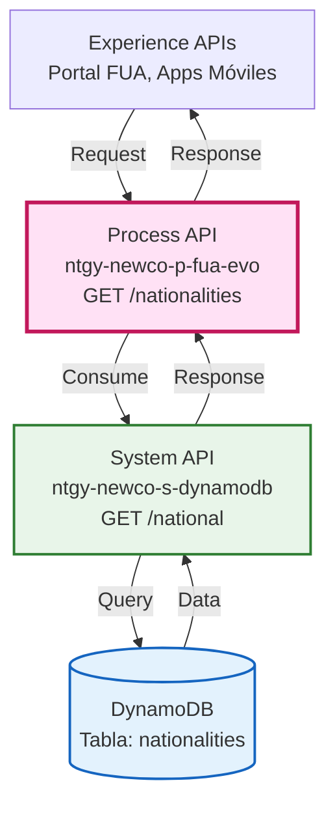
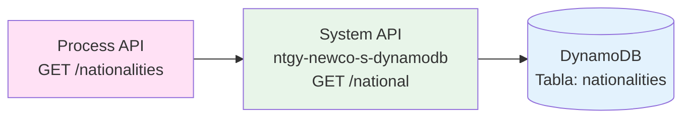
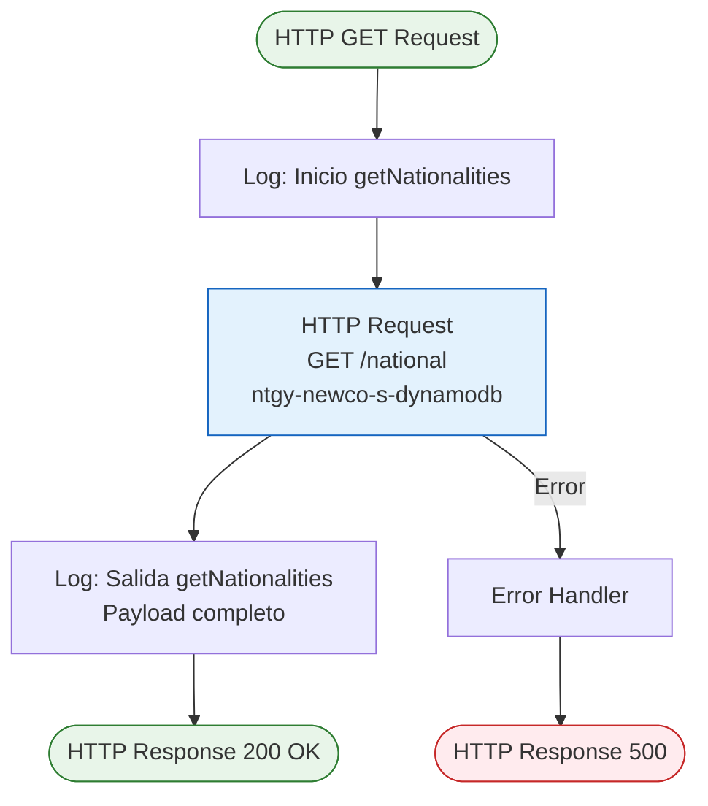
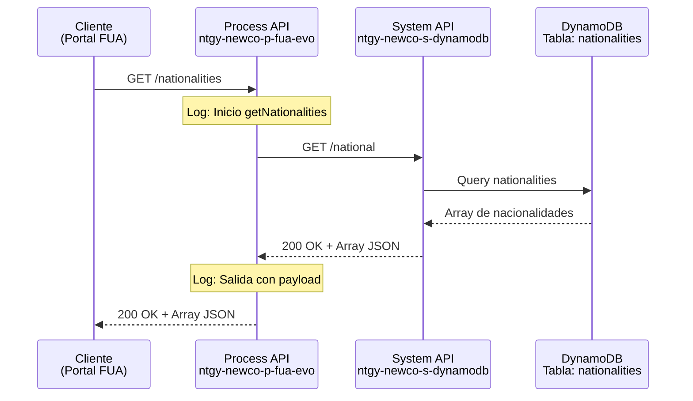
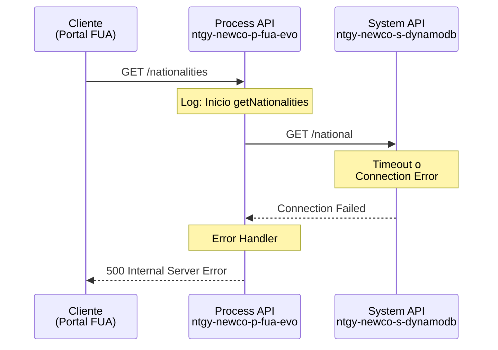
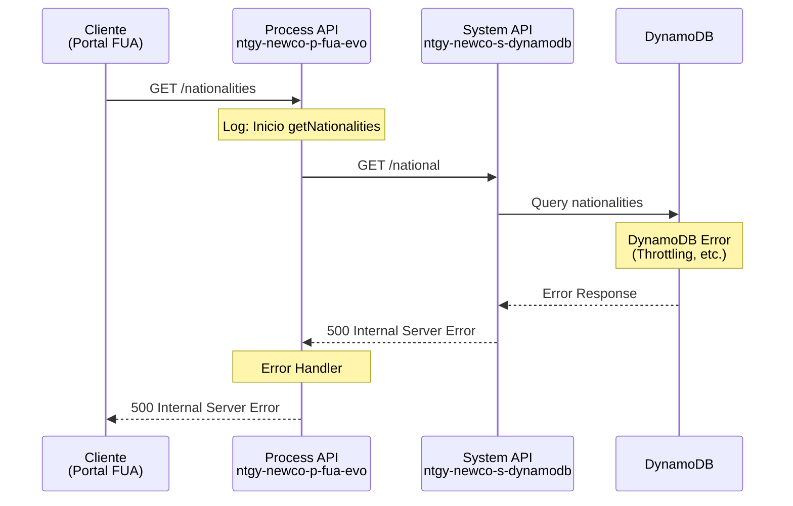

# GET /nationalities

## 📌 Descripción General

### Propósito del Endpoint

Este endpoint recupera el catálogo completo de nacionalidades disponibles en el sistema, proporcionando datos de referencia estándar para ser utilizados en formularios y procesos de registro de clientes en el portal FUA.

### Tipo de API

**Capa:** Process API (API-Led Connectivity)

**Función:** Orquestación de consulta de datos de referencia

### Patrón de Integración

**Tipo:** Pass-Through con logging

**Descripción:** Este endpoint actúa como un proxy simple hacia el System API de DynamoDB, agregando logging de entrada y salida para trazabilidad, pero sin aplicar transformaciones a los datos.

### Arquitectura API-Led Connectivity



---

## 💼 Propósito del Negocio

### Casos de Uso Principales

1. **Formularios de Registro de Clientes**
   - Poblar listas desplegables de nacionalidad en formularios de alta de clientes
   - Garantizar estandarización de datos de nacionalidad en el sistema

2. **Actualización de Datos de Cliente**
   - Permitir a clientes actualizar su nacionalidad desde el portal de autoservicio
   - Validar que la nacionalidad seleccionada sea válida según el catálogo

3. **Procesos de Validación**
   - Validar nacionalidad en procesos de contratación de servicios
   - Aplicar reglas de negocio específicas según nacionalidad del cliente

### 🔗 Endpoints Dependientes

Este Process API consume el siguiente System API:

| System API | Endpoint | Método | Propósito |
|------------|----------|--------|-----------|
| `ntgy-newco-s-dynamodb` | `/national` | GET | Recuperar catálogo de nacionalidades desde DynamoDB |

### Lógica de Orquestación



**Pasos del Proceso:**

1. **Logging de Entrada**: Registra el inicio de la operación
2. **Llamada al System API**: Invoca GET /national en ntgy-newco-s-dynamodb
3. **Logging de Salida**: Registra la respuesta recibida con el payload completo

### Transformaciones Aplicadas

⚠️ **Este Process API NO transforma la respuesta del System API.**

Los datos se devuelven tal como son recibidos desde DynamoDB, manteniendo la estructura original del catálogo de nacionalidades.

Para el schema completo, consultar:
📖 **System API: `ntgy-newco-s-dynamodb` endpoint `GET /national`**

### Contexto Empresarial

- **Dominio:** Gestión de Datos de Referencia
- **Sector:** Energía - Utilities
- **División:** Naturgy España - NewCo
- **Proceso de Negocio:** Gestión de Información de Clientes FUA

### Stakeholders

- **Clientes Finales**: Necesitan seleccionar su nacionalidad en formularios de registro y actualización
- **Agentes de Call Center**: Requieren acceso al catálogo para asistir a clientes en procesos de alta/modificación
- **Desarrolladores Frontend**: Consumen este endpoint para poblar componentes de UI (dropdowns, selects)

### Valor de Negocio

- **Estandarización de Datos**: Garantiza que todos los sistemas usen el mismo catálogo de nacionalidades
- **Experiencia de Usuario**: Proporciona listas desplegables consistentes en todos los canales (web, móvil)
- **Mantenimiento Centralizado**: Cambios en el catálogo se reflejan automáticamente en todos los consumidores
- **Cumplimiento Normativo**: Asegura que las nacionalidades registradas cumplan con estándares internacionales

### Consumidores Potenciales

Este endpoint puede ser consumido por:
- Portales web de autoservicio (FUA Portal)
- Aplicaciones móviles de clientes
- Sistemas de agentes de call center
- Formularios de registro y actualización de datos
- Procesos de validación de datos de cliente

---

## 🔧 Especificación Técnica

### URLs por Ambiente

| Ambiente | URL Base | URL Completa |
|----------|----------|--------------|
| **Local** | `http://localhost:8081` | `http://localhost:8081/api/nationalities` |
| **Development** | `https://ntgy-newco-p-fua-evo-dev.us-e2.cloudhub.io` | `https://ntgy-newco-p-fua-evo-dev.us-e2.cloudhub.io/api/nationalities` |
| **UAT** | `https://ntgy-newco-p-fua-evo-uat.us-e2.cloudhub.io` | `https://ntgy-newco-p-fua-evo-uat.us-e2.cloudhub.io/api/nationalities` |
| **Production** | `https://ntgy-newco-p-fua-evo-pro.us-e2.cloudhub.io` | `https://ntgy-newco-p-fua-evo-pro.us-e2.cloudhub.io/api/nationalities` |

### Método HTTP

```
GET /api/nationalities
```

### Parámetros de Entrada

**Este endpoint NO requiere parámetros de entrada.**

- No requiere query parameters
- No requiere path parameters
- No requiere request body

### Headers Requeridos

| Header | Tipo | Requerido | Descripción |
|--------|------|-----------|-------------|
| `client_id` | string | ✅ Sí | Client ID de Anypoint Platform |
| `client_secret` | string | ✅ Sí | Client Secret de Anypoint Platform |

### Respuestas

#### ✅ 200 OK - Éxito

**Descripción:** Catálogo de nacionalidades recuperado exitosamente

**Content-Type:** `application/json`

**Estructura de Respuesta:**

⚠️ **Este endpoint es pass-through puro. La estructura exacta NO está definida en el RAML del System API.**

**Tipo de Respuesta:** `application/json` - Array de objetos

**Fuente de Datos:** DynamoDB tabla `nationalities` vía System API `MUL-COM-NEWCO-S-DYNAMODB`

**Para conocer la estructura exacta de los objetos:**
1. Consultar la documentación del System API `MUL-COM-NEWCO-S-DYNAMODB` endpoint `GET /national`
2. Ejecutar el endpoint en un ambiente de desarrollo y analizar la respuesta real
3. Consultar el schema de la tabla DynamoDB `nationalities`

**Nota:** El RAML del System API define el response como `application/json` sin schema específico, por lo que la estructura debe verificarse mediante ejecución o consulta directa a DynamoDB.

#### ❌ 400 Bad Request - Error de Cliente

**Descripción:** Solicitud inválida o mal formada

**Content-Type:** `application/json`

**Estructura:**

```json
{
  "code": "BAD_REQUEST",
  "message": "Descripción del error",
  "timestamp": "2026-08-20T11:45:00Z"
}
```

#### ❌ 500 Internal Server Error - Error del Servidor

**Descripción:** Error interno del servidor o del System API de DynamoDB

**Content-Type:** `application/json`

**Estructura:**

```json
{
  "code": "INTERNAL_ERROR",
  "message": "Error al recuperar nacionalidades",
  "timestamp": "2026-08-20T11:45:00Z"
}
```

### Autenticación

- **Tipo:** Client ID & Client Secret (Anypoint Platform)
- **Ubicación:** Headers HTTP
- **Validación:** Gestionada por API Manager de Anypoint Platform

### Timeouts

| Tipo | Valor |
|------|-------|
| **Request Timeout** | 30 segundos |
| **Connection Timeout** | 10 segundos |

### Rate Limiting

- **Límite:** Configurado en API Manager
- **Ventana:** Por minuto
- **Comportamiento:** HTTP 429 Too Many Requests si se excede

---

## 🏗️ Implementación Técnica

### Arquitectura del Flow



### Código de Implementación

**Archivo:** `src/main/mule/services/clients/clientInfo.xml`

**Sub-flow:** `getNationalities`

```xml
<sub-flow name="getNationalities" doc:id="6fb87b58-50cc-46ec-86af-2a4b586e7a4c">
    <logger level="INFO" doc:name="Logger" 
            doc:id="cde2a95a-f724-474f-8232-f56aa4002ac5"
            message="Inicio getNationalities" />
    
    <http:request method="GET" doc:name="Request s-dynamodb"
                  doc:id="9e4bf423-60ab-4c01-877f-369587b6734b"
                  config-ref="HTTP_Request_configuration_ntgy_newco_s_dynamodb"
                  path="/national" />
    
    <logger level="INFO" doc:name="Logger"
            doc:id="a0299fcb-a79f-4561-80b1-9d606a56ecb1"
            message="Salida getNationalities #[payload]" />
</sub-flow>
```

**Archivo Principal:** `src/main/mule/ntgy-newco-p-fua.xml`

**Flow Principal:**

```xml
<flow name="get:\nationalities:ntgy-newco-p-fua-config">
    <logger level="INFO" message="get:\nationalities:ntgy-newco-p-fua-config" />
    <flow-ref doc:name="getNationalities dynamodb" 
              doc:id="8425941a-ec1b-4501-9a60-c5d8073932cc" 
              name="getNationalities" />
</flow>
```

### Configuración HTTP

**Config Reference:** `HTTP_Request_configuration_ntgy_newco_s_dynamodb`

**Propiedades:**
- **Host:** Configurado en properties por ambiente
- **Port:** 443 (HTTPS)
- **Protocol:** HTTPS
- **Base Path:** `/api`
- **Connection Timeout:** 10 segundos
- **Response Timeout:** 30 segundos

### Transformaciones DataWeave

⚠️ **No se aplican transformaciones DataWeave en este endpoint.**

El payload recibido del System API se devuelve directamente al consumidor sin modificaciones.

### Patrones de Diseño

**Patrón:** Pass-Through con Logging

**Justificación:** 
- Los datos de referencia no requieren transformación
- El logging proporciona trazabilidad para debugging
- Mantiene simplicidad y bajo overhead de procesamiento
- Facilita el mantenimiento al no introducir lógica de transformación

### Diagramas de Secuencia

#### 1. Flujo Normal de Éxito



#### 2. Flujo con Error de Conectividad



#### 3. Flujo con Error de DynamoDB



### Manejo de Errores

**Estrategia:** Propagación de errores del System API con logging

**Tipos de Errores Manejados:**

1. **Errores de Conectividad**
   - Timeout de conexión al System API
   - System API no disponible
   - **Respuesta:** HTTP 500 con mensaje genérico

2. **Errores de DynamoDB**
   - Throttling de DynamoDB
   - Tabla no disponible
   - **Respuesta:** HTTP 500 propagado desde System API

3. **Errores de Autenticación**
   - Client ID/Secret inválidos
   - **Respuesta:** HTTP 401 Unauthorized

**Error Handler:** Utiliza el error handler global del proyecto (`error/general-errors.xml`)

**Logging de Errores:** Todos los errores se registran en CloudHub logs con nivel ERROR

### Consideraciones de Performance

**Caching Recomendado:**
- ✅ **Altamente cacheable**: Los datos de nacionalidades son estáticos
- **TTL Sugerido:** 24 horas o más
- **Estrategia:** Implementar cache en Object Store V2 o en el cliente

**Optimizaciones:**
- Respuesta típicamente pequeña (< 5KB)
- Sin transformaciones = bajo overhead de CPU
- Candidato ideal para CDN caching

---

## 💻 Ejemplos de Uso

### Ejemplo 1: Llamada Exitosa con cURL

#### Request

```bash
curl -X GET "https://ntgy-newco-p-fua-evo-dev.us-e2.cloudhub.io/api/nationalities" \
  -H "Content-Type: application/json" \
  -H "client_id: a1b2c3d4e5f6g7h8i9j0" \
  -H "client_secret: k1l2m3n4o5p6q7r8s9t0"
```

#### Response (200 OK)

```json
[
  // Array de objetos con información de nacionalidades
  // La estructura exacta debe verificarse ejecutando el endpoint
  // o consultando la documentación del System API MUL-COM-NEWCO-S-DYNAMODB
]
```

⚠️ **Nota Importante:** 
- Este endpoint es **pass-through puro** sin transformaciones
- La estructura exacta NO está definida en el RAML del System API
- Para obtener la estructura real, ejecutar el endpoint en un ambiente de desarrollo
- Consultar System API: `MUL-COM-NEWCO-S-DYNAMODB` endpoint `GET /national`

### Ejemplo 2: Integración en JavaScript (React)

```javascript
// Hook personalizado para obtener nacionalidades
import { useState, useEffect } from 'react';

const useNationalities = () => {
  const [nationalities, setNationalities] = useState([]);
  const [loading, setLoading] = useState(true);
  const [error, setError] = useState(null);

  useEffect(() => {
    const fetchNationalities = async () => {
      try {
        const response = await fetch(
          'https://ntgy-newco-p-fua-evo-pro.us-e2.cloudhub.io/api/nationalities',
          {
            method: 'GET',
            headers: {
              'Content-Type': 'application/json',
              'client_id': process.env.REACT_APP_CLIENT_ID,
              'client_secret': process.env.REACT_APP_CLIENT_SECRET
            }
          }
        );

        if (!response.ok) {
          throw new Error(`HTTP error! status: ${response.status}`);
        }

        const data = await response.json();
        setNationalities(data);
      } catch (err) {
        setError(err.message);
      } finally {
        setLoading(false);
      }
    };

    fetchNationalities();
  }, []);

  return { nationalities, loading, error };
};

// Componente de formulario
const CustomerForm = () => {
  const { nationalities, loading, error } = useNationalities();

  if (loading) return <div>Cargando nacionalidades...</div>;
  if (error) return <div>Error: {error}</div>;

  return (
    <form>
      <label htmlFor="nationality">Nacionalidad:</label>
      <select id="nationality" name="nationality">
        <option value="">Seleccione una nacionalidad</option>
        {nationalities.map((nat, index) => (
          <option key={index} value={nat.id || index}>
            {nat.name || nat.description || JSON.stringify(nat)}
          </option>
        ))}
      </select>
      {/* Nota: Ajustar campos según estructura real del API */}
    </form>
  );
};

export default CustomerForm;
```

### Ejemplo 3: Integración en Python

```python
import requests
from typing import List, Dict, Optional
import os

class NationalitiesClient:
    """Cliente para el endpoint de nacionalidades"""
    
    def __init__(self, base_url: str, client_id: str, client_secret: str):
        self.base_url = base_url
        self.client_id = client_id
        self.client_secret = client_secret
        self.headers = {
            'Content-Type': 'application/json',
            'client_id': client_id,
            'client_secret': client_secret
        }
    
    def get_nationalities(self) -> Optional[List[Dict]]:
        """
        Recupera el catálogo de nacionalidades
        
        Returns:
            List[Dict]: Lista de nacionalidades o None si hay error
        """
        try:
            response = requests.get(
                f'{self.base_url}/api/nationalities',
                headers=self.headers,
                timeout=30
            )
            response.raise_for_status()
            return response.json()
        except requests.exceptions.RequestException as e:
            print(f"Error al obtener nacionalidades: {e}")
            return None
    
    def get_nationality_by_field(self, field: str, value: str) -> Optional[Dict]:
        """
        Busca una nacionalidad específica por un campo
        
        Args:
            field: Nombre del campo a buscar (ej: "code", "id")
            value: Valor a buscar
        
        Returns:
            Dict: Datos de la nacionalidad o None si no se encuentra
        
        Note: Ajustar según estructura real del API
        """
        nationalities = self.get_nationalities()
        if nationalities:
            return next(
                (nat for nat in nationalities if nat.get(field) == value),
                None
            )
        return None

# Uso del cliente
if __name__ == "__main__":
    client = NationalitiesClient(
        base_url='https://ntgy-newco-p-fua-evo-pro.us-e2.cloudhub.io',
        client_id=os.getenv('CLIENT_ID'),
        client_secret=os.getenv('CLIENT_SECRET')
    )
    
    # Obtener todas las nacionalidades
    nationalities = client.get_nationalities()
    if nationalities:
        print(f"Total de nacionalidades: {len(nationalities)}")
        print("\nPrimeras 5 nacionalidades:")
        for i, nat in enumerate(nationalities[:5]):
            print(f"  {i+1}. {nat}")
    
    # Buscar nacionalidad específica (ajustar campo según estructura real)
    # Ejemplo: buscar por 'code' si ese campo existe
    # result = client.get_nationality_by_field('code', 'ES')
    # if result:
    #     print(f"\nNacionalidad encontrada: {result}")
```

### Ejemplo 4: Manejo de Errores

```bash
# Error 401 - Credenciales inválidas
curl -X GET "https://ntgy-newco-p-fua-evo-dev.us-e2.cloudhub.io/api/nationalities" \
  -H "Content-Type: application/json" \
  -H "client_id: invalid_client_id" \
  -H "client_secret: invalid_secret"

# Response (401 Unauthorized)
{
  "error": "Unauthorized",
  "message": "Invalid client credentials"
}
```

```bash
# Error 500 - System API no disponible
curl -X GET "https://ntgy-newco-p-fua-evo-dev.us-e2.cloudhub.io/api/nationalities" \
  -H "Content-Type: application/json" \
  -H "client_id: valid_client_id" \
  -H "client_secret: valid_secret"

# Response (500 Internal Server Error)
{
  "code": "INTERNAL_ERROR",
  "message": "Error al recuperar nacionalidades desde DynamoDB",
  "timestamp": "2026-08-20T11:45:00Z"
}
```

### Ejemplo 5: Implementación con Cache en Frontend

```typescript
// TypeScript con cache local
interface Nationality {
  code: string;
  api_name: string;
  description: string;
}

class NationalitiesService {
  private cache: Nationality[] | null = null;
  private cacheTimestamp: number = 0;
  private readonly CACHE_TTL = 24 * 60 * 60 * 1000; // 24 horas

  constructor(
    private baseUrl: string,
    private clientId: string,
    private clientSecret: string
  ) {}

  async getNationalities(): Promise<Nationality[]> {
    // Verificar si el cache es válido
    const now = Date.now();
    if (this.cache && (now - this.cacheTimestamp) < this.CACHE_TTL) {
      console.log('Retornando nacionalidades desde cache');
      return this.cache;
    }

    // Obtener datos frescos
    console.log('Obteniendo nacionalidades desde API');
    try {
      const response = await fetch(`${this.baseUrl}/api/nationalities`, {
        method: 'GET',
        headers: {
          'Content-Type': 'application/json',
          'client_id': this.clientId,
          'client_secret': this.clientSecret
        }
      });

      if (!response.ok) {
        throw new Error(`HTTP error! status: ${response.status}`);
      }

      const data: Nationality[] = await response.json();
      
      // Actualizar cache
      this.cache = data;
      this.cacheTimestamp = now;
      
      return data;
    } catch (error) {
      console.error('Error al obtener nacionalidades:', error);
      
      // Si hay error pero tenemos cache, retornar cache aunque esté expirado
      if (this.cache) {
        console.warn('Retornando cache expirado debido a error');
        return this.cache;
      }
      
      throw error;
    }
  }

  clearCache(): void {
    this.cache = null;
    this.cacheTimestamp = 0;
  }
}

// Uso
const service = new NationalitiesService(
  'https://ntgy-newco-p-fua-evo-pro.us-e2.cloudhub.io',
  'your_client_id',
  'your_client_secret'
);

// Primera llamada - obtiene desde API
const nationalities1 = await service.getNationalities();

// Segunda llamada - obtiene desde cache
const nationalities2 = await service.getNationalities();