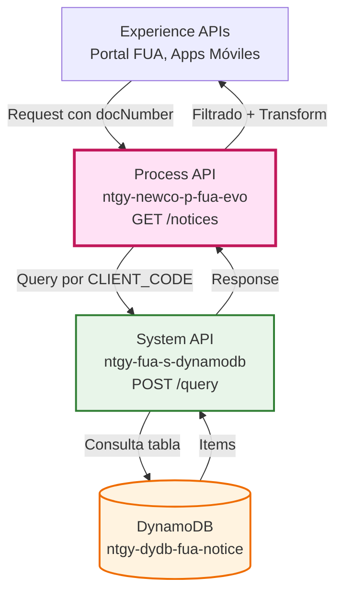
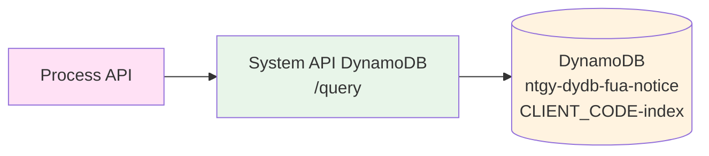
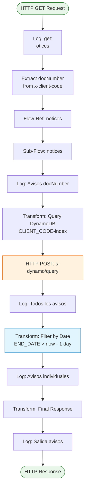
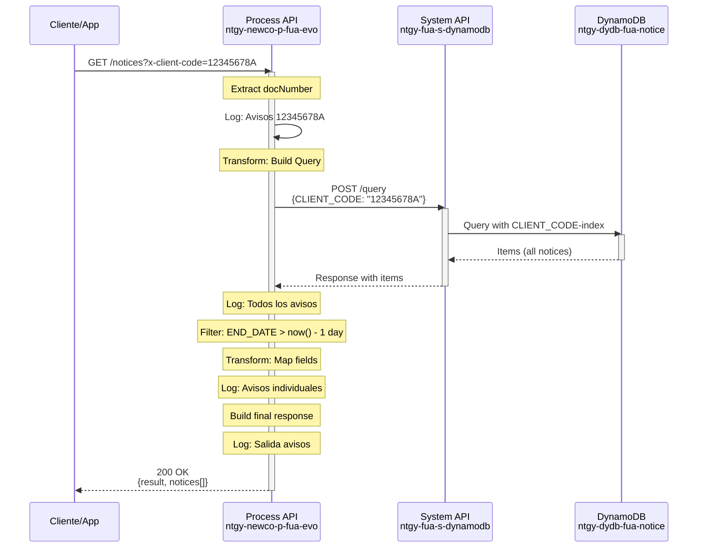
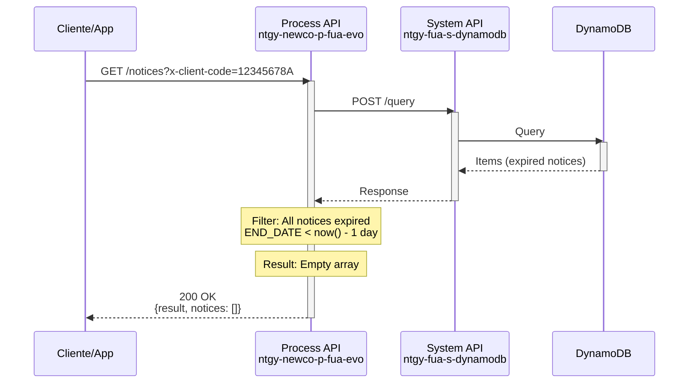
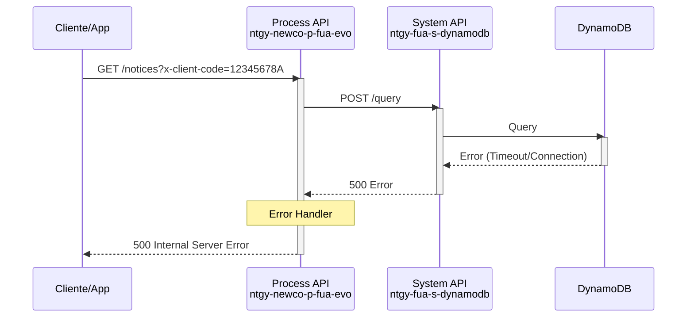

# GET /notices

## 📌 Descripción General

### Propósito del Endpoint

Este endpoint recupera todos los avisos activos asociados a un cliente específico desde DynamoDB. Los avisos son notificaciones importantes para el cliente sobre su cuenta, servicios o información relevante del portal FUA. El endpoint filtra automáticamente los avisos por fecha de vigencia, retornando solo aquellos que están activos (fecha de fin posterior a ayer).

### Tipo de API

**Capa:** Process API (API-Led Connectivity)

**Función:** Orquestación de consulta de avisos con filtrado de vigencia

### Patrón de Integración

**Tipo:** Transformación y Filtrado

**Descripción:** El endpoint consulta DynamoDB a través del System API `ntgy-fua-s-dynamodb`, aplica filtrado por fecha de vigencia y transforma la respuesta para el consumidor.

### Arquitectura API-Led Connectivity



---

## 💼 Propósito del Negocio

### Casos de Uso Principales

1. **Visualización de Avisos en Portal FUA**
   - El cliente accede al portal y visualiza sus avisos activos
   - Beneficio: Mantiene al cliente informado sobre aspectos importantes de su cuenta

2. **Notificaciones de Aplicación Móvil**
   - La app móvil consulta avisos para mostrar notificaciones
   - Beneficio: Comunicación proactiva con el cliente

3. **Centro de Notificaciones**
   - Centraliza todas las comunicaciones importantes para el cliente
   - Beneficio: Mejora la experiencia del usuario con información relevante

### 🔗 Endpoints Dependientes

Este Process API consume el siguiente System API:

| System API | Endpoint | Método | Propósito |
|------------|----------|--------|-----------|
| `ntgy-fua-s-dynamodb` | `/query` | POST | Consulta avisos por CLIENT_CODE usando índice secundario |

### Lógica de Orquestación



**Pasos del Proceso:**

1. **Extracción de Parámetros**: Obtiene `docNumber` del query param `x-client-code` o del payload
2. **Construcción de Query**: Prepara query DynamoDB con condición `CLIENT_CODE=:CLIENT_CODE` usando índice secundario
3. **Consulta a DynamoDB**: Ejecuta query a través del System API
4. **Filtrado por Vigencia**: Filtra avisos donde `END_DATE > now() - |P1D|` (fecha fin mayor a ayer)
5. **Transformación**: Mapea campos de DynamoDB a estructura de respuesta del API
6. **Respuesta**: Retorna lista de avisos activos

### Transformaciones Aplicadas

| Campo Original (DynamoDB) | Campo Transformado (Process API) | Transformación |
|---------------------------|----------------------------------|----------------|
| `CLIENT_CODE` | `clientCode` | Directo |
| `NOTICE_ID` | `noticeId` | Directo |
| `TYPE` | `type` | Directo |
| `TEXT` | `text` | Directo |
| `TITLE` | `title` | Directo |
| `VISIBILITY` | `visibility` | Directo |
| `READ` | `read` | Default `false` si no existe |
| `DELETE` | `delete` | Default `false` si no existe |
| `VALIDITY` | `validity` | Directo |
| `START_DATE` | `startDate` | Directo |
| `END_DATE` | `endDate` | Directo (usado para filtrado) |
| `IDIOMA` | `idioma` | Directo |
| `DIRSUMINISTRO` | `dirSuministro` | Directo |
| `URL` | `url` | Directo |

**Filtrado Aplicado:**
- Solo se retornan avisos donde: `END_DATE as Date > now() - |P1D|`
- Esto asegura que solo se muestren avisos vigentes (activos desde ayer)

### Contexto Empresarial

- **Dominio:** Gestión de Notificaciones y Comunicaciones
- **Sector:** Energía - Utilities
- **División:** Naturgy España - NewCo
- **Proceso de Negocio:** Comunicación con Cliente - Centro de Avisos

### Stakeholders

- **Clientes FUA**: Reciben avisos importantes sobre su cuenta y servicios
- **Equipo de Marketing**: Gestiona comunicaciones y campañas
- **Equipo de Atención al Cliente**: Utiliza avisos para informar a clientes

### Valor de Negocio

- **Comunicación Proactiva**: Mantiene a los clientes informados sobre aspectos importantes
- **Reducción de Llamadas**: Los avisos responden preguntas frecuentes antes de que el cliente llame
- **Mejora de Experiencia**: Centraliza información relevante en un solo lugar
- **Segmentación**: Permite enviar avisos específicos por cliente

### Consumidores Potenciales

Este endpoint puede ser consumido por:
- Portal web FUA (autoservicio de clientes)
- Aplicaciones móviles iOS/Android
- Sistemas de agentes de call center
- Integraciones de terceros autorizados

---

## 🔧 Especificación Técnica

### URLs por Ambiente

| Ambiente | URL Base | URL Completa |
|----------|----------|--------------|
| **Local** | `http://localhost:8081` | `http://localhost:8081/api/notices?x-client-code={docNumber}` |
| **Development** | `https://ntgy-newco-p-fua-evo-dev.us-e2.cloudhub.io` | `https://ntgy-newco-p-fua-evo-dev.us-e2.cloudhub.io/api/notices?x-client-code={docNumber}` |
| **UAT** | `https://ntgy-newco-p-fua-evo-uat.us-e2.cloudhub.io` | `https://ntgy-newco-p-fua-evo-uat.us-e2.cloudhub.io/api/notices?x-client-code={docNumber}` |
| **Production** | `https://ntgy-newco-p-fua-evo-pro.us-e2.cloudhub.io` | `https://ntgy-newco-p-fua-evo-pro.us-e2.cloudhub.io/api/notices?x-client-code={docNumber}` |

### Método HTTP

```
GET /api/notices
```

### Parámetros de Entrada

#### Query Parameters

| Parámetro | Tipo | Requerido | Descripción | Ejemplo |
|-----------|------|-----------|-------------|---------|
| `x-client-code` | string | Sí | Número de documento del cliente (NIF/NIE) | `12345678A` |

**Nota:** Si no se proporciona en query params, el sistema intenta obtenerlo de `payload.data.nif` como fallback.

### Respuestas

#### 200 OK - Avisos Encontrados

```json
{
  "result": {
    "codResult": "0000",
    "msgResult": "Item found"
  },
  "notices": [
    {
      "clientCode": "12345678A",
      "noticeId": "NOTICE-001",
      "type": "INFO",
      "text": "Recuerde que puede consultar su factura en el portal",
      "title": "Consulta de Factura",
      "visibility": "VISIBLE",
      "read": false,
      "delete": false,
      "validity": "30",
      "startDate": "2026/08/01",
      "endDate": "2026/09/01",
      "idioma": "ES",
      "dirSuministro": "Calle Principal 123",
      "url": "https://portal.naturgy.es/facturas"
    }
  ]
}
```

#### 200 OK - Sin Avisos Activos

```json
{
  "result": {
    "codResult": "0000",
    "msgResult": "Item found"
  },
  "notices": []
}
```

#### 400 Bad Request

```json
{
  "message": "Bad request"
}
```

#### 500 Internal Server Error

```json
{
  "code": "ERROR_CODE",
  "message": "Error message",
  "details": "Additional error details"
}
```

### Autenticación

- **Tipo:** Client ID & Client Secret (Anypoint Platform)

### Timeouts

| Tipo | Valor |
|------|-------|
| **Request Timeout** | 30 segundos |
| **Connection Timeout** | 10 segundos |

---

## 🏗️ Implementación Técnica

### Arquitectura del Flow



### Transformaciones DataWeave

#### 1. Construcción de Query DynamoDB

```dataweave
%dw 2.0
output application/json
---
{
    "attributes": {
        ":CLIENT_CODE": {
            "S": vars.docNumber 
        }
    },
    "condition": "CLIENT_CODE=:CLIENT_CODE",
    "tableName": "ntgy-dydb-fua-notice",
    "index": "CLIENT_CODE-index"
}
```

#### 2. Filtrado y Transformación de Respuesta

```dataweave
%dw 2.0
output application/json
---
{
  "noticesClient": vars.resultAvisos.items filter ((item) -> 
        item.END_DATE as Date {format: "yyyy/MM/dd"} > now() - |P1D|
    ) map ((item, index) -> {
      "clientCode": item.CLIENT_CODE,
      "noticeId": item.NOTICE_ID,
      "type": item.TYPE,
      "text": item.TEXT,
      "title": item.TITLE,
      "visibility": item.VISIBILITY,
      "read": item.READ default false,
      "delete": item.DELETE default false,
      "validity": item.VALIDITY,
      "startDate": item.START_DATE,
      "endDate": item.END_DATE,
      "idioma": item.IDIOMA,
      "dirSuministro": item.DIRSUMINISTRO,
      "url": item.URL 
  }) default []
}
```

#### 3. Respuesta Final

```dataweave
%dw 2.0
output application/json
---
{
    "result": {
        "codResult": "0000",
        "msgResult": "Item found"
    },
    "notices": flatten(vars.noticesClient.noticesClient) 
}
```

### Patrones de Diseño

**Patrón:** Query con Índice Secundario + Filtrado Post-Consulta

**Justificación:** 
- DynamoDB no permite filtrar por fecha en el query directamente cuando se usa índice secundario
- El filtrado se realiza en memoria después de obtener los resultados
- Esto es eficiente porque el número de avisos por cliente es limitado

### Diagramas de Secuencia

#### 1. Flujo Normal de Éxito



#### 2. Flujo Sin Avisos Activos



#### 3. Flujo con Error de DynamoDB



### Manejo de Errores

El endpoint utiliza el error handler global `errorManagerFlow` que:

1. **Captura errores de conectividad** con DynamoDB
2. **Transforma errores** a formato estándar
3. **Registra errores** en logs para troubleshooting
4. **Retorna respuesta** con código HTTP apropiado

**Códigos de Error Comunes:**
- `400`: Parámetros inválidos o faltantes
- `500`: Error de conexión con DynamoDB o error interno
- `503`: DynamoDB no disponible

---

## 💻 Ejemplos de Uso

### Ejemplo 1: Consulta Exitosa con Avisos

#### cURL

```bash
curl -X GET "https://ntgy-newco-p-fua-evo-dev.us-e2.cloudhub.io/api/notices?x-client-code=12345678A" \
  -H "Content-Type: application/json" \
  -H "client_id: YOUR_CLIENT_ID" \
  -H "client_secret: YOUR_CLIENT_SECRET"
```

#### Respuesta (200 OK)

```json
{
  "result": {
    "codResult": "0000",
    "msgResult": "Item found"
  },
  "notices": [
    {
      "clientCode": "12345678A",
      "noticeId": "NOTICE-2026-001",
      "type": "INFO",
      "text": "Su factura del mes de agosto ya está disponible. Puede consultarla en el portal.",
      "title": "Nueva Factura Disponible",
      "visibility": "VISIBLE",
      "read": false,
      "delete": false,
      "validity": "30",
      "startDate": "2026/08/01",
      "endDate": "2026/09/01",
      "idioma": "ES",
      "dirSuministro": "Calle Principal 123, Madrid",
      "url": "https://portal.naturgy.es/facturas/2026-08"
    },
    {
      "clientCode": "12345678A",
      "noticeId": "NOTICE-2026-002",
      "type": "ALERT",
      "text": "Recuerde que el próximo 15 de septiembre vence el plazo de pago de su factura.",
      "title": "Recordatorio de Pago",
      "visibility": "VISIBLE",
      "read": true,
      "delete": false,
      "validity": "15",
      "startDate": "2026/08/20",
      "endDate": "2026/09/15",
      "idioma": "ES",
      "dirSuministro": "Calle Principal 123, Madrid",
      "url": "https://portal.naturgy.es/pagos"
    }
  ]
}
```

### Ejemplo 2: Consulta Sin Avisos Activos

#### cURL

```bash
curl -X GET "https://ntgy-newco-p-fua-evo-dev.us-e2.cloudhub.io/api/notices?x-client-code=98765432B" \
  -H "Content-Type: application/json" \
  -H "client_id: YOUR_CLIENT_ID" \
  -H "client_secret: YOUR_CLIENT_SECRET"
```

#### Respuesta (200 OK)

```json
{
  "result": {
    "codResult": "0000",
    "msgResult": "Item found"
  },
  "notices": []
}
```

### Ejemplo 3: JavaScript (Fetch API)

```javascript
const getNotices = async (clientCode) => {
  try {
    const response = await fetch(
      `https://ntgy-newco-p-fua-evo-dev.us-e2.cloudhub.io/api/notices?x-client-code=${clientCode}`,
      {
        method: 'GET',
        headers: {
          'Content-Type': 'application/json',
          'client_id': 'YOUR_CLIENT_ID',
          'client_secret': 'YOUR_CLIENT_SECRET'
        }
      }
    );

    if (!response.ok) {
      throw new Error(`HTTP error! status: ${response.status}`);
    }

    const data = await response.json();
    
    // Filtrar avisos no leídos
    const unreadNotices = data.notices.filter(notice => !notice.read);
    console.log(`Avisos no leídos: ${unreadNotices.length}`);
    
    return data;
  } catch (error) {
    console.error('Error al obtener avisos:', error);
    throw error;
  }
};

// Uso
getNotices('12345678A')
  .then(data => console.log('Avisos:', data.notices))
  .catch(error => console.error('Error:', error));
```

### Ejemplo 4: Python (Requests)

```python
import requests
from datetime import datetime

def get_notices(client_code):
    """
    Obtiene los avisos activos de un cliente
    
    Args:
        client_code (str): Código del cliente (NIF/NIE)
    
    Returns:
        dict: Respuesta con avisos del cliente
    """
    url = f'https://ntgy-newco-p-fua-evo-dev.us-e2.cloudhub.io/api/notices'
    
    headers = {
        'Content-Type': 'application/json',
        'client_id': 'YOUR_CLIENT_ID',
        'client_secret': 'YOUR_CLIENT_SECRET'
    }
    
    params = {
        'x-client-code': client_code
    }
    
    try:
        response = requests.get(url, headers=headers, params=params, timeout=30)
        response.raise_for_status()
        
        data = response.json()
        
        # Procesar avisos
        notices = data.get('notices', [])
        print(f"Total de avisos activos: {len(notices)}")
        
        # Contar por tipo
        types_count = {}
        for notice in notices:
            notice_type = notice.get('type', 'UNKNOWN')
            types_count[notice_type] = types_count.get(notice_type, 0) + 1
        
        print(f"Avisos por tipo: {types_count}")
        
        return data
        
    except requests.exceptions.RequestException as e:
        print(f"Error al obtener avisos: {e}")
        raise

# Uso
if __name__ == "__main__":
    client_code = "12345678A"
    result = get_notices(client_code)
    
    for notice in result.get('notices', []):
        print(f"\n{notice['title']}")
        print(f"Tipo: {notice['type']}")
        print(f"Vigencia: {notice['startDate']} - {notice['endDate']}")
        print(f"Leído: {'Sí' if notice['read'] else 'No'}")