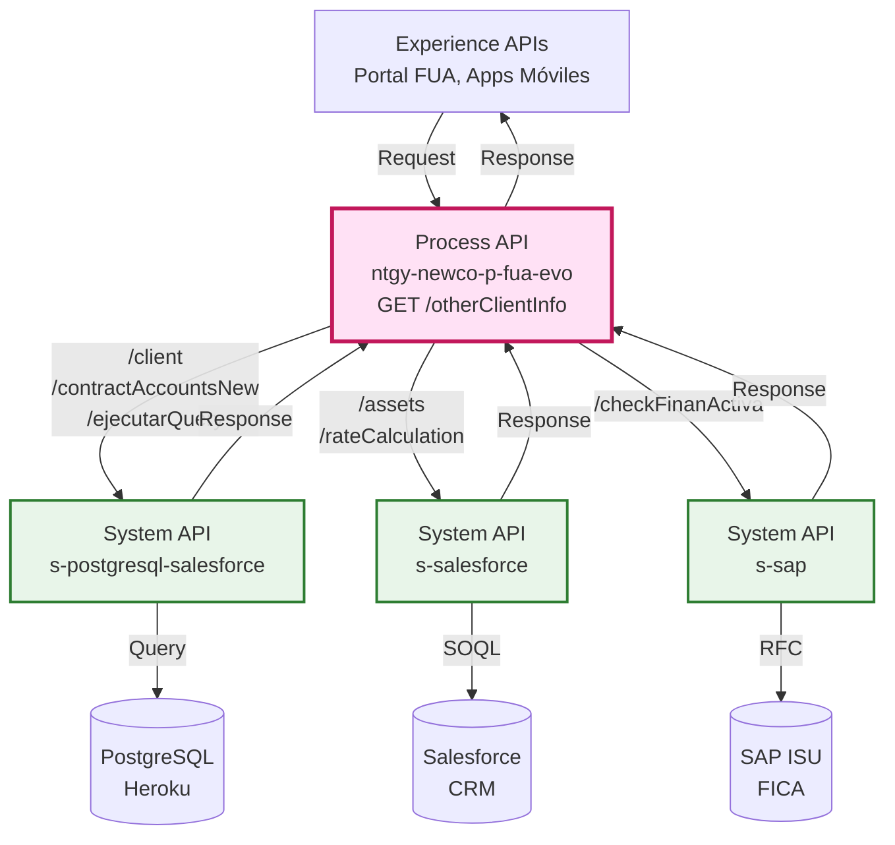
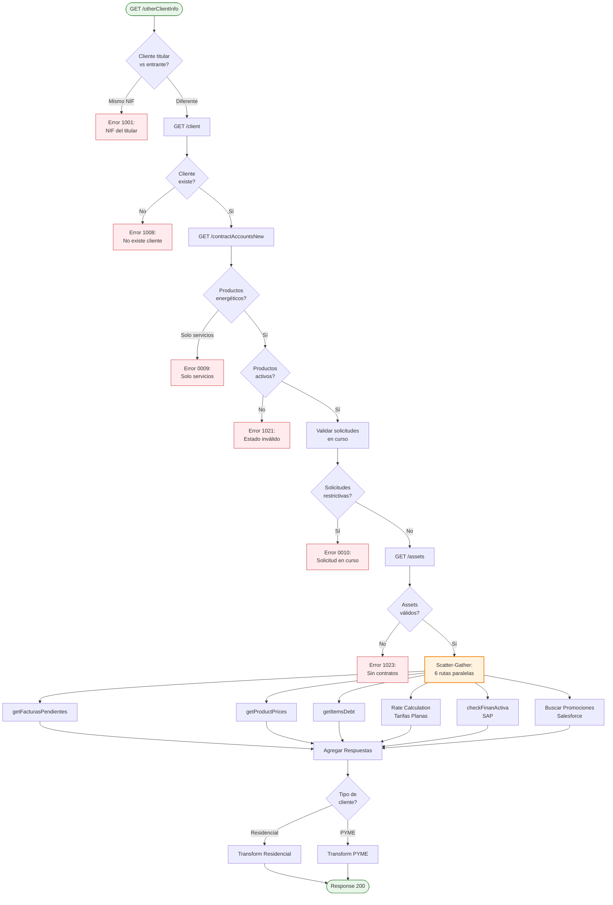
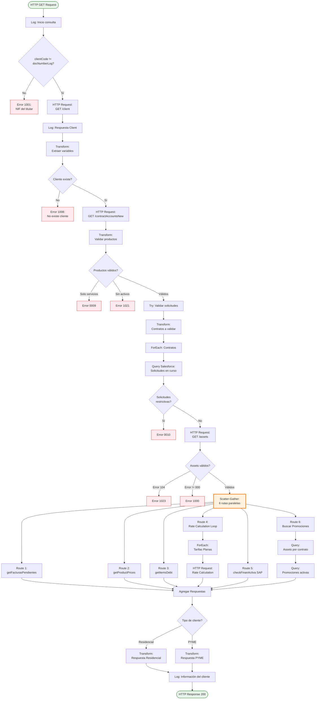

# GET /otherClientInfo

## 📌 Descripción General

### Propósito del Endpoint

Este endpoint orquesta múltiples System APIs para obtener información completa del cliente necesaria para validar la elegibilidad de contratación de nuevos productos o servicios. Realiza validaciones de negocio críticas, agrega datos de múltiples fuentes y diferencia la respuesta según el tipo de cliente (Residencial vs PYME).

### Tipo de API

**Capa:** Process API (API-Led Connectivity)

**Función:** Orquestación compleja con validaciones de negocio, agregación de datos y procesamiento paralelo

### Patrón de Integración

**Tipo:** Orquestación Compleja con Procesamiento Paralelo

**Descripción:** Este endpoint implementa un flujo de orquestación sofisticado que:
1. Valida múltiples condiciones de negocio
2. Consume 3 System APIs diferentes (PostgreSQL-Salesforce, Salesforce, SAP)
3. Ejecuta procesamiento paralelo mediante Scatter-Gather
4. Aplica transformaciones DataWeave complejas
5. Diferencia la respuesta según tipo de cliente

### Arquitectura API-Led Connectivity



---

## 💼 Propósito del Negocio

### Casos de Uso Principales

1. **Validación de Elegibilidad para Contratación**
   - Verifica que el cliente cumple todos los requisitos para contratar nuevos productos
   - Valida estados de productos, solicitudes en curso y financiaciones activas
   - Beneficio: Previene contrataciones inválidas y mejora la experiencia del cliente

2. **Consulta de Información Completa del Cliente**
   - Agrega datos de cliente, productos, facturas, precios y promociones
   - Proporciona vista unificada desde múltiples sistemas backend
   - Beneficio: Reduce llamadas al backend y mejora rendimiento

3. **Cálculo de Precios para Tarifas Planas**
   - Calcula precios estimados para productos con tarifa plana
   - Incluye consumo anual base e importe anual estimado
   - Beneficio: Permite al cliente tomar decisiones informadas

### 🔗 Endpoints Dependientes

Este Process API consume los siguientes System APIs:

| System API | Endpoint | Método | Propósito |
|------------|----------|--------|-----------|
| `ntgy-newco-s-postgresql-salesforce` | `/client` | GET | Obtiene datos del cliente desde PostgreSQL |
| `ntgy-newco-s-postgresql-salesforce` | `/contractAccountsNew` | GET | Obtiene cuentas de servicio y facturación |
| `ntgy-newco-s-postgresql-salesforce` | `/ejecutarQuery` | POST | Ejecuta queries SQL en Salesforce |
| `ntgy-newco-s-salesforce` | `/accounts/:accountId/billing-accounts/:billingAccountId/service-accounts/:serviceAccountId/contacts/:contactId/assets` | GET | Obtiene assets y contratos |
| `ntgy-newco-s-salesforce` | `/rateCalculation` | POST | Calcula precios para tarifas planas |
| `ntgy-newco-s-sap` | `/checkFinanActiva` | GET | Verifica financiaciones activas en SAP |

### Lógica de Orquestación



**Pasos del Proceso:**

1. **Validación Inicial**: Verifica que el cliente entrante no sea el titular
2. **Obtención de Datos**: Consulta información del cliente y cuentas de contrato
3. **Validaciones de Negocio**: Verifica productos energéticos, estados válidos y solicitudes en curso
4. **Obtención de Assets**: Consulta contratos relacionados en Salesforce
5. **Procesamiento Paralelo**: Ejecuta 6 operaciones simultáneas (Scatter-Gather)
6. **Agregación**: Combina todas las respuestas
7. **Transformación Final**: Diferencia respuesta según tipo de cliente (Residencial/PYME)

### Validaciones de Negocio Implementadas

| Código Error | Validación | Descripción |
|--------------|------------|-------------|
| **1001** | Cliente titular vs entrante | El NIF introducido es el del titular |
| **1008** | Existencia del cliente | No existe el cliente titular |
| **0009** | Tipo de productos | Solo existen contratos de servicio |
| **1021** | Estado del producto | El estado del producto no es válido |
| **0010** | Solicitudes en curso | Ya existe una solicitud de contratación en curso |
| **1020** | Número de referencia | El número de referencia no coincide con el id del cliente |
| **1023** | Contratos relacionados | La cuenta contrato no tiene contratos relacionados |

### Transformaciones Aplicadas

**Transformaciones Complejas:**

1. **Validación de Productos**: Filtra productos por familia (servicios vs energéticos) y estado
2. **Cálculo de Precios**: Para tarifas planas, calcula consumo máximo pactado e importe anual
3. **Agregación de Datos**: Combina información de 6 fuentes diferentes
4. **Diferenciación Residencial/PYME**: Aplica lógica diferente según tipo de cliente
5. **Mapeo de Promociones**: Asocia promociones activas a productos específicos

### Contexto Empresarial

- **Dominio:** Gestión de Clientes y Contratación
- **Sector:** Energía - Utilities
- **División:** Naturgy España - NewCo
- **Proceso de Negocio:** Validación de elegibilidad para contratación de productos energéticos

### Stakeholders

- **Clientes Finales**: Necesitan información completa para tomar decisiones de contratación
- **Agentes de Call Center**: Requieren validación rápida de elegibilidad
- **Equipo de Ventas**: Necesitan información de precios y promociones actualizadas
- **Sistemas de Facturación**: Requieren datos consistentes para procesamiento

### Valor de Negocio

- **Prevención de Errores**: Valida elegibilidad antes de iniciar proceso de contratación
- **Experiencia del Cliente**: Proporciona información completa en una sola llamada
- **Eficiencia Operativa**: Reduce llamadas al backend mediante agregación de datos
- **Transparencia**: Muestra precios, promociones y deudas pendientes

### Consumidores Potenciales

Este endpoint puede ser consumido por:
- Portal web FUA
- Aplicaciones móviles de autoservicio
- Sistemas de agentes de call center
- Herramientas de ventas y contratación

---

## 🔧 Especificación Técnica

### URLs por Ambiente

| Ambiente | URL Base | URL Completa |
|----------|----------|--------------|
| **Local** | `http://localhost:8081` | `http://localhost:8081/api/otherClientInfo` |
| **Development** | `https://ntgy-newco-p-fua-evo-dev.us-e2.cloudhub.io` | `https://ntgy-newco-p-fua-evo-dev.us-e2.cloudhub.io/api/otherClientInfo` |
| **UAT** | `https://ntgy-newco-p-fua-evo-uat.us-e2.cloudhub.io` | `https://ntgy-newco-p-fua-evo-uat.us-e2.cloudhub.io/api/otherClientInfo` |
| **Production** | `https://ntgy-newco-p-fua-evo-pro.us-e2.cloudhub.io` | `https://ntgy-newco-p-fua-evo-pro.us-e2.cloudhub.io/api/otherClientInfo` |

### Método HTTP

```
GET /api/otherClientInfo
```

### Parámetros de Entrada

#### Query Parameters

| Parámetro | Tipo | Requerido | Descripción | Ejemplo |
|-----------|------|-----------|-------------|---------|
| `refNum` | string | ✅ Sí | Número de referencia de la cuenta contrato | `"123456789"` |
| `docNumber` | string | ❌ No | Documento/código del cliente | `"C001234"` |
| `x-language` | string \| nil | ❌ No | Idioma para descripciones (es, ca, gl, en, eu) | `"es"` |
| `x-client-code` | string \| nil | ❌ No | Documento del usuario entrante (para validación) | `"12345678A"` |
| `x-client-id` | string | ❌ No | ID de cuenta de Salesforce | `"0011234567890ABC"` |
| `contactId` | string | ❌ No | ID de contacto de Salesforce | `"0031234567890ABC"` |

**Nota:** Los parámetros con prefijo `x-` son headers personalizados que se pasan como query parameters.

### Respuestas

#### 200 OK - Éxito

**Estructura de Respuesta (Residencial):**

```json
{
  "result": {
    "codResult": "0000",
    "msgResult": "No hay error"
  },
  "otherClientInfo": {
    "name": "string",
    "serviceAccount": {
      "clientId": "string",
      "serviceAccountId": "string",
      "lastInvoice": null,
      "supplyAddress": {
        "fullAddress": "string",
        "addressId": "string",
        "zipCode": "string",
        "province": "string",
        "city": "string",
        "town": "string",
        "wayId": "string",
        "way": "string",
        "wayType": "string",
        "number": "string",
        "floor": "string",
        "door": "string",
        "portal": "string",
        "stairs": "string"
      },
      "billingAccountList": {
        "refNum": "string",
        "billingAccountId": "string",
        "isDirectPayment": boolean,
        "billDeliveryMethod": "string",
        "mailingAddress": { },
        "bankAccount": { },
        "products": []
      }
    },
    "renewalContracts": boolean,
    "orderItemList": [
      {
        "productName": "string",
        "techDataId": "string",
        "contractNumber": "string",
        "startDate": "string",
        "prices": {
          "maxConsumption": number,
          "annualAmount": number,
          "consumoAnual": number,
          "serviceAmount": number,
          "flatRateAmount": number,
          "energy": [number],
          "power": [number],
          "fixedTerm": number,
          "variableTerm": number
        },
        "productTypeFamily": "string",
        "rateInfoData": [],
        "orderItemId": "string"
      }
    ],
    "orderId": "string",
    "invoicesDueList": [],
    "itemsDebt": {},
    "orderItemSubrogateList": [],
    "existsActiveLoan": boolean
  }
}
```

**Diferencias PYME:**
- Los precios de energía y potencia se extraen directamente de los items (no de rate calculation)
- Incluye campos `precioTE*` y `precioTP*` en lugar de arrays calculados

#### 400 Bad Request - Errores de Negocio

**Error 1001 - NIF del Titular:**
```json
{
  "result": {
    "codResult": "1001",
    "msgResult": "El NIF introducido es el del titular de la persona entrante: 12345678A"
  }
}
```

**Error 1008 - Cliente No Existe:**
```json
{
  "result": {
    "codResult": "1008",
    "msgResult": "No existe el cliente titular"
  }
}
```

**Error 0009 - Solo Servicios:**
```json
{
  "result": {
    "codResult": "0009",
    "msgResult": "Solo existen contratos de servicio"
  }
}
```

**Error 1021 - Estado Inválido:**
```json
{
  "result": {
    "codResult": "1021",
    "msgResult": "El estado del producto no es válido"
  }
}
```

**Error 0010 - Solicitud en Curso:**
```json
{
  "result": {
    "codResult": "0010",
    "msgResult": "Ya existe una solicitud de contratación en curso"
  }
}
```

**Error 1020 - Número de Referencia Inválido:**
```json
{
  "result": {
    "codResult": "1020",
    "msgResult": "El número de referencia no coincide con el id del cliente"
  }
}
```

**Error 1023 - Sin Contratos:**
```json
{
  "result": {
    "codResult": "1023",
    "msgResult": "La cuenta contrato no tiene contratos relacionados"
  }
}
```

**Error SA01 - Timeout SAP:**
```json
{
  "result": {
    "codResult": "SA01",
    "msgResult": "Timeout exceeded SAP"
  }
}
```

**Nota:** Este error ocurre cuando el Scatter-Gather detecta un timeout en la llamada a SAP (ruta 5: checkFinanActiva).

#### 500 Internal Server Error

```json
{
  "code": "INTERNAL_ERROR",
  "message": "Error interno del servidor",
  "details": "Descripción del error técnico"
}
```

### Autenticación

- **Tipo:** Client ID & Client Secret (Anypoint Platform)
- **Headers Requeridos:**
  - `client_id`: ID del cliente de la aplicación
  - `client_secret`: Secret del cliente de la aplicación

### Timeouts

| Tipo | Valor |
|------|-------|
| **Request Timeout** | 60 segundos (operación compleja) |
| **Connection Timeout** | 10 segundos |
| **Rate Calculation Timeout** | 30 segundos |
| **SAP Timeout** | Configurado en properties |

---

## 🏗️ Implementación Técnica

### Arquitectura del Flow



### Transformaciones DataWeave Clave

#### 1. Validación de Productos

**Ubicación:** Inline en XML (línea ~70)

```dataweave
%dw 2.0
output application/json  

var products = (flatten(vars.productList.serviceAccountList.billingAccountList) 
  filter ((item) -> item.refNum == vars.IVkont))[0].products.productType

---
{
   serviceProducts: products filter ($.productTypeFamily == "servicios"),
   energeticProducts: products filter (["gas", "luz"] contains $.productTypeFamily),
   activeEnergeticProducts: (products filter (["gas", "luz"] contains $.productTypeFamily)) 
     filter (!(["01", "02", "04", "05", "06", "10", "11", "12", "13", "15", "16", 
               "18", "19", "20", "21", "22", "23", "24", "25", "26", "27", "28", "29"] 
               contains $.productStatus))
}
```

**Propósito:** Clasifica productos por familia y valida estados activos

#### 2. Preparación para Rate Calculation

**Ubicación:** Inline en ForEach (línea ~200)

```dataweave
%dw 2.0
output application/json

fun formateoDecimales(valor) =
    if(!(valor contains(".")) and valor != "0") 
        dw::core::Strings::rightPad((valor as String ++ "."),8,"0")
    else
        dw::core::Strings::rightPad(valor as String,8,"0")

var powers = payload.techData filterObject ((value, key, index) -> 
  key as String contains(/p[1-6]/)) pluck (formateoDecimales($ default 0))

---
{
    "CUPS": payload.techData.cups,
    "TipoEnergia": payload.techData.serviceType,
    "FechaReservaPrecios": now() as Date,
    "Potencias": {
        "P1": if(powers[0] == "00000000") null else powers[0],
        "P2": if(powers[1] == "00000000") null else powers[1],
        "P3": if(powers[2] == "00000000") null else powers[2],
        "P4": if(powers[3] == "00000000") null else powers[3],
        "P5": if(powers[4] == "00000000") null else powers[4],
        "P6": if(powers[5] == "00000000") null else powers[5]
    }
}
```

**Propósito:** Formatea potencias para cálculo de precios de tarifas planas

#### 3. Transformación Final Residencial

**Ubicación:** Inline en XML (línea ~300)

```dataweave
%dw 2.0
import join from dw::core::Arrays
output application/json

var childItems = vars.assetsResult.orderItemList filter (!isEmpty($.OrderItemParent))
var parentItems = vars.assetsResult.orderItemList filter (isEmpty($.OrderItemParent))
var rateCalculationInfo = vars.rateCalculationResult groupBy $.product2Id
var tarifa = (vars.assetsResult.orderItemList filter (isEmpty($.OrderItemParent)))[0].Tarifa
var promotionsMap = vars.promotionsList reduce ((item, acc = {}) -> 
  acc ++ { (item.productTypeId): item })

fun transformInput(value) =
  if (value == "RL01") "RL1"
  else if (value == "RL02") "RL2"
  else if (value == "RL03") "RL3"
  else if (value == "RL04") "RL4"
  else if (value == "RL05") "RL5"
  else if (value == "RL06") "RL6"
  else value

fun checkEmpty(value) =
  if (!isEmpty(value)) value ++ " " else ""

---
{
  "result": {
    "codResult": "0000",
    "msgResult": "No hay error"
  },
  "otherClientInfo": {
    "name": trim(checkEmpty(vars.clientResult.client.name) ++  
                 checkEmpty(vars.clientResult.client.surname) ++ 
                 checkEmpty(vars.clientResult.client.surname2)),
    "serviceAccount": { /* ... */ },
    "orderItemList": parentItems map ((parItems,parItemsIndex)-> {
      "productName": parItems.NombreProducto,
      "prices": {
        "energy": if(!isEmpty(childItems filter ($.OrderItemParent == parItems.OrderItemId 
                    and $.Product2Family == "Término Energía"))) 
                  (childItems filter ($.OrderItemParent == parItems.OrderItemId 
                    and $.Product2Family == "Término Energía") 
                    map ($.PrecioTerminoTarifaElectricidad default 0) as Number) 
                  else [0,0,0,0,0,0],
        "power": if(!isEmpty(childItems filter ($.OrderItemParent == parItems.OrderItemId 
                   and $.Product2Family == "Término Potencia")))
                 (childItems filter ($.OrderItemParent == parItems.OrderItemId 
                   and $.Product2Family == "Término Potencia") 
                   map ($.PrecioTerminoTarifaElectricidad default 0) as Number) 
                 else [0,0,0,0,0,0]
      }
    })
  }
}
```

**Propósito:** Construye respuesta final para clientes residenciales con precios calculados

### Patrones de Diseño

**Patrón 1: Scatter-Gather (Procesamiento Paralelo)**

**Justificación:** Optimiza el tiempo de respuesta ejecutando 6 operaciones independientes simultáneamente:
- Obtención de facturas pendientes
- Obtención de precios de productos
- Obtención de items de deuda
- Cálculo de precios para tarifas planas
- Verificación de financiaciones activas en SAP
- Búsqueda de promociones en Salesforce

**Patrón 2: Content-Based Routing**

**Justificación:** Diferencia la transformación final según el tipo de cliente (Residencial vs PYME), aplicando lógica específica para cada caso.

**Patrón 3: Chain of Responsibility (Validaciones)**

**Justificación:** Implementa una cadena de validaciones secuenciales que detienen el flujo en caso de error, mejorando la eficiencia y claridad del código.

### Diagramas de Secuencia

#### 1. Flujo Normal de Éxito (Residencial)

```mermaid
sequenceDiagram
    participant E as Experience API
    participant P as Process API
    participant S1 as s-postgresql-salesforce
    participant S2 as s-salesforce
    participant S3 as s-sap
    participant SF as Salesforce DB
    
    E->>P: GET /otherClientInfo?refNum=123&docNumber=C001
    
    Note over P: Validación: clientCode != docNumberLog
    
    P->>S1: GET /client?docNumber=C001
    S1-->>P: Cliente data
    
    P->>S1: GET /contractAccountsNew?clientId=X&refNum=123
    S1-->>P: Cuentas y productos
    
    Note over P: Validar productos energéticos activos
    
    P->>S1: POST /ejecutarQuery (solicitudes en curso)
    S1->>SF: Query Salesforce
    SF-->>S1: Solicitudes
    S1-->>P: No hay solicitudes restrictivas
    
    P->>S2: GET /assets
    S2-->>P: Assets y contratos
    
    Note over P: Scatter-Gather (6 rutas paralelas)
    
    par Ruta 1: Facturas
        P->>P: getFacturasPendientes
    and Ruta 2: Precios
        P->>P: getProductPrices
    and Ruta 3: Deuda
        P->>P: getItemsDebt
    and Ruta 4: Rate Calculation
        P->>S2: POST /rateCalculation (por cada tarifa plana)
        S2-->>P: Precios calculados
    and Ruta 5: Financiaciones
        P->>S3: GET /checkFinanActiva
        S3-->>P: Estado financiaciones
    and Ruta 6: Promociones
        P->>S1: POST /ejecutarQuery (promociones)
        S1->>SF: Query promociones
        SF-->>S1: Promociones activas
        S1-->>P: Lista promociones
    end
    
    Note over P: Agregar respuestas
    Note over P: Transform según tipo cliente (Residencial)
    
    P-->>E: 200 OK + otherClientInfo completo
