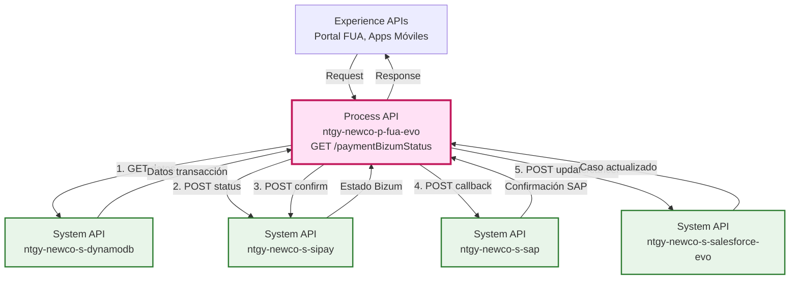
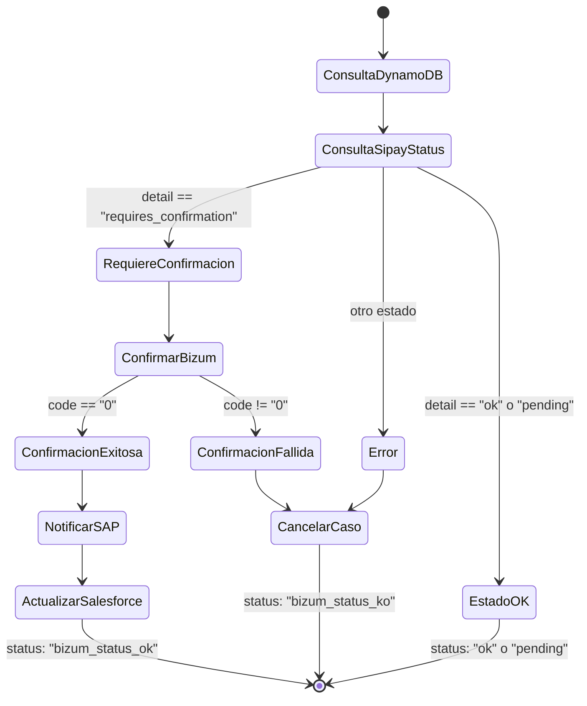
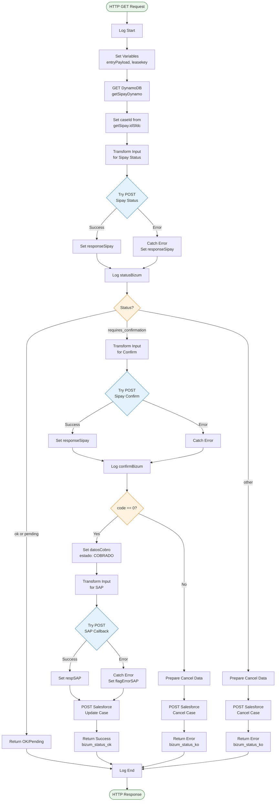
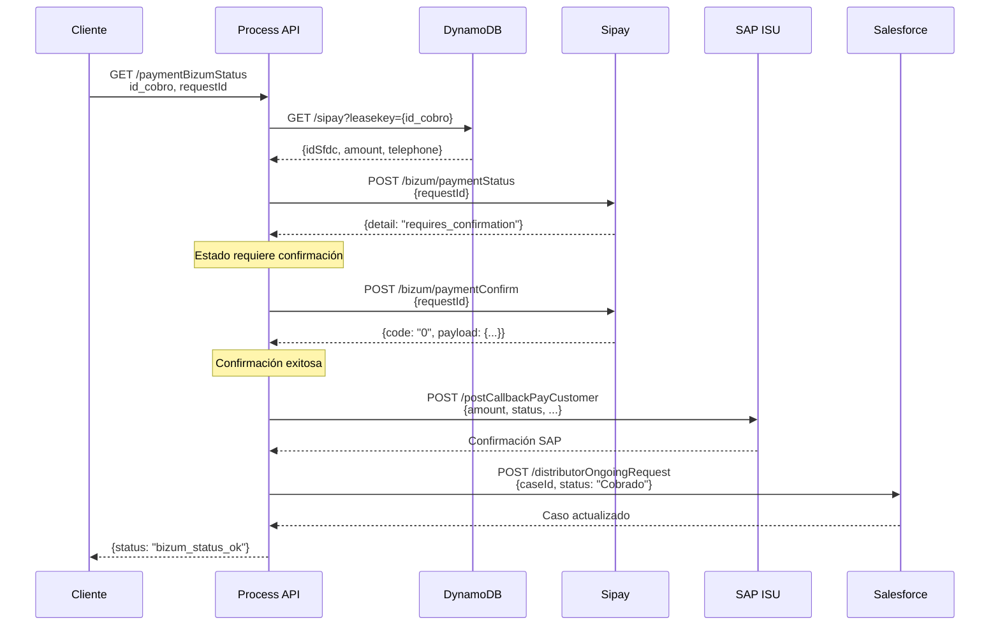
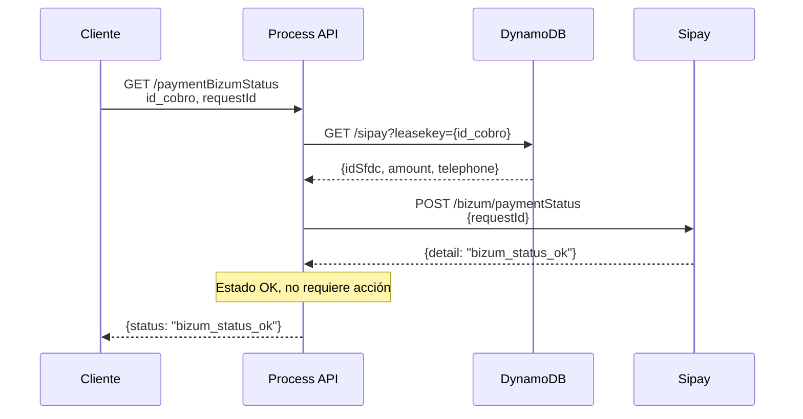
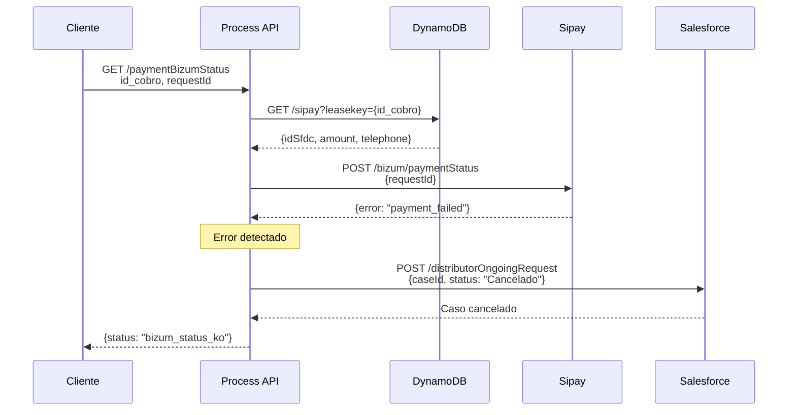

# GET /paymentBizumStatus

## 📌 Descripción General

### Propósito del Endpoint

Este endpoint implementa una **máquina de estados** para consultar y gestionar el estado de pagos vía Bizum, orquestando múltiples System APIs para:
1. Consultar el estado actual del pago en la pasarela Sipay
2. Confirmar automáticamente la retirada de fondos cuando sea necesario
3. Notificar el resultado a SAP ISU y Salesforce
4. Gestionar casos de error cancelando transacciones en Salesforce

### Tipo de API

**Capa:** Process API (API-Led Connectivity)

**Función:** Orquestación compleja de consulta y confirmación de pagos Bizum con gestión de estados

### Patrón de Integración

**Tipo:** Orquestación con Máquina de Estados

**Descripción:** Implementa una lógica condicional compleja que:
- Consulta el estado del pago en Sipay
- Decide automáticamente si confirmar o cancelar según el estado
- Actualiza múltiples sistemas backend (SAP, Salesforce, DynamoDB)
- Maneja 3 escenarios diferentes con flujos específicos

### Arquitectura API-Led Connectivity



---

## 💼 Propósito del Negocio

### Casos de Uso Principales

1. **Consulta de Estado de Pago Bizum**
   - Cliente consulta el estado de su pago desde el portal FUA
   - Sistema verifica automáticamente en la pasarela Sipay
   - Beneficio: Transparencia en tiempo real del estado del pago

2. **Confirmación Automática de Fondos**
   - Cuando Bizum requiere confirmación, el sistema la ejecuta automáticamente
   - Notifica a SAP ISU para actualizar la cuenta del cliente
   - Beneficio: Proceso automatizado sin intervención manual

3. **Gestión de Errores y Cancelaciones**
   - Detecta pagos fallidos o rechazados
   - Cancela automáticamente el caso en Salesforce
   - Beneficio: Limpieza automática de transacciones fallidas

### 🔗 Endpoints Dependientes

Este Process API consume los siguientes System APIs:

| System API | Endpoint | Método | Propósito |
|------------|----------|--------|-----------|
| `ntgy-newco-s-dynamodb` | `/alisys` | GET | Recuperar datos de transacción almacenados |
| `ntgy-newco-s-sipay` | `/bizum/paymentStatus` | POST | Consultar estado actual en pasarela |
| `ntgy-newco-s-sipay` | `/bizum/paymentConfirm` | POST | Confirmar retirada de fondos (condicional) |
| `ntgy-newco-s-sap` | `/functions/postCallbackPayCustomer` | POST | Notificar pago a SAP ISU (condicional) |
| `ntgy-newco-s-salesforce-evo` | `/distributorOngoingRequest` | POST | Actualizar caso con estado 'Cobrado' (condicional) |
| `ntgy-newco-s-salesforce-evo` | `/distributorOngoingRequest` | POST | Cancelar caso con estado 'Cancelado' (condicional) |

### Lógica de Orquestación - Máquina de Estados



**Pasos del Proceso por Escenario:**

#### Escenario 1: Requiere Confirmación (Flujo Completo)
1. **Consulta DynamoDB**: Obtiene idSfdc, amount, telephone
2. **Consulta Sipay Status**: Retorna "requires_confirmation"
3. **Confirma Bizum**: POST a `/paymentBizumConfirm`
4. **Si confirmación exitosa**:
   - Notifica a SAP ISU (callback de pago)
   - Actualiza caso en Salesforce a "Cobrado"
   - Retorna: `{"status": "bizum_status_ok"}`
5. **Si confirmación falla**:
   - Cancela caso en Salesforce
   - Retorna: `{"status": "bizum_status_ko"}`

#### Escenario 2: Estado OK o Pending (Flujo Directo)
1. **Consulta DynamoDB**: Obtiene datos
2. **Consulta Sipay Status**: Retorna "ok" o "pending"
3. **Retorna directamente**: Sin más acciones

#### Escenario 3: Error (Flujo de Cancelación)
1. **Consulta DynamoDB**: Obtiene datos
2. **Consulta Sipay Status**: Retorna error
3. **Cancela caso en Salesforce**
4. **Retorna**: `{"status": "bizum_status_ko"}`

### Contexto Empresarial

- **Dominio:** Gestión de Pagos - Bizum
- **Sector:** Energía - Utilities
- **División:** Naturgy España - NewCo
- **Proceso de Negocio:** Cobro de facturas vía Bizum con confirmación automática

### Stakeholders

- **Clientes Finales**: Consultan el estado de sus pagos Bizum
- **Equipo de Cobros**: Monitoriza pagos confirmados y fallidos
- **Soporte Técnico**: Gestiona incidencias de pagos
- **Sistemas Backend**: SAP ISU (contabilidad), Salesforce (CRM)

### Valor de Negocio

- **Automatización**: Confirmación automática de pagos sin intervención manual
- **Transparencia**: Cliente ve el estado real de su pago en tiempo real
- **Integridad**: Sincronización automática entre Sipay, SAP y Salesforce
- **Eficiencia**: Reducción de casos de soporte por pagos pendientes

### Consumidores Potenciales

Este endpoint puede ser consumido por:
- Portal web FUA (autoservicio de clientes)
- Aplicaciones móviles de Naturgy
- Sistemas de agentes de call center
- Procesos batch de conciliación de pagos

---

## 🔧 Especificación Técnica

### URLs por Ambiente

| Ambiente | URL Base | URL Completa |
|----------|----------|--------------|
| **Local** | `http://localhost:8082` | `http://localhost:8082/api/paymentBizumStatus?id_cobro=XXX&requestId=YYY` |
| **Development** | `https://ntgy-newco-p-fua-evo-des.de-c1.cloudhub.io` | `https://ntgy-newco-p-fua-evo-des.de-c1.cloudhub.io/api/paymentBizumStatus?id_cobro=XXX&requestId=YYY` |
| **UAT** | `https://ntgy-newco-p-fua-evo-uat.de-c1.cloudhub.io` | `https://ntgy-newco-p-fua-evo-uat.de-c1.cloudhub.io/api/paymentBizumStatus?id_cobro=XXX&requestId=YYY` |
| **Production** | `https://ntgy-newco-p-fua-evo-pro.de-c1.cloudhub.io` | `https://ntgy-newco-p-fua-evo-pro.de-c1.cloudhub.io/api/paymentBizumStatus?id_cobro=XXX&requestId=YYY` |

### Método HTTP

```
GET /api/paymentBizumStatus
```

### Parámetros de Entrada

#### Query Parameters (Obligatorios)

| Parámetro | Tipo | Obligatorio | Descripción | Ejemplo |
|-----------|------|-------------|-------------|---------|
| `id_cobro` | string | Sí | ID asociado a facturación, elemento de trazabilidad | `"900012345678"` |
| `requestId` | string | Sí | ID asociado al proceso de Bizum en la pasarela | `"1201ba6d77170014a2c89"` |

### Respuestas

#### 200 OK - Pago Confirmado

```json
{
  "result": {
    "codResult": "0000",
    "msgResult": "No hay error"
  },
  "status": "bizum_status_ok"
}
```

#### 200 OK - Pago Pendiente

```json
{
  "result": {
    "codResult": "0000",
    "msgResult": "No hay error"
  },
  "status": "bizum_status_pending"
}
```

#### 200 OK - Pago Fallido

```json
{
  "result": {
    "codResult": "0001",
    "msgResult": "Error en proceso de pago Bizum"
  },
  "status": "bizum_status_ko"
}
```

### Autenticación

- **Tipo:** Client ID & Client Secret (Anypoint Platform)
- **Headers requeridos:**
  - `client_id`: ID de la aplicación cliente
  - `client_secret`: Secret de la aplicación cliente

### Timeouts

| Tipo | Valor | Notas |
|------|-------|-------|
| **Sipay Status** | 30 segundos | Configurado en código XML |
| **Sipay Confirm** | 30 segundos | Configurado en código XML |
| **SAP Callback** | 30-60 segundos | Estimado (no especificado en código) |
| **Salesforce** | 60 segundos | Estimado (no especificado en código) |
| **Timeout Total (Peor Caso)** | **180 segundos (3 minutos)** | Escenario: Confirmación exitosa con todas las llamadas |
| **Timeout Total (Mejor Caso)** | **60 segundos (1 minuto)** | Escenario: Estado OK/Pending (solo 2 llamadas) |

---

## 🏗️ Implementación Técnica

### Arquitectura del Flow



### Transformaciones DataWeave

#### 1. Transformación de Variables de Entrada

**Propósito:** Capturar y estructurar los query parameters de entrada

```dataweave
%dw 2.0
output application/json
---
{
    "id_cobro": attributes.queryParams.id_cobro,
    "requestId": attributes.queryParams.request_id
}
```

**Variables generadas:**
- `vars.entryPayload`: Objeto con id_cobro y requestId
- `vars.leasekey`: ID de cobro extraído de entryPayload

#### 2. Transformación de Input para Sipay Status

**Propósito:** Preparar payload para consultar estado en Sipay

```dataweave
%dw 2.0
output application/json
---
{
    "requestId": vars.entryPayload.requestId 
}
```

#### 3. Transformación de Datos de Cobro (Cuando Confirmado)

**Propósito:** Estructurar datos del cobro exitoso para SAP y Salesforce

```dataweave
%dw 2.0
output application/json
---
{
    "codigo_cobro": vars.leasekey,
    "estado_cobro": "COBRADO",
    "fecha_cobro": now() as String {format: "yyyy-MM-dd HH:mm:ss"},
    "orderid": payload.'payload'.operation_id,
    "pasarela": "Bizum",
    "paymentMode": "Bizum"
}
```

#### 4. Transformación de Input para SAP Callback

**Propósito:** Preparar payload para notificar pago a SAP ISU (FICA)

```dataweave
%dw 2.0
output application/json
var statusCobro = if(vars.datosCobro.estado_cobro == "COBRADO") "1" else "2"
var statusDescCobro = if(vars.datosCobro.estado_cobro == "COBRADO") 
    "Approved" 
    else 
    "Unexpected Gateway Response: 103 - Card in Blacklist or suspected of fraud"
---
{
    amount: vars.getSipay.amount as Number,
    paymentDate: ((now() >> "Europe/Madrid") as String {format: "yyyyMMdd"}),
    merchantTransactionId: vars.datosCobro.codigo_cobro,
    status: statusCobro,
    statusDescription: statusDescCobro,
    telephone: trim(if(isEmpty(vars.getSipay.telephone)) (null) else vars.getSipay.telephone),
    operationType: "ACB",
    source: "W"
}
```

**Campos clave:**
- `status`: "1" = Aprobado, "2" = Rechazado
- `operationType`: "ACB" = Operación de cobro Bizum
- `source`: "W" = Web (origen del pago)

#### 5. Transformación de Motivo de Cancelación

**Propósito:** Generar mensaje descriptivo para cancelación de caso en Salesforce

```dataweave
%dw 2.0
output application/json
---
"Código de error: " ++ (vars.responseSipay.payload.status_code default "N/D") ++ "\r\n" ++
"Descripción: " ++ (vars.responseSipay.payload.message default "Ha ocurrido un error en pasarela de pago Bizum")
```

**Uso:** Se almacena en `vars.motive` y se envía a Salesforce al cancelar el caso

### Variables de Flow

El endpoint utiliza las siguientes variables para mantener el estado a lo largo del flujo:

| Variable | Tipo | Propósito | Origen |
|----------|------|-----------|--------|
| `entryPayload` | Object | Payload de entrada con id_cobro y requestId | Query params transformados |
| `leasekey` | String | ID de cobro (id_cobro) usado como clave | Extraído de entryPayload |
| `getSipay` | Object | Datos de transacción desde DynamoDB | Response de GET /alisys |
| `caseId` | String | ID del caso en Salesforce | Extraído de getSipay.idSfdc |
| `responseSipay` | Object | Respuesta de Sipay (status o confirm) | Response de Sipay APIs |
| `datosCobro` | Object | Datos del cobro para SAP y Salesforce | Transformación DataWeave |
| `inputFica` | Object | Input transformado para SAP FICA | Transformación DataWeave |
| `respSAP` | Object | Respuesta de SAP ISU | Response de SAP callback |
| `flagErrorSAP` | Boolean | Indica error en llamada a SAP | Error handler (true si falla) |
| `motive` | String | Motivo de cancelación del caso | Transformación DataWeave |
| `datosSap` | Object | Datos para cancelación en SAP | Transformación DataWeave |

**Ciclo de vida de variables:**
1. **Entrada:** `entryPayload`, `leasekey` se crean al inicio
2. **Consulta:** `getSipay`, `caseId` se obtienen de DynamoDB
3. **Procesamiento:** `responseSipay` se actualiza en cada llamada a Sipay
4. **Confirmación:** `datosCobro`, `inputFica`, `respSAP` se usan en flujo exitoso
5. **Cancelación:** `motive`, `datosSap` se usan en flujo de error

### Patrones de Diseño

**Patrón:** Máquina de Estados con Orquestación Condicional

**Justificación:** 
- El estado del pago en Sipay determina el flujo a seguir
- Cada estado requiere acciones diferentes en múltiples sistemas
- Necesidad de mantener consistencia entre Sipay, SAP y Salesforce
- Manejo robusto de errores con rollback (cancelación de casos)

### Flows Referenciados

Este endpoint invoca dos sub-flows adicionales para operaciones en Salesforce:

#### salesforceRequestSipay

**Propósito:** Actualiza el caso en Salesforce con estado "Cobrado" cuando el pago es exitoso

**Input requerido:**
- `vars.caseId`: ID del caso en Salesforce
- `vars.datosCobro`: Objeto con datos del cobro (codigo_cobro, estado_cobro, fecha_cobro, orderid, pasarela, paymentMode)

**Operación:** 
- Realiza POST a `ntgy-newco-s-salesforce-evo` endpoint `/distributorOngoingRequest`
- Actualiza el caso con estado "Cobrado"
- Registra información del pago en el caso

**Resultado:** Caso actualizado en Salesforce con confirmación de pago

#### cancelCaseBizum

**Propósito:** Cancela el caso en Salesforce cuando el pago falla o es rechazado

**Input requerido:**
- `vars.caseId`: ID del caso en Salesforce
- `vars.motive`: Motivo de cancelación (código y descripción del error)
- `vars.datosSap`: Datos del intento de pago (amount, telephone, merchantTransactionId)

**Operación:**
- Realiza POST a `ntgy-newco-s-salesforce-evo` endpoint `/distributorOngoingRequest`
- Actualiza el caso con estado "Cancelado"
- Registra el motivo de cancelación

**Resultado:** Caso cancelado en Salesforce con detalle del error

### Diagramas de Secuencia

#### 1. Flujo Normal - Requiere Confirmación (Exitoso)



#### 2. Flujo con Estado OK/Pending (Directo)



#### 3. Flujo con Error (Cancelación)



### Manejo de Errores

#### Estrategia de Error Handling

El endpoint implementa una estrategia de error handling en **3 niveles** con comportamientos diferentes según el punto de fallo:

#### 1. Try-Catch en Sipay Status (Primera Llamada)

**Ubicación en código:** Línea ~299 del XML

```xml
<try>
    <http:request method="POST" path="${ntgy-newco-s-sipay.bizum.paymentStatus}" 
                  responseTimeout="30000"/>
    <set-variable value="#[payload]" variableName="responseSipay"/>
    <error-handler>
        <on-error-continue>
            <!-- Captura error pero continúa el flujo -->
            <ee:transform>
                <ee:set-variable variableName="responseSipay">
                    <![CDATA[%dw 2.0
                    output application/json
                    ---
                    payload]]>
                </ee:set-variable>
            </ee:transform>
        </on-error-continue>
    </error-handler>
</try>
```

**Comportamiento:**
- ✅ Captura errores de conexión, timeout o HTTP 4xx/5xx
- ✅ Almacena el error en `vars.responseSipay`
- ✅ **Continúa el flujo** para evaluar el error en el Choice
- ✅ Permite tomar decisión basada en el tipo de error

**Rationale:** No detener el flujo permite evaluar si el error es recuperable o requiere cancelación

#### 2. Try-Catch en Sipay Confirm (Segunda Llamada)

**Ubicación en código:** Línea ~308 del XML

```xml
<try>
    <http:request method="POST" path="${ntgy-newco-s-sipay.bizum.paymentConfirm}" 
                  responseTimeout="30000"/>
    <set-variable value="#[payload]" variableName="responseSipay"/>
    <error-handler>
        <on-error-continue>
            <!-- Similar al anterior -->
            <ee:transform>
                <ee:set-variable variableName="responseSipay">
                    <![CDATA[%dw 2.0
                    output application/json
                    ---
                    payload]]>
                </ee:set-variable>
            </ee:transform>
        </on-error-continue>
    </error-handler>
</try>
```

**Comportamiento:**
- ✅ Similar al Try-Catch anterior
- ✅ Permite evaluar código de respuesta: `code == "0"` → Éxito
- ✅ Si `code != "0"` → Flujo de cancelación

**Decisión de flujo:**
```
IF vars.responseSipay.code == "0"
  THEN → Notificar SAP → Actualizar Salesforce → Retornar OK
  ELSE → Cancelar caso → Retornar KO
```

#### 3. Try-Catch en SAP Callback (Tercera Llamada)

**Ubicación en código:** Línea ~323 del XML

```xml
<try>
    <http:request method="POST" path="${ntgy-newco-s-sap.functions.postCallbackPayCustomer}"/>
    <set-variable value="#[vars.respSAP]" variableName="respSAP"/>
    <error-handler>
        <on-error-continue>
            <!-- Error en SAP NO detiene el flujo -->
            <logger level="INFO" message="Error SAP: #[error.errorMessage.payload]"/>
            <set-variable value="#[error.errorMessage.payload]" variableName="respSAP"/>
            <set-variable value="#[vars.httpStatus default 500]" variableName="httpStatusCodeSap"/>
            <set-variable value="#[true]" variableName="flagErrorSAP"/>
        </on-error-continue>
    </error-handler>
</try>
```

**Comportamiento CRÍTICO:**
- ⚠️ Error en SAP **NO detiene el flujo**
- ✅ Marca `flagErrorSAP = true` para logging/monitoreo
- ✅ **Continúa con actualización de Salesforce**
- ✅ Retorna éxito al cliente aunque SAP falle

**Rationale:** 
- El pago YA fue confirmado en Sipay (no se puede revertir)
- Es más importante actualizar Salesforce que notificar a SAP
- SAP puede ser notificado posteriormente mediante proceso batch
- Evita falso negativo al cliente cuando el pago sí se procesó

**Flujo en caso de error SAP:**
```
Sipay Confirm OK → SAP Callback FALLA → flagErrorSAP=true 
→ Salesforce Update OK → Cliente recibe "bizum_status_ok"
```

#### 4. Logging Exhaustivo

**Puntos de logging:**
1. **Inicio:** Log con `id_cobro` y `requestId`
2. **Post Status:** Log con respuesta de Sipay Status
3. **Post Confirm:** Log con respuesta de Sipay Confirm
4. **Post SAP:** Log con respuesta de SAP (o error)
5. **Fin:** Log con resultado final

**Ejemplo de logs:**
```
INFO: Inicio paymentStatus request_id: 1201ba6d77170014a2c89 y id_cobro: 900012345678
INFO: paymentBizumRequest statusBizum - {"detail":"bizum_status_requires_confirmation"}
INFO: paymentBizumRequest confirmBizum - {"code":"0","payload":{...}}
INFO: paymentStatus - Response Sap: {...}
INFO: Final paymentStatus
```

#### Códigos de Error

| Código | Mensaje | Causa | Acción |
|--------|---------|-------|--------|
| `0000` | No hay error | Operación exitosa | Retornar OK |
| `0001` | Error en proceso de pago Bizum | Error genérico de Bizum | Cancelar caso |
| `CJ00304` | Error específico de Sipay | Ver `sipayBizum.resultCodes` | Cancelar caso |
| `N/D` | Código no disponible | Error de conexión/timeout | Cancelar caso |

#### Matriz de Decisiones de Error

| Escenario | Sipay Status | Sipay Confirm | SAP | Salesforce | Resultado Cliente |
|-----------|--------------|---------------|-----|------------|-------------------|
| **Éxito Total** | ✅ OK | ✅ code=0 | ✅ OK | ✅ Actualizado | `bizum_status_ok` |
| **SAP Falla** | ✅ OK | ✅ code=0 | ❌ Error | ✅ Actualizado | `bizum_status_ok` ⚠️ |
| **Confirm Falla** | ✅ OK | ❌ code≠0 | - | ✅ Cancelado | `bizum_status_ko` |
| **Status Error** | ❌ Error | - | - | ✅ Cancelado | `bizum_status_ko` |
| **Status Pending** | ✅ Pending | - | - | - | `bizum_status_pending` |

**⚠️ Nota importante:** Cuando SAP falla pero Sipay confirma OK, el cliente recibe éxito porque el pago SÍ se procesó en la pasarela. La inconsistencia con SAP se resuelve posteriormente.

---

## 💻 Ejemplos de Uso

### Ejemplo 1: Consulta de Estado - Pago Confirmado

#### cURL

```bash
curl -X GET "https://ntgy-newco-p-fua-evo-des.de-c1.cloudhub.io/api/paymentBizumStatus?id_cobro=900012345678&requestId=1201ba6d77170014a2c89" \
  -H "client_id: YOUR_CLIENT_ID" \
  -H "client_secret: YOUR_CLIENT_SECRET"
```

#### Respuesta (200 OK)

```json
{
  "result": {
    "codResult": "0000",
    "msgResult": "No hay error"
  },
  "status": "bizum_status_ok"
}
```

### Ejemplo 2: Consulta de Estado - Pago Pendiente

#### cURL

```bash
curl -X GET "https://ntgy-newco-p-fua-evo-des.de-c1.cloudhub.io/api/paymentBizumStatus?id_cobro=900012345679&requestId=1201ba6d77170014a2c90" \
  -H "client_id: YOUR_CLIENT_ID" \
  -H "client_secret: YOUR_CLIENT_SECRET"
```

#### Respuesta (200 OK)

```json
{
  "result": {
    "codResult": "0000",
    "msgResult": "No hay error"
  },
  "status": "bizum_status_pending"
}
```

### Ejemplo 3: Consulta de Estado - Pago Fallido

#### cURL

```bash
curl -X GET "https://ntgy-newco-p-fua-evo-des.de-c1.cloudhub.io/api/paymentBizumStatus?id_cobro=900012345680&requestId=1201ba6d77170014a2c91" \
  -H "client_id: YOUR_CLIENT_ID" \
  -H "client_secret: YOUR_CLIENT_SECRET"
```

#### Respuesta (200 OK)

```json
{
  "result": {
    "codResult": "CJ00304",
    "msgResult": "Error en proceso de pago Bizum"
  },
  "status": "bizum_status_ko"
}
```

### Ejemplo 4: JavaScript (Fetch API)

```javascript
const checkBizumStatus = async (idCobro, requestId) => {
  const url = new URL('https://ntgy-newco-p-fua-evo-des.de-c1.cloudhub.io/api/paymentBizumStatus');
  url.searchParams.append('id_cobro', idCobro);
  url.searchParams.append('requestId', requestId);
  
  const response = await fetch(url, {
    method: 'GET',
    headers: {
      'client_id': 'YOUR_CLIENT_ID',
      'client_secret': 'YOUR_CLIENT_SECRET'
    }
  });
  
  const data = await response.json();
  
  if (data.status === 'bizum_status_ok') {
    console.log('Pago confirmado exitosamente');
  } else if (data.status === 'bizum_status_pending') {
    console.log('Pago aún pendiente, reintentar más tarde');
  } else {
    console.error('Pago fallido:', data.result.msgResult);
  }
  
  return data;
};

// Uso
checkBizumStatus('900012345678', '1201ba6d77170014a2c89');
```

### Ejemplo 5: Python (Requests)

```python
import requests

def check_bizum_status(id_cobro, request_id):
    url = 'https://ntgy-newco-p-fua-evo-des.de-c1.cloudhub.io/api/paymentBizumStatus'
    
    params = {
        'id_cobro': id_cobro,
        'requestId': request_id
    }
    
    headers = {
        'client_id': 'YOUR_CLIENT_ID',
        'client_secret': 'YOUR_CLIENT_SECRET'
    }
    
    response = requests.get(url, params=params, headers=headers)
    data = response.json()
    
    if data['status'] == 'bizum_status_ok':
        print('Pago confirmado exitosamente')
    elif data['status'] == 'bizum_status_pending':
        print('Pago aún pendiente')
    else:
        print(f"Pago fallido: {data['result']['msgResult']}")
    
    return data

# Uso
result = check_bizum_status('900012345678', '1201ba6d77170014a2c89')
print(result)
```

### Ejemplo 6: Polling para Verificar Estado

```javascript
const pollBizumStatus = async (idCobro, requestId, maxAttempts = 10, interval = 3000) => {
  for (let attempt = 1; attempt <= maxAttempts; attempt++) {
    console.log(`Intento ${attempt} de ${maxAttempts}...`);
    
    const result = await checkBizumStatus(idCobro, requestId);
    
    if (result.status === 'bizum_status_ok') {
      console.log('✓ Pago confirmado');
      return result;
    } else if (result.status === 'bizum_status_ko') {
      console.log('✗ Pago fallido');
      return result;
    }
    
    // Si está pendiente, esperar antes del siguiente intento
    if (attempt < maxAttempts) {
      console.log(`Esperando ${interval/1000}s antes del siguiente intento...`);
      await new Promise(resolve => setTimeout(resolve, interval));
    }
  }
  
  console.log('⚠ Máximo de intentos alcanzado, pago aún pendiente');
  return null;
};

// Uso: Verificar estado cada 3 segundos, máximo 10 intentos
pollBizumStatus('900012345678', '1201ba6d77170014a2c89');
```
