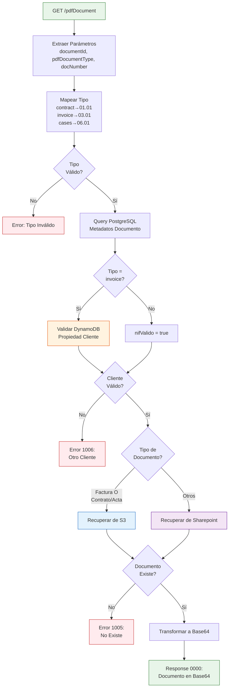
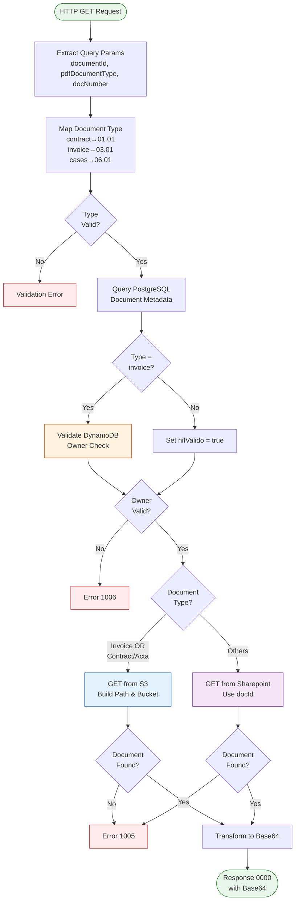
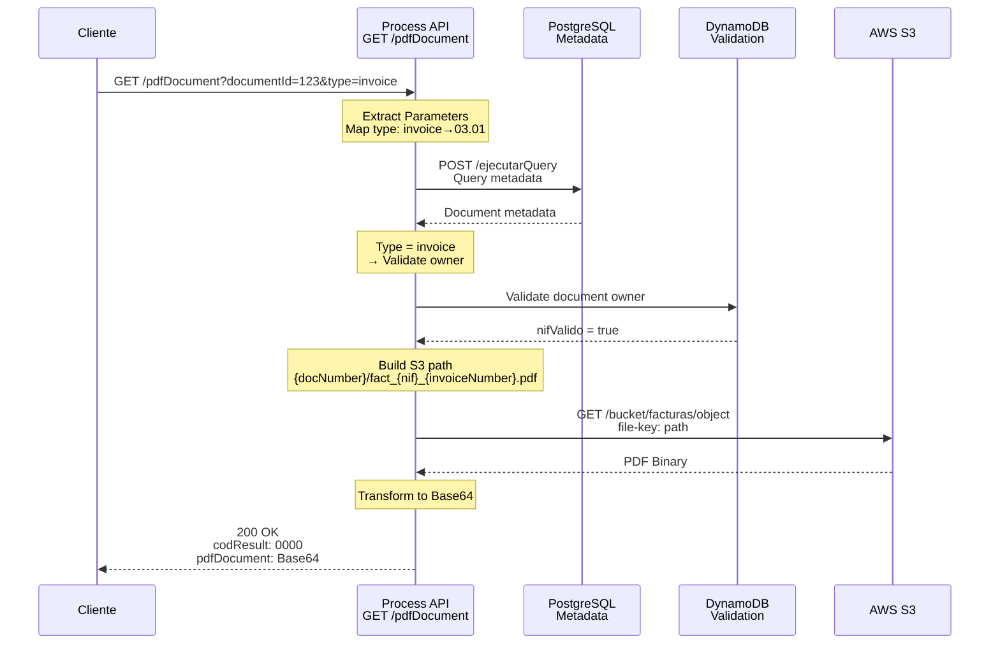
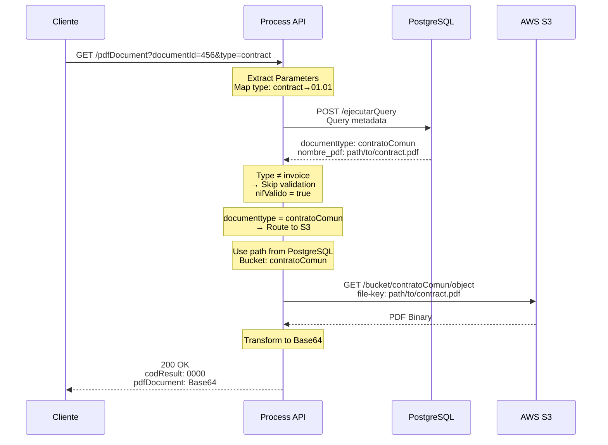
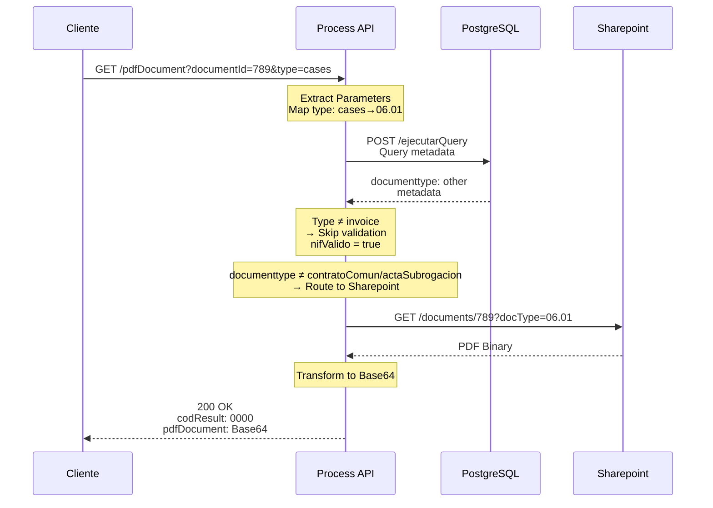
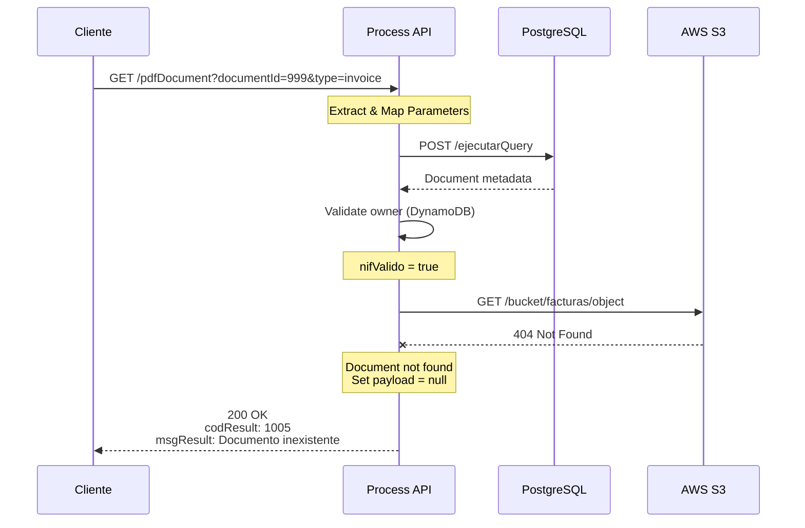
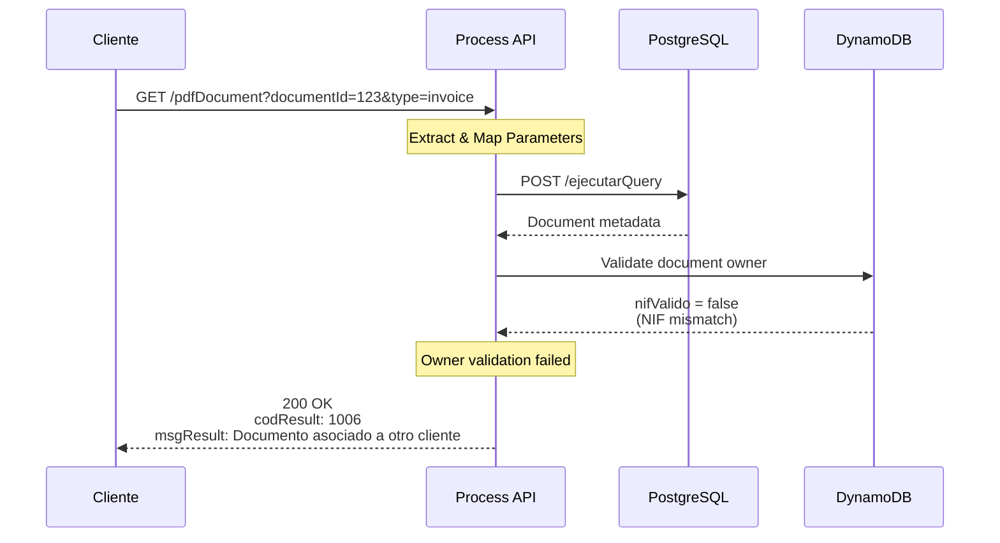

# GET /pdfDocument

## 📌 Descripción General

### Propósito del Endpoint

Este endpoint orquesta la recuperación segura de documentos PDF desde múltiples fuentes de almacenamiento (AWS S3 y Sharepoint). Implementa validación de propiedad del documento para evitar acceso no autorizado, enrutamiento inteligente según el tipo de documento, y transformación del contenido binario a Base64 para transporte JSON.

### Tipo de API

**Capa:** Process API (API-Led Connectivity)

**Función:** Orquestación compleja multi-backend con validación de seguridad y enrutamiento condicional

### Patrón de Integración

**Tipo:** Orquestación Compleja con Content-Based Routing

**Descripción:** El endpoint implementa un flujo de decisión complejo que:
1. Consulta metadatos del documento en PostgreSQL
2. Valida propiedad del documento (solo para facturas) en DynamoDB
3. Enruta la recuperación a S3 o Sharepoint según tipo de documento
4. Transforma el PDF binario a Base64 para respuesta JSON

### Arquitectura API-Led Connectivity

```mermaid
graph TB
    E[Experience APIs<br/>Portal FUA, Apps]
    P[Process API<br/>ntgy-newco-p-fua-evo<br/>GET /pdfDocument]
    PG[System API<br/>PostgreSQL-Salesforce<br/>POST /ejecutarQuery]
    DDB[DynamoDB<br/>Validación]
    S3[System API<br/>S3 Small<br/>GET /bucket/:bucket/object]
    SP[System API<br/>Sharepoint<br/>GET /documents/:docId]
    
    E -->|GET Request<br/>documentId, type| P
    P -->|Query Metadata| PG
    PG -->|Document Info| P
    P -->|Validate Owner<br/>(solo facturas)| DDB
    DDB -->|Validation Result| P
    P -->|Route Decision| S3
    P -->|Route Decision| SP
    S3 -->|PDF Binary| P
    SP -->|PDF Binary| P
    P -->|Base64 Response| E
    
    style P fill:#ffe1f5,stroke:#c2185b,stroke-width:3px
    style PG fill:#e8f5e9,stroke:#2e7d32,stroke-width:2px
    style DDB fill:#fff3e0,stroke:#e65100,stroke-width:2px
    style S3 fill:#e3f2fd,stroke:#1565c0,stroke-width:2px
    style SP fill:#f3e5f5,stroke:#6a1b9a,stroke-width:2px
```

---

## 💼 Propósito del Negocio

### Casos de Uso Principales

1. **Visualización de Facturas**
   - Permite a clientes descargar sus facturas en formato PDF
   - Beneficio: Acceso inmediato a documentación fiscal

2. **Consulta de Contratos**
   - Acceso a contratos firmados y actas de subrogación
   - Beneficio: Transparencia contractual y cumplimiento legal

3. **Documentos de Casos**
   - Recuperación de documentos adjuntos a casos de servicio
   - Beneficio: Seguimiento completo de incidencias

### 🔗 Endpoints Dependientes

Este Process API consume los siguientes System APIs:

| System API | Endpoint | Método | Propósito |
|------------|----------|--------|-----------|
| `ntgy-newco-s-postgresql-salesforce` | `/ejecutarQuery` | POST | Consulta metadatos del documento (nombre, tipo, ubicación) |
| `ntgy-newco-s-s3-small` | `/bucket/{bucket}/object` | GET | Recupera documentos almacenados en AWS S3 |
| `ntgy-newco-s-sharepoint` | `/documents/{docId}` | GET | Recupera documentos almacenados en Sharepoint |

**Subflow Interno:**
- `validarDocumentoSub_Flow`: Valida en DynamoDB que el documento pertenece al cliente (solo facturas)

### Lógica de Orquestación



**Pasos del Proceso:**

1. **Extracción y Mapeo**: Captura parámetros y mapea tipo de documento a código numérico
2. **Validación de Tipo**: Verifica que el tipo de documento sea válido (contract/invoice/cases)
3. **Consulta de Metadatos**: Obtiene información del documento desde PostgreSQL
4. **Validación de Propiedad**: Solo para facturas, valida en DynamoDB que pertenece al cliente
5. **Enrutamiento Inteligente**: Decide entre S3 o Sharepoint según tipo de documento
6. **Recuperación**: Obtiene el PDF binario de la fuente correspondiente
7. **Transformación**: Convierte el binario a Base64 para respuesta JSON

### Transformaciones Aplicadas

**Transformación 1: Mapeo de Tipo de Documento**

| Parámetro Input | Código Interno | Descripción |
|-----------------|----------------|-------------|
| `contract` | `01.01` | Contratos de servicio |
| `invoice` | `03.01` | Facturas |
| `cases` | `06.01` | Documentos de casos |

**Transformación 2: Construcción de Path en S3**

| Tipo de Documento | Patrón de Path | Bucket |
|-------------------|----------------|--------|
| Factura | `{docNumber}/fact_{nif}_{invoiceNumber}.pdf` | `s-s3-small.facturas.bucket` |
| Contrato Común | `{acn_fld_nombre_de_pdf__c}` | `s-s3-small.contratoComun.bucket` |
| Acta Subrogación | `{acn_fld_nombre_de_pdf__c}` | `s-s3-small.actaSubrogacion.bucket` |

**Transformación 3: Respuesta (Binary → Base64)**

```dataweave
{
    "result": {
        "codResult": "0000",
        "msgResult": "No hay error"
    },
    "pdfDocument": dw::core::Binaries::toBase64(payload)
}
```

### Contexto Empresarial

- **Dominio:** Gestión Documental
- **Sector:** Energía - Utilities
- **División:** Naturgy España - NewCo
- **Proceso de Negocio:** Acceso seguro a documentación del cliente (facturas, contratos, casos)

### Stakeholders

- **Clientes Finales**: Necesitan acceso a sus documentos (facturas, contratos)
- **Equipo de Atención al Cliente**: Requieren consultar documentos para resolver incidencias
- **Equipo Legal**: Necesitan acceso a contratos y documentación legal
- **Equipo de Seguridad**: Responsables de garantizar acceso autorizado

### Valor de Negocio

- **Seguridad**: Validación de propiedad evita acceso no autorizado a documentos
- **Flexibilidad**: Soporte para múltiples fuentes de almacenamiento (S3, Sharepoint)
- **Eficiencia**: Enrutamiento inteligente optimiza recuperación según tipo
- **Cumplimiento**: Trazabilidad de acceso a documentos sensibles

### Consumidores Potenciales

Este endpoint puede ser consumido por:
- Portal web FUA
- Aplicaciones móviles de clientes
- Sistemas de agentes de call center
- Portales de autoservicio
- Sistemas de gestión documental

---

## 🔧 Especificación Técnica

### URLs por Ambiente

| Ambiente | URL Base | URL Completa |
|----------|----------|--------------|
| **Local** | `http://localhost:8081` | `http://localhost:8081/api/pdfDocument` |
| **Development** | `https://ntgy-newco-p-fua-evo-dev.us-e2.cloudhub.io` | `https://ntgy-newco-p-fua-evo-dev.us-e2.cloudhub.io/api/pdfDocument` |
| **UAT** | `https://ntgy-newco-p-fua-evo-uat.us-e2.cloudhub.io` | `https://ntgy-newco-p-fua-evo-uat.us-e2.cloudhub.io/api/pdfDocument` |
| **Production** | `https://ntgy-newco-p-fua-evo-pro.us-e2.cloudhub.io` | `https://ntgy-newco-p-fua-evo-pro.us-e2.cloudhub.io/api/pdfDocument` |

### Método HTTP

```
GET /api/pdfDocument
```

### Parámetros de Entrada

#### Query Parameters

| Parámetro | Tipo | Requerido | Descripción | Valores Permitidos |
|-----------|------|-----------|-------------|-------------------|
| `documentId` | string | Sí | Identificador único del documento | UUID o ID del documento |
| `pdfDocumentType` | string | Sí | Tipo de documento a recuperar | `contract`, `invoice`, `cases` |
| `docNumber` | string | Opcional | Número de documento del cliente | Código de cliente |

#### Headers

| Header | Tipo | Requerido | Descripción | Ejemplo |
|--------|------|-----------|-------------|---------|
| `x-client-code` | string | Opcional | Código de cliente (usado como docNumber) | `NEWCO`, `IMPERIAL` |
| `client_id` | string | Sí | Client ID de Anypoint Platform | `abc123...` |
| `client_secret` | string | Sí | Client Secret de Anypoint Platform | `xyz789...` |

### Respuestas

#### 200 OK - Documento Recuperado Exitosamente

**Descripción:** Documento encontrado y convertido a Base64

**Content-Type:** `application/json`

**Schema:**
```json
{
  "result": {
    "codResult": "0000",
    "msgResult": "No hay error"
  },
  "pdfDocument": "JVBERi0xLjQKJeLjz9MKMSAwIG9iago8PC9UeXBlL0NhdGFsb2cvUGFnZXMgMiAwIFI+PgplbmRvYmoKMiAwIG9iago8PC9UeXBlL1BhZ2VzL0NvdW50IDEvS2lkc1szIDAgUl0+PgplbmRvYmoKMyAwIG9iago8PC9UeXBlL1BhZ2UvTWVkaWFCb3hbMCAwIDYxMiA3OTJdL1BhcmVudCAyIDAgUi9SZXNvdXJjZXM8PC9Gb250PDwvRjEgNCAwIFI+Pj4+L0NvbnRlbnRzIDUgMCBSPj4KZW5kb2JqCjQgMCBvYmoKPDwvVHlwZS9Gb250L1N1YnR5cGUvVHlwZTEvQmFzZUZvbnQvSGVsdmV0aWNhPj4KZW5kb2JqCjUgMCBvYmoKPDwvTGVuZ3RoIDQ0Pj4Kc3RyZWFtCkJUCi9GMSA0OCBUZgoxMCA3MDAgVGQKKEhlbGxvIFdvcmxkKSBUagpFVAplbmRzdHJlYW0KZW5kb2JqCnhyZWYKMCA2CjAwMDAwMDAwMDAgNjU1MzUgZiAKMDAwMDAwMDAxNSAwMDAwMCBuIAowMDAwMDAwMDY0IDAwMDAwIG4gCjAwMDAwMDAxMjEgMDAwMDAgbiAKMDAwMDAwMDIyNyAwMDAwMCBuIAowMDAwMDAwMjk1IDAwMDAwIG4gCnRyYWlsZXIKPDwvU2l6ZSA2L1Jvb3QgMSAwIFI+PgpzdGFydHhyZWYKMzg3CiUlRU9GCg=="
}
```

**Campos:**
- `result.codResult`: Código de resultado (`0000` = éxito)
- `result.msgResult`: Mensaje descriptivo
- `pdfDocument`: Contenido del PDF codificado en Base64

#### 200 OK - Documento No Encontrado (Código 1005)

**Descripción:** El documento no existe en el sistema de almacenamiento

**Content-Type:** `application/json`

**Schema:**
```json
{
  "result": {
    "codResult": "1005",
    "msgResult": "Documento inexistente"
  }
}
```

#### 200 OK - Documento de Otro Cliente (Código 1006)

**Descripción:** El documento existe pero pertenece a otro cliente

**Content-Type:** `application/json`

**Schema:**
```json
{
  "result": {
    "codResult": "1006",
    "msgResult": "Documento asociado a otro cliente"
  }
}
```

#### 400 Bad Request - Tipo de Documento Inválido

**Descripción:** El parámetro pdfDocumentType tiene un valor no permitido

**Content-Type:** `application/json`

**Schema:** `generic.response-failed`

```json
{
  "code": "VALIDATION_ERROR",
  "message": "El campo pdfDocumentType esta vacio o tiene un valor incorrecto",
  "details": "Valores permitidos: contract, invoice, cases",
  "timestamp": "2024-01-15T10:30:00Z"
}
```

#### 500 Internal Server Error - Error del Sistema

**Descripción:** Error en el procesamiento interno o en System APIs

**Content-Type:** `application/json`

**Schema:** `generic.response-failed`

```json
{
  "code": "INTERNAL_ERROR",
  "message": "Error al procesar la solicitud",
  "details": "Error de conexión con System API",
  "timestamp": "2024-01-15T10:30:00Z"
}
```

### Autenticación

- **Tipo:** Client ID & Client Secret (Anypoint Platform)
- **Headers requeridos:** `client_id`, `client_secret`

### Timeouts

| Tipo | Valor |
|------|-------|
| **Request Timeout** | 240 segundos |
| **Connection Timeout** | 30 segundos |

**Nota:** Timeout extendido (240s) debido a que la recuperación de documentos grandes desde S3/Sharepoint puede tardar.

---

## 🏗️ Implementación Técnica

### Arquitectura del Flow



### Componentes del Flow

#### 1. Flow Principal: `get:\pdfDocument:ntgy-newco-p-fua-config`

**Ubicación:** `src/main/mule/ntgy-newco-p-fua.xml`

**Responsabilidades:**
- Recibir request HTTP GET
- Extraer 3 query parameters a variables
- Invocar subflow de procesamiento

**Código XML:**
```xml
<flow name="get:\pdfDocument:ntgy-newco-p-fua-config">
    <ee:transform>
        <ee:variables>
            <ee:set-variable variableName="documentId">
                attributes.queryParams.'documentId'
            </ee:set-variable>
            <ee:set-variable variableName="pdfDocumentType">
                attributes.queryParams.'pdfDocumentType'
            </ee:set-variable>
            <ee:set-variable variableName="docNumber">
                attributes.queryParams.'x-client-code'
            </ee:set-variable>
        </ee:variables>
    </ee:transform>
    <flow-ref doc:name="getDocumentPdf" name="getDocumentPdf" />
</flow>
```

#### 2. Subflow: `getDocumentPdf`

**Ubicación:** `src/main/mule/services/docs/getDocumentPdf.xml` (ubicación estimada)

**Responsabilidades:**
- Mapear tipo de documento a código interno
- Validar tipo de documento
- Consultar metadatos en PostgreSQL
- Validar propiedad (solo facturas)
- Enrutar a S3 o Sharepoint
- Transformar a Base64

**Transformación 1: Mapeo de Tipo de Documento**
```dataweave
%dw 2.0
output application/java
---
if(vars.pdfDocumentType == "contract") "01.01" 
else if(vars.pdfDocumentType == "invoice") "03.01" 
else if(vars.pdfDocumentType == "cases") "06.01"
else (null)
```

**Validación:**
```xml
<validation:is-not-null 
    doc:name="Is not null" 
    value="#[vars.pdfDocuType]" 
    message="El campo pdfDocumentType esta vacio o tiene un valor incorrecto" />
```

**Transformación 2: Query PostgreSQL**
```dataweave
%dw 2.0
output application/json
---
{
    "query": "select aocc.acn_fld_nombre_de_pdf__c,aocc.acn_fld_documenttype__c from newcosalesforce.acn_obj_caseattachments__c aocc where aocc.acn_fld_documentkey__c = '" ++ vars.documentId ++ "'"
}
```

**Llamada HTTP PostgreSQL:**
```xml
<http:request 
    method="POST" 
    doc:name="Request Heroku"
    config-ref="HTTP_Request_s_postgresql-salesforce" 
    path="/ejecutarQuery" 
    target="caseAttachmentResult">
    <http:body>#[vars.query]</http:body>
</http:request>
```

#### 3. Decisión de Validación (Solo Facturas)

**Choice 1: Validar o No**
```xml
<choice doc:name="Choice">
    <when expression='#[vars.pdfDocumentType == "invoice"]'>
        <flow-ref doc:name="validar documento dynamoDB" 
                  name="validarDocumentoSub_Flow" />
    </when>
    <otherwise>
        <logger level="INFO" 
                message="No se valida documento, tipo de documento #[vars.pdfDocumentType]"/>
        <set-variable value="#[true]" 
                      variableName="nifValido" />
    </otherwise>
</choice>
```

#### 4. Enrutamiento a S3 o Sharepoint

**Choice 2: Determinar Fuente**
```xml
<choice doc:name="Choice">
    <when expression="#[(vars.pdfDocumentType == 'invoice') or 
                        (['contratoComun','actaSubrogacion'] contains 
                         vars.caseAttachmentResult[0].acn_fld_documenttype__c)]">
        <!-- Recuperar de S3 -->
    </when>
    <otherwise>
        <!-- Recuperar de Sharepoint -->
    </otherwise>
</choice>
```

**Transformación 3: Path y Bucket para S3**
```dataweave
%dw 2.0
output application/json
---
// Path del documento
if(['contratoComun','actaSubrogacion'] contains vars.caseAttachmentResult[0].acn_fld_documenttype__c)
    vars.caseAttachmentResult[0].acn_fld_nombre_de_pdf__c
else
    vars.docNumber ++ "/" ++ (['fact',vars.dynamoResult.items[0].nif,vars.dynamoResult.items[0].invoiceNumber] joinBy  "_") ++ ".pdf"
```

```dataweave
%dw 2.0
output application/json

var documentType = vars.caseAttachmentResult[0].acn_fld_documenttype__c default "facturas"
---
p('s-s3-small.' ++ documentType ++ '.bucket')
```

**Llamada HTTP S3:**
```xml
<http:request 
    method="GET" 
    doc:name="Recuperar documento S3"
    config-ref="HTTP_Request_s_s3_small" 
    path="/bucket/{bucket}/object" 
    outputMimeType="application/octet-stream" 
    responseTimeout="240000">
    <http:headers>
        { "file-key": vars.pathDocumento }
    </http:headers>
    <http:uri-params>
        { "bucket": vars.bucket }
    </http:uri-params>
</http:request>
```

**Llamada HTTP Sharepoint:**
```xml
<http:request 
    method="GET" 
    doc:name="Request Descarga de facturas"
    config-ref="HTTP_Request_ntgy-newco-s-sharepoint" 
    path="/documents/{docId}">
    <http:uri-params>
        { "docId": vars.documentId }
    </http:uri-params>
    <http:query-params>
        { "docType": vars.pdfDocuType }
    </http:query-params>
</http:request>
```

#### 5. Transformación de Respuesta

**Si documento existe:**
```dataweave
%dw 2.0
output application/json
---
{
    "result": {
        "codResult": '0000',
        "msgResult": "No hay error"
    },
} ++ "pdfDocument": dw::core::Binaries::toBase64(payload)
```

**Si documento no existe:**
```dataweave
%dw 2.0
output application/json
---
{
    "result": {
        "codResult": '1005',
        "msgResult": "Documento inexistente"
    }
}
```

**Si documento de otro cliente:**
```dataweave
%dw 2.0
output application/json
---
{
    "result": {
        "codResult": '1006',
        "msgResult": "Documento asociado a otro cliente"
    }
}
```

### Configuración HTTP

**Config References:**
- `HTTP_Request_s_postgresql-salesforce`: Conexión a PostgreSQL (Salesforce replica)
- `HTTP_Request_s_s3_small`: Conexión a AWS S3
- `HTTP_Request_ntgy-newco-s-sharepoint`: Conexión a Sharepoint

### Patrones de Diseño

**Patrón 1: Content-Based Routing**

**Justificación:** 
- Diferentes tipos de documentos se almacenan en diferentes sistemas
- Facturas y contratos en S3, otros documentos en Sharepoint
- Enrutamiento basado en tipo de documento y metadatos

**Patrón 2: Security Validation**

**Justificación:**
- Evitar acceso no autorizado a documentos sensibles
- Validación de propiedad solo para facturas (datos financieros)
- Trazabilidad de acceso a documentos

**Patrón 3: Error Handling with Business Codes**

**Justificación:**
- Códigos de error específicos del negocio (1005, 1006)
- Diferenciación entre "no existe" y "no autorizado"
- Respuestas consistentes incluso en casos de error

### Diagramas de Secuencia

#### 1. Flujo Normal - Factura desde S3



#### 2. Flujo Normal - Contrato desde S3



#### 3. Flujo Normal - Documento desde Sharepoint



#### 4. Flujo con Error - Documento No Encontrado



#### 5. Flujo con Error - Documento de Otro Cliente



### Manejo de Errores

**Estrategia:** Códigos de error específicos del negocio con respuestas HTTP 200

**Tipos de Error:**

1. **Validación de Tipo (400)**
   - Tipo de documento inválido o vacío
   - Valores permitidos: contract, invoice, cases
   - Validación con `validation:is-not-null`

2. **Documento No Encontrado (Código 1005)**
   - El documento no existe en S3 o Sharepoint
   - Respuesta HTTP 200 con código de negocio 1005
   - Logging: "No se ha podido recuperar el documento"

3. **Documento de Otro Cliente (Código 1006)**
   - Validación de propiedad falla en DynamoDB
   - Solo aplica para facturas
   - Respuesta HTTP 200 con código de negocio 1006
   - Logging: "El documento corresponde a otro cliente"

4. **Errores de Sistema (500)**
   - Error de conexión con PostgreSQL/S3/Sharepoint
   - Error en transformación DataWeave
   - Timeout de request

**Formato de Error:** Códigos de negocio personalizados (0000, 1005, 1006)

**Logging:**
- Nivel INFO: Recuperación exitosa, validaciones
- Nivel ERROR: Excepciones y errores de sistema

**Error Handling en Código:**
```xml
<try doc:name="Try">
    <http:request method="GET" ...>
    </http:request>
    <error-handler>
        <on-error-continue enableNotifications="true" logException="false">
            <set-payload value="#[null]" 
                         doc:name="Payload vacio no encuentra el documento" />
        </on-error-continue>
    </error-handler>
</try>
```

---

## 💻 Ejemplos de Uso

### Ejemplo 1: Recuperar Factura (S3)

#### cURL

```bash
curl -X GET "https://ntgy-newco-p-fua-evo-dev.us-e2.cloudhub.io/api/pdfDocument?documentId=INV-2024-001&pdfDocumentType=invoice&docNumber=NEWCO123" \
  -H "Content-Type: application/json" \
  -H "client_id: YOUR_CLIENT_ID" \
  -H "client_secret: YOUR_CLIENT_SECRET" \
  -H "x-client-code: NEWCO"
```

#### Respuesta (200 OK - Código 0000)

```json
{
  "result": {
    "codResult": "0000",
    "msgResult": "No hay error"
  },
  "pdfDocument": "JVBERi0xLjQKJeLjz9MKMSAwIG9iago8PC9UeXBlL0NhdGFsb2cvUGFnZXMgMiAwIFI+PgplbmRvYmoKMiAwIG9iago8PC9UeXBlL1BhZ2VzL0NvdW50IDEvS2lkc1szIDAgUl0+PgplbmRvYmoKMyAwIG9iago8PC9UeXBlL1BhZ2UvTWVkaWFCb3hbMCAwIDYxMiA3OTJdL1BhcmVudCAyIDAgUi9SZXNvdXJjZXM8PC9Gb250PDwvRjEgNCAwIFI+Pj4+L0NvbnRlbnRzIDUgMCBSPj4KZW5kb2JqCjQgMCBvYmoKPDwvVHlwZS9Gb250L1N1YnR5cGUvVHlwZTEvQmFzZUZvbnQvSGVsdmV0aWNhPj4KZW5kb2JqCjUgMCBvYmoKPDwvTGVuZ3RoIDQ0Pj4Kc3RyZWFtCkJUCi9GMSA0OCBUZgoxMCA3MDAgVGQKKEhlbGxvIFdvcmxkKSBUagpFVAplbmRzdHJlYW0KZW5kb2JqCnhyZWYKMCA2CjAwMDAwMDAwMDAgNjU1MzUgZiAKMDAwMDAwMDAxNSAwMDAwMCBuIAowMDAwMDAwMDY0IDAwMDAwIG4gCjAwMDAwMDAxMjEgMDAwMDAgbiAKMDAwMDAwMDIyNyAwMDAwMCBuIAowMDAwMDAwMjk1IDAwMDAwIG4gCnRyYWlsZXIKPDwvU2l6ZSA2L1Jvb3QgMSAwIFI+PgpzdGFydHhyZWYKMzg3CiUlRU9GCg=="
}
```

**Nota:** El campo `pdfDocument` contiene el PDF codificado en Base64. Para usar el documento:

```javascript
// Decodificar Base64 y crear blob
const pdfBlob = new Blob(
  [Uint8Array.from(atob(response.pdfDocument), c => c.charCodeAt(0))],
  { type: 'application/pdf' }
);

// Crear URL para descarga
const url = URL.createObjectURL(pdfBlob);
window.open(url);
```

### Ejemplo 2: Recuperar Contrato (S3)

#### cURL

```bash
curl -X GET "https://ntgy-newco-p-fua-evo-dev.us-e2.cloudhub.io/api/pdfDocument?documentId=CONT-2024-001&pdfDocumentType=contract" \
  -H "Content-Type: application/json" \
  -H "client_id: YOUR_CLIENT_ID" \
  -H "client_secret: YOUR_CLIENT_SECRET"
```

#### Respuesta (200 OK - Código 0000)

```json
{
  "result": {
    "codResult": "0000",
    "msgResult": "No hay error"
  },
  "pdfDocument": "JVBERi0xLjQKJeLjz9MK..."
}
```

### Ejemplo 3: Recuperar Documento de Caso (Sharepoint)

#### cURL

```bash
curl -X GET "https://ntgy-newco-p-fua-evo-dev.us-e2.cloudhub.io/api/pdfDocument?documentId=CASE-2024-001&pdfDocumentType=cases" \
  -H "Content-Type: application/json" \
  -H "client_id: YOUR_CLIENT_ID" \
  -H "client_secret: YOUR_CLIENT_SECRET"
```

#### Respuesta (200 OK - Código 0000)

```json
{
  "result": {
    "codResult": "0000",
    "msgResult": "No hay error"
  },
  "pdfDocument": "JVBERi0xLjQKJeLjz9MK..."
}
```

### Ejemplo 4: Error - Documento No Encontrado (Código 1005)

#### cURL

```bash
curl -X GET "https://ntgy-newco-p-fua-evo-dev.us-e2.cloudhub.io/api/pdfDocument?documentId=INVALID-ID&pdfDocumentType=invoice" \
  -H "Content-Type: application/json" \
  -H "client_id: YOUR_CLIENT_ID" \
  -H "client_secret: YOUR_CLIENT_SECRET"
```

#### Respuesta (200 OK - Código 1005)

```json
{
  "result": {
    "codResult": "1005",
    "msgResult": "Documento inexistente"
  }
}
```

### Ejemplo 5: Error - Documento de Otro Cliente (Código 1006)

#### cURL

```bash
curl -X GET "https://ntgy-newco-p-fua-evo-dev.us-e2.cloudhub.io/api/pdfDocument?documentId=INV-OTHER-CLIENT&pdfDocumentType=invoice&docNumber=WRONG-CLIENT" \
  -H "Content-Type: application/json" \
  -H "client_id: YOUR_CLIENT_ID" \
  -H "client_secret: YOUR_CLIENT_SECRET"
```

#### Respuesta (200 OK - Código 1006)

```json
{
  "result": {
    "codResult": "1006",
    "msgResult": "Documento asociado a otro cliente"
  }
}
```

### Ejemplo 6: Error - Tipo de Documento Inválido (400)

#### cURL

```bash
curl -X GET "https://ntgy-newco-p-fua-evo-dev.us-e2.cloudhub.io/api/pdfDocument?documentId=DOC-001&pdfDocumentType=invalid_type" \
  -H "Content-Type: application/json" \
  -H "client_id: YOUR_CLIENT_ID" \
  -H "client_secret: YOUR_CLIENT_SECRET"
```

#### Respuesta (400 Bad Request)

```json
{
  "code": "VALIDATION_ERROR",
  "message": "El campo pdfDocumentType esta vacio o tiene un valor incorrecto",
  "details": "Valores permitidos: contract, invoice, cases",
  "timestamp": "2024-01-15T10:30:00Z"
}
```

### Ejemplo 7: JavaScript (Fetch API con Descarga)

```javascript
const getPdfDocument = async (documentId, documentType) => {
  try {
    const response = await fetch(
      `https://ntgy-newco-p-fua-evo-dev.us-e2.cloudhub.io/api/pdfDocument?documentId=${documentId}&pdfDocumentType=${documentType}`,
      {
        method: 'GET',
        headers: {
          'Content-Type': 'application/json',
          'client_id': 'YOUR_CLIENT_ID',
          'client_secret': 'YOUR_CLIENT_SECRET'
        }
      }
    );

    if (!response.ok) {
      throw new Error(`HTTP error! status: ${response.status}`);
    }

    const data = await response.json();

    // Verificar código de resultado
    if (data.result.codResult !== '0000') {
      console.error(`Error: ${data.result.msgResult}`);
      return null;
    }

    // Decodificar Base64 y crear blob
    const binaryString = atob(data.pdfDocument);
    const bytes = new Uint8Array(binaryString.length);
    for (let i = 0; i < binaryString.length; i++) {
      bytes[i] = binaryString.charCodeAt(i);
    }

    const blob = new Blob([bytes], { type: 'application/pdf' });
    
    // Crear URL para descarga
    const url = URL.createObjectURL(blob);
    
    // Abrir en nueva ventana o descargar
    const link = document.createElement('a');
    link.href = url;
    link.download = `document-${documentId}.pdf`;
    link.click();
    
    // Limpiar URL
    URL.revokeObjectURL(url);
    
    return blob;
  } catch (error) {
    console.error('Error al obtener documento:', error);
    return null;
  }
};

// Uso
getPdfDocument('INV-2024-001', 'invoice');
```

### Ejemplo 8: Python (Requests con Guardado)

```python
import requests
import base64
from pathlib import Path

def get_pdf_document(document_id, document_type, save_path=None):
    """
    Obtiene un documento PDF desde el Process API
    
    Args:
        document_id (str): ID del documento
        document_type (str): Tipo de documento (contract, invoice, cases)
        save_path (str, optional): Ruta donde guardar el PDF
    
    Returns:
        bytes: Contenido del PDF o None si hay error
    """
    url = 'https://ntgy-newco-p-fua-evo-dev.us-e2.cloudhub.io/api/pdfDocument'
    
    params = {
        'documentId': document_id,
        'pdfDocumentType': document_type
    }
    
    headers = {
        'Content-Type': 'application/json',
        'client_id': 'YOUR_CLIENT_ID',
        'client_secret': 'YOUR_CLIENT_SECRET'
    }
    
    try:
        response = requests.get(url, params=params, headers=headers, timeout=240)
        response.raise_for_status()
        
        data = response.json()
        
        # Verificar código de resultado
        if data['result']['codResult'] != '0000':
            print(f"Error: {data['result']['msgResult']}")
            return None
        
        # Decodificar Base64
        pdf_content = base64.b64decode(data['pdfDocument'])
        
        # Guardar si se especificó ruta
        if save_path:
            Path(save_path).write_bytes(pdf_content)
            print(f"Documento guardado en: {save_path}")
        
        return pdf_content
        
    except requests.exceptions.RequestException as e:
        print(f"Error al obtener documento: {e}")
        return None

# Uso
if __name__ == "__main__":
    # Obtener y guardar factura
    pdf_content = get_pdf_document(
        document_id='INV-2024-001',
        document_type='invoice',
        save_path='./factura.pdf'
    )
    
    if pdf_content:
        print(f"Documento recuperado: {len(pdf_content)} bytes")
    
    # Obtener contrato
    contract = get_pdf_document(
        document_id='CONT-2024-001',
        document_type='contract',
        save_path='./contrato.pdf'
    )
```

### Ejemplo 9: Postman Collection

```json
{
  "info": {
    "name": "Process API - PDF Documents",
    "schema": "https://schema.getpostman.com/json/collection/v2.1.0/collection.json"
  },
  "item": [
    {
      "name": "Get Invoice PDF",
      "request": {
        "method": "GET",
        "header": [
          {
            "key": "Content-Type",
            "value": "application/json"
          },
          {
            "key": "client_id",
            "value": "{{client_id}}"
          },
          {
            "key": "client_secret",
            "value": "{{client_secret}}"
          }
        ],
        "url": {
          "raw": "{{base_url}}/api/pdfDocument?documentId=INV-2024-001&pdfDocumentType=invoice&docNumber=NEWCO123",
          "host": ["{{base_url}}"],
          "path": ["api", "pdfDocument"],
          "query": [
            {
              "key": "documentId",
              "value": "INV-2024-001"
            },
            {
              "key": "pdfDocumentType",
              "value": "invoice"
            },
            {
              "key": "docNumber",
              "value": "NEWCO123"
            }
          ]
        }
      },
      "response": []
    },
    {
      "name": "Get Contract PDF",
      "request": {
        "method": "GET",
        "header": [
          {
            "key": "Content-Type",
            "value": "application/json"
          },
          {
            "key": "client_id",
            "value": "{{client_id}}"
          },
          {
            "key": "client_secret",
            "value": "{{client_secret}}"
          }
        ],
        "url": {
          "raw": "{{base_url}}/api/pdfDocument?documentId=CONT-2024-001&pdfDocumentType=contract",
          "host": ["{{base_url}}"],
          "path": ["api", "pdfDocument"],
          "query": [
            {
              "key": "documentId",
              "value": "CONT-2024-001"
            },
            {
              "key": "pdfDocumentType",
              "value": "contract"
            }
          ]
        }
      },
      "response": []
    }
  ]
}
```
