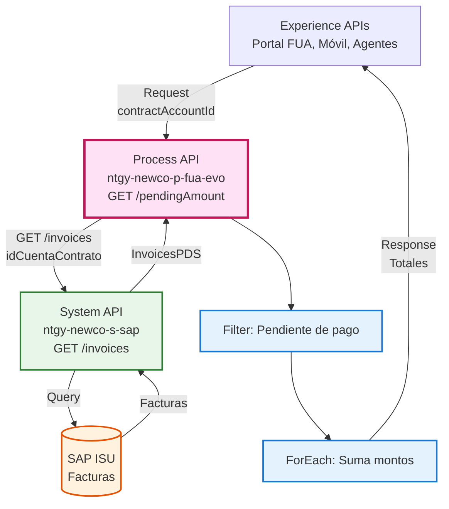
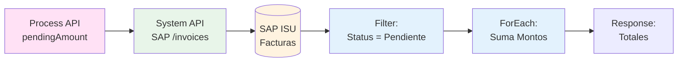
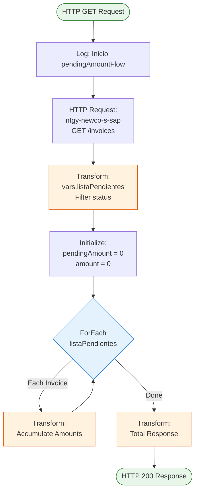
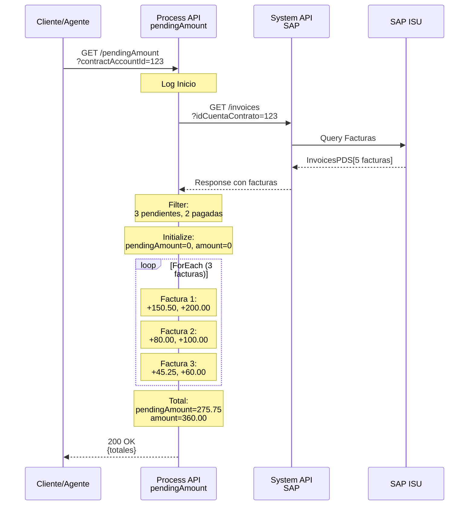
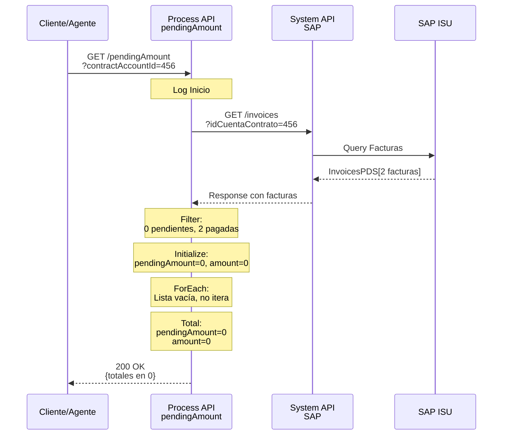
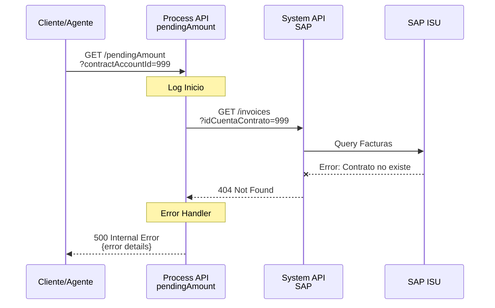

# GET /pendingAmount

## 📌 Descripción General

### Propósito del Endpoint

Este endpoint consulta y calcula el montante total de las facturas pendientes de pago para un contrato específico, obteniendo los datos desde SAP ISU y agregando los montos pendientes y totales.

### Tipo de API

**Capa:** Process API (API-Led Connectivity)

**Función:** Agregación y cálculo de montos pendientes desde SAP ISU

### Patrón de Integración

**Tipo:** Agregación con Filtrado y Acumulación

**Descripción:** Obtiene todas las facturas de un contrato desde SAP ISU, filtra las que están pendientes de pago y suma sus montos para proporcionar un total consolidado.

### Arquitectura API-Led Connectivity



---

## 💼 Propósito del Negocio

### Casos de Uso Principales

1. **Consulta de Deuda Pendiente**
   - Permite al cliente conocer el monto total de sus facturas pendientes
   - Muestra tanto el monto pendiente como el monto total de las facturas
   - Beneficio: Visibilidad inmediata de la deuda actual

2. **Gestión de Pagos por Agentes**
   - Los agentes pueden consultar rápidamente la deuda del cliente
   - Facilita la gestión de cobros y planes de pago
   - Beneficio: Información precisa para negociación de pagos

3. **Validación de Estado de Cuenta**
   - Verifica si existen facturas pendientes antes de operaciones
   - Útil para validaciones en procesos de contratación o modificación
   - Beneficio: Prevención de operaciones con deuda pendiente

### 🔗 Endpoints Dependientes

Este Process API consume el siguiente System API:

| System API | Endpoint | Método | Propósito |
|------------|----------|--------|-----------|
| `ntgy-newco-s-sap` | `/invoices` | GET | Obtiene todas las facturas de un contrato desde SAP ISU |

### Lógica de Orquestación



**Pasos del Proceso:**

1. **Request a SAP**: Llama al System API con `idCuentaContrato` (mapeado desde `contractAccountId`)
2. **Filtrado**: Filtra facturas con `status == "Pendiente de pago"`
3. **Inicialización**: Crea variables `pendingAmount` y `amount` en 0
4. **Iteración ForEach**: Por cada factura pendiente:
   - Extrae `pendingAmount` y `amount` de la factura
   - Convierte strings a números (con `trim()` y `as Number`)
   - Acumula en las variables totales
5. **Respuesta**: Retorna los totales calculados

### Transformaciones Aplicadas

**Transformación de Query Parameter:**

| Campo Original | Campo SAP | Transformación |
|----------------|-----------|----------------|
| `contractAccountId` | `idCuentaContrato` | Mapeo directo |

**Transformación de Datos (Filtrado):**

| Campo SAP | Condición | Resultado |
|-----------|-----------|-----------|
| `InvoicesPDS[].status` | `== "Pendiente de pago"` | Solo facturas pendientes |

**Transformación de Datos (Acumulación):**

| Campo Factura | Variable Acumulada | Transformación |
|---------------|-------------------|----------------|
| `pendingAmount` | `vars.pendingAmount` | `trim()` + `as Number` + suma |
| `amount` | `vars.amount` | `trim()` + `as Number` + suma |

### Contexto Empresarial

- **Dominio:** Facturación y Cobros
- **Sector:** Energía - Utilities
- **División:** Naturgy España - NewCo
- **Proceso de Negocio:** Consulta de deuda pendiente para gestión de cobros

### Stakeholders

- **Clientes Finales**: Necesitan conocer su deuda pendiente actual
- **Agentes de Cobros**: Gestionan pagos y planes de financiación
- **Equipo de Facturación**: Monitorea cuentas con deuda pendiente
- **Sistemas de Alertas**: Notifican sobre deudas vencidas

### Valor de Negocio

- **Transparencia**: Cliente conoce exactamente cuánto debe
- **Eficiencia**: Cálculo automático sin intervención manual
- **Precisión**: Datos directos desde SAP ISU (fuente de verdad)
- **Tiempo Real**: Información actualizada al momento de la consulta

### Consumidores Potenciales

Este endpoint puede ser consumido por:
- Portal web FUA
- Aplicación móvil de clientes
- Sistema de agentes de call center
- Sistemas de alertas y notificaciones
- Procesos de validación de operaciones

---

## 🔧 Especificación Técnica

### URLs por Ambiente

| Ambiente | URL Base | URL Completa |
|----------|----------|--------------|
| **Local** | `http://localhost:8081` | `http://localhost:8081/api/pendingAmount?contractAccountId={id}` |
| **Development** | `https://ntgy-newco-p-fua-evo-dev.us-e2.cloudhub.io` | `https://ntgy-newco-p-fua-evo-dev.us-e2.cloudhub.io/api/pendingAmount?contractAccountId={id}` |
| **UAT** | `https://ntgy-newco-p-fua-evo-uat.us-e2.cloudhub.io` | `https://ntgy-newco-p-fua-evo-uat.us-e2.cloudhub.io/api/pendingAmount?contractAccountId={id}` |
| **Production** | `https://ntgy-newco-p-fua-evo-pro.us-e2.cloudhub.io` | `https://ntgy-newco-p-fua-evo-pro.us-e2.cloudhub.io/api/pendingAmount?contractAccountId={id}` |

### Método HTTP

```
GET /api/pendingAmount
```

### Headers Requeridos

| Header | Tipo | Obligatorio | Descripción |
|--------|------|-------------|-------------|
| `client_id` | string | ✅ Sí | Client ID de Anypoint Platform |
| `client_secret` | string | ✅ Sí | Client Secret de Anypoint Platform |

### Query Parameters

| Parámetro | Tipo | Obligatorio | Descripción |
|-----------|------|-------------|-------------|
| `contractAccountId` | string | ✅ Sí | ID de la cuenta de contrato en SAP ISU |

**Ejemplo:**
```
GET /api/pendingAmount?contractAccountId=1234567890
```

### Respuestas

#### 200 OK - Éxito

**Con facturas pendientes:**

```json
{
  "result": {
    "codResult": "0000",
    "msgResult": "No hay error"
  },
  "pendingAmount": 150.50,
  "amount": 200.00
}
```

**Sin facturas pendientes:**

```json
{
  "result": {
    "codResult": "0000",
    "msgResult": "No hay error"
  },
  "pendingAmount": 0,
  "amount": 0
}
```

| Campo | Tipo | Descripción |
|-------|------|-------------|
| `result.codResult` | string | Código de resultado ("0000" = éxito) |
| `result.msgResult` | string | Mensaje descriptivo del resultado |
| `pendingAmount` | number | Suma total de montos pendientes de todas las facturas pendientes |
| `amount` | number | Suma total de montos de todas las facturas pendientes |

**Nota sobre los montos:**
- `pendingAmount`: Monto que aún falta por pagar de cada factura
- `amount`: Monto total original de cada factura
- La diferencia (`amount - pendingAmount`) representa lo ya pagado

#### 400 Bad Request - Error de Validación

```json
{
  "code": "BAD_REQUEST",
  "message": "Error de validación en los parámetros de entrada",
  "details": "El parámetro 'contractAccountId' es obligatorio"
}
```

#### 500 Internal Server Error - Error del Sistema

```json
{
  "code": "INTERNAL_SERVER_ERROR",
  "message": "Error interno del servidor",
  "details": "Error al conectar con SAP ISU"
}
```

### Autenticación

- **Tipo:** Client ID & Client Secret (Anypoint Platform)
- **Headers:** `client_id` y `client_secret`

### Timeouts

| Tipo | Valor |
|------|-------|
| **Request Timeout** | 30 segundos (configurado en System API SAP) |
| **Connection Timeout** | 10 segundos |

### Validaciones

- ✅ El parámetro `contractAccountId` debe estar presente
- ✅ El `contractAccountId` debe ser un string válido
- ✅ Los montos en las facturas deben ser convertibles a números

---

## 🏗️ Implementación Técnica

### Arquitectura del Flow



### Componentes del Flow

#### 1. Flow Principal: `get:\pendingAmount:ntgy-newco-p-fua-config`

**Ubicación:** `src/main/mule/ntgy-newco-p-fua.xml`

**Función:** Flow de entrada generado por APIKit que delega al subflow `pendingAmountFlow`

```xml
<flow name="get:\pendingAmount:ntgy-newco-p-fua-config">
    <logger level="INFO" message="get:\pendingAmount:ntgy-newco-p-fua-config" />
    <flow-ref name="pendingAmountFlow" />
</flow>
```

#### 2. Flow: `pendingAmountFlow`

**Ubicación:** Archivo XML proporcionado

**Función:** Obtiene facturas de SAP, filtra las pendientes y calcula totales

**Componentes:**

1. **Logger Inicio**: Registra inicio del flujo
2. **HTTP Request**: Llama al System API de SAP para obtener facturas
3. **Transform vars.listaPendientes**: Filtra facturas pendientes e inicializa variables
4. **ForEach**: Itera sobre cada factura pendiente
5. **Transform Accumulate**: Acumula montos en cada iteración
6. **Transform Total**: Construye respuesta final con totales

### Transformaciones DataWeave

#### Transformación 1: Query Parameters (Request → SAP)

**Ubicación:** Inline en HTTP Request

**Propósito:** Mapear el query parameter al formato esperado por SAP

```dataweave
%dw 2.0
output application/java
---
{
  "idCuentaContrato": attributes.queryParams.'contractAccountId'
}
```

**Mapeo:**
- `contractAccountId` (entrada) → `idCuentaContrato` (SAP)

#### Transformación 2: Filtrado e Inicialización

**Ubicación:** Inline en el flow `pendingAmountFlow`

**Propósito:** Filtrar facturas pendientes e inicializar variables acumuladoras

```dataweave
%dw 2.0
output application/java
---
// Variable: listaPendientes
payload.InvoicesPDS filter ((item) -> item.status == "Pendiente de pago")

// Variable: pendingAmount
0 as Number

// Variable: amount
0 as Number
```

**Lógica:**
- **listaPendientes**: Filtra array `InvoicesPDS` por `status == "Pendiente de pago"`
- **pendingAmount**: Inicializa acumulador en 0
- **amount**: Inicializa acumulador en 0

#### Transformación 3: Acumulación (ForEach)

**Ubicación:** Inline en ForEach del flow `pendingAmountFlow`

**Propósito:** Acumular montos de cada factura pendiente

```dataweave
%dw 2.0
output application/java

var pa = trim(payload.pendingAmount) as Number
---
// Variable: pendingAmount
vars.pendingAmount ++ pa

// Variable: amount (transformación separada)
%dw 2.0
output application/java

var am = trim(payload.amount) as Number
---
vars.amount ++ am
```

**Lógica:**
1. Extrae `pendingAmount` de la factura actual
2. Aplica `trim()` para eliminar espacios
3. Convierte a `Number` con `as Number`
4. Suma al acumulador con operador `++`
5. Repite para `amount`

**Nota:** El operador `++` en DataWeave concatena/suma valores

#### Transformación 4: Respuesta Final

**Ubicación:** Inline en el flow `pendingAmountFlow`

**Propósito:** Construir respuesta JSON con totales calculados

```dataweave
%dw 2.0
output application/json
---
{
  "result": {
    "codResult": "0000",
    "msgResult": "No hay error"
  },
  "pendingAmount": vars.pendingAmount,
  "amount": vars.amount
}
```

**⚠️ NOTA IMPORTANTE - Bug en Código Original:**

El código proporcionado tiene un typo en esta transformación:
```dataweave
"pendingAmount": vars.pendingAmmount,  // ❌ Typo: "Ammount" (3 m's)
```

Debería ser:
```dataweave
"pendingAmount": vars.pendingAmount,   // ✅ Correcto: "Amount" (2 m's)
```

Este bug causará que el campo `pendingAmount` en la respuesta sea `null` o `undefined`.

### Configuración HTTP Request

**Config Reference:** `HTTP_Request_ntgy-newco-s-sap`

**Propiedades:**

- **Method:** GET
- **Path:** `/invoices`
- **Query Parameters:** `idCuentaContrato` (mapeado desde `contractAccountId`)

```xml
<http:request 
    method="GET" 
    config-ref="HTTP_Request_ntgy-newco-s-sap" 
    path="/invoices">
  <http:query-params>
    <![CDATA[#[output application/java
    ---
    {
      "idCuentaContrato": attributes.queryParams.'contractAccountId'
    }]]]>
  </http:query-params>
</http:request>
```

### Estructura de Datos SAP

#### Respuesta de SAP ISU (GET /invoices)

```json
{
  "InvoicesPDS": [
    {
      "invoiceId": "1234567890",
      "status": "Pendiente de pago",
      "pendingAmount": "150.50",
      "amount": "200.00",
      "dueDate": "2026-09-15",
      "issueDate": "2026-08-15"
    },
    {
      "invoiceId": "1234567891",
      "status": "Pagada",
      "pendingAmount": "0.00",
      "amount": "180.00",
      "dueDate": "2026-08-15",
      "issueDate": "2026-07-15"
    }
  ]
}
```

**Campos Relevantes:**

| Campo | Tipo | Descripción |
|-------|------|-------------|
| `InvoicesPDS` | array | Array de facturas del contrato |
| `status` | string | Estado de la factura ("Pendiente de pago", "Pagada", etc.) |
| `pendingAmount` | string | Monto pendiente de pago (como string) |
| `amount` | string | Monto total de la factura (como string) |

### Patrones de Diseño

#### 1. Filter Pattern

**Justificación:** Reduce el conjunto de datos a solo las facturas relevantes (pendientes) antes de procesarlas.

**Implementación:**
```dataweave
payload.InvoicesPDS filter ((item) -> item.status == "Pendiente de pago")
```

#### 2. Accumulator Pattern

**Justificación:** Calcula totales iterando sobre una colección y acumulando valores.

**Implementación:**
- Variables inicializadas en 0
- ForEach itera sobre facturas filtradas
- Cada iteración suma al acumulador

#### 3. Type Conversion Pattern

**Justificación:** SAP retorna montos como strings, necesitan convertirse a números para operaciones matemáticas.

**Implementación:**
```dataweave
trim(payload.pendingAmount) as Number
```

### Diagramas de Secuencia

#### 1. Flujo Normal con Facturas Pendientes



#### 2. Flujo Sin Facturas Pendientes



#### 3. Flujo con Error de SAP



### Manejo de Errores

**Estrategia:** El flow no tiene try-catch explícito, los errores se propagan al error handler global del API.

**Errores Posibles:**

| Error | Causa | Respuesta |
|-------|-------|-----------|
| **400 Bad Request** | `contractAccountId` faltante o inválido | Error de validación |
| **404 Not Found** | Contrato no existe en SAP | Propagado como 500 |
| **500 Internal Error** | Error de conexión con SAP | Error interno |
| **Timeout** | SAP no responde en tiempo | Error de timeout |

---

## 💻 Ejemplos de Uso

### Ejemplo 1: Consulta con Facturas Pendientes

#### Request

```bash
curl -X GET "https://ntgy-newco-p-fua-evo-dev.us-e2.cloudhub.io/api/pendingAmount?contractAccountId=1234567890" \
  -H "client_id: YOUR_CLIENT_ID" \
  -H "client_secret: YOUR_CLIENT_SECRET"
```

#### Response (200 OK)

```json
{
  "result": {
    "codResult": "0000",
    "msgResult": "No hay error"
  },
  "pendingAmount": 275.75,
  "amount": 360.00
}
```

**Interpretación:**
- El cliente tiene 3 facturas pendientes
- Monto total pendiente: €275.75
- Monto total de las facturas: €360.00
- Ya pagó: €84.25 (360.00 - 275.75)

### Ejemplo 2: Consulta Sin Facturas Pendientes

#### Request

```bash
curl -X GET "https://ntgy-newco-p-fua-evo-dev.us-e2.cloudhub.io/api/pendingAmount?contractAccountId=9876543210" \
  -H "client_id: YOUR_CLIENT_ID" \
  -H "client_secret: YOUR_CLIENT_SECRET"
```

#### Response (200 OK)

```json
{
  "result": {
    "codResult": "0000",
    "msgResult": "No hay error"
  },
  "pendingAmount": 0,
  "amount": 0
}
```

**Interpretación:**
- El cliente no tiene facturas pendientes
- Todas las facturas están pagadas o no hay facturas

### Ejemplo 3: JavaScript (Fetch API)

```javascript
const getPendingAmount = async (contractAccountId) => {
  const url = `https://ntgy-newco-p-fua-evo-dev.us-e2.cloudhub.io/api/pendingAmount?contractAccountId=${contractAccountId}`;
  
  const response = await fetch(url, {
    method: 'GET',
    headers: {
      'client_id': 'YOUR_CLIENT_ID',
      'client_secret': 'YOUR_CLIENT_SECRET'
    }
  });

  const data = await response.json();
  
  if (data.result.codResult === '0000') {
    console.log(`Monto pendiente: €${data.pendingAmount}`);
    console.log(`Monto total: €${data.amount}`);
    
    if (data.pendingAmount > 0) {
      console.log(`Ya pagado: €${data.amount - data.pendingAmount}`);
    } else {
      console.log('No hay facturas pendientes');
    }
  }
  
  return data;
};

// Uso
getPendingAmount('1234567890')
  .then(result => console.log('Resultado:', result))
  .catch(error => console.error('Error:', error));
```

### Ejemplo 4: Python (Requests)

```python
import requests

def get_pending_amount(contract_account_id):
    url = 'https://ntgy-newco-p-fua-evo-dev.us-e2.cloudhub.io/api/pendingAmount'
    
    headers = {
        'client_id': 'YOUR_CLIENT_ID',
        'client_secret': 'YOUR_CLIENT_SECRET'
    }
    
    params = {
        'contractAccountId': contract_account_id
    }
    
    response = requests.get(url, headers=headers, params=params)
    
    if response.status_code == 200:
        data = response.json()
        
        if data['result']['codResult'] == '0000':
            pending = data['pendingAmount']
            total = data['amount']
            paid = total - pending
            
            print(f"Monto pendiente: €{pending}")
            print(f"Monto total: €{total}")
            print(f"Ya pagado: €{paid}")
            
            return data
    else:
        print(f"Error: {response.status_code}")
        print(response.text)
        return None

# Uso
result = get_pending_amount('1234567890')
```

### Ejemplo 5: React Component

```javascript
import React, { useState, useEffect } from 'react';

const PendingAmountDisplay = ({ contractAccountId }) => {
  const [data, setData] = useState(null);
  const [loading, setLoading] = useState(true);
  const [error, setError] = useState(null);

  useEffect(() => {
    const fetchPendingAmount = async () => {
      try {
        const url = `https://ntgy-newco-p-fua-evo-dev.us-e2.cloudhub.io/api/pendingAmount?contractAccountId=${contractAccountId}`;
        
        const response = await fetch(url, {
          headers: {
            'client_id': process.env.REACT_APP_CLIENT_ID,
            'client_secret': process.env.REACT_APP_CLIENT_SECRET
          }
        });

        const result = await response.json();
        setData(result);
      } catch (err) {
        setError(err.message);
      } finally {
        setLoading(false);
      }
    };

    fetchPendingAmount();
  }, [contractAccountId]);

  if (loading) return <div>Cargando...</div>;
  if (error) return <div>Error: {error}</div>;
  if (!data) return null;

  const hasPendingAmount = data.pendingAmount > 0;

  return (
    <div className="pending-amount-card">
      <h3>Estado de Cuenta</h3>
      {hasPendingAmount ? (
        <>
          <p className="amount-pending">
            Monto Pendiente: <strong>€{data.pendingAmount.toFixed(2)}</strong>
          </p>
          <p className="amount-total">
            Monto Total: €{data.amount.toFixed(2)}
          </p>
          <p className="amount-paid">
            Ya Pagado: €{(data.amount - data.pendingAmount).toFixed(2)}
          </p>
        </>
      ) : (
        <p className="no-pending">✅ No hay facturas pendientes</p>
      )}
    </div>
  );
};

export default PendingAmountDisplay;
```

### Ejemplo 6: Error - Parámetro Faltante

#### Request

```bash
curl -X GET "https://ntgy-newco-p-fua-evo-dev.us-e2.cloudhub.io/api/pendingAmount" \
  -H "client_id: YOUR_CLIENT_ID" \
  -H "client_secret: YOUR_CLIENT_SECRET"
```

#### Response (400 Bad Request)

```json
{
  "code": "BAD_REQUEST",
  "message": "Error de validación en los parámetros de entrada",
  "details": "El parámetro 'contractAccountId' es obligatorio"
}
```

### Ejemplo 7: Error - Contrato No Existe

#### Request

```bash
curl -X GET "https://ntgy-newco-p-fua-evo-dev.us-e2.cloudhub.io/api/pendingAmount?contractAccountId=9999999999" \
  -H "client_id: YOUR_CLIENT_ID" \
  -H "client_secret: YOUR_CLIENT_SECRET"
```

#### Response (500 Internal Server Error)

```json
{
  "code": "INTERNAL_SERVER_ERROR",
  "message": "Error al consultar facturas en SAP ISU",
  "details": "Contrato no encontrado: 9999999999"
}
```

---

## 📊 Consideraciones de Rendimiento

### Tiempos de Respuesta Esperados

| Escenario | Tiempo Esperado | Notas |
|-----------|-----------------|-------|
| **Sin Facturas Pendientes** | 1-2 segundos | Solo consulta SAP + filtrado |
| **Con Pocas Facturas (1-5)** | 1.5-2.5 segundos | Consulta + filtrado + iteración mínima |
| **Con Muchas Facturas (10-50)** | 2-3 segundos | Iteración ForEach más larga |
| **Con Muchas Facturas (50+)** | 3-4 segundos | Puede acercarse al timeout |

### Optimizaciones Aplicadas

1. **Filtrado Temprano**: Filtra facturas pendientes antes del ForEach, reduciendo iteraciones
2. **Type Conversion**: Convierte strings a números solo cuando es necesario
3. **Acumulación Simple**: Usa operador `++` nativo de DataWeave para suma eficiente

### Límites y Restricciones

- **SAP API Limits**: Sujeto a límites de consultas de SAP ISU
- **ForEach Performance**: El rendimiento depende del número de facturas pendientes
- **Timeout**: 30 segundos máximo de espera
- **Memory**: Variables acumuladoras en memoria durante toda la iteración

### Recomendaciones de Optimización

**Para Contratos con Muchas Facturas:**
- Considerar paginación en el System API de SAP
- Implementar caché para consultas frecuentes
- Agregar índices en SAP para mejorar consultas

---

## 🔐 Seguridad y Auditoría

### Trazabilidad

- **Logs de Inicio**: Registra cada consulta con el `contractAccountId`
- **Logs de SAP**: El System API registra la llamada a SAP ISU
- **Correlation ID**: Propagado a través de las capas para seguimiento

### Datos Sensibles

- **Contract Account ID**: Identificador del contrato (no PII directo)
- **Montos**: Información financiera del cliente
- **Sin Datos Personales**: No expone nombre, dirección o datos personales

### Cumplimiento GDPR

- ✅ No expone datos personales identificables
- ✅ Solo información financiera del contrato
- ✅ Trazabilidad mediante logs
- ✅ Acceso controlado por autenticación

---

## 🧪 Testing

### Casos de Prueba Recomendados

1. **Contrato con Facturas Pendientes**
   - Verificar que suma correctamente múltiples facturas
   - Verificar que `pendingAmount` y `amount` son correctos
   - Verificar que la diferencia representa lo pagado

2. **Contrato sin Facturas Pendientes**
   - Verificar que retorna 0 en ambos campos
   - Verificar que no falla con lista vacía

3. **Contrato con Todas las Facturas Pagadas**
   - Verificar que filtra correctamente (0 pendientes)
   - Verificar respuesta con valores en 0

4. **Contrato con Facturas Parcialmente Pagadas**
   - Verificar que `pendingAmount < amount`
   - Verificar cálculo correcto de diferencia

5. **Contrato No Existe**
   - Verificar error 500 con mensaje apropiado
   - Verificar que no retorna datos incorrectos

6. **Parámetro Faltante**
   - Verificar error 400 cuando falta `contractAccountId`

7. **Montos con Decimales**
   - Verificar conversión correcta de strings a números
   - Verificar precisión decimal (2 decimales)

8. **Montos con Espacios**
   - Verificar que `trim()` elimina espacios correctamente
   - Verificar conversión exitosa después de trim

### Datos de Prueba Sugeridos

```json
// Caso 1: Múltiples facturas pendientes
{
  "contractAccountId": "1234567890",
  "expectedPendingAmount": 275.75,
  "expectedAmount": 360.00
}

// Caso 2: Sin facturas pendientes
{
  "contractAccountId": "9876543210",
  "expectedPendingAmount": 0,
  "expectedAmount": 0
}

// Caso 3: Una sola factura pendiente
{
  "contractAccountId": "5555555555",
  "expectedPendingAmount": 150.50,
  "expectedAmount": 200.00
}
```

---

## 🐛 Problemas Conocidos

### Bug Crítico: Typo en Variable

**Descripción:** El código tiene un typo en la transformación final que causa que `pendingAmount` retorne `null`.

**Ubicación:** Transformación "Total" en `pendingAmountFlow`

**Código Actual (Incorrecto):**
```dataweave
"pendingAmount": vars.pendingAmmount,  // ❌ 3 m's
```

**Código Correcto:**
```dataweave
"pendingAmount": vars.pendingAmount,   // ✅ 2 m's
```

**Impacto:**
- El campo `pendingAmount` en la respuesta será `null` o `undefined`
- Solo el campo `amount` tendrá valor correcto
- Los clientes no podrán ver el monto pendiente real

**Solución:**
Corregir el typo en el archivo XML:
```xml
<ee:set-payload><![CDATA[%dw 2.0
output application/json
---
{
  "result": {
    "codResult": "0000",
    "msgResult": "No hay error"
  },
  "pendingAmount": vars.pendingAmount,  // ✅ Corregido
  "amount": vars.amount
}]]></ee:set-payload>
```

**Prioridad:** Alta - Afecta funcionalidad principal del endpoint

---

## 📈 Métricas y Monitoreo

### KPIs Recomendados

| Métrica | Objetivo | Descripción |
|---------|----------|-------------|
| **Response Time** | < 3s (95th percentile) | Tiempo de respuesta total |
| **Error Rate** | < 1% | Porcentaje de errores 4xx/5xx |
| **SAP Availability** | > 99% | Disponibilidad del System API SAP |
| **Requests/Day** | Monitorear | Volumen de consultas diarias |

### Alertas Sugeridas

1. **Response Time > 5s**: Alerta de rendimiento
2. **Error Rate > 5%**: Alerta de disponibilidad
3. **SAP Timeout**: Alerta crítica de integración
4. **Bug de Typo Detectado**: Alerta de datos incorrectos (pendingAmount null)

---

## 🔄 Mejoras Futuras

### Optimizaciones Propuestas

1. **Caché de Resultados**
   - Cachear respuesta por 5-10 minutos
   - Invalidar caché cuando se registra un pago
   - Reducir carga en SAP ISU

2. **Agregación en SAP**
   - Mover el cálculo de totales al System API
   - Reducir transferencia de datos
   - Mejorar rendimiento del ForEach

3. **Paginación**
   - Para contratos con muchas facturas (>100)
   - Evitar timeouts en casos extremos

4. **Métricas Adicionales**
   - Número de facturas pendientes
   - Factura más antigua pendiente
   - Promedio de monto por factura

### Funcionalidades Adicionales

1. **Filtro por Fecha**
   - Permitir filtrar facturas por rango de fechas
   - Útil para análisis históricos

2. **Desglose por Estado**
   - Retornar totales por cada estado de factura
   - No solo "Pendiente de pago"

3. **Información de Vencimiento**
   - Incluir cuántas facturas están vencidas
   - Monto total vencido vs pendiente no vencido
