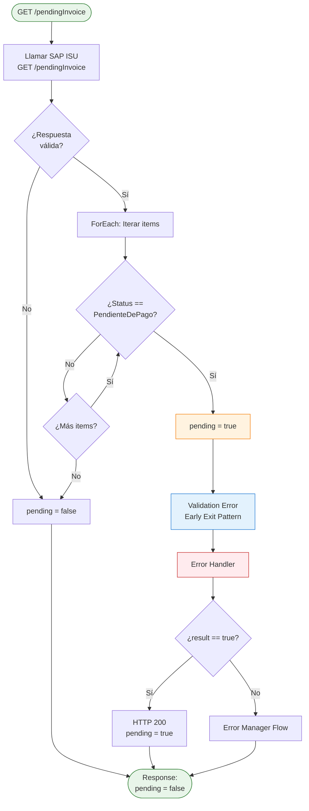
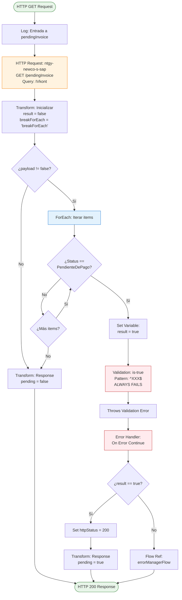
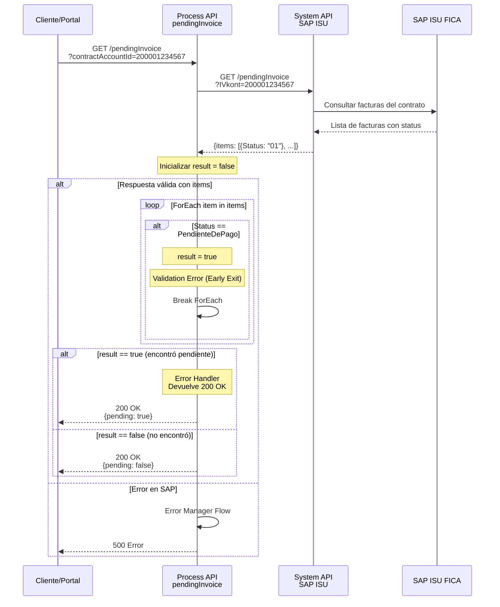

# GET /pendingInvoice

## 📌 Descripción General

### Propósito del Endpoint

Este endpoint realiza una **validación rápida y optimizada** para determinar si un contrato tiene facturas pendientes de pago en SAP ISU. Utiliza un patrón de "early exit" que detiene la búsqueda en cuanto encuentra la primera factura pendiente, optimizando el rendimiento.

**Características clave:**
- Respuesta booleana simple (`true`/`false`)
- Optimización: Se detiene en la primera factura pendiente encontrada
- No devuelve la lista de facturas, solo indica si existen
- Ideal para validaciones previas a operaciones (pagos, cambios de producto, etc.)

### Tipo de API

**Capa:** Process API (API-Led Connectivity)

**Función:** Orquestación de consulta a SAP ISU con lógica de validación optimizada

### Patrón de Integración

**Tipo:** Pass-Through con Validación y Early Exit

**Descripción:** Consulta SAP ISU, itera sobre las facturas y se detiene en la primera que tenga status "Pendiente de Pago", devolviendo un booleano simple.

### Arquitectura API-Led Connectivity

```mermaid
graph TB
    E[Experience APIs<br/>Portal FUA / Móvil]
    P[Process API<br/>ntgy-newco-p-fua-evo<br/>GET /pendingInvoice]
    S[System API<br/>ntgy-newco-s-sap<br/>GET /pendingInvoice]
    SAP[(SAP ISU<br/>FICA Module)]
    
    E -->|Query: contractAccountId| P
    P -->|Query: IVkont| S
    S -->|Consulta facturas| SAP
    SAP -->|Lista de facturas| S
    S -->|items[]| P
    P -->|Validación + Early Exit| P
    P -->|Response: pending boolean| E
    
    style P fill:#ffe1f5,stroke:#c2185b,stroke-width:3px
    style S fill:#e8f5e9,stroke:#2e7d32,stroke-width:2px
```

---

## 💼 Propósito del Negocio

### Casos de Uso Principales

1. **Validación Previa a Pago**
   - Antes de procesar un pago, verificar si hay facturas pendientes
   - Evitar pagos duplicados o innecesarios
   - **Beneficio:** Prevención de errores en proceso de pago

2. **Validación Previa a Cambio de Producto**
   - Verificar que no hay deuda pendiente antes de cambiar tarifa/producto
   - Requisito de negocio: cliente al día en pagos
   - **Beneficio:** Cumplimiento de políticas comerciales

3. **Indicador de Estado de Cuenta**
   - Mostrar badge/indicador en portal si hay facturas pendientes
   - Alertar al cliente sobre deuda pendiente
   - **Beneficio:** Mejora de experiencia y transparencia

4. **Validación en Flujos de Autoservicio**
   - Bloquear ciertas operaciones si hay deuda
   - Redirigir a pago si es necesario
   - **Beneficio:** Automatización de reglas de negocio

### 🔗 Endpoints Dependientes

Este Process API consume el siguiente System API:

| System API | Endpoint | Método | Propósito |
|------------|----------|--------|-----------|
| `ntgy-newco-s-sap` | `/pendingInvoice` | GET | Obtener lista de facturas del contrato desde SAP ISU |

### Lógica de Validación



**Pasos del Proceso:**

1. **Llamada a SAP ISU**: Obtiene lista de facturas del contrato
2. **Validación de Respuesta**: Si no hay datos, devuelve `pending: false`
3. **Iteración con Early Exit**: 
   - ForEach sobre `items[]`
   - Compara `Status` con valor hardcodeado de "Pendiente de Pago"
   - Si encuentra una, establece `result = true` y fuerza salida del loop
4. **Patrón de Salida**: Usa validación con patrón imposible `^(XXX)$` para generar error controlado
5. **Error Handler Inteligente**: 
   - Si `result == true`: Devuelve 200 OK con `pending: true`
   - Si `result == false`: Propaga error al error manager

### Transformaciones Aplicadas

#### Transformación 1: Query Parameter Mapping

**Archivo:** Inline en XML (líneas 8-13)

| Campo Entrada | Campo SAP | Transformación |
|---------------|-----------|----------------|
| `contractAccountId` (query param) | `IVkont` | Mapeo directo |

**Lógica DataWeave:**
```dataweave
{
  IVkont: attributes.queryParams.'contractAccountId'
}
```

#### Transformación 2: Inicialización de Variables

**Archivo:** Inline en XML (líneas 14-24)

| Variable | Valor Inicial | Propósito |
|----------|---------------|-----------|
| `result` | `false` | Indicador de factura pendiente encontrada |
| `breakForEach` | `"breakForEach"` | String para control de flujo |

#### Transformación 3: Response Final

**Archivo:** Inline en XML (líneas 42-53)

**Estructura de Respuesta:**
```json
{
  "result": {
    "codResult": "0000",
    "msgResult": "No hay error"
  },
  "pending": boolean
}
```

### Contexto Empresarial

- **Dominio:** Gestión de Facturación y Cobranza
- **Sector:** Energía - Utilities
- **División:** Naturgy España - NewCo
- **Proceso de Negocio:** Validación de estado de cuenta para operaciones de autoservicio

### Stakeholders

- **Clientes Finales**: Necesitan conocer su estado de deuda
- **Equipo de Cobranza**: Monitoreo de cuentas con deuda
- **Desarrolladores de Portal**: Implementación de reglas de negocio
- **Equipo de Producto**: Definición de políticas de acceso a servicios

### Valor de Negocio

- **Optimización de Performance**: Early exit reduce tiempo de respuesta
- **Prevención de Errores**: Validación previa a operaciones críticas
- **Experiencia de Usuario**: Feedback inmediato sobre estado de cuenta
- **Cumplimiento de Políticas**: Aplicación automática de reglas de negocio
- **Reducción de Carga**: No devuelve datos innecesarios, solo booleano

### Consumidores Potenciales

Este endpoint puede ser consumido por:
- Portal web FUA
- Aplicaciones móviles de clientes
- Sistemas de agentes de call center
- Flujos de validación en otros Process APIs

---

## 🔧 Especificación Técnica

### URLs por Ambiente

| Ambiente | URL Base | URL Completa |
|----------|----------|--------------|
| **Local** | `http://localhost:8081` | `http://localhost:8081/api/pendingInvoice?contractAccountId={id}` |
| **Development** | `https://ntgy-newco-p-fua-evo-dev.us-e2.cloudhub.io` | `https://ntgy-newco-p-fua-evo-dev.us-e2.cloudhub.io/api/pendingInvoice?contractAccountId={id}` |
| **UAT** | `https://ntgy-newco-p-fua-evo-uat.us-e2.cloudhub.io` | `https://ntgy-newco-p-fua-evo-uat.us-e2.cloudhub.io/api/pendingInvoice?contractAccountId={id}` |
| **Production** | `https://ntgy-newco-p-fua-evo-pro.us-e2.cloudhub.io` | `https://ntgy-newco-p-fua-evo-pro.us-e2.cloudhub.io/api/pendingInvoice?contractAccountId={id}` |

### Método HTTP

```
GET /api/pendingInvoice
```

### Query Parameters

| Parámetro | Tipo | Obligatorio | Descripción |
|-----------|------|-------------|-------------|
| `contractAccountId` | string | ✅ | ID de la cuenta de contrato en SAP ISU (IVkont) |

**Ejemplo:**
```
?contractAccountId=200001234567
```

### Headers Requeridos

| Header | Tipo | Obligatorio | Descripción |
|--------|------|-------------|-------------|
| `client_id` | string | ✅ | Client ID de Anypoint Platform |
| `client_secret` | string | ✅ | Client Secret de Anypoint Platform |

### Respuestas

#### 200 OK - Sin Facturas Pendientes

```json
{
  "result": {
    "codResult": "0000",
    "msgResult": "No hay error"
  },
  "pending": false
}
```

| Campo | Tipo | Descripción |
|-------|------|-------------|
| `result.codResult` | string | Código de resultado: "0000" para éxito |
| `result.msgResult` | string | Mensaje descriptivo del resultado |
| `pending` | boolean | `false` = No hay facturas pendientes de pago |

#### 200 OK - Con Facturas Pendientes

```json
{
  "result": {
    "codResult": "0000",
    "msgResult": "No hay error"
  },
  "pending": true
}
```

| Campo | Tipo | Descripción |
|-------|------|-------------|
| `pending` | boolean | `true` = Existe al menos una factura pendiente de pago |

**Nota:** El endpoint devuelve 200 OK en ambos casos (con o sin facturas pendientes). El campo `pending` indica el resultado de la validación.

#### 400 Bad Request - Parámetro Faltante

```json
{
  "code": "BAD_REQUEST",
  "message": "Missing required query parameter: contractAccountId"
}
```

#### 500 Internal Server Error - Error en SAP

```json
{
  "code": "INTERNAL_SERVER_ERROR",
  "message": "Error al consultar facturas en SAP ISU",
  "details": "Connection timeout"
}
```

### Autenticación

- **Tipo:** Client ID & Client Secret (Anypoint Platform)
- **Headers:** `client_id` y `client_secret`

### Timeouts

| Tipo | Valor | Descripción |
|------|-------|-------------|
| **Request Timeout** | 30 segundos | Timeout total del endpoint |
| **SAP ISU Timeout** | Variable | Configurado en System API |

### Validaciones

1. **Query Parameter Obligatorio**: `contractAccountId` debe estar presente
2. **Formato de Contract Account**: Debe ser un string válido
3. **Respuesta de SAP**: Validación de estructura de respuesta

---

## 🏗️ Implementación Técnica

### Arquitectura del Flow



### Componentes del Flow

#### 1. Llamada a SAP ISU

**Ubicación:** Líneas 7-13 del XML

**Endpoint:** `GET ${ntgy-newco-s-sap.functions.pendingInvoice}`

**Query Parameters:**
```dataweave
{
  IVkont: attributes.queryParams.'contractAccountId'
}
```

**Propósito:** Obtener lista de facturas del contrato desde SAP ISU FICA

#### 2. Inicialización de Variables

**Ubicación:** Líneas 14-25 del XML

**Variables Creadas:**
- `result`: `false` (indica si se encontró factura pendiente)
- `breakForEach`: `"breakForEach"` (string para control de flujo)

**Lógica:**
```dataweave
%dw 2.0
output application/java
---
{
  payload: payload,
  result: false
}
```

#### 3. Validación de Respuesta

**Ubicación:** Líneas 26-27 del XML

**Condición:**
```
payload != false
```

**Comportamiento:**
- Si `payload == false`: No hay datos, devuelve `pending: false`
- Si `payload != false`: Procede a iterar sobre `items[]`

#### 4. ForEach con Early Exit Pattern

**Ubicación:** Líneas 28-35 del XML

**Colección:** `payload.items`

**Lógica por Item:**
```xml
<when expression="#[payload.Status == p('Harcode.FICA.Status.PendienteDePago')]">
    <set-variable variableName="result" value="true" />
    <validation:is-true 
        expression="#[vars.breakForEach contains /^(XXX)$/]"
        message="Hay una factura con status: {Status}" />
</when>
```

**Patrón de Early Exit:**
1. Compara `Status` con valor hardcodeado de "Pendiente de Pago"
2. Si coincide, establece `result = true`
3. Ejecuta validación con patrón imposible `^(XXX)$`
4. La validación SIEMPRE falla (breakForEach nunca contiene "XXX")
5. El error fuerza la salida del foreach
6. El error handler captura y procesa el resultado

**Optimización:** Se detiene en la primera factura pendiente, no procesa todas.

#### 5. Error Handler Inteligente

**Ubicación:** Líneas 54-75 del XML

**Tipo:** `on-error-continue`

**Lógica:**
```xml
<choice>
    <when expression="#[vars.result == true]">
        <!-- Encontró factura pendiente, devolver 200 OK -->
        <set-variable variableName="httpStatus" value="200" />
        <ee:transform>
            {
              "result": {"codResult": "0000", "msgResult": "No hay error"},
              "pending": true
            }
        </ee:transform>
    </when>
    <otherwise>
        <!-- Error real, propagar al error manager -->
        <flow-ref name="errorManagerFlow" />
    </otherwise>
</choice>
```

**Comportamiento:**
- Si `result == true`: Es un "error controlado" (early exit), devuelve 200 OK
- Si `result == false`: Es un error real, propaga al error manager

### Transformaciones DataWeave Detalladas

#### Transformación 1: Query Parameter Mapping

```dataweave
%dw 2.0
output application/java
---
{
  IVkont: attributes.queryParams.'contractAccountId'
}
```

**Mapeo:**
- `contractAccountId` (API) → `IVkont` (SAP ISU)

#### Transformación 2: Response con Pending False

```dataweave
%dw 2.0
output application/json
---
{
  "result": {
    "codResult": "0000",
    "msgResult": "No hay error"
  },
  "pending": vars.result
}
```

**Valor:** `vars.result` = `false` (no se encontró factura pendiente)

#### Transformación 3: Response con Pending True

```dataweave
%dw 2.0
output application/json
---
{
  "result": {
    "codResult": "0000",
    "msgResult": "No hay error"
  },
  "pending": vars.result
}
```

**Valor:** `vars.result` = `true` (se encontró al menos una factura pendiente)

### Patrones de Diseño

#### Patrón 1: Early Exit con Validation Error

**Justificación:** Optimización de performance - detiene la iteración en cuanto encuentra lo que busca

**Implementación:**
- Usa `validation:is-true` con patrón imposible
- Genera error controlado para salir del foreach
- Error handler distingue entre "encontrado" y "error real"

**Ventajas:**
- No procesa todas las facturas innecesariamente
- Respuesta más rápida
- Menor carga en SAP ISU

#### Patrón 2: Boolean Response

**Justificación:** Simplicidad - el consumidor solo necesita saber si hay deuda, no los detalles

**Ventajas:**
- Payload mínimo
- Fácil de consumir
- Ideal para validaciones

#### Patrón 3: Error Handler Inteligente

**Justificación:** Distinguir entre error controlado (early exit) y error técnico

**Implementación:**
- Verifica `vars.result` en error handler
- Si `true`: Devuelve 200 OK (es el comportamiento esperado)
- Si `false`: Propaga error real

### Configuración

#### Propiedades Hardcodeadas

**Ubicación:** Archivo de propiedades (no encontrado en búsqueda)

```yaml
Harcode:
  FICA:
    Status:
      PendienteDePago: "01"  # Valor probable
```

**Nota:** El valor exacto del status "Pendiente de Pago" está configurado en las propiedades del proyecto.

#### Endpoint SAP

```yaml
ntgy-newco-s-sap:
  functions:
    pendingInvoice: "/pendingInvoice"  # Path del endpoint
```

### Manejo de Errores

#### Error Controlado (Early Exit)

**Escenario:** Se encuentra factura pendiente

**Comportamiento:**
1. `result` = `true`
2. Validation error lanzado intencionalmente
3. Error handler captura
4. Verifica `result == true`
5. Devuelve 200 OK con `pending: true`

#### Error Real (SAP ISU)

**Escenario:** Fallo en llamada a SAP o timeout

**Comportamiento:**
1. `result` = `false` (no se modificó)
2. Error propagado al error handler
3. Verifica `result == false`
4. Propaga a `errorManagerFlow`
5. Devuelve 500 con mensaje de error

#### Error de Validación (Parámetro Faltante)

**Escenario:** No se proporciona `contractAccountId`

**Comportamiento:**
- APIKit valida parámetros requeridos
- Devuelve 400 Bad Request
- No llega al flow de implementación

---

## 💻 Ejemplos de Uso

### Ejemplo 1: Contrato Sin Facturas Pendientes

#### Request

```bash
curl -X GET "https://ntgy-newco-p-fua-evo-dev.us-e2.cloudhub.io/api/pendingInvoice?contractAccountId=200001234567" \
  -H "client_id: YOUR_CLIENT_ID" \
  -H "client_secret: YOUR_CLIENT_SECRET"
```

#### Response (200 OK)

```json
{
  "result": {
    "codResult": "0000",
    "msgResult": "No hay error"
  },
  "pending": false
}
```

**Interpretación:** El contrato NO tiene facturas pendientes de pago. El cliente está al día.

### Ejemplo 2: Contrato Con Facturas Pendientes

#### Request

```bash
curl -X GET "https://ntgy-newco-p-fua-evo-dev.us-e2.cloudhub.io/api/pendingInvoice?contractAccountId=200009876543" \
  -H "client_id: YOUR_CLIENT_ID" \
  -H "client_secret: YOUR_CLIENT_SECRET"
```

#### Response (200 OK)

```json
{
  "result": {
    "codResult": "0000",
    "msgResult": "No hay error"
  },
  "pending": true
}
```

**Interpretación:** El contrato TIENE al menos una factura pendiente de pago. Hay deuda.

### Ejemplo 3: Parámetro Faltante

#### Request

```bash
curl -X GET "https://ntgy-newco-p-fua-evo-dev.us-e2.cloudhub.io/api/pendingInvoice" \
  -H "client_id: YOUR_CLIENT_ID" \
  -H "client_secret: YOUR_CLIENT_SECRET"
```

#### Response (400 Bad Request)

```json
{
  "code": "BAD_REQUEST",
  "message": "Missing required query parameter: contractAccountId"
}
```

### Ejemplo 4: JavaScript (Fetch API)

```javascript
const checkPendingInvoices = async (contractAccountId) => {
  try {
    const response = await fetch(
      `https://ntgy-newco-p-fua-evo-dev.us-e2.cloudhub.io/api/pendingInvoice?contractAccountId=${contractAccountId}`,
      {
        method: 'GET',
        headers: {
          'client_id': 'YOUR_CLIENT_ID',
          'client_secret': 'YOUR_CLIENT_SECRET'
        }
      }
    );

    const data = await response.json();
    
    if (data.pending) {
      console.log('⚠️ El contrato tiene facturas pendientes');
      return {
        hasPendingInvoices: true,
        message: 'Hay facturas pendientes de pago'
      };
    } else {
      console.log('✅ El contrato está al día');
      return {
        hasPendingInvoices: false,
        message: 'No hay facturas pendientes'
      };
    }
  } catch (error) {
    console.error('❌ Error al verificar facturas:', error);
    throw error;
  }
};

// Uso en validación de pago
const validateBeforePayment = async (contractAccountId) => {
  const result = await checkPendingInvoices(contractAccountId);
  
  if (result.hasPendingInvoices) {
    // Mostrar alerta o redirigir a pago
    alert('Tiene facturas pendientes. Por favor, revise su estado de cuenta.');
  } else {
    // Continuar con el flujo
    console.log('Validación exitosa, puede continuar');
  }
};

// Ejemplo de uso
validateBeforePayment('200001234567');
```

### Ejemplo 5: Python (Requests)

```python
import requests
from typing import Dict, Any

def check_pending_invoices(contract_account_id: str) -> Dict[str, Any]:
    """
    Verifica si un contrato tiene facturas pendientes de pago
    
    Args:
        contract_account_id: ID de la cuenta de contrato en SAP ISU
    
    Returns:
        dict: {
            'has_pending': bool,
            'message': str,
            'raw_response': dict
        }
    """
    url = 'https://ntgy-newco-p-fua-evo-dev.us-e2.cloudhub.io/api/pendingInvoice'
    
    headers = {
        'client_id': 'YOUR_CLIENT_ID',
        'client_secret': 'YOUR_CLIENT_SECRET'
    }
    
    params = {
        'contractAccountId': contract_account_id
    }
    
    try:
        response = requests.get(url, headers=headers, params=params, timeout=30)
        response.raise_for_status()
        
        data = response.json()
        
        has_pending = data.get('pending', False)
        
        result = {
            'has_pending': has_pending,
            'message': 'Facturas pendientes encontradas' if has_pending else 'Sin facturas pendientes',
            'raw_response': data
        }
        
        if has_pending:
            print(f'⚠️ Contrato {contract_account_id}: Tiene facturas pendientes')
        else:
            print(f'✅ Contrato {contract_account_id}: Al día en pagos')
        
        return result
        
    except requests.exceptions.Timeout:
        print('❌ Timeout en la consulta a SAP ISU')
        raise
    except requests.exceptions.RequestException as e:
        print(f'❌ Error en la solicitud: {e}')
        raise

# Uso en validación de cambio de producto
def validate_before_product_change(contract_account_id: str) -> bool:
    """
    Valida que no haya deuda antes de permitir cambio de producto
    
    Returns:
        bool: True si puede cambiar producto, False si hay deuda
    """
    result = check_pending_invoices(contract_account_id)
    
    if result['has_pending']:
        print('❌ No se puede cambiar de producto: Hay facturas pendientes')
        print('   Por favor, regularice su situación de pago primero')
        return False
    else:
        print('✅ Validación exitosa: Puede proceder con el cambio de producto')
        return True

# Ejemplo de uso
if __name__ == '__main__':
    contract_id = '200001234567'
    
    # Verificación simple
    result = check_pending_invoices(contract_id)
    print(f"\nResultado: {result}")
    
    # Validación para cambio de producto
    can_change = validate_before_product_change(contract_id)
    print(f"\n¿Puede cambiar producto?: {can_change}")
```

### Ejemplo 6: Integración en Portal Web

```javascript
// Componente React para mostrar estado de cuenta
import React, { useEffect, useState } from 'react';

const AccountStatusBadge = ({ contractAccountId }) => {
  const [hasPending, setHasPending] = useState(false);
  const [loading, setLoading] = useState(true);
  const [error, setError] = useState(null);

  useEffect(() => {
    const checkStatus = async () => {
      try {
        setLoading(true);
        const response = await fetch(
          `/api/pendingInvoice?contractAccountId=${contractAccountId}`,
          {
            headers: {
              'client_id': process.env.REACT_APP_CLIENT_ID,
              'client_secret': process.env.REACT_APP_CLIENT_SECRET
            }
          }
        );

        const data = await response.json();
        setHasPending(data.pending);
      } catch (err) {
        setError(err.message);
      } finally {
        setLoading(false);
      }
    };

    checkStatus();
  }, [contractAccountId]);

  if (loading) return <span>Verificando...</span>;
  if (error) return <span className="error">Error: {error}</span>;

  return (
    <div className={`status-badge ${hasPending ? 'warning' : 'success'}`}>
      {hasPending ? (
        <>
          <span className="icon">⚠️</span>
          <span>Facturas Pendientes</span>
        </>
      ) : (
        <>
          <span className="icon">✅</span>
          <span>Al Día</span>
        </>
      )}
    </div>
  );
};

export default AccountStatusBadge;
```

### Diagrama de Secuencia Completo



### Comparación con Otros Endpoints

| Característica | GET /pendingInvoice | GET /facturas | GET /checkCurrentDebt |
|----------------|---------------------|---------------|----------------------|
| **Respuesta** | Boolean simple | Lista completa | Monto de deuda |
| **Performance** | ⚡ Rápido (early exit) | 🐢 Lento (lista completa) | ⚡ Rápido |
| **Uso** | Validación rápida | Consulta detallada | Cálculo de deuda |
| **Datos** | Mínimos | Completos | Agregados |

**Recomendación:** Usar `/pendingInvoice` para validaciones previas donde solo se necesita saber si hay deuda, no los detalles.
