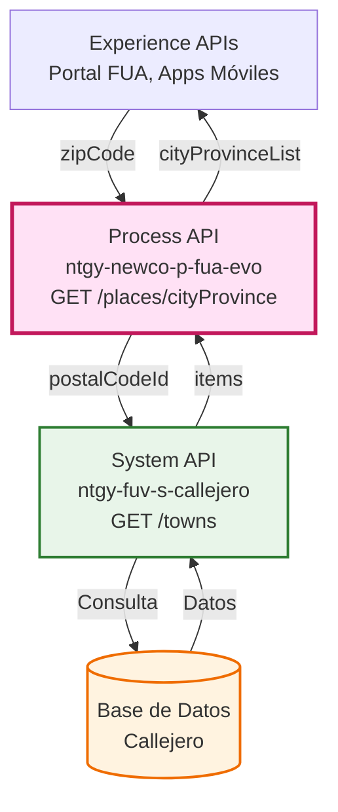
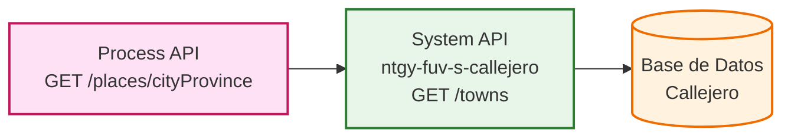
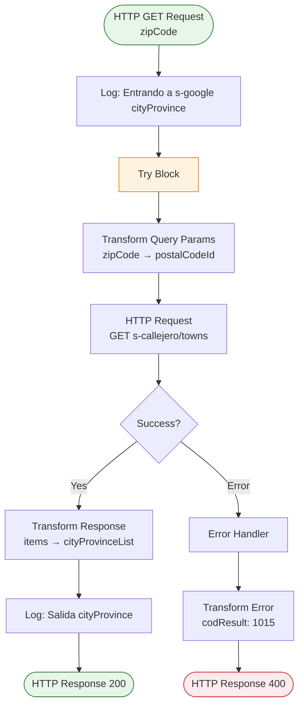
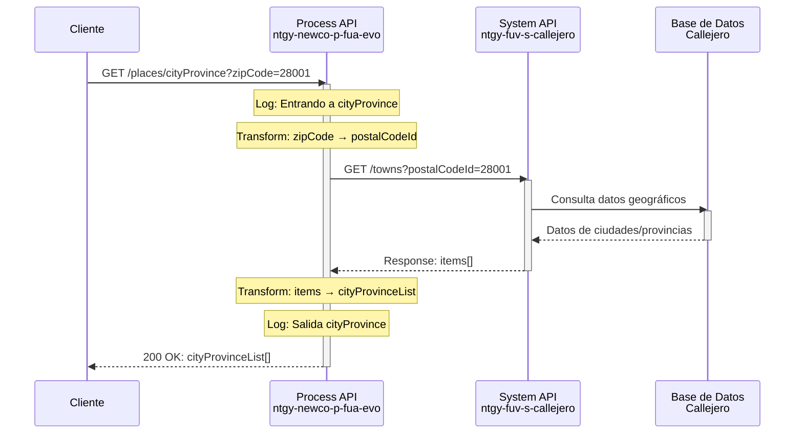
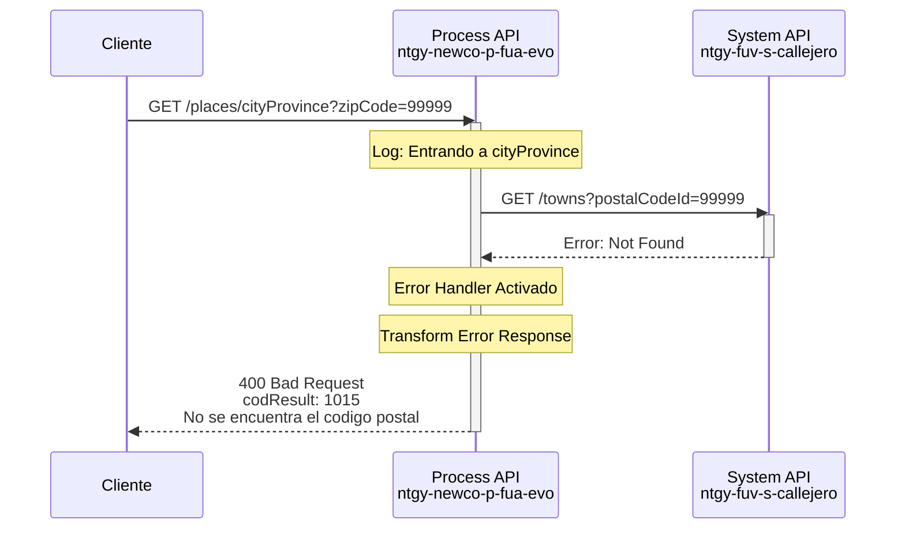
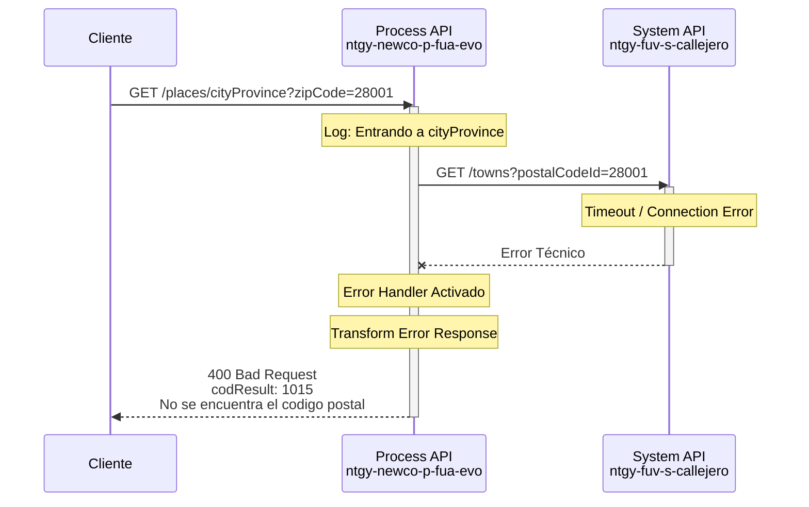

# GET /places/cityProvince

## 📌 Descripción General

### Propósito del Endpoint

Este endpoint actúa como un **passthrough** hacia el System API `ntgy-fuv-s-callejero`, permitiendo consultar información de ciudades y provincias asociadas a un código postal específico. Forma parte del flujo de validación y normalización de direcciones en el portal FUA.

### Tipo de API

**Capa:** Process API (API-Led Connectivity)

**Función:** Orquestación y transformación de datos geográficos

### Patrón de Integración

**Tipo:** Passthrough con Transformación

**Descripción:** El endpoint recibe un código postal, lo reenvía al System API Callejero, y transforma la respuesta para adaptarla al formato esperado por los consumidores del Process API.

### Arquitectura API-Led Connectivity



---

## 💼 Propósito del Negocio

### Casos de Uso Principales

1. **Validación de Direcciones en Alta de Cliente**
   - Permite validar que el código postal ingresado corresponde a una ubicación real
   - Facilita la selección de ciudad y provincia correctas
   - Reduce errores en datos de facturación

2. **Normalización de Datos Geográficos**
   - Estandariza la información de ubicación en el sistema
   - Asegura consistencia en los datos de clientes
   - Facilita análisis geográficos posteriores

3. **Autocompletado en Formularios**
   - Mejora la experiencia de usuario al rellenar direcciones
   - Reduce tiempo de captura de datos
   - Minimiza errores de escritura

### 🔗 Endpoints Dependientes

Este Process API consume el siguiente System API:

| System API | Endpoint | Método | Propósito |
|------------|----------|--------|-----------|
| `ntgy-fuv-s-callejero` | `/towns` | GET | Consulta información de ciudades y provincias por código postal |

### Lógica de Orquestación



**Pasos del Proceso:**

1. **Recepción**: Process API recibe query parameter `zipCode`
2. **Transformación**: Mapea `zipCode` a `postalCodeId` para el System API
3. **Invocación**: Llama a `ntgy-fuv-s-callejero GET /towns` con el parámetro transformado
4. **Transformación de Respuesta**: Convierte estructura `items[]` a `cityProvinceList[]`
5. **Respuesta**: Devuelve datos normalizados al consumidor

### Transformaciones Aplicadas

| Campo Original (System API) | Campo Transformado (Process API) | Transformación |
|------------------------------|----------------------------------|----------------|
| `items[].townId` | `cityProvinceList[].cityId` | Mapeo directo |
| `items[].townName` | `cityProvinceList[].cityDesc` | Mapeo directo |
| `items[].provinceId` | `cityProvinceList[].provinceId` | Mapeo directo |
| `items[].provinceDesc` | `cityProvinceList[].provinceDesc` | Mapeo directo |
| N/A | `cityProvinceList[].autonomousCommunityId` | Campo vacío (no disponible) |
| N/A | `cityProvinceList[].autonomousCommunityDesc` | Campo vacío (no disponible) |

### Contexto Empresarial

- **Dominio:** Gestión de Direcciones y Geolocalización
- **Sector:** Energía - Utilities
- **División:** Naturgy España - NewCo
- **Proceso de Negocio:** Validación y normalización de direcciones en procesos de alta y modificación de clientes

### Stakeholders

- **Clientes Finales**: Necesitan ingresar direcciones correctas para facturación
- **Agentes de Call Center**: Requieren validación rápida de códigos postales
- **Equipo de Calidad de Datos**: Necesitan datos geográficos consistentes y normalizados

### Valor de Negocio

- **Reducción de Errores**: Minimiza errores en direcciones de facturación
- **Mejora de Experiencia**: Facilita el proceso de alta y modificación de datos
- **Calidad de Datos**: Asegura consistencia en información geográfica
- **Eficiencia Operativa**: Reduce tiempo de validación manual de direcciones

### Consumidores Potenciales

Este endpoint puede ser consumido por:
- Portal web FUA
- Aplicaciones móviles de autoservicio
- Sistemas de agentes de call center
- Procesos de alta y modificación de clientes

---

## 🔧 Especificación Técnica

### URLs por Ambiente

| Ambiente | URL Base | URL Completa |
|----------|----------|--------------|
| **Local** | `http://localhost:8081` | `http://localhost:8081/api/places/cityProvince?zipCode={codigo}` |
| **Development** | `https://ntgy-newco-p-fua-evo-dev.us-e2.cloudhub.io` | `https://ntgy-newco-p-fua-evo-dev.us-e2.cloudhub.io/api/places/cityProvince?zipCode={codigo}` |
| **UAT** | `https://ntgy-newco-p-fua-evo-uat.us-e2.cloudhub.io` | `https://ntgy-newco-p-fua-evo-uat.us-e2.cloudhub.io/api/places/cityProvince?zipCode={codigo}` |
| **Production** | `https://ntgy-newco-p-fua-evo-pro.us-e2.cloudhub.io` | `https://ntgy-newco-p-fua-evo-pro.us-e2.cloudhub.io/api/places/cityProvince?zipCode={codigo}` |

### Método HTTP

```
GET /api/places/cityProvince
```

### Parámetros de Entrada

#### Query Parameters

| Parámetro | Tipo | Requerido | Descripción | Ejemplo |
|-----------|------|-----------|-------------|---------|
| `zipCode` | string | ✅ Sí | Código postal a consultar | `28001` |

**Validaciones:**
- Debe ser un código postal válido español (5 dígitos)
- No puede estar vacío

### Respuestas

#### 200 OK - Éxito

**Descripción:** Código postal encontrado con información de ciudades y provincias

**Estructura de Respuesta:**

```json
{
  "result": {
    "codResult": "string",
    "msgResult": "string"
  },
  "cityProvinceList": [
    {
      "autonomousCommunityId": "string",
      "autonomousCommunityDesc": "string",
      "cityId": "string",
      "cityDesc": "string",
      "provinceId": "string",
      "provinceDesc": "string"
    }
  ]
}
```

**Campos de Respuesta:**

| Campo | Tipo | Descripción |
|-------|------|-------------|
| `result.codResult` | string | Código de resultado de la operación |
| `result.msgResult` | string | Mensaje descriptivo del resultado |
| `cityProvinceList` | array | Lista de ciudades y provincias asociadas al código postal |
| `cityProvinceList[].autonomousCommunityId` | string | ID de la comunidad autónoma (actualmente vacío) |
| `cityProvinceList[].autonomousCommunityDesc` | string | Descripción de la comunidad autónoma (actualmente vacío) |
| `cityProvinceList[].cityId` | string | ID de la ciudad/municipio |
| `cityProvinceList[].cityDesc` | string | Nombre de la ciudad/municipio |
| `cityProvinceList[].provinceId` | string | ID de la provincia |
| `cityProvinceList[].provinceDesc` | string | Nombre de la provincia |

#### 400 Bad Request - Error de Negocio

**Descripción:** Código postal no encontrado o inválido

**Estructura de Respuesta:**

```json
{
  "result": {
    "codResult": "1015",
    "msgResult": "No se encuentra el codigo postal"
  }
}
```

#### 500 Internal Server Error - Error Técnico

**Descripción:** Error en el procesamiento de la solicitud

**Estructura de Respuesta:**

```json
{
  "code": "ERROR_CODE",
  "message": "Descripción del error técnico",
  "details": "Detalles adicionales del error"
}
```

### Autenticación

- **Tipo:** Client ID & Client Secret (Anypoint Platform)
- **Headers Requeridos:**
  - `client_id`: ID del cliente registrado en Anypoint Platform
  - `client_secret`: Secret del cliente registrado en Anypoint Platform

### Timeouts

| Tipo | Valor |
|------|-------|
| **Request Timeout** | 30 segundos |
| **Connection Timeout** | 10 segundos |

---

## 🏗️ Implementación Técnica

### Arquitectura del Flow



### Componentes del Flow

#### 1. Logger de Entrada
```xml
<logger level="INFO" 
        message="Entrando a ntgy-newco-s-google cityProvince" />
```
**Propósito:** Registrar el inicio del procesamiento del endpoint

**Nota:** El mensaje del log menciona "s-google" por razones históricas, pero el endpoint realmente se conecta al System API Callejero.

#### 2. Try Block (Línea 7)
**Propósito:** Manejar errores de forma controlada

#### 3. HTTP Request a System API
```xml
<http:request method="GET" 
              config-ref="HTTP_Request_s_callejero" 
              path="/towns">
    <http:query-params>
        {
            postalCodeId : vars.zipCode
        }
    </http:query-params>
</http:request>
```
**Propósito:** Invocar System API `ntgy-fuv-s-callejero` con el código postal

**Configuración:**
- **Config:** `HTTP_Request_s_callejero`
- **System API:** `ntgy-fuv-s-callejero`
- **Path:** `/towns`
- **Query Param:** `postalCodeId` (mapeado desde `vars.zipCode`)

#### 4. Error Handler (Línea 16-28)
```xml
<on-error-continue>
    <ee:transform>
        <ee:set-payload>
            {
                "result": {
                    "codResult": '1015',
                    "msgResult": "No se encuentra el codigo postal"
                }
            }
        </ee:set-payload>
    </ee:transform>
</on-error-continue>
```
**Propósito:** Transformar errores del System API en respuesta de negocio

**Código de Error:**
- `1015`: Código postal no encontrado

#### 5. Transformación de Respuesta (Línea 29-46)
```dataweave
%dw 2.0
output application/json
---
{
  result: payload.result,
  cityProvinceList: payload.items map (item) -> {
    autonomousCommunityId: "",
    autonomousCommunityDesc: "",
    cityId: item.townId,
    cityDesc: item.townName,
    provinceId: item.provinceId,
    provinceDesc: item.provinceDesc
  }
}
```
**Propósito:** Transformar estructura del System API al formato del Process API

**Mapeo de Campos:**
- `items[]` → `cityProvinceList[]`
- `townId` → `cityId`
- `townName` → `cityDesc`
- `provinceId` → `provinceId` (sin cambio)
- `provinceDesc` → `provinceDesc` (sin cambio)
- Campos de comunidad autónoma: vacíos (no disponibles en origen)

#### 6. Logger de Salida
```xml
<logger level="INFO" 
        message="Log salida ntgy-newco-s-google cityProvince: #[message.payload]" />
```
**Propósito:** Registrar la respuesta final del endpoint

**Nota:** El mensaje del log menciona "s-google" por razones históricas, pero el endpoint realmente se conecta al System API Callejero.

### Patrones de Diseño

**Patrón:** Passthrough con Transformación

**Justificación:** 
- El endpoint no agrega lógica de negocio compleja
- Actúa como adaptador entre el System API y los consumidores
- Transforma la estructura de datos para mantener consistencia en la capa Process

**Patrón:** Try-Catch con Error Handler

**Justificación:**
- Manejo robusto de errores del System API
- Conversión de errores técnicos en respuestas de negocio
- Evita exponer detalles técnicos a los consumidores

### Diagramas de Secuencia

#### 1. Flujo Normal de Éxito



#### 2. Flujo con Código Postal No Encontrado



#### 3. Flujo con Error Técnico del System API



### Manejo de Errores

**Estrategia:** Try-Catch con Error Handler Específico

**Tipos de Errores Manejados:**

1. **Errores de Conectividad**
   - Timeout del System API
   - Connection refused
   - **Respuesta:** 400 Bad Request con código 1015

2. **Errores de Negocio**
   - Código postal no encontrado
   - Código postal inválido
   - **Respuesta:** 400 Bad Request con código 1015

3. **Errores del System API**
   - Respuestas 4xx o 5xx del System API
   - **Respuesta:** 400 Bad Request con código 1015

**Código de Error Estándar:**
```json
{
  "result": {
    "codResult": "1015",
    "msgResult": "No se encuentra el codigo postal"
  }
}
```

**Logging:**
- Todos los errores se registran con nivel INFO
- Se incluye el payload completo en el log de salida
- Facilita troubleshooting y auditoría

---

## 💻 Ejemplos de Uso

### Ejemplo 1: Consulta Exitosa - Madrid

#### cURL

```bash
curl -X GET "https://ntgy-newco-p-fua-evo-dev.us-e2.cloudhub.io/api/places/cityProvince?zipCode=28001" \
  -H "Content-Type: application/json" \
  -H "client_id: YOUR_CLIENT_ID" \
  -H "client_secret: YOUR_CLIENT_SECRET"
```

#### Respuesta (200 OK)

```json
{
  "result": {
    "codResult": "0",
    "msgResult": "Operación exitosa"
  },
  "cityProvinceList": [
    {
      "autonomousCommunityId": "",
      "autonomousCommunityDesc": "",
      "cityId": "28079",
      "cityDesc": "Madrid",
      "provinceId": "28",
      "provinceDesc": "Madrid"
    }
  ]
}
```

### Ejemplo 2: Consulta Exitosa - Barcelona

#### cURL

```bash
curl -X GET "https://ntgy-newco-p-fua-evo-dev.us-e2.cloudhub.io/api/places/cityProvince?zipCode=08001" \
  -H "Content-Type: application/json" \
  -H "client_id: YOUR_CLIENT_ID" \
  -H "client_secret: YOUR_CLIENT_SECRET"
```

#### Respuesta (200 OK)

```json
{
  "result": {
    "codResult": "0",
    "msgResult": "Operación exitosa"
  },
  "cityProvinceList": [
    {
      "autonomousCommunityId": "",
      "autonomousCommunityDesc": "",
      "cityId": "08019",
      "cityDesc": "Barcelona",
      "provinceId": "08",
      "provinceDesc": "Barcelona"
    }
  ]
}
```

### Ejemplo 3: Código Postal No Encontrado

#### cURL

```bash
curl -X GET "https://ntgy-newco-p-fua-evo-dev.us-e2.cloudhub.io/api/places/cityProvince?zipCode=99999" \
  -H "Content-Type: application/json" \
  -H "client_id: YOUR_CLIENT_ID" \
  -H "client_secret: YOUR_CLIENT_SECRET"
```

#### Respuesta (400 Bad Request)

```json
{
  "result": {
    "codResult": "1015",
    "msgResult": "No se encuentra el codigo postal"
  }
}
```

### Ejemplo 4: JavaScript (Fetch API)

```javascript
const fetchCityProvince = async (zipCode) => {
  try {
    const response = await fetch(
      `https://ntgy-newco-p-fua-evo-dev.us-e2.cloudhub.io/api/places/cityProvince?zipCode=${zipCode}`,
      {
        method: 'GET',
        headers: {
          'Content-Type': 'application/json',
          'client_id': 'YOUR_CLIENT_ID',
          'client_secret': 'YOUR_CLIENT_SECRET'
        }
      }
    );

    if (!response.ok) {
      const error = await response.json();
      console.error('Error:', error.result.msgResult);
      return null;
    }

    const data = await response.json();
    console.log('Ciudades encontradas:', data.cityProvinceList);
    return data;
  } catch (error) {
    console.error('Error de red:', error);
    return null;
  }
};

// Uso
fetchCityProvince('28001');
```

### Ejemplo 5: Python (Requests)

```python
import requests

def get_city_province(zip_code):
    """
    Consulta información de ciudad y provincia por código postal
    
    Args:
        zip_code (str): Código postal a consultar
        
    Returns:
        dict: Información de ciudades y provincias, o None si hay error
    """
    url = f"https://ntgy-newco-p-fua-evo-dev.us-e2.cloudhub.io/api/places/cityProvince"
    
    headers = {
        'Content-Type': 'application/json',
        'client_id': 'YOUR_CLIENT_ID',
        'client_secret': 'YOUR_CLIENT_SECRET'
    }
    
    params = {
        'zipCode': zip_code
    }
    
    try:
        response = requests.get(url, headers=headers, params=params, timeout=30)
        
        if response.status_code == 200:
            data = response.json()
            print(f"Ciudades encontradas: {len(data['cityProvinceList'])}")
            for city in data['cityProvinceList']:
                print(f"  - {city['cityDesc']} ({city['provinceDesc']})")
            return data
        else:
            error = response.json()
            print(f"Error {response.status_code}: {error['result']['msgResult']}")
            return None
            
    except requests.exceptions.Timeout:
        print("Error: Timeout en la petición")
        return None
    except requests.exceptions.RequestException as e:
        print(f"Error de red: {e}")
        return None

# Uso
result = get_city_province('28001')
```

### Ejemplo 6: Java (Spring RestTemplate)

```java
import org.springframework.http.*;
import org.springframework.web.client.RestTemplate;
import org.springframework.web.util.UriComponentsBuilder;

public class CityProvinceClient {
    
    private final RestTemplate restTemplate;
    private final String baseUrl = "https://ntgy-newco-p-fua-evo-dev.us-e2.cloudhub.io";
    private final String clientId = "YOUR_CLIENT_ID";
    private final String clientSecret = "YOUR_CLIENT_SECRET";
    
    public CityProvinceClient() {
        this.restTemplate = new RestTemplate();
    }
    
    public CityProvinceResponse getCityProvince(String zipCode) {
        // Construir URL con query parameter
        String url = UriComponentsBuilder
            .fromHttpUrl(baseUrl + "/api/places/cityProvince")
            .queryParam("zipCode", zipCode)
            .toUriString();
        
        // Configurar headers
        HttpHeaders headers = new HttpHeaders();
        headers.setContentType(MediaType.APPLICATION_JSON);
        headers.set("client_id", clientId);
        headers.set("client_secret", clientSecret);
        
        HttpEntity<String> entity = new HttpEntity<>(headers);
        
        try {
            // Realizar petición
            ResponseEntity<CityProvinceResponse> response = restTemplate.exchange(
                url,
                HttpMethod.GET,
                entity,
                CityProvinceResponse.class
            );
            
            return response.getBody();
            
        } catch (Exception e) {
            System.err.println("Error al consultar código postal: " + e.getMessage());
            return null;
        }
    }
    
    // Uso
    public static void main(String[] args) {
        CityProvinceClient client = new CityProvinceClient();
        CityProvinceResponse response = client.getCityProvince("28001");
        
        if (response != null && response.getCityProvinceList() != null) {
            response.getCityProvinceList().forEach(city -> 
                System.out.println(city.getCityDesc() + " - " + city.getProvinceDesc())
            );
        }
    }
}
```

### Ejemplo 7: Postman Collection

```json
{
  "info": {
    "name": "ntgy-newco-p-fua-evo - cityProvince",
    "schema": "https://schema.getpostman.com/json/collection/v2.1.0/collection.json"
  },
  "item": [
    {
      "name": "GET cityProvince - Success",
      "request": {
        "method": "GET",
        "header": [
          {
            "key": "Content-Type",
            "value": "application/json"
          },
          {
            "key": "client_id",
            "value": "{{client_id}}"
          },
          {
            "key": "client_secret",
            "value": "{{client_secret}}"
          }
        ],
        "url": {
          "raw": "{{base_url}}/api/places/cityProvince?zipCode=28001",
          "host": ["{{base_url}}"],
          "path": ["api", "cityProvince"],
          "query": [
            {
              "key": "zipCode",
              "value": "28001"
            }
          ]
        }
      }
    },
    {
      "name": "GET cityProvince - Not Found",
      "request": {
        "method": "GET",
        "header": [
          {
            "key": "Content-Type",
            "value": "application/json"
          },
          {
            "key": "client_id",
            "value": "{{client_id}}"
          },
          {
            "key": "client_secret",
            "value": "{{client_secret}}"
          }
        ],
        "url": {
          "raw": "{{base_url}}/api/places/cityProvince?zipCode=99999",
          "host": ["{{base_url}}"],
          "path": ["api", "cityProvince"],
          "query": [
            {
              "key": "zipCode",
              "value": "99999"
            }
          ]