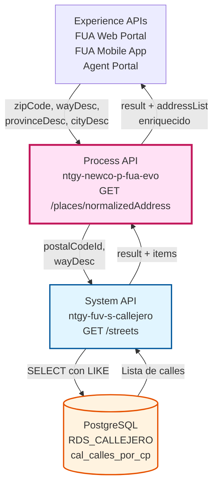
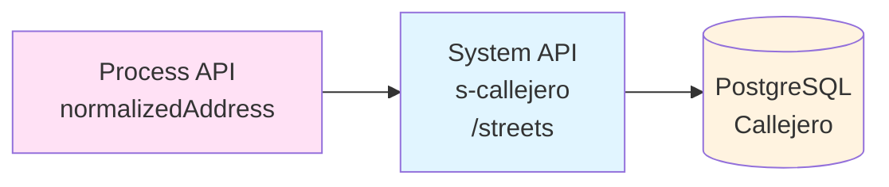
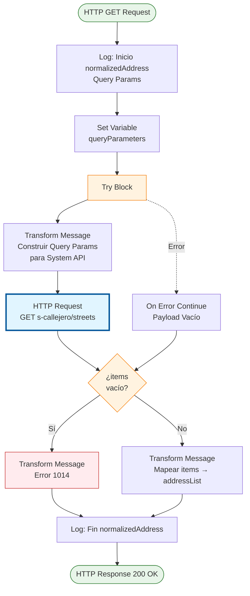
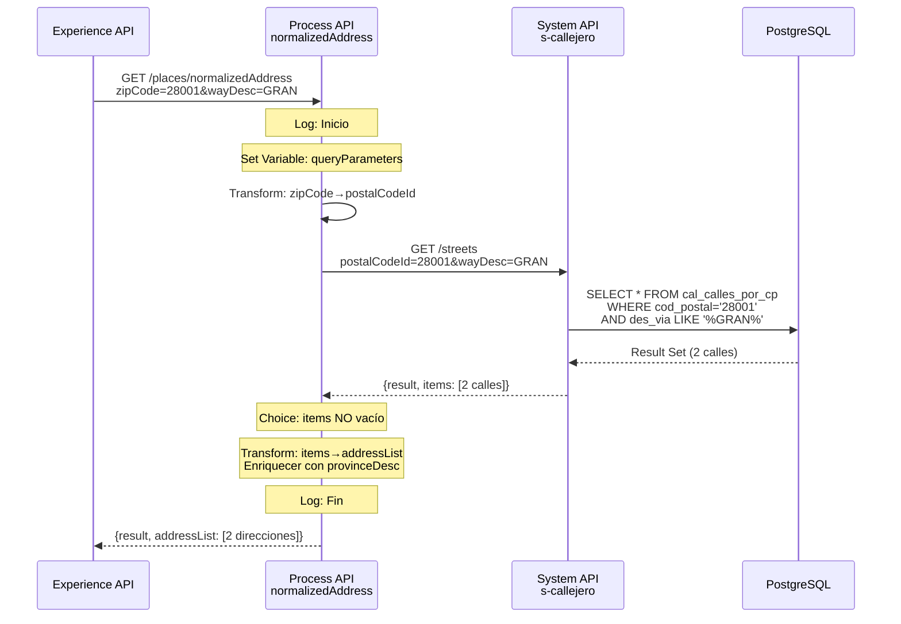
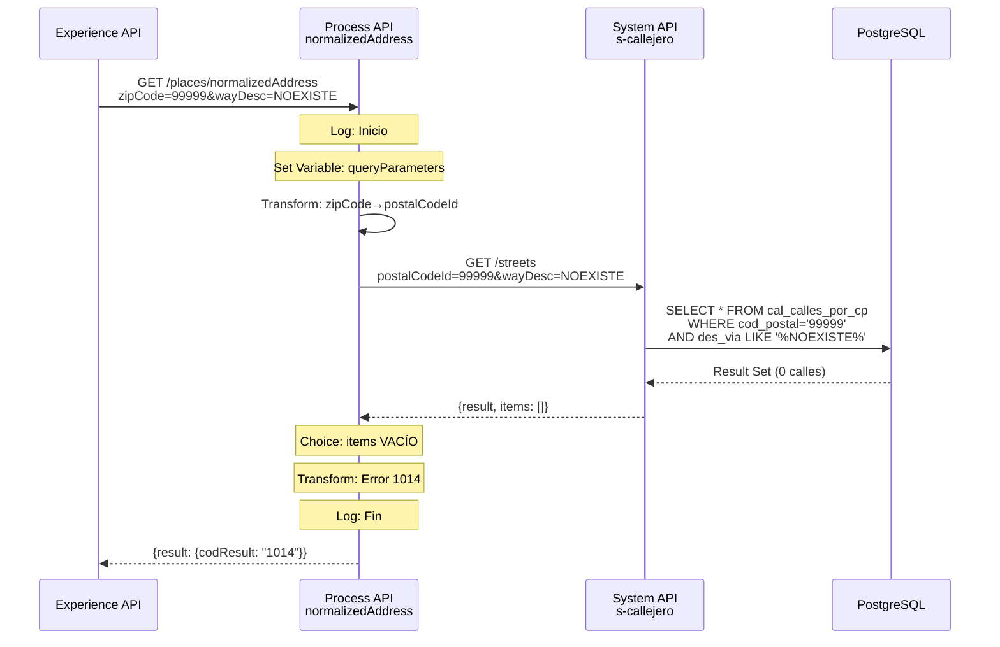
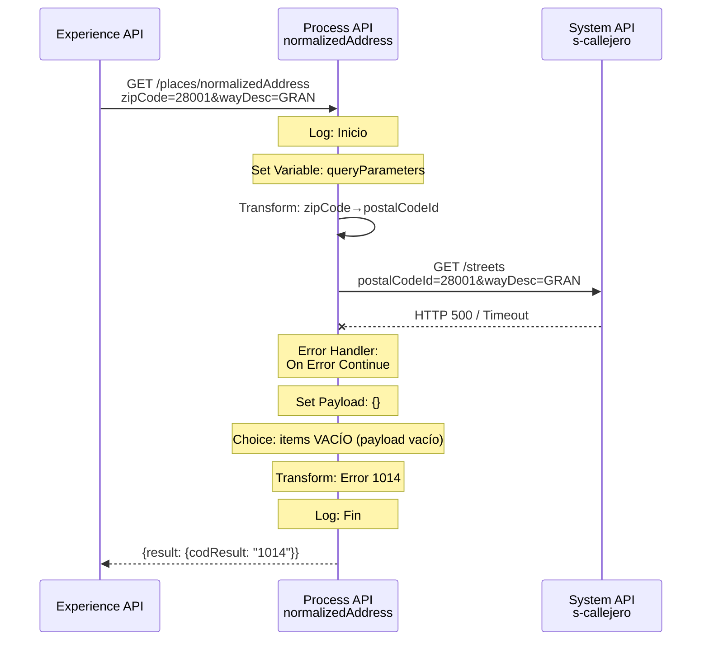
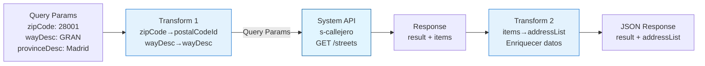

# GET /places/normalizedAddress

## 📌 Descripción General

### Propósito del Endpoint

Este endpoint normaliza y valida direcciones postales españolas mediante la integración con el System API `ntgy-fuv-s-callejero`, que a su vez consulta el callejero oficial en PostgreSQL. Proporciona funcionalidad de búsqueda y validación de direcciones para los portales de autoservicio FUA, permitiendo a los usuarios encontrar y seleccionar direcciones válidas durante procesos de alta, modificación de datos o gestión de contratos.

El endpoint actúa como capa de orquestación que:
- **Recibe parámetros de búsqueda** del usuario (código postal, descripción de vía, provincia, ciudad)
- **Transforma y valida** los parámetros antes de enviarlos al System API
- **Enriquece la respuesta** con información adicional de ubicación
- **Maneja casos especiales** como búsquedas sin resultados
- **Normaliza el formato** de las direcciones para consumo por Experience APIs

### Tipo de API

**Capa:** Process API (API-Led Connectivity)

**Función:** Orquestación de validación y normalización de direcciones postales españolas, integrando datos del callejero oficial con información contextual de ubicación.

### Patrón de Integración

**Tipo:** Pass-Through con Transformación y Enriquecimiento

**Descripción:** 
1. Recibe parámetros de búsqueda de direcciones
2. Transforma parámetros (`zipCode` → `postalCodeId`, `wayDesc` → `wayDesc`)
3. Invoca System API `s-callejero` GET /streets
4. Valida respuesta (verifica si hay resultados)
5. Transforma y enriquece datos (construye `addressId`, añade información de provincia/ciudad)
6. Retorna estructura normalizada con lista de direcciones

### Arquitectura API-Led Connectivity



---

## 💼 Propósito del Negocio

### Casos de Uso Principales

1. **Alta de Cliente con Validación de Dirección**
   - Cliente ingresa su dirección en formulario de alta
   - Sistema valida que la dirección existe en el callejero oficial
   - Reduce errores de facturación y entregas
   - Mejora calidad de datos en el sistema

2. **Autocompletado de Direcciones en Portales**
   - Usuario escribe código postal y primeras letras de la calle
   - Sistema muestra sugerencias en tiempo real
   - Mejora experiencia de usuario y velocidad de entrada
   - Reduce abandono de formularios

3. **Modificación de Datos de Cliente**
   - Cliente actualiza su dirección en portal de autoservicio
   - Sistema valida nueva dirección antes de guardar
   - Asegura consistencia de datos
   - Previene direcciones inválidas

4. **Gestión de Contratos y Puntos de Suministro**
   - Agentes de call center buscan direcciones para contratos
   - Sistema proporciona direcciones normalizadas
   - Facilita localización de puntos de suministro
   - Mejora eficiencia operativa

### 🔗 Endpoints Dependientes

Este Process API consume el siguiente System API:

| System API | Endpoint | Método | Propósito |
|------------|----------|--------|-----------|
| `ntgy-fuv-s-callejero` | `/streets` | GET | Consulta calles del callejero español por código postal con autocompletado |

**Flujo de Integración:**



### Lógica de Orquestación

**Pasos del Proceso:**

1. **Recepción y Validación**: Recibe 5 parámetros de query (zipCode, wayDesc, provinceDesc, cityDesc, autonomousCommunityDesc)
2. **Transformación de Parámetros**: Mapea `zipCode` → `postalCodeId` y `wayDesc` → `wayDesc` para el System API
3. **Invocación del System API**: Llama a `s-callejero` GET /streets con parámetros transformados
4. **Manejo de Errores**: Try-catch para capturar fallos del System API (devuelve payload vacío en caso de error)
5. **Validación de Resultados**: Verifica si `items` está vacío
   - Si vacío → Retorna error de negocio (código 1014)
   - Si tiene datos → Continúa con transformación
6. **Enriquecimiento de Datos**: Transforma `items` a `addressList` añadiendo:
   - `addressId` construido (tipo vía + descripción + CP + provincia)
   - Información de provincia, ciudad, municipio desde parámetros de entrada
   - Campos preparados para datos adicionales (number, floor, portal, stairs)
7. **Respuesta Final**: Retorna estructura normalizada con `result` + `addressList`

### Transformaciones Aplicadas

#### Transformación de Entrada (Process → System API)

| Campo Process API | Campo System API | Transformación |
|-------------------|------------------|----------------|
| `zipCode` | `postalCodeId` | Renombrado directo |
| `wayDesc` | `wayDesc` | Copia directa |

#### Transformación de Salida (System API → Process API)

| Campo System API | Campo Process API | Transformación |
|------------------|-------------------|----------------|
| `items` | `addressList` | Mapeo de array completo |
| `streetTypeName` + `streetDescription` + `postalCodeId` + `provinceDesc` | `addressId` | Concatenación: "CALLE GRAN VIA, 28001 Madrid" |
| `postalCodeId` | `zipCode` | Renombrado |
| `streetDescription` | `way` | Copia directa |
| `streetDescription` | `wayType` | Copia directa (duplicado) |
| `streetTypeId` | `wayTypeId` | Copia directa |
| `streetId` | `wayId` | Copia directa |
| N/A (parámetro entrada) | `province` | Desde `provinceDesc` |
| N/A (parámetro entrada) | `city` | Desde `provinceDesc` |
| N/A (parámetro entrada) | `town` | Desde `provinceDesc` |
| N/A | `number`, `floor`, `portal`, `stairs` | Campos vacíos (preparados para uso futuro) |

**Nota sobre duplicación:** Los campos `province`, `city` y `town` actualmente se rellenan todos con el valor de `provinceDesc`. Esto puede ser una simplificación temporal o un área de mejora futura.

### Contexto Empresarial

- **Dominio:** Gestión de Direcciones y Validación de Datos
- **Sector:** Energía - Utilities
- **División:** Naturgy España - NewCo
- **Proceso de Negocio:** Validación y normalización de direcciones en portales de autoservicio FUA
- **Estándar:** Direcciones según nomenclatura oficial española (INE, Correos)

### Stakeholders

- **Clientes Finales**: Necesitan ingresar direcciones correctamente en portales de autoservicio
- **Equipos de UX/UI**: Implementan funcionalidad de autocompletado en interfaces
- **Equipos de Atención al Cliente**: Utilizan búsqueda rápida durante atención telefónica
- **Product Owners de FUA Portal**: Requieren experiencia de usuario optimizada
- **Equipos de Calidad de Datos**: Aseguran consistencia de direcciones en el sistema

### Valor de Negocio

- **Calidad de Datos**: Garantiza direcciones válidas y normalizadas en el sistema
- **Experiencia del Usuario**: Autocompletado mejora significativamente la UX en formularios
- **Reducción de Errores**: Validación previa reduce errores de facturación y entregas
- **Eficiencia Operativa**: Acelera procesos de alta y modificación de clientes
- **Conversión Mejorada**: Formularios más fáciles aumentan tasa de completitud
- **Cumplimiento Normativo**: Uso de callejero oficial asegura cumplimiento con estándares españoles

### Consumidores Potenciales

Este endpoint puede ser consumido por:
- Portales web de autoservicio FUA
- Aplicaciones móviles FUA
- Sistemas de agentes de call center
- Herramientas de administración de clientes
- Integraciones de terceros autorizados

---

## 🔧 Especificación Técnica

### URLs por Ambiente

| Ambiente | URL Base | URL Completa |
|----------|----------|--------------|
| **Local** | `http://localhost:8081` | `http://localhost:8081/api/places/normalizedAddress?zipCode=28001&wayDesc=GRAN` |
| **Development** | `https://ntgy-newco-p-fua-evo-dev.us-e2.cloudhub.io` | `https://ntgy-newco-p-fua-evo-dev.us-e2.cloudhub.io/api/places/normalizedAddress?zipCode=28001&wayDesc=GRAN` |
| **UAT** | `https://ntgy-newco-p-fua-evo-uat.us-e2.cloudhub.io` | `https://ntgy-newco-p-fua-evo-uat.us-e2.cloudhub.io/api/places/normalizedAddress?zipCode=28001&wayDesc=GRAN` |
| **Production** | `https://ntgy-newco-p-fua-evo-pro.us-e2.cloudhub.io` | `https://ntgy-newco-p-fua-evo-pro.us-e2.cloudhub.io/api/places/normalizedAddress?zipCode=28001&wayDesc=GRAN` |

### Método HTTP

```
GET /api/places/normalizedAddress
```

### Parámetros de Entrada

#### Headers HTTP

| Header | Tipo | Requerido | Descripción | Ejemplo |
|--------|------|-----------|-------------|---------|
| `client_id` | string | ✅ Sí | Client ID de Anypoint Platform | `a1b2c3d4e5f6` |
| `client_secret` | string | ✅ Sí | Client Secret de Anypoint Platform | `A1B2C3D4E5F6` |
| `Accept` | string | ❌ No | Tipo de contenido esperado | `application/json` |

#### Query Parameters

| Parámetro | Tipo | Requerido | Descripción | Ejemplo |
|-----------|------|-----------|-------------|---------|
| `zipCode` | string | ✅ Sí | Código postal español (5 dígitos) | `"28001"` |
| `wayDesc` | string | ✅ Sí | Descripción de la vía (calle, avenida, etc.) | `"GRAN VIA"` |
| `provinceDesc` | string | ✅ Sí | Descripción de la provincia | `"Madrid"` |
| `cityDesc` | string | ✅ Sí | Descripción de la ciudad | `"Madrid"` |
| `autonomousCommunityDesc` | string | ❌ No | Descripción de la comunidad autónoma | `"Comunidad de Madrid"` |

**Notas:**
- `wayDesc` se utiliza para filtrado en el System API (búsqueda con LIKE)
- `provinceDesc` se usa para enriquecer la respuesta (campos province, city, town)
- `cityDesc` actualmente no se utiliza en la lógica (puede ser para uso futuro)
- `autonomousCommunityDesc` es opcional y no se utiliza en la lógica actual

### Respuestas

#### Respuesta Exitosa con Resultados (200 OK)

```json
{
  "result": {
    "codResult": "0000",
    "msgResult": "No hay error"
  },
  "addressList": [
    {
      "addressId": "CALLE GRAN VIA, 28001 Madrid",
      "zipCode": "28001",
      "province": "Madrid",
      "city": "Madrid",
      "town": "Madrid",
      "way": "GRAN VIA",
      "wayType": "GRAN VIA",
      "wayTypeId": "1",
      "wayId": "10002",
      "number": "",
      "floor": "",
      "portal": "",
      "stairs": ""
    },
    {
      "addressId": "CALLE GRAN VIA DE SAN FRANCISCO, 28001 Madrid",
      "zipCode": "28001",
      "province": "Madrid",
      "city": "Madrid",
      "town": "Madrid",
      "way": "GRAN VIA DE SAN FRANCISCO",
      "wayType": "GRAN VIA DE SAN FRANCISCO",
      "wayTypeId": "1",
      "wayId": "10015",
      "number": "",
      "floor": "",
      "portal": "",
      "stairs": ""
    }
  ]
}
```

#### Respuesta Sin Resultados (200 OK)

```json
{
  "result": {
    "codResult": "1014",
    "msgResult": "No se encuentra para el codigo postal o descripcion enviados"
  }
}
```

**Nota:** Cuando no hay resultados, NO se incluye el campo `addressList`.

#### Respuesta de Error de Validación (400)

```json
{
  "result": {
    "codResult": "0002",
    "msgResult": "Parámetros requeridos faltantes"
  }
}
```

#### Respuesta de Error Técnico (500)

```json
{
  "result": {
    "codResult": "0001",
    "msgResult": "Error interno del servidor"
  }
}
```

### Estructura de Datos de Respuesta

#### Objeto `result`

| Campo | Tipo | Descripción |
|-------|------|-------------|
| `codResult` | string | Código de resultado ("0000" = éxito, "1014" = sin resultados) |
| `msgResult` | string | Mensaje descriptivo del resultado |

#### Array `addressList` (solo si hay resultados)

| Campo | Tipo | Descripción |
|-------|------|-------------|
| `addressId` | string | Identificador legible de la dirección completa |
| `zipCode` | string | Código postal |
| `province` | string | Provincia (desde parámetro de entrada) |
| `city` | string | Ciudad (desde parámetro de entrada) |
| `town` | string | Municipio (desde parámetro de entrada) |
| `way` | string | Nombre de la vía |
| `wayType` | string | Tipo de vía (actualmente duplica `way`) |
| `wayTypeId` | string | ID del tipo de vía |
| `wayId` | string | ID único de la vía |
| `number` | string | Número de la dirección (vacío, preparado para uso futuro) |
| `floor` | string | Piso (vacío, preparado para uso futuro) |
| `portal` | string | Portal (vacío, preparado para uso futuro) |
| `stairs` | string | Escalera (vacío, preparado para uso futuro) |

### Autenticación y Autorización

- **Tipo:** Client ID & Client Secret (Anypoint Platform)
- **Headers Requeridos:**
  - `client_id`: Identificador de la aplicación cliente
  - `client_secret`: Secreto de la aplicación cliente
- **Validación:** Gestionada por Anypoint Platform API Manager

### Timeouts

| Tipo | Valor | Descripción |
|------|-------|-------------|
| **Request Timeout** | 30 segundos | Tiempo máximo de espera para la respuesta completa |
| **Connection Timeout** | 10 segundos | Tiempo máximo para establecer conexión con System API |
| **System API Timeout** | 20 segundos | Timeout del System API s-callejero |

### Códigos de Resultado

| Código | Tipo | Descripción |
|--------|------|-------------|
| `0000` | Éxito | Operación exitosa con resultados |
| `1014` | Sin Resultados | No se encontraron direcciones para los criterios especificados |
| `0001` | Error Técnico | Error interno del servidor |
| `0002` | Error Validación | Parámetros requeridos faltantes o inválidos |

---

## 🏗️ Implementación Técnica

### Arquitectura del Flow



### Componentes del Flow

#### 1. Logger - Inicio (Línea 8)
```xml
<logger level="INFO" message="Inicio de normalizedAddress: #[attributes.queryParams]"/>
```
- Registra inicio del flow con todos los query parameters
- Útil para debugging y trazabilidad de requests

#### 2. Set Variable - queryParameters (Línea 9)
```xml
<set-variable value="#[attributes.queryParams]" variableName="queryParameters"/>
```
- Guarda query parameters en variable para uso posterior
- Permite acceso a parámetros originales después de transformaciones

#### 3. Try Block con Error Handler (Líneas 10-21)

**Try Block:**
```xml
<try>
    <http:request method="GET" config-ref="HTTP_Request_s_callejero" path="/streets">
        <http:query-params><![CDATA[#[output application/java
---
{
    wayDesc : vars.wayDesc,
    postalCodeId : vars.zipCode
}]]]></http:query-params>
    </http:request>
    
    <error-handler>
        <on-error-continue>
            <ee:transform>
                <ee:set-payload><![CDATA[%dw 2.0
output application/java
---
{
}]]></ee:set-payload>
            </ee:transform>
        </on-error-continue>
    </error-handler>
</try>
```

**Lógica:**
- **HTTP Request:** Llama a System API `s-callejero` GET /streets
- **Query Params:** Transforma parámetros inline:
  - `zipCode` → `postalCodeId`
  - `wayDesc` → `wayDesc`
- **Error Handler:** Si falla la llamada HTTP:
  - Captura el error con `on-error-continue`
  - Devuelve payload vacío `{}`
  - Permite que el flow continúe (no falla completamente)
  - El payload vacío será detectado en el siguiente Choice

**Rationale del Error Handler:**
- Resiliencia: El endpoint no falla completamente si el System API está caído
- Experiencia de usuario: Retorna mensaje de "sin resultados" en lugar de error 500
- Logging: El error se registra pero no interrumpe el flujo

#### 4. Choice - Validación de Resultados (Líneas 22-42)

```xml
<choice>
    <when expression="#[isEmpty(payload.items)]">
        <!-- Caso: Sin resultados -->
    </when>
    <otherwise>
        <!-- Caso: Con resultados -->
    </otherwise>
</choice>
```

**Condición:** `isEmpty(payload.items)`
- Verifica si el array `items` está vacío
- Incluye casos donde:
  - System API retorna `items: []`
  - Error handler devolvió payload vacío `{}`
  - No hay coincidencias en la búsqueda

##### 4.1. When - Sin Resultados (Líneas 23-33)

```dataweave
%dw 2.0
output application/json
---
{
    "result": {
        "codResult": "1014",
        "msgResult": "No se encuentra para el codigo postal o descripcion enviados"
    }
}
```

**Respuesta de Negocio:**
- Código 1014: Código específico para "sin resultados"
- Mensaje descriptivo para el usuario
- NO incluye campo `addressList`
- HTTP 200 OK (no es un error técnico, es un resultado válido)

##### 4.2. Otherwise - Con Resultados (Líneas 34-41)

```dataweave
%dw 2.0
output application/json
---
{
  result: payload.result,
  addressList: payload.items map (item) -> {
    addressId: (item.streetTypeName ++ " " ++ item.streetDescription ++ ", " ++ item.postalCodeId ++ " " ++ vars.queryParameters['provinceDesc']),
    zipCode: item.postalCodeId,
    province: vars.queryParameters['provinceDesc'],
    city: vars.queryParameters['provinceDesc'],
    town: vars.queryParameters['provinceDesc'],
    way: item.streetDescription,
    wayType: item.streetDescription,
    wayTypeId: item.streetTypeId,
    wayId: item.streetId,
    number: "",
    floor: "",
    portal: "",
    stairs: ""
  }
}
```

**Transformación Detallada:**

1. **Copia `result` del System API:**
   - Mantiene `codResult` y `msgResult` originales

2. **Mapea `items` → `addressList`:**
   - Itera sobre cada item del array
   - Transforma cada objeto

3. **Construcción de `addressId`:**
   ```dataweave
   item.streetTypeName ++ " " ++ item.streetDescription ++ ", " ++ 
   item.postalCodeId ++ " " ++ vars.queryParameters['provinceDesc']
   ```
   - Ejemplo: `"CALLE GRAN VIA, 28001 Madrid"`
   - Formato legible para humanos
   - Útil para mostrar en UI como opción seleccionable

4. **Mapeo de Campos del System API:**
   - `postalCodeId` → `zipCode`
   - `streetDescription` → `way` y `wayType` (duplicado)
   - `streetTypeId` → `wayTypeId`
   - `streetId` → `wayId`

5. **Enriquecimiento con Parámetros de Entrada:**
   - `province`, `city`, `town` ← `vars.queryParameters['provinceDesc']`
   - Nota: Actualmente los tres campos usan el mismo valor

6. **Campos Preparados para Futuro:**
   - `number`, `floor`, `portal`, `stairs` ← `""`
   - Campos vacíos listos para cuando se implemente dirección completa

#### 5. Logger - Fin (Línea 43)
```xml
<logger level="INFO" message="Fin de normalizedAddress: #[payload]"/>
```
- Registra fin del flow con el payload de respuesta
- Útil para debugging y auditoría

### Diagrama de Secuencia Completo

#### Flujo Normal de Éxito



#### Flujo Sin Resultados



#### Flujo con Error del System API



### Diagrama de Transformación de Datos



### Manejo de Errores

#### Estrategia de Resiliencia

```mermaid
flowchart TD
    Request[HTTP Request] --> Try{Try Block}
    Try -->|Success| Validate{¿items<br/>vacío?}
    Try -->|Error| ErrorHandler[Error Handler<br/>On Error Continue]
    ErrorHandler --> EmptyPayload[Set Payload: {}]
    EmptyPayload --> Validate
    Validate -->|Sí| Error1014[Response 1014<br/>Sin resultados]
    Validate -->|No| Success[Response 200<br/>Con addressList]
    
    style Try fill:#fff3e0,stroke:#f57c00
    style ErrorHandler fill:#ffebee,stroke:#c62828
    style Error1014 fill:#fff3e0,stroke:#f57c00
    style Success fill:#e8f5e9,stroke:#2e7d32
```

**Tipos de Errores Manejados:**

1. **Error de Conectividad con System API:**
   - Timeout, conexión rechazada, System API caído
   - Acción: Error handler devuelve payload vacío
   - Resultado: Cliente recibe error 1014 (sin resultados)

2. **Sin Resultados en Búsqueda:**
   - System API responde con `items: []`
   - Acción: Choice detecta array vacío
   - Resultado: Cliente recibe error 1014 con mensaje descriptivo

3. **Errores de Validación:**
   - Parámetros faltantes o inválidos
   - Acción: APIKit valida antes de llegar al flow
   - Resultado: HTTP 400 Bad Request

### Configuración HTTP Request

**Config Reference:** `HTTP_Request_s_callejero`

**Propiedades:**
- **Host:** Configurado en properties file por ambiente
- **Port:** 443 (HTTPS)
- **Base Path:** `/api`
- **Protocol:** HTTPS
- **Connection Timeout:** 10 segundos
- **Response Timeout:** 30 segundos

**Ejemplo de Configuración:**
```xml
<http:request-config name="HTTP_Request_s_callejero">
    <http:request-connection 
        host="${s-callejero.host}" 
        port="443" 
        protocol="HTTPS"/>
</http:request-config>
```

---

## 💻 Ejemplos de Uso

### Ejemplo 1: Búsqueda Exitosa con Resultados

#### Request con curl

```bash
curl -X GET "https://ntgy-newco-p-fua-evo-dev.us-e2.cloudhub.io/api/places/normalizedAddress?zipCode=28001&wayDesc=GRAN&provinceDesc=Madrid&cityDesc=Madrid" \
  -H "client_id: YOUR_CLIENT_ID" \
  -H "client_secret: YOUR_CLIENT_SECRET" \
  -H "Accept: application/json"
```

#### Response (200 OK)

```json
{
  "result": {
    "codResult": "0000",
    "msgResult": "No hay error"
  },
  "addressList": [
    {
      "addressId": "CALLE GRAN VIA, 28001 Madrid",
      "zipCode": "28001",
      "province": "Madrid",
      "city": "Madrid",
      "town": "Madrid",
      "way": "GRAN VIA",
      "wayType": "GRAN VIA",
      "wayTypeId": "1",
      "wayId": "10002",
      "number": "",
      "floor": "",
      "portal": "",
      "stairs": ""
    },
    {
      "addressId": "CALLE GRAN VIA DE SAN FRANCISCO, 28001 Madrid",
      "zipCode": "28001",
      "province": "Madrid",
      "city": "Madrid",
      "town": "Madrid",
      "way": "GRAN VIA DE SAN FRANCISCO",
      "wayType": "GRAN VIA DE SAN FRANCISCO",
      "wayTypeId": "1",
      "wayId": "10015",
      "number": "",
      "floor": "",
      "portal": "",
      "stairs": ""
    }
  ]
}
```

### Ejemplo 2: Búsqueda Sin Resultados

#### Request con curl

```bash
curl -X GET "https://ntgy-newco-p-fua-evo-dev.us-e2.cloudhub.io/api/places/normalizedAddress?zipCode=99999&wayDesc=NOEXISTE&provinceDesc=Madrid&cityDesc=Madrid" \
  -H "client_id: YOUR_CLIENT_ID" \
  -H "client_secret: YOUR_CLIENT_SECRET" \
  -H "Accept: application/json"
```

#### Response (200 OK)

```json
{
  "result": {
    "codResult": "1014",
    "msgResult": "No se encuentra para el codigo postal o descripcion enviados"
  }
}
```

### Ejemplo 3: Búsqueda con Código Postal Válido

#### Request con curl

```bash
curl -X GET "https://ntgy-newco-p-fua-evo-dev.us-e2.cloudhub.io/api/places/normalizedAddress?zipCode=08001&wayDesc=RAMBLA&provinceDesc=Barcelona&cityDesc=Barcelona" \
  -H "client_id: YOUR_CLIENT_ID" \
  -H "client_secret: YOUR_CLIENT_SECRET" \
  -H "Accept: application/json"
```

#### Response (200 OK)

```json
{
  "result": {
    "codResult": "0000",
    "msgResult": "No hay error"
  },
  "addressList": [
    {
      "addressId": "RAMBLA CATALUNYA, 08001 Barcelona",
      "zipCode": "08001",
      "province": "Barcelona",
      "city": "Barcelona",
      "town": "Barcelona",
      "way": "RAMBLA CATALUNYA",
      "wayType": "RAMBLA CATALUNYA",
      "wayTypeId": "3",
      "wayId": "20001",
      "number": "",
      "floor": "",
      "portal": "",
      "stairs": ""
    }
  ]
}
```

### Ejemplo 4: Integración JavaScript - Autocompletado

```javascript
/**
 * Cliente para búsqueda de direcciones normalizadas
 */
class AddressSearchClient {
  constructor(baseUrl, clientId, clientSecret) {
    this.baseUrl = baseUrl;
    this.clientId = clientId;
    this.clientSecret = clientSecret;
  }

  /**
   * Busca direcciones normalizadas
   * @param {string} zipCode - Código postal
   * @param {string} wayDesc - Descripción de la vía
   * @param {string} provinceDesc - Provincia
   * @param {string} cityDesc - Ciudad
   * @returns {Promise<Object>} Respuesta con addressList
   */
  async searchAddresses(zipCode, wayDesc, provinceDesc, cityDesc) {
    const url = new URL(`${this.baseUrl}/api/places/normalizedAddress`);
    url.searchParams.append('zipCode', zipCode);
    url.searchParams.append('wayDesc', wayDesc);
    url.searchParams.append('provinceDesc', provinceDesc);
    url.searchParams.append('cityDesc', cityDesc);

    try {
      const response = await fetch(url, {
        method: 'GET',
        headers: {
          'client_id': this.clientId,
          'client_secret': this.clientSecret,
          'Accept': 'application/json'
        }
      });

      const data = await response.json();

      if (data.result.codResult === '0000') {
        return {
          success: true,
          addresses: data.addressList || []
        };
      } else if (data.result.codResult === '1014') {
        return {
          success: true,
          addresses: [],
          message: 'No se encontraron direcciones'
        };
      } else {
        return {
          success: false,
          error: data.result.msgResult
        };
      }
    } catch (error) {
      return {
        success: false,
        error: `Error de conexión: ${error.message}`
      };
    }
  }
}

// Uso
const client = new AddressSearchClient(
  'https://ntgy-newco-p-fua-evo-dev.us-e2.cloudhub.io',
  'YOUR_CLIENT_ID',
  'YOUR_CLIENT_SECRET'
);

const result = await client.searchAddresses('28001', 'GRAN', 'Madrid', 'Madrid');
console.log(result);
```

### Ejemplo 5: React Component - Autocompletado de Direcciones

```jsx
import React, { useState, useEffect, useCallback } from 'react';
import debounce from 'lodash/debounce';

const AddressAutocomplete = ({ 
  postalCode, 
  province, 
  city, 
  onAddressSelect 
}) => {
  const [searchTerm, setSearchTerm] = useState('');
  const [addresses, setAddresses] = useState([]);
  const [loading, setLoading] = useState(false);
  const [error, setError] = useState(null);

  const searchAddresses = async (zipCode, wayDesc, prov, cty) => {
    if (!zipCode || !wayDesc || wayDesc.length < 2) {
      setAddresses([]);
      return;
    }

    setLoading(true);
    setError(null);

    const url = new URL('https://ntgy-newco-p-fua-evo-dev.us-e2.cloudhub.io/api/places/normalizedAddress');
    url.searchParams.append('zipCode', zipCode);
    url.searchParams.append('wayDesc', wayDesc);
    url.searchParams.append('provinceDesc', prov);
    url.searchParams.append('cityDesc', cty);

    try {
      const response = await fetch(url, {
        method: 'GET',
        headers: {
          'client_id': process.env.REACT_APP_CLIENT_ID,
          'client_secret': process.env.REACT_APP_CLIENT_SECRET,
          'Accept': 'application/json'
        }
      });

      const data = await response.json();

      if (data.result.codResult === '0000') {
        setAddresses(data.addressList || []);
      } else if (data.result.codResult === '1014') {
        setAddresses([]);
      } else {
        setError(data.result.msgResult);
        setAddresses([]);
      }
    } catch (err) {
      setError('Error al buscar direcciones');
      setAddresses([]);
    } finally {
      setLoading(false);
    }
  };

  // Debounce search function
  const debouncedSearch = useCallback(
    debounce((zipCode, wayDesc, prov, cty) => 
      searchAddresses(zipCode, wayDesc, prov, cty), 300),
    []
  );

  useEffect(() => {
    if (postalCode && province && city) {
      debouncedSearch(postalCode, searchTerm, province, city);
    }
  }, [postalCode, searchTerm, province, city, debouncedSearch]);

  const handleSelect = (address) => {
    setSearchTerm(address.way);
    setAddresses([]);
    onAddressSelect(address);
  };

  return (
    <div className="address-autocomplete">
      <input
        type="text"
        value={searchTerm}
        onChange={(e) => setSearchTerm(e.target.value)}
        placeholder="Escribe el nombre de la calle..."
        className="address-input"
      />
      
      {loading && <div className="loading">Buscando direcciones...</div>}
      {error && <div className="error">{error}</div>}
      
      {addresses.length > 0 && (
        <ul className="address-list">
          {addresses.map((address) => (
            <li
              key={address.wayId}
              onClick={() => handleSelect(address)}
              className="address-item"
            >
              <strong>{address.addressId}</strong>
            </li>
          ))}
        </ul>
      )}
      
      {!loading && addresses.length === 0 && searchTerm.length >= 2 && (
        <div className="no-results">No se encontraron direcciones</div>
      )}
    </div>
  );
};

export default AddressAutocomplete;
```

### Ejemplo 6: Python - Cliente de Búsqueda

```python
import requests
from typing import List, Dict, Optional

class AddressSearchClient:
    """Cliente para búsqueda de direcciones normalizadas"""
    
    def __init__(self, base_url: str, client_id: str, client_secret: str):
        self.base_url = base_url.rstrip('/')
        self.client_id = client_id
        self.client_secret = client_secret
        self.endpoint = f"{self.base_url}/api/places/normalizedAddress"
    
    def search_addresses(
        self, 
        zip_code: str, 
        way_desc: str, 
        province_desc: str, 
        city_desc: str,
        autonomous_community_desc: Optional[str] = None
    ) -> Dict:
        """
        Busca direcciones normalizadas
        
        Args:
            zip_code: Código postal español (5 dígitos)
            way_desc: Descripción de la vía
            province_desc: Descripción de la provincia
            city_desc: Descripción de la ciudad
            autonomous_community_desc: Comunidad autónoma (opcional)
            
        Returns:
            Diccionario con resultado y lista de direcciones
        """
        params = {
            'zipCode': zip_code,
            'wayDesc': way_desc,
            'provinceDesc': province_desc,
            'cityDesc': city_desc
        }
        
        if autonomous_community_desc:
            params['autonomousCommunityDesc'] = autonomous_community_desc
        
        headers = {
            'client_id': self.client_id,
            'client_secret': self.client_secret,
            'Accept': 'application/json'
        }
        
        try:
            response = requests.get(
                self.endpoint, 
                params=params, 
                headers=headers,
                timeout=30
            )
            response.raise_for_status()
            
            data = response.json()
            
            if data['result']['codResult'] == '0000':
                return {
                    'success': True,
                    'addresses': data.get('addressList', []),
                    'count': len(data.get('addressList', []))
                }
            elif data['result']['codResult'] == '1014':
                return {
                    'success': True,
                    'addresses': [],
                    'count': 0,
                    'message': 'No se encontraron direcciones'
                }
            else:
                return {
                    'success': False,
                    'error': data['result']['msgResult']
                }
                
        except requests.exceptions.RequestException as e:
            return {
                'success': False,
                'error': f'Error de conexión: {str(e)}'
            }

# Uso
client = AddressSearchClient(
    'https://ntgy-newco-p-fua-evo-dev.us-e2.cloudhub.io',
    'YOUR_CLIENT_ID',
    'YOUR_CLIENT_SECRET'
)

result = client.search_addresses('28001', 'GRAN', 'Madrid', 'Madrid')

if result['success']:
    print(f"Encontradas {result['count']} direcciones:")
    for address in result['addresses']:
        print(f"  - {address['addressId']}")
else:
    print(f"Error: {result['error']}")
```

### Ejemplo 7: Postman Collection

```json
{
  "info": {
    "name": "Process API - Normalized Address",
    "schema": "https://schema.getpostman.com/json/collection/v2.1.0/collection.json"
  },
  "item": [
    {
      "name": "Búsqueda Exitosa",
      "request": {
        "method": "GET",
        "header": [
          {
            "key": "client_id",
            "value": "{{client_id}}"
          },
          {
            "key": "client_secret",
            "value": "{{client_secret}}"
          },
          {
            "key": "Accept",
            "value": "application/json"
          }
        ],
        "url": {
          "raw": "{{base_url}}/api/places/normalizedAddress?zipCode=28001&wayDesc=GRAN&provinceDesc=Madrid&cityDesc=Madrid",
          "host": ["{{base_url}}"],
          "path": ["api", "places", "normalizedAddress"],
          "query": [
            {
              "key": "zipCode",
              "value": "28001"
            },
            {
              "key": "wayDesc",
              "value": "GRAN"
            },
            {
              "key": "provinceDesc",
              "value": "Madrid"
            },
            {
              "key": "cityDesc",
              "value": "Madrid"
            }
          ]
        }
      }
    },
    {
      "name": "Sin Resultados",
      "request": {
        "method": "GET",
        "header": [
          {
            "key": "client_id",
            "value": "{{client_id}}"
          },
          {
            "key": "client_secret",
            "value": "{{client_secret}}"
          }
        ],
        "url": {
          "raw": "{{base_url}}/api/places/normalizedAddress?zipCode=99999&wayDesc=NOEXISTE&provinceDesc=Madrid&cityDesc=Madrid",
          "host": ["{{base_url}}"],
          "path": ["api", "places", "normalizedAddress"],
          "query": [
            {
              "key": "zipCode",
              "value": "99999"
            },
            {
              "key": "wayDesc",
              "value": "NOEXISTE"
            },
            {
              "key": "provinceDesc",
              "value": "Madrid"
            },
            {
              "key": "cityDesc",
              "value": "Madrid"
            }
          ]
        }
      }
    }
  ]
}
```
