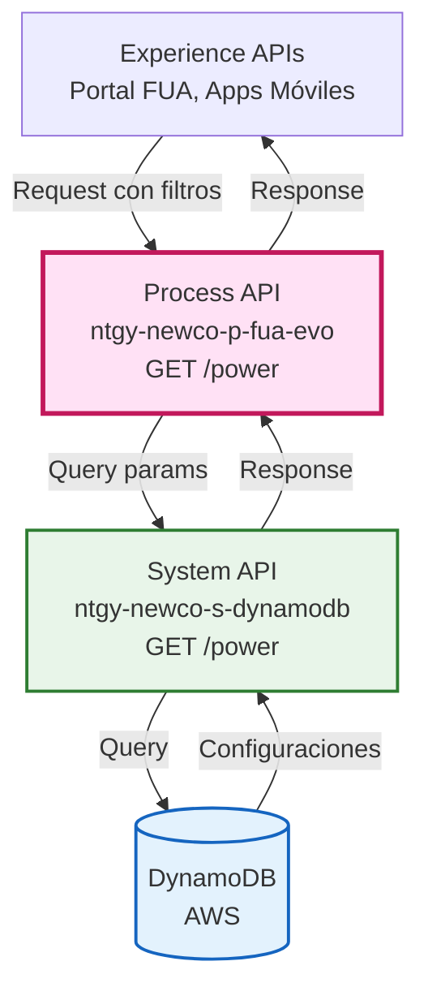
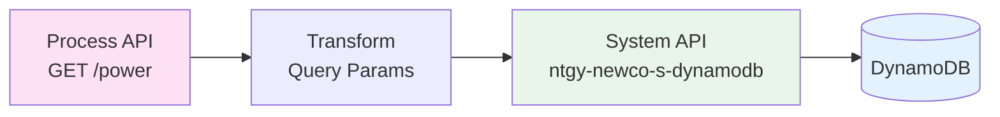
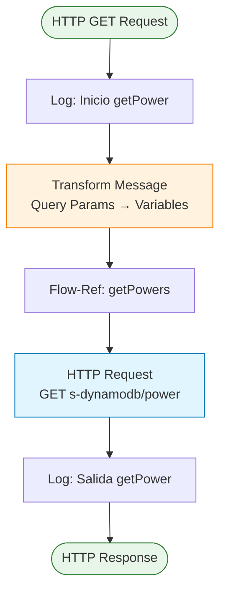
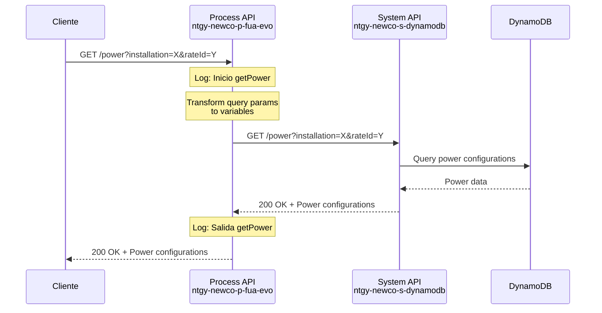
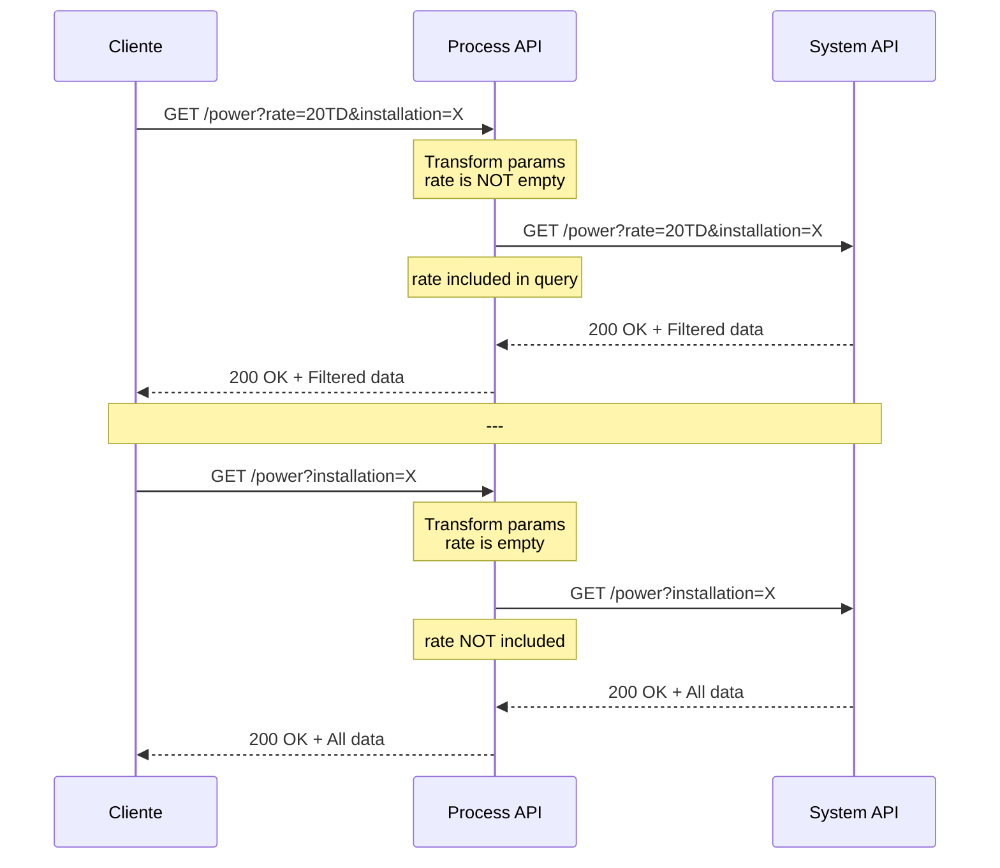
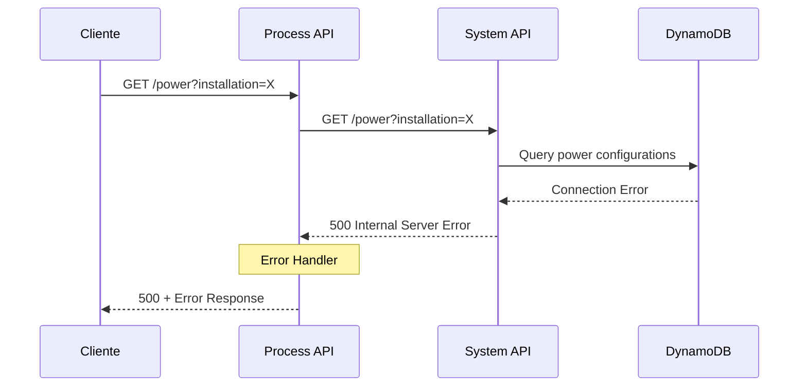

# GET /power

## 📌 Descripción General

### Propósito del Endpoint

Este endpoint recupera las configuraciones de potencia eléctrica almacenadas en DynamoDB, permitiendo consultar información sobre potencias contratadas, tarifas asociadas y configuraciones de gestión remota para instalaciones eléctricas.

### Tipo de API

**Capa:** Process API (API-Led Connectivity)

**Función:** Orquestación de consulta de configuraciones de potencia desde System API de DynamoDB

### Patrón de Integración

**Tipo:** Pass-Through Proxy con transformación de parámetros

**Descripción:** Este endpoint actúa como proxy hacia el System API de DynamoDB, transformando los query parameters de entrada en variables y propagándolos al backend. No realiza transformaciones complejas en la respuesta, manteniendo la estructura original del System API.

### Arquitectura API-Led Connectivity



---

## 💼 Propósito del Negocio

### Casos de Uso Principales

1. **Consulta de Potencias Contratadas**
   - Permite a los clientes visualizar las potencias eléctricas contratadas para sus instalaciones
   - Facilita la comparación entre potencias actuales y recomendadas

2. **Gestión de Tarifas Eléctricas**
   - Consulta de configuraciones de potencia asociadas a tarifas específicas
   - Soporte para cambios de tarifa y optimización de costes

3. **Configuración de Gestión Remota**
   - Consulta de instalaciones con capacidad de gestión remota de potencia
   - Soporte para servicios de optimización energética

### 🔗 Endpoints Dependientes

Este Process API consume el siguiente System API:

| System API | Endpoint | Método | Propósito |
|------------|----------|--------|-----------|
| `ntgy-newco-s-dynamodb` | `/power` | GET | Recupera configuraciones de potencia desde DynamoDB |

### Lógica de Orquestación



**Pasos del Proceso:**

1. **Recepción de Request**: Recibe query parameters opcionales (installation, rateId, remoteManagement, rate)
2. **Transformación de Parámetros**: Convierte query params en variables Mule usando DataWeave
3. **Llamada al System API**: Invoca el System API de DynamoDB con los parámetros filtrados
4. **Respuesta Directa**: Retorna la respuesta del System API sin transformaciones adicionales

### Transformaciones Aplicadas

⚠️ **Este Process API NO transforma la respuesta del System API.**

**Transformación de Query Parameters:**

El endpoint aplica una transformación condicional en los query parameters:

| Parámetro Entrada | Variable Mule | Condición |
|-------------------|---------------|-----------|
| `installation` | `vars.installation` | Siempre incluido |
| `rateId` | `vars.rateId` | Siempre incluido |
| `remoteManagement` | `vars.remoteManagement` | Siempre incluido |
| `rate` | `vars.rate` | Solo si no está vacío |

Para el schema completo de la respuesta, consultar:
📖 **System API: `ntgy-newco-s-dynamodb` endpoint `/power`**

### Contexto Empresarial

- **Dominio:** Gestión de Contratos y Potencias Eléctricas
- **Sector:** Energía - Utilities
- **División:** Naturgy España - NewCo
- **Proceso de Negocio:** Consulta y gestión de configuraciones de potencia para optimización energética

### Stakeholders

- **Clientes Residenciales**: Consultan potencias contratadas para optimizar costes
- **Clientes Empresariales**: Gestionan potencias de múltiples instalaciones
- **Agentes de Call Center**: Asesoran sobre cambios de potencia y tarifas
- **Equipo de Operaciones**: Monitorean configuraciones de gestión remota

### Valor de Negocio

- **Transparencia**: Clientes pueden consultar sus configuraciones de potencia en tiempo real
- **Optimización de Costes**: Facilita la identificación de oportunidades de ahorro energético
- **Autoservicio**: Reduce llamadas al call center sobre consultas de potencia
- **Gestión Remota**: Habilita servicios avanzados de optimización energética

### Consumidores Potenciales

Este endpoint puede ser consumido por:
- Portal web FUA
- Aplicaciones móviles de clientes
- Sistemas de agentes de call center
- Herramientas de análisis y optimización energética
- Integraciones con sistemas de gestión de energía

---

## 🔧 Especificación Técnica

### URLs por Ambiente

| Ambiente | URL Base | URL Completa |
|----------|----------|--------------|
| **Local** | `http://localhost:8081` | `http://localhost:8081/api/power` |
| **Development** | `https://ntgy-newco-p-fua-evo-dev.us-e2.cloudhub.io` | `https://ntgy-newco-p-fua-evo-dev.us-e2.cloudhub.io/api/power` |
| **UAT** | `https://ntgy-newco-p-fua-evo-uat.us-e2.cloudhub.io` | `https://ntgy-newco-p-fua-evo-uat.us-e2.cloudhub.io/api/power` |
| **Production** | `https://ntgy-newco-p-fua-evo-pro.us-e2.cloudhub.io` | `https://ntgy-newco-p-fua-evo-pro.us-e2.cloudhub.io/api/power` |

### Método HTTP

```
GET /api/power
```

### Parámetros de Entrada

#### Query Parameters

| Parámetro | Tipo | Requerido | Descripción | Ejemplo |
|-----------|------|-----------|-------------|---------|
| `installation` | string | No | Código de instalación eléctrica | `"ES0021000000001234AB"` |
| `rateId` | string | No | Identificador de tarifa | `"2.0TD"` |
| `remoteManagement` | boolean | No | Indica si tiene gestión remota | `true` |
| `rate` | string | No | Código de tarifa (filtro adicional) | `"20TD"` |

**Notas:**
- Todos los parámetros son opcionales
- El parámetro `rate` solo se incluye en la llamada al backend si tiene valor
- Los parámetros permiten filtrar las configuraciones de potencia

### Respuestas

#### 200 OK - Éxito

**Content-Type:** `application/json`

⚠️ **Nota Importante:** Este endpoint es un **pass-through directo** desde el Process API al System API `MUL-COM-NEWCO-S-DYNAMODB`. La respuesta mantiene la estructura exacta del System API sin transformaciones.

**Estructura de Respuesta:**

```json
{
  "result": {
    "codResult": "string",
    "msgResult": "string"
  },
  "powers": ["string"]
}
```

**Campos:**

| Campo | Tipo | Descripción |
|-------|------|-------------|
| `result` | object | Objeto con información del resultado de la operación |
| `result.codResult` | string | Código de resultado (`"0000"` = éxito) |
| `result.msgResult` | string | Mensaje descriptivo del resultado |
| `powers` | array[string] | Array de valores de potencia disponibles en kW (como strings) |

**Información Verificable del Código:**
- ✅ La respuesta es JSON (`application/json`)
- ✅ Estructura idéntica al System API `MUL-COM-NEWCO-S-DYNAMODB`
- ✅ NO hay transformaciones aplicadas (pass-through completo)
- ✅ Datos filtrados según los query parameters proporcionados
- ✅ Los valores de potencia se retornan como strings, no como números

#### 400 Bad Request - Error de Validación

**Content-Type:** `application/json`

```json
{
  "code": "VALIDATION_ERROR",
  "message": "Parámetros de entrada inválidos",
  "details": "El formato del parámetro 'installation' no es válido",
  "timestamp": "2026-08-21T08:43:00Z"
}
```

#### 500 Internal Server Error - Error del Sistema

**Content-Type:** `application/json`

```json
{
  "code": "INTERNAL_ERROR",
  "message": "Error al procesar la solicitud",
  "details": "Error de conexión con DynamoDB",
  "timestamp": "2026-08-21T08:43:00Z"
}
```

### Autenticación

- **Tipo:** Client ID & Client Secret (Anypoint Platform)
- **Headers Requeridos:**
  - `client_id`: ID del cliente registrado en Anypoint Platform
  - `client_secret`: Secret del cliente

### Timeouts

| Tipo | Valor |
|------|-------|
| **Request Timeout** | 30 segundos |
| **Connection Timeout** | 10 segundos |

### Rate Limiting

- **Límite:** Según políticas de Anypoint Platform
- **Recomendación:** Implementar caché en el cliente para consultas frecuentes

---

## 🏗️ Implementación Técnica

### Arquitectura del Flow



### Código de Implementación

#### Flow Principal: `get:\power:ntgy-newco-p-fua-config`

**Ubicación:** `src/main/mule/ntgy-newco-p-fua.xml`

```xml
<flow name="get:\power:ntgy-newco-p-fua-config">
    <ee:transform doc:name="Transform Message">
        <ee:message />
        <ee:variables>
            <ee:set-variable variableName="installation">
                <![CDATA[attributes.queryParams.'installation']]>
            </ee:set-variable>
            <ee:set-variable variableName="rateId">
                <![CDATA[attributes.queryParams.'rateId']]>
            </ee:set-variable>
            <ee:set-variable variableName="remoteManagement">
                <![CDATA[attributes.queryParams.'remoteManagement']]>
            </ee:set-variable>
            <ee:set-variable variableName="rate">
                <![CDATA[attributes.queryParams.'rate']]>
            </ee:set-variable>
        </ee:variables>
    </ee:transform>
    <flow-ref doc:name="Flow Reference" name="getPowers" />
</flow>
```

#### Sub-Flow: `getPowers`

**Ubicación:** `src/main/mule/ntgy-newco-p-fua.xml`

```xml
<sub-flow name="getPowers">
    <logger level="INFO" doc:name="Logger" 
            message="Inicio getPower" />
    
    <http:request method="GET" 
                  doc:name="Request s-dynamodb" 
                  config-ref="HTTP_Request_configuration_ntgy_newco_s_dynamodb" 
                  path="/power">
        <http:query-params>
            <![CDATA[#[output application/java
---
{
    (rate : vars.rate) if(!isEmpty(vars.rate)),
    installation : vars.installation,
    rateId : vars.rateId,
    remoteManagement : vars.remoteManagement
}]]]>
        </http:query-params>
    </http:request>
    
    <logger level="INFO" doc:name="Logger" 
            message="Salida getPower #[payload]" />
</sub-flow>
```

### Transformaciones DataWeave

#### Transformación de Query Parameters

**Propósito:** Convertir query parameters en variables Mule para su uso en el sub-flow

```dataweave
%dw 2.0
output application/java
---
{
    installation: attributes.queryParams.'installation',
    rateId: attributes.queryParams.'rateId',
    remoteManagement: attributes.queryParams.'remoteManagement',
    rate: attributes.queryParams.'rate'
}
```

#### Construcción de Query Parameters para Backend

**Propósito:** Construir query parameters para la llamada HTTP al System API, incluyendo `rate` solo si tiene valor

```dataweave
%dw 2.0
output application/java
---
{
    (rate : vars.rate) if(!isEmpty(vars.rate)),
    installation : vars.installation,
    rateId : vars.rateId,
    remoteManagement : vars.remoteManagement
}
```

**Lógica Condicional:**
- El operador `if(!isEmpty(vars.rate))` asegura que el parámetro `rate` solo se incluye si tiene un valor no vacío
- Los otros tres parámetros siempre se incluyen en la llamada al backend

### Configuración HTTP

**Config-Ref:** `HTTP_Request_configuration_ntgy_newco_s_dynamodb`

**Ubicación:** `src/main/mule/global.xml`

**Propiedades:**
- **Host:** `${ntgy.newco.s.dynamodb.host}`
- **Port:** `${ntgy.newco.s.dynamodb.port}`
- **Base Path:** `/api`
- **Protocol:** HTTPS
- **Connection Pooling:** Habilitado

### Patrones de Diseño

**Patrón:** Pass-Through Proxy con Transformación de Parámetros

**Justificación:** 
- Separa la lógica de transformación de parámetros del flow principal
- Permite reutilización del sub-flow `getPowers` desde otros endpoints
- Mantiene la respuesta original del System API sin transformaciones innecesarias
- Facilita el mantenimiento y testing independiente

### Diagramas de Secuencia

#### 1. Flujo Normal de Éxito



#### 2. Flujo con Parámetro Rate Condicional



#### 3. Flujo con Error de Backend



### Manejo de Errores

**Estrategia:** Propagación de errores del System API con logging

**Errores Manejados:**

1. **Errores de Conectividad (500)**
   - Error de conexión con DynamoDB
   - Timeout en la llamada al System API
   - **Acción:** Log del error y respuesta 500 al cliente

2. **Errores de Validación (400)**
   - Parámetros inválidos
   - Formato incorrecto de datos
   - **Acción:** Respuesta 400 con detalles del error

3. **Errores de Sistema (500)**
   - Errores internos del Process API
   - Errores del System API
   - **Acción:** Log detallado y respuesta genérica al cliente

**Logging:**
- Log de inicio con nivel INFO
- Log de salida con payload completo (nivel INFO)
- Logs de error con stack trace (nivel ERROR)

---

## 💻 Ejemplos de Uso

### Ejemplo 1: Consulta con Todos los Parámetros

#### cURL

```bash
curl -X GET "https://ntgy-newco-p-fua-evo-dev.us-e2.cloudhub.io/api/power?installation=ES0021000000001234AB&rateId=2.0TD&remoteManagement=true&rate=20TD" \
  -H "Content-Type: application/json" \
  -H "client_id: YOUR_CLIENT_ID" \
  -H "client_secret: YOUR_CLIENT_SECRET"
```

#### Respuesta (200 OK)

```json
{
  "result": {
    "codResult": "0000",
    "msgResult": "No hay error"
  },
  "powers": [
    "3.3",
    "4.6",
    "5.75",
    "6.9",
    "8.05",
    "9.2"
  ]
}
```

### Ejemplo 2: Consulta sin Gestión Remota y Trifásica

#### cURL

```bash
curl -X GET "https://ntgy-newco-p-fua-evo-dev.us-e2.cloudhub.io/api/power?remoteManagement=false&installation=02&rateId=3.0TD" \
  -H "Content-Type: application/json" \
  -H "client_id: YOUR_CLIENT_ID" \
  -H "client_secret: YOUR_CLIENT_SECRET"
```

#### Respuesta (200 OK)

```json
{
  "result": {
    "codResult": "0000",
    "msgResult": "No hay error"
  },
  "powers": [
    "10.35",
    "13.8",
    "17.25",
    "20.7"
  ]
}
```

### Ejemplo 3: JavaScript (Fetch API)

```javascript
const getPowerConfigurations = async (installation, rateId = null) => {
  const baseUrl = 'https://ntgy-newco-p-fua-evo-dev.us-e2.cloudhub.io/api/power';
  const params = new URLSearchParams({
    installation: installation
  });
  
  if (rateId) {
    params.append('rateId', rateId);
  }
  
  try {
    const response = await fetch(`${baseUrl}?${params}`, {
      method: 'GET',
      headers: {
        'Content-Type': 'application/json',
        'client_id': 'YOUR_CLIENT_ID',
        'client_secret': 'YOUR_CLIENT_SECRET'
      }
    });
    
    if (!response.ok) {
      throw new Error(`HTTP error! status: ${response.status}`);
    }
    
    const data = await response.json();
    console.log('Power configurations:', data.powers);
    return data;
  } catch (error) {
    console.error('Error fetching power configurations:', error);
    throw error;
  }
};

// Uso
getPowerConfigurations('ES0021000000001234AB', '2.0TD')
  .then(data => console.log(data))
  .catch(error => console.error(error));
```

### Ejemplo 4: Python (Requests)

```python
import requests
from typing import Optional, Dict, Any

def get_power_configurations(
    installation: str,
    rate_id: Optional[str] = None,
    remote_management: Optional[bool] = None,
    rate: Optional[str] = None
) -> Dict[str, Any]:
    """
    Consulta configuraciones de potencia desde el Process API.
    
    Args:
        installation: Código CUPS de la instalación
        rate_id: Identificador de tarifa (opcional)
        remote_management: Filtro por gestión remota (opcional)
        rate: Código de tarifa (opcional)
    
    Returns:
        Dict con las configuraciones de potencia
    """
    base_url = 'https://ntgy-newco-p-fua-evo-dev.us-e2.cloudhub.io/api/power'
    
    params = {'installation': installation}
    if rate_id:
        params['rateId'] = rate_id
    if remote_management is not None:
        params['remoteManagement'] = str(remote_management).lower()
    if rate:
        params['rate'] = rate
    
    headers = {
        'Content-Type': 'application/json',
        'client_id': 'YOUR_CLIENT_ID',
        'client_secret': 'YOUR_CLIENT_SECRET'
    }
    
    try:
        response = requests.get(base_url, params=params, headers=headers)
        response.raise_for_status()
        
        data = response.json()
        print(f"Found {len(data.get('powers', []))} power configurations")
        return data
        
    except requests.exceptions.RequestException as e:
        print(f"Error fetching power configurations: {e}")
        raise

# Uso
if __name__ == "__main__":
    # Consulta con todos los parámetros
    result = get_power_configurations(
        installation='ES0021000000001234AB',
        rate_id='2.0TD',
        remote_management=True,
        rate='20TD'
    )
    
    # Procesar respuesta según estructura real de DynamoDB
    print(f"Response: {result}")
```

### Ejemplo 5: Error - Parámetros Inválidos

#### cURL

```bash
curl -X GET "https://ntgy-newco-p-fua-evo-dev.us-e2.cloudhub.io/api/power?installation=INVALID" \
  -H "Content-Type: application/json" \
  -H "client_id: YOUR_CLIENT_ID" \
  -H "client_secret: YOUR_CLIENT_SECRET"
```

#### Respuesta (400 Bad Request)

```json
{
  "code": "VALIDATION_ERROR",
  "message": "Parámetros de entrada inválidos",
  "details": "El formato del código de instalación no es válido. Debe seguir el formato CUPS estándar.",
  "timestamp": "2026-08-21T08:43:00Z"
}