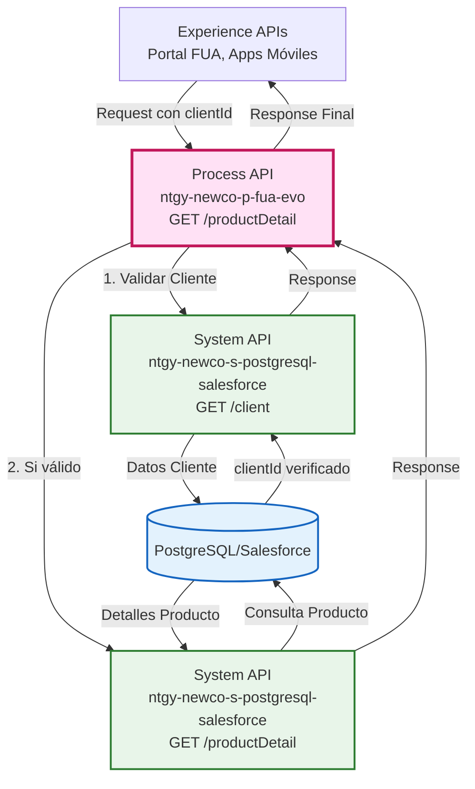
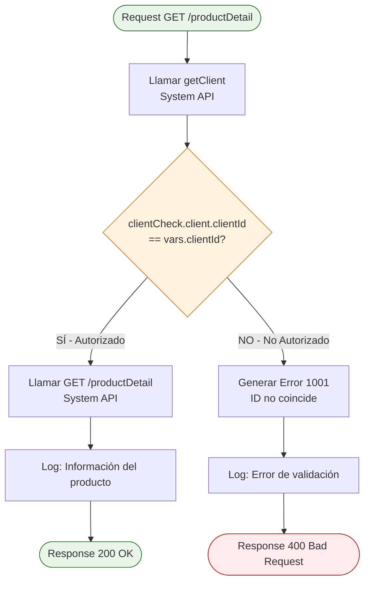
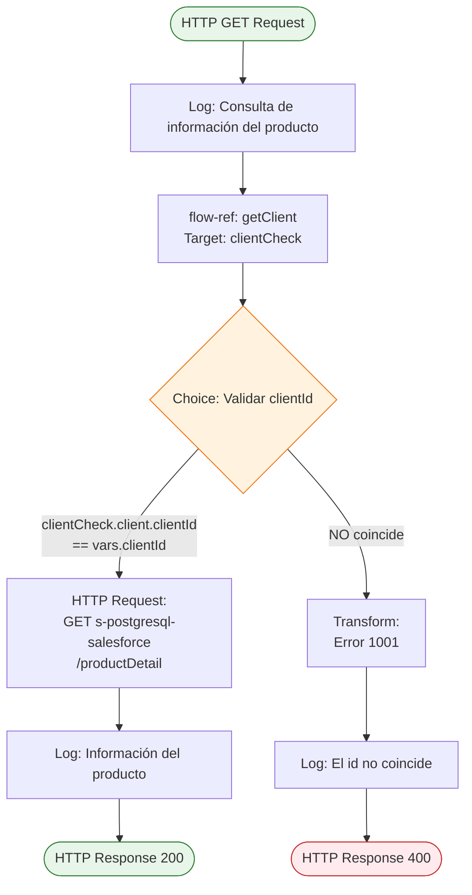
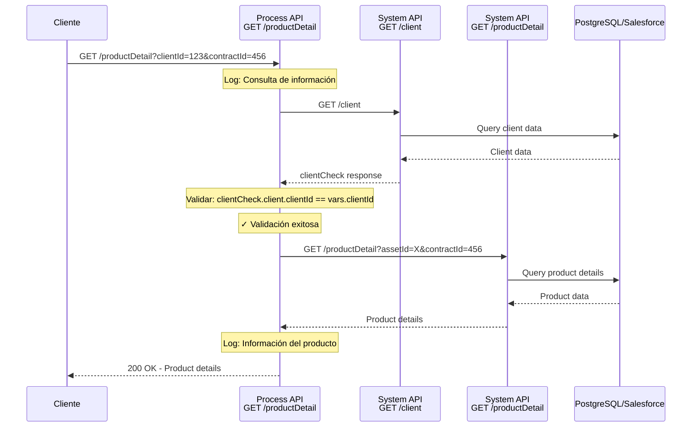
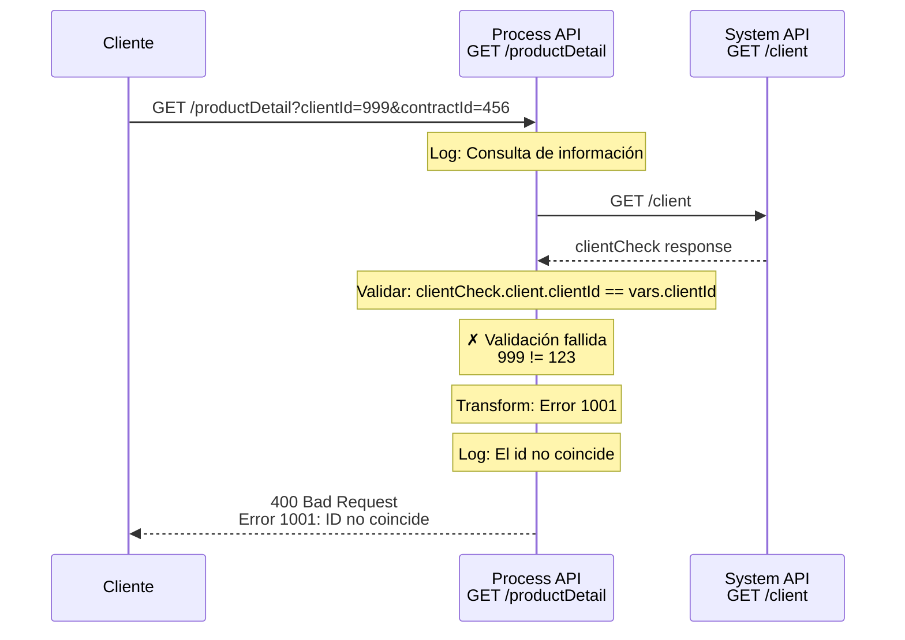
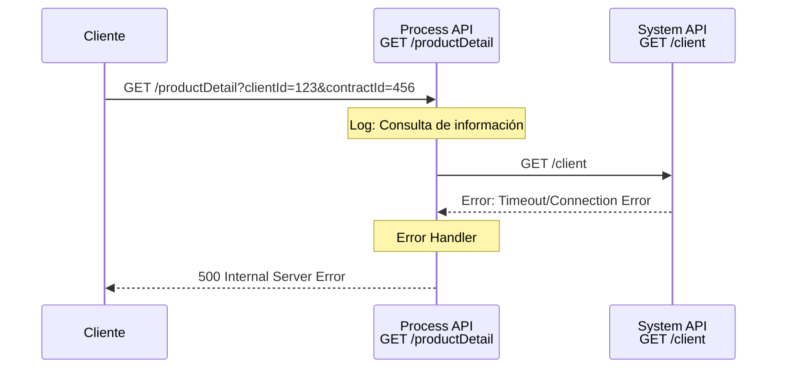

# GET /productDetail

## 📌 Descripción General

### Propósito del Endpoint

Este endpoint orquesta la consulta segura de información detallada de productos, implementando una **validación de seguridad crítica** que verifica que el cliente solicitante tiene autorización para acceder a la información del producto mediante la comparación de `clientId` con `clientCode`.

### Tipo de API

**Capa:** Process API (API-Led Connectivity)

**Función:** Orquestación de validación de seguridad y consulta de producto

### Patrón de Integración

**Tipo:** Orquestación con Validación de Seguridad

**Descripción:** El endpoint implementa un patrón de orquestación en dos fases:
1. **Fase de Validación**: Consulta datos del cliente para verificar autorización
2. **Fase de Consulta**: Si la validación es exitosa, obtiene los detalles del producto

Este patrón garantiza que solo clientes autorizados puedan acceder a información de productos específicos.

### Arquitectura API-Led Connectivity



---

## 💼 Propósito del Negocio

### Casos de Uso Principales

1. **Consulta Segura de Producto por Cliente**
   - Cliente autenticado consulta detalles de su producto contratado
   - Sistema valida que el cliente tiene autorización para ver el producto
   - Previene acceso no autorizado a información de productos de otros clientes

2. **Verificación de Autorización de Acceso**
   - Validación de que el `clientId` proporcionado coincide con el `clientCode` del cliente
   - Implementa capa de seguridad adicional en la capa de proceso
   - Retorna error específico si la validación falla

3. **Obtención de Información de Producto**
   - Consulta detalles completos del producto asociado a un contrato
   - Incluye información de activos (`assetId`) y contratos (`contractId`)
   - Proporciona datos necesarios para gestión de productos en portal FUA

### 🔗 Endpoints Dependientes

Este Process API consume los siguientes System APIs:

| System API | Endpoint | Método | Propósito |
|------------|----------|--------|-----------|
| `ntgy-newco-s-postgresql-salesforce` | `/client` | GET | Obtiene información del cliente para validación de seguridad |
| `ntgy-newco-s-postgresql-salesforce` | `/productDetail` | GET | Obtiene detalles del producto desde PostgreSQL/Salesforce |

### Lógica de Orquestación



**Pasos del Proceso:**

1. **Validación de Cliente**: 
   - Invoca `getClient` para obtener datos del cliente
   - Almacena resultado en variable `clientCheck`

2. **Verificación de Autorización**:
   - Compara `clientCheck.client.clientId` con `vars.clientId`
   - Si coinciden → Cliente autorizado, continúa al paso 3
   - Si NO coinciden → Retorna error 1001 con mensaje descriptivo

3. **Consulta de Producto** (solo si validación exitosa):
   - Invoca System API `/productDetail` con parámetros `assetId` y `contractId`
   - Retorna información completa del producto

### Transformaciones Aplicadas

**Transformación de Error (DataWeave):**

Cuando la validación falla, se genera una respuesta de error estructurada:

```dataweave
%dw 2.0
output application/json
---
{
    "result": {
        "codResult": '1001',
        "msgResult": "El id no coincide con el DNI del cliente: " ++ vars.clientCode ++ " y clientId: " ++ vars.clientId
    }
}
```

**Pass-through de Respuesta Exitosa:**

Cuando la validación es exitosa, la respuesta del System API se retorna sin transformación adicional.

### Contexto Empresarial

- **Dominio:** Gestión de Productos y Servicios
- **Sector:** Energía - Utilities
- **División:** Naturgy España - NewCo
- **Proceso de Negocio:** Consulta segura de información de productos con validación de autorización

### Stakeholders

- **Clientes Finales**: Necesitan consultar detalles de sus productos contratados de forma segura
- **Equipo de Seguridad**: Requiere validación de autorización antes de exponer datos sensibles
- **Equipo de Producto**: Necesita información precisa de productos para gestión y soporte

### Valor de Negocio

- **Seguridad**: Implementa validación de autorización en capa de proceso, previniendo acceso no autorizado
- **Transparencia**: Proporciona mensajes de error claros cuando la validación falla
- **Trazabilidad**: Logs detallados de validaciones exitosas y fallidas
- **Experiencia de Usuario**: Acceso rápido a información de productos para clientes autorizados

### Consumidores Potenciales

Este endpoint puede ser consumido por:
- Portal web FUA
- Aplicaciones móviles de clientes
- Sistemas de agentes de call center
- Integraciones de terceros autorizados

---

## 🔧 Especificación Técnica

### URLs por Ambiente

| Ambiente | URL Base | URL Completa |
|----------|----------|--------------|
| **Local** | `http://localhost:8081` | `http://localhost:8081/api/productDetail` |
| **Development** | `https://ntgy-newco-p-fua-evo-dev.us-e2.cloudhub.io` | `https://ntgy-newco-p-fua-evo-dev.us-e2.cloudhub.io/api/productDetail` |
| **UAT** | `https://ntgy-newco-p-fua-evo-uat.us-e2.cloudhub.io` | `https://ntgy-newco-p-fua-evo-uat.us-e2.cloudhub.io/api/productDetail` |
| **Production** | `https://ntgy-newco-p-fua-evo-pro.us-e2.cloudhub.io` | `https://ntgy-newco-p-fua-evo-pro.us-e2.cloudhub.io/api/productDetail` |

### Método HTTP

```
GET /api/productDetail
```

### Parámetros de Entrada

#### Query Parameters

| Parámetro | Tipo | Requerido | Descripción | Ejemplo |
|-----------|------|-----------|-------------|---------|
| `clientId` | string | No | Identificador del cliente para validación | `"12345678A"` |
| `contractId` | string | Sí | Identificador del contrato | `"0001234567"` |
| `language` | string | No | Idioma de respuesta | `"es"` |
| `clientCode` | string | No | Código del cliente (DNI/NIF) | `"12345678A"` |
| `assetId` | string | No | Identificador del activo/producto | `"ASSET-001"` |

**Nota sobre Validación de Seguridad:**
- Si se proporciona `clientId`, el sistema validará que coincida con el `clientCode` del cliente
- Si la validación falla, se retorna error 1001
- Si no se proporciona `clientId`, no se realiza validación (comportamiento legacy)

### Respuestas

#### 200 OK - Consulta Exitosa

**Condición:** Validación de cliente exitosa y producto encontrado

**Estructura:** La respuesta es pass-through del System API. Para schema completo, consultar:
📖 **System API: `ntgy-newco-s-postgresql-salesforce` endpoint `/productDetail`**

**Ejemplo:**
```json
{
  "productId": "PROD-12345",
  "productName": "Tarifa Estable Gas",
  "contractId": "0001234567",
  "assetId": "ASSET-001",
  "status": "active",
  "details": {
    "type": "gas",
    "rate": "fixed",
    "startDate": "2024-01-01"
  }
}
```

#### 400 Bad Request - Validación Fallida

**Condición:** El `clientId` no coincide con el `clientCode` del cliente

**Estructura:**
```json
{
  "result": {
    "codResult": "1001",
    "msgResult": "El id no coincide con el DNI del cliente: [clientCode] y clientId: [clientId]"
  }
}
```

**Ejemplo:**
```json
{
  "result": {
    "codResult": "1001",
    "msgResult": "El id no coincide con el DNI del cliente: 12345678A y clientId: 87654321B"
  }
}
```

#### 500 Internal Server Error

**Condición:** Error en System APIs o error interno del proceso

**Estructura:**
```json
{
  "error": {
    "code": "INTERNAL_ERROR",
    "message": "Error al procesar la solicitud"
  }
}
```

### Autenticación

- **Tipo:** Client ID & Client Secret (Anypoint Platform)
- **Headers Requeridos:**
  - `client_id`: ID de la aplicación cliente
  - `client_secret`: Secret de la aplicación cliente

### Timeouts

| Tipo | Valor |
|------|-------|
| **Request Timeout** | 30 segundos |
| **Connection Timeout** | 10 segundos |
| **System API Timeout** | 20 segundos (por llamada) |

---

## 🏗️ Implementación Técnica

### Arquitectura del Flow



### Componentes del Flow

#### 1. Logger Inicial
```xml
<logger level="INFO" 
        message="Consulta de informacion del producto #[vars.contractId]" />
```
**Propósito:** Registrar inicio de consulta con identificador del contrato

#### 2. Flow-ref: getClient
```xml
<flow-ref name="getClient" target="clientCheck" />
```
**Propósito:** Obtener información del cliente para validación
**Target Variable:** `clientCheck` - Almacena respuesta del System API

#### 3. Choice: Validación de Seguridad
```xml
<choice>
    <when expression="#[vars.clientCheck.client.clientId == vars.clientId]">
        <!-- Flujo autorizado -->
    </when>
    <otherwise>
        <!-- Flujo de error -->
    </otherwise>
</choice>
```
**Expresión:** Compara `clientId` del cliente con el proporcionado en request
**Decisión:** Autoriza o rechaza acceso al producto

#### 4. HTTP Request: Consulta de Producto
```xml
<http:request method="GET" 
              config-ref="HTTP_Request_s_postgresql-salesforce" 
              path="/productDetail">
    <http:query-params>
        {
            assetId: vars.assetId,
            contractId: vars.contractId
        }
    </http:query-params>
</http:request>
```
**Configuración:** `HTTP_Request_s_postgresql-salesforce`
**Host:** `https://ntgy-newco-s-postgresql-salesforce-dev.us-e2.cloudhub.io/api`
**Parámetros:** `assetId`, `contractId`

#### 5. Transform: Error de Validación
```xml
<ee:transform>
    <ee:set-payload>
        %dw 2.0
        output application/json
        ---
        {
            "result": {
                "codResult": '1001',
                "msgResult": "El id no coincide con el DNI del cliente: " ++ 
                             vars.clientCode ++ " y clientId: " ++ vars.clientId
            }
        }
    </ee:set-payload>
</ee:transform>
```
**Propósito:** Generar respuesta de error estructurada con detalles de validación

### Configuración HTTP

**Nombre:** `HTTP_Request_s_postgresql-salesforce`

**Propiedades (desde properties-dev.yaml):**
```yaml
s-postgresql-salesforce:
  host: "https://ntgy-newco-s-postgresql-salesforce-dev.us-e2.cloudhub.io/api"
  port: "443"
  protocol: "HTTPS"
```

### Patrones de Diseño

**Patrón:** Security Gateway Pattern

**Justificación:** 
- Implementa validación de autorización en la capa de proceso
- Previene acceso no autorizado a datos sensibles
- Centraliza lógica de seguridad antes de consultar recursos
- Proporciona mensajes de error claros y trazables

**Patrón:** Orchestration Pattern

**Justificación:**
- Coordina múltiples llamadas a System APIs
- Implementa lógica de negocio (validación) entre llamadas
- Maneja flujos condicionales basados en validación

### Diagramas de Secuencia

#### 1. Flujo Normal de Éxito (Validación Exitosa)



#### 2. Flujo con Error de Validación



#### 3. Flujo con Error Técnico



### Manejo de Errores

#### Errores de Validación (400)
- **Código:** 1001
- **Mensaje:** "El id no coincide con el DNI del cliente: [clientCode] y clientId: [clientId]"
- **Causa:** `clientId` proporcionado no coincide con el del cliente
- **Acción:** Verificar que el `clientId` sea correcto

#### Errores de System API (500)
- **Causa:** Error en llamadas a `getClient` o `/productDetail`
- **Manejo:** Error handler global del Process API
- **Logging:** Se registra el error completo para debugging

#### Errores de Timeout (500)
- **Causa:** System API no responde en tiempo configurado
- **Timeout:** 20 segundos por llamada
- **Acción:** Retry automático según política configurada

---

## 💻 Ejemplos de Uso

### Ejemplo 1: Consulta Exitosa con Validación

#### cURL

```bash
curl -X GET "https://ntgy-newco-p-fua-evo-dev.us-e2.cloudhub.io/api/productDetail?clientId=12345678A&contractId=0001234567&assetId=ASSET-001&language=es" \
  -H "Content-Type: application/json" \
  -H "client_id: YOUR_CLIENT_ID" \
  -H "client_secret: YOUR_CLIENT_SECRET"
```

#### Respuesta (200 OK)

```json
{
  "productId": "PROD-12345",
  "productName": "Tarifa Estable Gas",
  "contractId": "0001234567",
  "assetId": "ASSET-001",
  "status": "active",
  "details": {
    "type": "gas",
    "rate": "fixed",
    "startDate": "2024-01-01",
    "power": "11.5 kW",
    "consumption": "3500 kWh/year"
  },
  "pricing": {
    "fixedTerm": "45.50",
    "energyTerm": "0.125",
    "currency": "EUR"
  }
}
```

### Ejemplo 2: Error de Validación (clientId no coincide)

#### cURL

```bash
curl -X GET "https://ntgy-newco-p-fua-evo-dev.us-e2.cloudhub.io/api/productDetail?clientId=87654321B&contractId=0001234567&clientCode=12345678A" \
  -H "Content-Type: application/json" \
  -H "client_id: YOUR_CLIENT_ID" \
  -H "client_secret: YOUR_CLIENT_SECRET"
```

#### Respuesta (400 Bad Request)

```json
{
  "result": {
    "codResult": "1001",
    "msgResult": "El id no coincide con el DNI del cliente: 12345678A y clientId: 87654321B"
  }
}
```

### Ejemplo 3: JavaScript (Fetch API)

```javascript
const getProductDetail = async (clientId, contractId, assetId) => {
  try {
    const params = new URLSearchParams({
      clientId: clientId,
      contractId: contractId,
      assetId: assetId,
      language: 'es'
    });

    const response = await fetch(
      `https://ntgy-newco-p-fua-evo-dev.us-e2.cloudhub.io/api/productDetail?${params}`,
      {
        method: 'GET',
        headers: {
          'Content-Type': 'application/json',
          'client_id': 'YOUR_CLIENT_ID',
          'client_secret': 'YOUR_CLIENT_SECRET'
        }
      }
    );

    if (!response.ok) {
      const error = await response.json();
      if (error.result && error.result.codResult === '1001') {
        console.error('Error de validación:', error.result.msgResult);
      }
      throw new Error(`HTTP error! status: ${response.status}`);
    }

    const data = await response.json();
    console.log('Detalles del producto:', data);
    return data;
  } catch (error) {
    console.error('Error al obtener detalles del producto:', error);
    throw error;
  }
};

// Uso
getProductDetail('12345678A', '0001234567', 'ASSET-001')
  .then(product => console.log('Producto:', product))
  .catch(error => console.error('Error:', error));
```

### Ejemplo 4: Python (Requests)

```python
import requests

def get_product_detail(client_id, contract_id, asset_id, language='es'):
    """
    Consulta detalles de producto con validación de cliente
    
    Args:
        client_id: ID del cliente para validación
        contract_id: ID del contrato
        asset_id: ID del activo/producto
        language: Idioma de respuesta (default: 'es')
    
    Returns:
        dict: Detalles del producto
    
    Raises:
        ValueError: Si la validación de cliente falla (código 1001)
        requests.HTTPError: Si hay error HTTP
    """
    url = 'https://ntgy-newco-p-fua-evo-dev.us-e2.cloudhub.io/api/productDetail'
    
    params = {
        'clientId': client_id,
        'contractId': contract_id,
        'assetId': asset_id,
        'language': language
    }
    
    headers = {
        'Content-Type': 'application/json',
        'client_id': 'YOUR_CLIENT_ID',
        'client_secret': 'YOUR_CLIENT_SECRET'
    }
    
    try:
        response = requests.get(url, params=params, headers=headers)
        response.raise_for_status()
        
        data = response.json()
        print(f'Detalles del producto: {data}')
        return data
        
    except requests.HTTPError as e:
        if e.response.status_code == 400:
            error_data = e.response.json()
            if error_data.get('result', {}).get('codResult') == '1001':
                raise ValueError(f"Error de validación: {error_data['result']['msgResult']}")
        raise
    except requests.RequestException as e:
        print(f'Error al obtener detalles del producto: {e}')
        raise

# Uso
try:
    product = get_product_detail('12345678A', '0001234567', 'ASSET-001')
    print(f'Producto obtenido: {product}')
except ValueError as e:
    print(f'Error de validación: {e}')
except requests.HTTPError as e:
    print(f'Error HTTP: {e}')
```
