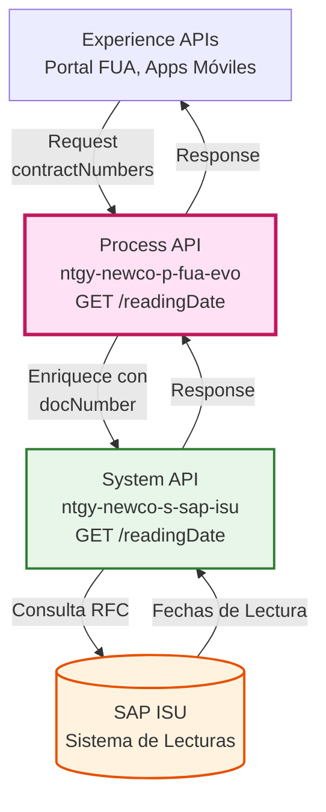
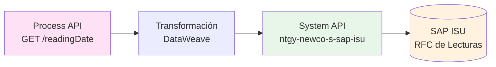
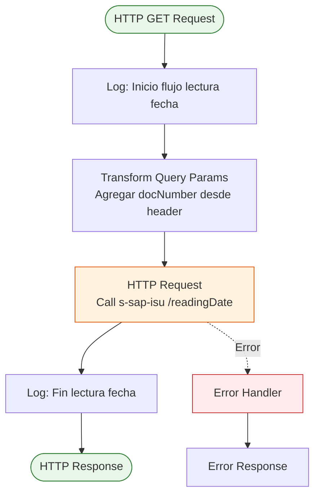
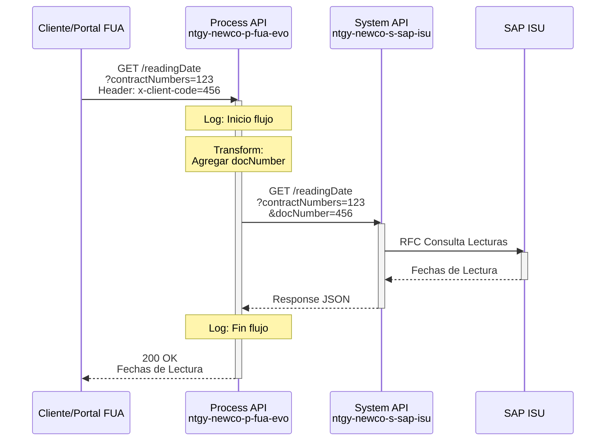
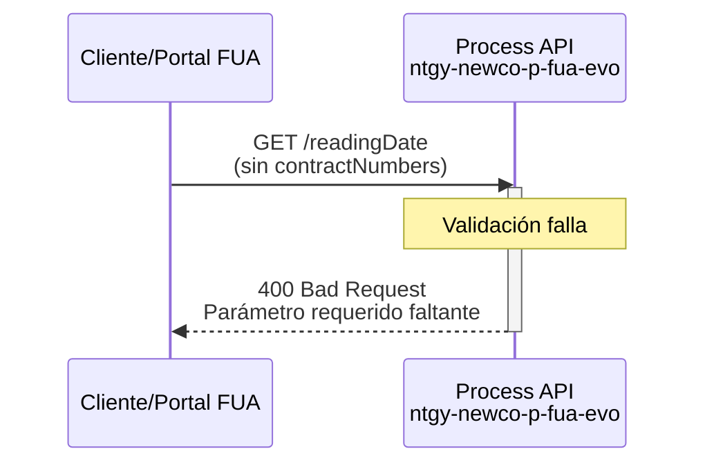
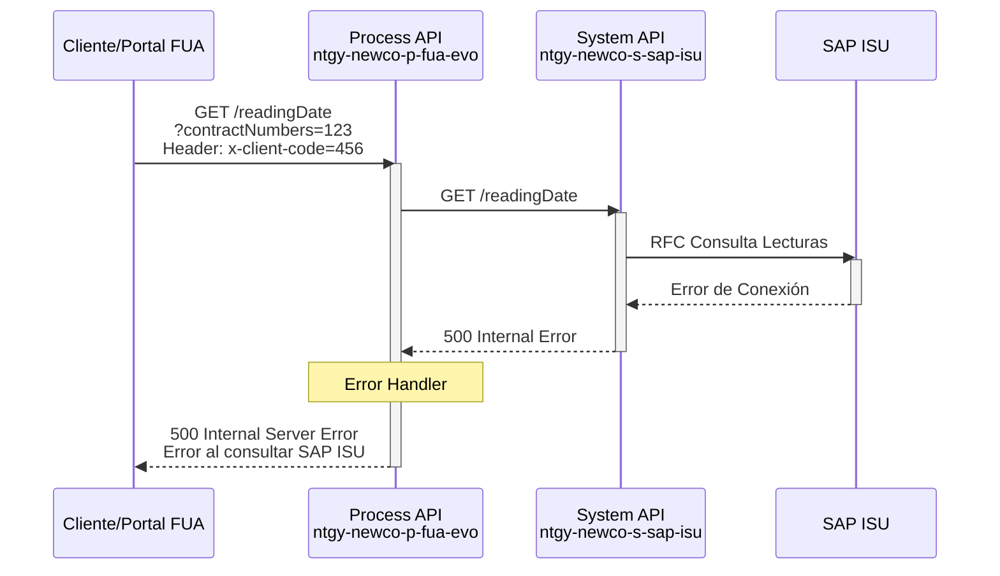

# GET /readingDate

## 📌 Descripción General

### Propósito del Endpoint

Este endpoint orquesta la obtención de fechas de lectura de contratos desde SAP ISU, agregando información del cliente desde headers HTTP y delegando la consulta al System API correspondiente. Forma parte del módulo de lecturas del proceso FUA (Firma Única Avanzada).

### Tipo de API

**Capa:** Process API (API-Led Connectivity)

**Función:** Orquestación de consulta de fechas de lectura con enriquecimiento de parámetros

### Patrón de Integración

**Tipo:** Pass-Through con Enriquecimiento de Parámetros

**Descripción:** El endpoint recibe el número de contrato como query parameter, agrega el código de cliente desde el header `x-client-code`, y delega la consulta al System API `ntgy-newco-s-sap-isu` que se conecta directamente con SAP ISU.

### Arquitectura API-Led Connectivity



---

## 💼 Propósito del Negocio

### Casos de Uso Principales

1. **Consulta de Fechas de Lectura para Firma Digital**
   - Los clientes necesitan conocer las fechas de lectura de sus contratos
   - Información necesaria para el proceso de firma única avanzada (FUA)
   - Permite validar períodos de facturación

2. **Validación de Información de Lecturas**
   - Verificar fechas de lectura antes de procesos de modificación
   - Confirmar períodos de lectura para análisis de consumo
   - Soporte a procesos de atención al cliente

3. **Integración con Portal de Autoservicio**
   - Proporcionar información de lecturas en tiempo real
   - Facilitar la gestión autónoma de contratos
   - Mejorar la experiencia del cliente en el portal FUA

### 🔗 Endpoints Dependientes

Este Process API consume el siguiente System API:

| System API | Endpoint | Método | Propósito |
|------------|----------|--------|-----------|
| `ntgy-newco-s-sap-isu` | `/readingDate` | GET | Consulta fechas de lectura en SAP ISU mediante RFC |

### Lógica de Orquestación



**Pasos del Proceso:**

1. **Recepción de Request**: Recibe `contractNumbers` como query parameter y `x-client-code` como header
2. **Enriquecimiento de Parámetros**: Agrega `docNumber` desde el header `x-client-code` a los query parameters
3. **Delegación a System API**: Invoca al System API SAP ISU con los parámetros enriquecidos
4. **Respuesta Directa**: Retorna la respuesta del System API sin transformación adicional

### Transformaciones Aplicadas

**Enriquecimiento de Query Parameters:**

| Parámetro Original | Parámetro Agregado | Transformación |
|--------------------|-------------------|----------------|
| `contractNumbers` (query param) | `contractNumbers` | Pass-through directo |
| `x-client-code` (header) | `docNumber` (query param) | Extracción desde header y agregación como query param |

⚠️ **Este Process API NO transforma la respuesta del System API.**

Para el schema completo de la respuesta, consultar:
📖 **System API: `ntgy-newco-s-sap-isu` endpoint `/readingDate`**

### Contexto Empresarial

- **Dominio:** Gestión de Lecturas y Consumo
- **Sector:** Energía - Utilities
- **División:** Naturgy España - NewCo
- **Proceso de Negocio:** Firma Única Avanzada (FUA) - Módulo de Lecturas

### Stakeholders

- **Clientes Naturgy**: Necesitan consultar fechas de lectura de sus contratos
- **Equipo FUA Portal**: Requiere información de lecturas para procesos de firma
- **Equipo SAP ISU**: Propietarios del sistema fuente de datos de lecturas
- **Equipo de Atención al Cliente**: Utilizan la información para soporte

### Valor de Negocio

- **Transparencia**: Clientes pueden consultar fechas de lectura en tiempo real
- **Eficiencia**: Reduce consultas al call center sobre información de lecturas
- **Integración**: Facilita procesos automatizados de firma y validación
- **Experiencia del Cliente**: Mejora el autoservicio en el portal FUA

### Consumidores Potenciales

Este endpoint puede ser consumido por:
- Portal web FUA (Frontal Único de Atención)
- Aplicaciones móviles de clientes
- Sistemas de agentes de call center
- Procesos automatizados de firma digital

---

## 🔧 Especificación Técnica

### URLs por Ambiente

| Ambiente | URL Base | URL Completa |
|----------|----------|--------------|
| **Local** | `http://localhost:8081` | `http://localhost:8081/api/readingDate?contractNumbers={numbers}` |
| **Development** | `https://ntgy-newco-p-fua-evo-dev.us-e2.cloudhub.io` | `https://ntgy-newco-p-fua-evo-dev.us-e2.cloudhub.io/api/readingDate?contractNumbers={numbers}` |
| **UAT** | `https://ntgy-newco-p-fua-evo-uat.us-e2.cloudhub.io` | `https://ntgy-newco-p-fua-evo-uat.us-e2.cloudhub.io/api/readingDate?contractNumbers={numbers}` |
| **Production** | `https://ntgy-newco-p-fua-evo-pro.us-e2.cloudhub.io` | `https://ntgy-newco-p-fua-evo-pro.us-e2.cloudhub.io/api/readingDate?contractNumbers={numbers}` |

### Método HTTP

```
GET /api/readingDate
```

### Parámetros de Entrada

#### Query Parameters

| Parámetro | Tipo | Requerido | Descripción | Ejemplo |
|-----------|------|-----------|-------------|---------|
| `contractNumbers` | string | ✅ Sí | Números de contrato separados por comas | `"1234567890,0987654321"` |

#### Headers

| Header | Tipo | Requerido | Descripción | Ejemplo |
|--------|------|-----------|-------------|---------|
| `x-client-code` | string | ✅ Sí | Código de cliente para identificación en SAP | `"12345678"` |
| `Content-Type` | string | ✅ Sí | Tipo de contenido | `"application/json"` |
| `client_id` | string | ✅ Sí | Client ID de Anypoint Platform | `"your-client-id"` |
| `client_secret` | string | ✅ Sí | Client Secret de Anypoint Platform | `"your-client-secret"` |

### Respuestas

#### 200 OK - Consulta Exitosa

**Descripción:** Fechas de lectura obtenidas correctamente desde SAP ISU

**Content-Type:** `application/json`

**Schema:** La respuesta es delegada directamente desde el System API `ntgy-newco-s-sap-isu`. Para el schema completo, consultar la documentación del System API.

**Estructura Típica:**
```json
{
  "readingDates": [
    {
      "contractNumber": "string",
      "lastReadingDate": "string",
      "nextReadingDate": "string",
      "readingType": "string"
    }
  ]
}
```

#### 400 Bad Request - Error de Validación

**Descripción:** Parámetros de entrada inválidos o faltantes

```json
{
  "error": {
    "code": "BAD_REQUEST",
    "message": "Parámetro contractNumbers es requerido",
    "timestamp": "2024-01-15T10:30:00Z"
  }
}
```

#### 401 Unauthorized - Error de Autenticación

**Descripción:** Credenciales inválidas o faltantes

```json
{
  "error": {
    "code": "UNAUTHORIZED",
    "message": "Client ID o Client Secret inválidos",
    "timestamp": "2024-01-15T10:30:00Z"
  }
}
```

#### 500 Internal Server Error - Error del Sistema

**Descripción:** Error en la comunicación con SAP ISU o error interno

```json
{
  "error": {
    "code": "INTERNAL_ERROR",
    "message": "Error al consultar fechas de lectura en SAP ISU",
    "timestamp": "2024-01-15T10:30:00Z"
  }
}
```

#### 503 Service Unavailable - Servicio No Disponible

**Descripción:** System API SAP ISU no disponible

```json
{
  "error": {
    "code": "SERVICE_UNAVAILABLE",
    "message": "System API SAP ISU temporalmente no disponible",
    "timestamp": "2024-01-15T10:30:00Z"
  }
}
```

### Autenticación

- **Tipo:** Client ID & Client Secret (Anypoint Platform)
- **Headers Requeridos:** `client_id`, `client_secret`

### Timeouts

| Tipo | Valor |
|------|-------|
| **Request Timeout** | 30 segundos |
| **Connection Timeout** | 10 segundos |

---

## 🏗️ Implementación Técnica

### Arquitectura del Flow



### Código de Implementación

**Archivo:** `src/main/mule/services/lecturas/getReadingDate.xml`

**Flow Principal:**
```xml
<sub-flow name="getReadingDate" doc:id="84e44bec-0aa8-4e2a-8ca0-51efac664739">
    <logger level="DEBUG" 
            doc:name="Inicio flujo lectura fecha" 
            message="Inicio flujo lectura fecha"/>
    
    <http:request method="GET" 
                  doc:name="Call s-sap-isu (readingDate)" 
                  config-ref="HTTP_Request_ntgy-newco-s-sap" 
                  path="${ntgy-newco-s-sap.functions.readingDate}">
        <http:query-params><![CDATA[#[output application/java
---
{
    "contractNumbers" : attributes.queryParams.contractNumbers,
    "docNumber" : attributes.queryParams.'x-client-code'
}]]]></http:query-params>
    </http:request>
    
    <logger level="DEBUG" 
            doc:name="Fin lectura fecha" 
            message="Salida al flujo Lectura fecha: #[payload]"/>
</sub-flow>
```

### Transformaciones DataWeave

**Transformación de Query Parameters (Inline):**

```dataweave
%dw 2.0
output application/java
---
{
    "contractNumbers": attributes.queryParams.contractNumbers,
    "docNumber": attributes.queryParams.'x-client-code'
}
```

**Descripción:**
- Extrae `contractNumbers` desde query parameters del request original
- Extrae `x-client-code` desde headers y lo mapea como `docNumber`
- Ambos parámetros se envían al System API como query parameters

### Configuración HTTP

**Connector:** `HTTP_Request_ntgy-newco-s-sap`

**Path Dinámico:** `${ntgy-newco-s-sap.functions.readingDate}`
- Configurado en archivo de propiedades por ambiente
- Apunta al endpoint `/readingDate` del System API SAP ISU

### Patrones de Diseño

**Patrón:** Pass-Through con Enriquecimiento de Parámetros

**Justificación:** 
- El Process API no necesita transformar la respuesta del System API
- Solo agrega contexto adicional (docNumber) desde headers
- Mantiene la simplicidad y reduce latencia
- Facilita el mantenimiento al delegar la lógica de negocio al System API

### Diagramas de Secuencia

#### 1. Flujo Normal de Éxito



#### 2. Flujo con Error de Validación



#### 3. Flujo con Error de Sistema



### Manejo de Errores

**Estrategia:** Delegación de errores al framework de error handling global

**Tipos de Errores Manejados:**

1. **Errores de Validación (400)**
   - Parámetros faltantes o inválidos
   - Formato incorrecto de contractNumbers

2. **Errores de Autenticación (401)**
   - Client ID o Client Secret inválidos
   - Credenciales expiradas

3. **Errores de Conectividad (503)**
   - System API SAP ISU no disponible
   - Timeout en la comunicación

4. **Errores de Sistema (500)**
   - Error en SAP ISU
   - Error interno del Process API

**Logging:**
- Log de inicio del flujo (DEBUG)
- Log de fin del flujo con payload (DEBUG)
- Logs de error manejados por error handlers globales

---

## 💻 Ejemplos de Uso

### Ejemplo 1: Consulta Exitosa de Fechas de Lectura

#### cURL

```bash
curl -X GET "https://ntgy-newco-p-fua-evo-dev.us-e2.cloudhub.io/api/readingDate?contractNumbers=1234567890,0987654321" \
  -H "Content-Type: application/json" \
  -H "x-client-code: 12345678" \
  -H "client_id: your-client-id" \
  -H "client_secret: your-client-secret"
```

#### Respuesta (200 OK)

```json
{
  "readingDates": [
    {
      "contractNumber": "1234567890",
      "lastReadingDate": "2024-01-15",
      "nextReadingDate": "2024-02-15",
      "readingType": "REAL",
      "meterNumber": "MTR123456"
    },
    {
      "contractNumber": "0987654321",
      "lastReadingDate": "2024-01-10",
      "nextReadingDate": "2024-02-10",
      "readingType": "ESTIMATED",
      "meterNumber": "MTR654321"
    }
  ],
  "status": "SUCCESS",
  "timestamp": "2024-01-15T10:30:00Z"
}
```

### Ejemplo 2: JavaScript (Fetch API)

```javascript
const getReadingDates = async (contractNumbers, clientCode) => {
  try {
    const response = await fetch(
      `https://ntgy-newco-p-fua-evo-dev.us-e2.cloudhub.io/api/readingDate?contractNumbers=${contractNumbers}`,
      {
        method: 'GET',
        headers: {
          'Content-Type': 'application/json',
          'x-client-code': clientCode,
          'client_id': 'your-client-id',
          'client_secret': 'your-client-secret'
        }
      }
    );

    if (!response.ok) {
      throw new Error(`HTTP error! status: ${response.status}`);
    }

    const data = await response.json();
    console.log('Fechas de lectura:', data);
    return data;
  } catch (error) {
    console.error('Error al obtener fechas de lectura:', error);
    throw error;
  }
};

// Uso
getReadingDates('1234567890,0987654321', '12345678');
```

### Ejemplo 3: Python (Requests)

```python
import requests
from typing import Dict, Any

def get_reading_dates(contract_numbers: str, client_code: str) -> Dict[str, Any]:
    """
    Obtiene fechas de lectura de contratos desde el Process API
    
    Args:
        contract_numbers: Números de contrato separados por comas
        client_code: Código de cliente
        
    Returns:
        Dict con las fechas de lectura
    """
    url = 'https://ntgy-newco-p-fua-evo-dev.us-e2.cloudhub.io/api/readingDate'
    
    headers = {
        'Content-Type': 'application/json',
        'x-client-code': client_code,
        'client_id': 'your-client-id',
        'client_secret': 'your-client-secret'
    }
    
    params = {
        'contractNumbers': contract_numbers
    }
    
    try:
        response = requests.get(url, headers=headers, params=params, timeout=30)
        response.raise_for_status()
        return response.json()
    except requests.exceptions.RequestException as e:
        print(f'Error al obtener fechas de lectura: {e}')
        raise

# Uso
reading_dates = get_reading_dates('1234567890,0987654321', '12345678')
print(f'Fechas obtenidas: {reading_dates}')
```

### Ejemplo 4: Error - Parámetro Faltante

#### cURL

```bash
curl -X GET "https://ntgy-newco-p-fua-evo-dev.us-e2.cloudhub.io/api/readingDate" \
  -H "Content-Type: application/json" \
  -H "x-client-code: 12345678" \
  -H "client_id: your-client-id" \
  -H "client_secret: your-client-secret"
```

#### Respuesta (400 Bad Request)

```json
{
  "error": {
    "code": "BAD_REQUEST",
    "message": "Query parameter 'contractNumbers' es requerido",
    "timestamp": "2024-01-15T10:30:00Z",
    "path": "/api/readingDate"
  }
}
```

### Ejemplo 5: Error - System API No Disponible

#### Respuesta (503 Service Unavailable)

```json
{
  "error": {
    "code": "SERVICE_UNAVAILABLE",
    "message": "System API ntgy-newco-s-sap-isu temporalmente no disponible. Por favor, intente más tarde.",
    "timestamp": "2024-01-15T10:30:00Z",
    "path": "/api/readingDate",
    "retryAfter": 60
  }
}