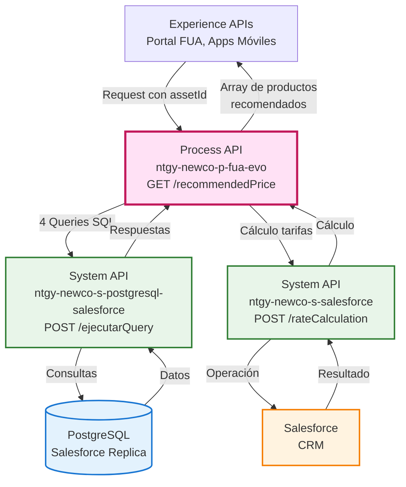
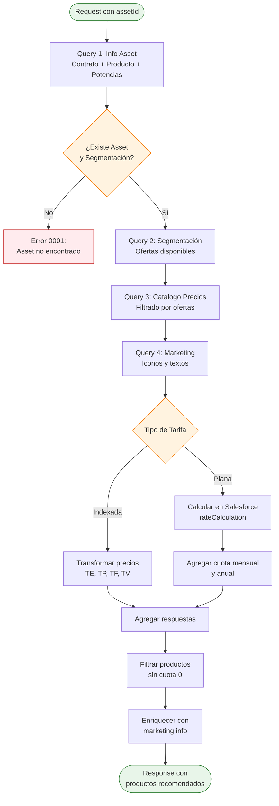
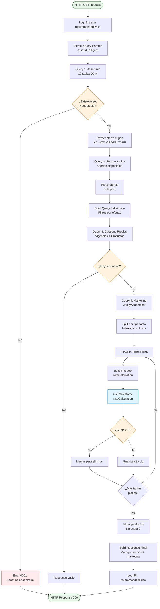
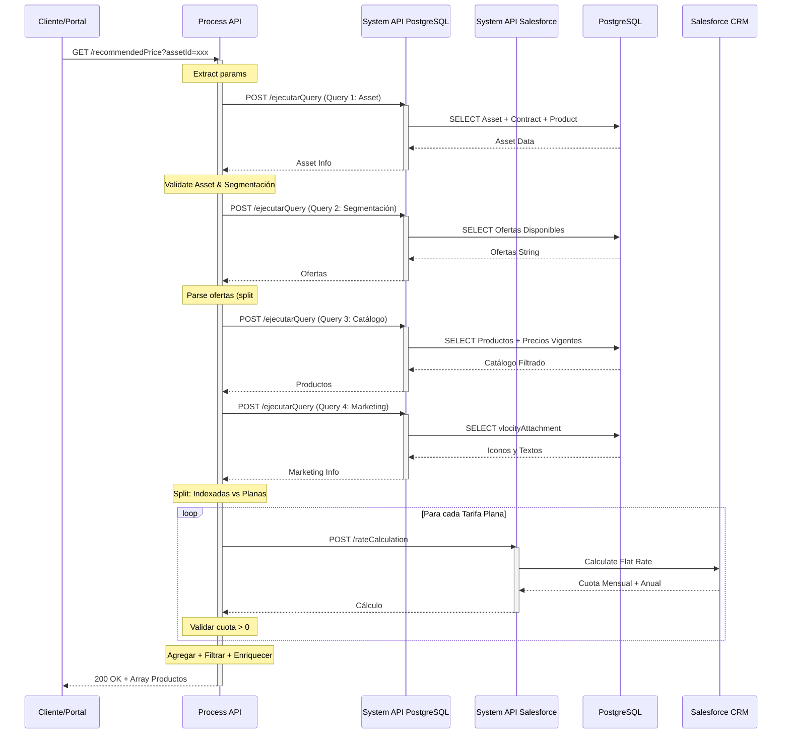
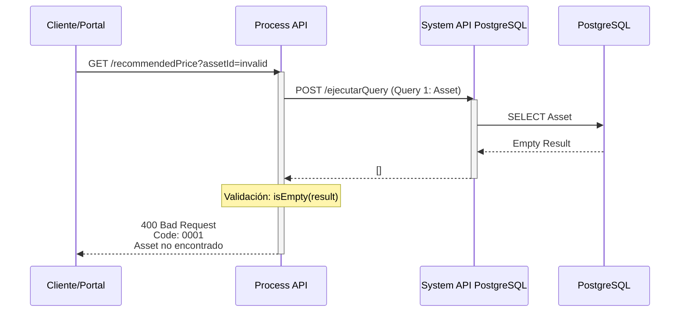
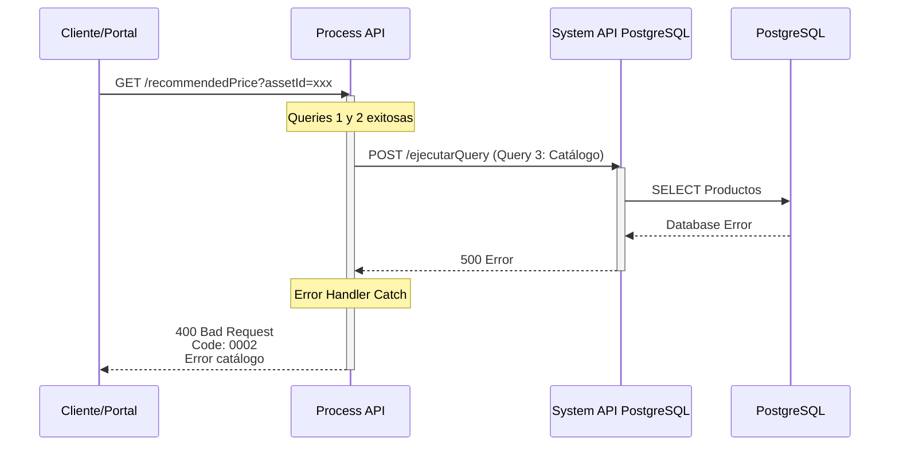

# GET /recommendedPrice

## 📌 Descripción General

### Propósito del Endpoint

Motor de recomendación de precios que orquesta múltiples consultas a PostgreSQL (réplica de Salesforce) y Salesforce para ofrecer productos personalizados según la segmentación del cliente. Analiza el contrato actual, consulta ofertas disponibles, filtra el catálogo de precios vigentes, calcula tarifas planas y enriquece la respuesta con información de marketing.

### Tipo de API

**Capa:** Process API (API-Led Connectivity)

**Función:** Orquestación de motor de recomendación de productos y precios

### Patrón de Integración

**Tipo:** Orquestación + Transformación + Agregación

**Descripción:** 
- Orquesta 5 llamadas a backends (4 a PostgreSQL + 1 a Salesforce)
- Aplica lógica de negocio compleja para filtrado de ofertas
- Transforma y agrega datos de múltiples fuentes
- Calcula precios según tipo de tarifa (indexada vs plana)
- Enriquece respuesta con información de marketing

### Arquitectura API-Led Connectivity



---

## 💼 Propósito del Negocio

### Casos de Uso Principales

1. **Recomendación Personalizada de Ofertas**
   - Cliente consulta ofertas disponibles según su segmentación
   - Sistema filtra productos compatibles con su contrato actual
   - Beneficio: Ofertas relevantes y personalizadas

2. **Comparativa de Productos Energéticos**
   - Cliente compara precios de luz/gas entre diferentes ofertas
   - Sistema muestra precios indexados y tarifas planas
   - Beneficio: Transparencia en precios y facilita decisión

3. **Cálculo de Tarifas Planas**
   - Sistema calcula cuota mensual según consumo y potencias
   - Muestra ahorro estimado anual
   - Beneficio: Cliente conoce coste exacto antes de contratar

### 🔗 Endpoints Dependientes

Este Process API consume los siguientes System APIs:

| System API | Endpoint | Método | Propósito |
|------------|----------|--------|-----------|
| `ntgy-newco-s-postgresql-salesforce` | `/ejecutarQuery` | POST | Consulta información del Asset (contrato, producto, potencias) |
| `ntgy-newco-s-postgresql-salesforce` | `/ejecutarQuery` | POST | Consulta segmentación de precios del cliente |
| `ntgy-newco-s-postgresql-salesforce` | `/ejecutarQuery` | POST | Consulta catálogo de precios con vigencias |
| `ntgy-newco-s-postgresql-salesforce` | `/ejecutarQuery` | POST | Consulta documentos de marketing (iconos, textos) |
| `ntgy-newco-s-salesforce` | `/rateCalculation` | POST | Cálculo de tarifas planas (cuota mensual y anual) |

### Lógica de Orquestación



**Pasos del Proceso:**

1. **Consulta Asset**: Obtiene información del contrato actual (producto, potencias, CUPS, tarifa ATR, segmentación)
2. **Validación**: Verifica que existe Asset y tiene segmentación de precios asignada
3. **Consulta Segmentación**: Obtiene ofertas disponibles para el cliente según su segmentación
4. **Consulta Catálogo**: Filtra productos del catálogo que coincidan con ofertas disponibles y estén vigentes
5. **Consulta Marketing**: Obtiene iconos y textos promocionales de los productos
6. **Cálculo Tarifas Planas**: Para productos con tarifa plana, calcula cuota mensual y anual en Salesforce
7. **Agregación**: Combina precios indexados y tarifas planas
8. **Filtrado**: Elimina productos con cuota 0 (error en cálculo)
9. **Enriquecimiento**: Añade información de marketing a cada producto
10. **Respuesta**: Devuelve array de productos recomendados con precios

### Transformaciones Aplicadas

**Transformaciones Principales:**

| Origen | Destino | Transformación |
|--------|---------|----------------|
| `asset.productFamily` | `productTypeFamily` | Mapeo: "Electricidad" → "luz", "Gas" → "gas" |
| `asset.newco_specification_type__c` | `productTypeFamily` | Si es "Product" → familia, sino → "servicios" |
| `vigenciaPrecios.NewCo_TE1__c...TE6__c` | `energy[]` | Array de 6 términos de energía formateados |
| `vigenciaPrecios.NewCo_TP1__c...TP6__c` | `power[]` | Array de 6 términos de potencia formateados |
| `rateCalculation.CoutaMensual` | `flatRateAmount` | Conversión a número |
| `rateCalculation.ImporteAnualEstimado` | `annualAmount` | Conversión a número |
| `vlocityAttachment` | `marketingInfo[]` | Array de objetos `{text, icon}` |

**Lógica de Negocio Aplicada:**

- **Filtrado por Vigencia**: Solo precios con fecha inicial ≤ hoy y fecha fin ≥ hoy (o null)
- **Filtrado por Tarifa ATR**: Transformación de formato (RL01 → RL.1)
- **Filtrado por Ofertas**: Solo productos que coincidan con ofertas disponibles en segmentación
- **Cálculo Condicional**: Tarifas planas solo si `newco_asignacion_de_precio__c == 'Valor'`
- **Exclusión de Empleados**: No mostrar precios si `newco_tipo_de_cliente__c == 'E'`

### Contexto Empresarial

- **Dominio:** Gestión de Productos y Precios
- **Sector:** Energía - Utilities
- **División:** Naturgy España - NewCo
- **Proceso de Negocio:** Recomendación y comparativa de ofertas energéticas

### Stakeholders

- **Clientes Finales**: Necesitan comparar ofertas y conocer precios antes de contratar
- **Agentes de Call Center**: Requieren información de precios para asesorar clientes
- **Equipo Comercial**: Necesita motor de recomendación para campañas
- **Equipo de Pricing**: Define segmentaciones y vigencias de precios

### Valor de Negocio

- **Personalización**: Ofertas adaptadas a la segmentación del cliente
- **Transparencia**: Precios claros antes de contratar
- **Automatización**: Cálculo automático de tarifas planas
- **Conversión**: Facilita decisión de compra con información completa

### Consumidores Potenciales

Este endpoint puede ser consumido por:
- Portal web FUA (Frontal Único de Atención)
- Aplicaciones móviles de clientes
- Sistemas de agentes de call center
- Herramientas de comparación de ofertas

---

## 🔧 Especificación Técnica

### URLs por Ambiente

| Ambiente | URL Base | URL Completa |
|----------|----------|--------------|
| **Local** | `http://localhost:8081` | `http://localhost:8081/api/recommendedPrice?assetId={id}&isAgent={bool}&contractId={id}` |
| **Development** | `https://ntgy-newco-p-fua-evo-dev.us-e2.cloudhub.io` | `https://ntgy-newco-p-fua-evo-dev.us-e2.cloudhub.io/api/recommendedPrice?assetId={id}&isAgent={bool}&contractId={id}` |
| **UAT** | `https://ntgy-newco-p-fua-evo-uat.us-e2.cloudhub.io` | `https://ntgy-newco-p-fua-evo-uat.us-e2.cloudhub.io/api/recommendedPrice?assetId={id}&isAgent={bool}&contractId={id}` |
| **Production** | `https://ntgy-newco-p-fua-evo-pro.us-e2.cloudhub.io` | `https://ntgy-newco-p-fua-evo-pro.us-e2.cloudhub.io/api/recommendedPrice?assetId={id}&isAgent={bool}&contractId={id}` |

### Método HTTP

```
GET /api/recommendedPrice
```

### Parámetros de Entrada

#### Query Parameters

| Parámetro | Tipo | Requerido | Descripción | Ejemplo |
|-----------|------|-----------|-------------|---------|
| `assetId` | string | ✅ Sí | ID del Asset (contrato) en Salesforce | `"a1B2c3D4e5F6g7H8i9"` |
| `isAgent` | boolean | ✅ Sí | Indica si la consulta es realizada por un agente | `true` o `false` |
| `contractId` | string | ✅ Sí | ID del contrato | `"8001234567890"` |

**Validaciones:**
- `assetId`: Debe ser un ID válido de Salesforce (18 caracteres)
- `isAgent`: Debe ser booleano
- `contractId`: Debe existir en el sistema

### Respuestas

#### 200 OK - Éxito

**Estructura de Respuesta:**

```json
{
  "recommendedPrice": [
    {
      "productId": "string",
      "priceBookEntryId": "string",
      "productType": {
        "isEco": boolean,
        "productClientType": "string",
        "productTypeId": "string",
        "productCode": "string",
        "productTypeName": "string",
        "isActualProduct": boolean,
        "productActualOfferType": "string",
        "productTypeFamily": "luz|gas|servicios",
        "isVariable": boolean
      },
      "marketingInfo": [
        {
          "text": "string",
          "icon": "url"
        }
      ],
      "prices": [
        {
          "productOfferType": "string",
          "serviceAmount": number,
          "flatRateAmount": number,
          "annualAmount": number,
          "dateReview": "date",
          "power": [number, number, number, number, number, number],
          "energy": [number, number, number, number, number, number],
          "fixedTerm": number,
          "variableTerm": number,
          "maxConsumption": number,
          "consumoAnual": number
        }
      ]
    }
  ]
}
```

**Descripción de Campos:**

| Campo | Tipo | Descripción |
|-------|------|-------------|
| `productId` | string | ID del producto en Salesforce |
| `priceBookEntryId` | string | ID de la entrada en el catálogo de precios |
| `productType.isEco` | boolean | Indica si es producto ecológico |
| `productType.productClientType` | string | Tipo de cliente (Residencial, Empresa, etc.) |
| `productType.productCode` | string | Código del producto |
| `productType.productTypeName` | string | Nombre del producto |
| `productType.isActualProduct` | boolean | Indica si es el producto actual del cliente |
| `productType.productActualOfferType` | string | Tipo de oferta actual (solo si isActualProduct=true) |
| `productType.productTypeFamily` | string | Familia del producto: "luz", "gas" o "servicios" |
| `productType.isVariable` | boolean | Indica si es precio indexado (variable) |
| `marketingInfo[].text` | string | Texto promocional del producto |
| `marketingInfo[].icon` | string | URL del icono del producto |
| `prices[].productOfferType` | string | Tipo de oferta (ej: "OFERTA_ONLINE") |
| `prices[].serviceAmount` | number | Precio del servicio (para indexados) |
| `prices[].flatRateAmount` | number | Cuota mensual (para tarifas planas) |
| `prices[].annualAmount` | number | Importe anual estimado (para tarifas planas) |
| `prices[].dateReview` | date | Fecha de revisión del precio |
| `prices[].power` | number[] | Términos de potencia P1-P6 (€/kW/día) |
| `prices[].energy` | number[] | Términos de energía TE1-TE6 (€/kWh) |
| `prices[].fixedTerm` | number | Término fijo (€/día) |
| `prices[].variableTerm` | number | Término variable (€/kWh) |
| `prices[].maxConsumption` | number | Consumo máximo pactado (para tarifas planas) |
| `prices[].consumoAnual` | number | Consumo anual base (para tarifas planas) |

#### 400 Bad Request - Error de Negocio

**Código 0001 - Asset o Segmentación No Encontrada:**

```json
{
  "result": {
    "codResult": "0001",
    "msgResult": "Informacion de asset o de su segmentacion no encontrada"
  },
  "startDate": "",
  "recommendedPrice": []
}
```

**Código 0002 - Error al Consultar Catálogo:**

```json
{
  "result": {
    "codResult": "0002",
    "msgResult": "Error al consultar el catálogo de productos"
  },
  "startDate": "",
  "recommendedPrice": []
}
```

#### 500 Internal Server Error

```json
{
  "code": "INTERNAL_ERROR",
  "message": "Error interno del servidor",
  "details": "Descripción técnica del error"
}
```

### Autenticación

- **Tipo:** Client ID & Client Secret (Anypoint Platform)
- **Headers Requeridos:**
  - `client_id`: ID de la aplicación cliente
  - `client_secret`: Secret de la aplicación cliente

### Timeouts

| Tipo | Valor |
|------|-------|
| **Request Timeout** | 60 segundos |
| **Connection Timeout** | 30 segundos |

**Nota:** Timeout extendido debido a múltiples consultas y cálculos complejos.

---

## 🏗️ Implementación Técnica

### Arquitectura del Flow



### Queries SQL Ejecutadas

#### Query 1: Información del Asset

**Propósito:** Obtener información completa del contrato, producto, potencias y segmentación

**Tablas Consultadas:**
- `asset` (contrato y producto)
- `vlocity_cmt__servicepoint__c` (punto de suministro)
- `contract` (datos del contrato)
- `account` (cuenta del cliente)
- `product2` (producto)

**Query SQL:**

```sql
SELECT 
    tableasset.sfid,
    tableasset.productFamily,
    tableasset.vlocity_cmt__attributeselectedvalues__c::json -> 'NC_ATT_ORDER_TYPE' as oferta,
    tableasset.productCode,
    tableasset.newco_specification_type__c as productType,
    tableasset.NewCo_NivelPresion__c,
    tableProduct2.sfid as productId,
    tableProduct2.newco_tipo_de_cliente__c as clientType,
    tableProduct2.NewCo_Tipo_de_Precio__c,
    consumerAccount.newco_tipocliente__c,
    consumerAccount.newco_empleado__c,
    servicePoint.acn_fld_contractpowerp1__c as power1,
    servicePoint.acn_fld_contractpowerp2__c as power2,
    servicePoint.acn_fld_contractpowerp3__c as power3,
    servicePoint.acn_fld_contractpowerp4__c as power4,
    servicePoint.acn_fld_contractpowerp5__c as power5,
    servicePoint.acn_fld_contractpowerp6__c as power6,
    servicePoint.newco_toll__c as tarifaATR,
    servicePoint.name as cups,
    tableContract.acn_fld_contractcode2__c as contractNumber,
    tableContract.acn_fld_activatedDate__c as startDate,
    tableContract.newco_bonificacionstatus__c as bonificationStatus,
    tableContract.newco_segmentacionprecio__c as segprecio
FROM newcosalesforce.asset tableasset 
INNER JOIN newcosalesforce.vlocity_cmt__servicepoint__c as servicePoint 
    ON tableasset.vlocity_cmt__ServicePointId__c = servicePoint.sfid
INNER JOIN newcosalesforce.contract as tableContract 
    ON tableContract.sfid = tableasset.acn_fld_contract__c
INNER JOIN newcosalesforce.account as consumerAccount 
    ON consumerAccount.sfid = tableasset.accountid
INNER JOIN newcosalesforce.product2 as tableProduct2 
    ON tableProduct2.sfid = tableasset.product2id
WHERE tableasset.sfid = :assetId
```

#### Query 2: Segmentación de Precios

**Propósito:** Obtener ofertas disponibles para el cliente según su segmentación

**Query SQL:**

```sql
SELECT nsc.newco_ofertasdisponibles__c  
FROM newcosalesforce.newco_segmentacionprecios__c nsc 
WHERE nsc.sfid = :segprecio
```

**Resultado:** String con ofertas separadas por `;` (ej: "OFERTA_ONLINE;OFERTA_VERDE;OFERTA_PLANA")

#### Query 3: Catálogo de Precios

**Propósito:** Consultar productos del catálogo que coincidan con ofertas disponibles y estén vigentes

**Tablas Consultadas:**
- `NewCo_Vigencia_Precios__c` (vigencia de precios)
- `RecordType` (tipo de registro)
- `product2` (producto)
- `pricebookentry` (entrada en catálogo)

**Query SQL (Dinámico):**

```sql
SELECT 
    tablePriceBookEntry.sfid as priceBookEntryId,
    tableProduct2.newco_tipo_de_cliente__c,
    tableProduct2.sfid as productId,
    tableProduct2.newco_eco__c as isEco,
    tableProduct2.productcode,
    tableProduct2.Name as productName,
    tableProduct2.vlocity_cmt__specificationtype__c,
    tableProduct2.newco_asignacion_de_precio__c,
    tableProduct2.family,
    tableProduct2.newco_tipo_de_precio__c,
    tableVigenciaPrecios.newco_precio__c,
    tableVigenciaPrecios.NewCo_Oferta__c,
    tableVigenciaPrecios.NewCo_TE1__c,
    tableVigenciaPrecios.NewCo_TE2__c,
    tableVigenciaPrecios.NewCo_TE3__c,
    tableVigenciaPrecios.NewCo_TE4__c,
    tableVigenciaPrecios.NewCo_TE5__c,
    tableVigenciaPrecios.NewCo_TE6__c,
    tableVigenciaPrecios.NewCo_TP1__c,
    tableVigenciaPrecios.NewCo_TP2__c,
    tableVigenciaPrecios.NewCo_TP3__c,
    tableVigenciaPrecios.NewCo_TP4__c,
    tableVigenciaPrecios.NewCo_TP5__c,
    tableVigenciaPrecios.NewCo_TP6__c,
    tableVigenciaprecios.newco_tf__c,
    tableVigenciaprecios.newco_tv__c 
FROM newcosalesforce.NewCo_Vigencia_Precios__c tableVigenciaPrecios 
INNER JOIN newcosalesforce.RecordType tableRecordType 
    ON tableRecordType.sfid = tableVigenciaPrecios.recordtypeid 
INNER JOIN newcosalesforce.product2 tableProduct2 
    ON tableProduct2.sfid = tableVigenciaPrecios.newco_product__c 
INNER JOIN newcosalesforce.pricebookentry tablePriceBookEntry 
    ON tablePriceBookEntry.product2id = tableProduct2.sfid
INNER JOIN newcosalesforce.NewCo_Vigencia_Precios__c tableVigenciaPreciosLibre 
    ON tableVigenciaPreciosLibre.sfid = tableVigenciaPrecios.NewCo_ComponenteLibreOrigen__c
WHERE tableProduct2.Family = :productFamily
    AND tableProduct2.vlocity_cmt__SpecificationType__c = :productType
    AND (tableVigenciaPrecios.NewCo_FechaInicial__c <= :today 
         AND (tableVigenciaPrecios.NewCo_FechaFin__c >= :today 
              OR tableVigenciaPrecios.NewCo_FechaFin__c IS NULL))
    AND (tableVigenciaPreciosLibre.NewCo_FechaInicial__c <= :today 
         AND (tableVigenciaPreciosLibre.NewCo_FechaFin__c >= :today 
              OR tableVigenciaPreciosLibre.NewCo_FechaFin__c IS NULL))
    AND tableVigenciaPreciosLibre.newco_tarifaatr__c = :tarifaATR
    AND tableProduct2.sfid = :productId
    AND (tableVigenciaPreciosLibre.NewCo_Oferta__c IN (:ofertas))
```

**Filtros Dinámicos:**
- Familia de producto (Electricidad/Gas)
- Tipo de producto (especificación)
- Vigencia de precios (fecha inicial ≤ hoy ≤ fecha fin)
- Tarifa ATR transformada (RL01 → RL.1)
- Ofertas disponibles según segmentación

#### Query 4: Documentos de Marketing

**Propósito:** Obtener iconos y textos promocionales de los productos

**Query SQL:**

```sql
SELECT 
    vlocityAttachmentTable.vlocity_cmt__objectid__c,
    vlocityAttachmentTable.vlocity_cmt__UrlLong__c,
    vlocityattachmenttable.vlocity_cmt__Description__c 
FROM newcosalesforce.vlocity_cmt__VlocityAttachment__c as vlocityAttachmentTable 
WHERE vlocityAttachmentTable.vlocity_cmt__objectid__c IN (:productIds)
```

### Transformaciones DataWeave

#### Transformación 1: Extracción de Ofertas Disponibles

**Ubicación:** Líneas 68-78 del subflow

**Descripción de la Transformación:**

Esta transformación parsea el string de ofertas disponibles que viene separado por punto y coma (`;`) y crea un array de objetos para el filtrado posterior.

**Proceso:**
1. Obtiene el string de ofertas desde `postgresResultSegmentacionPrecios.newco_ofertasdisponibles__c`
2. Divide el string usando `;` como separador
3. Para cada oferta, crea un objeto con:
   - `codigo_producto_destino__c`: Código del producto actual del cliente
   - `tipo_oferta_destino__c`: Tipo de oferta disponible

**Entrada:** `"OFERTA_ONLINE;OFERTA_VERDE;OFERTA_PLANA"`

**Salida:** Array de objetos con código de producto y tipo de oferta

**Propósito:** Preparar las ofertas disponibles para construir el filtro SQL dinámico

---

#### Transformación 2: Construcción Dinámica de Query

**Ubicación:** Líneas 88-106 del subflow

**Descripción de la Transformación:**

Construye dinámicamente el filtro SQL para la consulta del catálogo de precios basándose en las ofertas disponibles del cliente.

**Proceso:**
1. Define función `transformTarifa` que convierte formato de tarifa ATR:
   - RL01 → RL.1
   - RL02 → RL.2
   - RL03 → RL.3
   - RL04 → RL.4
   - RL05 → RL.5
   - RL06 → RL.6

2. Construye filtro SQL dinámico concatenando condiciones:
   - Para cada oferta disponible, crea: `(tabla.oferta = 'X' AND tabla.producto = 'Y')`
   - Une todas las condiciones con ` OR `

**Salida:** Query SQL con filtro dinámico: `"SELECT ... WHERE ... AND (condicion1 OR condicion2 OR ...)"`

**Propósito:** Filtrar el catálogo de precios solo por productos y ofertas compatibles con el cliente

---

#### Transformación 3: Input para rateCalculation

**Ubicación:** Líneas 158-172 del subflow

**Descripción de la Transformación:**

Prepara el payload para llamar al servicio de Salesforce que calcula tarifas planas, formateando las potencias al formato SAP (8 dígitos con padding de ceros).

**Proceso:**
1. Define función `formateoDecimales` que:
   - Añade punto decimal si no existe
   - Rellena con ceros a la derecha hasta 8 caracteres
   - Ejemplo: "3.5" → "3.500000"

2. Extrae potencias P1-P6 del resultado de PostgreSQL
3. Formatea cada potencia con 8 dígitos
4. Construye objeto con:
   - CUPS del punto de suministro
   - Tipo de energía (Electricidad/Gas)
   - Fecha de reserva de precios (hoy)
   - Potencias P1-P6 formateadas (null si es "00000000")

**Salida:** Objeto JSON con formato requerido por Salesforce rateCalculation

**Propósito:** Calcular cuota mensual y anual para tarifas planas

---

#### Transformación 4: Respuesta Final

**Ubicación:** Líneas 186-234 del subflow

**Descripción de la Transformación:**

Construye la respuesta final agregando datos de múltiples fuentes: catálogo de precios, cálculos de tarifas planas, y documentos de marketing.

**Proceso:**

1. **Filtrado inicial:**
   - Identifica productos con cuota 0 (error en cálculo) para eliminarlos
   - Filtra catálogo excluyendo productos marcados como KO

2. **Extracción de precios:**
   - De cada producto del catálogo, extrae campos de precios:
     - productcode, newco_te1-6 (términos energía)
     - newco_tp1-6 (términos potencia)
     - newco_tf__c (término fijo), newco_tv__c (término variable)
     - newco_precio__c, newco_oferta__c

3. **Construcción de respuesta por producto:**
   - **productId y priceBookEntryId:** IDs de Salesforce
   - **productType:** Información del tipo de producto
     - isEco: Si es producto ecológico
     - productClientType: Tipo de cliente
     - productCode: Código del producto
     - productTypeName: Nombre del producto
     - isActualProduct: (condicional) true si es el producto actual
     - productActualOfferType: (condicional) tipo de oferta actual
     - productTypeFamily: "luz", "gas" o "servicios"
     - isVariable: true si es precio indexado

   - **marketingInfo:** Array de documentos promocionales
     - Filtra vlocityAttachment por productId
     - Extrae "text" (descripción) e "icon" (URL)

   - **prices:** Array con información de precios
     - productOfferType: Tipo de oferta
     - serviceAmount: Precio del servicio
     - flatRateAmount: Cuota mensual (tarifas planas)
     - annualAmount: (condicional) Importe anual estimado
     - dateReview: Fecha de revisión
     - power: Array de 6 términos de potencia (o [0,0,0,0,0,0] si es plana)
     - energy: Array de 6 términos de energía (o [0,0,0,0,0,0] si es plana)
     - fixedTerm: Término fijo
     - variableTerm: Término variable
     - maxConsumption: (condicional) Consumo máximo pactado
     - consumoAnual: (condicional) Consumo anual base

4. **Exclusión de empleados:**
   - No muestra precios si el tipo de cliente es 'E' (empleado)

**Salida:** Objeto JSON con array `recommendedPrice` conteniendo todos los productos recomendados con sus precios y marketing

**Propósito:** Proporcionar respuesta completa y enriquecida al cliente con todas las ofertas disponibles

### Diagramas de Secuencia

#### 1. Flujo Normal de Éxito



#### 2. Flujo con Error de Negocio (Asset No Encontrado)



#### 3. Flujo con Error Técnico (Catálogo)



### Manejo de Errores

**Estrategia de Error Handling:**

1. **Error 0001 - Asset No Encontrado:**
   - **Trigger:** Query 1 devuelve vacío o segprecio es null
   - **Acción:** Retornar error de negocio inmediatamente
   - **Response:** 400 con código 0001

2. **Error 0002 - Error en Catálogo:**
   - **Trigger:** Exception en Query 3 (catálogo de precios)
   - **Acción:** Try-catch captura error, log y respuesta controlada
   - **Response:** 400 con código 0002

3. **Error en vlocityAttachment:**
   - **Trigger:** Exception en Query 4
   - **Acción:** Continue con array vacío (no crítico)
   - **Response:** Productos sin marketing info

4. **Error en rateCalculation:**
   - **Trigger:** Cuota = 0 o error en Salesforce
   - **Acción:** Marcar producto para eliminar
   - **Response:** Producto no incluido en respuesta final

**Logging:**
- Log de entrada con assetId
- Log de cada query ejecutada
- Log de respuesta final
- Log de errores con stack trace

---

## 💻 Ejemplos de Uso

### Ejemplo 1: Llamada Exitosa - Cliente Residencial

#### cURL

```bash
curl -X GET "https://ntgy-newco-p-fua-evo-dev.us-e2.cloudhub.io/api/recommendedPrice?assetId=a1B2c3D4e5F6g7H8i9&isAgent=false&contractId=8001234567890" \
  -H "Content-Type: application/json" \
  -H "client_id: YOUR_CLIENT_ID" \
  -H "client_secret: YOUR_CLIENT_SECRET"
```

#### Respuesta (200 OK)

```text
{
  "recommendedPrice": [
    {
      "productId": "01t5g000000AbCdEFG",
      "priceBookEntryId": "01u5g000000XyZwABC",
      "productType": {
        "isEco": true,
        "productClientType": "Residencial",
        "productTypeId": "01t5g000000AbCdEFG",
        "productCode": "PROD_LUZ_ECO_001",
        "productTypeName": "Luz Eco Online",
        "isActualProduct": false,
        "productTypeFamily": "luz",
        "isVariable": true
      },
      "marketingInfo": [
        {
          "text": "100% energía renovable certificada",
          "icon": "https://cdn.naturgy.com/icons/eco-leaf.svg"
        },
        {
          "text": "Ahorra hasta un 15% en tu factura",
          "icon": "https://cdn.naturgy.com/icons/savings.svg"
        }
      ],
      "prices": [
        {
          "productOfferType": "OFERTA_ONLINE",
          "serviceAmount": 0,
          "flatRateAmount": 0,
          "dateReview": "2026-04-09",
          "power": [0.105, 0.105, 0.105, 0.105, 0.105, 0.105],
          "energy": [0.145, 0.125, 0.110, 0.095, 0.085, 0.075],
          "fixedTerm": 0.15,
          "variableTerm": 0
        }
      ]
    },
    {
      "productId": "01t5g000000AbCdXYZ",
      "priceBookEntryId": "01u5g000000XyZwDEF",
      "productType": {
        "isEco": false,
        "productClientType": "Residencial",
        "productTypeId": "01t5g000000AbCdXYZ",
        "productCode": "PROD_LUZ_PLANA_001",
        "productTypeName": "Luz Tarifa Plana",
        "isActualProduct": false,
        "productTypeFamily": "luz",
        "isVariable": false
      },
      "marketingInfo": [
        {
          "text": "Paga lo mismo todos los meses",
          "icon": "https://cdn.naturgy.com/icons/flat-rate.svg"
        }
      ],
      "prices": [
        {
          "productOfferType": "OFERTA_PLANA",
          "serviceAmount": 0,
          "flatRateAmount": 85.50,
          "annualAmount": 1026.00,
          "dateReview": "2026-04-09",
          "power": [0, 0, 0, 0, 0, 0],
          "energy": [0, 0, 0, 0, 0, 0],
          "fixedTerm": 0,
          "variableTerm": 0,
          "maxConsumption": 350.0,
          "consumoAnual": 3500
        }
      ]
    }
  ]
}
```

### Ejemplo 2: Error - Asset No Encontrado

#### cURL

```bash
curl -X GET "https://ntgy-newco-p-fua-evo-dev.us-e2.cloudhub.io/api/recommendedPrice?assetId=INVALID_ID&isAgent=false&contractId=8001234567890" \
  -H "Content-Type: application/json" \
  -H "client_id: YOUR_CLIENT_ID" \
  -H "client_secret: YOUR_CLIENT_SECRET"
```

#### Respuesta (400 Bad Request)

```text
{
  "result": {
    "codResult": "0001",
    "msgResult": "Informacion de asset o de su segmentacion no encontrada"
  },
  "startDate": "",
  "recommendedPrice": []
}
```

### Ejemplo 3: JavaScript (Fetch API)

```javascript
const getRecommendedPrice = async (assetId, isAgent, contractId) => {
  try {
    const response = await fetch(
      `https://ntgy-newco-p-fua-evo-dev.us-e2.cloudhub.io/api/recommendedPrice?assetId=${assetId}&isAgent=${isAgent}&contractId=${contractId}`,
      {
        method: 'GET',
        headers: {
          'Content-Type': 'application/json',
          'client_id': 'YOUR_CLIENT_ID',
          'client_secret': 'YOUR_CLIENT_SECRET'
        }
      }
    );

    if (!response.ok) {
      const error = await response.json();
      throw new Error(`Error ${error.result.codResult}: ${error.result.msgResult}`);
    }

    const data = await response.json();
    
    // Procesar productos recomendados
    data.recommendedPrice.forEach(product => {
      console.log(`Producto: ${product.productType.productTypeName}`);
      console.log(`Familia: ${product.productType.productTypeFamily}`);
      
      if (product.productType.isVariable) {
        console.log('Precio indexado - Términos de energía:', product.prices[0].energy);
      } else {
        console.log('Tarifa plana - Cuota mensual:', product.prices[0].flatRateAmount);
      }
    });

    return data;
  } catch (error) {
    console.error('Error al obtener precios recomendados:', error);
    throw error;
  }
};

// Uso
getRecommendedPrice('a1B2c3D4e5F6g7H8i9', false, '8001234567890')
  .then(data => console.log('Productos recomendados:', data.recommendedPrice.length))
  .catch(error => console.error('Error:', error));
```

### Ejemplo 4: Python (Requests)

```python
import requests
from typing import Dict, List

def get_recommended_price(
    asset_id: str, 
    is_agent: bool, 
    contract_id: str,
    client_id: str,
    client_secret: str
) -> Dict:
    """
    Obtiene precios recomendados para un asset específico.
    
    Args:
        asset_id: ID del asset en Salesforce
        is_agent: True si es consulta de agente
        contract_id: ID del contrato
        client_id: Client ID de Anypoint
        client_secret: Client Secret de Anypoint
        
    Returns:
        Dict con productos recomendados
        
    Raises:
        requests.HTTPError: Si hay error en la petición
    """
    url = "https://ntgy-newco-p-fua-evo-dev.us-e2.cloudhub.io/api/recommendedPrice"
    
    params = {
        'assetId': asset_id,
        'isAgent': str(is_agent).lower(),
        'contractId': contract_id
    }
    
    headers = {
        'Content-Type': 'application/json',
        'client_id': client_id,
        'client_secret': client_secret
    }
    
    try:
        response = requests.get(url, params=params, headers=headers, timeout=60)
        response.raise_for_status()
        
        data = response.json()
        
        # Procesar productos
        print(f"Productos encontrados: {len(data['recommendedPrice'])}")
        
        for product in data['recommendedPrice']:
            product_type = product['productType']
            prices = product['prices'][0] if product['prices'] else None
            
            print(f"\n- {product_type['productTypeName']}")
            print(f"  Familia: {product_type['productTypeFamily']}")
            print(f"  Eco: {'Sí' if product_type['isEco'] else 'No'}")
            
            if prices:
                if product_type['isVariable']:
                    print(f"  Tipo: Indexado")
                    print(f"  TE1: {prices['energy'][0]} €/kWh")
                else:
                    print(f"  Tipo: Tarifa Plana")
                    print(f"  Cuota: {prices['flatRateAmount']} €/mes")
        
        return data
        
    except requests.exceptions.HTTPError as e:
        if e.response.status_code == 400:
            error_data = e.response.json()
            print(f"Error de negocio: {error_data['result']['msgResult']}")
        raise
    except requests.exceptions.Timeout:
        print("Timeout: La petición tardó más de 60 segundos")
        raise
    except requests.exceptions.RequestException as e:
        print(f"Error en la petición: {str(e)}")
        raise

# Uso
if __name__ == "__main__":
    try:
        result = get_recommended_price(
            asset_id='a1B2c3D4e5F6g7H8i9',
            is_agent=False,
            contract_id='8001234567890',
            client_id='YOUR_CLIENT_ID',
            client_secret='YOUR_CLIENT_SECRET'
        )
        
        print(f"\n✅ Total productos recomendados: {len(result['recommendedPrice'])}")
        
    except Exception as e:
        print(f"❌ Error: {str(e)}")
```

### Ejemplo 5: Postman Collection

```json
{
  "info": {
    "name": "Naturgy - Recommended Price",
    "schema": "https://schema.getpostman.com/json/collection/v2.1.0/collection.json"
  },
  "item": [
    {
      "name": "Get Recommended Price - Success",
      "request": {
        "method": "GET",
        "header": [
          {
            "key": "Content-Type",
            "value": "application/json"
          },
          {
            "key": "client_id",
            "value": "{{client_id}}"
          },
          {
            "key": "client_secret",
            "value": "{{client_secret}}"
          }
        ],
        "url": {
          "raw": "{{base_url}}/api/recommendedPrice?assetId={{asset_id}}&isAgent=false&contractId={{contract_id}}",
          "host": ["{{base_url}}"],
          "path": ["api", "recommendedPrice"],
          "query": [
            {
              "key": "assetId",
              "value": "{{asset_id}}"
            },
            {
              "key": "isAgent",
              "value": "false"
            },
            {
              "key": "contractId",
              "value": "{{contract_id}}"
            }
          ]
        }
      }
    }
  ]
}
```
