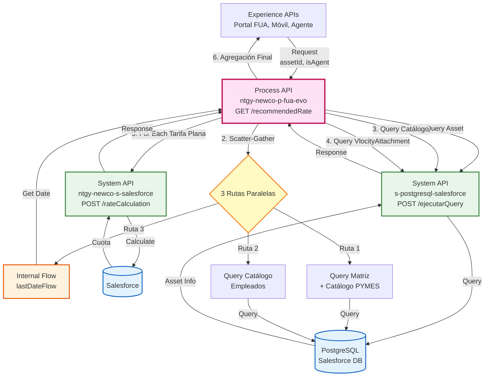
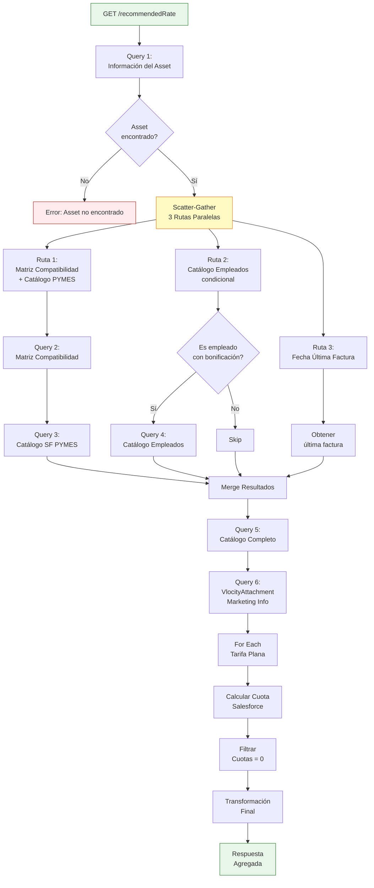
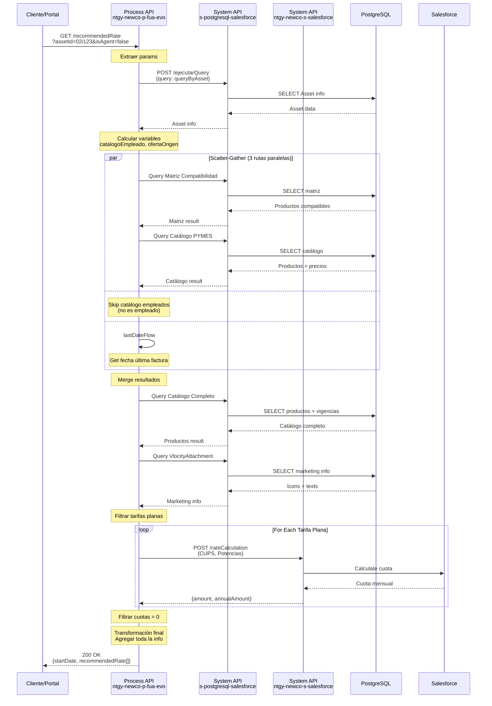
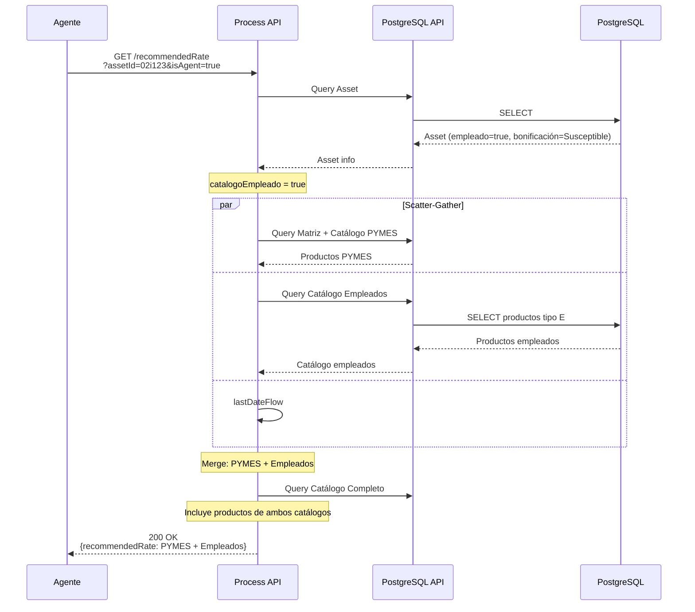
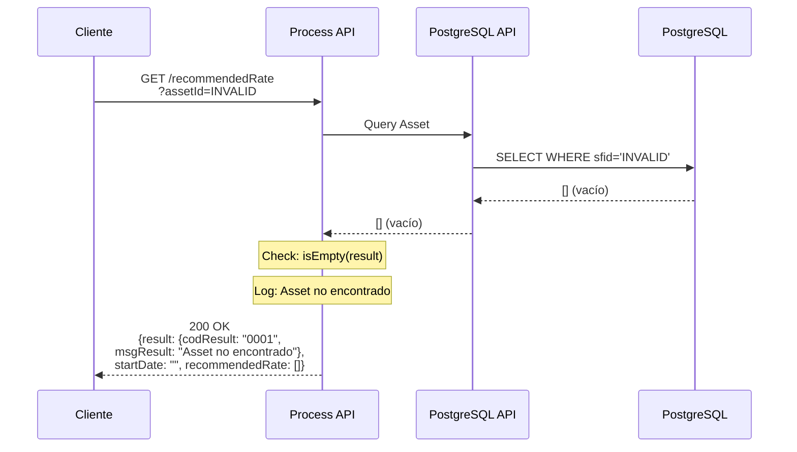

# GET /recommendedRate

## 📌 Descripción General

### Propósito del Endpoint

Este endpoint orquesta un proceso complejo de recomendación de tarifas energéticas basándose en el producto actual del cliente. Consulta múltiples fuentes de datos (PostgreSQL, Salesforce), aplica lógica de compatibilidad de productos, calcula precios personalizados para tarifas planas, y agrega toda la información en una respuesta unificada con opciones de productos recomendados.

### Tipo de API

**Capa:** Process API (API-Led Connectivity)

**Función:** Orquestación avanzada de recomendación de tarifas con agregación de datos de múltiples fuentes y cálculos personalizados

### Patrón de Integración

**Tipo:** Orquestación Compleja con Scatter-Gather y Transformación

**Descripción:** El endpoint implementa un flujo de orquestación avanzado que:
1. Consulta información del producto actual (Asset) en PostgreSQL
2. Ejecuta 3 rutas paralelas (Scatter-Gather) para obtener matriz de compatibilidad, catálogo de empleados y fecha de última factura
3. Consulta el catálogo completo de productos compatibles
4. Obtiene información de marketing (VlocityAttachment)
5. Calcula cuotas mensuales para tarifas planas mediante Salesforce
6. Agrega y transforma toda la información en una respuesta estructurada

### Arquitectura API-Led Connectivity



---

## 💼 Propósito del Negocio

### Casos de Uso Principales

1. **Recomendación de Tarifas para Cambio de Producto**
   - El cliente consulta qué tarifas puede contratar basándose en su producto actual
   - Se filtran productos compatibles según matriz de compatibilidad
   - Se personalizan recomendaciones según perfil (cliente/agente/empleado)

2. **Comparativa de Precios Personalizada**
   - Calcula precios específicos para tarifas planas según consumo del cliente
   - Muestra precios de energía y potencia para tarifas indexadas
   - Incluye información de marketing (iconos, textos promocionales)

3. **Catálogo Diferenciado por Perfil**
   - **Clientes**: Ven productos con visibilidad de cliente
   - **Agentes**: Ven productos adicionales con visibilidad de agente
   - **Empleados**: Acceden a catálogo especial de empleados con bonificaciones

### 🔗 Endpoints Dependientes

Este Process API consume los siguientes System APIs y flows internos:

| System API / Flow | Endpoint | Método | Propósito |
|-------------------|----------|--------|-----------|
| `s-postgresql-salesforce` | `/ejecutarQuery` | POST | Ejecutar queries SQL dinámicas en PostgreSQL (5 queries diferentes) |
| `ntgy-newco-s-salesforce` | `/rateCalculation` | POST | Calcular cuota mensual para tarifas planas |
| `lastDateFlow` | Internal Flow | - | Obtener fecha de última factura del contrato |

### Lógica de Orquestación



**Pasos del Proceso:**

1. **Query Asset**: Obtiene información del producto actual del cliente (familia, tipo, potencias, tarifa ATR, etc.)
2. **Scatter-Gather (3 rutas paralelas)**:
   - **Ruta 1**: Consulta matriz de compatibilidad y catálogo de productos PYMES
   - **Ruta 2**: Consulta catálogo de empleados (solo si aplica)
   - **Ruta 3**: Obtiene fecha de última factura
3. **Query Catálogo Completo**: Consulta precios y vigencias de productos compatibles
4. **Query VlocityAttachment**: Obtiene información de marketing (iconos, textos)
5. **Cálculo de Tarifas Planas**: Para cada tarifa plana, calcula la cuota mensual en Salesforce
6. **Filtrado**: Elimina productos con cuota 0 o errores de cálculo
7. **Transformación Final**: Agrega toda la información en estructura de respuesta

### Transformaciones Aplicadas

**Transformación 1: Construcción de queryByAsset (Query SQL Dinámica)**

| Campo Extraído | Origen | Uso |
|----------------|--------|-----|
| `productFamily` | Asset | Filtrar productos por familia (Electricidad/Gas) |
| `productCode` | Asset | Identificar producto actual |
| `productType` | Asset | Tipo de producto (Product/Service) |
| `tarifaATR` | ServicePoint | Tarifa de acceso (solo electricidad) |
| `power1-6` | ServicePoint | Potencias contratadas (solo productos) |
| `clientType` | Product2 | Tipo de cliente |
| `newco_empleado__c` | Account | Indicador de empleado |
| `bonificationStatus` | Contract | Estado de bonificación |

**Transformación 2: Construcción de queryMatrizCompatibilidad**

Filtra productos compatibles según:
- Código de producto origen
- Tipo de oferta origen
- Tarifa ATR (solo electricidad)
- Visibilidad (cliente/agente)

**Transformación 3: Construcción de queryCatalogoSF**

Query SQL compleja que filtra productos por:
- Familia de producto
- Tipo de especificación
- Vigencia de precios (fecha actual)
- Compatibilidad con matriz
- Nivel de presión (solo gas)

**Transformación 4: Input rateCalculation**

Formatea potencias para cálculo de tarifa plana:
```dataweave
fun formateoDecimales(valor) =
    if(!(valor contains(".")) and valor != 0) 
        dw::core::Strings::rightPad((valor as String ++ "."),8,"0")
    else
        dw::core::Strings::rightPad(valor as String,8,"0")
```

**Transformación 5: Respuesta Final (Agregación Compleja)**

Agrega datos de 6+ fuentes:
- Información del Asset
- Matriz de compatibilidad
- Catálogo de productos
- Catálogo de empleados
- VlocityAttachment (marketing)
- Cálculos de tarifas planas
- Fecha de última factura

### Contexto Empresarial

- **Dominio:** Gestión de Productos y Tarifas Energéticas
- **Sector:** Energía - Utilities
- **División:** Naturgy España - NewCo
- **Proceso de Negocio:** Recomendación y comparativa de tarifas para cambio de producto

### Stakeholders

- **Clientes de Naturgy**: Necesitan comparar tarifas para optimizar costes energéticos
- **Agentes de Call Center**: Requieren herramientas para recomendar productos adecuados
- **Empleados de Naturgy**: Acceden a catálogo especial con bonificaciones
- **Departamento Comercial**: Gestiona matriz de compatibilidad y catálogo de productos
- **Equipo de Pricing**: Define precios y vigencias de productos

### Valor de Negocio

- **Personalización**: Recomendaciones basadas en producto actual y perfil del cliente
- **Transparencia**: Comparativa clara de precios entre diferentes tarifas
- **Optimización de Costes**: Ayuda al cliente a encontrar la tarifa más adecuada
- **Aumento de Ventas**: Facilita el cambio de producto con información completa
- **Diferenciación por Perfil**: Catálogos específicos para clientes, agentes y empleados

### Consumidores Potenciales

Este endpoint puede ser consumido por:
- Portal web FUA
- Aplicaciones móviles de clientes
- Sistemas de agentes de call center
- Herramientas de comparativa de tarifas

---

## 🔧 Especificación Técnica

### URLs por Ambiente

| Ambiente | URL Base | URL Completa |
|----------|----------|--------------|
| **Local** | `http://localhost:8081` | `http://localhost:8081/api/recommendedRate?assetId={assetId}&isAgent={isAgent}` |
| **Development** | `https://ntgy-newco-p-fua-evo-dev.us-e2.cloudhub.io` | `https://ntgy-newco-p-fua-evo-dev.us-e2.cloudhub.io/api/recommendedRate?assetId={assetId}&isAgent={isAgent}` |
| **UAT** | `https://ntgy-newco-p-fua-evo-uat.us-e2.cloudhub.io` | `https://ntgy-newco-p-fua-evo-uat.us-e2.cloudhub.io/api/recommendedRate?assetId={assetId}&isAgent={isAgent}` |
| **Production** | `https://ntgy-newco-p-fua-evo-pro.us-e2.cloudhub.io` | `https://ntgy-newco-p-fua-evo-pro.us-e2.cloudhub.io/api/recommendedRate?assetId={assetId}&isAgent={isAgent}` |

### Método HTTP

```
GET /api/recommendedRate
```

### Query Parameters

| Parámetro | Tipo | Obligatorio | Descripción | Ejemplo |
|-----------|------|-------------|-------------|---------|
| `assetId` | string | ✅ | ID del Asset (producto contratado) en Salesforce | `02i1234567890ABC` |
| `isAgent` | boolean | ✅ | Indica si la consulta es desde agente (`true`) o cliente (`false`) | `true` |
| `isService` | boolean | ⚠️ | Indica si es un servicio en lugar de producto (default: `false`) | `false` |

**Notas:**
- `assetId`: Debe ser un ID válido de Asset en Salesforce (formato: `02iXXXXXXXXXXXXX`)
- `isAgent`: Determina qué productos se muestran según visibilidad
- `isService`: Si es `true`, no consulta información de ServicePoint (CUPS, potencias, tarifa ATR)

### Respuestas

#### Respuesta Exitosa (200 OK)

**Cuando se encuentran productos recomendados:**

```json
{
  "startDate": "15/01/2026",
  "recommendedRate": [
    {
      "productId": "01t1234567890ABC",
      "priceBookEntryId": "01u1234567890DEF",
      "productType": {
        "isEco": true,
        "productClientType": "R",
        "productTypeId": "01t1234567890ABC",
        "productCode": "PROD_ECO_001",
        "productTypeName": "Tarifa Eco Luz",
        "isActualProduct": false,
        "productTypeFamily": "luz",
        "isVariable": false
      },
      "marketingInfo": [
        {
          "text": "Tarifa 100% renovable",
          "icon": "https://cdn.naturgy.com/icons/eco.png"
        }
      ],
      "prices": [
        {
          "productOfferType": "ONLINE",
          "serviceAmount": 0,
          "flatRateAmount": 0,
          "dateReview": "2026-08-27",
          "power": [0.05, 0.04, 0.03, 0.02, 0.01, 0.01],
          "energy": [0.15, 0.14, 0.13, 0.12, 0.11, 0.10],
          "fixedTerm": 3.50,
          "variableTerm": 0
        }
      ]
    }
  ]
}
```

| Campo | Tipo | Descripción |
|-------|------|-------------|
| `startDate` | string | Fecha de inicio (última factura o fecha de alta del contrato) formato dd/MM/yyyy |
| `recommendedRate` | array | Lista de productos recomendados |
| `recommendedRate[].productId` | string | ID del producto en Salesforce |
| `recommendedRate[].priceBookEntryId` | string | ID de la entrada en el catálogo de precios |
| `recommendedRate[].productType` | object | Información del tipo de producto |
| `recommendedRate[].productType.isEco` | boolean | Indica si es producto ecológico |
| `recommendedRate[].productType.productClientType` | string | Tipo de cliente (R=Residencial, E=Empleado, etc.) |
| `recommendedRate[].productType.productCode` | string | Código del producto |
| `recommendedRate[].productType.productTypeName` | string | Nombre del producto |
| `recommendedRate[].productType.isActualProduct` | boolean | Indica si es el producto actual del cliente |
| `recommendedRate[].productType.productActualOfferType` | string | Tipo de oferta del producto actual (solo si isActualProduct=true) |
| `recommendedRate[].productType.productTypeFamily` | string | Familia del producto: "luz", "gas" o "servicios" |
| `recommendedRate[].productType.isVariable` | boolean | Indica si es tarifa indexada (precio variable) |
| `recommendedRate[].marketingInfo` | array | Información de marketing del producto |
| `recommendedRate[].marketingInfo[].text` | string | Texto descriptivo/promocional |
| `recommendedRate[].marketingInfo[].icon` | string | URL del icono/imagen |
| `recommendedRate[].prices` | array | Lista de precios por tipo de oferta |
| `recommendedRate[].prices[].productOfferType` | string | Tipo de oferta (ONLINE, TELEFONO, etc.) |
| `recommendedRate[].prices[].serviceAmount` | number | Importe del servicio (para servicios) |
| `recommendedRate[].prices[].flatRateAmount` | number | Cuota mensual (para tarifas planas) |
| `recommendedRate[].prices[].annualAmount` | number | Importe anual estimado (solo tarifas planas) |
| `recommendedRate[].prices[].dateReview` | string | Fecha de revisión de precios |
| `recommendedRate[].prices[].power` | array[6] | Precios de potencia por periodo (€/kW/día) |
| `recommendedRate[].prices[].energy` | array[6] | Precios de energía por periodo (€/kWh) |
| `recommendedRate[].prices[].fixedTerm` | number | Término fijo (€/mes) |
| `recommendedRate[].prices[].variableTerm` | number | Término variable (€/kWh) |
| `recommendedRate[].prices[].maxConsumption` | number | Consumo máximo pactado (solo tarifas planas) |
| `recommendedRate[].prices[].consumoAnual` | number | Consumo anual base (solo tarifas planas) |

#### Respuesta Sin Productos Compatibles (200 OK)

```json
{
  "startDate": "",
  "recommendedRate": []
}
```

#### Respuesta de Error - Asset No Encontrado (200 OK)

```json
{
  "result": {
    "codResult": "0001",
    "msgResult": "Información asset no encontrada"
  },
  "startDate": "",
  "recommendedRate": []
}
```

#### Respuesta de Error - Error en Catálogo (200 OK)

```json
{
  "result": {
    "codResult": "0002",
    "msgResult": "Error al consultar el catálogo de productos"
  },
  "startDate": "",
  "recommendedRate": []
}
```

#### Respuesta de Error (400 Bad Request)

```json
{
  "code": "VALIDATION_ERROR",
  "message": "El parámetro assetId es obligatorio",
  "timestamp": "2026-08-27T12:45:00Z"
}
```

#### Respuesta de Error (500 Internal Server Error)

```json
{
  "code": "INTERNAL_ERROR",
  "message": "Error al procesar la recomendación de tarifas",
  "details": "Error en la comunicación con PostgreSQL",
  "timestamp": "2026-08-27T12:45:00Z"
}
```

### Autenticación

- **Tipo:** Client ID & Client Secret (Anypoint Platform)
- **Headers:** `client_id` y `client_secret` en los headers de la petición

### Timeouts

| Tipo | Valor |
|------|-------|
| **Request Timeout** | 240 segundos (4 minutos) |
| **Connection Timeout** | 30 segundos |
| **PostgreSQL Timeout** | 240 segundos |
| **Salesforce rateCalculation Timeout** | 60 segundos |

**Nota:** El timeout es alto debido a la complejidad del proceso (múltiples queries SQL, cálculos de tarifas planas).

---

## 🏗️ Implementación Técnica

### Arquitectura del Flow

```mermaid
flowchart TD
    Start([HTTP GET Request]) --> Log1[Log Entrada]
    Log1 --> ExtractParams[Extraer Query Params<br/>assetId, isAgent, isService]
    ExtractParams --> BuildQ1[Construir Query 1<br/>queryByAsset SQL]
    BuildQ1 --> CallPG1[PostgreSQL:<br/>Información del Asset]
    CallPG1 --> CheckAsset{Asset<br/>encontrado?}
    
    CheckAsset -->|No| LogNoAsset[Log: Asset no encontrado]
    LogNoAsset --> ErrorAsset[Response: Error 0001]
    
    CheckAsset -->|Sí| CalcVars[Calcular Variables<br/>catalogoEmpleado, ofertaOrigen]
    CalcVars --> ScatterGather[Scatter-Gather<br/>3 Rutas Paralelas]
    
    ScatterGather --> Route1[Ruta 1:<br/>Matriz + Catálogo PYMES]
    ScatterGather --> Route2[Ruta 2:<br/>Catálogo Empleados]
    ScatterGather --> Route3[Ruta 3:<br/>Fecha Última Factura]
    
    Route1 --> BuildQ2[Construir Query 2<br/>queryMatrizCompatibilidad]
    BuildQ2 --> CallPG2[PostgreSQL:<br/>Matriz Compatibilidad]
    CallPG2 --> CheckMatriz{Productos<br/>compatibles?}
    CheckMatriz -->|Sí| BuildQ3[Construir Query 3<br/>queryCatalogoSF]
    CheckMatriz -->|No| LogNoMatriz[Log: Sin compatibles]
    
    Route2 --> CheckEmp{Es empleado<br/>con bonificación?}
    CheckEmp -->|Sí| BuildQ4[Construir Query 4<br/>queryCatalogoEmpSF]
    BuildQ4 --> CallPG4[PostgreSQL:<br/>Catálogo Empleados]
    CheckEmp -->|No| SkipEmp[Skip]
    
    Route3 --> CallLastDate[Flow: lastDateFlow<br/>Fecha última factura]
    
    BuildQ3 --> Merge[Merge Resultados<br/>Scatter-Gather]
    CallPG4 --> Merge
    SkipEmp --> Merge
    CallLastDate --> Merge
    LogNoMatriz --> Merge
    
    Merge --> CheckCatalog{Hay query<br/>catálogo?}
    CheckCatalog -->|No| EmptyResponse[Response: Sin productos]
    
    CheckCatalog -->|Sí| CallPG5[PostgreSQL:<br/>Catálogo Completo]
    CallPG5 --> BuildQ6[Construir Query 6<br/>vlocityAttachmentQuery]
    BuildQ6 --> TryVlocity[Try: Query VlocityAttachment]
    TryVlocity --> CallPG6[PostgreSQL:<br/>VlocityAttachment]
    CallPG6 --> FilterFlat[Filtrar Tarifas Planas]
    
    FilterFlat --> ForEach[For Each<br/>Tarifa Plana]
    ForEach --> BuildInput[Construir Input<br/>rateCalculation]
    BuildInput --> CallSF[Salesforce:<br/>rateCalculation]
    CallSF --> StoreResult[Guardar Resultado<br/>rateCalculationPrices]
    StoreResult --> NextFlat{Más tarifas<br/>planas?}
    NextFlat -->|Sí| ForEach
    NextFlat -->|No| FilterZero[Filtrar Cuotas = 0]
    
    FilterZero --> TransformFinal[Transformación Final<br/>Agregar toda la info]
    TransformFinal --> LogFinal[Log Respuesta Final]
    LogFinal --> End([HTTP Response 200])
    
    TryVlocity -->|Error| LogErrorVlocity[Log: Error VlocityAttachment]
    LogErrorVlocity --> SetEmptyVlocity[vlocityAttachmentResult = []]
    SetEmptyVlocity --> FilterFlat
    
    style Start fill:#e8f5e9,stroke:#2e7d32
    style End fill:#e8f5e9,stroke:#2e7d32
    style ErrorAsset fill:#ffebee,stroke:#c62828
    style EmptyResponse fill:#fff9c4,stroke:#f57f17
    style ScatterGather fill:#e1f5fe,stroke:#0277bd
    style ForEach fill:#f3e5f5,stroke:#7b1fa2
    style CallPG1 fill:#e3f2fd,stroke:#1565c0
    style CallPG2 fill:#e3f2fd,stroke:#1565c0
    style CallPG4 fill:#e3f2fd,stroke:#1565c0
    style CallPG5 fill:#e3f2fd,stroke:#1565c0
    style CallPG6 fill:#e3f2fd,stroke:#1565c0
    style CallSF fill:#e8f5e9,stroke:#2e7d32
```

### Transformaciones DataWeave

#### Transformación 1: Construcción de queryByAsset

**Ubicación:** Inline en el flow (líneas 11-48 del XML)

```dataweave
%dw 2.0
output application/json
var isService = vars.isService default false
var assetId = vars.assetId default ""
---
{
  "query":
    ([
      "select tableasset.sfid",
      "tableasset.productFamily",
      "tableasset.vlocity_cmt__attributeselectedvalues__c::json -> 'NC_ATT_ORDER_TYPE' as oferta",
      "tableasset.productCode",
      "tableasset.newco_specification_type__c as productType",
      "tableasset.NewCo_NivelPresion__c",
      "tableProduct2.sfid as productId",
      "tableProduct2.newco_tipo_de_cliente__c as clientType",
      "tableProduct2.NewCo_Tipo_de_Precio__c",
      "consumerAccount.newco_tipocliente__c",
      "consumerAccount.newco_empleado__c"
    ]
    ++ (if (!isService) [
      "servicePoint.acn_fld_contractpowerp1__c as power1",
      "servicePoint.acn_fld_contractpowerp2__c as power2",
      "servicePoint.acn_fld_contractpowerp3__c as power3",
      "servicePoint.acn_fld_contractpowerp4__c as power4",
      "servicePoint.acn_fld_contractpowerp5__c as power5",
      "servicePoint.acn_fld_contractpowerp6__c as power6",
      "servicePoint.newco_toll__c as tarifaATR",
      "servicePoint.name as cups"
    ] else [])
    ++ [
      "tableContract.acn_fld_contractcode2__c as contractNumber",
      "tableContract.acn_fld_activatedDate__c as startDate",
      "tableContract.newco_bonificacionstatus__c as bonificationStatus"
    ]) joinBy ", "
    ++ " from newcosalesforce.asset tableasset"
    ++ (if (!isService)
      " inner join newcosalesforce.vlocity_cmt__servicepoint__c as servicePoint on tableasset.vlocity_cmt__ServicePointId__c = servicePoint.sfid"
    else "")
    ++ " inner join newcosalesforce.contract as tableContract on tableContract.sfid = tableasset.acn_fld_contract__c"
    ++ " inner join newcosalesforce.account as consumerAccount on consumerAccount.sfid = tableasset.accountid"
    ++ " inner join newcosalesforce.product2 as tableProduct2 on tableProduct2.sfid = tableasset.product2id"
    ++ " where tableasset.sfid = '" ++ assetId ++ "'"
}
```

**Propósito:** Construir query SQL dinámica que obtiene toda la información del Asset actual del cliente, incluyendo producto, potencias (si aplica), tarifa ATR, y datos del contrato.

**Tablas consultadas:**
- `asset`: Información del producto contratado
- `vlocity_cmt__servicepoint__c`: Punto de suministro (CUPS, potencias, tarifa ATR)
- `contract`: Información del contrato
- `account`: Información de la cuenta del cliente
- `product2`: Información del producto

#### Transformación 2: Construcción de queryMatrizCompatibilidad

**Ubicación:** Inline en el flow (líneas 85-95 del XML)

```dataweave
%dw 2.0
output application/json

var filtroVisibilidad = if(vars.isAgent) 
  "matrizCompatibilidad.visibilidad_agente__c = true" 
else 
  "matrizCompatibilidad.visibilidad_cliente__c = true"
---
{
  "query": "select matrizCompatibilidad.codigo_producto_destino__c,matrizCompatibilidad.tipo_oferta_destino__c from newcosalesforce.Matriz_Compatibilidad_Productos__mdt as matrizCompatibilidad where matrizCompatibilidad.codigo_producto_origen__c = '" ++ vars.postgresQueryByAssetResult.productcode ++ (if(vars.ofertaOrigen != null) ("' and matrizCompatibilidad.tipo_oferta_origen__c ='" ++ (vars.ofertaOrigen) ++ "'") else "'") ++ (if(vars.postgresQueryByAssetResult.productfamily == 'Electricidad' and vars.postgresQueryByAssetResult.productType == "Product") "' and matrizCompatibilidad.atr__c ='" ++ vars.postgresQueryByAssetResult.tarifaatr else "") ++ " and " ++ filtroVisibilidad
}
```

**Propósito:** Consultar la matriz de compatibilidad de productos para determinar qué productos puede contratar el cliente basándose en su producto actual.

**Filtros aplicados:**
- Código de producto origen
- Tipo de oferta origen (si existe)
- Tarifa ATR (solo para electricidad)
- Visibilidad según perfil (agente/cliente)

#### Transformación 3: Construcción de queryCatalogoSF (Query SQL Compleja)

**Ubicación:** Inline en el flow (líneas 105-145 del XML)

Esta es la transformación más compleja del endpoint. Construye una query SQL dinámica que:
- Filtra productos por familia y tipo
- Aplica vigencia de precios (fecha actual)
- Filtra por compatibilidad con matriz
- Incluye nivel de presión para gas
- Excluye el producto actual (opcional)

**Ejemplo simplificado:**
```sql
SELECT 
  tablePriceBookEntry.sfid as priceBookEntryId,
  tableProduct2.sfid as productId,
  tableProduct2.productcode,
  tableProduct2.Name as productName,
  tableVigenciaPrecios.newco_precio__c,
  tableVigenciaPrecios.NewCo_TE1__c, -- Energía periodo 1
  tableVigenciaPrecios.NewCo_TP1__c  -- Potencia periodo 1
  -- ... más campos
FROM newcosalesforce.NewCo_Vigencia_Precios__c tableVigenciaPrecios
INNER JOIN newcosalesforce.product2 tableProduct2 
  ON tableProduct2.sfid = tableVigenciaPrecios.newco_product__c
WHERE 
  tableProduct2.Family = 'Electricidad'
  AND (vigencia válida en fecha actual)
  AND (producto compatible según matriz)
```

#### Transformación 4: Input rateCalculation

**Ubicación:** Inline en el flow (líneas 230-255 del XML)

```dataweave
%dw 2.0

fun formateoDecimales(valor) =
    if(!(valor contains(".")) and valor != 0) 
        dw::core::Strings::rightPad((valor as String ++ "."),8,"0")
    else
        dw::core::Strings::rightPad(valor as String,8,"0")

var powers = vars.postgresQueryByAssetResult 
  filterObject ((value, key, index) -> key as String contains(/power/)) 
  pluck (formateoDecimales($ default 0))

output application/json
---
{
    "CUPS": vars.postgresQueryByAssetResult.cups,
    "TipoEnergia": payload.family,
    "FechaReservaPrecios": now() as Date,
    "Potencias": {
        "P1": if(powers[0] == "00000000") null else powers[0],
        "P2": if(powers[1] == "00000000") null else powers[1],
        "P3": if(powers[2] == "00000000") null else powers[2],
        "P4": if(powers[3] == "00000000") null else powers[3],
        "P5": if(powers[4] == "00000000") null else powers[4],
        "P6": if(powers[5] == "00000000") null else powers[5],
    }
}
```

**Propósito:** Formatear las potencias del cliente para enviarlas a Salesforce y calcular la cuota mensual de tarifas planas.

**Función `formateoDecimales`:** Asegura que las potencias tengan formato de 8 caracteres con decimales (ej: "4.600000").

#### Transformación 5: Respuesta Final (Agregación Compleja)

**Ubicación:** Inline en el flow (líneas 290-360 del XML)

```dataweave
%dw 2.0
output application/json

import * from dw::core::Strings

fun formateoDecimales(valor) =
    substring(((valor default 0) replace "," with "."),0,10) as Number
    
var tarifasKO = (vars.rateCalculationPrices filter $.eliminar).productId    
var productosSinCuota0 = vars.postgresResultCatalogo filter ((item, index) ->  
  !(tarifasKO contains item.productid))    

var precios = productosSinCuota0 map ((item, index) -> 
  item filterObject ((value, key, index) -> 
    !isEmpty((key as String) match(/productcode|newco_te.*|newco_tp.*|newco_tf__c|newco_tv__c|newco_precio__c|newco_oferta__c/))
  ))

var productos = productosSinCuota0 map ((item, index) -> 
  item filterObject ((value, key, index) -> 
    isEmpty((key as String) match(/newco_te.*|newco_tp.*|newco_tf__c|newco_tv__c|newco_precio__c|newco_oferta__c/))
  )) distinctBy $
---
{
  "startDate": vars.lastInvoiceDate,
  "recommendedRate": productos map ((item, index) -> do{		
    var tarifaPlana = (vars.rateCalculationPrices filter $.productId == item.productid)[0]
    var isTarifaPlana = !isEmpty(tarifaPlana)
    var isActualProduct = item.productcode == vars.postgresQueryByAssetResult.productcode
    ---
    {
      "productId": item.productid,
      "priceBookEntryId": item.pricebookentryid,
      "productType": {
        "isEco": item.iseco == "Si",
        "productClientType": item.newco_tipo_de_cliente__c,
        "productTypeId": item.productid,
        "productCode": item.productcode,
        "productTypeName": item.productname,
        ("isActualProduct": true) if(isActualProduct),
        ("productActualOfferType": vars.ofertaOrigen) if(isActualProduct),
        "productTypeFamily": if(item.vlocity_cmt__specificationtype__c == "Product") 
          if(item.family == "Electricidad") "luz" else "gas" 
        else "servicios",
        "isVariable": item.newco_tipo_de_precio__c == 'Indexados'
      },
      "marketingInfo": (vars.vlocityAttachmentResult filter $.vlocity_cmt__objectid__c == item.productid) map {
        "text": $.vlocity_cmt__description__c,
        "icon": $.vlocity_cmt__urllong__c
      },
      ("prices": (precios filter $.productcode == item.productcode) map ((item, index) -> {
        "productOfferType": item.newco_oferta__c,
        "serviceAmount":  item.newco_precio__c default 0,
        "flatRateAmount": tarifaPlana.amount default 0,
        ("annualAmount": tarifaPlana.annualAmount default 0) if(isTarifaPlana),
        "dateReview": now() as Date,
        "power": if(!isTarifaPlana)
          valuesOf(item filterObject ((value, key, index) -> key as String contains(/newco_tp/))) 
            map ((item, index) -> formateoDecimales(item default 0)) 
        else [0,0,0,0,0,0],
        "energy": if(!isTarifaPlana)
          valuesOf(item filterObject ((value, key, index) -> key as String contains(/newco_te/))) 
            map ((item, index) -> formateoDecimales(item default 0)) 
        else [0,0,0,0,0,0],
        "fixedTerm": if(!isTarifaPlana) item.newco_tf__c default 0 else 0,
        "variableTerm": if(!isTarifaPlana) item.newco_tv__c default 0 else 0,
        ("maxConsumption":  tarifaPlana.maxConsumption as Number default 0)  if(isTarifaPlana),
        ("consumoAnual": tarifaPlana.consumoAnual default 0) if(isTarifaPlana)
      })) if(item.newco_tipo_de_cliente__c != 'E')
    }		
  })
}
```

**Propósito:** Agregar toda la información de múltiples fuentes en una estructura de respuesta unificada.

**Fuentes de datos agregadas:**
1. Información del Asset (producto actual)
2. Catálogo de productos compatibles
3. Catálogo de empleados (si aplica)
4. VlocityAttachment (marketing info)
5. Cálculos de tarifas planas
6. Fecha de última factura

**Lógica especial:**
- Filtra productos con cuota 0 o errores
- Identifica el producto actual del cliente
- Diferencia entre tarifas planas e indexadas
- Formatea precios de energía y potencia

### Patrones de Diseño

**Patrón 1: Scatter-Gather (Procesamiento Paralelo)**

**Justificación:** Ejecuta 3 consultas independientes en paralelo para optimizar el tiempo de respuesta:
- Ruta 1: Matriz de compatibilidad + Catálogo PYMES
- Ruta 2: Catálogo de empleados (condicional)
- Ruta 3: Fecha de última factura

**Patrón 2: Query Builder (Construcción Dinámica de SQL)**

**Justificación:** Las queries SQL se construyen dinámicamente según:
- Tipo de producto (Product/Service)
- Perfil del usuario (Cliente/Agente)
- Familia de producto (Electricidad/Gas)
- Tipo de cliente (Empleado/No empleado)

**Patrón 3: For Each con Acumulación**

**Justificación:** Para cada tarifa plana, se calcula la cuota mensual y se acumula en una variable para posterior filtrado.

**Patrón 4: Try-Catch con Fallback**

**Justificación:** Si falla la consulta de VlocityAttachment (marketing info), se continúa con un array vacío en lugar de fallar todo el proceso.

### Diagramas de Secuencia

#### 1. Flujo Normal de Éxito (Cliente)



#### 2. Flujo con Catálogo de Empleados



#### 3. Flujo con Error - Asset No Encontrado



### Manejo de Errores

**Estrategia de Manejo de Errores:**

1. **Asset No Encontrado:**
   - Se retorna 200 OK con código de error "0001"
   - No se ejecutan las consultas posteriores
   - Response: `{result: {codResult: "0001", msgResult: "Información asset no encontrada"}}`

2. **Error en Consulta de Catálogo:**
   - Se captura en error handler del Try
   - Se retorna 200 OK con código de error "0002"
   - Response: `{result: {codResult: "0002", msgResult: "Error al consultar el catálogo de productos"}}`

3. **Error en VlocityAttachment:**
   - Se captura en error handler específico
   - Se continúa con array vacío `[]`
   - No afecta el flujo principal

4. **Productos Sin Compatibilidad:**
   - Se retorna 200 OK con array vacío
   - Response: `{startDate: "", recommendedRate: []}`

5. **Tarifas Planas con Cuota 0:**
   - Se filtran automáticamente
   - No se incluyen en la respuesta final

**Error Handlers Aplicables:**
- `error/general-errors.xml`: Errores HTTP y de conectividad
- Error handler inline en Try de VlocityAttachment
- Error handler inline en Try del Scatter-Gather

### Configuración de Backends

**PostgreSQL System API (s-postgresql-salesforce):**
- **Config-ref:** `HTTP_Request_s_postgresql-salesforce`
- **Path:** `/ejecutarQuery`
- **Host (dev):** `mule-worker-internal-ntgy-newco-s-postgresql-salesforce-des.de-c1.cloudhub.io`
- **Port:** 8091
- **Timeout:** 240 segundos
- **Método:** POST
- **Uso:** Ejecutar 6 queries SQL dinámicas diferentes

**Salesforce System API (ntgy-newco-s-salesforce):**
- **Config-ref:** `HTTP_Request_configuration_ntgy_newco_s_salesforce`
- **Path:** `${ntgy-newco-s-salesforce.pathRateCalculation}`
- **Valor (dev):** `/rateCalculation`
- **Host (dev):** `mule-worker-internal-ntgy-newco-s-salesforce-des.de-c1.cloudhub.io`
- **Port:** 8091
- **Timeout:** 60 segundos
- **Método:** POST
- **Uso:** Calcular cuota mensual para tarifas planas

**Internal Flow (lastDateFlow):**
- **Tipo:** Sub-flow interno
- **Propósito:** Obtener fecha de última factura del contrato
- **Input:** `contractNumber`
- **Output:** `lastInvoiceDate`

---

## 💻 Ejemplos de Uso

### Ejemplo 1: Consulta desde Cliente (Producto Electricidad)

#### cURL

```bash
curl -X GET "https://ntgy-newco-p-fua-evo-dev.us-e2.cloudhub.io/api/recommendedRate?assetId=02i1234567890ABC&isAgent=false" \
  -H "client_id: YOUR_CLIENT_ID" \
  -H "client_secret: YOUR_CLIENT_SECRET"
```

#### Respuesta (200 OK)

```json
{
  "startDate": "15/01/2026",
  "recommendedRate": [
    {
      "productId": "01t1234567890ABC",
      "priceBookEntryId": "01u1234567890DEF",
      "productType": {
        "isEco": true,
        "productClientType": "R",
        "productTypeId": "01t1234567890ABC",
        "productCode": "PROD_ECO_LUZ_001",
        "productTypeName": "Tarifa Eco Luz 2.0",
        "productTypeFamily": "luz",
        "isVariable": false
      },
      "marketingInfo": [
        {
          "text": "100% energía renovable certificada",
          "icon": "https://cdn.naturgy.com/icons/eco-leaf.png"
        },
        {
          "text": "Ahorra hasta un 15% en tu factura",
          "icon": "https://cdn.naturgy.com/icons/savings.png"
        }
      ],
      "prices": [
        {
          "productOfferType": "ONLINE",
          "serviceAmount": 0,
          "flatRateAmount": 0,
          "dateReview": "2026-08-27",
          "power": [0.051234, 0.042156, 0.033078, 0.024000, 0.014922, 0.014922],
          "energy": [0.152345, 0.143267, 0.134189, 0.125111, 0.116033, 0.106955],
          "fixedTerm": 3.50,
          "variableTerm": 0
        }
      ]
    },
    {
      "productId": "01t1234567890XYZ",
      "priceBookEntryId": "01u1234567890GHI",
      "productType": {
        "isEco": false,
        "productClientType": "R",
        "productTypeId": "01t1234567890XYZ",
        "productCode": "PROD_PLANA_001",
        "productTypeName": "Tarifa Plana Luz",
        "isActualProduct": true,
        "productActualOfferType": "ONLINE",
        "productTypeFamily": "luz",
        "isVariable": false
      },
      "marketingInfo": [],
      "prices": [
        {
          "productOfferType": "ONLINE",
          "serviceAmount": 0,
          "flatRateAmount": 85.50,
          "annualAmount": 1026.00,
          "dateReview": "2026-08-27",
          "power": [0, 0, 0, 0, 0, 0],
          "energy": [0, 0, 0, 0, 0, 0],
          "fixedTerm": 0,
          "variableTerm": 0,
          "maxConsumption": 350.0,
          "consumoAnual": 3500.0
        }
      ]
    }
  ]
}
```

### Ejemplo 2: Consulta desde Agente (Producto Gas)

#### cURL

```bash
curl -X GET "https://ntgy-newco-p-fua-evo-dev.us-e2.cloudhub.io/api/recommendedRate?assetId=02i9876543210DEF&isAgent=true" \
  -H "client_id: YOUR_CLIENT_ID" \
  -H "client_secret: YOUR_CLIENT_SECRET"
```

#### Respuesta (200 OK)

```json
{
  "startDate": "20/02/2026",
  "recommendedRate": [
    {
      "productId": "01t9876543210GHI",
      "priceBookEntryId": "01u9876543210JKL",
      "productType": {
        "isEco": false,
        "productClientType": "R",
        "productTypeId": "01t9876543210GHI",
        "productCode": "PROD_GAS_FIJO_001",
        "productTypeName": "Gas Natural Precio Fijo",
        "productTypeFamily": "gas",
        "isVariable": false
      },
      "marketingInfo": [
        {
          "text": "Precio fijo durante 12 meses",
          "icon": "https://cdn.naturgy.com/icons/lock-price.png"
        }
      ],
      "prices": [
        {
          "productOfferType": "TELEFONO",
          "serviceAmount": 0,
          "flatRateAmount": 0,
          "dateReview": "2026-08-27",
          "power": [0, 0, 0, 0, 0, 0],
          "energy": [0.065432, 0, 0, 0, 0, 0],
          "fixedTerm": 2.80,
          "variableTerm": 0.055
        }
      ]
    }
  ]
}
```

### Ejemplo 3: Consulta para Empleado

#### cURL

```bash
curl -X GET "https://ntgy-newco-p-fua-evo-dev.us-e2.cloudhub.io/api/recommendedRate?assetId=02iEMP1234567890&isAgent=true" \
  -H "client_id: YOUR_CLIENT_ID" \
  -H "client_secret: YOUR_CLIENT_SECRET"
```

#### Respuesta (200 OK)

```json
{
  "startDate": "10/03/2026",
  "recommendedRate": [
    {
      "productId": "01tEMP1234567890",
      "priceBookEntryId": "01uEMP1234567890",
      "productType": {
        "isEco": true,
        "productClientType": "E",
        "productTypeId": "01tEMP1234567890",
        "productCode": "PROD_EMP_ECO_001",
        "productTypeName": "Tarifa Empleados Eco",
        "productTypeFamily": "luz",
        "isVariable": false
      },
      "marketingInfo": [
        {
          "text": "Tarifa exclusiva para empleados con 20% de descuento",
          "icon": "https://cdn.naturgy.com/icons/employee.png"
        }
      ]
    }
  ]
}
```

**Nota:** Los productos de empleados (tipo "E") no incluyen el array `prices` en la respuesta.

### Ejemplo 4: Asset No Encontrado

#### cURL

```bash
curl -X GET "https://ntgy-newco-p-fua-evo-dev.us-e2.cloudhub.io/api/recommendedRate?assetId=INVALID_ID&isAgent=false" \
  -H "client_id: YOUR_CLIENT_ID" \
  -H "client_secret: YOUR_CLIENT_SECRET"
```

#### Respuesta (200 OK)

```json
{
  "result": {
    "codResult": "0001",
    "msgResult": "Información asset no encontrada"
  },
  "startDate": "",
  "recommendedRate": []
}
```

### Ejemplo 5: Sin Productos Compatibles

#### cURL

```bash
curl -X GET "https://ntgy-newco-p-fua-evo-dev.us-e2.cloudhub.io/api/recommendedRate?assetId=02iNOCOMP1234567&isAgent=false" \
  -H "client_id: YOUR_CLIENT_ID" \
  -H "client_secret: YOUR_CLIENT_SECRET"
```

#### Respuesta (200 OK)

```json
{
  "startDate": "",
  "recommendedRate": []
}
```

### Ejemplo 6: JavaScript (Fetch API)

```javascript
const getRecommendedRate = async (assetId, isAgent = false) => {
  const url = new URL('https://ntgy-newco-p-fua-evo-dev.us-e2.cloudhub.io/api/recommendedRate');
  url.searchParams.append('assetId', assetId);
  url.searchParams.append('isAgent', isAgent);
  
  const response = await fetch(url, {
      method: 'GET',
    headers: {
      'client_id': 'YOUR_CLIENT_ID',
      'client_secret': 'YOUR_CLIENT_SECRET'
    }
  });
  
  const data = await response.json();
  
  // Verificar si hay error
  if (data.result && data.result.codResult !== '0000') {
    console.error('Error:', data.result.msgResult);
    return null;
  }
  
  // Procesar productos recomendados
  if (data.recommendedRate && data.recommendedRate.length > 0) {
    console.log(`Encontrados ${data.recommendedRate.length} productos recomendados`);
    
    data.recommendedRate.forEach(product => {
      console.log(`- ${product.productType.productTypeName}`);
      console.log(`  Código: ${product.productType.productCode}`);
      console.log(`  Familia: ${product.productType.productTypeFamily}`);
      console.log(`  Es Eco: ${product.productType.isEco ? 'Sí' : 'No'}`);
      
      if (product.prices && product.prices.length > 0) {
        const price = product.prices[0];
        if (price.flatRateAmount > 0) {
          console.log(`  Tarifa Plana: ${price.flatRateAmount}€/mes`);
        } else {
          console.log(`  Término Fijo: ${price.fixedTerm}€/mes`);
          console.log(`  Energía P1: ${price.energy[0]}€/kWh`);
        }
      }
    });
  } else {
    console.log('No se encontraron productos compatibles');
  }
  
  return data;
};

// Uso
getRecommendedRate('02i1234567890ABC', false)
  .then(result => console.log('Resultado:', result))
  .catch(error => console.error('Error:', error));
```

### Ejemplo 7: Python (Requests)

```python
import requests
from typing import Optional, Dict, List

def get_recommended_rate(asset_id: str, is_agent: bool = False) -> Optional[Dict]:
    """
    Obtiene tarifas recomendadas para un Asset.
    
    Args:
        asset_id: ID del Asset en Salesforce
        is_agent: True si consulta desde agente, False si desde cliente
        
    Returns:
        Dict con tarifas recomendadas o None si hay error
    """
    url = "https://ntgy-newco-p-fua-evo-dev.us-e2.cloudhub.io/api/recommendedRate"
    
    params = {
        "assetId": asset_id,
        "isAgent": str(is_agent).lower()
    }
    
    headers = {
        "client_id": "YOUR_CLIENT_ID",
        "client_secret": "YOUR_CLIENT_SECRET"
    }
    
    try:
        response = requests.get(url, params=params, headers=headers, timeout=240)
        response.raise_for_status()
        
        data = response.json()
        
        # Verificar si hay error
        if "result" in data and data["result"].get("codResult") != "0000":
            print(f"Error: {data['result']['msgResult']}")
            return None
        
        # Procesar productos recomendados
        if data.get("recommendedRate"):
            print(f"Encontrados {len(data['recommendedRate'])} productos recomendados")
            
            for product in data["recommendedRate"]:
                product_type = product["productType"]
                print(f"- {product_type['productTypeName']}")
                print(f"  Código: {product_type['productCode']}")
                print(f"  Familia: {product_type['productTypeFamily']}")
                print(f"  Es Eco: {'Sí' if product_type['isEco'] else 'No'}")
                
                if product.get("prices"):
                    price = product["prices"][0]
                    if price.get("flatRateAmount", 0) > 0:
                        print(f"  Tarifa Plana: {price['flatRateAmount']}€/mes")
                    else:
                        print(f"  Término Fijo: {price['fixedTerm']}€/mes")
                        print(f"  Energía P1: {price['energy'][0]}€/kWh")
        else:
            print("No se encontraron productos compatibles")
        
        return data
        
    except requests.exceptions.RequestException as e:
        print(f"Error en la petición: {e}")
        return None

# Uso
if __name__ == "__main__":
    result = get_recommended_rate("02i1234567890ABC", is_agent=False)
    if result:
        print(f"\nFecha inicio: {result.get('startDate')}")
        print(f"Total productos: {len(result.get('recommendedRate', []))}")
```

---

**Última Actualización:** 27/08/2026  
**Versión del API:** 1.97.0-SNAPSHOT  
**Mantenido por:** Equipo MuleSoft Naturgy
