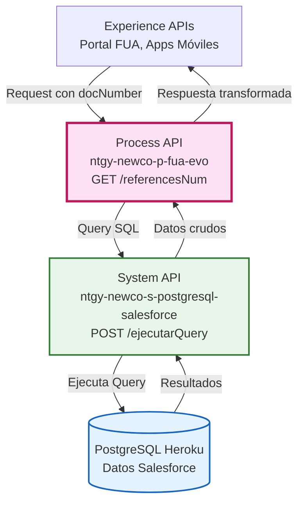
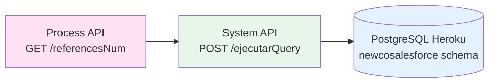
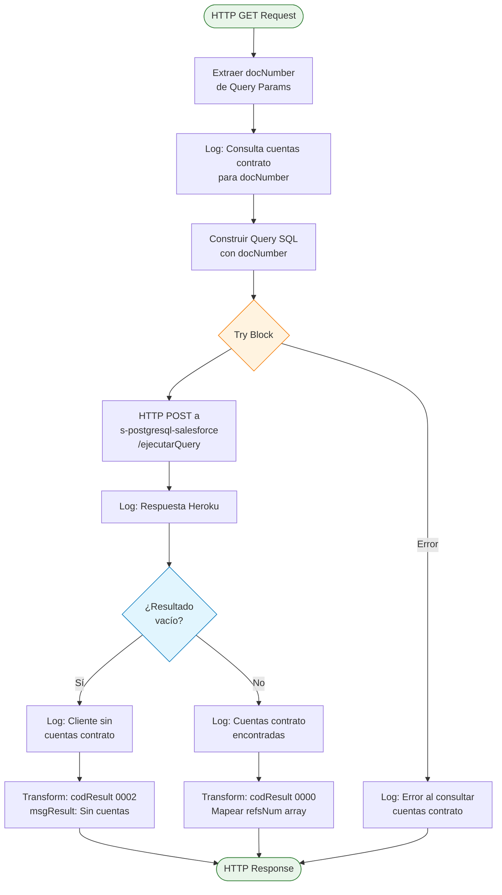
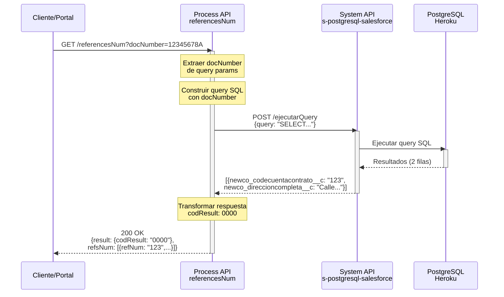
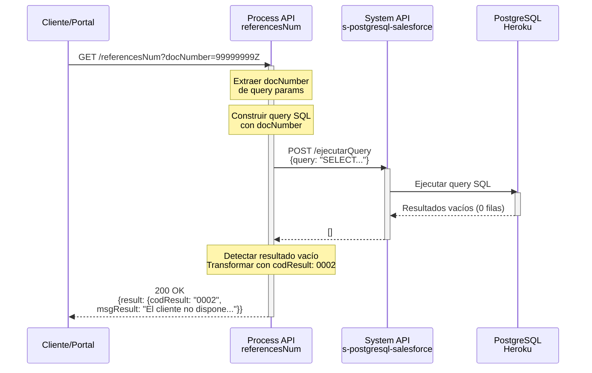
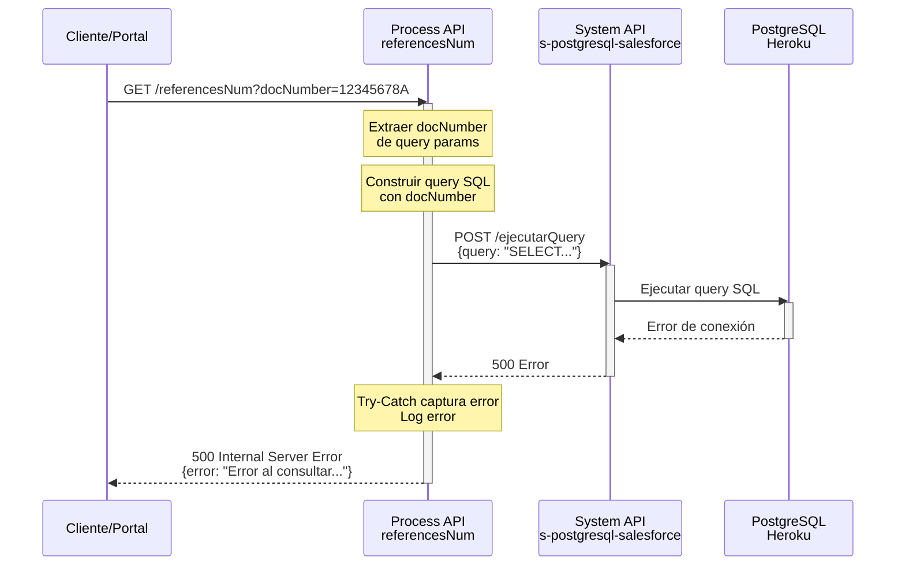

# GET /referencesNum

## 📌 Descripción General

### Propósito del Endpoint

Este endpoint recupera la lista de cuentas contrato (billing accounts) asociadas a un cliente específico, junto con sus direcciones de suministro completas. Consulta datos de Salesforce almacenados en PostgreSQL (Heroku) mediante una query SQL que relaciona las entidades de cliente consumidor, cuenta de servicio, cuenta de facturación y dirección de suministro.

### Tipo de API

**Capa:** Process API (API-Led Connectivity)

**Función:** Orquestación de consulta de cuentas contrato desde Salesforce vía PostgreSQL

### Patrón de Integración

**Tipo:** Orquestación con Transformación

**Descripción:** El endpoint construye dinámicamente una query SQL que relaciona múltiples tablas de Salesforce, la envía al System API de PostgreSQL-Salesforce para su ejecución, y transforma la respuesta en un formato estandarizado con códigos de resultado.

### Arquitectura API-Led Connectivity



---

## 💼 Propósito del Negocio

### Casos de Uso Principales

1. **Consulta de Cuentas Contrato del Cliente**
   - Un cliente accede al portal FUA y necesita ver todas sus cuentas contrato activas
   - El sistema muestra el código de cuenta contrato y la dirección completa de suministro
   - Permite al cliente identificar cada punto de suministro de forma clara

2. **Gestión de Múltiples Suministros**
   - Clientes con varios puntos de suministro pueden visualizar todas sus cuentas
   - Facilita la selección de la cuenta específica para operaciones posteriores
   - Mejora la experiencia de usuario al mostrar direcciones completas

3. **Validación de Relación Cliente-Cuenta**
   - Verifica que el cliente tenga cuentas contrato asociadas
   - Proporciona feedback claro cuando no existen cuentas contrato
   - Previene errores en flujos posteriores que requieren cuenta contrato

### 🔗 Endpoints Dependientes

Este Process API consume el siguiente System API:

| System API | Endpoint | Método | Propósito |
|------------|----------|--------|-----------|
| `ntgy-newco-s-postgresql-salesforce` | `/ejecutarQuery` | POST | Ejecuta query SQL en PostgreSQL con datos de Salesforce |

### Lógica de Orquestación



**Pasos del Proceso:**

1. **Paso 1**: Recibe el número de documento del cliente (docNumber) como query parameter
2. **Paso 2**: Construye query SQL que relaciona 4 tablas de Salesforce (account x3, premises)
3. **Paso 3**: Envía query al System API de PostgreSQL-Salesforce para ejecución
4. **Paso 4**: Evalúa si hay resultados y transforma la respuesta con códigos estándar

### Transformaciones Aplicadas

**Transformación de Request:**

| Campo de Entrada | Uso en Query SQL | Descripción |
|------------------|------------------|-------------|
| `docNumber` (query param) | `acn_fld_documentnumber__c` | Número de documento del cliente consumidor |

**Transformación de Response:**

| Campo Original (PostgreSQL) | Campo Transformado (API) | Transformación |
|-----------------------------|--------------------------|----------------|
| `newco_codecuentacontrato__c` | `refNum` | Código de cuenta contrato |
| `newco_direccioncompleta__c` | `fullAddress` | Dirección completa de suministro |
| N/A | `result.codResult` | Código de resultado: "0000" (éxito) o "0002" (sin datos) |
| N/A | `result.msgResult` | Mensaje descriptivo del resultado |

### Contexto Empresarial

- **Dominio:** Gestión de Clientes y Cuentas Contrato
- **Sector:** Energía - Utilities
- **División:** Naturgy España - NewCo
- **Proceso de Negocio:** Consulta de información de cuentas contrato para autoservicio del cliente

### Stakeholders

- **Clientes Naturgy**: Necesitan visualizar sus cuentas contrato y direcciones de suministro
- **Agentes de Call Center**: Requieren acceso rápido a las cuentas del cliente para gestión
- **Equipo de Desarrollo FUA**: Consume este endpoint para funcionalidades del portal

### Valor de Negocio

- **Autoservicio del Cliente**: Permite a los clientes consultar sus cuentas sin llamar al call center
- **Reducción de Costes Operativos**: Disminuye la carga de consultas básicas en el call center
- **Mejora de Experiencia**: Proporciona información clara y completa de las cuentas contrato
- **Trazabilidad**: Relaciona correctamente cliente → cuenta servicio → cuenta facturación → dirección

### Consumidores Potenciales

Este endpoint puede ser consumido por:
- Portal web FUA
- Aplicaciones móviles de clientes
- Sistemas de agentes de call center
- Integraciones de terceros autorizados

---

## 🔧 Especificación Técnica

### URLs por Ambiente

| Ambiente | URL Base | URL Completa |
|----------|----------|--------------|
| **Local** | `http://localhost:8081` | `http://localhost:8081/api/referencesNum?docNumber={docNumber}` |
| **Development** | `https://ntgy-newco-p-fua-evo-dev.us-e2.cloudhub.io` | `https://ntgy-newco-p-fua-evo-dev.us-e2.cloudhub.io/api/referencesNum?docNumber={docNumber}` |
| **UAT** | `https://ntgy-newco-p-fua-evo-uat.us-e2.cloudhub.io` | `https://ntgy-newco-p-fua-evo-uat.us-e2.cloudhub.io/api/referencesNum?docNumber={docNumber}` |
| **Production** | `https://ntgy-newco-p-fua-evo-pro.us-e2.cloudhub.io` | `https://ntgy-newco-p-fua-evo-pro.us-e2.cloudhub.io/api/referencesNum?docNumber={docNumber}` |

### Método HTTP

```
GET /api/referencesNum
```

### Parámetros de Entrada

#### Query Parameters

| Parámetro | Tipo | Requerido | Descripción | Ejemplo |
|-----------|------|-----------|-------------|---------|
| `docNumber` | string | ✅ Sí | Número de documento del cliente (DNI/NIE/CIF) | "12345678A" |

**Validaciones:**
- El parámetro `docNumber` es obligatorio
- Se utiliza directamente en la query SQL para filtrar por cliente

### Respuestas

#### 200 OK - Éxito con Datos

```json
{
  "result": {
    "codResult": "0000",
    "msgResult": "No hay error"
  },
  "refsNum": [
    {
      "refNum": "1234567890",
      "fullAddress": "Calle Example 123, 28001 Madrid"
    },
    {
      "refNum": "0987654321",
      "fullAddress": "Avenida Test 456, 08001 Barcelona"
    }
  ]
}
```

**Campos de Respuesta:**

| Campo | Tipo | Descripción |
|-------|------|-------------|
| `result.codResult` | string | Código de resultado: "0000" = éxito |
| `result.msgResult` | string | Mensaje descriptivo: "No hay error" |
| `refsNum` | array | Lista de cuentas contrato del cliente |
| `refsNum[].refNum` | string | Código de cuenta contrato |
| `refsNum[].fullAddress` | string | Dirección completa de suministro |

#### 200 OK - Sin Datos

```json
{
  "result": {
    "codResult": "0002",
    "msgResult": "El cliente no dispone de cuentas contrato"
  }
}
```

**Descripción:** El cliente existe pero no tiene cuentas contrato asociadas.

#### 400 Bad Request

```json
{
  "error": "Missing required query parameter: docNumber"
}
```

**Descripción:** El parámetro `docNumber` no fue proporcionado.

#### 500 Internal Server Error

```json
{
  "error": "Error al consultar las cuentas contrato",
  "details": "Error message details"
}
```

**Descripción:** Error al ejecutar la query en PostgreSQL o error de conexión.

### Autenticación

- **Tipo:** Client ID & Client Secret (Anypoint Platform)
- **Headers requeridos:**
  - `client_id`: ID del cliente de la aplicación
  - `client_secret`: Secret del cliente de la aplicación

### Timeouts

| Tipo | Valor |
|------|-------|
| **Request Timeout** | 60 segundos |
| **Connection Timeout** | 30 segundos |

---

## 🏗️ Implementación Técnica

### Arquitectura del Flow



### Query SQL Ejecutada

**Ubicación en código:** Línea de transformación DataWeave en el subflow `referencesNum`

```sql
SELECT DISTINCT 
  billingAccount.newco_codecuentacontrato__c, 
  supplyAddress.NewCo_DireccionCompleta__c  
FROM newcosalesforce.account billingAccount, 
  newcosalesforce.account serviceAccount, 
  newcosalesforce.account consumerAccount, 
  newcosalesforce.vlocity_cmt__Premises__c supplyAddress 
WHERE serviceAccount.parentid = consumerAccount.sfid  
  AND serviceAccount.vlocity_cmt__premisesid__c = supplyAddress.sfid 
  AND billingAccount.newco_serviceaccount__c = serviceAccount.sfid  
  AND consumeraccount.acn_fld_documentnumber__c = '{docNumber}'
```

**Descripción de la Query:**

La query relaciona 4 entidades de Salesforce:
1. **consumerAccount**: Cuenta del cliente consumidor (filtrada por docNumber)
2. **serviceAccount**: Cuenta de servicio (hijo de consumerAccount)
3. **billingAccount**: Cuenta de facturación (asociada a serviceAccount)
4. **supplyAddress**: Dirección de suministro (premises asociado a serviceAccount)

**Relaciones:**
- `serviceAccount.parentid = consumerAccount.sfid` → Servicio pertenece a consumidor
- `serviceAccount.vlocity_cmt__premisesid__c = supplyAddress.sfid` → Servicio tiene dirección
- `billingAccount.newco_serviceaccount__c = serviceAccount.sfid` → Facturación asociada a servicio

### Tablas de Salesforce Consultadas

| Tabla | Alias | Campos Utilizados | Propósito |
|-------|-------|-------------------|-----------|
| `newcosalesforce.account` | `consumerAccount` | `sfid`, `acn_fld_documentnumber__c` | Cliente consumidor (filtro por docNumber) |
| `newcosalesforce.account` | `serviceAccount` | `sfid`, `parentid`, `vlocity_cmt__premisesid__c` | Cuenta de servicio (relación) |
| `newcosalesforce.account` | `billingAccount` | `sfid`, `newco_codecuentacontrato__c`, `newco_serviceaccount__c` | Cuenta de facturación (resultado) |
| `newcosalesforce.vlocity_cmt__Premises__c` | `supplyAddress` | `sfid`, `NewCo_DireccionCompleta__c` | Dirección de suministro (resultado) |

### Transformaciones DataWeave

#### 1. Construcción de Query SQL

**Ubicación:** Variable `query` en el flow

```dataweave
%dw 2.0
output application/json
---
{
    "query": "select distinct billingAccount.newco_codecuentacontrato__c, supplyAddress.NewCo_DireccionCompleta__c  from newcosalesforce.account billingAccount, newcosalesforce.account serviceAccount, newcosalesforce.account consumerAccount, newcosalesforce.vlocity_cmt__Premises__c supplyAddress where serviceAccount.parentid = consumerAccount.sfid  and serviceAccount.vlocity_cmt__premisesid__c  = supplyAddress.sfid and billingAccount.newco_serviceaccount__c = serviceAccount.sfid  and consumeraccount.acn_fld_documentnumber__c = '" ++ vars.docNumber ++ "'"
}
```

**Descripción:** Construye el objeto JSON con la query SQL, concatenando el `docNumber` del cliente.

#### 2. Transformación de Respuesta con Datos

**Ubicación:** Transform "Response heroku" en el flow

```dataweave
%dw 2.0
output application/json
---
{
  "result": {
    "codResult": "0000",
    "msgResult": "No hay error"
  },
  "refsNum": vars.postgresResultRefNum map ((item, index) -> {
      "refNum": item.newco_codecuentacontrato__c,
      "fullAddress": item.newco_direccioncompleta__c
  })
}
```

**Descripción:** Transforma el resultado de PostgreSQL en el formato estándar de respuesta, mapeando los campos de Salesforce a la estructura del API.

#### 3. Transformación de Respuesta Sin Datos

**Ubicación:** Transform "El cliente no dispone de cuentas contrato" en el flow

```dataweave
%dw 2.0
output application/json
---
{
  "result": {
    "codResult": "0002",
    "msgResult": "El cliente no dispone de cuentas contrato"
  }
}
```

**Descripción:** Respuesta estandarizada cuando no se encuentran cuentas contrato para el cliente.

### Patrones de Diseño

**Patrón:** Request-Reply con Transformación y Manejo de Casos de Negocio

**Justificación:** 
- El endpoint necesita consultar datos de Salesforce de forma síncrona
- Requiere transformación de la query SQL y de la respuesta
- Debe manejar el caso de negocio "sin datos" de forma explícita (código 0002)
- Utiliza try-catch para manejo robusto de errores de conexión

### Diagramas de Secuencia

#### 1. Flujo Normal de Éxito (Con Datos)



#### 2. Flujo Sin Datos (Cliente Sin Cuentas Contrato)



#### 3. Flujo con Error Técnico



### Manejo de Errores

**Estrategia:** Try-Catch con On-Error-Continue

**Errores Manejados:**

1. **Error de Conexión a PostgreSQL**
   - **Causa:** System API no disponible o timeout
   - **Acción:** Log del error, continuar flujo
   - **Respuesta:** 500 Internal Server Error

2. **Error en Ejecución de Query**
   - **Causa:** Query SQL inválida o error en base de datos
   - **Acción:** Log del error, continuar flujo
   - **Respuesta:** 500 Internal Server Error

3. **Resultado Vacío (No es error)**
   - **Causa:** Cliente sin cuentas contrato
   - **Acción:** Transformar a respuesta con código 0002
   - **Respuesta:** 200 OK con mensaje descriptivo

**Logging:**
- Log de inicio con docNumber
- Log de respuesta de Heroku
- Log específico para caso sin datos
- Log de error en caso de excepción

---

## 💻 Ejemplos de Uso

### Ejemplo 1: Consulta Exitosa con Múltiples Cuentas

#### cURL

```bash
curl -X GET "https://ntgy-newco-p-fua-evo-dev.us-e2.cloudhub.io/api/referencesNum?docNumber=12345678A" \
  -H "Content-Type: application/json" \
  -H "client_id: YOUR_CLIENT_ID" \
  -H "client_secret: YOUR_CLIENT_SECRET"
```

#### Respuesta (200 OK)

```json
{
  "result": {
    "codResult": "0000",
    "msgResult": "No hay error"
  },
  "refsNum": [
    {
      "refNum": "1234567890",
      "fullAddress": "Calle Mayor 123, 28001 Madrid, España"
    },
    {
      "refNum": "0987654321",
      "fullAddress": "Avenida Diagonal 456, 08001 Barcelona, España"
    }
  ]
}
```

### Ejemplo 2: Cliente Sin Cuentas Contrato

#### cURL

```bash
curl -X GET "https://ntgy-newco-p-fua-evo-dev.us-e2.cloudhub.io/api/referencesNum?docNumber=99999999Z" \
  -H "Content-Type: application/json" \
  -H "client_id: YOUR_CLIENT_ID" \
  -H "client_secret: YOUR_CLIENT_SECRET"
```

#### Respuesta (200 OK)

```json
{
  "result": {
    "codResult": "0002",
    "msgResult": "El cliente no dispone de cuentas contrato"
  }
}
```

### Ejemplo 3: JavaScript (Fetch API)

```javascript
const docNumber = '12345678A';

const response = await fetch(
  `https://ntgy-newco-p-fua-evo-dev.us-e2.cloudhub.io/api/referencesNum?docNumber=${docNumber}`,
  {
    method: 'GET',
    headers: {
      'Content-Type': 'application/json',
      'client_id': 'YOUR_CLIENT_ID',
      'client_secret': 'YOUR_CLIENT_SECRET'
    }
  }
);

const data = await response.json();

if (data.result.codResult === '0000') {
  console.log('Cuentas contrato encontradas:', data.refsNum.length);
  data.refsNum.forEach(account => {
    console.log(`- ${account.refNum}: ${account.fullAddress}`);
  });
} else if (data.result.codResult === '0002') {
  console.log('El cliente no tiene cuentas contrato');
} else {
  console.error('Error:', data.result.msgResult);
}
```

### Ejemplo 4: Python (Requests)

```python
import requests

doc_number = '12345678A'

response = requests.get(
    f'https://ntgy-newco-p-fua-evo-dev.us-e2.cloudhub.io/api/referencesNum',
    params={'docNumber': doc_number},
    headers={
        'Content-Type': 'application/json',
        'client_id': 'YOUR_CLIENT_ID',
        'client_secret': 'YOUR_CLIENT_SECRET'
    }
)

data = response.json()

if data['result']['codResult'] == '0000':
    print(f"Cuentas contrato encontradas: {len(data['refsNum'])}")
    for account in data['refsNum']:
        print(f"- {account['refNum']}: {account['fullAddress']}")
elif data['result']['codResult'] == '0002':
    print("El cliente no tiene cuentas contrato")
else:
    print(f"Error: {data['result']['msgResult']}")
```

### Ejemplo 5: Manejo de Errores

#### cURL - Parámetro Faltante

```bash
curl -X GET "https://ntgy-newco-p-fua-evo-dev.us-e2.cloudhub.io/api/referencesNum" \
  -H "Content-Type: application/json" \
  -H "client_id: YOUR_CLIENT_ID" \
  -H "client_secret: YOUR_CLIENT_SECRET"
```

#### Respuesta (400 Bad Request)

```json
{
  "error": "Missing required query parameter: docNumber"
}
```

### Ejemplo 6: Integración en Portal FUA

```javascript
// Función para obtener cuentas contrato del cliente
async function getCustomerAccounts(docNumber) {
  try {
    const response = await fetch(
      `${API_BASE_URL}/api/referencesNum?docNumber=${docNumber}`,
      {
        method: 'GET',
        headers: {
          'Content-Type': 'application/json',
          'client_id': CLIENT_ID,
          'client_secret': CLIENT_SECRET
        }
      }
    );

    if (!response.ok) {
      throw new Error(`HTTP error! status: ${response.status}`);
    }

    const data = await response.json();

    if (data.result.codResult === '0000') {
      // Cliente con cuentas contrato
      return {
        success: true,
        accounts: data.refsNum,
        message: `Se encontraron ${data.refsNum.length} cuenta(s) contrato`
      };
    } else if (data.result.codResult === '0002') {
      // Cliente sin cuentas contrato
      return {
        success: true,
        accounts: [],
        message: 'El cliente no dispone de cuentas contrato'
      };
    } else {
      // Otro código de resultado
      return {
        success: false,
        accounts: [],
        message: data.result.msgResult
      };
    }
  } catch (error) {
    console.error('Error al obtener cuentas contrato:', error);
    return {
      success: false,
      accounts: [],
      message: 'Error al consultar las cuentas contrato'
    };
  }
}

// Uso en la aplicación
const result = await getCustomerAccounts('12345678A');

if (result.success && result.accounts.length > 0) {
  // Mostrar lista de cuentas en la UI
  displayAccountsList(result.accounts);
} else {
  // Mostrar mensaje al usuario
  showMessage(result.message);
}