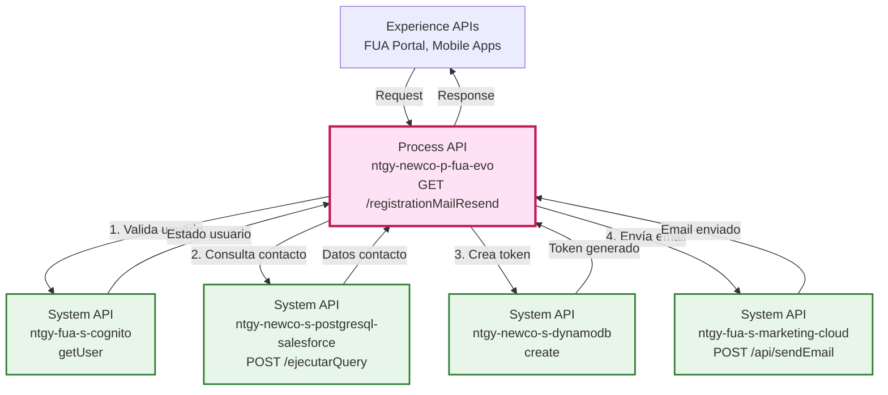
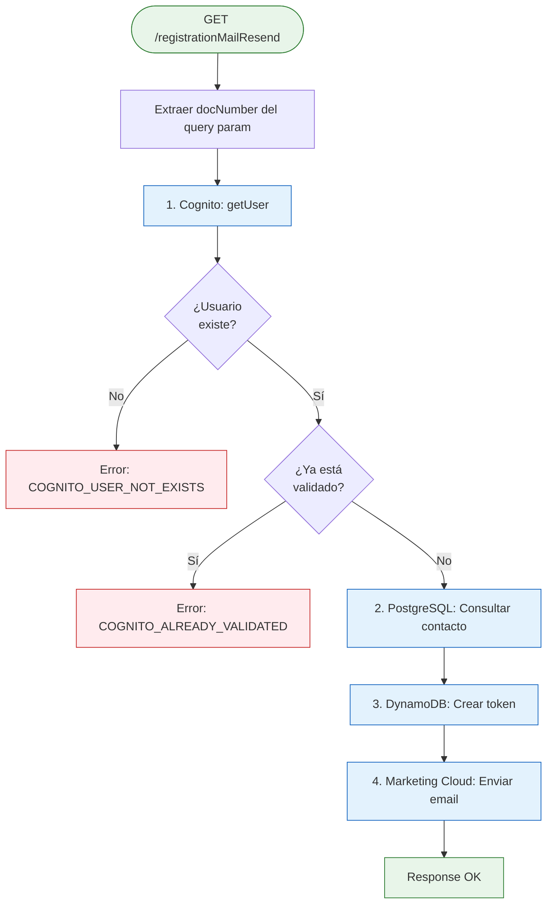
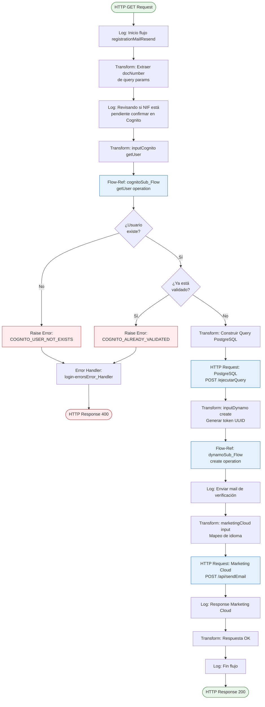
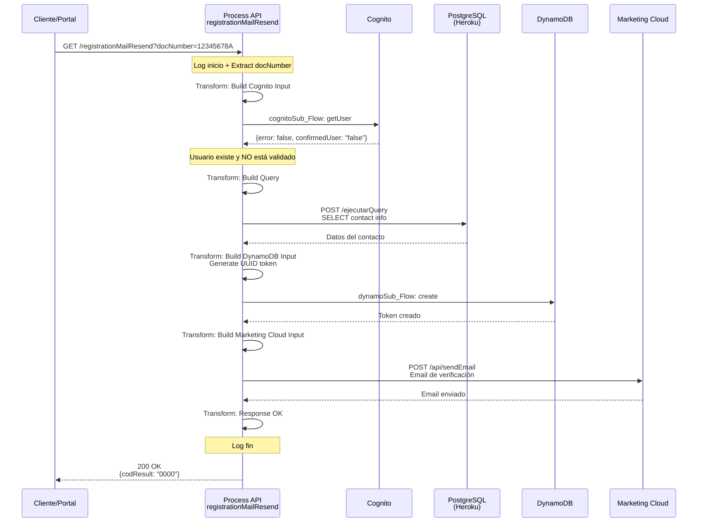
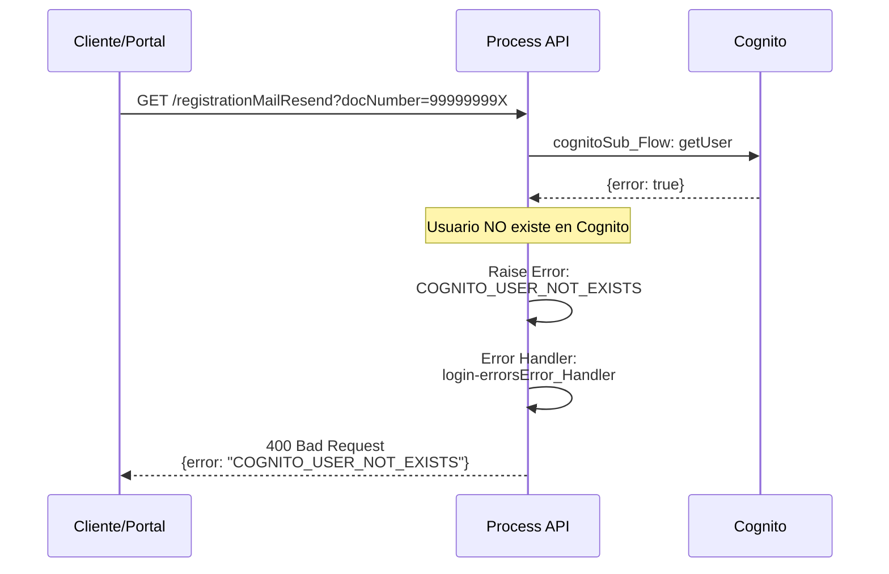
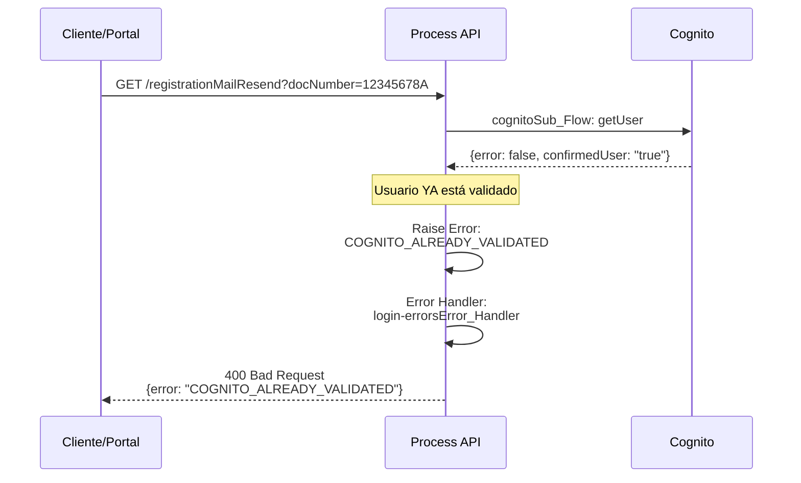

# GET /registrationMailResend

## 📌 Descripción General

### Propósito del Endpoint

Este endpoint orquesta el proceso de reenvío del email de verificación para usuarios que iniciaron su registro pero no han confirmado su cuenta. Valida el estado del usuario en Cognito, consulta su información en PostgreSQL, genera un nuevo token en DynamoDB y envía el email de verificación a través de Marketing Cloud.

### Tipo de API

**Capa:** Process API (API-Led Connectivity)

**Función:** Orquestación del proceso de reenvío de email de registro

### Patrón de Integración

**Tipo:** Orquestación Multi-Sistema con Validaciones

**Descripción:** Coordina validaciones en Cognito, consulta en PostgreSQL, creación de token en DynamoDB y envío de email por Marketing Cloud

### Arquitectura API-Led Connectivity



---

## 💼 Propósito del Negocio

### Casos de Uso Principales

1. **Recuperación de Proceso de Registro**
   - Usuario inició registro pero no recibió o perdió el email de verificación
   - Permite reenviar el email sin reiniciar todo el proceso
   - Beneficio: Mejora la experiencia de usuario y reduce abandono

2. **Validación de Estado de Usuario**
   - Verifica que el usuario existe en Cognito
   - Confirma que el usuario está pendiente de validación
   - Beneficio: Previene reenvíos innecesarios a usuarios ya validados

3. **Generación de Nuevo Token**
   - Crea un nuevo token de verificación con fecha de expiración
   - Registra la operación en DynamoDB para auditoría
   - Beneficio: Seguridad y trazabilidad del proceso

### 🔗 Endpoints Dependientes

Este Process API consume los siguientes System APIs:

| System API | Endpoint | Método | Propósito |
|------------|----------|--------|-----------|
| `ntgy-fua-s-cognito` | `/cognitoSub_Flow` | Flow-Ref | Valida estado del usuario en Cognito |
| `ntgy-newco-s-postgresql-salesforce` | `/ejecutarQuery` | POST | Consulta información del contacto |
| `ntgy-newco-s-dynamodb` | `/dynamoSub_Flow` | Flow-Ref | Crea registro de token |
| `ntgy-fua-s-marketing-cloud` | `/api/sendEmail` | POST | Envía email de verificación |

### Lógica de Orquestación



**Pasos del Proceso:**

1. **Validación Cognito**: Verifica que el usuario existe y está pendiente de confirmación
2. **Consulta PostgreSQL**: Obtiene información del contacto (email, idioma, teléfono, nombre)
3. **Generación Token**: Crea registro en DynamoDB con token UUID y fecha de expiración
4. **Envío Email**: Envía email de verificación en el idioma preferido del usuario

### Transformaciones Aplicadas

| Campo Original (PostgreSQL) | Campo Transformado (DynamoDB/Marketing Cloud) | Transformación |
|-----------------------------|-----------------------------------------------|----------------|
| `contact.sfid` | `contactId` | Pass-through |
| `contact.email` | `email` | Pass-through |
| `contact.newco_preferredlanguage__c` | `idioma` | Mapeo: Euskera→euskera, Gallego→gallego, Catalán→catalan, default→castellano |
| `contact.mobilephone` | `phone` | Pass-through |
| `contact.name` | `name` | Pass-through con default "" |
| N/A | `token` | Generación: uuid() |
| N/A | `tokenExpirationDate` | Cálculo: now() + caducidad (configurado en properties) |

### Contexto Empresarial

- **Dominio:** Gestión de Usuarios y Autenticación
- **Sector:** Energía - Utilities
- **División:** Naturgy España - NewCo
- **Proceso de Negocio:** Registro y verificación de usuarios en FUA

### Stakeholders

- **Clientes Nuevos**: Necesitan completar su registro para acceder al portal
- **Equipo de Atención al Cliente**: Gestiona solicitudes de reenvío de emails
- **Equipo de Seguridad**: Audita procesos de registro y tokens
- **Equipo de Marketing**: Gestiona templates de emails de verificación

### Valor de Negocio

- **Reducción de Abandono**: Facilita completar el registro sin reiniciar
- **Experiencia de Usuario**: Proceso simple y rápido de recuperación
- **Seguridad**: Tokens con expiración y auditoría completa
- **Trazabilidad**: Registro de todas las operaciones de reenvío

### Consumidores Potenciales

Este endpoint puede ser consumido por:
- Portal web FUA (Frontal Único de Atención)
- Aplicaciones móviles de clientes
- Sistemas de agentes de call center
- Procesos automatizados de recuperación de registro

---

## 🔧 Especificación Técnica

### URLs por Ambiente

| Ambiente | URL Base | URL Completa |
|----------|----------|--------------|
| **Local** | `http://localhost:8081` | `http://localhost:8081/api/registrationMailResend?docNumber=12345678A` |
| **Development** | `https://ntgy-newco-p-fua-evo-dev.us-e2.cloudhub.io` | `https://ntgy-newco-p-fua-evo-dev.us-e2.cloudhub.io/api/registrationMailResend?docNumber=12345678A` |
| **UAT** | `https://ntgy-newco-p-fua-evo-uat.us-e2.cloudhub.io` | `https://ntgy-newco-p-fua-evo-uat.us-e2.cloudhub.io/api/registrationMailResend?docNumber=12345678A` |
| **Production** | `https://ntgy-newco-p-fua-evo-pro.us-e2.cloudhub.io` | `https://ntgy-newco-p-fua-evo-pro.us-e2.cloudhub.io/api/registrationMailResend?docNumber=12345678A` |

### Método HTTP

```
GET /api/registrationMailResend
```

### Parámetros de Entrada

#### Query Parameters

| Parámetro | Tipo | Obligatorio | Descripción | Ejemplo |
|-----------|------|-------------|-------------|---------|
| `docNumber` | string | ✅ Sí | Número de documento (DNI/NIE) del usuario | "12345678A" |

**Validaciones:**
- `docNumber`: Debe corresponder a un usuario registrado en Cognito
- El usuario debe estar en estado "pendiente de confirmación"
- El usuario NO debe estar ya validado

### Respuestas

#### 200 OK - Email Reenviado Exitosamente

```json
{
  "result": {
    "codResult": "0000",
    "msgResult": "No hay error"
  }
}
```

| Campo | Tipo | Descripción |
|-------|------|-------------|
| `result.codResult` | string | Código de resultado ("0000" = éxito) |
| `result.msgResult` | string | Mensaje descriptivo del resultado |

#### 400 Bad Request - Usuario No Existe en Cognito

```json
{
  "error": {
    "code": "APP:COGNITO_USER_NOT_EXISTS",
    "message": "El usuario no existe en Cognito",
    "timestamp": "2026-09-02T13:20:46Z"
  }
}
```

#### 400 Bad Request - Usuario Ya Validado

```json
{
  "error": {
    "code": "APP:COGNITO_ALREADY_VALIDATED",
    "message": "El usuario ya ha sido validado",
    "timestamp": "2026-09-02T13:20:46Z"
  }
}
```

#### 500 Internal Server Error - Error en PostgreSQL

```json
{
  "error": {
    "code": "APP:POSTGRESQL_SALESFORCE",
    "message": "Error al consultar la base de datos PostgreSQL",
    "timestamp": "2026-09-02T13:20:46Z"
  }
}
```

#### 500 Internal Server Error - Error en Marketing Cloud

```json
{
  "error": {
    "code": "APP:MARKETING_CLOUD",
    "message": "Error al enviar email de verificación",
    "timestamp": "2026-09-02T13:20:46Z"
  }
}
```

### Autenticación

- **Tipo:** Client ID & Client Secret (Anypoint Platform)
- **Headers:** `client_id` y `client_secret` en cada request

### Timeouts

| Tipo | Valor |
|------|-------|
| **Request Timeout** | 60 segundos |
| **Connection Timeout** | 30 segundos |
| **Cognito Timeout** | 30 segundos |
| **PostgreSQL Query Timeout** | 30 segundos |
| **DynamoDB Timeout** | 30 segundos |
| **Marketing Cloud Timeout** | 30 segundos |

---

## 🏗️ Implementación Técnica

### Arquitectura del Flow



### Transformaciones DataWeave

#### 1. Extracción de docNumber (Líneas 11-20)

```dataweave
%dw 2.0
output application/json
---
attributes.queryParams.docNumber
```

**Propósito:** Extrae el parámetro docNumber de los query parameters y lo almacena en variable.

#### 2. Construcción de Input Cognito (Líneas 22-30)

```dataweave
%dw 2.0
output application/json
---
{
    "username": vars.docNumber,
    "operation": "getUser"
}
```

**Propósito:** Prepara el input para consultar el estado del usuario en Cognito.

**Operación:** `getUser` - Obtiene información del usuario y su estado de confirmación

#### 3. Construcción de Query PostgreSQL (Líneas 37-45)

```dataweave
%dw 2.0
output application/json
---
{
    "query": "select contact.sfid as contactId,
              contact.email,
              contact.newco_preferredlanguage__c as idioma,
              contact.mobilephone,
              contact.name 
              from newcosalesforce.contact contact 
              where contact.newco_documentnumber__c = '" ++ vars.docNumber ++ "'"
}
```

**Propósito:** Construye query SQL para obtener información completa del contacto.

**Tablas Consultadas:**
- `newcosalesforce.contact`: Datos del contacto en Salesforce

#### 4. Construcción de Input DynamoDB (Líneas 46-72)

```dataweave
%dw 2.0
output application/json

var caducidad = Mule::p('s-marketing-cloud.caducidad') as Period

var expirationDate = ((now() + caducidad) >> "CET") as String {
    format: "dd-MM-yyyy HH:mm:ss"
}
---
{
    "body": {
        "docNumber": vars.docNumber,
        "docType": "NIF",
        "accountId": "",
        "contactId": vars.contactInfo[0].contactid,
        "idioma": vars.contactInfo[0].idioma,
        "phone": vars.contactInfo[0].mobilephone,
        "email": vars.contactInfo[0].email default "",
        "name": vars.contactInfo[0].name default "",
        "status": "PENDING",
        "token": uuid(),
        "operation": "RegistrationMailResend",
        "emailUpdated": "Y",
        "rol": "",
        "tokenExpirationDate": expirationDate
    },
    "operationDynamo": "create",
    "table": p('fua-s-dynamo.tables.tableRegistration')
}
```

**Propósito:** Crea registro en DynamoDB con token de verificación y fecha de expiración.

**Campos Clave:**
- `token`: UUID generado automáticamente
- `tokenExpirationDate`: Fecha calculada (now() + período de caducidad configurado)
- `status`: "PENDING" (pendiente de validación)
- `operation`: "RegistrationMailResend" (para auditoría)

#### 5. Construcción de Input Marketing Cloud (Líneas 74-98)

```dataweave
%dw 2.0
output application/json

var idioma = vars.contactInfo[0].idioma match {
    case "Euskera" -> "euskera"
    case "Gallego" -> "gallego"
    case "Catalán" -> "catalan"
    else -> "castellano"
}
---
{
    "contactKey": vars.contactInfo[0].contactid,
    "eventDefinitionKey": p('s-marketing-cloud.eventDefinitionKeyLog'),
    "data": {
        "subscriberKey": vars.contactInfo[0].contactid,
        "ContactKey": vars.contactInfo[0].contactid,
        "emailAddress": vars.contactInfo[0].email,
        "nombre": vars.contactInfo[0].name default "",
        "tipoEmail": p('s-marketing-cloud.emailType.verificacionAC'),
        "token": vars.inputDynamo.body.token,
        "idioma": idioma
    }
}
```

**Propósito:** Construye payload para Marketing Cloud con token y datos del usuario.

**Mapeo de Idiomas:**
- Euskera → euskera
- Gallego → gallego
- Catalán → catalan
- Otros → castellano (default)

### Operaciones de Base de Datos

#### Query PostgreSQL (Línea 46)

**Endpoint:** `POST /ejecutarQuery` (System API: ntgy-newco-s-postgresql-salesforce)

**Query SQL:**
```sql
SELECT 
    contact.sfid AS contactId,
    contact.email,
    contact.newco_preferredlanguage__c AS idioma,
    contact.mobilephone,
    contact.name
FROM newcosalesforce.contact contact
WHERE contact.newco_documentnumber__c = :docNumber
```

**Tablas:**
- `newcosalesforce.contact`: Datos de contactos

**Operaciones:** READ

### Operaciones Cognito

**Flow-Ref:** `cognitoSub_Flow` (Línea 31)

**Operación:** `getUser`

**Input:**
```json
{
  "username": "12345678A",
  "operation": "getUser"
}
```

**Output Esperado:**
```json
{
  "error": false,
  "confirmedUser": "false"
}
```

**Validaciones:**
- Si `error == true` → Usuario no existe → Error `COGNITO_USER_NOT_EXISTS`
- Si `confirmedUser == "true"` → Usuario ya validado → Error `COGNITO_ALREADY_VALIDATED`

### Operaciones DynamoDB

**Flow-Ref:** `dynamoSub_Flow` (Línea 73)

**Tabla:** Configurada en properties (`fua-s-dynamo.tables.tableRegistration`)

**Operación:** `create`

**Campos del Registro:**
- `docNumber`: Número de documento
- `docType`: "NIF"
- `contactId`: ID del contacto en Salesforce
- `token`: UUID generado
- `status`: "PENDING"
- `operation`: "RegistrationMailResend"
- `tokenExpirationDate`: Fecha de expiración calculada

### Integración Marketing Cloud

**Endpoint:** `POST /api/sendEmail` (System API: ntgy-fua-s-marketing-cloud)

**Parámetros:**
- `contactKey`: ID del contacto en Salesforce
- `eventDefinitionKey`: Clave del evento de login (configurado en properties)
- `data.tipoEmail`: Tipo de email (`verificacionAC`)
- `data.token`: Token de verificación generado
- `data.idioma`: Idioma del email (castellano/euskera/gallego/catalan)

### Patrones de Diseño

**Patrón:** Saga Pattern (Orquestación)

**Justificación:** 
- Coordina múltiples operaciones en diferentes sistemas
- Mantiene consistencia entre Cognito, PostgreSQL, DynamoDB y Marketing Cloud
- Validaciones tempranas previenen operaciones innecesarias

**Patrón:** Guard Clauses (Validaciones Tempranas)

**Justificación:**
- Valida estado en Cognito antes de proceder
- Previene reenvíos a usuarios ya validados
- Reduce carga en sistemas downstream

### Diagramas de Secuencia

#### 1. Flujo Normal de Éxito



#### 2. Flujo con Error - Usuario No Existe



#### 3. Flujo con Error - Usuario Ya Validado



### Manejo de Errores

#### Errores de Negocio

| Error Type | HTTP Status | Descripción | Acción |
|------------|-------------|-------------|--------|
| `APP:COGNITO_USER_NOT_EXISTS` | 400 | El usuario no existe en Cognito | Verificar que el usuario se haya registrado |
| `APP:COGNITO_ALREADY_VALIDATED` | 400 | El usuario ya ha sido validado | Informar al usuario que puede iniciar sesión |

#### Errores Técnicos

| Error Type | HTTP Status | Descripción | Acción |
|------------|-------------|-------------|--------|
| `APP:POSTGRESQL_SALESFORCE` | 500 | Error al consultar PostgreSQL | Reintentar, verificar conectividad |
| `APP:MARKETING_CLOUD` | 500 | Error al enviar email | Revisar configuración de Marketing Cloud |
| `COGNITO:*` | 500 | Error en operaciones Cognito | Verificar credenciales y configuración |
| `DYNAMODB:*` | 500 | Error en operaciones DynamoDB | Verificar permisos y conectividad |

#### Error Handler

**Referencia:** `login-errorsError_Handler`

**Estrategia:**
- Errores de negocio: Retornar 400 con mensaje descriptivo
- Errores técnicos: Retornar 500 con código de error específico
- Logging completo de todos los errores para auditoría

---

## 💻 Ejemplos de Uso

### Ejemplo 1: Reenvío Exitoso

#### cURL

```bash
curl -X GET "https://ntgy-newco-p-fua-evo-dev.us-e2.cloudhub.io/api/registrationMailResend?docNumber=12345678A" \
  -H "Content-Type: application/json" \
  -H "client_id: YOUR_CLIENT_ID" \
  -H "client_secret: YOUR_CLIENT_SECRET"
```

#### Respuesta (200 OK)

```json
{
  "result": {
    "codResult": "0000",
    "msgResult": "No hay error"
  }
}
```

**Resultado:**
- ✅ Usuario validado en Cognito (existe y está pendiente)
- ✅ Información del contacto obtenida de PostgreSQL
- ✅ Nuevo token generado en DynamoDB
- ✅ Email de verificación enviado al usuario

### Ejemplo 2: Error - Usuario No Existe

#### cURL

```bash
curl -X GET "https://ntgy-newco-p-fua-evo-dev.us-e2.cloudhub.io/api/registrationMailResend?docNumber=99999999X" \
  -H "Content-Type: application/json" \
  -H "client_id: YOUR_CLIENT_ID" \
  -H "client_secret: YOUR_CLIENT_SECRET"
```

#### Respuesta (400 Bad Request)

```json
{
  "error": {
    "code": "APP:COGNITO_USER_NOT_EXISTS",
    "message": "El usuario no existe en Cognito",
    "timestamp": "2026-09-02T13:20:46Z"
  }
}
```

### Ejemplo 3: Error - Usuario Ya Validado

#### cURL

```bash
curl -X GET "https://ntgy-newco-p-fua-evo-dev.us-e2.cloudhub.io/api/registrationMailResend?docNumber=87654321B" \
  -H "Content-Type: application/json" \
  -H "client_id: YOUR_CLIENT_ID" \
  -H "client_secret: YOUR_CLIENT_SECRET"
```

#### Respuesta (400 Bad Request)

```json
{
  "error": {
    "code": "APP:COGNITO_ALREADY_VALIDATED",
    "message": "El usuario ya ha sido validado",
    "timestamp": "2026-09-02T13:20:46Z"
  }
}
```

### Ejemplo 4: JavaScript (Fetch API)

```javascript
const resendRegistrationEmail = async (docNumber) => {
  try {
    const response = await fetch(
      `https://ntgy-newco-p-fua-evo-dev.us-e2.cloudhub.io/api/registrationMailResend?docNumber=${docNumber}`,
      {
        method: 'GET',
        headers: {
          'Content-Type': 'application/json',
          'client_id': 'YOUR_CLIENT_ID',
          'client_secret': 'YOUR_CLIENT_SECRET'
        }
      }
    );

    if (!response.ok) {
      const error = await response.json();
      
      if (error.error.code === 'APP:COGNITO_USER_NOT_EXISTS') {
        throw new Error('Usuario no encontrado. Por favor, regístrese primero.');
      } else if (error.error.code === 'APP:COGNITO_ALREADY_VALIDATED') {
        throw new Error('Su cuenta ya está validada. Puede iniciar sesión.');
      } else {
        throw new Error(`Error ${response.status}: ${error.error.message}`);
      }
    }

    const data = await response.json();
    console.log('Email de verificación reenviado exitosamente:', data);
    return data;
  } catch (error) {
    console.error('Error al reenviar email:', error);
    throw error;
  }
};

// Uso
resendRegistrationEmail('12345678A')
  .then(result => {
    console.log('Éxito:', result);
    alert('Se ha reenviado el email de verificación. Por favor, revise su bandeja de entrada.');
  })
  .catch(error => {
    console.error('Error:', error);
    alert(error.message);
  });
```

### Ejemplo 5: Python (Requests)

```python
import requests
import json

def resend_registration_email(doc_number):
    """
    Reenvía el email de verificación de registro
    
    Args:
        doc_number (str): Número de documento del usuario
    
    Returns:
        dict: Respuesta del API
    """
    url = f"https://ntgy-newco-p-fua-evo-dev.us-e2.cloudhub.io/api/registrationMailResend"
    
    headers = {
        'Content-Type': 'application/json',
        'client_id': 'YOUR_CLIENT_ID',
        'client_secret': 'YOUR_CLIENT_SECRET'
    }
    
    params = {
        'docNumber': doc_number
    }
    
    try:
        response = requests.get(url, headers=headers, params=params, timeout=60)
        response.raise_for_status()
        
        result = response.json()
        print(f"✅ Email de verificación reenviado exitosamente")
        print(f"Código: {result['result']['codResult']}")
        print(f"Mensaje: {result['result']['msgResult']}")
        return result
        
    except requests.exceptions.HTTPError as e:
        if response.status_code == 400:
            error_data = response.json()
            error_code = error_data['error']['code']
            
            if error_code == 'APP:COGNITO_USER_NOT_EXISTS':
                print(f"❌ Usuario no encontrado. Por favor, regístrese primero.")
            elif error_code == 'APP:COGNITO_ALREADY_VALIDATED':
                print(f"❌ Su cuenta ya está validada. Puede iniciar sesión.")
            else:
                print(f"❌ Error de negocio: {error_data['error']['message']}")
        elif response.status_code == 500:
            error_data = response.json()
            print(f"❌ Error técnico: {error_data['error']['message']}")
        raise
    except requests.exceptions.RequestException as e:
        print(f"❌ Error de conexión: {str(e)}")
        raise

# Uso
try:
    result = resend_registration_email('12345678A')
    print(f"Resultado: {json.dumps(result, indent=2)}")
except Exception as e:
    print(f"Error: {str(e)}")
```

### Ejemplo 6: Postman Collection

```json
{
  "info": {
    "name": "Registration Mail Resend",
    "schema": "https://schema.getpostman.com/json/collection/v2.1.0/collection.json"
  },
  "item": [
    {
      "name": "Resend Registration Email - Success",
      "request": {
        "method": "GET",
        "header": [
          {
            "key": "Content-Type",
            "value": "application/json"
          },
          {
            "key": "client_id",
            "value": "{{client_id}}"
          },
          {
            "key": "client_secret",
            "value": "{{client_secret}}"
          }
        ],
        "url": {
          "raw": "{{base_url}}/api/registrationMailResend?docNumber=12345678A",
          "host": ["{{base_url}}"],
          "path": ["api", "registrationMailResend"],
          "query": [
            {
              "key": "docNumber",
              "value": "12345678A"
            }
          ]
        }
      }
    },
    {
      "name": "Resend Registration Email - User Not Exists",
      "request": {
        "method": "GET",
        "header": [
          {
            "key": "Content-Type",
            "value": "application/json"
          },
          {
            "key": "client_id",
            "value": "{{client_id}}"
          },
          {
            "key": "client_secret",
            "value": "{{client_secret}}"
          }
        ],
        "url": {
          "raw": "{{base_url}}/api/registrationMailResend?docNumber=99999999X",
          "host": ["{{base_url}}"],
          "path": ["api", "registrationMailResend"],
          "query": [
            {
              "key": "docNumber",
              "value": "99999999X"
            }
          ]
        }
      }
    },
    {
      "name": "Resend Registration Email - Already Validated",
      "request": {
        "method": "GET",
        "header": [
          {
            "key": "Content-Type",
            "value": "application/json"
          },
          {
            "key": "client_id",
            "value": "{{client_id}}"
          },
          {
            "key": "client_secret",
            "value": "{{client_secret}}"
          }
        ],
        "url": {
          "raw": "{{base_url}}/api/registrationMailResend?docNumber=87654321B",
          "host": ["{{base_url}}"],
          "path": ["api", "registrationMailResend"],
          "query": [
            {
              "key": "docNumber",
              "value": "87654321B"
            }
          ]
        }
      }
    }
  ]
}
```
