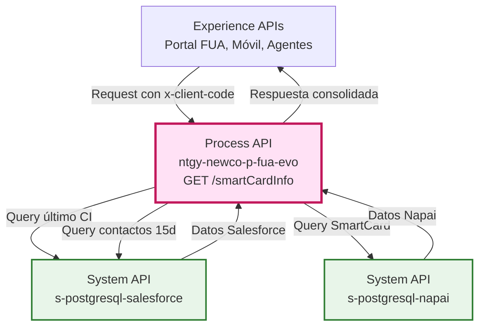
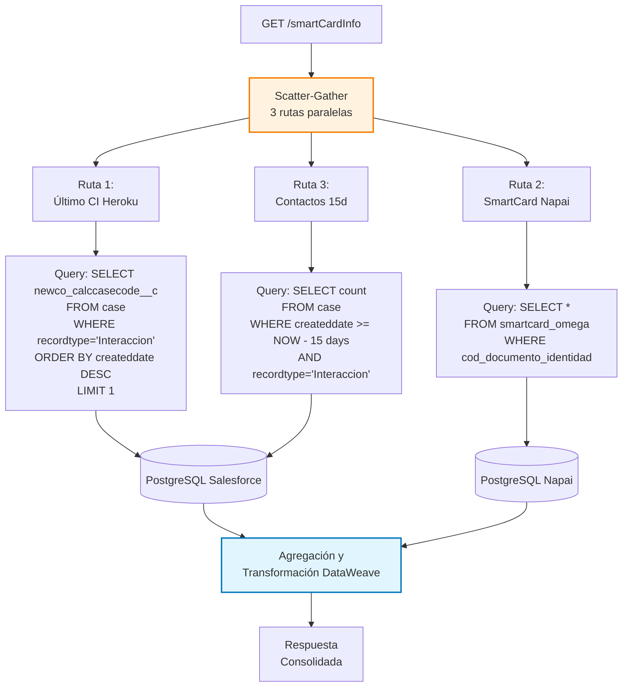
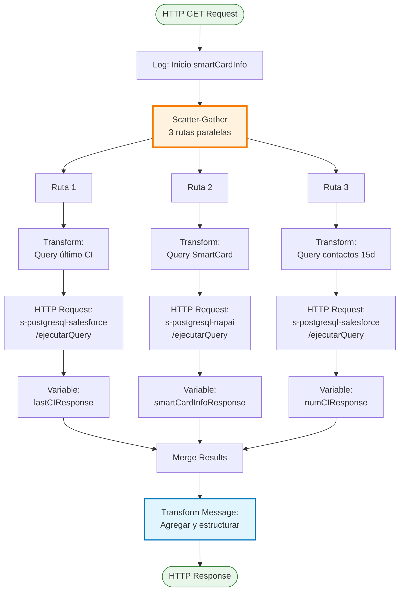
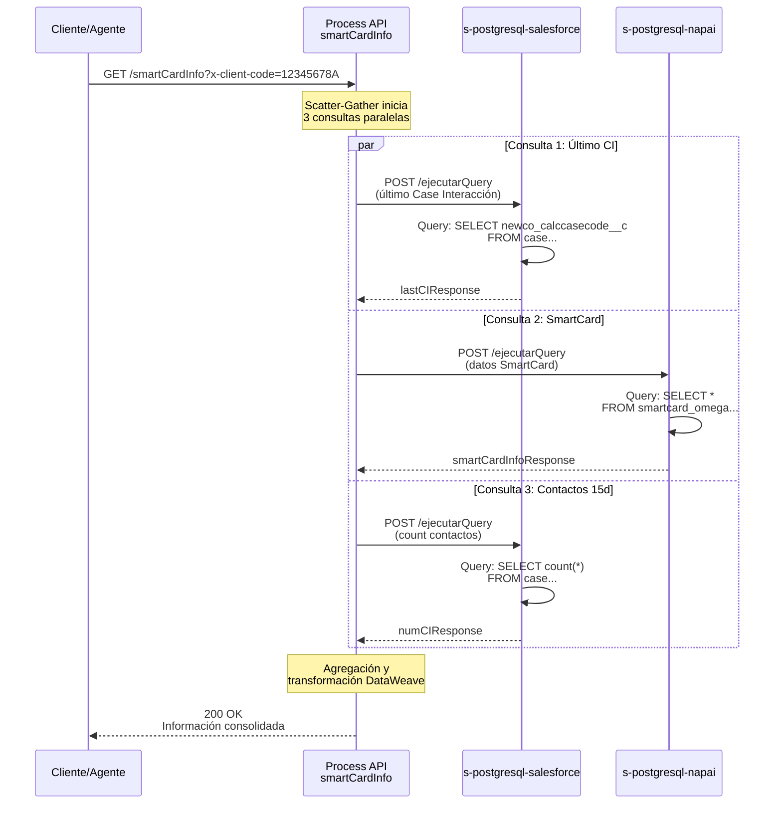
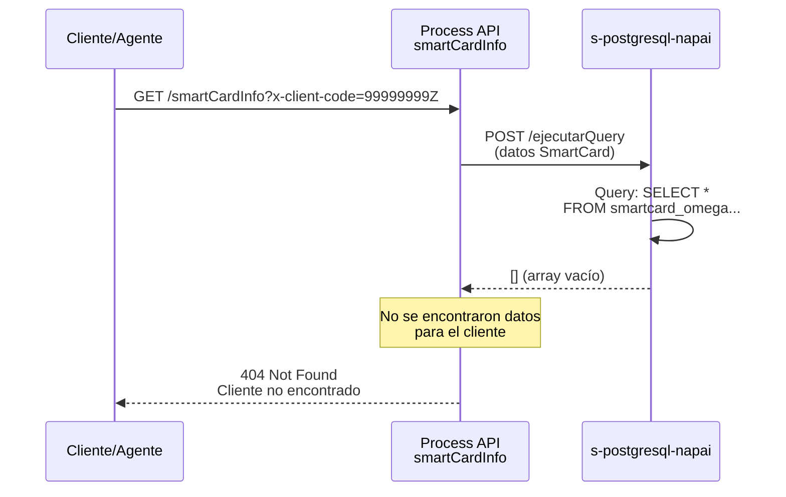
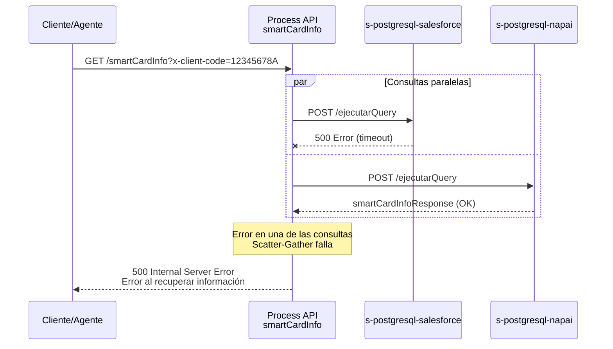

# GET /smartCardInfo

## 📌 Descripción General

### Propósito del Endpoint

Este endpoint recupera información consolidada del cliente para la funcionalidad SmartCard, agregando datos de múltiples fuentes (Napai y Salesforce) en una única respuesta. Proporciona una vista completa del historial del cliente incluyendo antigüedad, última llamada, satisfacción en encuestas y actividad reciente.

### Tipo de API

**Capa:** Process API (API-Led Connectivity)

**Función:** Orquestación y agregación de datos de cliente desde múltiples System APIs

### Patrón de Integración

**Tipo:** Orquestación con Scatter-Gather

**Descripción:** Utiliza el patrón Scatter-Gather para ejecutar 3 consultas en paralelo a diferentes bases de datos (Salesforce y Napai), agregando los resultados en una respuesta unificada.

### Arquitectura API-Led Connectivity



---

## 💼 Propósito del Negocio

### Casos de Uso Principales

1. **Vista 360° del Cliente para Agentes**
   - Proporciona información completa del cliente en una sola llamada
   - Facilita la atención personalizada con contexto histórico
   - Reduce tiempo de consulta al consolidar múltiples fuentes

2. **Análisis de Satisfacción y Engagement**
   - Muestra última encuesta de satisfacción del cliente
   - Indica frecuencia de contacto (últimos 15 días)
   - Permite identificar clientes con alta actividad

3. **Gestión de Riesgo Crediticio**
   - Incluye indicador ASNEF (morosidad)
   - Muestra antigüedad del cliente
   - Ayuda en decisiones de crédito y cobranza

### 🔗 Endpoints Dependientes

Este Process API consume los siguientes System APIs:

| System API | Endpoint | Método | Propósito |
|------------|----------|--------|-----------|
| `ntgy-newco-s-postgresql-salesforce` | `/ejecutarQuery` | POST | Obtener último código de interacción (Case) del cliente |
| `ntgy-newco-s-postgresql-napai` | `/ejecutarQuery` | POST | Obtener información completa de SmartCard desde tabla Omega |
| `ntgy-newco-s-postgresql-salesforce` | `/ejecutarQuery` | POST | Contar contactos del cliente en últimos 15 días |

### Lógica de Orquestación



**Pasos del Proceso:**

1. **Scatter-Gather Paralelo**: Ejecuta 3 consultas simultáneamente
   - Ruta 1: Último código de interacción en Salesforce
   - Ruta 2: Datos completos de SmartCard en Napai
   - Ruta 3: Conteo de contactos recientes en Salesforce

2. **Consultas SQL Específicas**:
   - **Último CI**: Obtiene el código del último Case de tipo Interacción
   - **SmartCard**: Recupera todos los datos de la tabla smartcard_omega
   - **Contactos 15d**: Cuenta Cases de los últimos 15 días

3. **Agregación y Transformación**: Combina las 3 respuestas en estructura unificada

### Transformaciones Aplicadas

| Campo Original (System APIs) | Campo Transformado (Process API) | Transformación |
|------------------------------|----------------------------------|----------------|
| `cod_cliente` | `codCliente` | Directo desde Napai |
| `cod_documento_identidad` | `docNumber` | Directo desde Napai |
| `primera_fec_activacion` | `fechaPrimeraActivacion` | Directo desde Napai |
| `antiguedad` | `antiguedad` | Directo desde Napai |
| `cliente_en_asnef` | `asnef` | Directo desde Napai |
| `count(*)` | `numContacto15d` | Directo desde Salesforce |
| `newco_calccasecode__c` | `codCIHrk` | Directo desde Salesforce |
| `fecha_ultima_encuesta` | `encuesta.fecha` | Anidado desde Napai |
| `satisfaccion_ultima_encuesta` | `encuesta.nota` | Anidado desde Napai |
| `caso_interaccion_ultima_llamada` | `ultLlamada.codCINap` | Anidado desde Napai |
| `fecha_ultima_llamada` | `ultLlamada.fecha` | Anidado desde Napai |
| `motivo_ultima_llamada` | `ultLlamada.motivo` | Anidado desde Napai |
| `motivo_resuelto` | `ultLlamada.motivoResuelto` | Anidado desde Napai |
| `resumen_ultima_llamada` | `ultLlamada.resumen` | Anidado desde Napai |

### Contexto Empresarial

- **Dominio:** Gestión de Clientes y Atención al Cliente
- **Sector:** Energía - Utilities
- **División:** Naturgy España - NewCo
- **Proceso de Negocio:** Atención al Cliente - Vista 360° del Cliente

### Stakeholders

- **Agentes de Call Center**: Necesitan vista completa del cliente para atención personalizada
- **Supervisores de Atención**: Monitorean satisfacción y frecuencia de contacto
- **Área de Cobranza**: Utilizan indicador ASNEF y antigüedad para gestión de riesgo
- **Área de Calidad**: Analizan datos de satisfacción y resolución de motivos

### Valor de Negocio

- **Eficiencia Operativa**: Reduce tiempo de consulta al consolidar múltiples fuentes en una llamada
- **Mejora de Experiencia**: Permite atención más personalizada con contexto completo
- **Gestión de Riesgo**: Facilita identificación de clientes en ASNEF o con alta actividad
- **Calidad de Servicio**: Proporciona métricas de satisfacción y resolución

### Consumidores Potenciales

Este endpoint puede ser consumido por:
- Portales web de agentes de call center
- Aplicaciones de escritorio para atención al cliente
- Sistemas de CRM que requieren vista consolidada
- Dashboards de supervisión y calidad

---

## 🔧 Especificación Técnica

### URLs por Ambiente

| Ambiente | URL Base | URL Completa |
|----------|----------|--------------|
| **Local** | `http://localhost:8081` | `http://localhost:8081/api/smartCardInfo` |
| **Development** | `https://ntgy-newco-p-fua-evo-dev.us-e2.cloudhub.io` | `https://ntgy-newco-p-fua-evo-dev.us-e2.cloudhub.io/api/smartCardInfo` |
| **UAT** | `https://ntgy-newco-p-fua-evo-uat.us-e2.cloudhub.io` | `https://ntgy-newco-p-fua-evo-uat.us-e2.cloudhub.io/api/smartCardInfo` |
| **Production** | `https://ntgy-newco-p-fua-evo-pro.us-e2.cloudhub.io` | `https://ntgy-newco-p-fua-evo-pro.us-e2.cloudhub.io/api/smartCardInfo` |

### Método HTTP

```
GET /api/smartCardInfo
```

### Parámetros de Entrada

#### Query Parameters (Obligatorios)

| Parámetro | Tipo | Obligatorio | Descripción | Ejemplo |
|-----------|------|-------------|-------------|---------|
| `x-client-code` | string | ✅ Sí | Código de documento de identidad del cliente (DNI/NIE) | `12345678A` |

**Ejemplo de URL completa:**
```
GET /api/smartCardInfo?x-client-code=12345678A
```

### Respuestas

#### ✅ 200 OK - Éxito

**Descripción:** Información de SmartCard recuperada exitosamente

**Estructura de Respuesta:**

```json
{
  "codCliente": "string",
  "docNumber": "string",
  "fechaPrimeraActivacion": "date",
  "antiguedad": "number",
  "asnef": "boolean",
  "numContacto15d": "number",
  "codCIHrk": "string",
  "encuesta": {
    "fecha": "date",
    "nota": "number"
  },
  "ultLlamada": {
    "codCINap": "string",
    "fecha": "date",
    "motivo": "string",
    "motivoResuelto": "boolean",
    "resumen": "string"
  }
}
```

**Descripción de Campos:**

| Campo | Tipo | Descripción |
|-------|------|-------------|
| `codCliente` | string | Código interno del cliente en el sistema |
| `docNumber` | string | Número de documento de identidad (DNI/NIE) |
| `fechaPrimeraActivacion` | date | Fecha de primera activación del cliente |
| `antiguedad` | number | Antigüedad del cliente en días/meses |
| `asnef` | boolean | Indicador si el cliente está en ASNEF (morosidad) |
| `numContacto15d` | number | Número de contactos del cliente en últimos 15 días |
| `codCIHrk` | string | Código del último Case de Interacción en Heroku/Salesforce |
| `encuesta.fecha` | date | Fecha de la última encuesta de satisfacción |
| `encuesta.nota` | number | Nota de satisfacción de la última encuesta |
| `ultLlamada.codCINap` | string | Código del Case de la última llamada en Napai |
| `ultLlamada.fecha` | date | Fecha de la última llamada |
| `ultLlamada.motivo` | string | Motivo de la última llamada |
| `ultLlamada.motivoResuelto` | boolean | Indica si el motivo fue resuelto |
| `ultLlamada.resumen` | string | Resumen de la última llamada |

#### ❌ 400 Bad Request - Error de Validación

**Descripción:** Parámetro `x-client-code` faltante o inválido

```json
{
  "error": "Bad Request",
  "message": "Missing required parameter: x-client-code"
}
```

#### ❌ 404 Not Found - Cliente No Encontrado

**Descripción:** No se encontró información para el código de cliente proporcionado

```json
{
  "error": "Not Found",
  "message": "No SmartCard information found for client code: 12345678A"
}
```

#### ❌ 500 Internal Server Error - Error del Servidor

**Descripción:** Error al consultar bases de datos o procesar respuesta

```json
{
  "error": "Internal Server Error",
  "message": "Error retrieving SmartCard information"
}
```

### Autenticación

- **Tipo:** Client ID & Client Secret (Anypoint Platform)
- **Headers requeridos:**
  - `client_id`: ID de la aplicación cliente
  - `client_secret`: Secret de la aplicación cliente

### Timeouts

| Tipo | Valor |
|------|-------|
| **Request Timeout** | 60 segundos (por consultas múltiples) |
| **Connection Timeout** | 10 segundos |

---

## 🏗️ Implementación Técnica

### Arquitectura del Flow



### Queries SQL Ejecutadas

#### Query 1: Último Código de Interacción (Salesforce)

**Ubicación en código:** Línea 8-15 (smartCardInfo.xml)

```sql
SELECT c.newco_calccasecode__c 
FROM newcosalesforce.case c 
WHERE c.newco_recordtype__c = 'Interaccion' 
  AND c.newco_accountdocumentnumber__c = '{x-client-code}' 
ORDER BY c.createddate DESC 
LIMIT 1
```

**Propósito:** Obtener el código del último Case de tipo Interacción del cliente

**Tabla:** `newcosalesforce.case`

**Operación:** READ

#### Query 2: Información SmartCard (Napai)

**Ubicación en código:** Línea 23-30 (smartCardInfo.xml)

```sql
SELECT * 
FROM self_publication_sistemas.smartcard_omega so 
WHERE so.cod_documento_identidad = '{x-client-code}'
```

**Propósito:** Obtener toda la información de SmartCard del cliente desde tabla Omega

**Tabla:** `self_publication_sistemas.smartcard_omega`

**Operación:** READ

**Campos recuperados:**
- `cod_cliente`
- `cod_documento_identidad`
- `primera_fec_activacion`
- `antiguedad`
- `cliente_en_asnef`
- `fecha_ultima_encuesta`
- `satisfaccion_ultima_encuesta`
- `caso_interaccion_ultima_llamada`
- `fecha_ultima_llamada`
- `motivo_ultima_llamada`
- `motivo_resuelto`
- `resumen_ultima_llamada`

#### Query 3: Número de Contactos en 15 Días (Salesforce)

**Ubicación en código:** Línea 38-45 (smartCardInfo.xml)

```sql
SELECT count(*) 
FROM newcosalesforce.case c 
WHERE c.createddate >= NOW() - INTERVAL '15 days' 
  AND c.newco_recordtype__c = 'Interaccion' 
  AND c.newco_accountdocumentnumber__c = '{x-client-code}'
```

**Propósito:** Contar el número de Cases de Interacción del cliente en los últimos 15 días

**Tabla:** `newcosalesforce.case`

**Operación:** READ (COUNT)

### Transformaciones DataWeave

#### Transformación Final (Agregación)

**Ubicación en código:** Línea 50-73 (smartCardInfo.xml)

```dataweave
%dw 2.0
output application/json
var smIR = vars.smartCardInfoResponse[0]
var codCIHRK = vars.lastCIResponse[0].newco_calccasecode__c
---
{
    "codCliente": smIR.cod_cliente,
    "docNumber": smIR.cod_documento_identidad,
    "fechaPrimeraActivacion": smIR.primera_fec_activacion,
    "antiguedad": smIR.antiguedad,
    "asnef": smIR.cliente_en_asnef,
    "numContacto15d": vars.numCIResponse[0].count,
    "codCIHrk": codCIHRK,
    "encuesta": {
        "fecha": smIR.fecha_ultima_encuesta,
        "nota": smIR.satisfaccion_ultima_encuesta
    },
    "ultLlamada": {
        "codCINap": smIR.caso_interaccion_ultima_llamada,
        "fecha": smIR.fecha_ultima_llamada,
        "motivo": smIR.motivo_ultima_llamada,
        "motivoResuelto": smIR.motivo_resuelto,
        "resumen": smIR.resumen_ultima_llamada
    }
}
```

**Descripción:**
- Extrae datos de las 3 variables de respuesta
- Estructura la respuesta en formato JSON
- Anida información de encuesta y última llamada
- Mapea nombres de campos de base de datos a nombres de API

### Patrones de Diseño

**Patrón:** Scatter-Gather (Fan-Out/Fan-In)

**Justificación:** 
- Permite ejecutar 3 consultas independientes en paralelo
- Reduce tiempo total de respuesta (vs. secuencial)
- Cada consulta es independiente y no depende de las otras
- Mejora performance al aprovechar paralelismo

**Beneficios:**
- **Performance**: Tiempo total = MAX(query1, query2, query3) en lugar de SUM
- **Resiliencia**: Si una consulta falla, las otras continúan
- **Escalabilidad**: Fácil agregar nuevas consultas paralelas

### Diagramas de Secuencia

#### 1. Flujo Normal de Éxito



#### 2. Flujo con Cliente No Encontrado



#### 3. Flujo con Error en System API



### Manejo de Errores

**Estrategia:** Error handling a nivel de Scatter-Gather

**Comportamiento:**
- Si **cualquiera** de las 3 consultas falla, el Scatter-Gather falla
- No hay fallback parcial (requiere todas las respuestas)
- Los errores se propagan al cliente con código 500

**Errores Comunes:**

| Error | Causa | Código HTTP |
|-------|-------|-------------|
| Missing parameter | `x-client-code` no proporcionado | 400 |
| Cliente no encontrado | No existe en smartcard_omega | 404 |
| Timeout en consulta | Base de datos no responde | 500 |
| Error de conexión | System API no disponible | 500 |
| Error de transformación | Datos inválidos en respuesta | 500 |

**Logging:**
- Log de inicio: "Inicio smartCardInfo"
- Logs implícitos en cada HTTP request
- Logs de error en caso de fallo

---

## 💻 Ejemplos de Uso

### Ejemplo 1: Consulta Exitosa

#### cURL

```bash
curl -X GET "https://ntgy-newco-p-fua-evo-dev.us-e2.cloudhub.io/api/smartCardInfo?x-client-code=12345678A" \
  -H "Content-Type: application/json" \
  -H "client_id: YOUR_CLIENT_ID" \
  -H "client_secret: YOUR_CLIENT_SECRET"
```

#### Respuesta (200 OK)

```json
{
  "codCliente": "CLI001234",
  "docNumber": "12345678A",
  "fechaPrimeraActivacion": "2020-03-15",
  "antiguedad": 1460,
  "asnef": false,
  "numContacto15d": 3,
  "codCIHrk": "I0012345",
  "encuesta": {
    "fecha": "2024-01-10",
    "nota": 8.5
  },
  "ultLlamada": {
    "codCINap": "0012345",
    "fecha": "2024-01-15",
    "motivo": "Consulta factura",
    "motivoResuelto": true,
    "resumen": "Cliente consultó sobre importe de última factura. Se explicó desglose y quedó conforme."
  }
}
```

### Ejemplo 2: Cliente No Encontrado

#### cURL

```bash
curl -X GET "https://ntgy-newco-p-fua-evo-dev.us-e2.cloudhub.io/api/smartCardInfo?x-client-code=99999999Z" \
  -H "Content-Type: application/json" \
  -H "client_id: YOUR_CLIENT_ID" \
  -H "client_secret: YOUR_CLIENT_SECRET"
```

#### Respuesta (404 Not Found)

```json
{
  "error": "Not Found",
  "message": "No SmartCard information found for client code: 99999999Z"
}
```

### Ejemplo 3: JavaScript (Fetch API)

```javascript
const clientCode = '12345678A';

const response = await fetch(
  `https://ntgy-newco-p-fua-evo-dev.us-e2.cloudhub.io/api/smartCardInfo?x-client-code=${clientCode}`,
  {
    method: 'GET',
    headers: {
      'Content-Type': 'application/json',
      'client_id': 'YOUR_CLIENT_ID',
      'client_secret': 'YOUR_CLIENT_SECRET'
    }
  }
);

const data = await response.json();
console.log(data);
```

### Ejemplo 4: Python

```python
import requests

client_code = '12345678A'

response = requests.get(
    f'https://ntgy-newco-p-fua-evo-dev.us-e2.cloudhub.io/api/smartCardInfo',
    params={'x-client-code': client_code},
    headers={
        'Content-Type': 'application/json',
        'client_id': 'YOUR_CLIENT_ID',
        'client_secret': 'YOUR_CLIENT_SECRET'
    }
)

print(response.json())
```

### Ejemplo 5: Error de Parámetro Faltante

#### cURL

```bash
curl -X GET "https://ntgy-newco-p-fua-evo-dev.us-e2.cloudhub.io/api/smartCardInfo" \
  -H "Content-Type: application/json" \
  -H "client_id: YOUR_CLIENT_ID" \
  -H "client_secret: YOUR_CLIENT_SECRET"
```

#### Respuesta (400 Bad Request)

```json
{
  "error": "Bad Request",
  "message": "Missing required parameter: x-client-code"
}
```
