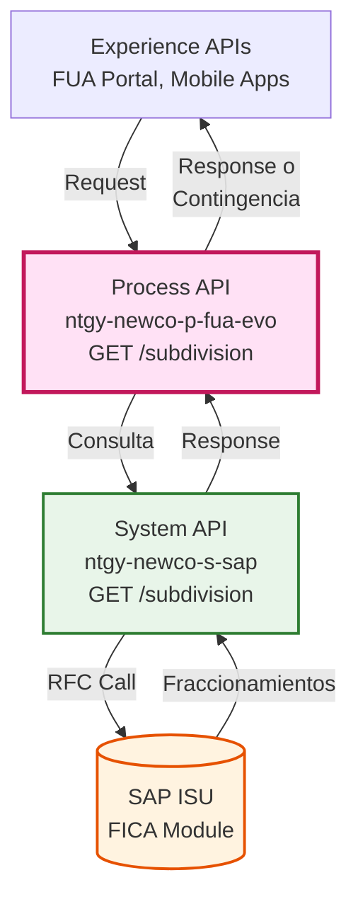
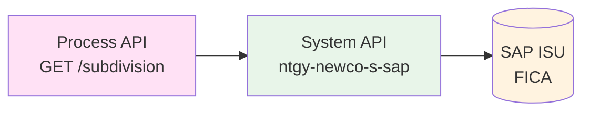
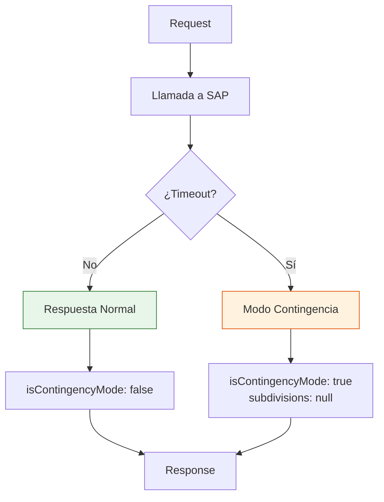
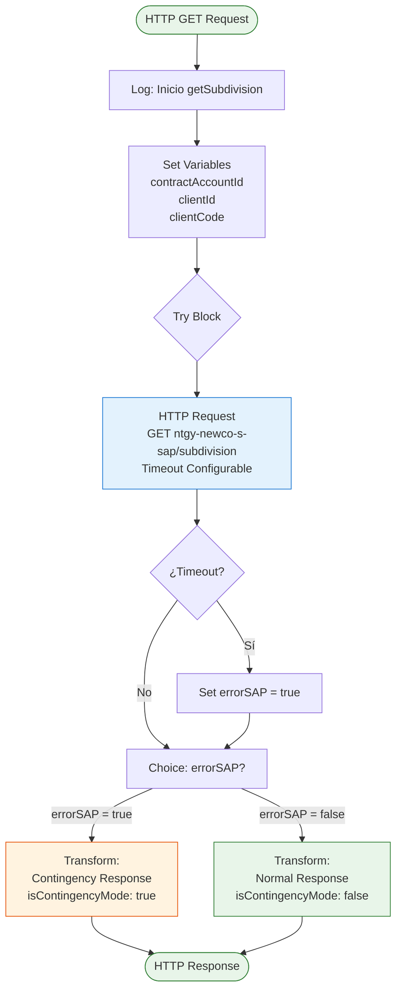
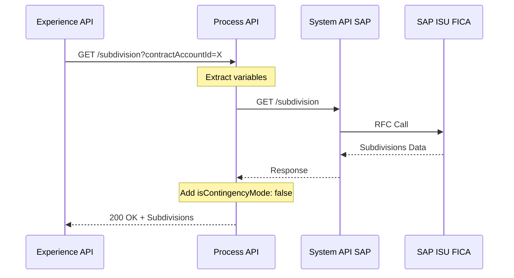
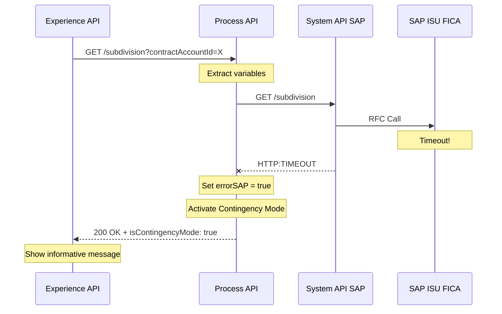
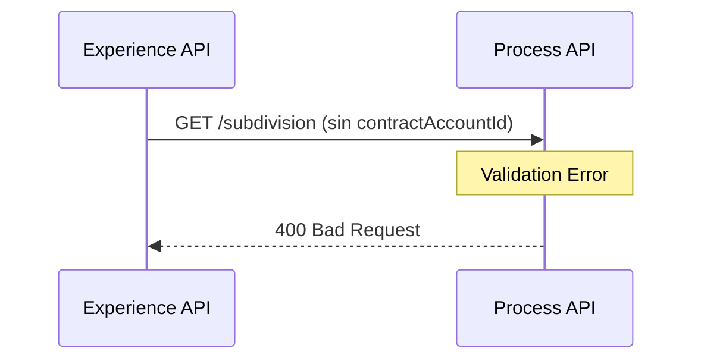

# GET /subdivision

## 📌 Descripción General

### Propósito del Endpoint

Este endpoint consulta los fraccionamientos de pago (planes de pago a plazos) activos asociados a una cuenta contrato específica en SAP ISU. Implementa un **modo de contingencia** que devuelve una respuesta controlada en caso de timeout del sistema SAP, garantizando la disponibilidad del servicio incluso cuando el backend no responde.

### Tipo de API

**Capa:** Process API (API-Led Connectivity)

**Función:** Orquestación de consulta de fraccionamientos con resiliencia

### Patrón de Integración

**Tipo:** Pass-Through con Contingencia

**Descripción:** Proxy directo al System API de SAP con manejo especial de timeouts mediante respuesta de contingencia que permite al frontend continuar operando sin bloquear la experiencia del usuario.

### Arquitectura API-Led Connectivity



---

## 💼 Propósito del Negocio

### Casos de Uso Principales

1. **Consulta de Planes de Pago Activos**
   - El cliente consulta sus fraccionamientos vigentes desde el portal FUA
   - Visualiza cuotas pendientes, importes y fechas de vencimiento
   - **Beneficio:** Transparencia en la gestión de deuda

2. **Validación de Elegibilidad para Nuevo Fraccionamiento**
   - El sistema verifica si el cliente tiene fraccionamientos activos
   - Determina si puede solicitar un nuevo plan de pago
   - **Beneficio:** Prevención de duplicados y control de riesgo

3. **Seguimiento de Pagos Fraccionados**
   - El agente de call center consulta el estado de fraccionamientos
   - Proporciona información actualizada al cliente
   - **Beneficio:** Mejor servicio al cliente y reducción de consultas

### 🔗 Endpoints Dependientes

Este Process API consume el siguiente System API:

| System API | Endpoint | Método | Propósito |
|------------|----------|--------|-----------|
| `ntgy-newco-s-sap` | `/subdivision` | GET | Consulta fraccionamientos en SAP ISU FICA |

### Lógica de Orquestación



**Pasos del Proceso:**

1. **Paso 1**: Recibe contractAccountId y clientId del cliente
2. **Paso 2**: Invoca System API de SAP con timeout configurado
3. **Paso 3**: Si timeout → Activa modo contingencia
4. **Paso 4**: Devuelve fraccionamientos o respuesta de contingencia

### Modo de Contingencia

**Característica Especial:** Este endpoint implementa un patrón de resiliencia único:



**Respuesta de Contingencia:**
```json
{
  "result": {
    "codResult": "0000",
    "msgResult": "No hay error"
  },
  "isContingencyMode": true,
  "subdivisions": null
}
```

**Beneficio:** El frontend puede mostrar un mensaje informativo sin bloquear la navegación del usuario.

### Transformaciones Aplicadas

⚠️ **Este Process API NO transforma la respuesta del System API.**

Solo añade el flag `isContingencyMode` para indicar si la respuesta es real o de contingencia.

Para el schema completo de fraccionamientos, consultar:
📖 **System API: `ntgy-newco-s-sap` endpoint `GET /subdivision`**

### Contexto Empresarial

- **Dominio:** Gestión de Pagos y Cobranza
- **Sector:** Energía - Utilities
- **División:** Naturgy España - NewCo
- **Proceso de Negocio:** Consulta de Fraccionamientos de Pago (FICA)

### Stakeholders

- **Clientes Residenciales**: Consultan sus planes de pago activos
- **Agentes de Call Center**: Proporcionan información sobre fraccionamientos
- **Departamento de Cobranza**: Monitorean cumplimiento de planes de pago
- **Equipo de Riesgo**: Evalúan exposición por fraccionamientos activos

### Valor de Negocio

- **Transparencia Financiera**: Cliente informado sobre sus compromisos de pago
- **Reducción de Consultas**: Autoservicio disminuye carga en call center
- **Mejora de Cobranza**: Seguimiento facilita cumplimiento de pagos
- **Resiliencia Operativa**: Modo contingencia garantiza disponibilidad del servicio

### Consumidores Potenciales

Este endpoint puede ser consumido por:
- Portal web FUA
- Aplicaciones móviles de clientes
- Sistemas de agentes de call center
- Dashboards de gestión de cobranza

---

## 🔧 Especificación Técnica

### URLs por Ambiente

| Ambiente | URL Base | URL Completa |
|----------|----------|--------------|
| **Local** | `http://localhost:8081` | `http://localhost:8081/api/subdivision?contractAccountId=:contractAccountId` |
| **Development** | `https://ntgy-newco-p-fua-evo-dev.us-e2.cloudhub.io` | `https://ntgy-newco-p-fua-evo-dev.us-e2.cloudhub.io/api/subdivision?contractAccountId=:contractAccountId` |
| **UAT** | `https://ntgy-newco-p-fua-evo-uat.us-e2.cloudhub.io` | `https://ntgy-newco-p-fua-evo-uat.us-e2.cloudhub.io/api/subdivision?contractAccountId=:contractAccountId` |
| **Production** | `https://ntgy-newco-p-fua-evo-pro.us-e2.cloudhub.io` | `https://ntgy-newco-p-fua-evo-pro.us-e2.cloudhub.io/api/subdivision?contractAccountId=:contractAccountId` |

### Método HTTP

```
GET /api/subdivision
```

### Parámetros de Entrada

#### Query Parameters (Obligatorios)

| Parámetro | Tipo | Obligatorio | Descripción | Ejemplo |
|-----------|------|-------------|-------------|---------|
| `contractAccountId` | string | ✅ Sí | Identificador de la cuenta contrato en SAP | `"200123456"` |
| `x-client-code` | string | ✅ Sí | Código del cliente (NIF/CIF) | `"12345678A"` |

#### Headers (Obligatorios)

| Header | Tipo | Obligatorio | Descripción | Ejemplo |
|--------|------|-------------|-------------|---------|
| `clientId` | string | ✅ Sí | Identificador único del cliente en Salesforce | `"0031w00000AbCdEFG"` |
| `Content-Type` | string | ✅ Sí | Tipo de contenido | `"application/json"` |

### Respuestas

#### 200 OK - Respuesta Normal

**Descripción:** Fraccionamientos recuperados exitosamente de SAP

```json
{
  "result": {
    "codResult": "0000",
    "msgResult": "No hay error"
  },
  "maxCancel": false,
  "maxSubdivision": false,
  "isContingencyMode": false,
  "subdivisions": [
    {
      "numRef": "1000123456",
      "numAgreement": "1000123456",
      "totalAmount": 500.00,
      "pendingAmount": 300.00,
      "state": "Activo",
      "dues": [
        {
          "idDue": "001",
          "numberDue": "1",
          "endDate": "2024-02-15 00:00:00",
          "amount": 100.00,
          "state": "Pagado"
        },
        {
          "idDue": "002",
          "numberDue": "2",
          "endDate": "2024-03-15 00:00:00",
          "amount": 100.00,
          "state": "Pendiente"
        }
      ],
      "associatedInvoicesId": ["1234567890"]
    }
  ]
}
```

**Campos Calculables (no vienen en la respuesta):**
- `installments`: Se puede calcular como `dues.length`
- `remainingInstallments`: Se puede calcular filtrando `dues` por `state == "Pendiente"`
- `paidInstallments`: Se puede calcular filtrando `dues` por `state == "Pagado"`
- `nextPaymentDate`: Se puede obtener de la primera cuota con `state == "Pendiente"`

#### 200 OK - Modo Contingencia (Timeout SAP)

**Descripción:** SAP no respondió a tiempo, se activa modo contingencia

```json
{
  "result": {
    "codResult": "0000",
    "msgResult": "No hay error"
  },
  "isContingencyMode": true,
  "subdivisions": null
}
```

**Interpretación:**
- `isContingencyMode: true` → El frontend debe mostrar mensaje informativo
- `subdivisions: null` → No hay datos disponibles temporalmente
- El usuario puede reintentar más tarde

#### 400 Bad Request

**Descripción:** Parámetros faltantes o inválidos

```json
{
  "code": "BAD_REQUEST",
  "message": "Parámetro contractAccountId es obligatorio",
  "timestamp": "2026-08-26T12:00:00Z"
}
```

#### 500 Internal Server Error

**Descripción:** Error interno del servidor

```json
{
  "code": "INTERNAL_ERROR",
  "message": "Error al procesar la solicitud",
  "timestamp": "2026-08-26T12:00:00Z"
}
```

### Autenticación

- **Tipo:** Client ID & Client Secret (Anypoint Platform)
- **Headers requeridos:** `client_id`, `client_secret`

### Timeouts

| Tipo | Valor | Configuración |
|------|-------|---------------|
| **Request Timeout (SAP)** | Configurable | `${ntgy-newco-s-sap.response.timeoutResilienciaSub}` |
| **Connection Timeout** | 10 segundos | Estándar HTTP connector |

**Nota:** El timeout específico para subdivision está configurado en properties para permitir ajustes sin redespliegue.

---

## 🏗️ Implementación Técnica

### Arquitectura del Flow



### Código del Flow (Simplificado)

**Archivo:** `src/main/mule/services/invoices/subdivision.xml`

**Subflow:** `getSubdivision`

```xml
<sub-flow name="getSubdivision">
    <logger level="INFO" message="Inicio getSubdivision"/>
    
    <!-- Extraer variables de query params y headers -->
    <ee:transform>
        <ee:variables>
            <ee:set-variable variableName="contractAccountId">
                attributes.queryParams.contractAccountId
            </ee:set-variable>
            <ee:set-variable variableName="clientId">
                attributes.headers['clientId']
            </ee:set-variable>
            <ee:set-variable variableName="clientCode">
                attributes.queryParams.'x-client-code'
            </ee:set-variable>
        </ee:variables>
    </ee:transform>
    
    <!-- Try-Catch para manejar timeout -->
    <try>
        <http:request 
            method="GET" 
            config-ref="HTTP_Request_ntgy-newco-s-sap" 
            path="${ntgy-newco-s-sap.functions.subdivision}"
            responseTimeout="${ntgy-newco-s-sap.response.timeoutResilienciaSub}">
            <http:headers>
                clientId: vars.clientId
            </http:headers>
            <http:query-params>
                refNum: vars.contractAccountId,
                clientId: vars.clientId,
                clientCode: vars.clientCode
            </http:query-params>
        </http:request>
        
        <error-handler>
            <on-error-continue type="HTTP:TIMEOUT">
                <set-variable variableName="errorSAP" value="true"/>
                <logger level="INFO" message="Timeout SAP - Activando contingencia"/>
            </on-error-continue>
        </error-handler>
    </try>
    
    <!-- Choice: Contingencia vs Normal -->
    <choice>
        <when expression="#[vars.errorSAP]">
            <!-- Respuesta de contingencia -->
            <ee:transform>
                <ee:set-payload>
                    {
                      "result": {
                        "codResult": "0000",
                        "msgResult": "No hay error"
                      },
                      "isContingencyMode": true,
                      "subdivisions": null
                    }
                </ee:set-payload>
            </ee:transform>
        </when>
        <otherwise>
            <!-- Respuesta normal de SAP -->
            <ee:transform>
                <ee:set-payload>
                    payload ++ {"isContingencyMode": false}
                </ee:set-payload>
            </ee:transform>
        </otherwise>
    </choice>
</sub-flow>
```

### Transformaciones DataWeave

#### Transformación 1: Extracción de Variables

**Ubicación:** Inline en flow (líneas 238-248)

```dataweave
%dw 2.0
output application/java
---
{
    contractAccountId: attributes.queryParams.contractAccountId,
    clientId: attributes.headers['clientId'],
    clientCode: attributes.queryParams.'x-client-code'
}
```

#### Transformación 2: Respuesta de Contingencia

**Ubicación:** Inline en flow (líneas 263-276)

```dataweave
%dw 2.0
output application/json
---
{
  "result": {
    "codResult": "0000",
    "msgResult": "No hay error"
  },
  "isContingencyMode": true,
  "subdivisions": null
}
```

#### Transformación 3: Respuesta Normal

**Ubicación:** Inline en flow (líneas 280-286)

```dataweave
%dw 2.0
output application/json
---
payload ++ {"isContingencyMode": false}
```

**Explicación:** Añade el flag `isContingencyMode: false` a la respuesta de SAP.

### Patrones de Diseño

#### Patrón 1: Circuit Breaker Simplificado

**Justificación:** Evita que timeouts de SAP bloqueen la experiencia del usuario

**Implementación:**
- Try-catch específico para `HTTP:TIMEOUT`
- Variable `errorSAP` como flag de estado
- Respuesta de contingencia predefinida

#### Patrón 2: Graceful Degradation

**Justificación:** El servicio continúa disponible aunque SAP no responda

**Implementación:**
- Respuesta válida con `isContingencyMode: true`
- Frontend puede mostrar mensaje informativo
- Usuario no bloqueado, puede continuar navegando

### Diagramas de Secuencia

#### 1. Flujo Normal de Éxito



#### 2. Flujo con Timeout (Contingencia)



#### 3. Flujo con Error de Validación



### Manejo de Errores

#### Estrategia de Resiliencia

| Tipo de Error | Acción | Respuesta |
|---------------|--------|-----------|
| **HTTP:TIMEOUT** | Activar contingencia | 200 OK con `isContingencyMode: true` |
| **Parámetros faltantes** | Validación RAML | 400 Bad Request |
| **Error SAP (no timeout)** | Propagar error | 500 Internal Server Error |
| **Error de conexión** | Retry automático | 3 intentos con backoff |

#### Configuración de Timeout

**Property:** `ntgy-newco-s-sap.response.timeoutResilienciaSub`

**Valores recomendados por ambiente:**
- **Local/Dev:** 30 segundos
- **UAT:** 20 segundos
- **Production:** 15 segundos

**Rationale:** Timeouts más cortos en producción para activar contingencia rápidamente.

---

## 💻 Ejemplos de Uso

### Ejemplo 1: Consulta Exitosa con Fraccionamientos

#### cURL

```bash
curl -X GET "https://ntgy-newco-p-fua-evo-dev.us-e2.cloudhub.io/api/subdivision?contractAccountId=200123456&x-client-code=12345678A" \
  -H "Content-Type: application/json" \
  -H "clientId: 0031w00000AbCdEFG" \
  -H "client_id: YOUR_CLIENT_ID" \
  -H "client_secret: YOUR_CLIENT_SECRET"
```

#### Respuesta (200 OK)

```json
{
  "result": {
    "codResult": "0000",
    "msgResult": "No hay error"
  },
  "maxCancel": false,
  "maxSubdivision": false,
  "isContingencyMode": false,
  "subdivisions": [
    {
      "numRef": "1000123456",
      "numAgreement": "1000123456",
      "totalAmount": 500.00,
      "pendingAmount": 300.00,
      "state": "Activo",
      "dues": [
        {
          "idDue": "001",
          "numberDue": "1",
          "endDate": "2024-02-15 00:00:00",
          "amount": 100.00,
          "state": "Pagado"
        },
        {
          "idDue": "002",
          "numberDue": "2",
          "endDate": "2024-03-15 00:00:00",
          "amount": 100.00,
          "state": "Pagado"
        },
        {
          "idDue": "003",
          "numberDue": "3",
          "endDate": "2024-04-15 00:00:00",
          "amount": 100.00,
          "state": "Pendiente"
        },
        {
          "idDue": "004",
          "numberDue": "4",
          "endDate": "2024-05-15 00:00:00",
          "amount": 100.00,
          "state": "Pendiente"
        },
        {
          "idDue": "005",
          "numberDue": "5",
          "endDate": "2024-06-15 00:00:00",
          "amount": 100.00,
          "state": "Pendiente"
        }
      ],
      "associatedInvoicesId": ["1234567890", "1234567891"]
    }
  ]
}
```

### Ejemplo 2: Timeout SAP - Modo Contingencia

#### cURL

```bash
curl -X GET "https://ntgy-newco-p-fua-evo-pro.us-e2.cloudhub.io/api/subdivision?contractAccountId=200123456&x-client-code=12345678A" \
  -H "Content-Type: application/json" \
  -H "clientId: 0031w00000AbCdEFG" \
  -H "client_id: YOUR_CLIENT_ID" \
  -H "client_secret: YOUR_CLIENT_SECRET"
```

#### Respuesta (200 OK - Contingencia)

```json
{
  "result": {
    "codResult": "0000",
    "msgResult": "No hay error"
  },
  "isContingencyMode": true,
  "subdivisions": null
}
```

**Interpretación para el Frontend:**

```javascript
if (response.isContingencyMode) {
  // Mostrar mensaje informativo al usuario
  showMessage({
    type: 'info',
    title: 'Información temporalmente no disponible',
    message: 'No podemos consultar tus fraccionamientos en este momento. Por favor, inténtalo de nuevo en unos minutos.',
    action: 'Reintentar'
  });
} else {
  // Mostrar fraccionamientos normalmente
  displaySubdivisions(response.subdivisions);
}
```

### Ejemplo 3: JavaScript con Manejo de Contingencia

```javascript
async function getSubdivisions(contractAccountId, clientId, clientCode) {
  try {
    const response = await fetch(
      `https://api.naturgy.com/subdivision?contractAccountId=${contractAccountId}&x-client-code=${clientCode}`,
      {
        method: 'GET',
        headers: {
          'Content-Type': 'application/json',
          'clientId': clientId,
          'client_id': 'YOUR_CLIENT_ID',
          'client_secret': 'YOUR_CLIENT_SECRET'
        }
      }
    );

    const data = await response.json();

    // Verificar modo contingencia
    if (data.isContingencyMode) {
      console.warn('SAP en modo contingencia - datos no disponibles');
      return {
        available: false,
        message: 'Servicio temporalmente no disponible',
        subdivisions: []
      };
    }

    // Datos disponibles
    return {
      available: true,
      subdivisions: data.subdivisions || []
    };

  } catch (error) {
    console.error('Error al consultar fraccionamientos:', error);
    throw error;
  }
}

// Uso
const result = await getSubdivisions('200123456', '0031w00000AbCdEFG', '12345678A');

if (result.available) {
  console.log(`Fraccionamientos encontrados: ${result.subdivisions.length}`);
  result.subdivisions.forEach(sub => {
    console.log(`- Ref: ${sub.numRef}, Cuotas restantes: ${sub.remainingInstallments}`);
  });
} else {
  console.log(result.message);
}
```

### Ejemplo 4: Python con Retry Logic

```python
import requests
import time
from typing import Optional, Dict, List

def get_subdivisions(
    contract_account_id: str,
    client_id: str,
    client_code: str,
    max_retries: int = 3
) -> Optional[Dict]:
    """
    Consulta fraccionamientos con retry automático en caso de contingencia
    """
    url = f"https://api.naturgy.com/subdivision"
    params = {
        'contractAccountId': contract_account_id,
        'x-client-code': client_code
    }
    headers = {
        'Content-Type': 'application/json',
        'clientId': client_id,
        'client_id': 'YOUR_CLIENT_ID',
        'client_secret': 'YOUR_CLIENT_SECRET'
    }
    
    for attempt in range(max_retries):
        try:
            response = requests.get(url, params=params, headers=headers, timeout=30)
            response.raise_for_status()
            
            data = response.json()
            
            # Si está en modo contingencia, reintentar
            if data.get('isContingencyMode'):
                print(f"Intento {attempt + 1}: Modo contingencia activo")
                if attempt < max_retries - 1:
                    time.sleep(2 ** attempt)  # Exponential backoff
                    continue
                else:
                    print("Máximo de reintentos alcanzado")
                    return None
            
            # Datos disponibles
            return {
                'available': True,
                'subdivisions': data.get('subdivisions', [])
            }
            
        except requests.exceptions.RequestException as e:
            print(f"Error en intento {attempt + 1}: {e}")
            if attempt < max_retries - 1:
                time.sleep(2 ** attempt)
            else:
                raise
    
    return None

# Uso
result = get_subdivisions('200123456', '0031w00000AbCdEFG', '12345678A')

if result and result['available']:
    subdivisions = result['subdivisions']
    print(f"Fraccionamientos encontrados: {len(subdivisions)}")
    
    for sub in subdivisions:
        print(f"Ref: {sub['numRef']}")
        print(f"  Importe total: {sub['totalAmount']} €")
        print(f"  Cuotas restantes: {sub['remainingInstallments']}/{sub['installments']}")
        print(f"  Próximo pago: {sub['nextPaymentDate']}")
        print()
else:
    print("No se pudieron obtener los fraccionamientos")
```

### Ejemplo 5: Error - Parámetros Faltantes

#### cURL

```bash
curl -X GET "https://ntgy-newco-p-fua-evo-dev.us-e2.cloudhub.io/api/subdivision" \
  -H "Content-Type: application/json" \
  -H "client_id: YOUR_CLIENT_ID" \
  -H "client_secret: YOUR_CLIENT_SECRET"
```

#### Respuesta (400 Bad Request)

```json
{
  "code": "BAD_REQUEST",
  "message": "Required query parameter 'contractAccountId' is missing",
  "timestamp": "2026-08-26T12:00:00Z"
}